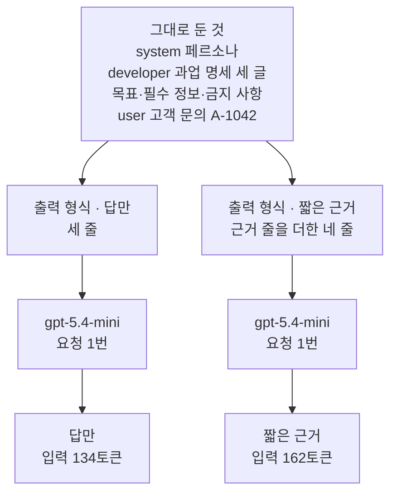
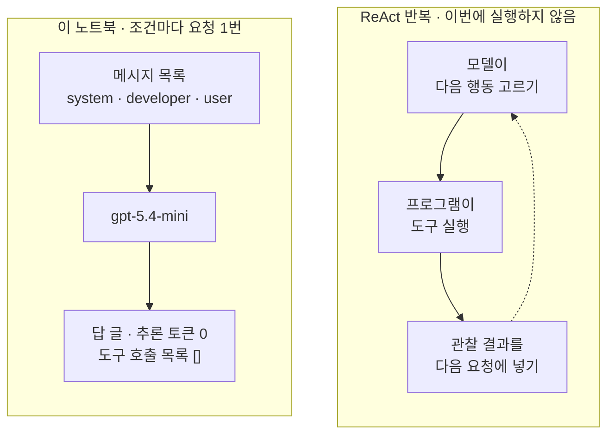
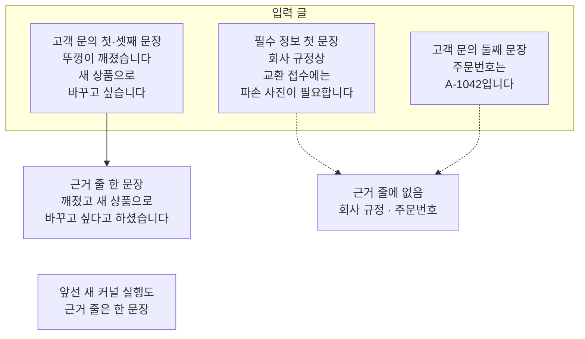
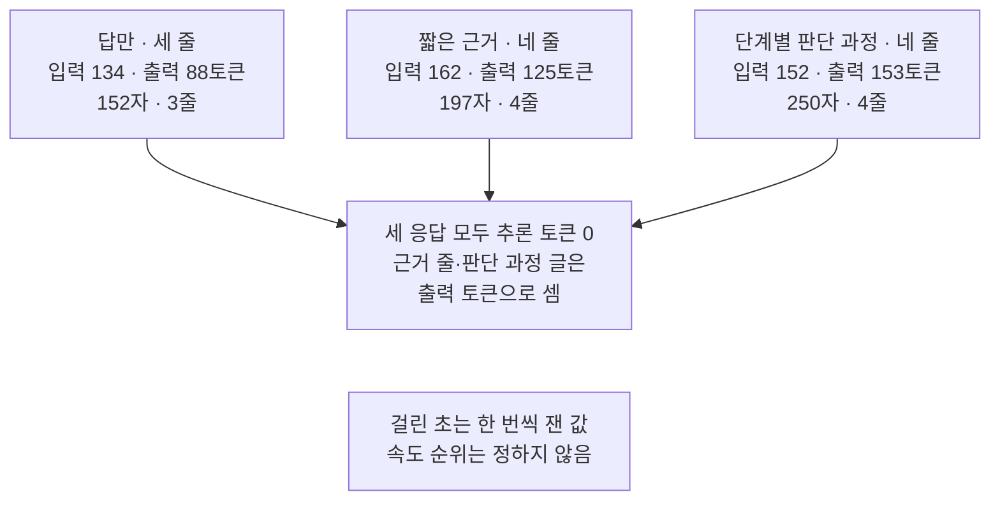

# 05-CoT와-ReAct의-경계

## _src 본문 (HTML 원본)

```html
<!--meta: 강의 1h | 실습 2h | 코드 Jupyter Notebook | 새 용어 6 -->
<h2 id="b1"><span class="no">1</span>학습 목표</h2>
<div class="goal"><p>이 절을 마치면 다음을 할 수 있습니다.</p><ul><li>과업 명세의 출력 형식 한 글만 바꿔, 답만 받는 목록과 짧은 근거도 받는 목록을 만들 수 있습니다.</li><li>근거 줄의 문장을 입력 글과 하나씩 대조하고, 빠진 사실도 찾을 수 있습니다.</li><li>추론 토큰 수와 도구 호출 목록을 보고, 답에 적힌 「확인했습니다」가 실행 기록이 아님을 설명할 수 있습니다.</li><li>사고의 연쇄(CoT)와 ReAct가 프롬프트에 무엇을 더하는지 구분할 수 있습니다.</li></ul></div>
<h2 id="b2"><span class="no">2</span>이 내용을 배우는 이유</h2>
<p>답만 받으면 왜 그런 결론이 나왔는지 검토하기 어렵습니다. 그렇다고 생각한 과정을 모두 적어 달라고 하면 답이 길어집니다. 긴 설명이 자연스러워도, 그 설명이 맞는지는 따로 확인해야 합니다.</p>
<p>고객 지원 답의 근거는 대부분 입력에 이미 있습니다. 고객이 한 말, 회사 규정, 주문번호입니다. 이 절은 그런 사실을 짧은 근거 줄로 받고, 그 줄을 입력 글과 대조합니다.</p>
<p>에이전트를 배우다 보면 모델이 생각하고 행동한다는 설명을 자주 만납니다. 모델이 도구를 고르면 프로그램이 실행하는 반복입니다. 이 절은 답에 「확인했습니다」가 적혀 있어도 실행한 것은 없다는 경계를 코드로 확인합니다.</p>
<p><strong>이 절의 질문</strong> — 답만 받을 때와 짧은 근거도 받을 때 무엇이 달라지고, 근거 줄은 어떻게 확인할까요?</p>
<h2 id="b3"><span class="no">3</span>앞에서 배운 내용</h2>
<table><thead><tr><th>앞 절</th><th>배운 것</th><th>이 절에서 이어지는 곳</th></tr></thead><tbody>
<tr><td>04절</td><td>틀로 만든 목록 = 03절 예시 없음 목록(입력 134토큰), 틀은 developer 튜플을 받지 않음, 대화 기록을 넣은 답만 앞 대화의 주문번호를 적음</td><td>2절 목록 다시 만들기, 6절 근거 줄 대조</td></tr>
<tr><td>03절</td><td>한 곳만 다르게 해 비교하기, 같은 목록도 실행마다 낱말이 달라짐</td><td>3·8절 출력 형식 한 글만 바꾸기</td></tr>
<tr><td>02절</td><td>과업 명세 네 글(목표·필수 정보·금지 사항·출력 형식), 글자 수 <code>len()</code>, 줄 수 <code>split("\n")</code></td><td>3절 출력 형식, 5·8절 답 모양</td></tr>
<tr><td>01절</td><td><code>timed_invoke()</code>·<code>make_prompt_record()</code>, 확인 단어 표시는 품질 점수가 아님</td><td>4·5·8절 기록, 6절 낱말 표시</td></tr>
<tr><td>Ch 6 01·06절</td><td><code>reasoning_effort="none"</code>(긴 추론 없이 바로 답함), <code>output_token_details</code>의 <code>reasoning</code>(답 전에 따로 쓴 추론 토큰 수)</td><td>7·8절 추론 토큰 수</td></tr>
<tr><td>Ch 2 03절</td><td><code>break</code>로 반복 멈추기</td><td>6절 근거 줄 찾기</td></tr>
</tbody></table>
<p>04절에서는 앞 대화의 주문번호가 답에 이어졌는지 원문에서 확인했습니다. 이 절은 답에 적힌 근거가 입력에 있는지를 확인합니다. 목록은 04절 틀 대신 03절처럼 튜플 목록으로 만듭니다. 조건마다 바꾸는 것이 developer 글이라, 틀을 쓰면 조건마다 틀을 새로 만들어야 하기 때문입니다.</p>
<p>01~04절이 과업 명세는 developer, 고객 문의는 user로 나눴으므로 이 절도 그 목록을 그대로 씁니다. 공식 안내는 모델과 설정에 따라 다르게 권합니다. 2026-09-17에 확인한 gpt-5.4 모델 안내는 추론 설정이 none이면 답 전에 단계를 적게 해 보라고 권합니다.</p>
<h2 id="b4"><span class="no">4</span>핵심 개념</h2>
<h3>비유로 시작하기</h3>
<p>02~04절 그림의 나무 책상이 이번에도 두 개입니다. 두 책상에는 같은 파란 명찰, 주황 클립보드, 금 간 컵이 그려진 노란 메모지가 놓여 있습니다. 책상 앞쪽에는 모델 답을 뜻하는 연보라 카드가 한 장씩 있습니다.</p>
<p>회의록에 「3쪽 표 참고」라고 적어 두면, 읽는 사람이 그 쪽을 펼쳐 같은 내용을 찾을 수 있습니다. 짧은 근거도 답을 읽는 사람이 입력 글에서 같은 사실을 다시 찾도록 적는 줄입니다.</p>
{{img:05-5-근거-줄과-실|흰 바탕에 같은 나무 책상 두 개가 나란히 있고, 책상마다 파란 명찰, 주황 클립보드, 금 간 컵이 그려진 노란 메모지와 앞쪽 연보라 카드가 있으며, 왼쪽 카드는 줄 세 개, 오른쪽 카드는 줄 네 개 중 둘째 줄이 연초록으로 칠해져 그 줄에서 나온 점선 실 두 가닥이 클립보드 종이와 노란 컵 메모지에 닿아 있는 삽화|두 책상의 입력 물건은 같고, 오른쪽 답 카드에만 초록 근거 줄과 입력으로 이어진 점선 실이 있습니다.}}
<p><strong>그림 읽기</strong> — 파란 명찰은 페르소나(system), 주황 클립보드는 과업 명세(developer)입니다. 노란 컵 메모지는 고객 문의(user)입니다. 연보라 카드는 04절 그림처럼 모델 답입니다. 왼쪽 카드는 세 줄이라 답만 받은 답이고, 오른쪽 카드는 네 줄이라 짧은 근거도 받은 답입니다.</p>
<p>오른쪽 카드의 둘째 줄만 연초록으로 칠해져 있습니다. 이 줄이 근거 줄입니다. 그 줄에서 나온 점선 실 두 가닥은 클립보드 종이와 노란 컵 메모지에 닿아 있습니다. 근거 줄의 사실을 입력 글에서 다시 찾아 짝짓는 근거 대조를 뜻하고, 이번 실행에서 짝이 있던 곳은 고객 문의뿐이었습니다. 그림 속 초록은 도식의 초록 상자(넣은 글)와 다른 뜻입니다.</p>
<h3>짧은 근거와 대조</h3>
<p>짧은 근거(brief evidence)는 답을 검토하는 사람이 입력 글에서 다시 찾을 수 있는 사실을 짧게 적은 줄입니다. 노트북 3절은 출력 형식 한 글만 바꿔 근거 줄을 요청합니다. 근거 줄에는 고객 문의와 회사 규정에서 다시 찾을 수 있는 사실만 적게 했습니다.</p>
<p>근거 줄이 있다고 근거가 맞는 것은 아닙니다. 근거 줄도 모델이 쓴 답의 일부라서, 사람이 입력 글과 한 문장씩 맞춰 봅니다. 이 일을 이 절에서는 근거 대조라고 부릅니다. 대조할 때는 틀린 사실뿐 아니라 빠진 사실도 찾습니다.</p>
{{mermaid:05-1-출력-형식만-바꾸기|초록 상자 그대로 둔 것 system 페르소나, developer 과업 명세 세 글 목표 필수 정보 금지 사항, user 고객 문의 A-1042가 초록 상자 출력 형식 답만 세 줄과 초록 상자 출력 형식 짧은 근거 근거 줄을 더한 네 줄로 갈라지고, 두 상자가 각각 보라 상자 gpt-5.4-mini 요청 1번을 거쳐 노란 상자 답만 입력 134토큰과 노란 상자 짧은 근거 입력 162토큰으로 이어지는 그림|답만 받는 목록과 짧은 근거 목록은 출력 형식 한 글만 다르고, 그 글이 입력 토큰을 134에서 162로 늘렸습니다.}}
<p><strong>도식 읽기</strong> — 위에서 아래로 읽습니다. 맨 위 초록 상자는 두 목록에 똑같이 넣은 메시지와 과업 명세 앞 세 글입니다. 가운데 초록 상자 둘이 두 목록에서 유일하게 다른 출력 형식 글입니다. 보라 상자에서 조건마다 요청이 한 번씩 나갑니다.</p>
<p>맨 아래 노란 상자는 노트북 5절 기록표의 입력 토큰 수입니다. 답만 받는 목록은 03·04절과 같은 134토큰, 짧은 근거 목록은 162토큰이었습니다. 출력 형식 글 하나가 입력 토큰 28개를 더했습니다.</p>
<h3>사고의 연쇄와 추론 토큰</h3>
<p>사고의 연쇄(Chain of Thought, CoT)는 답 전에 중간 단계를 글로 적게 하는 프롬프트 방법입니다. 수학 시험 답안지에 답만 쓰지 않고 풀이를 함께 적는 것과 비슷합니다. 2022년 논문은 풀이를 적은 예시 몇 개를 프롬프트에 넣었습니다. 그 결과 큰 언어 모델의 산수·상식·기호 추론 문제 성적이 올랐다고 보고했습니다.</p>
<p>공식 안내는 모델과 설정에 따라 다르게 권합니다. 추론 모델 안내는 안에서 추론하는 모델에 단계별로 생각하라는 지시가 필요 없다고 합니다. 반면 gpt-5.4 모델 안내는 추론 설정이 none이면 답 전에 단계를 적게 해 보라고 권합니다. 이 절의 모델 설정은 none이라, 노트북 8절에서 판단 과정을 먼저 적게 해 봅니다.</p>
<p>추론 토큰은 Ch 6 06절에서 본 대로, 모델이 답 전에 따로 쓴 토큰입니다. 추론 모델 안내는 이 토큰이 API로 보이지 않고, 출력 토큰으로 요금이 매겨진다고 설명합니다. 노트북에서 세 응답의 추론 토큰은 모두 0이었습니다. 근거 줄과 판단 과정 글은 답과 함께 보이는 출력 토큰으로 셌습니다.</p>
<p>그래서 근거 줄을 모델 안의 계산 기록으로 읽지 않습니다. 근거 줄은 사람이 읽도록 쓴 글이고, 모델이 답을 정한 실제 과정을 그대로 옮겼다는 증거는 없습니다. 추론 설정을 none이 아닌 값으로 둔 요청은 이번에 실행하지 않았습니다.</p>
<h3>ReAct가 더하는 것</h3>
<p>생각과 행동을 번갈아 하는 방식을 ReAct(Reasoning and Acting)라고 부릅니다. 2022년 논문의 모델은 생각을 적은 뒤 위키백과 검색 같은 행동을 골랐습니다. 그리고 행동의 결과를 읽고 다시 생각을 이어 갔습니다. 전화 상담원이 「확인해 보겠습니다」라고 말한 뒤, 실제로 주문 화면을 열어 보고 답하는 것과 비슷합니다.</p>
<p>행동이 되려면 프로그램이 도구를 실행해야 합니다. 그 실행 결과(관찰)를 다음 요청에 넣는 단계도 있어야 합니다. 이 절의 노트북은 도구를 만들지 않았고, 조건마다 요청을 한 번만 보냈습니다. 노트북 7절에서 두 응답의 도구 호출 목록은 모두 빈 목록 <code>[]</code>이었습니다.</p>
<p>그런데 답만 받은 답에는 「주문번호 A-1042 확인되었으며」가 있었습니다. 번호는 고객 문의 글에 있던 것이고, 주문 기록을 찾아본 단계는 없었습니다. 답에 적힌 「확인」은 행동의 기록이 아니라 모델이 만든 글입니다.</p>
{{mermaid:05-2-요청-한-번과-ReAct-반복|왼쪽 큰 상자 이 노트북 조건마다 요청 1번 안에 초록 상자 메시지 목록 system developer user, 보라 상자 gpt-5.4-mini, 노란 상자 답 글 추론 토큰 0 도구 호출 목록 빈 목록이 위에서 아래로 이어지고, 오른쪽 큰 상자 ReAct 반복 이번에 실행하지 않음 안에 회색 상자 모델이 다음 행동 고르기, 프로그램이 도구 실행, 관찰 결과를 다음 요청에 넣기가 이어지고 점선 화살표가 첫 상자로 돌아가는 그림|이 노트북은 목록을 한 번 보내 답 글을 받고 끝나며, 도구 실행과 관찰 결과를 되돌려 넣는 ReAct 반복은 실행하지 않았습니다.}}
<p><strong>도식 읽기</strong> — 왼쪽 큰 상자는 이 노트북의 흐름이고, 위에서 아래로 한 번만 지나갑니다. 초록 메시지 목록이 보라 모델로 가고, 노란 상자의 답 글을 받고 끝납니다. 노란 상자의 값은 7절 출력입니다.</p>
<p>오른쪽 큰 상자는 ReAct 반복이고, 회색 상자는 모두 이번에 실행하지 않은 단계입니다. 셋째 상자에서 첫 상자로 돌아가는 점선 화살표가 반복을 뜻합니다. 왼쪽 큰 상자에는 되돌아가는 화살표가 없습니다.</p>
<p>도구를 모델에 알려 주고 호출 요청을 받는 방법은 Ch 19 04절부터 다룹니다. 도구 실행과 종료를 그래프로 잇는 방법은 Ch 20 01절에서 다룹니다.</p>
<h3>이 절에서 쓰는 말</h3>
<table><thead><tr><th>용어</th><th>뜻</th><th>이 절에서 보이는 모습</th></tr></thead><tbody>
<tr><td>짧은 근거(brief evidence)</td><td>답을 검토하는 사람이 입력 글에서 다시 찾을 수 있는 사실을 짧게 적은 줄. 회의록의 「3쪽 표 참고」와 비슷함</td><td><code>근거: 어제 받은 텀블러 뚜껑이 깨졌고</code></td></tr>
<tr><td>근거 대조</td><td>근거 줄의 문장을 입력 글과 하나씩 맞춰 보고, 틀린 사실과 빠진 사실을 찾는 일</td><td>6절 근거 줄과 입력 글 대조</td></tr>
<tr><td>사고의 연쇄(Chain of Thought, CoT)</td><td>답 전에 중간 단계를 글로 적게 하는 프롬프트 방법. 답안지에 풀이를 적는 것과 비슷함</td><td>8절 <code>판단 과정:</code> 줄</td></tr>
<tr><td>도구 호출 목록</td><td>모델이 프로그램에 요청한 도구 호출을 담은 응답 객체의 속성 <code>tool_calls</code></td><td><code>답만 | 0 | []</code></td></tr>
<tr><td>ReAct(Reasoning and Acting)</td><td>모델이 다음 행동을 고르고, 프로그램이 실행한 결과를 받아 다시 판단하는 반복</td><td>이번에 실행하지 않음</td></tr>
<tr><td>관찰(observation)</td><td>ReAct에서 프로그램이 도구를 실행한 결과를 다음 요청에 넣은 글. 상담원이 주문 화면에서 읽은 내용과 비슷함</td><td>이번에 실행하지 않음</td></tr>
</tbody></table>
<h2 id="b5"><span class="no">5</span>실행 예제</h2>
<p>노트북은 04절까지 쓴 글로 답만 받는 목록을 만들고, 출력 형식 한 글만 바꿔 짧은 근거 목록을 만듭니다. 두 목록을 같은 모델로 보내 기록표와 답 모양을 비교합니다. 근거 줄을 찾아 입력 글과 대조하고, 두 응답의 추론 토큰 수와 도구 호출 목록을 봅니다. 마지막으로 판단 과정을 먼저 적게 한 목록을 한 번 더 보냅니다.</p>
<p>실제 OpenAI 모델을 temperature 0으로 부릅니다. 이 페이지의 출력은 2026-09-21에 실행한 결과입니다. 요청은 모두 3번이고, 예상 비용은 0.01달러 미만입니다. 답 문장은 실행마다 달라질 수 있습니다.</p>
<p>강의 시간에는 노트북 3·6·7절(근거 목록, 근거 대조, 추론 토큰과 도구 호출)을 설명합니다. 4·5절과 8절(두 목록 보내기와 비교, 값 바꿔 보기)은 함께 실행하고 실습 시간에 읽습니다.</p>
{{notebook:05-CoT와-ReAct의-경계}}
<p class="look"><b>확인할 점</b> — 5절 <code>근거 요청이 더한 입력 토큰 수: 28</code>을 봅니다. 6절 근거 줄을 입력 글과 나란히 읽고, 빠진 사실도 찾습니다. 7절 <code>답만 | 0 | []</code> 줄과 4절 답의 「확인되었으며」를 함께 읽습니다.</p>
<h3>근거 줄 대조</h3>
<p>노트북 6절의 근거 줄을 입력 글과 맞춰 본 결과를 한 그림에 모았습니다.</p>
{{mermaid:05-3-근거-줄-대조|위 큰 상자 입력 글 안에 초록 상자 고객 문의 첫 셋째 문장 뚜껑이 깨졌습니다 새 상품으로 바꾸고 싶습니다, 필수 정보 첫 문장 회사 규정상 교환 접수에는 파손 사진이 필요합니다, 고객 문의 둘째 문장 주문번호는 A-1042입니다가 있고, 첫 상자는 실선으로 노란 상자 근거 줄 한 문장 깨졌고 새 상품으로 바꾸고 싶다고 하셨습니다에, 나머지 두 상자는 점선으로 노란 상자 근거 줄에 없음 회사 규정 주문번호에 이어지며, 맨 아래 회색 상자 앞선 새 커널 실행도 근거 줄은 한 문장이 있는 그림|근거 줄의 한 문장은 고객 문의 두 문장을 줄인 것이고, 필수 정보의 규정과 주문번호는 근거 줄에 없었습니다.}}
<p><strong>도식 읽기</strong> — 위 「입력 글」 큰 상자의 초록 상자 셋은 노트북 2절에서 만든 고객 문의와 필수 정보의 문장입니다. 노란 상자 「근거 줄 한 문장」은 6절 출력이고, 실선은 원문을 읽어 맞춘 짝입니다. 노란 상자 「근거 줄에 없음」은 근거 줄에 옮겨지지 않은 입력 문장이고, 점선이 그 문장을 가리킵니다.</p>
<p>근거 줄 문장은 고객 문의의 첫 문장과 셋째 문장을 한 문장으로 줄인 것이고, 입력 글에 없는 사실은 없었습니다. 그러나 출력 형식이 함께 적으라고 한 회사 규정의 사실은 없었고, 주문번호도 적지 않았습니다.</p>
<p>맨 아래 회색 상자는 이 페이지 출력에 없는 앞선 새 커널 실행입니다. 그때 근거 줄도 같은 한 문장이었습니다.</p>
<p>6절 확인 단어 표에서 근거 줄 열은 세 줄 모두 <code>False</code>였습니다. 근거 줄은 「교환」 대신 「바꾸고 싶다」라고 적었고, 번호와 규정은 적지 않았기 때문입니다. 낱말 표시는 읽을 곳을 찾는 데 쓰고, 뜻은 문장을 나란히 읽어 확인합니다.</p>
<h2 id="b6"><span class="no">6</span>실험 결과 해석</h2>
<p>출력 형식 한 글만 바꾸자 답이 네 줄이 됐고, 둘째 줄이 근거 줄이었습니다. 입력 토큰은 28개, 출력 토큰은 37개 늘었습니다. 글자 수는 152자에서 197자로 45자 늘었습니다. 늘어난 글자는 대부분 근거 줄이고, 다음 행동 줄과 고객 문장 줄의 길이는 두 답이 비슷했습니다.</p>
<p>이번 근거 줄은 고객 문의의 사실 한 문장이었고, 입력 글에 없는 사실은 없었습니다. 그러나 출력 형식이 함께 적으라고 한 회사 규정은 빠졌고, 앞선 새 커널 실행도 같았습니다. 근거 줄을 요청해도 필요한 사실이 모두 들어간다는 보장은 없습니다.</p>
<p>이번 실행의 걸린 초는 답만 1.05초, 짧은 근거 1.07초였습니다. 앞선 실행은 0.95초와 1.03초였습니다. 한 번씩 잰 시간이라, 근거를 요청하면 느려진다고 말하지 않습니다.</p>
<p>두 응답의 추론 토큰은 0이었고, 도구 호출 목록은 빈 목록이었습니다. 답만 받은 답은 「주문번호 A-1042 확인되었으며」라고 적었지만, 이 노트북에는 주문 기록을 찾는 단계가 없습니다. 조건마다 요청을 한 번 보내 글을 받았을 뿐이고, ReAct 반복은 실행하지 않았습니다.</p>
<h3>판단 과정을 먼저 적게 하면</h3>
<p>노트북 8절은 출력 형식을 「답하기 전에 판단 과정을 단계별로 자세히 적으세요」로 바꿨습니다. 그 뒤에 이어지는 세 줄 형식과 나머지 글은 그대로입니다.</p>
{{mermaid:05-4-세-조건-비교|위에 노란 상자 셋 답만 세 줄 입력 134 출력 88토큰 152자 3줄, 짧은 근거 네 줄 입력 162 출력 125토큰 197자 4줄, 단계별 판단 과정 네 줄 입력 152 출력 153토큰 250자 4줄이 가운데 노란 상자 세 응답 모두 추론 토큰 0 근거 줄 판단 과정 글은 출력 토큰으로 셈으로 모이고, 아래 회색 상자 걸린 초는 한 번씩 잰 값 속도 순위는 정하지 않음이 있는 그림|출력 토큰은 답만 88, 짧은 근거 125, 단계별 판단 과정 153이었고, 세 응답 모두 추론 토큰은 0이었습니다.}}
<p><strong>도식 읽기</strong> — 위 노란 상자 셋은 8절 마지막 셀의 세 줄로, 왼쪽부터 답만·짧은 근거·단계별 판단 과정입니다. 출력 토큰은 88·125·153, 줄 수는 3·4·4였습니다. 입력 토큰은 판단 과정 조건이 152로, 출력 형식 글 길이에 따라 달랐습니다.</p>
<p>가운데 노란 상자는 세 줄의 마지막 값인 추론 토큰 0입니다. 근거 줄과 판단 과정 글은 모두 출력 토큰으로 셌습니다. 아래 회색 상자는 이 결과로 정하지 않는 속도 순위입니다.</p>
<p>판단 과정은 「단계별로 자세히」라는 지시와 달리 한 줄에 세 문장이었고, 번호 붙인 단계는 없었습니다. 탐색 실행 두 번(한 번은 문구가 조금 다른 출력 형식)과 앞선 새 커널 실행에서도 판단 과정은 한 줄이었습니다. 지금 문구로는 세 번 본 모양이라, 이 출력 형식이 늘 한 줄을 만든다고 말하지는 않습니다.</p>
<p>판단 과정 줄의 사진 규정과 주문번호는 입력에 있습니다. 「사진 확인 전에는 접수를 확정할 수 없습니다」는 입력에 그대로 있는 문장이 아닙니다. 필수 정보의 사진 규정을 이어 모델이 덧붙인 판단입니다. 판단 과정 글도 근거 줄과 같은 방법으로 입력과 대조해야 합니다.</p>
<p>이 결론은 고객 문의 하나·모델 하나·조건마다 한 번 실행한 범위입니다. 판단 과정이나 근거 줄이 답의 정확성을 높였는지는 판정하지 않았습니다. 정확성을 비교하려면 여러 문의와 미리 정한 채점 기준이 필요합니다.</p>
<h2 id="b7"><span class="no">7</span>주의할 점과 실무 메모</h2>
<ul><li>근거 줄은 입력 글과 한 문장씩 대조합니다. 확인 단어 표시가 모두 <code>True</code>여도 뜻이 맞다는 보장은 없고, 빠진 사실은 표시로 찾기 어렵습니다.</li>
<li>답에 「확인했습니다」나 「조회해 보겠습니다」가 있어도 실행 기록이 아닙니다. 실행 여부는 도구 호출 목록과, 프로그램이 남긴 실행 결과로 확인합니다.</li>
<li>근거 줄에 고객 개인정보나 공개하면 안 되는 내부 기준을 그대로 적게 하지 않습니다. 고객에게 보일 답이라면, 보여도 되는 사실의 범위를 과업 명세에 먼저 적습니다.</li>
<li>판단 과정이나 근거 줄을 적게 하면 출력 토큰이 늘어 요금도 늘어납니다. 이번 판단 과정 답은 답만 받은 답보다 출력 토큰이 65개 많았습니다.</li>
<li>추론 설정을 none이 아닌 값으로 둔 요청은 이번에 실행하지 않았습니다. 풀이를 적은 예시를 프롬프트에 넣는 논문의 방식도 실행하지 않았습니다.</li>
<li>근거 줄 출력 형식 두 문장과 판단 과정 출력 형식은 흐름을 보여 주려고 정한 예입니다. 교재를 만들 때 기기에서 먼저 세 조건을 한 번씩 보냈습니다.</li>
<li>처음 판단 과정 문구는 「먼저 판단 과정을 단계별로 적은 뒤」였습니다. 판단 과정이 한 줄로 나와, 「자세히」를 더한 지금 문구로 한 번 더 보냈고 이번에도 한 줄이었습니다. 탐색 요청은 모두 4번입니다.</li>
<li>공식 안내는 모델과 설정마다 다르고, 바뀔 수 있습니다. 이 절의 안내 문장은 2026-09-17에 확인한 gpt-5.4 모델 안내와 추론 모델 안내 기준입니다.</li>
<li>교재 출력은 Linux의 Python 3.12.13으로 만들었습니다. 패키지는 langchain 1.4.0, langchain-core 1.6.2입니다. langchain-openai 1.6.0, openai 3.10.0도 함께 썼습니다. 다른 버전과 Windows·macOS에서는 실행하지 않았습니다.</li></ul>
<h2 id="b8"><span class="no">8</span>정리와 다음 절</h2>
<ul><li>출력 형식 한 글만 바꿔 근거 줄을 요청했고, 이번 근거 줄은 고객 문의의 사실만 적고 회사 규정은 빠뜨렸습니다.</li><li>두 응답의 추론 토큰은 0, 도구 호출 목록은 <code>[]</code>이었고, 답의 「확인되었으며」는 실행 기록이 아니었습니다.</li><li>판단 과정을 먼저 적게 하자 출력 토큰이 가장 많았습니다. 그 글에는 입력에 그대로 있지 않고, 필수 정보를 이어 모델이 덧붙인 판단도 섞였습니다.</li></ul>
<p><strong>다음 학습과 이어지는 지점</strong> — 06절에서는 같은 목록을 여러 번 따로 보내고, 답마다 분류 줄만 모아 비교합니다.</p>
<h2 id="b9"><span class="no">9</span>복습 문제</h2>
<details class="quiz"><summary>문제 1 · 한 곳만 바꾸기</summary><p class="quiz-q">노트북 3절에서 답만 받는 목록과 짧은 근거 목록의 다른 곳은 어디이고, 왜 한 곳만 바꿨나요?</p><p class="quiz-a"><b>해설</b> — developer 과업 명세의 출력 형식 글 하나만 다릅니다. 두 목록의 system·user 메시지가 같다는 것은 <code>assert</code>로 확인했습니다. 한 곳만 달라야, 달라진 결과를 그 글과 이어 읽을 수 있습니다.</p></details>
<details class="quiz"><summary>문제 2 · 근거 줄 대조</summary><p class="quiz-q">근거 줄 열의 확인 단어 표시가 모두 False였습니다. 근거 줄이 틀렸다고 결론 내려도 되나요?</p><p class="quiz-a"><b>해설</b> — 안 됩니다. 표시는 같은 낱말이 있는지만 알려 줍니다. 이번 근거 줄은 「교환」 대신 「바꾸고 싶다」라고 적어 교환 표시도 False였습니다. 근거 줄의 문장을 입력 글과 나란히 읽어 틀린 사실과 빠진 사실을 찾습니다.</p></details>
<details class="quiz"><summary>문제 3 · 확인했습니다</summary><p class="quiz-q">답에 「주문번호 A-1042 확인되었으며」가 있었습니다. 모델이 주문 기록을 조회했나요?</p><p class="quiz-a"><b>해설</b> — 아닙니다. 노트북에는 도구가 없었고, 도구 호출 목록도 <code>[]</code>이었습니다. 번호는 고객 문의 글에 있던 것이고, 「확인」은 모델이 만든 글입니다.</p></details>
<details class="quiz"><summary>문제 4 · 추론 토큰과 근거 줄</summary><p class="quiz-q">추론 토큰은 0인데 근거 줄은 있었습니다. 근거 줄은 무엇으로 셌고, 모델이 답을 정한 과정의 기록으로 읽어도 되나요?</p><p class="quiz-a"><b>해설</b> — 근거 줄은 답과 함께 출력 토큰으로 셌습니다. 근거 줄은 사람이 읽도록 쓴 글이고, 모델이 답을 정한 실제 과정을 그대로 옮겼다는 증거는 없습니다. 그래서 입력 글과 대조합니다.</p></details>
<details class="quiz"><summary>문제 5 · ReAct와 이 절</summary><p class="quiz-q">이 절의 노트북을 ReAct 실행이라고 부를 수 없는 이유를 코드에서 찾아보세요.</p><p class="quiz-a"><b>해설</b> — 도구 함수를 만들지 않았고, 조건마다 모델의 <code>invoke()</code>를 한 번만 불렀습니다. 실행 결과(관찰)를 다음 요청에 넣어 다시 부르는 반복도 없습니다.</p></details>
<h2 id="b10"><span class="no">10</span>참고 자료</h2>
<p>문서는 2026-09-17에 다시 열어 확인했습니다. 코드는 실습 가상환경에 설치한 <code>langchain 1.4.0</code>, <code>langchain-core 1.6.2</code>, <code>langchain-openai 1.6.0</code>으로 실행했습니다.</p>
<ul><li><div><a href="https://developers.openai.com/api/docs/guides/latest-model?model=gpt-5.4">OpenAI Model guidance (GPT-5.4)</a></div>추론 설정 none일 때 답 전에 단계를 적게 해 보라는 안내 · 확인 2026-09-17</li><li><div><a href="https://developers.openai.com/api/docs/guides/reasoning">OpenAI Reasoning models</a></div>추론 토큰은 API로 보이지 않고 출력 토큰으로 요금이 매겨짐 · 확인 2026-09-17</li><li><div><a href="https://developers.openai.com/api/docs/guides/reasoning-best-practices">OpenAI Reasoning best practices</a></div>추론 모델에는 단계별로 생각하라는 지시가 필요 없다는 안내 · 확인 2026-09-17</li><li><div><a href="https://arxiv.org/abs/2201.11903">Chain-of-Thought Prompting Elicits Reasoning in Large Language Models</a></div>사고의 연쇄 논문(2022) · 확인 2026-09-17</li><li><div><a href="https://arxiv.org/abs/2210.03629">ReAct: Synergizing Reasoning and Acting in Language Models</a></div>생각과 행동을 번갈아 하는 방식 논문(2022) · 확인 2026-09-17</li><li><div><a href="https://github.com/langchain-ai/langchain/blob/master/libs/core/langchain_core/messages/ai.py">LangChain ai.py</a></div>응답 객체의 <code>tool_calls</code> 속성, 설치한 langchain-core 1.6.2 소스 · 확인 2026-09-17</li><li><div><a href="https://github.com/langchain-ai/langchain/blob/master/LICENSE">LangChain MIT License</a></div>예제의 고객 문의·출력 형식과 설명은 이 교재에 맞게 새로 썼습니다</li></ul>
```

## 노트북 셀 (순서대로)

### [0] markdown {'html': 'skip'}

# CoT와 ReAct의 경계

**이 노트북에서 할 일**

1. 04절까지 쓴 과업 명세에서 출력 형식 한 글만 바꿔, 답만 받는 목록과 짧은 근거도 받는 목록을 만듭니다.
2. 두 목록을 같은 모델로 보내 기록표와 답 모양을 비교하고, 근거 줄의 사실을 입력 글과 대조합니다.
3. 추론 토큰 수와 도구 호출 목록을 확인하고, 판단 과정을 먼저 적게 한 목록을 한 번 더 보냅니다.

**준비물** — 프로젝트 폴더 `.env` 파일의 `OPENAI_API_KEY`가 필요합니다. 데이터 파일은 없습니다.

인터넷 서비스에 요청을 모두 3번 보냅니다. 모두 `gpt-5.4-mini`입니다.
실행 시간은 1분 안팎이고, 예상 비용은 0.01달러 미만으로 잡았습니다.
요금은 Ch 6 06절에서 2026-09-17에 확인한 mini 공식 요금 기준입니다.

**강의와 실습 범위** — 강의 시간에는 3·6·7절(근거 목록, 근거 대조, 추론 토큰과 도구 호출)을 설명합니다.
4·5절과 8절(두 목록 보내기와 비교, 값 바꿔 보기)은 함께 실행하고 실습 시간에 읽습니다.

**기준 버전** — 실습 폴더에 고정한 패키지 판을 씁니다. langchain 1.4.0, langchain-core 1.6.2, langchain-openai 1.6.0입니다.
openai 3.10.0, python-dotenv 1.2.3도 함께 씁니다.

교재 출력은 Linux의 Python 3.12.13으로 만들었습니다. 다른 버전과 Windows·macOS에서는 이번에 실행하지 않았습니다.

실습 폴더 `labs/part2/ch07-prompt-engineering`에서 `uv sync --locked`를 실행합니다.
그다음 이 폴더의 `.venv` 커널을 고르고 첫 셀부터 순서대로 실행합니다.

### [1] markdown {'html': 'skip'}

## 오늘 볼 그림


위에서 아래로 읽습니다. 맨 위 초록 상자는 두 목록에 똑같이 넣는 메시지와 과업 명세 세 글입니다.
두 목록은 출력 형식 한 글만 다르고, 짧은 근거 목록은 근거 줄 하나를 더 요청합니다.

두 목록을 같은 모델로 한 번씩 보냅니다. 맨 아래 노란 상자는 이 노트북에서 확인할 입력 토큰 수입니다.

### [2] markdown {}

## 1. 준비

첫 셀은 패키지를 설치하고 설치된 버전을 출력합니다. 설치에는 몇십 초가 걸릴 수 있습니다.
01~04절과 같은 실습 폴더와 같은 판입니다. 노트북은 앞 절 없이 새 커널에서 시작하므로 다시 확인합니다.

### [3] code {'execution': {'iopub.execute_input': '2026-09-21T03:49:02.187178Z', 'iopub.status.busy': '2026-09-21T03:49:02.186968Z', 'iopub.status.idle': '2026-09-21T03:49:02.693641Z', 'shell.execute_reply': '2026-09-21T03:49:02.693050Z'}, 'lesson_role': 'setup'}

```python
# 이 절에서 쓰는 패키지를 설치하고 버전을 확인합니다
%pip install -q "langchain==1.4.0" "langchain-openai==1.6.0" "python-dotenv==1.2.3"
from importlib.metadata import version

print("langchain:", version("langchain"))
print("langchain-core:", version("langchain-core"))
print("langchain-openai:", version("langchain-openai"))
print("openai:", version("openai"))
print("python-dotenv:", version("python-dotenv"))
```

출력:
```
Note: you may need to restart the kernel to use updated packages.
langchain: 1.4.0
langchain-core: 1.6.2
langchain-openai: 1.6.0
openai: 3.10.0
python-dotenv: 1.2.3

```

### [4] markdown {}

**결과 읽기** — 출력 줄은 `langchain: 1.4.0`, `langchain-core: 1.6.2`, `langchain-openai: 1.6.0` 등 다섯 줄입니다.
준비물에 적은 기준 버전과 같습니다.

모델 객체를 만드는 함수를 불러오고, 앞에서 배운 기록 함수 두 개를 가져옵니다.

앞에서 배운 함수는 `llm_tools.py`에 모아 두었습니다. 파일을 열면 코드를 볼 수 있습니다. 노트북과 같은 폴더(`notebooks/`)에 있는 파일입니다.
이 노트북은 Ch 6 06절 `timed_invoke()`와 01절 `make_prompt_record()`를 가져옵니다.

### [5] code {'execution': {'iopub.execute_input': '2026-09-21T03:49:02.694663Z', 'iopub.status.busy': '2026-09-21T03:49:02.694565Z', 'iopub.status.idle': '2026-09-21T03:49:03.124488Z', 'shell.execute_reply': '2026-09-21T03:49:03.124052Z'}, 'lesson_role': 'setup'}

```python
# 모델 객체를 만드는 함수를 불러옵니다
from langchain.chat_models import init_chat_model
# Ch 6 06절·01절 기록 함수 두 개를 도구 파일에서 가져옵니다
from llm_tools import make_prompt_record, timed_invoke
```

출력:
```

```

### [6] markdown {}

01~04절과 같은 셀로 API 키가 있는지 확인합니다. 키 값은 출력하지 않고, 있는지만 봅니다.
`True` 값이 나오면 다음으로 넘어갑니다.

### [7] code {'execution': {'iopub.execute_input': '2026-09-21T03:49:03.125261Z', 'iopub.status.busy': '2026-09-21T03:49:03.125208Z', 'iopub.status.idle': '2026-09-21T03:49:03.128471Z', 'shell.execute_reply': '2026-09-21T03:49:03.128103Z'}, 'lesson_role': 'setup'}

```python
# .env 파일에서 OpenAI API 키를 읽습니다(키 값은 출력하지 않습니다)
import os
from dotenv import find_dotenv, load_dotenv

env_path = find_dotenv(usecwd=True)
load_dotenv(env_path)
has_key = os.getenv("OPENAI_API_KEY") is not None
print("OPENAI_API_KEY 설정 여부:", has_key)
assert has_key, "프로젝트 폴더의 .env 파일에 OPENAI_API_KEY를 적어 주세요."
```

출력:
```
OPENAI_API_KEY 설정 여부: True

```

### [8] markdown {}

실습에 쓸 모델을 준비합니다.
01~04절과 같은 설정으로 모델 객체를 만듭니다. 이 셀은 요청을 보내지 않습니다.

### [9] code {'execution': {'iopub.execute_input': '2026-09-21T03:49:03.129057Z', 'iopub.status.busy': '2026-09-21T03:49:03.128997Z', 'iopub.status.idle': '2026-09-21T03:49:04.085104Z', 'shell.execute_reply': '2026-09-21T03:49:04.084672Z'}}

```python
# 실습에 쓸 모델을 준비합니다
model = init_chat_model(
    "openai:gpt-5.4-mini",
    temperature=0,
    reasoning_effort="none",
)
print("모델 이름:", model.model_name)
print("temperature:", model.temperature)
```

출력:
```
모델 이름: gpt-5.4-mini
temperature: 0.0

```

### [10] markdown {}

**결과 읽기** — 출력 줄은 `모델 이름: gpt-5.4-mini`와 `temperature: 0.0`입니다. 이것으로 준비가 끝났습니다.
이 노트북의 출력은 2026-09-21에 이 모델로 실행한 결과입니다. 실행마다 답 문장이 달라질 수 있습니다.
Ch 6 01절에서 본 것처럼 temperature 0은 Ch 5 06절의 뽑기를 끈 설정(`do_sample=False`)과 같은 것이 아닙니다.

인자 `reasoning_effort="none"`은 Ch 6 01절에서 본 추론 설정입니다. 모델이 긴 추론 없이 바로 답하게 합니다.
이 설정이 사용량에 어떻게 남는지는 7절에서 확인합니다.

### [11] markdown {}

## 2. 04절까지 쓴 글로 답만 받는 목록 만들기

03절 예시 없음 목록과 04절 틀로 만든 목록은 같은 메시지였습니다. system 페르소나, developer 과업 명세, user 고객 문의입니다.
과업 명세의 출력 형식은 분류·다음 행동·고객 문장 세 줄만 요청합니다. 그래서 이 절은 이 목록을 「답만 받는 목록」으로 씁니다.

이 절에서 조건마다 바꾸는 것은 고객 문의가 아니라 developer 글입니다. 04절 틀은 developer 메시지를 객체로 고정해 두었습니다.
조건마다 틀을 새로 만들어야 하므로, 이 절은 03절처럼 튜플 목록으로 만듭니다.

### [12] code {'execution': {'iopub.execute_input': '2026-09-21T03:49:04.085918Z', 'iopub.status.busy': '2026-09-21T03:49:04.085858Z', 'iopub.status.idle': '2026-09-21T03:49:04.088231Z', 'shell.execute_reply': '2026-09-21T03:49:04.087821Z'}}

```python
# 04절과 같은 페르소나 글·고객 문의·과업 명세로 답만 받는 목록을 만듭니다
persona_text = "당신은 친절한 고객 상담원입니다."
inquiry_text = "어제 받은 텀블러 뚜껑이 깨졌습니다. 주문번호는 A-1042입니다. 새 상품으로 바꾸고 싶습니다."
goal_text = "고객 문의를 분류하고 필요한 다음 행동을 안내하세요."
required_text = "회사 규정상 교환 접수에는 파손 사진이 필요합니다. 주문번호는 답에 그대로 적으세요."
forbidden_text = "근거 없는 보상은 약속하지 마세요."
format_text = "분류, 다음 행동, 고객에게 보낼 한 문장을 한 줄씩 세 줄로 답하세요."
task_text = goal_text + "\n" + required_text + "\n" + forbidden_text + "\n" + format_text
answer_messages = [("system", persona_text), ("developer", task_text), ("user", inquiry_text)]
print("과업 명세:")
print(task_text)
print("답만 받는 목록의 메시지 수:", len(answer_messages))
```

출력:
```
과업 명세:
고객 문의를 분류하고 필요한 다음 행동을 안내하세요.
회사 규정상 교환 접수에는 파손 사진이 필요합니다. 주문번호는 답에 그대로 적으세요.
근거 없는 보상은 약속하지 마세요.
분류, 다음 행동, 고객에게 보낼 한 문장을 한 줄씩 세 줄로 답하세요.
답만 받는 목록의 메시지 수: 3

```

### [13] markdown {}

**결과 읽기** — 라벨 줄 `과업 명세:` 아래 네 줄은 02~04절과 같은 과업 명세입니다.
넷째 줄 `분류, 다음 행동, 고객에게 보낼 한 문장을 한 줄씩 세 줄로 답하세요.`가 출력 형식입니다. 마지막 줄은 `답만 받는 목록의 메시지 수: 3`입니다.

## 3. 짧은 근거도 받는 목록 만들기

짧은 근거(brief evidence)는 답을 검토하는 사람이 입력 글에서 다시 찾을 수 있는 사실을 짧게 적은 줄입니다.
회의록에 「3쪽 표 참고」라고 적어 두면, 읽는 사람이 그 쪽을 다시 펼쳐 볼 수 있는 것과 비슷합니다.
이 절에서는 출력 형식에 근거 줄 하나를 더합니다. 근거 줄에는 고객 문의와 회사 규정에서 다시 찾을 수 있는 사실만 적게 합니다.

바꾸는 글은 출력 형식 하나입니다. 03절처럼 한 곳만 다르게 해야, 달라진 결과를 그 글과 이어 읽을 수 있습니다.
긴 글은 03절처럼 같은 이름에 `+`로 이어 다시 담습니다. 마지막 세 줄은 system·user 메시지가 두 목록에서 같은지 확인합니다.

### [14] code {'execution': {'iopub.execute_input': '2026-09-21T03:49:04.088925Z', 'iopub.status.busy': '2026-09-21T03:49:04.088857Z', 'iopub.status.idle': '2026-09-21T03:49:04.091001Z', 'shell.execute_reply': '2026-09-21T03:49:04.090630Z'}}

```python
# 출력 형식 한 글만 바꿔, 근거 줄을 더한 과업 명세와 목록을 만듭니다
evidence_format_text = "분류, 근거, 다음 행동, 고객에게 보낼 한 문장을 한 줄씩 네 줄로 답하세요."
evidence_format_text = evidence_format_text + " 근거 줄에는 고객 문의와 회사 규정에서 다시 찾을 수 있는 사실만 짧게 적으세요."
evidence_task_text = goal_text + "\n" + required_text + "\n" + forbidden_text + "\n" + evidence_format_text
evidence_messages = [("system", persona_text), ("developer", evidence_task_text), ("user", inquiry_text)]
print("바꾼 출력 형식:")
print(evidence_format_text)
same_system_user = answer_messages[0] == evidence_messages[0] and answer_messages[2] == evidence_messages[2]
print("system과 user 메시지가 같은가:", same_system_user)
assert same_system_user
```

출력:
```
바꾼 출력 형식:
분류, 근거, 다음 행동, 고객에게 보낼 한 문장을 한 줄씩 네 줄로 답하세요. 근거 줄에는 고객 문의와 회사 규정에서 다시 찾을 수 있는 사실만 짧게 적으세요.
system과 user 메시지가 같은가: True

```

### [15] markdown {}

**결과 읽기** — 라벨 줄 `바꾼 출력 형식:` 아래 줄은 `분류, 근거, 다음 행동`으로 시작하고, 근거 줄에 적을 내용까지 두 문장입니다.
마지막 줄은 `system과 user 메시지가 같은가: True`이고, `assert`도 통과했습니다.
두 목록에서 다른 곳은 developer 글의 출력 형식뿐입니다.

## 4. 두 목록 보내기

준비 셀에서 가져온 함수 두 개로 요청마다 기록 한 줄을 만듭니다. 함수 `timed_invoke()`는 요청을 보내면서 걸린 시간을 재고, 응답 객체와 걸린 초를 튜플로 반환합니다.
함수 `make_prompt_record()`는 조건 이름·응답 객체·걸린 초로 딕셔너리 한 줄을 만듭니다.
키는 `조건`·`답`·`입력 토큰 수`·`출력 토큰 수`·`끝난 이유`·`걸린 초` 여섯 개입니다.

먼저 답만 받는 목록을 보냅니다. 요청은 여기서 처음 나갑니다.
실행 전에 예상합니다. 03·04절과 같은 목록이므로 답은 세 줄이고, 입력 토큰 수는 134일 것입니다.

### [16] code {'execution': {'iopub.execute_input': '2026-09-21T03:49:04.091511Z', 'iopub.status.busy': '2026-09-21T03:49:04.091466Z', 'iopub.status.idle': '2026-09-21T03:49:05.149528Z', 'shell.execute_reply': '2026-09-21T03:49:05.148663Z'}}

```python
# 답만 받는 목록을 보내고 기록 한 줄을 만듭니다(요청 1번)
answer_response, answer_elapsed = timed_invoke(model, answer_messages)
answer_record = make_prompt_record("답만", answer_response, answer_elapsed)
print("답:")
print(answer_record["답"])
```

출력:
```
답:
분류: 파손 교환 문의  
다음 행동: 교환 접수를 위해 파손된 뚜껑 사진을 보내주시면 확인 후 진행하겠습니다. 주문번호 A-1042  
고객에게 보낼 한 문장: 주문번호 A-1042 확인되었으며, 파손 사진을 보내주시면 새 상품 교환 가능 여부를 확인해 안내드리겠습니다.

```

### [17] markdown {}

**결과 읽기** — 라벨 줄 아래 세 줄은 `분류: 파손 교환 문의`, `다음 행동:`, `고객에게 보낼 한 문장:`으로 시작합니다.
고객 문장 줄은 `주문번호 A-1042 확인되었으며,`로 시작하고, 두 줄에 사진 요청이 있습니다. 보상 약속은 없었습니다.
답은 결론만 적었고, 왜 교환 접수인지는 적지 않았습니다.

답은 「확인되었으며」라고 적었지만, 이 요청은 주문 기록을 찾아보지 않았습니다. 이 점은 7절에서 다시 봅니다.
분류 이름은 03절 예시 없음 답과 같았고, 04절 답의 「교환 요청(파손)」과는 달랐습니다. 03절에서 본 것처럼 같은 목록도 실행마다 낱말이 달라질 수 있습니다.

이번에는 짧은 근거도 받는 목록을 같은 모델로 보냅니다. 바꾼 것은 넘기는 목록 하나입니다.
실행 전에 예상합니다. 답이 네 줄이 되고, 둘째 줄이 근거 줄일 것입니다.

### [18] code {'execution': {'iopub.execute_input': '2026-09-21T03:49:05.151045Z', 'iopub.status.busy': '2026-09-21T03:49:05.150928Z', 'iopub.status.idle': '2026-09-21T03:49:06.226295Z', 'shell.execute_reply': '2026-09-21T03:49:06.224487Z'}}

```python
# 짧은 근거도 받는 목록을 같은 모델로 보내고 기록 한 줄을 만듭니다(요청 1번)
evidence_response, evidence_elapsed = timed_invoke(model, evidence_messages)
evidence_record = make_prompt_record("짧은 근거", evidence_response, evidence_elapsed)
print("답:")
print(evidence_record["답"])
```

출력:
```
답:
분류: 교환 요청  
근거: 어제 받은 텀블러 뚜껑이 깨졌고, 새 상품으로 바꾸고 싶다고 하셨습니다.  
다음 행동: 교환 접수를 위해 깨진 뚜껑의 파손 사진을 보내주세요. 주문번호 A-1042로 확인하겠습니다.  
고객에게 보낼 한 문장: 주문번호 A-1042 확인되었으며, 교환 접수를 위해 깨진 뚜껑의 파손 사진을 보내주시면 바로 안내드리겠습니다.

```

### [19] markdown {}

**결과 읽기** — 라벨 줄 아래 네 줄은 `분류: 교환 요청`, `근거:`, `다음 행동:`, `고객에게 보낼 한 문장:`으로 시작합니다.
예상대로 둘째 줄이 근거 줄입니다. 근거 줄은 한 문장으로, 고객이 한 말만 적었습니다.
다음 행동 줄과 고객 문장 줄에도 사진 요청이 있고, 보상 약속은 없었습니다.

## 5. 기록표와 답 모양 비교

두 기록을 01~04절과 같은 기록표 모양으로 출력합니다. 마지막 두 줄은 근거 요청이 더한 입력·출력 토큰 수입니다.
실행 전에 예상합니다. 출력 형식 글이 길어진 만큼 입력 토큰이 늘고, 근거 줄만큼 출력 토큰도 늘 것입니다.

### [20] code {'execution': {'iopub.execute_input': '2026-09-21T03:49:06.228450Z', 'iopub.status.busy': '2026-09-21T03:49:06.228281Z', 'iopub.status.idle': '2026-09-21T03:49:06.232510Z', 'shell.execute_reply': '2026-09-21T03:49:06.231781Z'}}

```python
# 두 기록을 기록표 모양으로 출력하고, 근거 요청이 더한 입력·출력 토큰 수를 계산합니다
two_records = [answer_record, evidence_record]
print("기록표(조건 | 입력 토큰 수 | 출력 토큰 수 | 끝난 이유 | 걸린 초):")
for record in two_records:
    print(record["조건"], "|", record["입력 토큰 수"], "|", record["출력 토큰 수"], "|", record["끝난 이유"], "|", record["걸린 초"])
added_input = evidence_record["입력 토큰 수"] - answer_record["입력 토큰 수"]
added_output = evidence_record["출력 토큰 수"] - answer_record["출력 토큰 수"]
print("근거 요청이 더한 입력 토큰 수:", added_input)
print("근거 요청이 더한 출력 토큰 수:", added_output)
```

출력:
```
기록표(조건 | 입력 토큰 수 | 출력 토큰 수 | 끝난 이유 | 걸린 초):
답만 | 134 | 88 | stop | 1.05
짧은 근거 | 162 | 125 | stop | 1.07
근거 요청이 더한 입력 토큰 수: 28
근거 요청이 더한 출력 토큰 수: 37

```

### [21] markdown {}

**결과 읽기** — 라벨 줄 아래 두 줄은 `답만 | 134 | 88 | stop | 1.05`와 `짧은 근거 | 162 | 125 | stop | 1.07`입니다.
마지막 두 줄은 `근거 요청이 더한 입력 토큰 수: 28`과 `근거 요청이 더한 출력 토큰 수: 37`입니다.
입력 134는 03·04절 목록과 같습니다. 바꾼 출력 형식 글은 입력 토큰을 28개 더했습니다.

교재를 만들 때 앞선 새 커널 실행에서는 출력 토큰이 77·112로, 차이가 35였습니다.
걸린 초는 앞선 실행이 0.95·1.03초였습니다. 한 번씩 잰 시간이라, 근거를 요청하면 느려진다고 말하지 않습니다.

02절에서 배운 대로 답의 글자 수는 `len(글)`, 줄 수는 `split("\n")` 목록의 길이로 셉니다.
실행 전에 예상합니다. 짧은 근거 답이 한 줄 더 많을 것입니다.

### [22] code {'execution': {'iopub.execute_input': '2026-09-21T03:49:06.233773Z', 'iopub.status.busy': '2026-09-21T03:49:06.233658Z', 'iopub.status.idle': '2026-09-21T03:49:06.236822Z', 'shell.execute_reply': '2026-09-21T03:49:06.236146Z'}}

```python
# 두 답의 글자 수와 줄 수(빈 줄 포함)를 셉니다
print("조건 | 글자 수 | 줄 수(빈 줄 포함)")
for record in two_records:
    answer_lines = record["답"].split("\n")
    print(record["조건"], "|", len(record["답"]), "|", len(answer_lines))
```

출력:
```
조건 | 글자 수 | 줄 수(빈 줄 포함)
답만 | 152 | 3
짧은 근거 | 197 | 4

```

### [23] markdown {}

**결과 읽기** — 라벨 줄 아래 두 줄은 `답만 | 152 | 3`과 `짧은 근거 | 197 | 4`입니다.
예상대로 짧은 근거 답이 한 줄 더 많았고, 글자 수는 45자 늘었습니다.
원문을 보면 늘어난 글자는 대부분 근거 줄이고, 다음 행동 줄과 고객 문장 줄의 길이는 두 답이 비슷했습니다.

## 6. 근거 줄을 입력 글과 대조하기

답에 근거 줄이 있다고 근거가 맞는 것은 아닙니다. 근거 줄의 사실이 입력 글에 정말 있는지는 사람이 대조해야 합니다.
먼저 짧은 근거 답을 줄마다 잘라, 「근거」 낱말이 든 첫 줄을 찾습니다.
찾으면 `break`로 반복을 멈춥니다(Ch 2 03절). 찾지 못하면 처음 담아 둔 글 「근거 줄 없음」이 남습니다.

### [24] code {'execution': {'iopub.execute_input': '2026-09-21T03:49:06.238154Z', 'iopub.status.busy': '2026-09-21T03:49:06.238048Z', 'iopub.status.idle': '2026-09-21T03:49:06.240710Z', 'shell.execute_reply': '2026-09-21T03:49:06.240169Z'}}

```python
# 짧은 근거 답을 줄마다 잘라, 「근거」 낱말이 든 첫 줄을 찾습니다
evidence_line = "근거 줄 없음"
for line in evidence_record["답"].split("\n"):
    if "근거" in line:
        evidence_line = line
        break
print("근거 줄:")
print(evidence_line)
```

출력:
```
근거 줄:
근거: 어제 받은 텀블러 뚜껑이 깨졌고, 새 상품으로 바꾸고 싶다고 하셨습니다.  

```

### [25] markdown {}

**결과 읽기** — 라벨 줄 `근거 줄:` 아래 줄은 `근거: 어제 받은 텀블러 뚜껑이 깨졌고, 새 상품으로 바꾸고 싶다고 하셨습니다.` 한 문장입니다.

이 문장을 입력 글과 대조합니다. 고객 문의의 첫 문장과 셋째 문장을 한 문장으로 줄인 것이고, 입력 글에 없는 사실은 없습니다.
출력 형식은 고객 문의와 회사 규정에서 다시 찾을 수 있는 사실을 적으라고 했습니다. 이 근거 줄에는 파손 사진 규정도, 주문번호도 없습니다.

앞선 새 커널 실행의 근거 줄도 같은 한 문장이었습니다.
근거 줄이 무엇을 빠뜨렸는지도 입력 글과 대조해야 알 수 있습니다.

01절 확인 단어 세 개가 고객 문의·과업 명세·근거 줄 가운데 어디에 있는지 표시합니다.
이 표시도 품질 점수가 아니라, 원문을 대조할 곳을 찾는 도구입니다.
실행 전에 예상합니다. 주문번호 A-1042는 고객 문의에, 교환과 사진은 과업 명세의 필수 정보에 있을 것입니다.

### [26] code {'execution': {'iopub.execute_input': '2026-09-21T03:49:06.242071Z', 'iopub.status.busy': '2026-09-21T03:49:06.241965Z', 'iopub.status.idle': '2026-09-21T03:49:06.244582Z', 'shell.execute_reply': '2026-09-21T03:49:06.244037Z'}}

```python
# 확인 단어 세 개가 고객 문의·과업 명세·근거 줄 가운데 어디에 있는지 표시합니다
check_words = ["교환", "A-1042", "사진"]
print("확인 단어 | 고객 문의 | 과업 명세 | 근거 줄")
for word in check_words:
    in_inquiry = word in inquiry_text
    in_task = word in evidence_task_text
    in_evidence = word in evidence_line
    print(word, "|", in_inquiry, "|", in_task, "|", in_evidence)
```

출력:
```
확인 단어 | 고객 문의 | 과업 명세 | 근거 줄
교환 | False | True | False
A-1042 | True | False | False
사진 | False | True | False

```

### [27] markdown {}

**결과 읽기** — 라벨 줄 아래 세 줄은 `교환 | False | True | False`, `A-1042 | True | False | False`, `사진 | False | True | False`입니다.
고객 문의·과업 명세 두 열은 예상과 같습니다. 근거 줄 열은 세 줄 모두 `False`입니다.

표시 `False`가 근거 줄이 틀렸다는 뜻은 아닙니다. 같은 낱말이 있는지만 알려 줍니다.
근거 줄은 「교환」 대신 「바꾸고 싶다」라고 적었고, 번호와 규정은 적지 않았습니다. 앞선 새 커널 실행에서도 근거 줄 열은 세 줄 모두 False였습니다.
낱말 표시로 읽을 곳을 찾고, 뜻은 앞 셀처럼 문장을 나란히 읽어 확인합니다.

## 7. 추론 토큰 수와 도구 호출 목록 확인하기

답에 「확인했습니다」 같은 말이 있어도, 무엇을 조회했다는 기록은 아닙니다. 이 요청에서 모델은 글을 만들었을 뿐입니다.
응답 객체에서 두 가지를 확인합니다.

첫째는 Ch 6 06절에서 본 `output_token_details`의 `reasoning` 값입니다. 모델이 답 전에 따로 쓴 추론 토큰 수입니다.
둘째는 응답 객체의 속성 `tool_calls`입니다. 모델이 프로그램에 요청한 도구 호출의 목록입니다.

이 노트북은 모델에 도구를 알려 주지 않았습니다. 도구를 알려 주고 호출 요청을 받는 방법은 Ch 19에서 배웁니다.

실행 전에 예상합니다. 추론 토큰 수는 0이고, 도구 호출 목록은 빈 목록 `[]`일 것입니다.

### [28] code {'execution': {'iopub.execute_input': '2026-09-21T03:49:06.245569Z', 'iopub.status.busy': '2026-09-21T03:49:06.245480Z', 'iopub.status.idle': '2026-09-21T03:49:06.248383Z', 'shell.execute_reply': '2026-09-21T03:49:06.247791Z'}}

```python
# 두 응답의 추론 토큰 수와 도구 호출 목록을 봅니다
response_pairs = [("답만", answer_response), ("짧은 근거", evidence_response)]
print("조건 | 추론 토큰 수 | 도구 호출 목록")
for condition, run_response in response_pairs:
    output_details = run_response.usage_metadata["output_token_details"]
    print(condition, "|", output_details["reasoning"], "|", run_response.tool_calls)
    assert run_response.tool_calls == []
```

출력:
```
조건 | 추론 토큰 수 | 도구 호출 목록
답만 | 0 | []
짧은 근거 | 0 | []

```

### [29] markdown {}

**결과 읽기** — 라벨 줄 아래 두 줄은 `답만 | 0 | []`과 `짧은 근거 | 0 | []`입니다. `assert`도 통과했습니다.
두 응답 모두 추론 토큰은 0이고, 도구 호출 목록은 비어 있습니다.

4절 답만 받은 답에는 「주문번호 A-1042 확인되었으며」라는 말이 있었습니다. 그러나 이 요청에는 주문 기록을 찾는 도구가 없었습니다.
모델도 도구 호출을 요청하지 않았습니다. 번호는 고객 문의 글에 있던 것을 옮겨 적었을 뿐입니다.
답의 「확인」은 무엇을 실행한 기록이 아니라, 모델이 만든 글입니다.

추론 토큰 0은 답 전에 따로 쓴 추론이 없었다는 뜻입니다. 근거 줄은 답과 함께 출력 토큰으로 셌습니다.
근거 줄은 사람이 읽도록 쓴 글입니다. 모델이 답을 정한 실제 과정을 그대로 옮겼다는 증거는 없습니다.

## 8. 값 바꿔 보기 — 판단 과정을 먼저 적게 하기

사고의 연쇄(Chain of Thought, CoT)는 답 전에 중간 단계를 글로 적게 하는 프롬프트 방법입니다.
수학 시험에서 답만 쓰지 않고 풀이를 답안지에 적는 것과 비슷합니다.
공식 안내 가운데 OpenAI의 gpt-5.4 모델 안내는 추론 설정이 none이면 답 전에 단계를 적게 해 보라고 권합니다.
이 안내는 2026-09-17에 확인했습니다.

바꾸는 값은 이번에도 출력 형식 한 글입니다. 짧은 근거 대신 「답하기 전에 판단 과정을 단계별로 자세히 적으세요」를 넣습니다.
나머지 세 줄은 답만 받는 목록과 같은 형식입니다. 이 셀은 목록만 만들고 요청을 보내지 않습니다.

### [30] code {'execution': {'iopub.execute_input': '2026-09-21T03:49:06.249379Z', 'iopub.status.busy': '2026-09-21T03:49:06.249274Z', 'iopub.status.idle': '2026-09-21T03:49:06.251823Z', 'shell.execute_reply': '2026-09-21T03:49:06.251415Z'}}

```python
# 출력 형식 한 글만, 판단 과정을 먼저 단계별로 적게 바꾼 목록을 만듭니다
steps_format_text = "답하기 전에 판단 과정을 단계별로 자세히 적으세요."
steps_format_text = steps_format_text + " 그다음 분류, 다음 행동, 고객에게 보낼 한 문장을 한 줄씩 세 줄로 답하세요."
steps_task_text = goal_text + "\n" + required_text + "\n" + forbidden_text + "\n" + steps_format_text
steps_messages = [("system", persona_text), ("developer", steps_task_text), ("user", inquiry_text)]
print("바꾼 출력 형식:")
print(steps_format_text)
```

출력:
```
바꾼 출력 형식:
답하기 전에 판단 과정을 단계별로 자세히 적으세요. 그다음 분류, 다음 행동, 고객에게 보낼 한 문장을 한 줄씩 세 줄로 답하세요.

```

### [31] markdown {}

**결과 읽기** — 라벨 줄 `바꾼 출력 형식:` 아래 줄은 `답하기 전에 판단 과정을 단계별로 자세히 적으세요.`로 시작합니다.
뒤 문장은 답만 받는 목록과 같은 세 줄 형식입니다.

이 목록을 보냅니다. 실행 전에 예상합니다. 판단 과정 글이 앞에 붙어 답이 여러 줄로 길어지고, 출력 토큰이 가장 많을 것입니다.

### [32] code {'execution': {'iopub.execute_input': '2026-09-21T03:49:06.252848Z', 'iopub.status.busy': '2026-09-21T03:49:06.252756Z', 'iopub.status.idle': '2026-09-21T03:49:07.652513Z', 'shell.execute_reply': '2026-09-21T03:49:07.651567Z'}}

```python
# 판단 과정을 먼저 적게 한 목록을 보내고 기록 한 줄을 만듭니다(요청 1번)
steps_response, steps_elapsed = timed_invoke(model, steps_messages)
steps_record = make_prompt_record("단계별 판단 과정", steps_response, steps_elapsed)
print("답:")
print(steps_record["답"])
```

출력:
```
답:
판단 과정: 파손된 상품의 교환 요청이며, 교환 접수에는 파손 사진이 필요합니다. 주문번호는 A-1042로 확인됩니다. 새 상품으로 바꾸는 요청은 교환으로 분류되지만, 사진 확인 전에는 접수를 확정할 수 없습니다.  
분류: 교환 요청(파손)  
다음 행동: 파손된 뚜껑 사진을 보내주시면 교환 접수를 도와드리겠습니다.  
고객에게 보낼 한 문장: 주문번호 A-1042 확인되었으며, 파손 사진을 보내주시면 새 상품 교환 접수를 진행해드리겠습니다.

```

### [33] markdown {}

**결과 읽기** — 라벨 줄 아래 네 줄은 `판단 과정:`, `분류: 교환 요청(파손)`, `다음 행동:`, `고객에게 보낼 한 문장:`으로 시작합니다.
「단계별로 자세히」라고 적었지만, 판단 과정은 한 줄에 세 문장이었고 번호 붙인 단계는 없었습니다.
고객 문장 줄은 `주문번호 A-1042 확인되었으며,`로 시작하고, 보상 약속은 없었습니다.

판단 과정 줄의 세 문장을 입력 글과 대조합니다. 파손 사진이 필요하다는 규정과 주문번호 A-1042는 입력에 있습니다.
「사진 확인 전에는 접수를 확정할 수 없습니다」는 입력에 그대로 있는 문장이 아닙니다.
필수 정보의 사진 규정을 이어, 모델이 덧붙인 판단입니다.

탐색 실행 두 번과 앞선 새 커널 실행에서도 판단 과정은 한 줄이었습니다. 탐색 한 번은 문구가 조금 다른 출력 형식이었습니다.
지금 문구로는 세 번 본 모양이지만, 이 출력 형식이 늘 한 줄 판단 과정을 만든다고 말하지는 않습니다.

세 조건을 한 줄씩 나란히 봅니다. 입력·출력 토큰 수, 글자 수, 줄 수, 추론 토큰 수를 출력합니다.
기록과 응답 객체를 튜플로 묶어 반복하고, 각 줄의 값은 앞 셀들과 같은 방법으로 셉니다.

### [34] code {'execution': {'iopub.execute_input': '2026-09-21T03:49:07.655139Z', 'iopub.status.busy': '2026-09-21T03:49:07.654944Z', 'iopub.status.idle': '2026-09-21T03:49:07.659009Z', 'shell.execute_reply': '2026-09-21T03:49:07.658262Z'}}

```python
# 세 조건을 입력·출력 토큰 수, 글자 수, 줄 수, 추론 토큰 수로 나란히 봅니다
all_pairs = [(answer_record, answer_response), (evidence_record, evidence_response), (steps_record, steps_response)]
print("조건 | 입력 토큰 수 | 출력 토큰 수 | 글자 수 | 줄 수 | 추론 토큰 수")
for record, run_response in all_pairs:
    line_count = len(record["답"].split("\n"))
    reasoning_count = run_response.usage_metadata["output_token_details"]["reasoning"]
    print(record["조건"], "|", record["입력 토큰 수"], "|", record["출력 토큰 수"], "|", len(record["답"]), "|", line_count, "|", reasoning_count)
```

출력:
```
조건 | 입력 토큰 수 | 출력 토큰 수 | 글자 수 | 줄 수 | 추론 토큰 수
답만 | 134 | 88 | 152 | 3 | 0
짧은 근거 | 162 | 125 | 197 | 4 | 0
단계별 판단 과정 | 152 | 153 | 250 | 4 | 0

```

### [35] markdown {}

**결과 읽기** — 라벨 줄 아래 첫 두 줄은 `답만 | 134 | 88 | 152 | 3 | 0`과 `짧은 근거 | 162 | 125 | 197 | 4 | 0`입니다.
셋째 줄은 `단계별 판단 과정 | 152 | 153 | 250 | 4 | 0`입니다.
출력 토큰은 판단 과정을 적게 한 조건이 153으로 가장 많았고, 세 조건 모두 추론 토큰은 0이었습니다.

판단 과정 글도 근거 줄처럼 출력 토큰으로 셉니다. 적게 한 글이 길수록 출력 토큰도 늘어납니다.
앞선 새 커널 실행의 출력 토큰은 77·112·162였습니다. 판단 과정 조건이 가장 많은 것은 두 번 같았습니다.

## 실험 결과 해석

출력 형식 한 글만 바꾸자 답 모양이 바뀌었습니다. 짧은 근거 목록의 답은 근거 줄이 더해진 네 줄이었습니다.

입력 토큰은 28개, 출력 토큰은 37개 늘었습니다. 근거 줄의 한 문장은 고객 문의에서 다시 찾을 수 있었지만, 회사 규정은 빠졌습니다.
앞선 새 커널 실행의 근거 줄도 같았습니다. 근거 줄은 적은 사실과 빠진 사실을 모두 입력 글과 대조해야 합니다.

답에 「확인되었으며」가 있어도 도구 호출 목록은 비어 있었습니다. 조건마다 요청은 한 번뿐입니다.
모델이 도구를 고르고, 프로그램이 실행한 결과를 받아 다시 판단하는 반복(ReAct)은 이 노트북에 없습니다.

판단 과정을 먼저 적게 하자 출력 토큰이 가장 많았습니다. 판단 과정 줄에는 입력에 그대로 있지 않고, 필수 정보를 이어 모델이 덧붙인 판단도 섞였습니다.
이 글도 사람이 읽는 출력이라, 근거 줄과 같은 방법으로 대조합니다. 답의 정확성이 좋아졌는지는 판정하지 않았습니다.

이 결론은 고객 문의 하나·모델 하나·조건마다 한 번 실행한 범위입니다. 걸린 초는 한 번씩 잰 값이라 속도 차이로 읽지 않습니다.

## 정리

- 출력 형식 한 글만 바꿔 근거 줄을 요청했고, 근거 줄이 적은 사실과 빠뜨린 규정을 입력 글과 대조했습니다.
- 두 응답 모두 추론 토큰 0, 도구 호출 목록 `[]`이었고, 답의 「확인되었으며」는 조회 기록이 아니었습니다.
- 판단 과정을 먼저 적게 하자 출력 토큰이 늘었습니다. 그 글에는 입력에 그대로 있지 않고, 필수 정보를 이어 모델이 덧붙인 판단도 섞였습니다.

다음 06절에서는 같은 목록을 여러 번 따로 보내고, 답마다 분류 줄만 모아 비교합니다.

## 그림

### 05-1-출력-형식만-바꾸기.mmd



- 설명 대상 문장: 두 목록은 developer 과업 명세의 출력 형식 한 글만 다르고, 조건마다 요청을 한 번씩 보냅니다.
- 캡션: 답만 받는 목록과 짧은 근거 목록은 출력 형식 한 글만 다르고, 그 글이 입력 토큰을 134에서 162로 늘렸습니다.
- 읽는 법: 맨 위 초록 상자 = 노트북 2절에서 만든 두 목록 공통 글(system 페르소나, developer 과업 명세 앞 세 글 목표·필수 정보·금지 사항, user 고객 문의). 3절 `system과 user 메시지가 같은가: True`. 가운데 초록 상자 둘 = 2절 `format_text`(세 줄)와 3절 `evidence_format_text`(근거 줄을 더한 네 줄). 보라 상자 = 4절 요청 한 번씩. 노란 상자 = 5절 기록표 `답만 | 134 | …`, `짧은 근거 | 162 | …`의 입력 토큰 수. 방향 TB.
- alt: 초록 상자 그대로 둔 것 system 페르소나, developer 과업 명세 세 글 목표 필수 정보 금지 사항, user 고객 문의 A-1042가 초록 상자 출력 형식 답만 세 줄과 초록 상자 출력 형식 짧은 근거 근거 줄을 더한 네 줄로 갈라지고, 두 상자가 각각 보라 상자 gpt-5.4-mini 요청 1번을 거쳐 노란 상자 답만 입력 134토큰과 노란 상자 짧은 근거 입력 162토큰으로 이어지는 그림

### 05-2-요청-한-번과-ReAct-반복.mmd



- 설명 대상 문장: 이 노트북은 조건마다 요청 한 번이고, 도구를 고르고 실행 결과를 다시 넣는 반복(ReAct)은 없습니다.
- 캡션: 이 노트북은 목록을 한 번 보내 답 글을 받고 끝나며, 도구 실행과 관찰 결과를 되돌려 넣는 ReAct 반복은 실행하지 않았습니다.
- 읽는 법: 왼쪽 큰 상자 「이 노트북 · 조건마다 요청 1번」 안은 위에서 아래로 초록 메시지 목록(2·3절) → 보라 `gpt-5.4-mini`(4절) → 노란 답 글(7절 `답만 | 0 | []`, `짧은 근거 | 0 | []`: 추론 토큰 0, 도구 호출 목록 빈 목록). 오른쪽 큰 상자 「ReAct 반복 · 이번에 실행하지 않음」 안은 회색 세 상자(모델이 다음 행동 고르기 → 프로그램이 도구 실행 → 관찰 결과를 다음 요청에 넣기)와, 셋째 상자에서 첫 상자로 돌아가는 점선 화살표. 오른쪽은 개념(ReAct 논문, Ch 19 05·Ch 20 01절 개선 전 파일 확인)이고 노트북에 없음.
- alt: 왼쪽 큰 상자 이 노트북 조건마다 요청 1번 안에 초록 상자 메시지 목록 system developer user, 보라 상자 gpt-5.4-mini, 노란 상자 답 글 추론 토큰 0 도구 호출 목록 빈 목록이 위에서 아래로 이어지고, 오른쪽 큰 상자 ReAct 반복 이번에 실행하지 않음 안에 회색 상자 모델이 다음 행동 고르기, 프로그램이 도구 실행, 관찰 결과를 다음 요청에 넣기가 이어지고 점선 화살표가 첫 상자로 돌아가는 그림

### 05-3-근거-줄-대조.mmd



- 설명 대상 문장: 근거 줄의 한 문장은 고객 문의에서 다시 찾을 수 있었지만, 회사 규정과 주문번호는 빠졌습니다.
- 캡션: 근거 줄의 한 문장은 고객 문의 두 문장을 줄인 것이고, 필수 정보의 규정과 주문번호는 근거 줄에 없었습니다.
- 읽는 법: 위 「입력 글」 큰 상자 안 초록 상자 셋 = 2절 `inquiry_text` 첫·셋째 문장, `required_text` 첫 문장, `inquiry_text` 둘째 문장. 노란 상자 「근거 줄 한 문장」 = 6절 출력 `근거: 어제 받은 텀블러 뚜껑이 깨졌고, 새 상품으로 바꾸고 싶다고 하셨습니다.`, 실선 = 원문을 읽어 맞춘 짝(두 문장을 줄인 것). 노란 상자 「근거 줄에 없음」 = 원문을 읽어 찾은 빠진 사실(필수 정보 첫 문장·고객 문의 둘째 문장), 점선 = 근거 줄에 옮겨지지 않은 입력 문장. 6절 확인 단어 표 근거 줄 열 `False` 세 줄과 맞음. 맨 아래 회색 상자 = 이 페이지 출력에 없는 앞선 새 커널 실행(근거 줄이 같은 한 문장). 방향 TB, 렌더에서 「근거 줄에 없음」은 오른쪽 가운데 줄, 회색 상자는 왼쪽 맨 아래(§2-7 리팩터 재실행 뒤).
- alt: 위 큰 상자 입력 글 안에 초록 상자 고객 문의 첫 셋째 문장 뚜껑이 깨졌습니다 새 상품으로 바꾸고 싶습니다, 필수 정보 첫 문장 회사 규정상 교환 접수에는 파손 사진이 필요합니다, 고객 문의 둘째 문장 주문번호는 A-1042입니다가 있고, 첫 상자는 실선으로 노란 상자 근거 줄 한 문장 깨졌고 새 상품으로 바꾸고 싶다고 하셨습니다에, 나머지 두 상자는 점선으로 노란 상자 근거 줄에 없음 회사 규정 주문번호에 이어지며, 맨 아래 회색 상자 앞선 새 커널 실행도 근거 줄은 한 문장이 있는 그림

### 05-4-세-조건-비교.mmd



- 설명 대상 문장: 판단 과정을 먼저 적게 하자 출력 토큰이 가장 많았고, 세 응답 모두 추론 토큰은 0이었습니다.
- 캡션: 출력 토큰은 답만 88, 짧은 근거 125, 단계별 판단 과정 153이었고, 세 응답 모두 추론 토큰은 0이었습니다.
- 읽는 법: 위 노란 상자 셋 = 8절 마지막 셀 출력 세 줄(`답만 | 134 | 88 | 152 | 3 | 0`, `짧은 근거 | 162 | 125 | 197 | 4 | 0`, `단계별 판단 과정 | 152 | 153 | 250 | 4 | 0`). 첫 줄은 조건 이름과 답 줄 수. 가운데 노란 상자 = 세 줄의 마지막 값(추론 토큰 0)과, 근거 줄·판단 과정 글이 답과 함께 출력 토큰으로 셈. 아래 회색 상자 = 정하지 않는 것(5절 걸린 초 1.05·1.07, 앞선 실행 0.95·1.03 — 한 번씩 잰 값). 방향 TB, 위 상자는 왼쪽부터 답만·짧은 근거·단계별 판단 과정.
- alt: 위에 노란 상자 셋 답만 세 줄 입력 134 출력 88토큰 152자 3줄, 짧은 근거 네 줄 입력 162 출력 125토큰 197자 4줄, 단계별 판단 과정 네 줄 입력 152 출력 153토큰 250자 4줄이 가운데 노란 상자 세 응답 모두 추론 토큰 0 근거 줄 판단 과정 글은 출력 토큰으로 셈으로 모이고, 아래 회색 상자 걸린 초는 한 번씩 잰 값 속도 순위는 정하지 않음이 있는 그림

### 05-5-근거-줄과-실.prompt.md

# 삽화 — 05-5 근거 줄과 실

- 상태: 2026-09-17 생성·검수 통과(1회 생성). 모델 nano_banana_pro(서버 표기 nano_banana_2), 16:9, 2k(2752×1536), 장당 2크레딧, 합계 2크레딧(생성 전 잔액 2858). 채택 job 7c74e0d7-7628-4e52-b9ca-e4fe936a5c82. 클라우드 `/mnt/user-data/outputs` 대신 기기 셸 `curl`로 받아 `uv run --no-project --with pillow`(`/tmp/ch07-01/resize.py`)로 폭 1100px(1100×614) 저장. 원본 SHA-256 `d9b231fa70c307ff86c7f42665d4c9eeecc391dfa7fef3a0370bf70f89d50c2d`. 채택 job 결과를 다시 받아(해시 같음) 같은 폭으로 줄여 저장 PNG와 픽셀 대조(`/tmp/ch07-01/cmp.py`), 차이 0(bbox 없음).
- 검수 메모(저장 파일 기준): 흰 바탕, 같은 모양 연한 나무 책상 두 개. 두 책상 모두 뒤쪽 같은 자리에 파란 명찰(집게, 글자 없음), 주황 클립보드(회색 물결 줄 네 줄 + 짧은 줄 하나), 금 간 컵(금은 번개 모양 선) 노란 메모지. 앞쪽 가운데 연보라 카드: 왼쪽 세 줄, 오른쪽 네 줄에 둘째 줄만 연초록 띠. 초록 띠 양 끝에서 점선 실 두 가닥이 클립보드 종이 아래쪽과 노란 컵 메모지에 닿음. 글자·숫자·사람·손·화면·화살표 없음. 그림만 보고 「두 책상은 같고, 오른쪽 답 카드의 한 줄만 두 입력 물건과 실로 이어져 있다」가 읽힘. 약점: 클립보드 쪽 실은 종이 가운데가 아니라 아래 모서리 가까이에 닿음, 클립보드 종이 줄이 네 줄 반이라 02~04 삽화(네 줄)와 조금 다름 → 그림 읽기에서 「클립보드 종이」로만 부름. 명찰 모양은 04-5 옷핀과 달리 집게 달린 사각.
- 설명 대상 문장: 짧은 근거는 답을 읽는 사람이 입력 글에서 같은 사실을 다시 찾도록 적는 줄입니다.
- 넣을 자리: 05절 핵심 개념 「비유로 시작하기」 둘째 단락 바로 아래
- 구성 요소와 배치: 왼쪽 책상(같은 입력 물건 + 세 줄 답 카드 = 답만) → 오른쪽 책상(같은 입력 물건 + 네 줄 답 카드, 둘째 줄 초록 + 점선 실 두 가닥 = 짧은 근거와 대조)
- 시선 순서: 두 책상이 같다는 것 → 두 답 카드의 줄 수 → 오른쪽 초록 줄 → 실이 닿은 클립보드와 컵 메모지
- 앞 절·앞 챕터와 이어짐: 02-5·03-5·04-5 삽화의 나무 책상과 색 약속(파란 명찰 = system, 주황 클립보드 = developer, 노란 메모지 = user, 연보라 = 모델 답)을 이어 씀. 03-5·04-5 금 간 컵 메모지를 이번 고객 문의로 다시 씀. 초록 줄은 도식의 tool 초록(넣은 글)과 다른 뜻이라 그림 읽기에서 「근거 줄」로 이름 붙임. Ch 5·Ch 6 「쟁반」, Ch 4 「카드 꽂이」, Ch 6 02-5 「우편함」, Ch 6 03 「양식」·「칸(필드)」, 04 「투명 봉투」(대화 기록)는 쓰지 않음. 판단 과정(값 바꿔 보기)과 ReAct는 그림에 넣지 않음(05-2·05-4 도식).
- 대응: 05-1 도식(두 목록), 05-3 도식(근거 줄 대조).

## 프롬프트 (채택본)

Simple flat educational illustration, white background, limited soft palette, clean outlines, plain everyday objects, no text, no letters, no numbers, no logos.
View from slightly above and in front of two identical small plain light wooden desks placed side by side in one row, with white space between the desks.
Every desk holds the same three objects in the same positions along the back of the desk: one light blue rectangular pin badge with a plain smooth face on the left, one light orange clipboard in the middle holding a white sheet with four rows of short gray wavy lines, and one pale yellow sticky note on the right showing a tiny simple drawing of a tumbler whose lid has a crack.
At the front center of every desk lies one pale lavender card.
On the left desk the lavender card has exactly three short gray lines and nothing else.
On the right desk the lavender card has exactly four short gray lines, and only its second line is covered by a pale green highlighter stripe. From that green stripe two thin dashed dark gray threads run across the desk surface: one thread ends touching the pale yellow tumbler note, the other thread ends touching the white sheet on the orange clipboard. The threads clearly connect the green line to those two objects.
The two desks look exactly the same except for the lavender cards and the two dashed threads on the right desk.
No people, no hands, no monitors, no screens, no computers, no arrows, no robots, no brains, no gears, no magnifying glass, no envelopes, no trays, no labels, no signs, no writing, no other objects.

