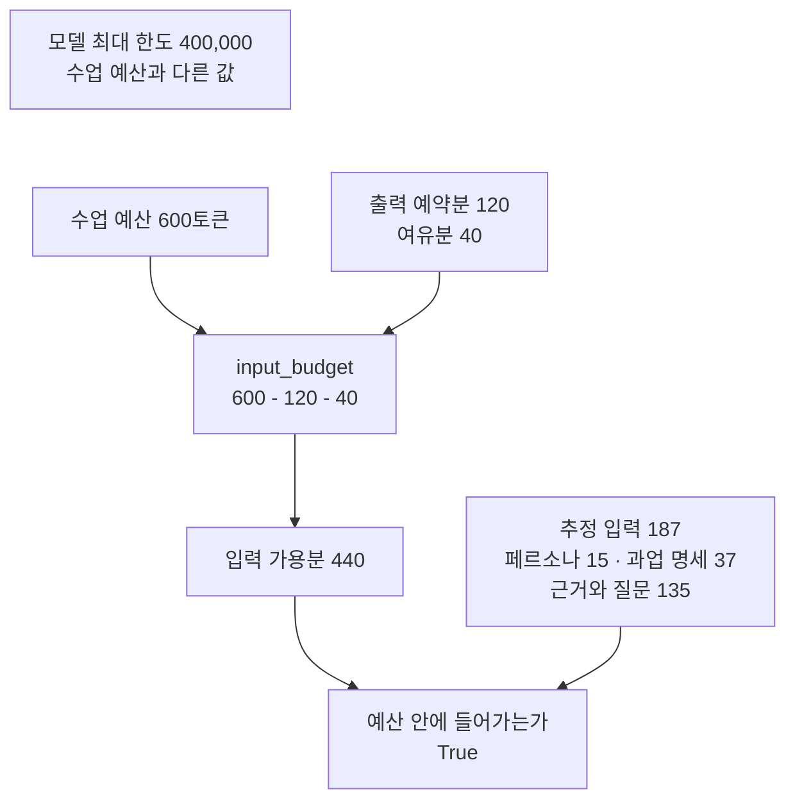
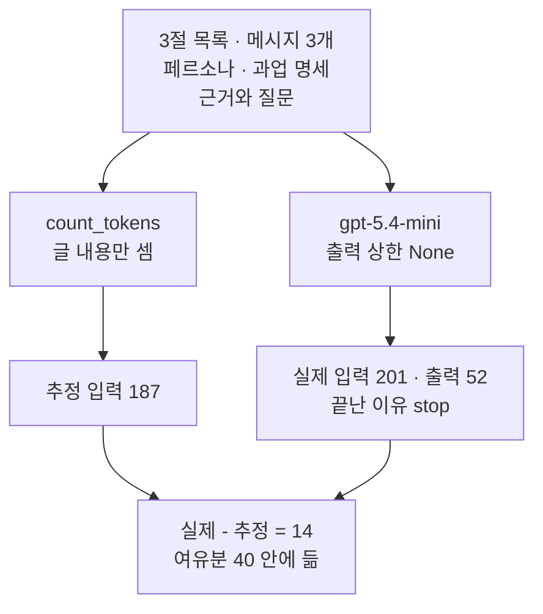
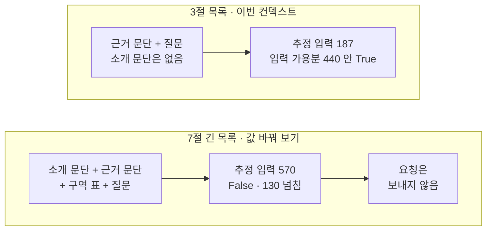
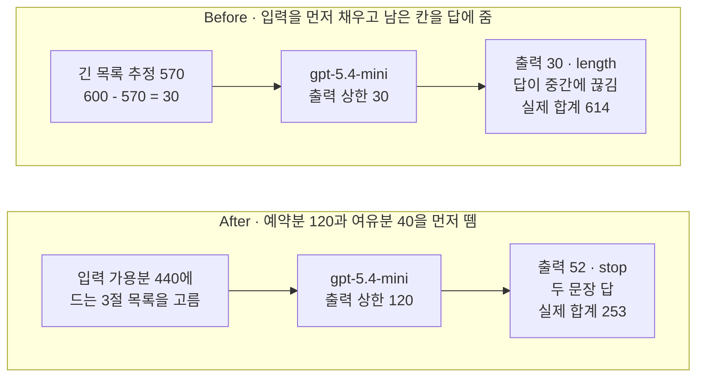

# 01-컨텍스트와-토큰-예산

## _src 본문 (HTML 원본)

```html
<!--meta: 강의 1h | 실습 1h | 코드 Jupyter Notebook | 새 용어 7 -->
<h2 id="b1"><span class="no">1</span>학습 목표</h2>
<div class="goal"><p>이 절을 마치면 다음을 할 수 있습니다.</p><ul><li>메시지 목록에 실린 글만 이번 요청의 컨텍스트라는 것을 노트북 출력으로 설명할 수 있습니다.</li><li>수업 예산에서 출력 예약분과 여유분을 먼저 빼 입력 가용분을 구하고, 추정 입력과 비교할 수 있습니다.</li><li>호출 전 추정 토큰 수와 응답의 실제 사용량을 따로 기록하고, 두 값이 다른 까닭을 말할 수 있습니다.</li></ul></div>
<h2 id="b2"><span class="no">2</span>이 내용을 배우는 이유</h2>
<p>Ch 7에서는 페르소나·과업 명세·고객 문의를 역할별 메시지에 나눠 넣었습니다. 이제 문서 같은 긴 자료도 함께 넣어야 합니다. 자료를 많이 넣을수록 모델이 읽을 글은 늘어나지만, 답이 늘 좋아지지는 않습니다.</p>
<p>모델이 한 번에 다룰 수 있는 토큰 수에는 한도가 있습니다. 넣은 글과 모델이 쓸 답이 같은 한도를 나눠 씁니다. 자료를 먼저 채우면 답을 쓸 자리가 모자랄 수 있습니다. 그래서 자료를 넣기 전에 자리를 어떻게 나눌지 먼저 정합니다.</p>
<p>이렇게 모델에 무엇을 얼마나 보낼지 정하는 일을 컨텍스트 엔지니어링이라고 부릅니다. 이 절은 그 첫 단계로 토큰 예산표를 만듭니다. 어떤 자료를 고르고 줄일지는 02절과 03절에서 다룹니다.</p>
<p><strong>이 절의 질문</strong> — 한 번의 요청에 자료를 넣기 전에, 답을 쓸 자리와 빈자리를 먼저 떼어 두면 무엇이 달라질까요?</p>
<h2 id="b3"><span class="no">3</span>앞에서 배운 내용</h2>
<table><thead><tr><th>앞 절</th><th>배운 것</th><th>이 절에서 이어지는 곳</th></tr></thead><tbody>
<tr><td>Ch 5 01절</td><td>토크나이저 <code>encode()</code>, 글자 수와 조각 수가 다름</td><td>5절 tiktoken으로 토큰 수 세기</td></tr>
<tr><td>Ch 5 04절</td><td>컨텍스트 윈도, 출력 몫, <code>입력 한도 = 전체 한도 - 출력 몫</code></td><td>4절 수업 예산표에 여유분을 더함</td></tr>
<tr><td>Ch 6 01절</td><td><code>init_chat_model()</code>·<code>invoke()</code>, <code>usage_metadata</code>, 끝난 이유, 출력 상한 <code>max_tokens</code></td><td>6절 실제 사용량, 8·9절 출력 상한을 준 모델</td></tr>
<tr><td>Ch 7 01~03절</td><td>system 페르소나·developer 과업 명세·user 목록, 글 <code>+</code>로 잇기, <code>len(글)</code></td><td>2·3절 메시지 목록 만들기</td></tr>
</tbody></table>
<p>Ch 5에서는 내 컴퓨터의 로컬 모델로 조각 수를 셌습니다. Ch 6부터는 인터넷 서비스 모델을 부르고, 사용량 토큰은 제공자가 센 값을 받았습니다. 이 절은 두 가지를 함께 씁니다. 호출 전에는 내 컴퓨터에서 세고, 호출 뒤에는 서비스가 센 값을 받습니다.</p>
<p>실습 폴더는 <code>labs/part2/ch08-context-engineering</code>으로 바뀝니다. <code>.env</code> 파일의 <code>OPENAI_API_KEY</code>와 모델 설정은 Ch 7과 같습니다. 이 폴더에 고정한 openai 판은 3.8.0으로 Ch 7과 다르고, 토큰을 세는 tiktoken 0.14.0이 더 있습니다.</p>
<h2 id="b4"><span class="no">4</span>핵심 개념</h2>
<h3>비유로 시작하기</h3>
<p>긴 나무 책상에 연회색 테이프 두 줄이 세로로 붙어 있습니다. 테이프는 책상 윗면을 왼쪽의 넓은 구역, 가운데의 좁은 빈 띠, 오른쪽 구역으로 나눕니다. 오른쪽 구역에는 빈 답안지 한 장과 연필만 있습니다.</p>
<p>왼쪽 구역에는 파란 명찰, 주황 클립보드, 흰 종이 두 장, 노란 메모지가 있습니다. 책상 왼쪽 바닥의 종이 상자에는 종이 묶음이 더 들어 있지만, 책상 위로 올리지 않았습니다. 자료를 올리기 전에 답안지 자리와 빈 띠부터 나눠 둔 책상입니다.</p>
{{img:01-5-책상-구역|연회색 테이프 두 줄로 나뉜 나무 책상의 왼쪽 구역에 파란 명찰·주황 클립보드·흰 종이 두 장·노란 메모지가 있고, 가운데 좁은 띠는 비어 있으며, 오른쪽 구역에는 빈 답안지와 연필만 있고, 책상 왼쪽 바닥의 열린 종이 상자에 종이 묶음이 들어 있는 삽화|자료를 올리기 전에 답안지 자리와 빈 띠를 먼저 나눠 둡니다. 책상에 올린 것만 이번 작업에 쓰고, 바닥 상자의 종이는 쓰지 않습니다.}}
<p><strong>그림 읽기</strong> — 오른쪽부터 봅니다. 빈 답안지와 연필만 놓인 오른쪽 구역이 먼저 비워 둔 답 자리입니다. 그 왼쪽 세로 테이프 두 줄 사이의 좁은 띠에는 아무것도 없습니다. 왼쪽 구역에만 자료가 놓였고, 바닥 상자의 종이는 책상 밖에 있습니다. 책상 뒤쪽 가장자리의 가로 테이프는 구역을 나누는 선이 아닙니다.</p>
<p>책상 윗면 전체는 노트북의 수업 예산 600토큰입니다. 오른쪽 답안지 자리는 출력 예약분, 가운데 빈 띠는 여유분, 왼쪽 구역은 입력 가용분입니다. 파란 명찰은 system 페르소나, 주황 클립보드는 developer 과업 명세입니다. Ch 7의 책상 색 약속을 그대로 이었습니다.</p>
<p>흰 종이는 근거 문단이고, 노란 메모지는 질문입니다. Ch 7에서는 노란 메모지가 고객 문의였고, 이 절에서는 도서관 질문입니다. 바닥 상자의 종이는 노트북 변수에만 있는 소개 문단과 구역 표입니다. 구역의 넓이는 실제 토큰 수의 비율이 아닙니다.</p>
<h3>컨텍스트는 이번 요청에 실린 글입니다</h3>
<p>컨텍스트(context)는 모델이 이번 답을 만들 때 받은 글 전체입니다. 시험지에 인쇄된 지문만 풀이에 쓸 수 있는 것과 비슷합니다. 노트북에서는 메시지 목록 <code>messages</code>에 넣은 네 글이 이번 컨텍스트입니다.</p>
<p>노트북 2절은 같은 문서 쪽의 소개 문단과 구역 표도 변수로 만들었습니다. 3절 출력 <code>소개 문단이 이번 목록에 들어 있는가: False</code>처럼, 변수나 파일에 있어도 목록에 넣지 않으면 컨텍스트가 아닙니다. 7절에서 두 글을 목록에 넣자 비로소 입력 자리를 차지했습니다.</p>
<h3>수업 예산표 — 예약분과 여유분을 먼저 뗍니다</h3>
<p>컨텍스트 윈도(context window)는 모델이 한 번에 다룰 수 있는 토큰 수의 최대 한도입니다. OpenAI 모델 안내에 적힌 <code>gpt-5.4-mini</code>의 컨텍스트 윈도는 400,000토큰입니다. 최대 출력은 128,000토큰입니다. 한도가 크다고 매번 그만큼 넣지는 않습니다. 긴 입력은 비용과 처리 시간을 늘리고, 답에 쓰지 않을 글도 함께 들어가기 때문입니다.</p>
<p>그래서 이번 작업에 쓸 상한을 사람이 따로 정합니다. 이것이 토큰 예산(token budget)이고, 노트북은 수업 예산 600토큰으로 정했습니다. 한 달 용돈을 받으면 교통비부터 떼어 두는 것과 비슷합니다. 예산표는 다음 순서로 만듭니다.</p>
{{mermaid:01-1-예산표|초록 상자 수업 예산 600토큰과 출력 예약분 120 여유분 40이 파란 상자 input_budget 600 - 120 - 40으로 모여 노란 상자 입력 가용분 440이 되고, 노란 상자 추정 입력 187과 함께 노란 상자 예산 안에 들어가는가 True로 이어지며, 맨 위 회색 상자에 모델 최대 한도 400,000이 따로 있는 흐름도|수업 예산에서 출력 예약분과 여유분을 먼저 빼면 입력 가용분 440이 남고, 네 글의 추정 입력 187은 그 안에 들어갑니다. 모델 최대 한도 400,000은 따로 있는 값입니다.}}
<p><strong>도식 읽기</strong> — 위에서 아래로 읽습니다. 초록 상자 두 개는 노트북 4절에서 정한 수업 예산 600, 출력 예약분 120, 여유분 40입니다. 파란 상자는 세 값을 빼는 함수 <code>input_budget()</code>이고, 그 아래 노란 상자가 출력으로 확인한 <code>입력 가용분: 440</code>입니다.</p>
<p>오른쪽 노란 상자는 5절에서 센 추정 입력 187과 칸별 토큰 수입니다. 두 노란 상자가 만나는 맨 아래 상자가 <code>입력 가용분 안에 드는가: True</code>입니다. 맨 위 회색 상자는 모델 안내의 최대 한도로, 노트북에서 실행한 값이 아닙니다.</p>
<p>출력 예약분(output reservation)은 답을 쓸 자리로 먼저 떼어 두는 토큰 수입니다. Ch 5 04절의 출력 몫, Ch 6 01절의 출력 상한과 같은 크기를 가리킵니다. 예산표에서는 출력 예약분이라 부르고, 모델 객체에는 같은 값을 출력 상한 <code>max_tokens</code>로 줍니다. 두 값이 같아야 예산표의 계획이 실제 요청에서도 지켜집니다.</p>
<p>여유분(safety margin)은 호출 전 추정이 실제보다 적게 나오는 몫을 받아 줄 빈자리입니다. 식은 <code>입력 가용분 = 수업 예산 - 출력 예약분 - 여유분</code>이고, 숫자를 넣으면 <code>600 - 120 - 40 = 440</code>입니다. Ch 5 04절의 <code>입력 한도 = 전체 한도 - 출력 몫</code>에 여유분 한 칸을 더한 모양입니다.</p>
<h3>이 절에서 쓰는 말</h3>
<table><thead><tr><th>용어</th><th>뜻</th><th>이 절에서 보이는 모습</th></tr></thead><tbody>
<tr><td>컨텍스트(context)</td><td>모델이 이번 답을 만들 때 받은 글 전체. 목록에 넣지 않은 변수·파일은 아님</td><td><code>소개 문단이 이번 목록에 들어 있는가: False</code></td></tr>
<tr><td>컨텍스트 윈도(context window)</td><td>모델이 한 번에 다룰 수 있는 토큰 수의 최대 한도. Ch 5 04절과 같은 뜻</td><td><code>gpt-5.4-mini</code> 400,000토큰(모델 안내)</td></tr>
<tr><td>토큰 예산(token budget)</td><td>이번 작업에 쓰려고 사람이 정한 토큰 상한. 노트북에서는 수업 예산</td><td><code>수업 예산: 600</code></td></tr>
<tr><td>출력 예약분(output reservation)</td><td>답을 쓸 자리로 먼저 떼어 두는 토큰 수. Ch 5 출력 몫, Ch 6 출력 상한과 같은 크기</td><td><code>출력 예약분: 120</code>, <code>출력 상한(max_tokens): 120</code></td></tr>
<tr><td>여유분(safety margin)</td><td>추정이 실제보다 적게 나오는 몫을 받아 줄 빈자리</td><td><code>여유분: 40</code></td></tr>
<tr><td>입력 가용분</td><td>예산에서 출력 예약분과 여유분을 뺀 뒤 입력에 쓸 수 있는 토큰 수</td><td><code>입력 가용분: 440</code></td></tr>
<tr><td>추정 토큰 수</td><td>요청 전에 내 컴퓨터에서 토큰화 규칙으로 센 글 내용의 토큰 수. 실제 사용량과 따로 적음</td><td><code>추정 입력 합계: 187</code></td></tr>
</tbody></table>
<h2 id="b5"><span class="no">5</span>실행 예제</h2>
<p>노트북은 도서관 안내 문서(E01) 2쪽의 글로 메시지 목록을 만들고, 목록에 실린 글만 컨텍스트라는 것을 확인합니다. 그다음 수업 예산표를 만들고, 호출 전에 토큰 수를 셉니다. 목록을 실제로 보내 사용량과 추정값을 비교합니다. 값 바꿔 보기에서는 같은 쪽의 다른 자료까지 넣어 예산표를 다시 봅니다.</p>
<p>실제 OpenAI 모델을 temperature 0으로 부릅니다. 이 페이지의 출력은 2026-09-17에 실행한 결과이고, 요청은 Before·After까지 모두 3번입니다. 예상 비용은 0.01달러 미만이고, 답 문장은 실행마다 달라질 수 있습니다.</p>
{{notebook:01-컨텍스트와-토큰-예산|example}}
<p class="look"><b>확인할 점</b> — 3절 <code>소개 문단이 이번 목록에 들어 있는가: False</code>를 봅니다. 5절 <code>추정 입력 합계: 187</code>과 6절 <code>실제 입력 토큰 수: 201</code>을 나란히 봅니다. 7절 <code>넘친 토큰 수: 130</code>을 확인합니다.</p>
<h3>추정한 수와 실제 사용량</h3>
<p>노트북 5절은 요청을 보내기 전에 tiktoken 라이브러리로 토큰 수를 셌습니다. 함수 <code>tiktoken.encoding_for_model()</code>은 모델 이름을 받아 그 모델의 토큰화 규칙을 반환합니다. 설치한 tiktoken 0.14.0 소스는 <code>gpt-5</code>로 시작하는 이름에 규칙 <code>o200k_base</code>를 씁니다. 질문 한 문장은 <code>질문 글자 수: 45</code>, <code>질문 토큰 수: 32</code>로 두 수가 달랐습니다.</p>
{{mermaid:01-2-추정과-실제|초록 상자 3절 목록 메시지 3개가 왼쪽으로는 파란 상자 count_tokens 글 내용만 셈을 거쳐 노란 상자 추정 입력 187로, 오른쪽으로는 보라 상자 gpt-5.4-mini 출력 상한 None을 거쳐 노란 상자 실제 입력 201 출력 52 끝난 이유 stop으로 가고, 두 노란 상자가 맨 아래 노란 상자 실제 - 추정 = 14 여유분 40 안에 듦으로 모이는 흐름도|같은 3절 목록을 내 컴퓨터에서 세면 187, 서비스가 센 실제 입력은 201이었습니다. 차이 14는 여유분 40 안에 들었습니다.}}
<p><strong>도식 읽기</strong> — 맨 위 초록 상자는 3절에서 만든 메시지 세 개의 목록입니다. 왼쪽 갈래는 5절 함수 <code>count_tokens()</code>로 글 내용만 세어 추정 입력 187을 얻었습니다. 오른쪽 갈래는 같은 목록을 보라 상자의 모델로 보내 실제 입력 201, 출력 52를 받았습니다.</p>
<p>두 갈래가 만나는 맨 아래 노란 상자가 6절 <code>실제 입력 - 추정 입력: 14</code>와 <code>차이가 여유분 안에 드는가: True</code>입니다. 추정은 글 내용만 세지만, 요청에는 역할 이름과 메시지 경계 표시도 실립니다. 차이 14는 그 표시로 보이는 몫입니다. 서비스 안에서 그 표시가 어떤 모양인지는 이번에 확인하지 않았습니다.</p>
<p>Ch 7 01절에서도 같은 글자를 메시지 1개에서 3개로 나누자 입력 토큰이 8개 늘었습니다. 그래서 추정값은 호출 전 예산 검사에 쓰고, 기록과 비용 계산에는 응답의 실제 사용량을 씁니다. 6절 출력 52토큰도 출력 예약분 120 안에 들었지만, 1절 모델에는 출력 상한이 없었습니다. 예약분을 지키게 한 것이 아니라 이번 답이 짧았던 것입니다.</p>
<h3>같은 쪽의 다른 자료까지 넣으면</h3>
<p>노트북 7절은 user 글 하나만 바꿨습니다. 근거 문단 앞에 소개 문단을, 뒤에 구역 표를 붙인 긴 목록입니다. 두 글은 질문에 답하는 데 쓰이지 않는 같은 쪽의 자료입니다.</p>
{{mermaid:01-3-긴-목록|위 칸 3절 목록 이번 컨텍스트에는 초록 상자 근거 문단 + 질문 소개 문단은 없음이 노란 상자 추정 입력 187 입력 가용분 440 안 True로 이어지고, 아래 칸 7절 긴 목록에는 초록 상자 소개 문단 + 근거 문단 + 구역 표 + 질문이 노란 상자 추정 입력 570 False 130 넘침을 거쳐 회색 상자 요청은 보내지 않음으로 이어지는 그림|근거 문단과 질문만 넣은 3절 목록은 187로 들어가고, 같은 쪽의 소개 문단과 구역 표까지 넣은 긴 목록은 570으로 130 넘칩니다.}}
<p><strong>도식 읽기</strong> — 위 칸이 3절 목록, 아래 칸이 7절 긴 목록이고, 칸마다 왼쪽에서 오른쪽으로 읽습니다. 초록 상자는 목록에 넣은 글이고, 노란 상자는 출력으로 확인한 추정 입력과 비교 결과입니다. 아래 칸 끝의 회색 상자는 실행하지 않은 단계입니다.</p>
<p>긴 목록은 <code>긴 목록 추정 입력 합계: 570</code>, <code>입력 가용분 안에 드는가: False</code>였고 <code>넘친 토큰 수: 130</code>이 나왔습니다. 두 글이 목록에 들어가 컨텍스트가 되자 추정 입력이 383토큰 늘었습니다. 답에 필요한 내용은 이미 근거 문단에 있었으므로, 늘어난 글은 자리만 차지합니다. 예산표대로라면 긴 목록은 보내기 전에 줄여야 합니다.</p>
<h2 id="b6"><span class="no">6</span>일부러 실패해 보기</h2>
<p>Before에서는 예산표를 거꾸로 씁니다. 긴 목록을 그대로 넣고, 수업 예산 600에서 추정 입력 570을 뺀 남은 30칸을 답의 출력 상한으로 줍니다. 입력을 먼저 채우고 답에는 남는 자리만 주는 방식입니다.</p>
<p>After에서는 고치는 곳이 예산표를 쓰는 순서입니다. 출력 예약분 120과 여유분 40을 먼저 떼어 입력 가용분 440을 구합니다. 보내기 전에 긴 목록이 넘친다는 것을 알 수 있으므로, 질문에 쓰는 근거만 남긴 3절 목록을 보냅니다. 출력 예약분 120은 모델의 출력 상한으로 줍니다.</p>
{{notebook:01-컨텍스트와-토큰-예산|failure}}
<p>Before 답은 <code>미르시립도서관의 정기 휴관일은 매주 월요일이며, 법정 공휴일에도 휴</code>에서 끊겼습니다. 출력 줄은 <code>실제 출력 토큰 수: 30</code>, <code>끝난 이유: length</code>였습니다. 질문 둘째 부분인 「공휴일이 월요일과 겹치면」에 대한 답과 출처 표시가 없습니다. 오류는 나지 않았으므로, 답 글자만 보면 끊긴 줄 모르고 넘어갈 수 있습니다.</p>
<p>Before 요청의 실제 입력은 <code>실제 입력 토큰 수: 584</code>로 추정 570보다 14 많았습니다. 남은 칸을 여유분 없이 추정값으로 계산해서, 출력 상한을 지켰는데도 <code>실제 합계: 614</code>로 예산 600을 넘었습니다.</p>
<p>After 요청은 <code>긴 목록이 드는가: False</code>, <code>3절 목록이 드는가: True</code>를 요청 전에 확인했습니다. 답은 두 문장이었고 둘째 문장에 <code>화요일에도 휴관합니다</code>와 출처 <code>[E01 p.2]</code>가 있었습니다. 출력 줄은 <code>실제 출력 토큰 수: 52</code>, <code>끝난 이유: stop</code>, <code>실제 합계: 253</code>이었습니다.</p>
{{mermaid:01-4-Before-After|위 칸 Before에는 파란 상자 긴 목록 추정 570 600 - 570 = 30, 보라 상자 gpt-5.4-mini 출력 상한 30, 빨간 상자 출력 30 length 답이 중간에 끊김 실제 합계 614가 차례로 있고, 아래 칸 After에는 파란 상자 입력 가용분 440에 드는 3절 목록을 고름, 보라 상자 gpt-5.4-mini 출력 상한 120, 노란 상자 출력 52 stop 두 문장 답 실제 합계 253이 차례로 있는 비교 그림|남은 칸 30을 출력 상한으로 준 Before는 30토큰에서 length로 끊기고 합계 614로 예산을 넘었습니다. 예약분을 먼저 뗀 After는 52토큰에서 stop으로 끝나고 합계 253이었습니다.}}
<p><strong>도식 읽기</strong> — 위 칸이 Before, 아래 칸이 After이고, 칸마다 왼쪽에서 오른쪽으로 읽습니다. 파란 상자는 노트북 코드의 계산입니다. Before 코드는 <code>답에 남은 칸: 30</code>을 구했고, After 코드는 입력 가용분 440에 드는 3절 목록을 골랐습니다. 보라 상자는 출력 상한만 다른 두 모델 객체입니다.</p>
<p>위 칸 끝의 빨간 상자는 Before의 결함 결과로, 답이 30토큰에서 끊기고 합계가 614였습니다. 아래 칸 끝의 노란 상자는 After 출력으로 확인한 값으로, 답이 52토큰에서 스스로 멈추고 합계가 253이었습니다. 두 칸의 입력 목록이 다르므로, 이 그림은 입력 토큰 수를 비교하는 그림이 아닙니다.</p>
<p>After 답은 이번 실행에서 상한이 없던 6절 답과 글자까지 같았고, 출력 상한 120에는 닿지 않았습니다. 같은 목록을 temperature 0으로 보내도 늘 같은 답이 온다고 보장하지는 않습니다. 출력 상한은 답이 예약분보다 길어질 때 그 자리를 넘지 않게 하는 설정입니다.</p>
<h2 id="b7"><span class="no">7</span>주의할 점과 실무 메모</h2>
<ul><li>최대 한도를 운영 목표로 쓰지 않습니다. 모델이 받을 수 있는 양과 매 요청에 쓰도록 허락할 양은 다릅니다. 팀에서는 비용과 처리 시간을 보고 예산을 따로 정합니다.</li>
<li>수업 예산 600, 출력 예약분 120, 여유분 40은 흐름을 보여 주려고 정한 예입니다. 교재를 만들 때 같은 글로 기기에서 먼저 요청 4번을 보냈습니다. 추정 187·570, 실제 입력 201·584, 끝까지 쓴 답 52~62토큰을 봤습니다. 그 뒤 긴 목록이 넘치고 남은 칸이 답보다 작도록 값을 정했고, 노트북을 새 커널로 두 번 실행했습니다.</li>
<li>여유분 40은 이번 목록의 차이 14를 보고 넉넉하게 잡은 값입니다. 메시지 수, 역할, 도구 결과가 달라지면 차이도 달라질 수 있습니다. 실제 서비스의 글로 추정과 실제를 비교해 보고 정합니다.</li>
<li>토큰화 규칙은 모델마다 다를 수 있습니다. 다른 제공자의 모델에 tiktoken 규칙을 그대로 쓰지 않습니다. Ch 5에서 센 Qwen 조각 수와도 나란히 비교하지 않습니다.</li>
<li>출력 상한에 닿으면 오류 없이 답이 끊깁니다. 답 글자와 함께 끝난 이유 <code>length</code>를 확인합니다.</li>
<li>이 노트북은 추론 설정 none만 실행했습니다. 다른 추론 설정에서 출력 상한과 추론 토큰이 어떻게 나뉘는지는 이번에 확인하지 않았습니다.</li>
<li>사용량 기록에는 토큰 수와 문서 이름처럼 필요한 값만 남깁니다. 개인 정보나 비밀 값이 든 메시지 원문은 기록에 그대로 넣지 않습니다.</li>
<li>교재 출력은 Linux의 Python 3.12.13으로 만들었습니다. 패키지는 langchain 1.4.0, langchain-core 1.6.2, langchain-openai 1.6.0입니다. openai 3.8.0, tiktoken 0.14.0도 함께 썼습니다. 다른 버전과 Windows·macOS에서는 실행하지 않았습니다.</li></ul>
<h2 id="b8"><span class="no">8</span>정리와 다음 절</h2>
<ul><li>메시지 목록에 실린 페르소나·과업 명세·근거·질문만 이번 컨텍스트였고, 변수에만 있던 소개 문단은 컨텍스트가 아니었습니다.</li><li>수업 예산 600에서 출력 예약분 120과 여유분 40을 먼저 떼어 입력 가용분 440을 구했습니다. 추정 187은 들어갔고 긴 목록 570은 넘쳤습니다.</li><li>추정 입력과 실제 입력은 14 달랐습니다. 남은 30칸을 답에 준 Before는 답이 끊겼고, 예약분을 출력 상한으로 준 After는 답을 끝까지 받았습니다.</li></ul>
<p><strong>다음 학습과 이어지는 지점</strong> — 02절에서는 자료를 파일에 적어 두고, 질문에 필요한 기록만 골라 메시지에 넣습니다. 7절의 긴 목록처럼 넘치는 자료를 보내기 전에 줄이는 첫 방법입니다. 같은 E01 문서는 Ch 9에서 검색으로 찾게 됩니다.</p>
<h2 id="b9"><span class="no">9</span>복습 문제</h2>
<details class="quiz"><summary>문제 1 · 변수에만 있는 글</summary><p class="quiz-q">노트북에 변수 <code>intro_text</code>로 만들었지만 메시지 목록에 넣지 않은 소개 문단은 이번 요청의 컨텍스트인가요?</p><p class="quiz-a"><b>해설</b> — 아닙니다. 컨텍스트는 모델이 이번 답을 만들 때 받은 글입니다. 3절 출력 <code>소개 문단이 이번 목록에 들어 있는가: False</code>처럼 목록에 없으면 모델에 가지 않습니다.</p></details>
<details class="quiz"><summary>문제 2 · 입력 가용분 계산</summary><p class="quiz-q">수업 예산 600, 출력 예약분 120, 여유분 40일 때 입력 가용분은 얼마이고, 왜 입력보다 두 값을 먼저 빼나요?</p><p class="quiz-a"><b>해설</b> — <code>600 - 120 - 40</code>으로 440입니다. 답도 같은 예산을 나눠 쓰므로 답 자리와 빈자리를 먼저 떼어야, 입력이 넘치는지를 요청 전에 알 수 있습니다.</p></details>
<details class="quiz"><summary>문제 3 · 추정과 실제의 차이</summary><p class="quiz-q">5절 추정 입력은 187이었고 6절 실제 입력은 201이었습니다. 이 차이를 계산 오류라고 봐야 하나요?</p><p class="quiz-a"><b>해설</b> — 아닙니다. 추정은 글 내용만 셌고, 요청에는 역할 이름과 메시지 경계 표시도 실립니다. 그래서 추정은 예산 검사에, 실제 사용량은 기록에 따로 쓰고, 차이는 여유분으로 받습니다.</p></details>
<details class="quiz"><summary>문제 4 · 끊긴 답</summary><p class="quiz-q">Before 요청은 오류 없이 끝났습니다. 답이 끊겼다는 것은 출력의 어느 값으로 알 수 있나요?</p><p class="quiz-a"><b>해설</b> — <code>끝난 이유: length</code>와 <code>실제 출력 토큰 수: 30</code>으로 압니다. 출력 토큰 수가 출력 상한 30과 같고, 모델이 스스로 멈춘 <code>stop</code>이 아닙니다.</p></details>
<details class="quiz"><summary>문제 5 · 출력 예약분과 출력 상한</summary><p class="quiz-q">6절 모델은 출력 상한이 없었는데도 출력 52토큰이 예약분 120 안에 들었습니다. 이것으로 예약분이 지켜진다고 말할 수 있나요?</p><p class="quiz-a"><b>해설</b> — 말할 수 없습니다. 이번 답이 짧았을 뿐입니다. 예산표의 출력 예약분을 모델 객체의 출력 상한 <code>max_tokens</code>로 같이 줘야, 답이 그 자리를 넘지 않습니다.</p></details>
<h2 id="b10"><span class="no">10</span>참고 자료</h2>
<p>문서는 2026-09-17에 다시 열어 확인했습니다. 토큰화 규칙 선택은 실습 가상환경에 설치한 <code>tiktoken 0.14.0</code> 소스에서 확인했습니다. 근거 글은 Ch 9에서 쓰는 가상 기관 문서 <code>E01.pdf</code> 2쪽 원문을 옮겼습니다.</p>
<ul><li><div><a href="https://www.anthropic.com/engineering/effective-context-engineering-for-ai-agents">Anthropic, Effective context engineering for AI agents</a></div>컨텍스트 정의와 꼭 필요한 토큰만 넣는 원칙 · 2025-09-29 · 확인 2026-09-17</li><li><div><a href="https://developers.openai.com/api/docs/models/gpt-5.4-mini">OpenAI GPT-5.4 mini 모델 안내</a></div>컨텍스트 윈도 400,000토큰, 최대 출력 128,000토큰 · 확인 2026-09-17</li><li><div><a href="https://github.com/openai/tiktoken">openai/tiktoken</a></div>OpenAI 모델의 토큰화 규칙 라이브러리 · 확인 2026-09-17</li><li><div><a href="https://docs.langchain.com/oss/python/langchain/models">LangChain Models</a></div><code>init_chat_model</code>, <code>max_tokens</code>, 응답 사용량 · 확인 2026-09-17</li></ul>
```

## 노트북 셀 (순서대로)

### [0] markdown {'html': 'skip'}

# 컨텍스트와 토큰 예산

**이 노트북에서 할 일**

1. 한 번의 요청에 넣을 글 네 가지로 메시지 목록을 만들고, 목록에 실린 글만 이번 컨텍스트라는 것을 확인합니다.
2. 수업 예산에서 출력 예약분과 여유분을 먼저 빼고, 호출 전에 추정한 토큰 수를 실제 사용량과 비교합니다.
3. 입력을 먼저 채우고 남은 칸을 답에 준 Before와, 예약분을 먼저 뗀 After의 답을 비교합니다.

**준비물** — 프로젝트 폴더 `.env` 파일의 `OPENAI_API_KEY`가 필요합니다. 데이터 파일은 없고, 글은 셀 안에 적습니다.

인터넷 서비스에 요청을 모두 3번 보냅니다. 모두 `gpt-5.4-mini`입니다.
실행 시간은 1분 안팎이고, 예상 비용은 0.01달러 미만으로 잡았습니다.
요금은 Ch 6 06절에서 2026-09-17에 확인한 mini 공식 요금 기준입니다.

**기준 버전** — 실습 폴더에 고정한 패키지 판을 씁니다. langchain 1.4.0, langchain-core 1.6.2, langchain-openai 1.6.0입니다.
openai 3.8.0, tiktoken 0.14.0, python-dotenv 1.2.3도 함께 씁니다.

교재 출력은 Linux의 Python 3.12.13으로 만들었습니다. 다른 버전과 Windows·macOS에서는 이번에 실행하지 않았습니다.

실습 폴더 `labs/part2/ch08-context-engineering`에서 `uv sync --locked`를 실행합니다.
그다음 이 폴더의 `.venv` 커널을 고르고 첫 셀부터 순서대로 실행합니다.

### [1] markdown {'html': 'skip'}

## 오늘 볼 그림


위에서 아래로 읽습니다. 초록 상자는 노트북 4절에서 정한 값이고, 파란 상자는 뺄셈 함수입니다.
노란 상자는 출력으로 확인한 값입니다. 입력 가용분 440과 5절의 추정 입력 187을 비교합니다.
맨 위 회색 상자는 모델이 받을 수 있는 최대 한도로, 이 노트북의 수업 예산과 다른 값입니다.

### [2] markdown {}

## 1. 준비

첫 셀은 패키지를 설치하고 설치된 버전을 출력합니다. 설치에는 몇십 초가 걸릴 수 있습니다.
Ch 7과 달리 토큰 수를 세는 라이브러리 tiktoken을 더 설치합니다.

### [3] code {'execution': {'iopub.execute_input': '2026-09-17T09:25:01.666149Z', 'iopub.status.busy': '2026-09-17T09:25:01.665964Z', 'iopub.status.idle': '2026-09-17T09:25:02.356840Z', 'shell.execute_reply': '2026-09-17T09:25:02.356126Z'}, 'lesson_role': 'setup'}

```python
# 이 절에서 쓰는 패키지를 설치하고 버전을 확인합니다
%pip install -q "langchain==1.4.0" "langchain-openai==1.6.0" "python-dotenv==1.2.3" "tiktoken==0.14.0"
from importlib.metadata import version

print("langchain:", version("langchain"))
print("langchain-core:", version("langchain-core"))
print("langchain-openai:", version("langchain-openai"))
print("openai:", version("openai"))
print("tiktoken:", version("tiktoken"))
print("python-dotenv:", version("python-dotenv"))
```

출력:
```
Note: you may need to restart the kernel to use updated packages.
langchain: 1.4.0
langchain-core: 1.6.2
langchain-openai: 1.6.0
openai: 3.8.0
tiktoken: 0.14.0
python-dotenv: 1.2.3

```

### [4] markdown {}

**결과 읽기** — 출력 줄은 `langchain: 1.4.0`, `openai: 3.8.0`, `tiktoken: 0.14.0` 등 여섯 줄입니다.
준비물에 적은 기준 버전과 같습니다. 이 챕터 실습 폴더의 openai 판은 Ch 7(3.10.0)과 다릅니다.

토큰 수를 세는 라이브러리와 모델 객체를 만드는 함수를 불러옵니다.

### [5] code {'execution': {'iopub.execute_input': '2026-09-17T09:25:02.358118Z', 'iopub.status.busy': '2026-09-17T09:25:02.358020Z', 'iopub.status.idle': '2026-09-17T09:25:02.778492Z', 'shell.execute_reply': '2026-09-17T09:25:02.778010Z'}, 'lesson_role': 'setup'}

```python
# 토큰 수를 세는 라이브러리와 모델 객체를 만드는 함수를 불러옵니다
import tiktoken

from langchain.chat_models import init_chat_model
```

출력:
```

```

### [6] markdown {}

Ch 7과 같은 셀로 API 키가 있는지 확인합니다. 키 값은 출력하지 않고, 있는지만 봅니다.
`True` 값이 나오면 다음으로 넘어갑니다.

### [7] code {'execution': {'iopub.execute_input': '2026-09-17T09:25:02.779332Z', 'iopub.status.busy': '2026-09-17T09:25:02.779274Z', 'iopub.status.idle': '2026-09-17T09:25:02.786573Z', 'shell.execute_reply': '2026-09-17T09:25:02.786205Z'}, 'lesson_role': 'setup'}

```python
# .env 파일에서 OpenAI API 키를 읽습니다(키 값은 출력하지 않습니다)
import os
from dotenv import find_dotenv, load_dotenv

env_path = find_dotenv(usecwd=True)
load_dotenv(env_path)
has_key = os.getenv("OPENAI_API_KEY") is not None
print("OPENAI_API_KEY 설정 여부:", has_key)
assert has_key, "프로젝트 폴더의 .env 파일에 OPENAI_API_KEY를 적어 주세요."
```

출력:
```
OPENAI_API_KEY 설정 여부: True

```

### [8] markdown {}

Ch 7과 같은 설정으로 모델 객체를 만듭니다. 이 셀은 요청을 보내지 않습니다.
마지막 줄은 Ch 6 01절에서 본 출력 상한(`max_tokens`)입니다. 이 객체에는 상한을 주지 않았습니다.

### [9] code {'execution': {'iopub.execute_input': '2026-09-17T09:25:02.787390Z', 'iopub.status.busy': '2026-09-17T09:25:02.787322Z', 'iopub.status.idle': '2026-09-17T09:25:03.786211Z', 'shell.execute_reply': '2026-09-17T09:25:03.785782Z'}}

```python
# 실습에 쓸 모델을 준비합니다(출력 상한은 주지 않습니다)
model = init_chat_model(
    "openai:gpt-5.4-mini",
    temperature=0,
    reasoning_effort="none",
)
print("모델 이름:", model.model_name)
print("temperature:", model.temperature)
print("출력 상한(max_tokens):", model.max_tokens)
```

출력:
```
모델 이름: gpt-5.4-mini
temperature: 0.0
출력 상한(max_tokens): None

```

### [10] markdown {}

**결과 읽기** — 출력 줄은 `모델 이름: gpt-5.4-mini`, `temperature: 0.0`, `출력 상한(max_tokens): None`입니다.
이 노트북의 출력은 2026-09-17에 이 모델로 실행한 결과입니다. 실행마다 답 문장이 달라질 수 있습니다.
Ch 6 01절에서 본 것처럼 temperature 0은 Ch 5 06절의 뽑기를 끈 설정(`do_sample=False`)과 같은 것이 아닙니다.

### [11] markdown {}

## 2. 이번 요청에 넣을 글 네 가지

미르시립도서관 안내 문서(E01) 2쪽으로 질문 하나에 답하게 합니다. 이 도서관은 Ch 9에서도 쓰는 가상 기관입니다.
메시지 목록은 Ch 7과 같은 모양으로 만듭니다. system에는 페르소나, developer에는 과업 명세, user에는 근거와 질문을 넣습니다.

먼저 페르소나와 과업 명세 두 글을 만듭니다. 과업 명세는 근거만 쓰고, 두 문장 이내로 답하고, 출처를 적으라는 글입니다.

### [12] code {'execution': {'iopub.execute_input': '2026-09-17T09:25:03.786890Z', 'iopub.status.busy': '2026-09-17T09:25:03.786827Z', 'iopub.status.idle': '2026-09-17T09:25:03.788560Z', 'shell.execute_reply': '2026-09-17T09:25:03.788205Z'}}

```python
# system에 넣을 페르소나와 developer에 넣을 과업 명세를 만듭니다
persona_text = "당신은 미르시립도서관 안내 담당자입니다."
task_text = "주어진 근거에 있는 정보만 쓰세요. 두 문장 이내로 답하고, 끝에 출처를 [E01 p.2]처럼 적으세요."
print("페르소나:", persona_text)
print("과업 명세:", task_text)
```

출력:
```
페르소나: 당신은 미르시립도서관 안내 담당자입니다.
과업 명세: 주어진 근거에 있는 정보만 쓰세요. 두 문장 이내로 답하고, 끝에 출처를 [E01 p.2]처럼 적으세요.

```

### [13] markdown {}

**결과 읽기** — 두 줄은 `페르소나:`와 `과업 명세:`로 시작합니다. 과업 명세 줄에는 출처 표시 `[E01 p.2]`가 있습니다.
아직 글만 만들었고 요청은 보내지 않았습니다.

이번에는 근거와 질문을 만듭니다. 근거는 E01 문서 2쪽의 「2. 이용 시간」 문단입니다.
긴 글은 Ch 7 03절처럼 같은 이름에 `+`로 이어 다시 담습니다. 글 `"\n"`은 줄바꿈 한 번입니다.

### [14] code {'execution': {'iopub.execute_input': '2026-09-17T09:25:03.789315Z', 'iopub.status.busy': '2026-09-17T09:25:03.789242Z', 'iopub.status.idle': '2026-09-17T09:25:03.791200Z', 'shell.execute_reply': '2026-09-17T09:25:03.790900Z'}}

```python
# 근거로 쓸 E01 문서 2쪽 「이용 시간」 문단과 질문을 만듭니다
evidence_text = "[E01 p.2] 2. 이용 시간\n"
evidence_text = evidence_text + "평일(화~금) 이용 시간은 오전 9시부터 오후 10시까지입니다. "
evidence_text = evidence_text + "토요일과 일요일은 오전 9시부터 오후 6시까지 문을 엽니다.\n"
evidence_text = evidence_text + "매주 월요일은 정기 휴관일입니다. 법정 공휴일에도 휴관하며, "
evidence_text = evidence_text + "공휴일이 월요일과 겹치면 그 다음 날인 화요일에도 휴관합니다."
question_text = "미르시립도서관의 정기 휴관일은 언제이고, 공휴일이 월요일과 겹치면 어떻게 되나요?"
print("근거:")
print(evidence_text)
print("질문:", question_text)
```

출력:
```
근거:
[E01 p.2] 2. 이용 시간
평일(화~금) 이용 시간은 오전 9시부터 오후 10시까지입니다. 토요일과 일요일은 오전 9시부터 오후 6시까지 문을 엽니다.
매주 월요일은 정기 휴관일입니다. 법정 공휴일에도 휴관하며, 공휴일이 월요일과 겹치면 그 다음 날인 화요일에도 휴관합니다.
질문: 미르시립도서관의 정기 휴관일은 언제이고, 공휴일이 월요일과 겹치면 어떻게 되나요?

```

### [15] markdown {}

**결과 읽기** — 라벨 줄 `근거:` 아래 세 줄이 근거 문단입니다. 셋째 줄에 `매주 월요일은 정기 휴관일입니다.`가 있습니다.
마지막 줄은 `질문:`으로 시작합니다. 질문에 답할 내용이 근거 셋째 줄에 모두 들어 있습니다.

같은 2쪽에는 이 질문에 쓰지 않는 자료도 있습니다. 「1. 도서관 소개」 문단과 구역별 이용 시간 표입니다.
두 글도 변수에 만들어 둡니다. 3절에서는 목록에 넣지 않고, 7절 값 바꿔 보기에서 넣습니다.

### [16] code {'execution': {'iopub.execute_input': '2026-09-17T09:25:03.791787Z', 'iopub.status.busy': '2026-09-17T09:25:03.791734Z', 'iopub.status.idle': '2026-09-17T09:25:03.793737Z', 'shell.execute_reply': '2026-09-17T09:25:03.793393Z'}}

```python
# 같은 2쪽에 있지만 이번 질문에 쓰지 않는 소개 문단과 구역 표를 만듭니다
intro_text = "[E01 p.2] 1. 도서관 소개\n"
intro_text = intro_text + "미르시립도서관은 1998년 10월 미르시 중앙동에 문을 연 공공도서관입니다. "
intro_text = intro_text + "지상 4층, 지하 1층 규모이며 장서 42만 권과 전자책 6만 종을 보유하고 있습니다. "
intro_text = intro_text + "2024년 리모델링을 마치고 3층에 '메이커 스페이스'와 '조용한 열람실'을 새로 열었습니다.\n"
intro_text = intro_text + "도서관의 사명은 \"누구나, 언제나, 무료로\"입니다. "
intro_text = intro_text + "시민 모두가 자료를 자유롭게 이용하고 배울 수 있도록 돕는 것을 최우선으로 합니다."
table_text = "[E01 p.2] 구역별 이용 시간(구역 | 평일 | 주말 | 비고)\n"
table_text = table_text + "종합자료실(2층) | 09:00~22:00 | 09:00~18:00 | 없음\n"
table_text = table_text + "어린이자료실(1층) | 09:00~18:00 | 09:00~18:00 | 보호자 동반 권장\n"
table_text = table_text + "디지털자료실(2층) | 09:00~21:00 | 09:00~18:00 | 1회 2시간\n"
table_text = table_text + "조용한 열람실(3층) | 07:00~22:00 | 07:00~18:00 | 좌석 예약제\n"
table_text = table_text + "메이커 스페이스(3층) | 13:00~20:00 | 13:00~17:00 | 사전 예약\n"
table_text = table_text + "카페 '책숲'(1층) | 09:00~20:00 | 09:00~17:00 | 외부 위탁"
print("소개 문단 글자 수:", len(intro_text))
print("구역 표 글자 수:", len(table_text))
```

출력:
```
소개 문단 글자 수: 240
구역 표 글자 수: 326

```

### [17] markdown {}

**결과 읽기** — 출력 줄은 `소개 문단 글자 수: 240`과 `구역 표 글자 수: 326`입니다. Ch 7 02절에서 본 것처럼 함수 `len()`에 글을 넣으면 글자 수입니다.
두 글은 노트북 변수에 있을 뿐, 아직 어느 메시지 목록에도 들어가지 않았습니다.

## 3. 메시지 목록과 이번 컨텍스트

user 메시지 글은 근거 문단 뒤에 빈 줄을 두고 질문을 붙여 만듭니다. 글 `"\n\n"`은 빈 줄 하나입니다(Ch 7 03절).
컨텍스트(context)는 모델이 이번 답을 만들 때 받은 글 전체입니다. 시험지에 인쇄된 지문만 풀이에 쓸 수 있는 것과 비슷합니다.
노트북 변수나 파일에 있어도 메시지 목록에 넣지 않은 글은 이번 컨텍스트가 아닙니다.

마지막 두 줄은 연산자 `in`(Ch 1)으로 소개 문단이 user 글 안에 들어 있는지 봅니다.
실행 전에 예상합니다. 메시지는 세 개이고, 소개 문단은 들어 있지 않을 것입니다.

### [18] code {'execution': {'iopub.execute_input': '2026-09-17T09:25:03.794314Z', 'iopub.status.busy': '2026-09-17T09:25:03.794269Z', 'iopub.status.idle': '2026-09-17T09:25:03.796138Z', 'shell.execute_reply': '2026-09-17T09:25:03.795782Z'}}

```python
# 근거와 질문을 이어 user 글을 만들고, Ch 7 모양의 메시지 목록을 만듭니다(요청은 보내지 않습니다)
user_text = evidence_text + "\n\n" + "질문: " + question_text
messages = [
    ("system", persona_text),
    ("developer", task_text),
    ("user", user_text),
]
print("메시지 수:", len(messages))
intro_included = intro_text in user_text
print("소개 문단이 이번 목록에 들어 있는가:", intro_included)
assert len(messages) == 3
```

출력:
```
메시지 수: 3
소개 문단이 이번 목록에 들어 있는가: False

```

### [19] markdown {}

**결과 읽기** — 출력 줄은 `메시지 수: 3`과 `소개 문단이 이번 목록에 들어 있는가: False`입니다. `assert`도 통과했습니다.
변수 `intro_text`는 노트북에 있지만 목록에 없으므로, 이 목록으로 보내는 요청의 컨텍스트가 아닙니다.
목록에 실린 페르소나·과업 명세·근거·질문 네 글이 이번 컨텍스트입니다.

## 4. 수업 예산표 — 출력 예약분과 여유분을 먼저 뗍니다

모델마다 한 번에 다룰 수 있는 토큰 수의 최대 한도(컨텍스트 윈도)가 있습니다. Ch 5 04절 칸막이 쟁반의 칸 전체입니다.
OpenAI 모델 안내(2026-09-17 확인)에 적힌 `gpt-5.4-mini`의 컨텍스트 윈도는 400,000토큰입니다. 최대 출력은 128,000토큰입니다.

최대 한도가 크다고 매번 그만큼 넣지는 않습니다. 사람이 이번 작업에 쓸 상한을 따로 정하는데, 이것을 토큰 예산(token budget)이라고 부릅니다.

이 노트북의 수업 예산은 600토큰입니다. 짧은 글로도 넘치는 모습을 보려고 작게 정한 연습용 값입니다.
예산에서 먼저 두 가지를 뗍니다. 출력 예약분(output reservation)은 답을 쓸 자리로 남겨 두는 토큰 수입니다.
여유분(safety margin)은 호출 전 추정이 실제보다 적게 나오는 몫을 받아 줄 빈자리입니다.

출력 예약분은 Ch 5 04절의 출력 몫, Ch 6 01절의 출력 상한과 같은 크기를 가리키는 이름입니다. 예산표에서는 예약분, 모델 설정에서는 출력 상한이라고 부릅니다.
먼저 세 값을 받아 입력 가용분을 반환하는 함수를 정의합니다. 이 셀은 정의만 하므로 출력이 없습니다.

### [20] code {'execution': {'iopub.execute_input': '2026-09-17T09:25:03.796676Z', 'iopub.status.busy': '2026-09-17T09:25:03.796633Z', 'iopub.status.idle': '2026-09-17T09:25:03.798393Z', 'shell.execute_reply': '2026-09-17T09:25:03.797988Z'}}

```python
# 수업 예산에서 출력 예약분과 여유분을 빼, 입력에 쓸 수 있는 토큰 수를 반환하는 함수를 정의합니다
def input_budget(total_budget, output_reserve, safety_margin):
    available = total_budget - output_reserve - safety_margin
    return available
```

출력:
```

```

### [21] markdown {}

**결과 읽기** — 정의만 하는 셀이라 출력이 없습니다.

세 값을 이름 있는 변수에 담고 함수를 부릅니다. 계산은 `600 - 120 - 40`입니다.
실행 전에 예상합니다. 입력 가용분은 440일 것입니다.

### [22] code {'execution': {'iopub.execute_input': '2026-09-17T09:25:03.799121Z', 'iopub.status.busy': '2026-09-17T09:25:03.799067Z', 'iopub.status.idle': '2026-09-17T09:25:03.800915Z', 'shell.execute_reply': '2026-09-17T09:25:03.800593Z'}}

```python
# 수업 예산·출력 예약분·여유분을 정하고 입력 가용분을 계산합니다
total_budget = 600
output_reserve = 120
safety_margin = 40
available = input_budget(total_budget, output_reserve, safety_margin)
print("수업 예산:", total_budget)
print("출력 예약분:", output_reserve)
print("여유분:", safety_margin)
print("입력 가용분:", available)
```

출력:
```
수업 예산: 600
출력 예약분: 120
여유분: 40
입력 가용분: 440

```

### [23] markdown {}

**결과 읽기** — 네 줄은 `수업 예산: 600`, `출력 예약분: 120`, `여유분: 40`, `입력 가용분: 440`입니다.
입력에 넣을 네 글은 모두 합해 440토큰 안에 들어가야 합니다. 5절에서 네 글의 토큰 수를 셉니다.

## 5. 호출 전에 토큰 수 추정하기

모델은 글자가 아니라 토큰 단위로 셉니다. 토큰은 Ch 5 01절에서 「조각」이라고 부른 단위입니다.
라이브러리 tiktoken은 OpenAI 모델의 토큰화 규칙을 내 컴퓨터에서 쓰게 해 줍니다. 요청을 보내지 않고 셉니다.

함수 `tiktoken.encoding_for_model()`은 모델 이름을 받아 그 모델의 토큰화 규칙 객체를 반환합니다. 속성 `name`은 규칙 이름입니다.
메서드 `encode()`는 글을 받아 토큰 번호 목록을 반환합니다. Ch 5 01절의 `tokenizer.encode()`와 같은 일을 합니다.

실행 전에 예상합니다. 질문의 글자 수와 토큰 수는 같을까요?

### [24] code {'execution': {'iopub.execute_input': '2026-09-17T09:25:03.801448Z', 'iopub.status.busy': '2026-09-17T09:25:03.801400Z', 'iopub.status.idle': '2026-09-17T09:25:03.921963Z', 'shell.execute_reply': '2026-09-17T09:25:03.921515Z'}}

```python
# 모델 이름으로 토큰화 규칙을 불러오고, 질문 한 문장의 글자 수와 토큰 수를 비교합니다
encoding = tiktoken.encoding_for_model("gpt-5.4-mini")
print("토큰화 규칙 이름:", encoding.name)
question_ids = encoding.encode(question_text)
print("질문 글자 수:", len(question_text))
print("질문 토큰 수:", len(question_ids))
```

출력:
```
토큰화 규칙 이름: o200k_base
질문 글자 수: 45
질문 토큰 수: 32

```

### [25] markdown {}

**결과 읽기** — 출력 줄은 `토큰화 규칙 이름: o200k_base`, `질문 글자 수: 45`, `질문 토큰 수: 32`입니다.
같은 글이라도 글자 수와 토큰 수는 다릅니다. 그래서 예산표에는 글자 수가 아니라 토큰 수를 적습니다.

설치한 tiktoken 0.14.0 소스는 `gpt-5`로 시작하는 모델 이름에 이 규칙을 씁니다. Ch 5에서 센 Qwen 조각 수와는 규칙이 달라 나란히 비교하지 않습니다.
네 글을 차례로 세려고, 글 하나의 토큰 수를 반환하는 함수를 정의합니다. 함수는 위에서 만든 `encoding`을 읽습니다.

### [26] code {'execution': {'iopub.execute_input': '2026-09-17T09:25:03.922609Z', 'iopub.status.busy': '2026-09-17T09:25:03.922549Z', 'iopub.status.idle': '2026-09-17T09:25:03.924318Z', 'shell.execute_reply': '2026-09-17T09:25:03.923919Z'}}

```python
# 글 하나를 받아 토큰 수를 반환하는 함수를 정의합니다(바깥 이름 encoding을 읽습니다)
def count_tokens(text):
    token_ids = encoding.encode(text)
    return len(token_ids)
```

출력:
```

```

### [27] markdown {}

**결과 읽기** — 정의만 하는 셀이라 출력이 없습니다.

목록에 들어간 세 메시지의 글을 세어 예산표를 만듭니다. user 글에는 근거와 질문이 함께 들어 있습니다.
마지막 줄은 추정 입력 합계가 입력 가용분 안에 드는지 봅니다.
실행 전에 예상합니다. 글이 짧으니 440 안에 들어갈 것입니다.

### [28] code {'execution': {'iopub.execute_input': '2026-09-17T09:25:03.924887Z', 'iopub.status.busy': '2026-09-17T09:25:03.924816Z', 'iopub.status.idle': '2026-09-17T09:25:03.927027Z', 'shell.execute_reply': '2026-09-17T09:25:03.926620Z'}}

```python
# 세 메시지 글의 토큰 수를 세어 예산표를 만들고, 입력 가용분과 비교합니다
persona_tokens = count_tokens(persona_text)
task_tokens = count_tokens(task_text)
user_tokens = count_tokens(user_text)
estimated_input = persona_tokens + task_tokens + user_tokens
print("예산표(칸 | 추정 토큰 수):")
print("페르소나 |", persona_tokens)
print("과업 명세 |", task_tokens)
print("근거와 질문 |", user_tokens)
print("추정 입력 합계:", estimated_input)
fits = estimated_input <= available
print("입력 가용분 안에 드는가:", fits)
```

출력:
```
예산표(칸 | 추정 토큰 수):
페르소나 | 15
과업 명세 | 37
근거와 질문 | 135
추정 입력 합계: 187
입력 가용분 안에 드는가: True

```

### [29] markdown {}

**결과 읽기** — 라벨 줄 아래 세 줄은 `페르소나 | 15`, `과업 명세 | 37`, `근거와 질문 | 135`입니다.
그 아래 `추정 입력 합계: 187`과 `입력 가용분 안에 드는가: True`가 나왔습니다. 440 가운데 187을 씁니다.

이 수는 글 내용만 센 추정값입니다. 요청에는 역할 이름과 메시지 경계 표시도 함께 실립니다. 6절에서 실제 수와 비교합니다.

## 6. 실제로 보내고 사용량과 비교하기

3절 목록을 1절의 모델로 보냅니다. 답은 여러 줄일 수 있어 라벨 줄 `답:`을 따로 출력합니다.
실행 전에 예상합니다. 근거에 있는 월요일과 화요일 휴관이 답에 나올 것입니다.

### [30] code {'execution': {'iopub.execute_input': '2026-09-17T09:25:03.927605Z', 'iopub.status.busy': '2026-09-17T09:25:03.927557Z', 'iopub.status.idle': '2026-09-17T09:25:05.325286Z', 'shell.execute_reply': '2026-09-17T09:25:05.324280Z'}}

```python
# 3절 목록을 출력 상한 없는 모델로 보내고 답을 봅니다(요청 1번)
response = model.invoke(messages)
print("답:")
print(response.text)
```

출력:
```
답:
미르시립도서관의 정기 휴관일은 매주 월요일입니다. 공휴일이 월요일과 겹치면 그 다음 날인 화요일에도 휴관합니다. [E01 p.2]

```

### [31] markdown {}

**결과 읽기** — 라벨 줄 아래 답은 `미르시립도서관의 정기 휴관일은 매주 월요일입니다.`로 시작합니다.
둘째 문장에 `화요일에도 휴관합니다`가 있고, 끝에 출처 `[E01 p.2]`가 붙었습니다.
과업 명세대로 두 문장이고, 근거에 없는 내용은 없습니다. 근거의 「법정 공휴일에도 휴관」은 이번 답에 나오지 않았습니다.

응답의 사용량(`usage_metadata`, Ch 6 01절)에서 실제 입력·출력 토큰 수를 꺼내 추정값과 비교합니다.
끝난 이유(`finish_reason`)도 함께 봅니다. 마지막 두 줄은 차이와 출력이 각각 여유분·출력 예약분 안에 드는지 봅니다.
실행 전에 예상합니다. 실제 입력은 추정 187보다 조금 많을 것입니다.

### [32] code {'execution': {'iopub.execute_input': '2026-09-17T09:25:05.326946Z', 'iopub.status.busy': '2026-09-17T09:25:05.326809Z', 'iopub.status.idle': '2026-09-17T09:25:05.330206Z', 'shell.execute_reply': '2026-09-17T09:25:05.329642Z'}}

```python
# 실제 입력·출력 토큰 수를 꺼내, 추정값·여유분·출력 예약분과 비교합니다
usage = response.usage_metadata
actual_input = usage["input_tokens"]
actual_output = usage["output_tokens"]
print("실제 입력 토큰 수:", actual_input)
print("실제 출력 토큰 수:", actual_output)
print("끝난 이유:", response.response_metadata["finish_reason"])
input_gap = actual_input - estimated_input
print("실제 입력 - 추정 입력:", input_gap)
print("차이가 여유분 안에 드는가:", input_gap <= safety_margin)
print("출력이 출력 예약분 안에 드는가:", actual_output <= output_reserve)
```

출력:
```
실제 입력 토큰 수: 201
실제 출력 토큰 수: 52
끝난 이유: stop
실제 입력 - 추정 입력: 14
차이가 여유분 안에 드는가: True
출력이 출력 예약분 안에 드는가: True

```

### [33] markdown {}

**결과 읽기** — 출력 줄은 `실제 입력 토큰 수: 201`, `실제 출력 토큰 수: 52`, `끝난 이유: stop`입니다.
그 아래 `실제 입력 - 추정 입력: 14`, `차이가 여유분 안에 드는가: True`, `출력이 출력 예약분 안에 드는가: True`가 나왔습니다.

5절 추정은 글 내용만 셌고, 실제 입력은 14토큰 더 많았습니다. 메시지 세 개의 역할 이름과 경계 표시가 더해진 것으로 보입니다.
서비스 안에서 그 표시가 어떤 모양인지는 이번에 확인하지 않았습니다.
Ch 7 01절에서도 메시지가 1개에서 3개로 늘자, 같은 글자로 입력 토큰이 8개 늘었습니다. 여유분 40은 이런 차이를 받아 주는 자리입니다.

출력 52토큰도 출력 예약분 120 안에 들었습니다. 하지만 1절 모델에는 출력 상한이 없었습니다.
예약분을 지키게 한 것이 아니라, 이번 답이 짧아서 들어간 것입니다.

### [34] markdown {}

## 7. 값 바꿔 보기 — 같은 쪽의 다른 자료까지 넣기

바꾸는 값은 user 글 하나입니다. 근거 문단 앞에 소개 문단을, 뒤에 구역 표를 붙인 긴 목록을 만듭니다.
페르소나·과업 명세·질문과 수업 예산표는 그대로 둡니다. 이 셀은 목록을 만들고 세기만 하고, 요청을 보내지 않습니다.

실행 전에 예상합니다. 2절에서 두 글은 합해 566자였습니다. 추정 입력이 440을 넘을까요?

### [35] code {'execution': {'iopub.execute_input': '2026-09-17T09:25:05.331365Z', 'iopub.status.busy': '2026-09-17T09:25:05.331252Z', 'iopub.status.idle': '2026-09-17T09:25:05.334773Z', 'shell.execute_reply': '2026-09-17T09:25:05.334128Z'}}

```python
# 소개 문단과 구역 표까지 넣은 긴 목록을 만들고, 추정 입력을 입력 가용분과 비교합니다(요청은 보내지 않습니다)
long_user_text = intro_text + "\n\n" + evidence_text + "\n\n" + table_text + "\n\n" + "질문: " + question_text
long_messages = [
    ("system", persona_text),
    ("developer", task_text),
    ("user", long_user_text),
]
long_estimate = persona_tokens + task_tokens + count_tokens(long_user_text)
print("긴 목록 추정 입력 합계:", long_estimate)
print("입력 가용분:", available)
print("입력 가용분 안에 드는가:", long_estimate <= available)
overflow = long_estimate - available
print("넘친 토큰 수:", overflow)
```

출력:
```
긴 목록 추정 입력 합계: 570
입력 가용분: 440
입력 가용분 안에 드는가: False
넘친 토큰 수: 130

```

### [36] markdown {}

**결과 읽기** — 출력 줄은 `긴 목록 추정 입력 합계: 570`, `입력 가용분: 440`, `입력 가용분 안에 드는가: False`입니다.
마지막 줄은 `넘친 토큰 수: 130`입니다. 소개 문단과 구역 표가 목록에 들어가 이번 컨텍스트가 되자 383토큰이 늘었습니다.

질문에 답할 내용은 근거 문단에 이미 있었습니다. 더한 두 글은 답에 쓰이지 않으면서 입력 자리만 차지합니다.
이 예산표대로라면 긴 목록은 보내기 전에 줄여야 합니다. 무엇을 남길지 고르는 방법은 02절에서 다룹니다.

### [37] markdown {'lesson_part': 'before'}

## 8. Before — 입력을 먼저 채우고, 남은 칸을 답에 주기

예산표를 거꾸로 쓰는 경우를 봅니다. 긴 목록을 그대로 넣고, 수업 예산 600에서 남은 칸을 답의 출력 상한으로 줍니다.
계산은 `600 - 570`입니다. 출력 상한을 준 모델 객체는 Ch 6 01절처럼 `max_tokens` 인자로 새로 만듭니다.

실행 전에 예상합니다. 남은 칸은 30이고, 6절 답은 그보다 길었으니 답이 중간에 끊길 것입니다.

### [38] code {'execution': {'iopub.execute_input': '2026-09-17T09:25:05.335865Z', 'iopub.status.busy': '2026-09-17T09:25:05.335744Z', 'iopub.status.idle': '2026-09-17T09:25:05.339166Z', 'shell.execute_reply': '2026-09-17T09:25:05.338630Z'}, 'lesson_part': 'before'}

```python
# 긴 목록을 넣고 남은 칸을 출력 상한으로 준 모델 객체를 만듭니다(이 셀은 요청을 보내지 않습니다)
leftover_output = total_budget - long_estimate
print("답에 남은 칸:", leftover_output)
leftover_model = init_chat_model(
    "openai:gpt-5.4-mini",
    temperature=0,
    reasoning_effort="none",
    max_tokens=leftover_output,
)
print("출력 상한(max_tokens):", leftover_model.max_tokens)
assert leftover_model.max_tokens == leftover_output
```

출력:
```
답에 남은 칸: 30
출력 상한(max_tokens): 30

```

### [39] markdown {'lesson_part': 'before'}

**결과 읽기** — 출력 줄은 `답에 남은 칸: 30`과 `출력 상한(max_tokens): 30`입니다. `assert`도 통과했습니다.

긴 목록을 이 모델 객체로 보냅니다. 답과 함께 끝난 이유와 실제 토큰 수를 봅니다.

### [40] code {'execution': {'iopub.execute_input': '2026-09-17T09:25:05.340290Z', 'iopub.status.busy': '2026-09-17T09:25:05.340200Z', 'iopub.status.idle': '2026-09-17T09:25:06.618000Z', 'shell.execute_reply': '2026-09-17T09:25:06.617016Z'}, 'lesson_part': 'before'}

```python
# 긴 목록을 남은 칸만 준 모델로 보냅니다(요청 1번)
before_response = leftover_model.invoke(long_messages)
print("답:")
print(before_response.text)
```

출력:
```
답:
미르시립도서관의 정기 휴관일은 매주 월요일이며, 법정 공휴일에도 휴

```

### [41] markdown {'lesson_part': 'before'}

**결과 읽기** — 라벨 줄 아래 답은 `미르시립도서관의 정기 휴관일은 매주 월요일이며, 법정 공휴일에도 휴`에서 끊겼습니다.
질문 둘째 부분인 「공휴일이 월요일과 겹치면」에 대한 답이 없고, 출처 표시도 없습니다. 오류는 나지 않았습니다.

### [42] code {'execution': {'iopub.execute_input': '2026-09-17T09:25:06.620775Z', 'iopub.status.busy': '2026-09-17T09:25:06.620564Z', 'iopub.status.idle': '2026-09-17T09:25:06.625511Z', 'shell.execute_reply': '2026-09-17T09:25:06.624552Z'}, 'lesson_part': 'before'}

```python
# Before 요청의 토큰 수와 끝난 이유를 보고, 실제 합계를 수업 예산과 비교합니다
before_usage = before_response.usage_metadata
print("실제 입력 토큰 수:", before_usage["input_tokens"])
print("실제 출력 토큰 수:", before_usage["output_tokens"])
print("끝난 이유:", before_response.response_metadata["finish_reason"])
before_total = before_usage["input_tokens"] + before_usage["output_tokens"]
print("실제 합계:", before_total)
print("수업 예산을 넘었는가:", before_total > total_budget)
```

출력:
```
실제 입력 토큰 수: 584
실제 출력 토큰 수: 30
끝난 이유: length
실제 합계: 614
수업 예산을 넘었는가: True

```

### [43] markdown {'lesson_part': 'before'}

**결과 읽기** — 출력 줄은 `실제 입력 토큰 수: 584`, `실제 출력 토큰 수: 30`, `끝난 이유: length`입니다.
그 아래 `실제 합계: 614`와 `수업 예산을 넘었는가: True`가 나왔습니다.

Ch 6 01절에서 본 것처럼 끝난 이유 `length`는 출력 상한에 닿아 멈췄다는 뜻입니다. 입력을 먼저 채우고 남은 30칸만 답에 주어 답이 끊겼습니다.
실제 입력도 추정 570보다 14 많은 584였습니다. 여유분 없이 남은 칸을 계산해서, 출력 상한을 지켜도 합계가 예산 600을 넘었습니다.

오류가 나지 않아 셀은 끝까지 실행됐습니다. 끊긴 답이 응답 객체에 그대로 담기므로, 답 글자와 함께 끝난 이유를 확인합니다.

### [44] markdown {'lesson_part': 'after'}

## 9. After — 출력 예약분과 여유분을 먼저 떼기

고치는 곳은 예산표를 쓰는 순서입니다. 4절처럼 출력 예약분 120과 여유분 40을 먼저 떼어 입력 가용분 440을 구합니다.
보내기 전에 목록마다 추정 입력을 비교하면, 긴 목록이 넘친다는 것을 요청 전에 알 수 있습니다.
그래서 질문에 쓰는 근거만 남긴 3절 목록을 보내고, 출력 예약분을 모델의 출력 상한으로 줍니다.

실행 전에 예상합니다. 긴 목록은 `False`, 3절 목록은 `True`이고, 출력 상한은 120일 것입니다.

### [45] code {'execution': {'iopub.execute_input': '2026-09-17T09:25:06.627274Z', 'iopub.status.busy': '2026-09-17T09:25:06.627116Z', 'iopub.status.idle': '2026-09-17T09:25:06.631412Z', 'shell.execute_reply': '2026-09-17T09:25:06.630850Z'}, 'lesson_part': 'after'}

```python
# 입력 가용분으로 두 목록을 먼저 검사하고, 출력 예약분을 출력 상한으로 준 모델 객체를 만듭니다
print("입력 가용분:", available)
print("긴 목록이 드는가:", long_estimate <= available)
print("3절 목록이 드는가:", estimated_input <= available)
reserved_model = init_chat_model(
    "openai:gpt-5.4-mini",
    temperature=0,
    reasoning_effort="none",
    max_tokens=output_reserve,
)
print("출력 상한(max_tokens):", reserved_model.max_tokens)
assert reserved_model.max_tokens == output_reserve
```

출력:
```
입력 가용분: 440
긴 목록이 드는가: False
3절 목록이 드는가: True
출력 상한(max_tokens): 120

```

### [46] markdown {'lesson_part': 'after'}

**결과 읽기** — 출력 줄은 `입력 가용분: 440`, `긴 목록이 드는가: False`, `3절 목록이 드는가: True`입니다.
마지막 줄은 `출력 상한(max_tokens): 120`이고 `assert`도 통과했습니다. 예산표의 출력 예약분이 모델 설정에 그대로 들어갔습니다.

3절 목록을 이 모델 객체로 보냅니다.

### [47] code {'execution': {'iopub.execute_input': '2026-09-17T09:25:06.633095Z', 'iopub.status.busy': '2026-09-17T09:25:06.632975Z', 'iopub.status.idle': '2026-09-17T09:25:07.687740Z', 'shell.execute_reply': '2026-09-17T09:25:07.686748Z'}, 'lesson_part': 'after'}

```python
# 입력 가용분 안에 드는 3절 목록을 출력 예약분만큼 상한을 준 모델로 보냅니다(요청 1번)
after_response = reserved_model.invoke(messages)
print("답:")
print(after_response.text)
```

출력:
```
답:
미르시립도서관의 정기 휴관일은 매주 월요일입니다. 공휴일이 월요일과 겹치면 그 다음 날인 화요일에도 휴관합니다. [E01 p.2]

```

### [48] markdown {'lesson_part': 'after'}

**결과 읽기** — 라벨 줄 아래 답은 두 문장입니다. 둘째 문장에 `화요일에도 휴관합니다`, 끝에 `[E01 p.2]`가 있습니다.
질문의 두 부분에 모두 답했습니다. 이번 실행에서는 6절 답과 글자까지 같았지만, 늘 같다고 보장하지는 않습니다.

### [49] code {'execution': {'iopub.execute_input': '2026-09-17T09:25:07.691560Z', 'iopub.status.busy': '2026-09-17T09:25:07.691167Z', 'iopub.status.idle': '2026-09-17T09:25:07.696506Z', 'shell.execute_reply': '2026-09-17T09:25:07.695454Z'}, 'lesson_part': 'after'}

```python
# After 요청의 토큰 수와 끝난 이유를 보고, 실제 합계를 수업 예산과 비교합니다
after_usage = after_response.usage_metadata
print("실제 입력 토큰 수:", after_usage["input_tokens"])
print("실제 출력 토큰 수:", after_usage["output_tokens"])
print("끝난 이유:", after_response.response_metadata["finish_reason"])
after_total = after_usage["input_tokens"] + after_usage["output_tokens"]
print("실제 합계:", after_total)
print("수업 예산 안에 드는가:", after_total <= total_budget)
```

출력:
```
실제 입력 토큰 수: 201
실제 출력 토큰 수: 52
끝난 이유: stop
실제 합계: 253
수업 예산 안에 드는가: True

```

### [50] markdown {'lesson_part': 'after'}

**결과 읽기** — 출력 줄은 `실제 입력 토큰 수: 201`, `실제 출력 토큰 수: 52`, `끝난 이유: stop`입니다.
그 아래 `실제 합계: 253`과 `수업 예산 안에 드는가: True`가 나왔습니다.

입력 201은 6절과 같은 목록이라 같은 수입니다. 출력 상한 120이 있어도 답은 52토큰에서 끝났고, 끝난 이유는 모델이 스스로 멈춘 `stop`입니다.
예약분을 먼저 떼면, 답이 쓸 자리가 요청 전에 정해집니다. 긴 자료가 넘치는 것도 보내기 전에 알 수 있습니다.

## 정리

- 메시지 목록에 실린 페르소나·과업 명세·근거·질문만 이번 컨텍스트였고, 변수에만 있던 소개 문단은 아니었습니다.
- 수업 예산 600에서 출력 예약분 120과 여유분 40을 먼저 떼어 입력 가용분 440을 구했고, 추정 입력과 비교했습니다.
- 남은 칸 30을 답에 준 Before는 답이 끊겼고, 예약분을 출력 상한으로 준 After는 답을 끝까지 받았습니다.

다음 02절에서는 자료를 파일에 적어 두고, 질문에 필요한 기록만 골라 메시지에 넣습니다. 도서관 문서는 이 절과 같습니다.

## 그림

### 01-1-예산표.mmd



- 설명 대상 문장: 수업 예산 600에서 출력 예약분 120과 여유분 40을 먼저 떼어 입력 가용분 440을 구하고, 추정 입력 187과 비교합니다.
- 캡션: 수업 예산에서 출력 예약분과 여유분을 먼저 빼면 입력 가용분 440이 남고, 네 글의 추정 입력 187은 그 안에 들어갑니다. 모델 최대 한도 400,000은 따로 있는 값입니다.
- 읽는 법: 위에서 아래로. 초록 상자는 4절에서 정한 `수업 예산: 600`·`출력 예약분: 120`·`여유분: 40`, 파란 상자는 뺄셈 함수 `input_budget`, 노란 상자는 출력으로 확인한 `입력 가용분: 440`, 5절 `페르소나 | 15`·`과업 명세 | 37`·`근거와 질문 | 135`·`추정 입력 합계: 187`·`입력 가용분 안에 드는가: True`. 맨 위 회색 상자는 OpenAI 모델 안내(2026-09-17 확인)의 컨텍스트 윈도 400,000으로, 노트북에서 실행한 값이 아님.
- alt: 초록 상자 수업 예산 600토큰과 출력 예약분 120 여유분 40이 파란 상자 input_budget 600 - 120 - 40으로 모여 노란 상자 입력 가용분 440이 되고, 노란 상자 추정 입력 187과 함께 노란 상자 예산 안에 들어가는가 True로 이어지며, 맨 위 회색 상자에 모델 최대 한도 400,000이 따로 있는 흐름도

### 01-2-추정과-실제.mmd



- 설명 대상 문장: 5절 추정은 글 내용만 셌고, 실제 입력은 14토큰 더 많았습니다. 여유분 40은 이런 차이를 받아 주는 자리입니다.
- 캡션: 같은 3절 목록을 내 컴퓨터에서 세면 187, 서비스가 센 실제 입력은 201이었습니다. 차이 14는 여유분 40 안에 들었습니다.
- 읽는 법: 위에서 아래로, 두 갈래가 맨 아래에서 만남. 초록 상자는 3절 `메시지 수: 3` 목록, 파란 상자는 5절 함수 `count_tokens`, 왼쪽 노란 상자는 `추정 입력 합계: 187`. 보라 상자는 1절 `출력 상한(max_tokens): None`인 모델, 오른쪽 노란 상자는 6절 `실제 입력 토큰 수: 201`·`실제 출력 토큰 수: 52`·`끝난 이유: stop`. 맨 아래 노란 상자는 `실제 입력 - 추정 입력: 14`·`차이가 여유분 안에 드는가: True`.
- alt: 초록 상자 3절 목록 메시지 3개가 왼쪽으로는 파란 상자 count_tokens 글 내용만 셈을 거쳐 노란 상자 추정 입력 187로, 오른쪽으로는 보라 상자 gpt-5.4-mini 출력 상한 None을 거쳐 노란 상자 실제 입력 201 출력 52 끝난 이유 stop으로 가고, 두 노란 상자가 맨 아래 노란 상자 실제 - 추정 = 14 여유분 40 안에 듦으로 모이는 흐름도

### 01-3-긴-목록.mmd



- 설명 대상 문장: 소개 문단과 구역 표가 목록에 들어가 이번 컨텍스트가 되자 추정 입력이 570으로 늘어 입력 가용분 440을 130 넘었습니다.
- 캡션: 근거 문단과 질문만 넣은 3절 목록은 187로 들어가고, 같은 쪽의 소개 문단과 구역 표까지 넣은 긴 목록은 570으로 130 넘칩니다.
- 읽는 법: 위 칸이 3절 목록, 아래 칸이 7절 긴 목록이고 칸마다 왼쪽에서 오른쪽으로. 초록 상자는 목록에 넣은 글(3절 `소개 문단이 이번 목록에 들어 있는가: False`), 노란 상자는 `추정 입력 합계: 187`·`입력 가용분 안에 드는가: True`와 7절 `긴 목록 추정 입력 합계: 570`·`입력 가용분 안에 드는가: False`·`넘친 토큰 수: 130`. 회색 상자는 실행하지 않은 단계(7절은 요청을 보내지 않음).
- alt: 위 칸 3절 목록 이번 컨텍스트에는 초록 상자 근거 문단 + 질문 소개 문단은 없음이 노란 상자 추정 입력 187 입력 가용분 440 안 True로 이어지고, 아래 칸 7절 긴 목록에는 초록 상자 소개 문단 + 근거 문단 + 구역 표 + 질문이 노란 상자 추정 입력 570 False 130 넘침을 거쳐 회색 상자 요청은 보내지 않음으로 이어지는 그림

### 01-4-Before-After.mmd



- 설명 대상 문장: 입력을 먼저 채우고 남은 30칸만 답에 준 Before는 답이 끊겼고, 예약분을 먼저 떼어 출력 상한 120을 준 After는 답을 끝까지 받았습니다.
- 캡션: 남은 칸 30을 출력 상한으로 준 Before는 30토큰에서 length로 끊기고 합계 614로 예산을 넘었습니다. 예약분을 먼저 뗀 After는 52토큰에서 stop으로 끝나고 합계 253이었습니다.
- 읽는 법: 위 칸이 Before, 아래 칸이 After이고 칸마다 왼쪽에서 오른쪽으로. 파란 상자는 학생 코드의 계산(Before `답에 남은 칸: 30`, After `3절 목록이 드는가: True`), 보라 상자는 출력 상한이 다른 모델 객체(`출력 상한(max_tokens): 30`·`120`). 빨간 상자는 Before 결함 결과 `실제 출력 토큰 수: 30`·`끝난 이유: length`·`실제 합계: 614`, 노란 상자는 After 출력 `실제 출력 토큰 수: 52`·`끝난 이유: stop`·`실제 합계: 253`. 두 문장 답은 After 답 원문.
- alt: 위 칸 Before에는 파란 상자 긴 목록 추정 570 600 - 570 = 30, 보라 상자 gpt-5.4-mini 출력 상한 30, 빨간 상자 출력 30 length 답이 중간에 끊김 실제 합계 614가 차례로 있고, 아래 칸 After에는 파란 상자 입력 가용분 440에 드는 3절 목록을 고름, 보라 상자 gpt-5.4-mini 출력 상한 120, 노란 상자 출력 52 stop 두 문장 답 실제 합계 253이 차례로 있는 비교 그림

### 01-5-책상-구역.prompt.md

# 삽화 — 01-5 책상 구역

- 상태: 2026-09-17 생성·검수 통과(1회 생성). 모델 nano_banana_pro(서버 표기 nano_banana_2), 16:9, 2k(2752×1536), 장당 2크레딧, 합계 2크레딧(생성 전 잔액 2848). 채택 job 8cb93eb3-ada6-4d2e-8903-71cf60da5803. 기기 셸 `curl`로 받아 `uv run --no-project --with pillow`로 폭 1100px(1100×614) 저장(`/tmp/ch08-01/resize.py`). 원본 SHA-256 `502c72f6fd6ce021fca8a70df70b5325cfc1b33f110264031ff17a94026f085d`, 저장 PNG SHA-256 `cc5b20d49748324c03f2b13eba1a45c6b1ede5f5160de270ad81cf3a3bdbdf35`. 채택 job 결과를 다시 받아(해시 같음) 같은 폭으로 줄여 저장 PNG와 픽셀 대조, 차이 0(bbox 없음, `/tmp/ch08-01/cmp.py`).
- 검수 메모(저장 파일 기준): 흰 바탕, 연한 나무 긴 책상을 앞쪽 위에서 봄. 연회색 테이프 두 줄이 책상 앞뒤로 세로로 지나 책상 윗면을 넓은 왼쪽 구역, 좁은 가운데 빈 띠, 오른쪽 구역으로 나눔. 왼쪽 구역에 옷핀 달린 연파랑 명찰, 주황 클립보드, 회색 물결 줄이 있는 흰 종이 두 장(겹침), 연노랑 메모지가 나란히 있음. 가운데 띠는 비어 있음. 오른쪽 구역에는 동그라미 칸이 줄지어 있는 빈 답안지 한 장과 연필 한 자루만 있고 둘레가 비어 있음. 책상 왼쪽 바닥에 흰 종이 묶음이 든 열린 종이 상자. 글자·숫자·사람·손·화면·화살표 없음. 그림만 보고 「책상 위 자리를 자료 자리·빈 띠·답안지 자리로 먼저 나눴고, 상자 속 종이는 책상에 올리지 않았다」가 읽힘. 약점: 책상 뒤쪽 가장자리를 따라 가로 테이프 한 줄이 더 있음(구역 뜻에는 영향 없음, 그림 읽기에서 세로 두 줄로만 가리킴). 답안지는 동그라미 칸이 있는 빈 답안지로 그려짐(채운 표시 없음).
- 설명 대상 문장: 책상 윗면 전체는 수업 예산입니다. 오른쪽 답안지 자리는 출력 예약분, 가운데 빈 띠는 여유분, 왼쪽 구역은 입력 가용분입니다. 바닥 상자의 종이는 노트북 변수에만 있고 목록에 넣지 않은 소개 문단·구역 표입니다.
- 넣을 자리: 01절 핵심 개념 「비유로 시작하기」 둘째 단락 바로 아래
- 구성 요소와 배치: 책상 윗면(수업 예산) → 세로 테이프 두 줄로 나눈 세 구역: 왼쪽 자료 자리(파란 명찰 = system 페르소나, 주황 클립보드 = developer 과업 명세, 흰 종이 = 근거 문단, 노란 메모지 = 질문), 가운데 빈 띠(여유분), 오른쪽 빈 답안지와 연필(출력 예약분) → 책상 밖 바닥 상자의 종이 묶음(이번 컨텍스트가 아닌 자료)
- 시선 순서: 오른쪽 빈 답안지 자리 → 가운데 빈 띠 → 왼쪽 자료 자리 → 바닥 상자
- 앞 절·앞 챕터와 이어짐: Ch 7 한 책상 색 약속(파란 명찰 = system 페르소나, 주황 클립보드 = developer 과업 명세, 노란 메모지 = user)을 그대로 쓰고, user 자리에 흰 근거 종이를 더함(Ch 7은 노란 메모지가 고객 문의). Ch 5 04절 칸막이 쟁반(빈칸 = 출력 몫)과 같은 관계를 책상 구역으로 다시 그림 — 「쟁반」이라는 말은 Ch 6 01 하네스와 겹쳐 쓰지 않음. 개선 전 삽화 `01-책상-예산.png`(2026-09-08, 두 책상·선반)는 지우지 않고 본문에서 쓰지 않음.
- 대응: 01-1 예산표 도식(수업 예산 → 출력 예약분·여유분 → 입력 가용분). 7절 긴 목록·Before/After는 그림에 넣지 않음.

## 프롬프트 (채택본)

Simple flat educational illustration, white background, limited soft palette, clean outlines, plain everyday objects, no text, no letters, no numbers, no logos.
View from slightly above and in front of one long plain light wooden desk, with wide white space around everything.
Two thin light gray tape lines run straight across the desk top from the front edge to the back edge, dividing the desk top into three zones: a wide left zone, a narrow completely empty middle strip, and a medium right zone.
In the wide left zone lie neatly side by side: one small light blue name badge, one light orange clipboard, two white sheets of paper with short gray wavy lines, and one small pale yellow sticky note.
The narrow middle strip between the two tape lines is completely empty.
In the right zone lies only one blank white answer sheet with one plain pencil beside it, with clear empty desk space around it.
On the floor to the left of the desk stands one open cardboard box with a stack of extra white papers clearly inside it, not on the desk.
No people, no hands, no monitors, no screens, no computers, no arrows, no shelves, no labels, no signs, no writing, no other objects.

