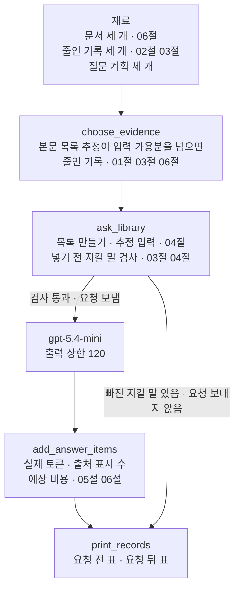
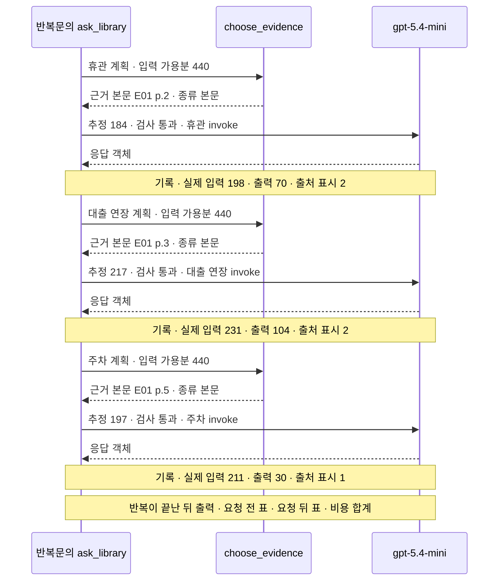
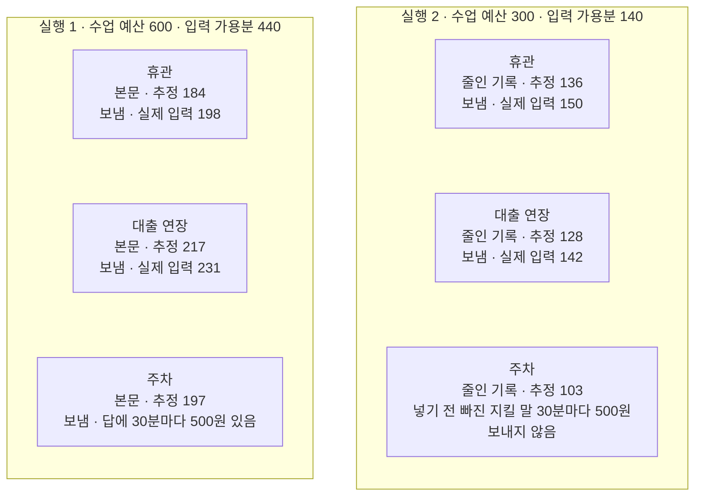

# 07-컨텍스트-엔지니어링-실습

## _src 본문 (HTML 원본)

```html
<!--meta: 실습 30분 | 코드 Jupyter Notebook | 새 용어 0개 -->
<h2 id="b1"><span class="no">1</span>학습 목표</h2>
<div class="goal"><ul><li>06절 본문 열기, 01절 예산표, 03절 줄인 기록과 지킬 말 검사를 조립 함수 하나로 이을 수 있습니다.</li><li>본문이 입력 가용분을 넘을 때 줄인 기록으로 바꾸고, 넣기 전에 지킬 말로 검사해 요청 여부를 정할 수 있습니다.</li><li>수업 예산 한 값만 바꾼 두 실행의 기록표를 비교하고, 결론을 실행한 범위로 적을 수 있습니다.</li></ul></div>
<h2 id="b2"><span class="no">2</span>이 내용을 배우는 이유</h2>
<p>01~06절에서는 컨텍스트를 다루는 방법을 한 가지씩 따로 익혔습니다. 예산표를 만들고, 기록을 고르고, 원문을 줄이고, 실패 모드를 확인했습니다. 목록을 먼저 보고 본문을 여는 방법도 배웠습니다. 실제 안내 프로그램에서는 이 방법이 한 요청 안에서 함께 움직입니다.</p>
<p>이번 절은 이 챕터의 실습입니다. 앞 절에서 쓴 함수와 글을 한 노트북에 모아 강사와 함께 실행해 봅니다. 01~06절에서 쓴 이름과 문법만 쓰고, 따로 내는 과제는 없습니다.</p>
<p>실습 주제는 도서관 안내 질문 세 개에 예산표와 지킬 말 검사 붙이기입니다. 02절에서 주차 기록에는 원문의 추가 요금이 없다고 적었습니다. 이번에는 예산이 줄어 본문 대신 그런 줄인 기록이 들어갈 때 무엇이 일어나는지 봅니다.</p>
<p><strong>이 절의 질문</strong> — 수업 예산이 줄어 본문 대신 줄인 기록을 넣어야 할 때, 요청을 보내기 전에 무엇을 확인해야 할까요?</p>
<h2 id="b3"><span class="no">3</span>앞에서 배운 내용</h2>
<p>이번 실습은 아래 절에서 배운 것을 그대로 가져옵니다.</p>
<table><thead><tr><th>절</th><th>배운 것</th><th>실습에서 쓰는 곳</th></tr></thead><tbody>
<tr><td>Ch 6 01절·Ch 7 01절</td><td><code>init_chat_model(…, temperature=0, reasoning_effort="none")</code>, system·developer·user 목록</td><td>준비 셀의 모델, 질문마다 만드는 메시지 목록</td></tr>
<tr><td>01절</td><td>수업 예산·출력 예약분·여유분, <code>input_budget()</code>·<code>count_tokens()</code>, 추정과 실제의 차이</td><td>두 실행의 입력 가용분 440·140, 요청 전 예산표</td></tr>
<tr><td>02절</td><td>기록 키 <code>출처</code>·<code>기관</code>·<code>주제</code>·<code>내용</code>, 주차 기록, 출처 표시</td><td>주차 줄인 기록, 답의 출처 표시</td></tr>
<tr><td>03절</td><td>줄인 기록과 지킬 말, <code>find_missing_words()</code>, 업무마다 목록 나누기</td><td>휴관·대출 줄인 기록, 넣기 전 검사와 답 검사, 질문마다 목록 하나</td></tr>
<tr><td>04절</td><td><code>build_notes_messages()</code>, 넣기 전에 기록을 지킬 말로 검사한 After</td><td>메시지 목록 만들기, 검사를 통과할 때만 보내기</td></tr>
<tr><td>05절</td><td>같게 둔 조건과 바꾼 값 하나, <code>count_marks()</code>, <code>estimate_openai_cost()</code></td><td>실행 2의 설계, 기록의 출처 표시 수와 예상 비용</td></tr>
<tr><td>06절</td><td>목록 보기 → 출처 고르기 → 본문 열기, <code>open_document()</code>, 예산표는 길이만 봄</td><td>문서 세 개와 목록, 질문 계획의 출처, 본문 열기</td></tr>
</tbody></table>
<p>페르소나·과업 명세·문서 세 개의 본문은 02~06절과 글자까지 같습니다. 휴관·대출 기록은 03절, 주차 기록은 02절과 같은 글입니다. 이번 실습에서 새로 적은 글은 주차 질문과 주차 지킬 말뿐입니다.</p>
<p>함수 일곱 개는 01~06절과 같은 코드로 다시 정의합니다. 새로 정의하는 함수는 <code>add_answer_items()</code>·<code>print_records()</code>·<code>choose_evidence()</code>·<code>ask_library()</code> 네 개입니다.</p>
<p>02절 기록 파일, 04절 혼란·충돌 목록, 05절 긴 측정 입력은 쓰지 않습니다. 이 실습은 파일을 쓰지 않으므로, 06절이 쓴 <code>runs/context-design-continuity.json</code>도 그대로 둡니다.</p>
<h2 id="b4"><span class="no">4</span>핵심 개념</h2>
<h3>비유로 시작하기</h3>
<p>나무 책상 두 개가 나란히 있습니다. 왼쪽 책상은 길고, 오른쪽 책상은 더 짧습니다. 두 책상 모두 오른쪽 끝에 같은 크기의 답안지와 연필이 있습니다. 오른쪽 책상 옆 바닥에는 얕은 회색 통이 하나 놓여 있습니다.</p>
{{img:07-4-두-책상과-회색-통|왼쪽 긴 나무 책상에 펼친 하늘색 책 세 권과 노란 메모지, 답안지와 연필이 있고, 오른쪽 더 짧은 책상에 초록 줄 두 개가 있는 초록 탭 카드 두 장과 노란 메모지, 같은 크기 답안지와 연필이 있으며, 오른쪽 책상 옆 바닥의 얕은 회색 통에 초록 줄 하나와 빈 점선 네모가 있는 카드와 노란 메모지가 놓인 삽화|긴 책상에는 펼친 책을, 짧은 책상에는 카드를 올립니다. 줄 하나가 빈 카드는 책상에 올리지 않고 바닥 통에 둡니다.}}
<p><strong>그림 읽기</strong> — 왼쪽 긴 책상에는 펼친 하늘색 책 세 권이 있고, 책마다 노란 메모지가 붙어 있습니다. 오른쪽 짧은 책상에는 책 대신 초록 탭 카드 두 장이 있고, 카드마다 초록 줄이 두 개 있습니다. 오른쪽 아래 바닥의 회색 통에는 세 번째 카드가 있습니다. 이 카드에는 초록 줄이 하나뿐이고, 그 아래는 빈 점선 네모입니다.</p>
<p>긴 책상은 수업 예산 600, 짧은 책상은 수업 예산 300입니다. 책상 길이는 예산의 비율을 그대로 나타내지 않습니다. 펼친 하늘색 책은 06절 그림처럼 문서 본문이고, 초록 탭 카드는 02~05절 그림의 기록, 곧 줄인 기록입니다. 노란 메모지는 질문, 답안지와 연필은 출력 예약분으로 01~06절과 같은 뜻입니다.</p>
<p>초록 줄은 03절 그림의 형광 줄처럼 지킬 말입니다. 회색 통의 카드는 추가 요금이 빠져 요청을 보내지 않은 주차 기록이고, 빈 점선 네모가 빠진 지킬 말입니다. 파란 명찰·주황 클립보드와 06절 목록 카드는 이 그림에 넣지 않았습니다.</p>
<h3>실습 조립의 구성</h3>
{{mermaid:07-1-조립도|맨 위 초록 상자 재료 문서 세 개 06절 줄인 기록 세 개 02절 03절 질문 계획 세 개에서 파란 상자 choose_evidence 본문 목록 추정이 입력 가용분을 넘으면 줄인 기록, 파란 상자 ask_library 목록 만들기 추정 입력 넣기 전 지킬 말 검사로 이어지고, 검사 통과 화살표는 보라 상자 gpt-5.4-mini 출력 상한 120과 파란 상자 add_answer_items 실제 토큰 출처 표시 수 예상 비용을 거쳐, 빠진 지킬 말 있음 화살표는 바로 노란 상자 print_records 요청 전 표 요청 뒤 표로 모이는 위에서 아래 흐름도|실습 조립 순서. 본문 목록이 입력 가용분을 넘으면 줄인 기록으로 바꾸고, 넣기 전 지킬 말 검사를 통과한 질문만 모델에 보냅니다.}}
<p><strong>도식 읽기</strong> — 위에서 아래로 읽습니다. 맨 위 초록 상자는 노트북 3·4절에서 만든 재료입니다. 파란 상자 세 개는 노트북에서 새로 정의한 함수이고, 보라 상자는 출력 상한 120인 모델입니다. 맨 아래 노란 상자가 기록을 표로 출력하는 함수입니다.</p>
<p>함수 <code>ask_library()</code> 아래에서 길이 둘로 갈립니다. 검사를 통과하면 모델에 요청을 보내고, 함수 <code>add_answer_items()</code>가 답 쪽 값을 기록에 더합니다. 빠진 지킬 말이 있으면 요청 없이 기록만 표로 갑니다.</p>
<table><thead><tr><th>함수</th><th>하는 일</th><th>가져온 곳</th></tr></thead><tbody>
<tr><td><code>choose_evidence(plan, available)</code></td><td>고른 출처의 본문을 열고, 본문 목록이 입력 가용분을 넘으면 줄인 기록으로 바꿔 근거와 종류를 튜플로 반환</td><td>01·03·06절(새로 정의)</td></tr>
<tr><td><code>ask_library(plan, available)</code></td><td>근거 고르기 → 목록 만들기 → 추정 입력 → 넣기 전 검사 → 통과할 때만 요청</td><td>01·03·04절(새로 정의)</td></tr>
<tr><td><code>add_answer_items(record, run_response, evidence, words)</code></td><td>실제 토큰 수·끝난 이유·예상 비용·출처 표시 수·답에서 빠진 지킬 말을 기록에 더함</td><td>05·06절 기록 함수(새로 정의)</td></tr>
<tr><td><code>print_records(records)</code></td><td>요청 전 표·요청 뒤 표·예상 비용 합계 출력</td><td>05·06절 기록표(새로 정의)</td></tr>
</tbody></table>
<h3>보내기 전에 보는 두 가지</h3>
<p>조립 함수는 요청 전에 두 가지를 봅니다. 하나는 01절 예산표로 센 추정 입력이 입력 가용분 안인지입니다. 다른 하나는 넣을 근거에 지킬 말이 모두 있는지입니다. 두 조건을 모두 지킬 때만 요청을 보냅니다.</p>
<p>06절 7절에서는 잘못 고른 본문이 입력 가용분 안에 들었습니다. 예산표는 길이만 보기 때문입니다. 그래서 줄인 기록으로 바꿀 때는 지킬 말 검사가 함께 있어야, 짧아진 대신 조건이 빠진 기록을 막을 수 있습니다.</p>
<h3>두 번의 실행</h3>
<p>실행 1은 01~06절과 같은 수업 예산 600으로 세 질문을 처리합니다. 실행 2는 수업 예산만 300으로 바꿔 같은 세 질문을 처리합니다. 출력 예약분 120과 여유분 40은 두 실행이 같으므로, 입력 가용분은 440과 140이 됩니다.</p>
<p>질문·문서·줄인 기록·지킬 말·모델 설정·조립 함수는 05절처럼 같게 둔 조건입니다. 바뀐 값은 수업 예산 하나이고, 그 값에 따라 넣는 자료와 요청 여부가 달라집니다.</p>
<h2 id="b5"><span class="no">5</span>실행 예제</h2>
<p>노트북은 글과 문서, 줄인 기록과 질문 계획을 만든 뒤 검사 함수와 기록표 함수를 준비합니다. 조립 함수를 정의하기 전에 요청 없이 질문마다 예산표를 봅니다. 그다음 실행 1, 실행 2, 두 실행 비교를 차례로 합니다.</p>
<p>실제 OpenAI 모델을 temperature 0으로 부릅니다. 이 페이지의 출력은 2026-09-17에 실행한 결과입니다. 요청은 많아야 6번이고, 이번 출력에서는 5번이었습니다. 예상 비용은 0.01달러 미만이고, 답 문장과 출력 토큰 수는 실행마다 달라질 수 있습니다.</p>
{{notebook:07-컨텍스트-엔지니어링-실습}}
<p class="look"><b>확인할 점</b> — 6절 요청 전 예산표에서 주차 줄의 <code>['30분마다 500원']</code>을 봅니다. 7·8절 요청 전 표에서 넣은 자료와 요청 칸을 봅니다. 9절 비교 표에서 달라진 줄을 찾습니다.</p>
<h3>실행 1의 실제 순서</h3>
{{mermaid:07-2-실행1-순서|반복문의 ask_library, choose_evidence, gpt-5.4-mini 세 세로줄 사이에서 휴관 계획과 입력 가용분 440을 보내 근거 본문 E01 p.2와 종류 본문을 받고, 추정 184 검사 통과 뒤 휴관 목록을 모델에 보내 응답 객체를 받은 다음 노란 메모 실제 입력 198 출력 70 출처 표시 2, 대출 연장은 본문 E01 p.3 추정 217에 노란 메모 231 104 2, 주차는 본문 E01 p.5 추정 197에 노란 메모 211 30 1이 차례로 있고, 맨 아래 노란 메모 반복이 끝난 뒤 요청 전 표 요청 뒤 표 비용 합계 출력이 붙은 순서도|실행 1(수업 예산 600)에서 조립 함수, 근거 고르기 함수, 모델이 주고받은 차례. 세 질문 모두 본문을 넣어 요청을 보냈습니다.}}
<p><strong>도식 읽기</strong> — 위에서 아래로 시간이 흐릅니다. 세로줄은 왼쪽부터 반복문 안에서 불린 <code>ask_library()</code>, 근거를 고르는 <code>choose_evidence()</code>, 모델 <code>gpt-5.4-mini</code>입니다. 실선은 보낸 것이고, 점선은 받은 것입니다.</p>
<p>질문마다 근거 고르기 함수가 먼저 고른 출처의 본문과 종류 「본문」을 반환합니다. 본문 목록의 추정 184·217·197이 모두 440 안이라 본문이 그대로 남았고, 넣기 전 검사도 통과했습니다. 노란 메모 세 개는 응답을 받은 직후 만든 기록 한 줄이고, 맨 아래 메모는 반복이 끝난 뒤 출력한 표입니다.</p>
<h2 id="b6"><span class="no">6</span>실험 결과 해석</h2>
<p>실행 1에서는 세 질문 모두 본문을 넣어 요청을 보냈습니다. 요청 뒤 표의 실제 입력은 198·231·211이었고, 세 목록 모두 추정보다 14 많았습니다. 세 답에서 빠진 지킬 말은 없었고, 주차 답은 <code>이후에는 30분마다 500원입니다</code>를 담았습니다.</p>
<p>실행 2에서는 입력 가용분이 140으로 줄어, 세 질문 모두 줄인 기록으로 바뀌었습니다. 휴관·대출 연장은 추정 136·128로 가용분 안이고 지킬 말도 모두 있어 요청을 보냈습니다. 주차는 추정 103으로 가용분 안이었지만, 요청 전 표가 <code>['30분마다 500원']</code>을 적고 <code>보내지 않음</code>으로 끝났습니다.</p>
{{mermaid:07-3-두-실행-비교|왼쪽 칸 실행 1 수업 예산 600 입력 가용분 440에 노란 상자 휴관 본문 추정 184 보냄 실제 입력 198, 대출 연장 본문 추정 217 보냄 실제 입력 231, 주차 본문 추정 197 보냄 답에 30분마다 500원 있음이 위에서 아래로 있고, 오른쪽 칸 실행 2 수업 예산 300 입력 가용분 140에 노란 상자 휴관 줄인 기록 추정 136 보냄 실제 입력 150, 대출 연장 줄인 기록 추정 128 보냄 실제 입력 142, 주차 줄인 기록 추정 103 넣기 전 빠진 지킬 말 30분마다 500원 보내지 않음이 위에서 아래로 있는 비교 그림|수업 예산만 바꾼 두 실행. 실행 2에서는 세 질문 모두 줄인 기록을 넣었고, 추가 요금이 빠진 주차 기록은 보내지 않았습니다.}}
<p><strong>도식 읽기</strong> — 왼쪽 칸은 실행 1, 오른쪽 칸은 실행 2이고, 칸 안은 위에서 아래로 휴관·대출 연장·주차입니다. 칸 제목에 수업 예산과 입력 가용분을 적었습니다. 노란 상자는 노트북 9절 비교 표와 8절 요청 전 표의 값입니다.</p>
<p>두 칸에서 넣은 자료는 세 줄 모두 달라졌고, 요청이 달라진 줄은 주차뿐입니다. 두 실행에서 보낸 휴관·대출 연장 답에는 모두 빠진 지킬 말이 없어서, 이 값은 상자에 넣지 않았습니다.</p>
<p>휴관·대출 연장의 실제 입력은 두 질문을 합쳐 429에서 292로 137토큰 줄었습니다. 이 차이는 넣은 자료가 정한 값입니다. 대출 연장 답은 실행 1에서 신청 방법과 대출되지 않는 자료까지 적었고, 실행 2에서는 줄인 기록에 있던 <code>대출 기준은 7권·14일입니다.</code>를 적었습니다.</p>
<p>예상 비용 합계는 실행 1이 <code>0.001397</code>달러, 실행 2가 <code>0.000759</code>달러였습니다. 실행 2는 요청이 하나 적었고, 대출 연장 출력도 104와 53으로 달랐습니다. 06절에서는 같은 목록도 출력이 104토큰과 64토큰으로 달랐으므로, 이 비용 차이를 모두 예산 탓으로 보지 않습니다.</p>
<p>결론은 이렇습니다. 예산을 줄이면 본문 대신 줄인 기록이 들어갑니다. 줄인 기록은 짧아서 예산표를 통과해도 조건이 빠져 있을 수 있고, 이번에는 넣기 전 지킬 말 검사가 그 기록을 막았습니다. 이 결과는 질문 세 개·모델 하나·예산마다 한 번 보낸 범위입니다.</p>
<h2 id="b7"><span class="no">7</span>주의할 점과 실무 메모</h2>
<ul><li>수업 예산 300과 주차 지킬 말은 흐름을 보여 주려고 정한 예입니다. 교재를 만들 때 세 질문의 본문·줄인 기록 추정 입력을 요청 없이 먼저 셌습니다. 그 뒤 본문은 넘치고 줄인 기록은 드는 값으로 300을 골랐습니다. 기기 셸에서 다섯 요청을 한 번 보낸 뒤 노트북을 새 커널로 두 번 실행했습니다.</li>
<li>휴관 줄인 기록 목록의 추정 136은 입력 가용분 140에 4토큰 차이로 들었습니다. 수업 예산을 조금만 더 줄여도 휴관 질문까지 보내지 않게 됩니다. 이 경우는 이번에 실행하지 않았습니다.</li>
<li>보내지 않은 주차 질문에는 답이 없습니다. 실제 창구라면 사람이 줄인 기록을 03절처럼 조건을 남겨 다시 적거나, 이 질문의 예산을 따로 정해야 합니다. 두 방법 모두 이번에 실행하지 않았고, 조건이 빠진 기록을 그대로 보냈을 때의 답도 확인하지 않았습니다.</li>
<li>지킬 말 검사는 목록에 적은 말이 글에 들어 있는지만 봅니다. 목록에 적지 않은 조건이 빠지거나, 말은 남았는데 뜻이 바뀌면 알려 주지 않습니다. 답의 뜻은 원문과 나란히 놓고 사람이 확인합니다.</li>
<li>출력 토큰 수와 예상 비용은 같은 목록이어도 요청마다 달라집니다. 예산마다 한 번씩 보낸 결과라, 비용 차이로 순위를 정하지 않았습니다. 입력이 모두 1,000토큰 미만이라 캐시 입력은 생기지 않았습니다.</li>
<li>이름 <code>available</code>은 실행 셀마다 다시 담습니다. 실행 1 셀만 다시 실행하면 조립 함수가 다시 요청을 보내고, 표의 답과 비용이 바뀔 수 있습니다.</li>
<li>이 실습은 기록을 파일로 남기지 않았습니다. 06절 기록 파일은 뒤 검사가 지문으로 확인하는 파일이라, 실습 결과를 그 파일에 덮어쓰지 않습니다.</li>
<li>교재 출력은 Linux의 Python 3.12.13으로 만들었습니다. 패키지는 langchain 1.4.0, langchain-core 1.6.2, langchain-openai 1.6.0입니다. openai 3.8.0, tiktoken 0.14.0도 함께 썼습니다. 다른 버전과 Windows·macOS에서는 실행하지 않았습니다.</li></ul>
<h2 id="b8"><span class="no">8</span>정리와 다음 절</h2>
<ul><li>06절 본문 열기, 01절 예산표, 03절 줄인 기록과 지킬 말 검사, 05절 기록 함수를 조립 함수 <code>ask_library()</code>로 이었습니다.</li><li>수업 예산 600인 실행 1에서는 세 질문 모두 본문을 넣어 보냈고, 세 답에서 빠진 지킬 말은 없었습니다.</li><li>수업 예산만 300으로 줄인 실행 2에서는 세 질문 모두 줄인 기록으로 바뀌었습니다. 추가 요금이 빠진 주차 기록은 넣기 전 검사에서 걸려 요청을 보내지 않았습니다.</li></ul>
<p><strong>다음 학습과 이어지는 지점</strong> — 이 절로 Ch 8과 Part 2가 끝납니다. Ch 9 01절은 같은 E01 문서를 PDF에서 쪽마다 읽습니다. 이 실습에서 사람이 목록을 보고 적던 출처를, Ch 9에서는 검색이 고릅니다. 검색으로 고른 문서가 맞았는지 재는 방법은 Ch 11에서 다룹니다.</p>
<h2 id="b9"><span class="no">9</span>복습 문제</h2>
<details class="quiz"><summary>문제 1 · 바뀐 값 하나</summary><p class="quiz-q">실행 1과 실행 2에서 바꾼 값은 무엇이고, 그 값 때문에 입력 가용분은 얼마에서 얼마로 바뀌었나요?</p><p class="quiz-a"><b>해설</b> — 수업 예산 하나를 600에서 300으로 바꿨습니다. 출력 예약분 120과 여유분 40은 같아서, 입력 가용분은 <code>600 - 120 - 40</code>인 440에서 <code>300 - 120 - 40</code>인 140으로 바뀌었습니다.</p></details>
<details class="quiz"><summary>문제 2 · 예산 안인데 보내지 않은 요청</summary><p class="quiz-q">실행 2의 주차 줄인 기록 목록은 추정 103으로 입력 가용분 140 안이었습니다. 그런데 왜 요청을 보내지 않았나요?</p><p class="quiz-a"><b>해설</b> — 넣기 전 지킬 말 검사에서 <code>['30분마다 500원']</code>이 빠진 것이 나왔기 때문입니다. 02절 주차 기록은 무료 시간만 옮겨 적은 한 문장이었습니다. 예산표는 길이만 보므로, 조건이 빠졌는지는 지킬 말로 따로 봐야 합니다.</p></details>
<details class="quiz"><summary>문제 3 · 휴관 질문의 여유</summary><p class="quiz-q">실행 2에서 휴관 줄인 기록 목록의 추정 입력은 136이었습니다. 수업 예산을 290으로 줄이면 조립 함수는 휴관 질문을 어떻게 처리할까요?</p><p class="quiz-a"><b>해설</b> — 입력 가용분이 <code>290 - 120 - 40</code>인 130이 됩니다. 본문 목록 184도, 줄인 기록 목록 136도 130을 넘으므로 요청을 보내지 않고 기록에 「보내지 않음」이 남을 것입니다. 이 경우는 노트북에서 실행하지 않았습니다.</p></details>
<details class="quiz"><summary>문제 4 · 비용 차이</summary><p class="quiz-q">예상 비용 합계가 0.001397달러에서 0.000759달러로 줄었습니다. 이 차이를 모두 예산을 줄인 효과라고 말할 수 있나요?</p><p class="quiz-a"><b>해설</b> — 말할 수 없습니다. 실행 2는 주차 요청을 보내지 않아 요청 수가 달랐습니다. 대출 연장 출력도 104와 53으로 달랐는데, 06절에서 같은 목록도 출력이 104와 64로 달랐습니다. 넣은 자료가 정한 것은 입력 토큰 수입니다.</p></details>
<details class="quiz"><summary>문제 5 · 이 절의 질문</summary><p class="quiz-q">수업 예산이 줄어 본문 대신 줄인 기록을 넣어야 할 때, 요청을 보내기 전에 무엇을 확인해야 하나요?</p><p class="quiz-a"><b>해설</b> — 줄인 기록 목록이 입력 가용분 안인지와, 줄인 기록에 지킬 말이 모두 남았는지를 확인합니다. 둘 중 하나라도 어긋나면 보내지 않고 기록에 남깁니다. 지킬 말 검사는 말이 있는지만 보므로, 뜻은 원문과 대조합니다.</p></details>
<h2 id="b10"><span class="no">10</span>참고 자료</h2>
<p>문서는 01~06절 작업에서 2026-09-17에 확인했습니다. 본문과 기록은 02·03·06절에서 가상 기관 문서 <code>E01.pdf</code>를 읽고 옮겨 적은 글입니다. 요금은 Ch 6 06절에서 확인한 값과 같습니다.</p>
<ul><li><div><a href="https://www.langchain.com/blog/context-engineering-for-agents">LangChain, Context Engineering</a></div>적어 두기·골라 넣기·줄이기·나누기의 이름 · 2025-07-02 · 확인 2026-09-17</li><li><div><a href="https://www.anthropic.com/engineering/effective-context-engineering-for-ai-agents">Anthropic, Effective context engineering for AI agents</a></div>꼭 필요한 토큰만 넣는 원칙과 필요할 때 자료를 읽는 방식 · 2025-09-29 · 확인 2026-09-17</li><li><div><a href="https://developers.openai.com/api/docs/models/gpt-5.4-mini">OpenAI GPT-5.4 mini 모델 안내</a></div>컨텍스트 윈도와 100만 토큰당 요금 · 확인 2026-09-17</li></ul>
```

## 노트북 셀 (순서대로)

### [0] markdown {'html': 'skip'}

# 컨텍스트 엔지니어링 실습: 도서관 안내 질문 세 개에 예산표와 지킬 말 검사 붙이기

**이 노트북에서 할 일**

1. 06절 본문 열기, 01절 예산표, 03절 줄인 기록과 지킬 말 검사를 요청 함수 하나로 잇습니다.
2. 수업 예산 600으로 도서관 안내 질문 세 개를 처리하고, 기록표로 결과를 봅니다(실행 1).
3. 수업 예산만 300으로 줄여 같은 세 질문을 다시 처리하고, 두 실행을 비교합니다(실행 2).

**준비물** — 프로젝트 폴더 `.env` 파일의 `OPENAI_API_KEY`가 필요합니다. 읽는 데이터 파일은 없습니다.

인터넷 서비스에 보내는 요청은 많아야 6번이고, 모두 `gpt-5.4-mini`입니다. 교재 출력에서는 실행 1에 3번, 실행 2에 2번을 보냈습니다.
실행 시간은 1분 안팎이고, 예상 비용은 0.01달러 미만입니다. 요금은 Ch 6 06절에서 2026-09-17에 확인한 mini 공식 요금 기준입니다.

이 노트북은 파일을 만들거나 고치지 않습니다. 06절이 쓴 `runs` 폴더의 기록 파일도 읽거나 건드리지 않습니다.

**기준 버전** — 실습 폴더에 고정한 패키지 판을 씁니다. langchain 1.4.0, langchain-core 1.6.2, langchain-openai 1.6.0입니다.
openai 3.8.0, tiktoken 0.14.0, python-dotenv 1.2.3도 함께 씁니다.

교재 출력은 Linux의 Python 3.12.13으로 만들었습니다. 다른 버전과 Windows·macOS에서는 이번에 실행하지 않았습니다.

실습 폴더 `labs/part2/ch08-context-engineering`에서 `uv sync --locked`를 실행합니다.
그다음 이 폴더의 `.venv` 커널을 고르고 첫 셀부터 순서대로 실행합니다.

01~06절에서 쓴 이름과 문법만 씁니다. 강사와 함께 셀을 차례로 실행하며, 따로 내는 과제는 없습니다.

### [1] markdown {'html': 'skip'}

## 오늘 볼 그림


위에서 아래로 읽습니다. 맨 위 초록 상자는 노트북 3·4절에서 만드는 재료이고, 파란 상자는 노트북에서 정의하는 함수입니다.
보라 상자는 요청을 받는 모델입니다. 넣기 전 검사를 통과한 질문만 모델에 가고, 통과하지 못한 질문은 요청 없이 기록에 남습니다.

맨 아래 노란 상자가 두 실행에서 출력하는 기록표입니다. 두 실행은 수업 예산 한 값만 다릅니다.

### [2] markdown {}

## 1. 준비

첫 셀은 패키지를 설치하고 설치된 버전을 출력합니다. 설치에는 몇십 초가 걸릴 수 있습니다.
01~06절과 같은 패키지 판을 씁니다.

### [3] code {'execution': {'iopub.execute_input': '2026-09-17T12:49:55.185444Z', 'iopub.status.busy': '2026-09-17T12:49:55.185270Z', 'iopub.status.idle': '2026-09-17T12:49:55.812822Z', 'shell.execute_reply': '2026-09-17T12:49:55.812268Z'}, 'lesson_role': 'setup'}

```python
# 이 절에서 쓰는 패키지를 설치하고 버전을 확인합니다
%pip install -q "langchain==1.4.0" "langchain-openai==1.6.0" "python-dotenv==1.2.3" "tiktoken==0.14.0"
from importlib.metadata import version

print("langchain:", version("langchain"))
print("langchain-core:", version("langchain-core"))
print("langchain-openai:", version("langchain-openai"))
print("openai:", version("openai"))
print("tiktoken:", version("tiktoken"))
print("python-dotenv:", version("python-dotenv"))
```

출력:
```
Note: you may need to restart the kernel to use updated packages.
langchain: 1.4.0
langchain-core: 1.6.2
langchain-openai: 1.6.0
openai: 3.8.0
tiktoken: 0.14.0
python-dotenv: 1.2.3

```

### [4] markdown {}

**결과 읽기** — 출력 줄은 `langchain: 1.4.0`, `openai: 3.8.0`, `tiktoken: 0.14.0` 등 여섯 줄입니다.
준비물에 적은 기준 버전과 같습니다.

두 가지를 불러옵니다. 토큰 수를 세는 라이브러리 tiktoken과, 모델 객체를 만드는 함수입니다.
06절과 달리 이 실습은 파일을 쓰지 않으므로 모듈 `json`·`hashlib`·`time`은 불러오지 않습니다.

### [5] code {'execution': {'iopub.execute_input': '2026-09-17T12:49:55.813870Z', 'iopub.status.busy': '2026-09-17T12:49:55.813783Z', 'iopub.status.idle': '2026-09-17T12:49:56.172457Z', 'shell.execute_reply': '2026-09-17T12:49:56.172013Z'}, 'lesson_role': 'setup'}

```python
# 토큰 수를 세는 라이브러리와 모델 객체를 만드는 함수를 불러옵니다
import tiktoken

from langchain.chat_models import init_chat_model
```

출력:
```

```

### [6] markdown {}

06절과 같은 셀로 API 키가 있는지 확인합니다. 키 값은 출력하지 않고, 있는지만 봅니다.
`True` 값이 나오면 다음으로 넘어갑니다.

### [7] code {'execution': {'iopub.execute_input': '2026-09-17T12:49:56.173190Z', 'iopub.status.busy': '2026-09-17T12:49:56.173131Z', 'iopub.status.idle': '2026-09-17T12:49:56.178164Z', 'shell.execute_reply': '2026-09-17T12:49:56.177871Z'}, 'lesson_role': 'setup'}

```python
# .env 파일에서 OpenAI API 키를 읽습니다(키 값은 출력하지 않습니다)
import os
from dotenv import find_dotenv, load_dotenv

env_path = find_dotenv(usecwd=True)
load_dotenv(env_path)
has_key = os.getenv("OPENAI_API_KEY") is not None
print("OPENAI_API_KEY 설정 여부:", has_key)
assert has_key, "프로젝트 폴더의 .env 파일에 OPENAI_API_KEY를 적어 주세요."
```

출력:
```
OPENAI_API_KEY 설정 여부: True

```

### [8] markdown {}

출력 예약분과 여유분은 01~06절과 같은 120과 40으로 담습니다. 이 두 값은 실행 1과 실행 2에서 바꾸지 않습니다.
모델 객체는 06절처럼 출력 예약분을 출력 상한(`max_tokens`)으로 주어 만듭니다. 이 셀은 요청을 보내지 않습니다.

### [9] code {'execution': {'iopub.execute_input': '2026-09-17T12:49:56.178778Z', 'iopub.status.busy': '2026-09-17T12:49:56.178722Z', 'iopub.status.idle': '2026-09-17T12:49:57.052402Z', 'shell.execute_reply': '2026-09-17T12:49:57.052105Z'}}

```python
# 두 실행에서 같게 둘 출력 예약분·여유분을 담고, 출력 예약분을 출력 상한으로 준 모델을 준비합니다
output_reserve = 120
safety_margin = 40
model = init_chat_model(
    "openai:gpt-5.4-mini",
    temperature=0,
    reasoning_effort="none",
    max_tokens=output_reserve,
)
print("출력 예약분:", output_reserve)
print("여유분:", safety_margin)
print("모델 이름:", model.model_name)
print("temperature:", model.temperature)
print("출력 상한(max_tokens):", model.max_tokens)
```

출력:
```
출력 예약분: 120
여유분: 40
모델 이름: gpt-5.4-mini
temperature: 0.0
출력 상한(max_tokens): 120

```

### [10] markdown {}

**결과 읽기** — 출력 줄은 `출력 예약분: 120`, `여유분: 40`, `모델 이름: gpt-5.4-mini`입니다.
끝의 두 줄은 `temperature: 0.0`과 `출력 상한(max_tokens): 120`입니다. 이것으로 준비가 끝났습니다.

이 노트북의 출력은 2026-09-17에 이 모델로 실행한 결과입니다. 실행마다 답 문장과 출력 토큰 수가 달라질 수 있습니다.
Ch 6 01절에서 본 것처럼 temperature 0은 Ch 5 06절의 뽑기를 끈 설정(`do_sample=False`)과 같은 것이 아닙니다.

## 2. 실습 주제 — 도서관 안내 질문 세 개에 예산표와 지킬 말 검사 붙이기

미르시립도서관 안내 창구에 질문 세 개가 들어왔다고 봅니다. 휴관일, 대출 연장, 회원 주차 요금 질문입니다.
프로그램은 질문마다 06절처럼 목록에서 고른 출처의 본문을 엽니다.

본문 목록의 추정 입력이 01절 입력 가용분을 넘으면, 03절처럼 사람이 줄여 둔 기록을 대신 넣습니다.
넣기 전에는 04절 After처럼 넣을 글을 지킬 말로 검사합니다. 빠진 지킬 말이 있으면 요청을 보내지 않고 그 사실을 기록에 남깁니다.

02절에서 주차 기록에는 원문의 추가 요금이 없다고 적었습니다. 이번 주차 질문은 그 추가 요금까지 묻습니다.

실행 1은 수업 예산 600, 실행 2는 수업 예산 300으로 같은 세 질문을 처리합니다. 두 실행에서 바꾸는 값은 수업 예산 하나입니다.
질문·문서·줄인 기록·지킬 말·모델 설정은 05절처럼 같게 둔 조건입니다.
02절 기록 파일, 04절 혼란·충돌 목록, 05절 긴 측정 입력은 이번 실습에서 쓰지 않습니다.

### [11] markdown {}

## 3. 재료 만들기 — 글과 문서 세 개

페르소나와 과업 명세는 02~06절과 글자까지 같습니다. 문서 세 개의 본문도 06절과 같은 글입니다.
E01 문서 2쪽 이용 시간, 3쪽 자료 대출, 5쪽 찾아오시는 길입니다. 토큰 수는 6절에서 함수를 정의한 뒤 셉니다.

실행 전에 예상합니다. 세 본문 가운데 자료 대출 본문이 가장 길 것입니다.

### [12] code {'execution': {'iopub.execute_input': '2026-09-17T12:49:57.053152Z', 'iopub.status.busy': '2026-09-17T12:49:57.053089Z', 'iopub.status.idle': '2026-09-17T12:49:57.055345Z', 'shell.execute_reply': '2026-09-17T12:49:57.054965Z'}}

```python
# 02~06절과 같은 페르소나·과업 명세와, 06절과 같은 문서 세 개의 본문을 만듭니다
persona_text = "당신은 미르시립도서관 안내 담당자입니다."
task_text = "주어진 근거에 있는 정보만 쓰세요. 두 문장 이내로 답하고, 문장마다 끝에 출처를 [E01 p.2]처럼 적으세요."
hours_text = "평일(화~금) 이용 시간은 오전 9시부터 오후 10시까지입니다. 토요일과 일요일은 오전 9시부터 오후 6시까지 문을 엽니다.\n"
hours_text = hours_text + "매주 월요일은 정기 휴관일입니다. 법정 공휴일에도 휴관하며, 공휴일이 월요일과 겹치면 그 다음 날인 화요일에도 휴관합니다."
loan_text = "회원 한 사람이 한 번에 빌릴 수 있는 자료는 도서 7권과 영상 자료 2점입니다. 대출 기간은 도서 14일, 영상 자료 7일입니다.\n"
loan_text = loan_text + "대출 기간은 다른 이용자의 예약이 없는 경우 1회에 한해 7일 연장할 수 있습니다. "
loan_text = loan_text + "연장은 반납 예정일 전에 앱, 홈페이지, 전화(032-000-1998)로 신청합니다.\n"
loan_text = loan_text + "정기간행물 최신호, 참고도서(사전·연감), 향토자료는 관내에서만 열람할 수 있고 대출되지 않습니다."
way_text = "주소는 미르시 중앙동 도서관로 12입니다. 지하철 미르선 중앙역 3번 출구에서 걸어서 5분이며, 시내버스 12·34·56번이 도서관 앞에 정차합니다.\n"
way_text = way_text + "주차장은 80면이며 회원은 최초 2시간 무료, 이후 30분마다 500원입니다. 장애인 주차 구역 5면과 전기차 충전기 2기가 있습니다."
print("본문 글자 수(이용 시간·자료 대출·찾아오시는 길):", len(hours_text), len(loan_text), len(way_text))
```

출력:
```
본문 글자 수(이용 시간·자료 대출·찾아오시는 길): 138 224 159

```

### [13] markdown {}

**결과 읽기** — 출력 줄은 `본문 글자 수(이용 시간·자료 대출·찾아오시는 길): 138 224 159`입니다. 예상대로 자료 대출 본문이 가장 깁니다.
찾아오시는 길 본문 둘째 줄에는 「이후 30분마다 500원」이라는 추가 요금이 있습니다.

06절과 같은 코드로 문서 세 개와 목록을 만듭니다. 목록 한 줄은 출처 표시, 제목, 한 줄 설명입니다.
사람은 이 목록을 보고 질문마다 열 출처를 고릅니다. 고른 출처는 4절 질문 계획에 적습니다.

### [14] code {'execution': {'iopub.execute_input': '2026-09-17T12:49:57.055850Z', 'iopub.status.busy': '2026-09-17T12:49:57.055803Z', 'iopub.status.idle': '2026-09-17T12:49:57.057683Z', 'shell.execute_reply': '2026-09-17T12:49:57.057357Z'}}

```python
# 06절과 같은 코드로 문서 세 개에 출처·제목·한 줄 설명·본문을 붙이고, 본문을 뺀 목록을 만듭니다
documents = [
    {"출처": "E01 p.2", "제목": "2. 이용 시간", "설명": "매주 월요일은 정기 휴관일입니다.", "내용": hours_text},
    {"출처": "E01 p.3", "제목": "4. 자료 대출", "설명": "도서는 7권까지 14일 동안 대출할 수 있습니다.", "내용": loan_text},
    {"출처": "E01 p.5", "제목": "12. 찾아오시는 길", "설명": "회원은 최초 2시간 무료입니다.", "내용": way_text},
]
catalog = []
for document in documents:
    line_text = document["제목"] + ": " + document["설명"]
    catalog.append({"출처": document["출처"], "내용": line_text})
print("목록:")
for item in catalog:
    print("[" + item["출처"] + "] " + item["내용"])
```

출력:
```
목록:
[E01 p.2] 2. 이용 시간: 매주 월요일은 정기 휴관일입니다.
[E01 p.3] 4. 자료 대출: 도서는 7권까지 14일 동안 대출할 수 있습니다.
[E01 p.5] 12. 찾아오시는 길: 회원은 최초 2시간 무료입니다.

```

### [15] markdown {}

**결과 읽기** — 라벨 줄 `목록:` 아래 세 줄은 06절 목록과 같습니다.
첫 줄은 `[E01 p.2] 2. 이용 시간: 매주 월요일은 정기 휴관일입니다.`입니다.
셋째 줄은 `[E01 p.5] 12. 찾아오시는 길: 회원은 최초 2시간 무료입니다.`입니다.

목록 줄은 06절에서 본 것처럼 본문을 고르는 데 쓰고, 답의 근거로 넣지 않습니다.

## 4. 재료 만들기 — 줄인 기록과 질문 계획

본문이 입력 가용분을 넘을 때 대신 넣을 줄인 기록 세 개를 담습니다. 휴관 기록과 대출 기록은 03절, 주차 기록은 02절과 글자까지 같습니다.
세 기록의 키는 02절 기록과 같은 `출처`·`기관`·`주제`·`내용`입니다.

실행 전에 예상합니다. 주차 기록 줄에는 추가 요금이 없을 것입니다.

### [16] code {'execution': {'iopub.execute_input': '2026-09-17T12:49:57.058188Z', 'iopub.status.busy': '2026-09-17T12:49:57.058140Z', 'iopub.status.idle': '2026-09-17T12:49:57.060006Z', 'shell.execute_reply': '2026-09-17T12:49:57.059716Z'}}

```python
# 03절 휴관·대출 기록과 02절 주차 기록을 줄인 기록으로 담습니다
closure_note = {"출처": "E01 p.2", "기관": "미르시립도서관", "주제": "휴관", "내용": "매주 월요일은 정기 휴관일이고 법정 공휴일에도 휴관하며, 공휴일이 월요일과 겹치면 다음 화요일도 휴관합니다."}
loan_note = {"출처": "E01 p.3", "기관": "미르시립도서관", "주제": "대출", "내용": "회원 한 사람의 도서 대출 기준은 7권·14일이며, 다른 이용자의 예약이 없는 경우에만 1회 7일 연장할 수 있습니다."}
parking_note = {"출처": "E01 p.5", "기관": "미르시립도서관", "주제": "주차", "내용": "회원은 최초 2시간 무료입니다."}
short_notes = [closure_note, loan_note, parking_note]
print("줄인 기록(출처 | 주제 | 내용):")
for note in short_notes:
    print(note["출처"], "|", note["주제"], "|", note["내용"])
```

출력:
```
줄인 기록(출처 | 주제 | 내용):
E01 p.2 | 휴관 | 매주 월요일은 정기 휴관일이고 법정 공휴일에도 휴관하며, 공휴일이 월요일과 겹치면 다음 화요일도 휴관합니다.
E01 p.3 | 대출 | 회원 한 사람의 도서 대출 기준은 7권·14일이며, 다른 이용자의 예약이 없는 경우에만 1회 7일 연장할 수 있습니다.
E01 p.5 | 주차 | 회원은 최초 2시간 무료입니다.

```

### [17] markdown {}

**결과 읽기** — 라벨 줄 아래 세 줄의 마지막은 `E01 p.5 | 주차 | 회원은 최초 2시간 무료입니다.`입니다.
예상대로 주차 기록에는 원문의 「이후 30분마다 500원」이 없습니다. 02절에서 사실 하나만 한 문장으로 옮겨 적은 기록이기 때문입니다.

질문마다 계획을 딕셔너리 하나로 적습니다. 키는 `이름`, `질문`, `출처`, `지킬 말`, `줄인 기록`입니다.
키 `출처`에는 사람이 3절 목록을 보고 고른 출처를 적습니다. 06절 `selected_source`와 같은 일입니다.

휴관 질문과 지킬 말은 03·04절, 대출 연장 질문은 03·06절과 같습니다. 대출 연장의 지킬 말은 06절 연장 조건 세 개입니다.
주차 질문과 지킬 말은 이번 실습에서 새로 적습니다. 지킬 말은 E01 5쪽 원문에서 무료 시간과 추가 요금을 골랐습니다.

### [18] code {'execution': {'iopub.execute_input': '2026-09-17T12:49:57.060535Z', 'iopub.status.busy': '2026-09-17T12:49:57.060489Z', 'iopub.status.idle': '2026-09-17T12:49:57.062460Z', 'shell.execute_reply': '2026-09-17T12:49:57.062135Z'}}

```python
# 질문마다 이름·질문·목록에서 고른 출처·지킬 말·줄인 기록을 딕셔너리 하나로 적습니다
closure_question = "미르시립도서관의 정기 휴관일은 언제이고, 공휴일이 월요일과 겹치면 어떻게 되나요?"
loan_question = "미르시립도서관에서 빌린 도서의 대출 기간을 연장할 수 있나요?"
parking_question = "미르시립도서관에 회원이 차를 세우면 몇 시간 무료이고, 그 뒤에는 요금이 얼마인가요?"
plans = [
    {"이름": "휴관", "질문": closure_question, "출처": "E01 p.2", "지킬 말": ["월요일", "법정 공휴일", "화요일"], "줄인 기록": closure_note},
    {"이름": "대출 연장", "질문": loan_question, "출처": "E01 p.3", "지킬 말": ["예약이 없는 경우", "1회", "7일 연장"], "줄인 기록": loan_note},
    {"이름": "주차", "질문": parking_question, "출처": "E01 p.5", "지킬 말": ["2시간", "30분마다 500원"], "줄인 기록": parking_note},
]
print("질문 계획(이름 | 출처 | 지킬 말):")
for plan in plans:
    print(plan["이름"], "|", plan["출처"], "|", plan["지킬 말"])
```

출력:
```
질문 계획(이름 | 출처 | 지킬 말):
휴관 | E01 p.2 | ['월요일', '법정 공휴일', '화요일']
대출 연장 | E01 p.3 | ['예약이 없는 경우', '1회', '7일 연장']
주차 | E01 p.5 | ['2시간', '30분마다 500원']

```

### [19] markdown {}

**결과 읽기** — 라벨 줄 아래 세 줄은 `휴관 | E01 p.2 | ['월요일', '법정 공휴일', '화요일']`로 시작합니다.
둘째 줄은 `대출 연장 | E01 p.3 | ['예약이 없는 경우', '1회', '7일 연장']`입니다.
셋째 줄은 `주차 | E01 p.5 | ['2시간', '30분마다 500원']`입니다.

질문마다 목록 하나를 따로 만들어 보내므로, 03절 나누기처럼 한 요청에는 한 업무의 자료만 들어갑니다.

## 5. 기록 장치 — 검사 함수와 기록표

요청마다 남길 기록을 만드는 함수와, 기록을 표로 출력하는 함수를 준비합니다.
먼저 03절 함수 `find_missing_words()`를 같은 코드로 정의합니다. 글 하나와 말 목록을 받아, 글에 없는 말만 목록으로 반환합니다.
이 함수는 넣기 전 검사와 답 검사에 모두 씁니다. 이 셀은 정의만 하므로 출력이 없습니다.

### [20] code {'execution': {'iopub.execute_input': '2026-09-17T12:49:57.062942Z', 'iopub.status.busy': '2026-09-17T12:49:57.062897Z', 'iopub.status.idle': '2026-09-17T12:49:57.064526Z', 'shell.execute_reply': '2026-09-17T12:49:57.064185Z'}}

```python
# 글에 들어 있지 않은 지킬 말만 모아 반환하는 함수를 정의합니다(03절과 같은 코드)
def find_missing_words(text, words):
    missing = []
    for word in words:
        if word not in text:
            missing.append(word)
    return missing
```

출력:
```

```

### [21] markdown {}

**결과 읽기** — 정의만 하는 셀이라 출력이 없습니다.

05절 함수 `count_marks()`도 같은 코드로 정의합니다. 답 글에 출처 표시가 몇 번 들어 있는지 셉니다.
과업 명세가 문장마다 출처를 적게 했으므로, 두 문장 답이면 표시가 두 번일 것으로 봅니다. 이 셀은 출력이 없습니다.

### [22] code {'execution': {'iopub.execute_input': '2026-09-17T12:49:57.065070Z', 'iopub.status.busy': '2026-09-17T12:49:57.065026Z', 'iopub.status.idle': '2026-09-17T12:49:57.066592Z', 'shell.execute_reply': '2026-09-17T12:49:57.066303Z'}}

```python
# 답 글에 출처 표시가 몇 번 들어 있는지 세어 반환하는 함수를 정의합니다(05절과 같은 코드)
def count_marks(answer_text, mark):
    pieces = answer_text.split(mark)
    mark_count = len(pieces) - 1
    return mark_count
```

출력:
```

```

### [23] markdown {}

**결과 읽기** — 정의만 하는 셀이라 출력이 없습니다.

Ch 7 08절 함수 `estimate_openai_cost()`도 05·06절과 같은 코드로 정의합니다. 사용량 딕셔너리로 요청 한 번의 예상 비용(달러)을 계산합니다.
기본값은 Ch 6 06절에서 확인한 mini 요금입니다. 이 셀은 정의만 하므로 출력이 없습니다.

### [24] code {'execution': {'iopub.execute_input': '2026-09-17T12:49:57.067181Z', 'iopub.status.busy': '2026-09-17T12:49:57.067138Z', 'iopub.status.idle': '2026-09-17T12:49:57.068747Z', 'shell.execute_reply': '2026-09-17T12:49:57.068424Z'}}

```python
# 사용량과 세 요금(기본값 mini 요금)으로 요청 한 번의 예상 비용(달러)을 계산하는 함수를 정의합니다(Ch 7 08절·05·06절과 같은 코드)
def estimate_openai_cost(usage, input_rate=0.75, cached_input_rate=0.075, output_rate=4.50):
    if usage is None:
        return None
    # 캐시 입력 키가 없으면 할인 없이 모두 입력 요금으로 계산합니다
    details = usage.get("input_token_details", {})
    cache_read = details.get("cache_read", 0)
    normal_input = usage["input_tokens"] - cache_read
    input_cost = normal_input * input_rate + cache_read * cached_input_rate
    output_cost = usage["output_tokens"] * output_rate
    price_unit = 1000000
    return (input_cost + output_cost) / price_unit
```

출력:
```

```

### [25] markdown {}

**결과 읽기** — 정의만 하는 셀이라 출력이 없습니다.

요청을 보낸 뒤 기록 한 줄에 답 쪽 값을 더하는 함수를 새로 정의합니다. 06절 `make_design_record()`와 05절 `make_length_record()`를 합친 모양입니다.
인자는 기록 딕셔너리, 응답 객체, 넣은 근거 하나, 지킬 말 목록입니다.

더하는 키는 `답`, `실제 입력 토큰 수`, `출력 토큰 수`, `끝난 이유`, `예상 비용(달러)`, `출처 표시 수`, `답에서 빠진 지킬 말`입니다.
Ch 7 08절 `add_cost_items()`처럼 받은 딕셔너리에 키를 더해 반환합니다. 이 셀은 정의만 하므로 출력이 없습니다.

### [26] code {'execution': {'iopub.execute_input': '2026-09-17T12:49:57.069394Z', 'iopub.status.busy': '2026-09-17T12:49:57.069343Z', 'iopub.status.idle': '2026-09-17T12:49:57.071138Z', 'shell.execute_reply': '2026-09-17T12:49:57.070823Z'}}

```python
# 요청을 보낸 기록 한 줄에 토큰 수·끝난 이유·예상 비용·출처 표시 수·답에서 빠진 지킬 말을 더해 반환하는 함수를 정의합니다
def add_answer_items(record, run_response, evidence, words):
    run_usage = run_response.usage_metadata
    run_cost = estimate_openai_cost(run_usage)
    record["답"] = run_response.text
    record["실제 입력 토큰 수"] = run_usage["input_tokens"]
    record["출력 토큰 수"] = run_usage["output_tokens"]
    record["끝난 이유"] = run_response.response_metadata["finish_reason"]
    record["예상 비용(달러)"] = round(run_cost, 6)
    # 05절: 넣은 근거의 출처 표시 수를 세고, 03절 함수로 답에 없는 지킬 말을 모읍니다
    record["출처 표시 수"] = count_marks(run_response.text, "[" + evidence["출처"] + "]")
    record["답에서 빠진 지킬 말"] = find_missing_words(run_response.text, words)
    return record
```

출력:
```

```

### [27] markdown {}

**결과 읽기** — 정의만 하는 셀이라 출력이 없습니다.

기록 목록을 받아 표 두 개를 출력하는 함수를 정의합니다. 요청 전 표에는 모든 기록의 넣은 자료·추정 입력·넣기 전 검사·요청 여부가 나옵니다.
요청 뒤 표에는 요청을 보낸 기록만 나오고, 마지막 줄에 예상 비용 합계를 출력합니다.

반복문은 이미 만든 기록을 출력만 하고, 요청을 보내지 않습니다. 이 셀은 정의만 하므로 출력이 없습니다.

### [28] code {'execution': {'iopub.execute_input': '2026-09-17T12:49:57.071706Z', 'iopub.status.busy': '2026-09-17T12:49:57.071662Z', 'iopub.status.idle': '2026-09-17T12:49:57.073746Z', 'shell.execute_reply': '2026-09-17T12:49:57.073369Z'}}

```python
# 기록 목록을 받아 요청 전 표·요청 뒤 표·예상 비용 합계를 출력하는 함수를 정의합니다
def print_records(records):
    print("요청 전 표(질문 | 넣은 자료 | 추정 입력 | 넣기 전 빠진 지킬 말 | 요청):")
    for record in records:
        print(record["질문"], "|", record["넣은 자료"], "|", record["추정 입력"], "|", record["넣기 전 빠진 지킬 말"], "|", record["요청"])
    print("요청 뒤 표(질문 | 실제 입력 토큰 수 | 출력 토큰 수 | 끝난 이유 | 출처 표시 수 | 답에서 빠진 지킬 말 | 예상 비용(달러)):")
    total_cost = 0
    for record in records:
        if record["요청"] == "보냄":
            total_cost = total_cost + record["예상 비용(달러)"]
            print(record["질문"], "|", record["실제 입력 토큰 수"], "|", record["출력 토큰 수"], "|", record["끝난 이유"], "|",
                  record["출처 표시 수"], "|", record["답에서 빠진 지킬 말"], "|", record["예상 비용(달러)"])
    print("예상 비용 합계(달러):", round(total_cost, 6))
```

출력:
```

```

### [29] markdown {}

**결과 읽기** — 정의만 하는 셀이라 출력이 없습니다.

## 6. 조립 — 본문 열기와 요청 함수

01절 함수 `input_budget()`을 같은 코드로 정의합니다. 수업 예산에서 출력 예약분과 여유분을 빼 입력 가용분을 반환합니다.
실행 1·2 셀에서 수업 예산만 바꿔 이 함수를 부릅니다. 이 셀은 정의만 하므로 출력이 없습니다.

### [30] code {'execution': {'iopub.execute_input': '2026-09-17T12:49:57.074353Z', 'iopub.status.busy': '2026-09-17T12:49:57.074298Z', 'iopub.status.idle': '2026-09-17T12:49:57.075732Z', 'shell.execute_reply': '2026-09-17T12:49:57.075368Z'}}

```python
# 수업 예산에서 출력 예약분과 여유분을 빼, 입력에 쓸 수 있는 토큰 수를 반환하는 함수를 정의합니다(01절과 같은 코드)
def input_budget(total_budget, output_reserve, safety_margin):
    available = total_budget - output_reserve - safety_margin
    return available
```

출력:
```

```

### [31] markdown {}

**결과 읽기** — 정의만 하는 셀이라 출력이 없습니다.

요청 전에 토큰 수를 셀 함수 `count_tokens()`도 01절과 같은 코드로 정의합니다. 규칙 객체 `encoding`을 읽어 글 하나의 토큰 수를 반환합니다.
이 셀은 규칙 객체를 만들고 함수를 정의만 하므로 출력이 없습니다.

### [32] code {'execution': {'iopub.execute_input': '2026-09-17T12:49:57.076297Z', 'iopub.status.busy': '2026-09-17T12:49:57.076248Z', 'iopub.status.idle': '2026-09-17T12:49:57.179948Z', 'shell.execute_reply': '2026-09-17T12:49:57.179557Z'}}

```python
# 01절처럼 모델의 토큰화 규칙을 불러오고, 글 하나의 토큰 수를 반환하는 함수를 정의합니다
encoding = tiktoken.encoding_for_model("gpt-5.4-mini")


def count_tokens(text):
    token_ids = encoding.encode(text)
    return len(token_ids)
```

출력:
```

```

### [33] markdown {}

**결과 읽기** — 규칙 객체를 만들고 함수를 정의만 하는 셀이라 출력이 없습니다.

06절 함수 `open_document()`를 같은 코드로 정의합니다. 문서 목록과 출처 글을 받아, 출처가 같은 문서를 반환합니다.
목록에 없는 출처면 `None`을 반환합니다. 이 셀은 정의만 하므로 출력이 없습니다.

### [34] code {'execution': {'iopub.execute_input': '2026-09-17T12:49:57.180686Z', 'iopub.status.busy': '2026-09-17T12:49:57.180641Z', 'iopub.status.idle': '2026-09-17T12:49:57.182297Z', 'shell.execute_reply': '2026-09-17T12:49:57.181948Z'}}

```python
# 문서 목록과 출처 글을 받아, 출처가 같은 문서를 찾아 반환하는 함수를 정의합니다(06절과 같은 코드)
def open_document(document_list, source):
    for document in document_list:
        if document["출처"] == source:
            return document
    return None
```

출력:
```

```

### [35] markdown {}

**결과 읽기** — 정의만 하는 셀이라 출력이 없습니다.

04절 함수 `build_notes_messages()`를 같은 코드로 정의합니다. 기록 목록과 질문으로 Ch 7 모양의 메시지 목록을 만듭니다.
06절처럼 문서 본문도 키 `출처`와 `내용`이 있어 같은 함수에 넣을 수 있습니다. 이 셀은 정의만 하므로 출력이 없습니다.

### [36] code {'execution': {'iopub.execute_input': '2026-09-17T12:49:57.182786Z', 'iopub.status.busy': '2026-09-17T12:49:57.182739Z', 'iopub.status.idle': '2026-09-17T12:49:57.184420Z', 'shell.execute_reply': '2026-09-17T12:49:57.184139Z'}}

```python
# 기록 목록과 질문 하나로 Ch 7 모양의 메시지 목록을 만들어 반환하는 함수를 정의합니다(04절과 같은 코드)
def build_notes_messages(notes, question):
    evidence_text = ""
    for note in notes:
        evidence_text = evidence_text + "[" + note["출처"] + "] " + note["내용"] + "\n"
    user_text = evidence_text + "\n" + "질문: " + question
    messages = [
        ("system", persona_text),
        ("developer", task_text),
        ("user", user_text),
    ]
    return messages
```

출력:
```

```

### [37] markdown {}

**결과 읽기** — 정의만 하는 셀이라 출력이 없습니다.

조립하기 전에, 요청 없이 질문마다 예산표를 봅니다. 본문을 넣은 목록과 줄인 기록을 넣은 목록의 추정 입력을 셉니다.
줄인 기록에서 빠진 지킬 말도 함께 봅니다. 페르소나와 과업 명세의 토큰 수는 이름 `shared_tokens`에 담아 뒤 함수에서도 씁니다.

실행 전에 예상합니다. 대출 연장 본문 목록은 06절 고른 입력처럼 217이고, 대출 기록 목록은 03·06절처럼 128일 것입니다.

### [38] code {'execution': {'iopub.execute_input': '2026-09-17T12:49:57.184927Z', 'iopub.status.busy': '2026-09-17T12:49:57.184879Z', 'iopub.status.idle': '2026-09-17T12:49:57.193534Z', 'shell.execute_reply': '2026-09-17T12:49:57.193167Z'}}

```python
# 요청 전에 질문마다 본문 목록·줄인 기록 목록의 추정 입력과, 줄인 기록에서 빠진 지킬 말을 봅니다(요청 없음)
shared_tokens = count_tokens(persona_text) + count_tokens(task_text)
print("페르소나 + 과업 명세 토큰 수:", shared_tokens)
print("요청 전 예산표(질문 | 본문 목록 추정 입력 | 줄인 기록 목록 추정 입력 | 줄인 기록에서 빠진 지킬 말):")
for plan in plans:
    document = open_document(documents, plan["출처"])
    body_messages = build_notes_messages([document], plan["질문"])
    note_messages = build_notes_messages([plan["줄인 기록"]], plan["질문"])
    body_estimate = shared_tokens + count_tokens(body_messages[2][1])
    note_estimate = shared_tokens + count_tokens(note_messages[2][1])
    note_missing = find_missing_words(plan["줄인 기록"]["내용"], plan["지킬 말"])
    print(plan["이름"], "|", body_estimate, "|", note_estimate, "|", note_missing)
```

출력:
```
페르소나 + 과업 명세 토큰 수: 55
요청 전 예산표(질문 | 본문 목록 추정 입력 | 줄인 기록 목록 추정 입력 | 줄인 기록에서 빠진 지킬 말):
휴관 | 184 | 136 | []
대출 연장 | 217 | 128 | []
주차 | 197 | 103 | ['30분마다 500원']

```

### [39] markdown {}

**결과 읽기** — 첫 줄은 `페르소나 + 과업 명세 토큰 수: 55`로 03~06절과 같습니다.
라벨 줄 아래 세 줄은 `휴관 | 184 | 136 | []`, `대출 연장 | 217 | 128 | []`, `주차 | 197 | 103 | ['30분마다 500원']`입니다.

예상대로 대출 연장은 217과 128입니다. 세 본문 목록은 모두 01절 입력 가용분 440 안에 듭니다.
줄인 기록 목록은 본문 목록보다 48~94토큰 짧습니다. 그러나 주차 기록에는 지킬 말 `30분마다 500원`이 빠져 있습니다.
이 표는 요청 전에 사람이 코드로 센 값이라, 실행할 때마다 같습니다.

이제 근거를 고르는 함수를 정의합니다. 함수 `choose_evidence()`는 질문 계획 하나와 입력 가용분을 받습니다.
06절처럼 고른 출처의 본문을 열고, 본문 목록의 추정 입력을 셉니다. 추정 입력이 입력 가용분을 넘으면 03절 줄인 기록으로 바꿉니다.

반환하는 값은 넣을 근거와 그 종류(「본문」 또는 「줄인 기록」) 두 개입니다. Ch 7 07절 `parse_json_answer()`처럼 튜플로 반환합니다.
이 셀은 정의만 하므로 출력이 없습니다.

### [40] code {'execution': {'iopub.execute_input': '2026-09-17T12:49:57.194057Z', 'iopub.status.busy': '2026-09-17T12:49:57.194007Z', 'iopub.status.idle': '2026-09-17T12:49:57.195660Z', 'shell.execute_reply': '2026-09-17T12:49:57.195401Z'}}

```python
# 질문 계획 하나와 입력 가용분으로, 넣을 근거(본문 또는 줄인 기록)와 그 종류를 튜플로 반환하는 함수를 정의합니다
def choose_evidence(plan, available):
    # 06절: 사람이 목록에서 고른 출처의 본문을 먼저 엽니다
    document = open_document(documents, plan["출처"])
    body_messages = build_notes_messages([document], plan["질문"])
    body_estimate = shared_tokens + count_tokens(body_messages[2][1])
    evidence = document
    evidence_kind = "본문"
    # 01·03절: 본문 목록이 입력 가용분을 넘으면 사람이 줄여 둔 기록으로 바꿉니다
    if body_estimate > available:
        evidence = plan["줄인 기록"]
        evidence_kind = "줄인 기록"
    return evidence, evidence_kind
```

출력:
```

```

### [41] markdown {}

**결과 읽기** — 정의만 하는 셀이라 출력이 없습니다.

마지막으로 조립 함수 `ask_library()`를 정의합니다. 질문 계획 하나와 입력 가용분으로 기록 한 줄을 만듭니다. 줄마다 주석에 가져온 절을 적었습니다.

먼저 근거를 고르고 메시지 목록과 추정 입력을 만듭니다. 넣을 근거에서 빠진 지킬 말을 찾고, 기록의 키 `요청`에는 「보내지 않음」을 먼저 담습니다.
빠진 지킬 말이 없고 추정 입력이 입력 가용분 안일 때만 요청을 보냅니다. 그때 키 `요청`을 「보냄」으로 바꾸고 답 쪽 값을 더합니다.

함수 안에서 바깥 이름 `model`과 `shared_tokens`를 읽습니다. 이 셀은 정의만 하므로 출력이 없습니다.

### [42] code {'execution': {'iopub.execute_input': '2026-09-17T12:49:57.196247Z', 'iopub.status.busy': '2026-09-17T12:49:57.196194Z', 'iopub.status.idle': '2026-09-17T12:49:57.198182Z', 'shell.execute_reply': '2026-09-17T12:49:57.197819Z'}}

```python
# 질문 계획 하나와 입력 가용분으로 근거를 고르고, 넣기 전 검사를 통과할 때만 요청을 보내 기록 한 줄을 반환하는 함수를 정의합니다
def ask_library(plan, available):
    # 06·01·03절: 본문을 열고, 입력 가용분을 넘으면 줄인 기록으로 바꿉니다
    evidence, evidence_kind = choose_evidence(plan, available)
    # 04절: 근거 하나와 질문으로 목록을 만들고(03절처럼 질문마다 목록 하나), 01절처럼 추정 입력을 셉니다
    messages = build_notes_messages([evidence], plan["질문"])
    estimate = shared_tokens + count_tokens(messages[2][1])
    # 03·04절: 넣을 근거를 지킬 말로 먼저 검사합니다
    missing_words = find_missing_words(evidence["내용"], plan["지킬 말"])
    record = {"질문": plan["이름"], "넣은 자료": evidence_kind, "추정 입력": estimate}
    record["넣기 전 빠진 지킬 말"] = missing_words
    record["요청"] = "보내지 않음"
    fits_budget = estimate <= available
    if missing_words == [] and fits_budget:
        record["요청"] = "보냄"
        run_response = model.invoke(messages)
        record = add_answer_items(record, run_response, evidence, plan["지킬 말"])
    return record
```

출력:
```

```

### [43] markdown {}

**결과 읽기** — 정의만 하는 셀이라 출력이 없습니다.

## 7. 실행 1 — 수업 예산 600

실행 1은 01~06절과 같은 수업 예산 600으로 입력 가용분을 구하고, 질문 세 개를 차례로 처리합니다.
요청은 반복문 안의 `ask_library()`가 보내고, 반복문은 기록만 목록에 모읍니다. 표는 반복이 끝난 뒤 출력합니다.

실행 전에 예상합니다. 입력 가용분은 440이고, 6절 예산표의 세 본문 목록 184·217·197은 모두 그 안에 듭니다.
그래서 세 질문 모두 본문을 넣고, 넣기 전 검사도 통과해 요청을 3번 보낼 것입니다.

### [44] code {'execution': {'iopub.execute_input': '2026-09-17T12:49:57.198793Z', 'iopub.status.busy': '2026-09-17T12:49:57.198748Z', 'iopub.status.idle': '2026-09-17T12:50:00.792201Z', 'shell.execute_reply': '2026-09-17T12:50:00.791169Z'}}

```python
# 실행 1: 수업 예산 600으로 입력 가용분을 구하고, 질문 세 개를 차례로 처리합니다(요청은 많아야 3번)
total_budget = 600
available = input_budget(total_budget, output_reserve, safety_margin)
run1_records = []
for plan in plans:
    run1_record = ask_library(plan, available)
    run1_records.append(run1_record)
print("수업 예산:", total_budget)
print("입력 가용분:", available)
print_records(run1_records)
```

출력:
```
수업 예산: 600
입력 가용분: 440
요청 전 표(질문 | 넣은 자료 | 추정 입력 | 넣기 전 빠진 지킬 말 | 요청):
휴관 | 본문 | 184 | [] | 보냄
대출 연장 | 본문 | 217 | [] | 보냄
주차 | 본문 | 197 | [] | 보냄
요청 뒤 표(질문 | 실제 입력 토큰 수 | 출력 토큰 수 | 끝난 이유 | 출처 표시 수 | 답에서 빠진 지킬 말 | 예상 비용(달러)):
휴관 | 198 | 70 | stop | 2 | [] | 0.000463
대출 연장 | 231 | 104 | stop | 2 | [] | 0.000641
주차 | 211 | 30 | stop | 1 | [] | 0.000293
예상 비용 합계(달러): 0.001397

```

### [45] markdown {}

**결과 읽기** — 첫 두 줄은 `수업 예산: 600`과 `입력 가용분: 440`입니다.
요청 전 표 라벨 줄 아래 세 줄은 `휴관 | 본문 | 184 | [] | 보냄`, `대출 연장 | 본문 | 217 | [] | 보냄`, `주차 | 본문 | 197 | [] | 보냄`입니다.
예상대로 세 질문 모두 본문을 넣고 요청을 보냈습니다.

요청 뒤 표 라벨 줄 아래 첫 줄은 `휴관 | 198 | 70 | stop | 2 | [] | 0.000463`입니다.
나머지 두 줄은 `대출 연장 | 231 | 104 | stop | 2 | [] | 0.000641`과 `주차 | 211 | 30 | stop | 1 | [] | 0.000293`입니다.
마지막 줄은 `예상 비용 합계(달러): 0.001397`입니다.

세 목록 모두 실제 입력이 추정 입력보다 14 많았습니다. 01~06절의 메시지 3개 목록에서 본 차이와 같습니다.
세 답 모두 끝난 이유는 stop이고, 답에서 빠진 지킬 말은 없었습니다. 주차 답만 출처 표시가 한 번인 까닭은 다음 셀의 답 글에서 봅니다.

세 요청의 답 글을 출력합니다. 요청을 보낸 기록만 골라 출력하고, 요청은 다시 보내지 않습니다.

### [46] code {'execution': {'iopub.execute_input': '2026-09-17T12:50:00.795126Z', 'iopub.status.busy': '2026-09-17T12:50:00.794929Z', 'iopub.status.idle': '2026-09-17T12:50:00.798576Z', 'shell.execute_reply': '2026-09-17T12:50:00.797861Z'}}

```python
# 실행 1에서 요청을 보낸 기록의 답 글을 출력합니다
for record in run1_records:
    if record["요청"] == "보냄":
        print(record["질문"], "답:")
        print(record["답"])
```

출력:
```
휴관 답:
미르시립도서관의 정기 휴관일은 매주 월요일이며, 법정 공휴일에도 휴관합니다. [E01 p.2]  
공휴일이 월요일과 겹치면 그 다음 날인 화요일에도 휴관합니다. [E01 p.2]
대출 연장 답:
네, 대출 기간은 다른 이용자의 예약이 없는 경우 1회에 한해 7일 연장할 수 있으며, 반납 예정일 전에 앱·홈페이지·전화(032-000-1998)로 신청합니다. [E01 p.3]  
다만 정기간행물 최신호, 참고도서(사전·연감), 향토자료는 관내 열람만 가능하고 대출되지 않습니다. [E01 p.3]
주차 답:
회원은 최초 2시간 무료이며, 이후에는 30분마다 500원입니다. [E01 p.5]

```

### [47] markdown {}

**결과 읽기** — 라벨 줄 `휴관 답:` 아래 답은 두 줄이고, 줄마다 끝에 `[E01 p.2]`가 붙었습니다.
둘째 줄은 `공휴일이 월요일과 겹치면 그 다음 날인 화요일에도 휴관합니다.`로 시작합니다.

라벨 줄 `대출 연장 답:` 아래 첫 줄은 연장 조건과 신청 방법을 한 문장에 담았습니다.
둘째 줄은 `다만 정기간행물 최신호`로 시작하는, 대출되지 않는 자료 이야기입니다. 이 문장도 자료 대출 본문에 있는 글입니다.

라벨 줄 `주차 답:` 아래 답은 `회원은 최초 2시간 무료이며, 이후에는 30분마다 500원입니다. [E01 p.5]` 한 문장입니다.
한 문장 답이라 출처 표시도 한 번입니다. 추가 요금은 넣은 본문에 있던 글이고, 답에도 들어갔습니다.
실행마다 답 문장과 출력 토큰 수가 달라질 수 있습니다.

## 8. 실행 2 — 수업 예산 300

실행 2는 수업 예산 하나만 600에서 300으로 바꿉니다. 질문·문서·줄인 기록·지킬 말·모델 설정과 조립 함수는 실행 1과 같습니다.

실행 전에 예상합니다. 입력 가용분은 `300 - 120 - 40`으로 140입니다. 세 본문 목록 184·217·197은 모두 140을 넘습니다.
그래서 세 질문 모두 줄인 기록으로 바뀌고, 추정 입력은 136·128·103일 것입니다. 셋 다 140 안입니다.

휴관·대출 연장은 요청을 보낼 것입니다. 주차는 줄인 기록에 「30분마다 500원」이 없어 보내지 않을 것입니다.

### [48] code {'execution': {'iopub.execute_input': '2026-09-17T12:50:00.799874Z', 'iopub.status.busy': '2026-09-17T12:50:00.799751Z', 'iopub.status.idle': '2026-09-17T12:50:02.969787Z', 'shell.execute_reply': '2026-09-17T12:50:02.969305Z'}}

```python
# 실행 2: 수업 예산만 300으로 바꿔 입력 가용분을 구하고, 같은 질문 세 개를 차례로 처리합니다(요청은 많아야 3번)
total_budget = 300
available = input_budget(total_budget, output_reserve, safety_margin)
run2_records = []
for plan in plans:
    run2_record = ask_library(plan, available)
    run2_records.append(run2_record)
print("수업 예산:", total_budget)
print("입력 가용분:", available)
print_records(run2_records)
```

출력:
```
수업 예산: 300
입력 가용분: 140
요청 전 표(질문 | 넣은 자료 | 추정 입력 | 넣기 전 빠진 지킬 말 | 요청):
휴관 | 줄인 기록 | 136 | [] | 보냄
대출 연장 | 줄인 기록 | 128 | [] | 보냄
주차 | 줄인 기록 | 103 | ['30분마다 500원'] | 보내지 않음
요청 뒤 표(질문 | 실제 입력 토큰 수 | 출력 토큰 수 | 끝난 이유 | 출처 표시 수 | 답에서 빠진 지킬 말 | 예상 비용(달러)):
휴관 | 150 | 67 | stop | 2 | [] | 0.000414
대출 연장 | 142 | 53 | stop | 2 | [] | 0.000345
예상 비용 합계(달러): 0.000759

```

### [49] markdown {}

**결과 읽기** — 첫 두 줄은 `수업 예산: 300`과 `입력 가용분: 140`입니다.
요청 전 표 라벨 줄 아래 앞의 두 줄은 `휴관 | 줄인 기록 | 136 | [] | 보냄`과 `대출 연장 | 줄인 기록 | 128 | [] | 보냄`입니다.
셋째 줄은 `주차 | 줄인 기록 | 103 | ['30분마다 500원'] | 보내지 않음`입니다. 예상대로 세 질문 모두 줄인 기록으로 바뀌었고, 주차만 요청을 보내지 않았습니다.

요청 뒤 표에는 보낸 두 기록만 나옵니다. 두 줄은 `휴관 | 150 | 67 | stop | 2 | [] | 0.000414`와 `대출 연장 | 142 | 53 | stop | 2 | [] | 0.000345`입니다.
마지막 줄은 `예상 비용 합계(달러): 0.000759`입니다.

주차 줄인 기록 목록의 추정 입력 103은 입력 가용분 140 안이었습니다. 예산표만 보면 보낼 수 있는 목록이었습니다.
넣기 전 지킬 말 검사가 추가 요금이 빠진 것을 찾아 요청을 막았습니다. 06절 7절에서 본 것처럼 예산표는 길이만 봅니다.

실행 2에서 요청을 보낸 기록의 답 글을 출력합니다.

### [50] code {'execution': {'iopub.execute_input': '2026-09-17T12:50:02.971117Z', 'iopub.status.busy': '2026-09-17T12:50:02.970995Z', 'iopub.status.idle': '2026-09-17T12:50:02.973739Z', 'shell.execute_reply': '2026-09-17T12:50:02.973024Z'}}

```python
# 실행 2에서 요청을 보낸 기록의 답 글을 출력합니다
for record in run2_records:
    if record["요청"] == "보냄":
        print(record["질문"], "답:")
        print(record["답"])
```

출력:
```
휴관 답:
미르시립도서관의 정기 휴관일은 매주 월요일이며, 법정 공휴일에도 휴관합니다. [E01 p.2]  
공휴일이 월요일과 겹치면 다음 화요일도 휴관합니다. [E01 p.2]
대출 연장 답:
네, 다른 이용자의 예약이 없는 경우에 한해 1회 7일 연장할 수 있습니다. [E01 p.3] 대출 기준은 7권·14일입니다. [E01 p.3]

```

### [51] markdown {}

**결과 읽기** — 라벨 줄 `휴관 답:` 아래 답은 실행 1처럼 두 줄이고, 줄마다 끝에 `[E01 p.2]`가 붙었습니다.
둘째 줄은 `공휴일이 월요일과 겹치면 다음 화요일도 휴관합니다.`로 시작합니다. 03절 휴관 기록의 마지막 부분과 같은 글입니다.

라벨 줄 `대출 연장 답:` 아래 답은 `네, 다른 이용자의 예약이 없는 경우에 한해 1회 7일 연장할 수 있습니다. [E01 p.3]`로 시작합니다.
둘째 문장은 `대출 기준은 7권·14일입니다. [E01 p.3]`입니다. 줄인 기록에 없던 신청 방법과 대출되지 않는 자료는 이번 답에 없었습니다.

주차 질문은 요청을 보내지 않았으므로 답이 없습니다. 줄인 기록을 그대로 보냈다면 어떤 답이 왔을지는 이번에 확인하지 않았습니다.

## 9. 두 실행 비교

질문마다 실행 1·2 기록을 한 줄에 나란히 출력합니다. 두 기록 목록은 같은 순서로 질문을 처리했으므로, `range(len(plans))`로 같은 번호의 기록을 꺼냅니다.
값 두 개가 나란히 있으면 앞이 실행 1, 뒤가 실행 2입니다.

요청을 보내지 않은 기록에는 답 쪽 키가 없습니다. 그래서 딕셔너리 메서드 `get(키, 기본값)`으로 꺼내고, 키가 없으면 `-`를 출력합니다.
실행 전에 예상합니다. 넣은 자료는 세 질문 모두 본문에서 줄인 기록으로 바뀌고, 주차 줄만 요청이 달라질 것입니다.

### [52] code {'execution': {'iopub.execute_input': '2026-09-17T12:50:02.975066Z', 'iopub.status.busy': '2026-09-17T12:50:02.974948Z', 'iopub.status.idle': '2026-09-17T12:50:02.977748Z', 'shell.execute_reply': '2026-09-17T12:50:02.977369Z'}}

```python
# 질문마다 실행 1·2의 넣은 자료·추정 입력·요청·실제 입력 토큰 수·답에서 빠진 지킬 말을 나란히 출력합니다
print("질문 | 넣은 자료(1 2) | 추정 입력(1 2) | 요청(1 2) | 실제 입력 토큰 수(1 2) | 답에서 빠진 지킬 말(1 2)")
for index in range(len(plans)):
    first_record = run1_records[index]
    second_record = run2_records[index]
    print(
        plans[index]["이름"], "|", first_record["넣은 자료"], second_record["넣은 자료"], "|",
        first_record["추정 입력"], second_record["추정 입력"], "|", first_record["요청"], second_record["요청"], "|",
        first_record.get("실제 입력 토큰 수", "-"), second_record.get("실제 입력 토큰 수", "-"), "|",
        first_record.get("답에서 빠진 지킬 말", "-"), second_record.get("답에서 빠진 지킬 말", "-"),
    )
```

출력:
```
질문 | 넣은 자료(1 2) | 추정 입력(1 2) | 요청(1 2) | 실제 입력 토큰 수(1 2) | 답에서 빠진 지킬 말(1 2)
휴관 | 본문 줄인 기록 | 184 136 | 보냄 보냄 | 198 150 | [] []
대출 연장 | 본문 줄인 기록 | 217 128 | 보냄 보냄 | 231 142 | [] []
주차 | 본문 줄인 기록 | 197 103 | 보냄 보내지 않음 | 211 - | [] -

```

### [53] markdown {}

**결과 읽기** — 라벨 줄 아래 첫 줄은 `휴관 | 본문 줄인 기록 | 184 136 | 보냄 보냄 | 198 150 | [] []`입니다.
둘째 줄은 `대출 연장 | 본문 줄인 기록 | 217 128 | 보냄 보냄 | 231 142 | [] []`입니다.
셋째 줄은 `주차 | 본문 줄인 기록 | 197 103 | 보냄 보내지 않음 | 211 - | [] -`입니다.
예상대로 넣은 자료는 세 질문 모두 바뀌었고, 요청이 달라진 줄은 주차뿐입니다.

두 실행 모두 보낸 휴관·대출 연장은 실제 입력이 198에서 150으로, 231에서 142로 줄었습니다. 두 질문의 답에서 빠진 지킬 말은 두 실행 모두 없었습니다.
입력 토큰 수는 넣은 자료가 정한 값입니다. 출력 토큰 수와 예상 비용은 같은 목록이어도 요청마다 달라집니다.

## 실험 결과 해석

두 실행은 수업 예산 한 값만 달랐습니다. 입력 가용분이 440에서 140으로 줄자, 조립 함수는 세 질문 모두 본문 대신 줄인 기록을 골랐습니다.

휴관과 대출 연장은 줄인 기록에 지킬 말이 모두 있었고, 두 답에도 지킬 말이 모두 들어갔습니다.
두 질문의 실제 입력을 합치면 429에서 292로 137토큰 줄었습니다. 대출 연장 답은 줄인 기록에 없던 신청 방법을 적지 않았습니다.

주차는 줄인 기록 목록이 입력 가용분 안이었습니다. 그러나 넣기 전 검사에서 「30분마다 500원」이 빠진 것이 드러나 요청을 보내지 않았습니다.
실행 1에서 본문을 넣은 주차 답에는 추가 요금이 들어갔습니다. 예산을 줄이면 본문 대신 줄인 기록이 들어가므로, 줄인 기록에 조건이 남았는지 넣기 전에 검사합니다.

예상 비용 합계는 실행 1이 0.001397달러, 실행 2가 0.000759달러였습니다. 실행 2는 요청이 하나 적었고, 대출 연장 출력도 104와 53으로 달랐습니다.
06절에서는 같은 목록도 출력이 104토큰과 64토큰으로 달랐습니다. 그래서 이 비용 차이를 모두 예산 탓으로 보지 않습니다.

이 결론은 질문 세 개·모델 하나·예산마다 한 번 보낸 범위입니다. 지킬 말 검사는 목록에 적은 말이 글에 있는지만 봅니다. 답의 뜻은 원문과 나란히 놓고 사람이 확인합니다.

## 정리

- 06절 본문 열기, 01절 예산표, 03절 줄인 기록과 지킬 말 검사, 05절 기록 함수를 조립 함수 `ask_library()`로 이었습니다.
- 수업 예산 600인 실행 1에서는 세 질문 모두 본문을 넣어 보냈고, 세 답에서 빠진 지킬 말은 없었습니다.
- 수업 예산만 300으로 줄인 실행 2에서는 세 질문 모두 줄인 기록으로 바뀌었습니다. 추가 요금이 빠진 주차 기록은 넣기 전 검사에서 걸려 요청을 보내지 않았습니다.

이 절로 Ch 8과 Part 2가 끝납니다. 다음 학습인 Ch 9 01절은 같은 E01 문서를 PDF에서 쪽마다 읽습니다.
이 실습에서 사람이 목록을 보고 적던 출처를, Ch 9에서는 검색이 고릅니다.

## 그림

### 07-1-조립도.mmd



- 설명 대상 문장: 두 실행은 수업 예산 한 값만 다르고, 조립 함수가 넣을 자료와 요청 여부를 정합니다.
- 캡션: 실습 조립 순서. 본문 목록이 입력 가용분을 넘으면 줄인 기록으로 바꾸고, 넣기 전 지킬 말 검사를 통과한 질문만 모델에 보냅니다.
- 읽는 법: 위에서 아래로. 초록 재료 → 파랑 `choose_evidence` → 파랑 `ask_library`에서 두 갈래(검사 통과 → 보라 모델 → 파랑 `add_answer_items`, 빠진 지킬 말 있음 → 바로) → 노랑 `print_records` 기록표.
- alt: 맨 위 초록 상자 재료 문서 세 개 06절 줄인 기록 세 개 02절 03절 질문 계획 세 개에서 파란 상자 choose_evidence 본문 목록 추정이 입력 가용분을 넘으면 줄인 기록, 파란 상자 ask_library 목록 만들기 추정 입력 넣기 전 지킬 말 검사로 이어지고, 검사 통과 화살표는 보라 상자 gpt-5.4-mini 출력 상한 120과 파란 상자 add_answer_items 실제 토큰 출처 표시 수 예상 비용을 거쳐, 빠진 지킬 말 있음 화살표는 바로 노란 상자 print_records 요청 전 표 요청 뒤 표로 모이는 위에서 아래 흐름도

### 07-2-실행1-순서.mmd



- 설명 대상 문장: 실행 1에서 세 질문은 모두 본문을 넣고 검사를 통과해 요청을 보냈습니다.
- 캡션: 실행 1(수업 예산 600)에서 조립 함수, 근거 고르기 함수, 모델이 주고받은 차례. 세 질문 모두 본문을 넣어 요청을 보냈습니다.
- 읽는 법: 위에서 아래로 시간이 흐름. 세로줄은 왼쪽부터 반복문의 `ask_library`, `choose_evidence`, `gpt-5.4-mini`. 실선은 보낸 것, 점선은 받은 것. 노란 메모는 응답을 받은 직후 기록 한 줄(요청 뒤 표 `휴관 | 198 | 70 | stop | 2`·`대출 연장 | 231 | 104 | stop | 2`·`주차 | 211 | 30 | stop | 1`)과 반복이 끝난 뒤 출력.
- alt: 반복문의 ask_library, choose_evidence, gpt-5.4-mini 세 세로줄 사이에서 휴관 계획과 입력 가용분 440을 보내 근거 본문 E01 p.2와 종류 본문을 받고, 추정 184 검사 통과 뒤 휴관 목록을 모델에 보내 응답 객체를 받은 다음 노란 메모 실제 입력 198 출력 70 출처 표시 2, 대출 연장은 본문 E01 p.3 추정 217에 노란 메모 231 104 2, 주차는 본문 E01 p.5 추정 197에 노란 메모 211 30 1이 차례로 있고, 맨 아래 노란 메모 반복이 끝난 뒤 요청 전 표 요청 뒤 표 비용 합계 출력이 붙은 순서도

### 07-3-두-실행-비교.mmd



- 설명 대상 문장: 입력 가용분이 440에서 140으로 줄자 세 질문 모두 줄인 기록으로 바뀌었고, 주차만 요청을 보내지 않았습니다.
- 캡션: 수업 예산만 바꾼 두 실행. 실행 2에서는 세 질문 모두 줄인 기록을 넣었고, 추가 요금이 빠진 주차 기록은 보내지 않았습니다.
- 읽는 법: 왼쪽 칸 실행 1, 오른쪽 칸 실행 2, 칸 안은 위에서 아래로 휴관·대출 연장·주차. 노란 상자는 9절 비교 표(`184 136`·`217 128`·`197 103`, `198 150`·`231 142`·`211 -`)와 8절 `주차 | 줄인 기록 | 103 | ['30분마다 500원'] | 보내지 않음`.
- alt: 왼쪽 칸 실행 1 수업 예산 600 입력 가용분 440에 노란 상자 휴관 본문 추정 184 보냄 실제 입력 198, 대출 연장 본문 추정 217 보냄 실제 입력 231, 주차 본문 추정 197 보냄 답에 30분마다 500원 있음이 위에서 아래로 있고, 오른쪽 칸 실행 2 수업 예산 300 입력 가용분 140에 노란 상자 휴관 줄인 기록 추정 136 보냄 실제 입력 150, 대출 연장 줄인 기록 추정 128 보냄 실제 입력 142, 주차 줄인 기록 추정 103 넣기 전 빠진 지킬 말 30분마다 500원 보내지 않음이 위에서 아래로 있는 비교 그림

### 07-4-두-책상과-회색-통.prompt.md

# 삽화 — 07-4 두 책상과 회색 통

- 상태: 2026-09-17 생성·검수 통과(1회 생성). 모델 nano_banana_pro(서버 표기 nano_banana_2), 16:9, 2k(2752×1536), 장당 2크레딧, 합계 2크레딧(생성 전 잔액 2836). 채택 job 1369d516-0e5e-485b-86dc-59437a8d6123. 기기 셸 `curl`로 받아 `uv run --no-project --with pillow`로 폭 1100px(1100×614) 저장(`/tmp/ch08-07/resize.py`). 원본 SHA-256 `83312611941d33dee175c4540fb90a65589672b62c2ea99fe3cd07347bcfb745`, 저장 PNG SHA-256 `8e183f1b657901eb90a15326182aa3ed77d3ea9e0bb82dc502a56efe8bae6300`. 채택 job 결과를 다시 받아(해시 같음) 같은 폭으로 줄여 저장 PNG와 픽셀 대조, 차이 0(bbox 없음, `/tmp/ch08-07/cmp.py`).
- 검수 메모(저장 파일 기준): 흰 바탕과 연한 베이지 바닥. 왼쪽 긴 나무 책상 위 왼쪽부터 펼친 하늘색 책 셋(책마다 오른쪽 아래 연노랑 메모지), 오른쪽 끝 흰 답안지와 연필. 오른쪽 책상은 왼쪽 책상보다 눈에 띄게 짧음(약 2/3, 프롬프트의 「절반」보다 김). 그 위 왼쪽부터 초록 탭 흰 카드 둘(카드마다 초록 줄 두 개, 옆에 연노랑 메모지), 같은 크기 흰 답안지와 연필. 오른쪽 책상 오른쪽 바닥에 얕은 회색 통, 안에 초록 탭 카드 한 장(초록 줄 하나 + 그 아래 빈 점선 네모)과 연노랑 메모지. 글자·숫자·사람·손·화면·화살표 없음. 그림만 보고 「긴 책상에는 책, 짧은 책상에는 카드, 줄 하나가 빈 카드는 책상에 오르지 못하고 바닥 통에 있음」이 읽힘. 약점: 회색 통이 작음(1100px에서 폭 약 110px) → 그림 읽기에서 오른쪽 아래 바닥으로 시선을 안내. 책상 길이 비율은 예산 600:300과 같지 않음 → 그림 읽기에 「길이는 비율이 아님」을 적음.
- 설명 대상 문장: 긴 책상은 수업 예산 600, 짧은 책상은 수업 예산 300입니다. 회색 통의 카드는 추가 요금이 빠져 보내지 않은 주차 기록입니다.
- 넣을 자리: 07절 핵심 개념 「비유로 시작하기」 첫 단락 바로 아래
- 구성 요소와 배치: 책상 길이 = 수업 예산 / 펼친 하늘색 책 = 본문(06-5 뜻) / 초록 탭 카드 = 줄인 기록(02~05-5 기록 카드) / 초록 줄 = 지킬 말(03-5 형광 띠 뜻), 빈 점선 네모 = 빠진 지킬 말 / 회색 통 = 요청을 보내지 않은 기록 / 노란 메모지 = 질문, 답안지와 연필 = 출력 예약분(01~06절 뜻)
- 시선 순서: 왼쪽 긴 책상의 책 셋 → 오른쪽 짧은 책상의 카드 둘 → 바닥 회색 통의 빈 점선 네모 → 두 책상의 같은 답안지
- 앞 절·앞 챕터와 이어짐: 01-5 책상 구역(책상 = 수업 예산, 답안지 = 출력 예약분), 02-5 초록 탭 카드(기록), 03-5 초록 형광 줄(지킬 말), 06-5 펼친 하늘색 책(본문). 파란 명찰·주황 클립보드·목록 카드·책꽂이는 그리지 않음. Ch 4·Ch 5 「쟁반」, 02-5 「기록 카드 상자」와 겹치지 않게 「회색 통」으로 부름.
- 대응: 07-3 도식(실행 1 본문 셋 보냄 / 실행 2 줄인 기록 둘 보냄·주차 보내지 않음).

## 프롬프트 (채택본)

Simple flat educational illustration, white background, limited soft palette, clean outlines, plain everyday objects, no text, no letters, no numbers, no logos.
Two plain light wooden desks stand side by side, seen from slightly above and in front, with empty floor space between them.
The left desk is long. On its top, from left to right: three light blue books lying open flat, each open book with one small pale yellow sticky note beside it, and at the right end one white answer sheet with one plain pencil.
The right desk is clearly only half as long as the left desk. On its top, from left to right: two small white index cards with green tabs, each card with one small pale yellow sticky note beside it, and at the right end the same size white answer sheet with one plain pencil.
The two cards on the right desk each show two short lines highlighted in green.
On the floor right next to the right desk sits one small shallow gray tray. Inside the tray lies a third white index card with a green tab and its own pale yellow sticky note; this card shows only one green highlighted line and, below it, one clearly empty dashed outline box where the second line is missing.
No people, no hands, no monitors, no screens, no computers, no arrows, no coins, no boxes other than the tray, no bookshelves, no labels, no signs, no writing, no other objects.

