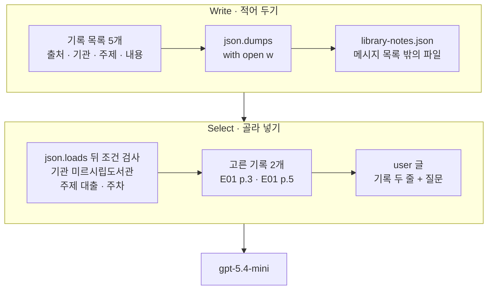
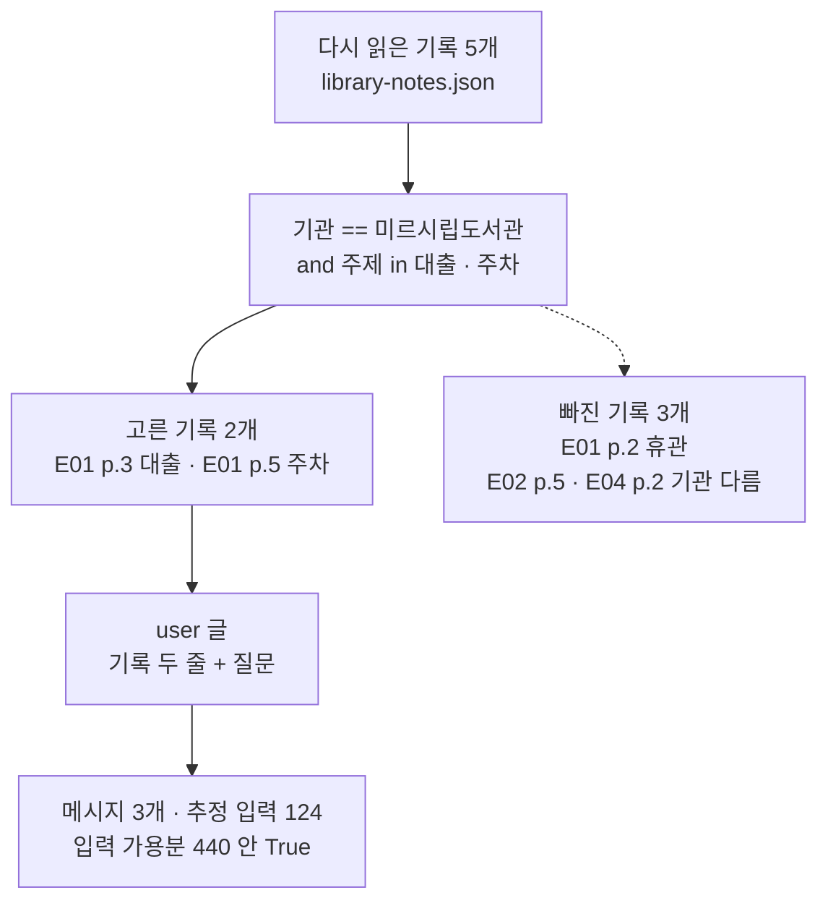
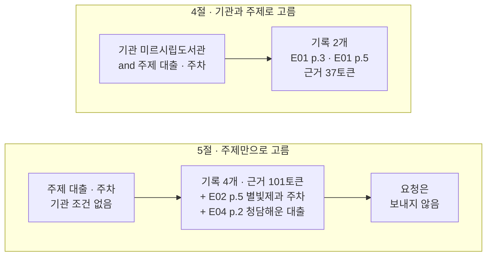
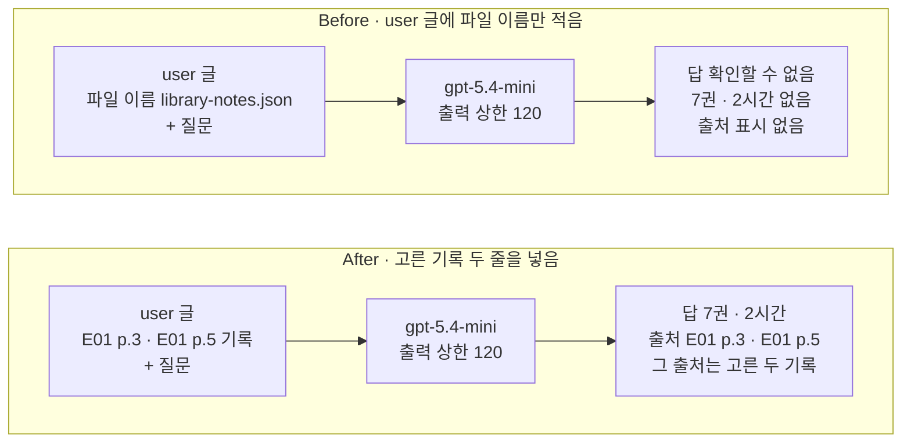

# 02-Write와-Select

## _src 본문 (HTML 원본)

```html
<!--meta: 강의 1h | 실습 2h | 코드 Jupyter Notebook | 새 용어 7 -->
<h2 id="b1"><span class="no">1</span>학습 목표</h2>
<div class="goal"><p>이 절을 마치면 다음을 할 수 있습니다.</p><ul><li>파일에 적어 두고 다시 읽은 기록도 메시지 목록에 넣기 전에는 컨텍스트가 아니라는 것을 노트북 출력으로 설명할 수 있습니다.</li><li>기관·주제 메타데이터로 조건을 적어 질문에 필요한 기록만 고르고, 01절 예산표로 추정 입력을 확인할 수 있습니다.</li><li>답에 적힌 출처 표시로 기록을 되짚어, 답이 넣은 기록에서 왔는지 확인할 수 있습니다.</li></ul></div>
<h2 id="b2"><span class="no">2</span>이 내용을 배우는 이유</h2>
<p>01절에서는 같은 쪽의 자료까지 넣은 긴 목록이 입력 가용분을 130토큰 넘었습니다. 자료가 문서 여러 개로 늘면 매번 모두 넣을 수 없습니다. 그렇다고 지워 버리면 다음 질문에 쓸 수 없습니다.</p>
<p>그래서 자료는 메시지 목록 밖에 적어 두고, 질문이 올 때 필요한 것만 골라 넣습니다. LangChain 팀은 컨텍스트를 다루는 방법을 네 이름으로 묶었습니다. 이 절은 그중 적어 두기(Write)와 골라 넣기(Select)를 다룹니다. 줄이기(Compress)와 나누기(Isolate)는 03절에서 다룹니다. 네 이름은 업계가 함께 정한 공식 단계가 아닙니다.</p>
<p>적어 두기에서 자주 하는 실수가 있습니다. 파일에 저장했으니 모델도 그 내용을 안다고 생각하는 것입니다. 이 절의 Before가 그 실수를 실제 요청으로 확인합니다.</p>
<p><strong>이 절의 질문</strong> — 파일에 적어 둔 기록을 이번 답의 근거로 쓰려면 무엇을 해야 하고, 무엇을 보고 골라야 할까요?</p>
<h2 id="b3"><span class="no">3</span>앞에서 배운 내용</h2>
<table><thead><tr><th>앞 절</th><th>배운 것</th><th>이 절에서 이어지는 곳</th></tr></thead><tbody>
<tr><td>Ch 2 05절</td><td>임시 폴더 준비 셀, <code>with open(…, encoding="utf-8")</code>, <code>read()</code></td><td>1절 작업 폴더, 3절 파일 쓰고 읽기</td></tr>
<tr><td>Ch 6 06절</td><td><code>json.dumps(…, ensure_ascii=False, indent=2)</code>, <code>json.loads()</code></td><td>3절 기록 파일</td></tr>
<tr><td>Ch 7 05·06절</td><td>근거 대조, 목록에 대한 <code>in</code> 검사(허용 이름)</td><td>4절 주제 조건, 6·7절 출처로 기록 되짚기</td></tr>
<tr><td>01절</td><td>목록에 실린 글만 컨텍스트, 수업 예산 600·출력 예약분 120·여유분 40, <code>input_budget()</code>·<code>count_tokens()</code>, 출력 상한</td><td>준비 셀에서 가져옴, 4절 추정 입력, 7절 추정과 실제의 차이</td></tr>
</tbody></table>
<p>01절 7절의 긴 목록은 넘쳤고, 01절은 보내기 전에 입력을 작게 해야 한다는 데까지 봤습니다. 이 절은 입력을 작게 하는 첫 방법으로, 자료를 기록으로 나눠 파일에 두고 필요한 기록만 넣습니다.</p>
<p>페르소나·수업 예산·모델 설정은 01절 값을 그대로 씁니다. 모델의 출력 상한은 01절 After처럼 출력 예약분 120입니다. 과업 명세는 출처를 문장마다 적게 한 곳만 바뀌었습니다.</p>
<h2 id="b4"><span class="no">4</span>핵심 개념</h2>
<h3>비유로 시작하기</h3>
<p>01절의 긴 나무 책상이 그대로 있습니다. 왼쪽에는 파란 명찰, 주황 클립보드, 노란 메모지가 있고, 오른쪽에는 빈 답안지와 연필이 있습니다. 이번에는 흰 종이 대신 초록 탭이 달린 흰 카드 두 장이 왼쪽에 놓였습니다.</p>
<p>책상 왼쪽 바닥에는 뚜껑이 열린 나무 기록 카드 상자가 있습니다. 상자 안에는 회색·갈색·보라 탭이 달린 카드가 서 있습니다. 상자 옆 바닥에는 빈 카드 한 장과 펜이 놓여 있습니다.</p>
{{img:02-5-기록-카드-상자|긴 나무 책상 왼쪽에 파란 명찰·주황 클립보드·노란 메모지와 초록 탭이 달린 흰 카드 두 장이 있고, 오른쪽에는 빈 답안지와 연필이 있으며, 책상 왼쪽 바닥의 열린 나무 기록 카드 상자에는 회색·갈색·보라 탭 카드가 서 있고, 상자 옆에 빈 카드와 펜이 놓인 삽화|카드에 적어 상자에 넣어 두고, 이번 일에 필요한 카드만 꺼내 책상에 올립니다. 상자 안에 남은 카드는 이번 작업에 쓰지 않습니다.}}
<p><strong>그림 읽기</strong> — 바닥에서 책상 쪽으로 봅니다. 상자 옆의 빈 카드와 펜은 기록을 카드에 적는 자리입니다. 상자 속 카드는 적어 두었지만 책상에 올리지 않은 기록입니다. 책상 위 초록 탭 카드 두 장은 상자에서 골라 올린 기록이고, 상자 안에서는 앞으로 기운 카드 뒤쪽이 비어 있습니다.</p>
<p>기록 카드 상자는 노트북의 기록 파일 <code>library-notes.json</code>이고, 카드 한 장은 기록 하나입니다. 빈 카드와 펜은 적어 두기, 책상에 올린 두 장은 골라 넣기입니다. 탭 색은 카드마다 적어 둔 기관·주제 같은 메타데이터를 나타냅니다. 색 하나가 조건 하나와 짝을 이루지는 않습니다.</p>
<p>01절 그림에서 바닥 상자의 종이는 목록에 넣지 않은 자료였습니다. 이 절에서는 그 자리에 기록 카드 상자를 두고, 필요한 카드만 꺼내 올립니다. 책상 위에 올린 카드만 이번 컨텍스트입니다. 파란 명찰·주황 클립보드·노란 메모지·답안지의 뜻은 01절과 같습니다.</p>
<h3>적어 두기 — 파일에 있어도 컨텍스트는 아닙니다</h3>
<p>적어 두기(Write)는 나중에 쓸 정보를 이번 요청의 메시지 목록 밖에 저장해 두는 일입니다. 수업에서 들은 내용을 공책에 적어 두는 것과 비슷합니다. 노트북 3절은 기록 다섯 개를 파일 <code>library-notes.json</code>에 쓰고 다시 읽었습니다.</p>
<p>출력 <code>처음 목록과 같은가: True</code>처럼 파일은 기록을 그대로 보관합니다. 하지만 모델은 이 파일이 있는지도, 안에 무엇이 들었는지도 모릅니다. 01절에서 본 것처럼 메시지 목록에 넣은 글만 이번 요청의 컨텍스트입니다. 다음 요청에 쓰려면 프로그램이 파일을 읽고, 골라서, 글로 넣어야 합니다.</p>
{{mermaid:02-1-적어-두기와-골라-넣기|위 칸 Write에는 초록 상자 기록 목록 5개, 파란 상자 json.dumps with open w, 초록 상자 library-notes.json 메시지 목록 밖의 파일이 왼쪽에서 오른쪽으로 있고, 아래 칸 Select에는 파란 상자 json.loads 뒤 조건 검사, 노란 상자 고른 기록 2개 E01 p.3 E01 p.5, 초록 상자 user 글이 있으며, 맨 아래 보라 상자 gpt-5.4-mini로 이어지는 흐름도|기록 다섯 개를 파일에 적어 두고, 다시 읽어 조건에 맞는 두 기록만 user 글에 넣어 모델로 보냅니다.}}
<p><strong>도식 읽기</strong> — 위 칸이 적어 두기, 아래 칸이 골라 넣기이고, 칸마다 왼쪽에서 오른쪽으로 읽습니다. 위 칸의 초록 상자는 기록 목록과 파일이고, 파란 상자는 <code>json.dumps()</code>와 <code>with open</code>으로 파일에 쓰는 코드입니다.</p>
<p>아래 칸의 파란 상자는 파일을 다시 읽고 조건을 검사하는 코드입니다. 노란 상자는 출력으로 확인한 <code>고른 기록 출처: ['E01 p.3', 'E01 p.5']</code>이고, 초록 상자는 두 기록을 옮긴 user 글입니다. 맨 아래 보라 상자가 그 글을 받는 모델입니다.</p>
<h3>기록과 메타데이터</h3>
<p>기록 하나는 딕셔너리 하나입니다. 키 <code>내용</code>에는 원문을 읽고 사실 하나를 한 문장으로 옮겨 적었습니다. 나머지 키 <code>출처</code>·<code>기관</code>·<code>주제</code>는 그 사실을 설명하는 값입니다.</p>
<p>메타데이터(metadata)는 내용 옆에 적어 두고, 찾거나 고를 때 쓰는 설명 값입니다. 도서관 책등에 붙은 분류 번호를 보면 책을 펴지 않고도 고를 수 있는 것과 비슷합니다. 노트북에서는 키 <code>기관</code>과 <code>주제</code>로 기록을 고르고, 키 <code>출처</code>로 답을 되짚습니다.</p>
<table><thead><tr><th>키</th><th>첫 기록의 값</th><th>노트북에서 쓰는 곳</th></tr></thead><tbody>
<tr><td><code>출처</code></td><td><code>E01 p.2</code></td><td>근거 줄과 답의 출처 표시, 원문 쪽 찾기</td></tr>
<tr><td><code>기관</code></td><td><code>미르시립도서관</code></td><td>4절 기관 조건</td></tr>
<tr><td><code>주제</code></td><td><code>휴관</code></td><td>4절 주제 조건</td></tr>
<tr><td><code>내용</code></td><td><code>매주 월요일은 정기 휴관일입니다.</code></td><td>user 글의 근거 줄</td></tr>
</tbody></table>
<p>기록의 내용은 원문 문단을 그대로 옮긴 글이 아닙니다. E01 5쪽 원문에는 주차 무료 시간 뒤에 추가 요금도 적혀 있지만, 기록에는 무료 시간만 적었습니다. 그래서 기록에 없는 조건은 출처가 가리키는 원문 쪽에서 확인합니다.</p>
<h3>골라 넣기 — 사람이 적은 조건으로 고릅니다</h3>
<p>골라 넣기(Select)는 저장해 둔 정보 가운데 이번 질문에 필요한 것만 골라 메시지 목록에 넣는 일입니다. 시험 공부를 할 때 공책에서 그 과목 쪽만 펴는 것과 비슷합니다. 이 절에서는 질문을 읽은 사람이 조건을 코드에 적습니다.</p>
<p>노트북 4절의 조건은 기관 <code>미르시립도서관</code>과 주제 목록 <code>['대출', '주차']</code>입니다. 두 조건을 <code>and</code>로 이어, 둘 다 맞는 기록만 목록 <code>selected</code>에 넣었습니다.</p>
{{mermaid:02-2-조건으로-고르기|초록 상자 다시 읽은 기록 5개가 파란 상자 기관 == 미르시립도서관 and 주제 in 대출 주차로 이어지고, 실선은 노란 상자 고른 기록 2개 E01 p.3 대출 E01 p.5 주차로, 점선은 회색 상자 빠진 기록 3개로 가며, 노란 상자가 초록 상자 user 글을 거쳐 노란 상자 메시지 3개 추정 입력 124 입력 가용분 440 안 True로 이어지는 흐름도|기관과 주제 조건에 모두 맞는 두 기록만 골라 user 글에 넣었고, 세 글의 추정 입력 124는 입력 가용분 440 안에 들었습니다.}}
<p><strong>도식 읽기</strong> — 위에서 아래로 읽습니다. 초록 상자는 파일에서 다시 읽은 기록 다섯 개이고, 파란 상자는 두 조건을 검사하는 반복문입니다. 왼쪽 아래 노란 상자가 출력 <code>고른 기록 수: 2</code>의 두 기록입니다.</p>
<p>점선 끝의 회색 상자는 빠진 기록 세 개입니다. 노트북은 빠진 기록을 따로 출력하지 않아 회색으로 그렸습니다. 휴관 기록은 주제가 달라서, 별빛제과·청담해운 기록은 기관이 달라서 빠졌습니다. 맨 아래 노란 상자는 두 기록을 넣은 목록의 <code>추정 입력 합계: 124</code>입니다.</p>
<h3>이 절에서 쓰는 말</h3>
<table><thead><tr><th>용어</th><th>뜻</th><th>이 절에서 보이는 모습</th></tr></thead><tbody>
<tr><td>적어 두기(Write)</td><td>나중에 쓸 정보를 이번 요청의 메시지 목록 밖에 저장해 두는 일</td><td><code>작업 폴더의 파일: ['library-notes.json']</code></td></tr>
<tr><td>골라 넣기(Select)</td><td>저장해 둔 정보 가운데 이번 질문에 필요한 것만 골라 메시지 목록에 넣는 일</td><td><code>고른 기록 출처: ['E01 p.3', 'E01 p.5']</code></td></tr>
<tr><td>기록</td><td>사실 한 문장과 그 사실을 설명하는 값을 담은 딕셔너리 하나. Ch 6·7의 요청 기록(요청 한 번의 측정값)과 다른 뜻</td><td><code>기록 수: 5</code></td></tr>
<tr><td>기록 파일</td><td>기록 목록을 JSON 글로 저장한 파일. 메시지 목록 밖에 있음</td><td><code>library-notes.json</code></td></tr>
<tr><td>메타데이터(metadata)</td><td>내용 옆에 적어 두고 찾거나 고를 때 쓰는 설명 값</td><td>키 <code>출처</code>·<code>기관</code>·<code>주제</code></td></tr>
<tr><td>선택 조건</td><td>기록을 고를 때 검사하는 조건. 이 절에서는 사람이 코드에 적음</td><td><code>고를 기관: 미르시립도서관</code></td></tr>
<tr><td>출처 표시</td><td>근거 줄이나 답에 붙여 어느 문서 어느 쪽에서 왔는지 알리는 표시</td><td><code>[E01 p.3]</code></td></tr>
</tbody></table>
<h2 id="b5"><span class="no">5</span>실행 예제</h2>
<p>노트북은 기록 다섯 개를 임시 폴더의 JSON 파일에 쓰고 다시 읽습니다. 그다음 기관과 주제로 기록 두 개를 골라 01절 모양의 user 글에 넣고, 예산표로 추정 입력을 셉니다. 값 바꿔 보기에서는 기관 조건을 빼고 다시 고릅니다. 이 부분은 요청을 보내지 않습니다.</p>
<p>실제 OpenAI 모델을 temperature 0으로 부르는 요청은 Before·After 두 번입니다. 이 페이지의 출력은 2026-09-21에 실행한 결과입니다. 예상 비용은 0.01달러 미만이고, 답 문장은 실행마다 달라질 수 있습니다.</p>
<p>강의 시간에는 노트북 3·4·6절(Write, Select, Before)을 설명합니다. 5·7절(값 바꿔 보기, After)은 함께 실행하고 실습 시간에 읽습니다.</p>
{{notebook:02-Write와-Select|example}}
<p class="look"><b>확인할 점</b> — 3절 <code>작업 폴더의 파일: ['library-notes.json']</code>과 <code>처음 목록과 같은가: True</code>를 봅니다. 4절 <code>고른 기록 출처: ['E01 p.3', 'E01 p.5']</code>와 <code>추정 입력 합계: 124</code>를 확인합니다. 5절 <code>주제만 본 기록 수: 4</code>를 봅니다.</p>
<h3>기관 조건을 빼면</h3>
<p>노트북 5절은 고르는 조건 하나만 바꿨습니다. 기관 조건을 빼고 주제만 봤고, 질문과 기록 파일은 그대로 뒀습니다.</p>
{{mermaid:02-3-기관-조건-빼기|위 칸 4절 기관과 주제로 고름에는 파란 상자 기관 미르시립도서관 and 주제 대출 주차가 노란 상자 기록 2개 E01 p.3 E01 p.5 근거 37토큰으로 이어지고, 아래 칸 5절 주제만으로 고름에는 파란 상자 주제 대출 주차 기관 조건 없음이 노란 상자 기록 4개 근거 101토큰 E02 p.5 별빛제과 주차 E04 p.2 청담해운 대출을 거쳐 회색 상자 요청은 보내지 않음으로 이어지는 그림|기관 조건을 빼자 다른 기관의 주차·대출 기록까지 골라져 기록이 4개, 근거가 101토큰이 됐습니다. 이 목록은 모델에 보내지 않았습니다.}}
<p><strong>도식 읽기</strong> — 위 칸이 4절, 아래 칸이 5절이고, 칸마다 왼쪽에서 오른쪽으로 읽습니다. 파란 상자는 고르는 조건이고, 노란 상자는 출력으로 확인한 기록 수·출처·근거 토큰 수입니다. 아래 칸 끝의 회색 상자는 실행하지 않은 단계입니다.</p>
<p>주제만 보자 <code>주제만 본 기록 수: 4</code>로 늘었고, 근거 토큰 수는 37에서 101이 됐습니다. 더해진 기록은 별빛제과 본사 주차비와 청담해운 전세자금 대출입니다. 주제 이름은 같지만, 질문한 도서관의 규칙이 아닙니다.</p>
<p>이 목록은 모델에 보내지 않았습니다. 그래서 모델이 다른 기관 기록을 답에 섞는지는 이번에 확인하지 않았습니다. 확인한 것은 기관 메타데이터로 고르지 않으면 이런 기록이 함께 들어간다는 것까지입니다. 필요 없는 기록이 목록에 들어갔을 때 답에서 무엇을 확인할지는 04절 혼란에서 다룹니다.</p>
<h2 id="b6"><span class="no">6</span>일부러 실패해 보기</h2>
<p>Before에서는 적어 두기만 하고 골라 넣기를 빼먹습니다. 기록은 파일에 있고, user 글에는 파일 이름을 적은 한 문장과 질문만 넣습니다. 파일에 저장했다고 알리면 모델이 그 파일을 읽을 것이라고 생각한 실수입니다.</p>
<p>After에서 고치는 곳은 user 글 하나입니다. 파일을 읽어 조건으로 고른 기록 두 줄을 넣은 4절 목록을 보냅니다. 페르소나·과업 명세·질문·출력 상한 120은 두 요청이 같습니다. 두 답에 적힌 출처 표시는 함수 <code>find_cited_notes()</code>로 기록 목록에서 찾습니다.</p>
{{notebook:02-Write와-Select|failure}}
<p>Before 목록은 <code>고른 기록이 user 글에 들어 있는가: False</code>였습니다. 답은 <code>library-notes.json</code>의 내용이 대화에 제공되지 않았다고 했습니다. 그래서 <code>도서 대출 권수와 회원 주차 무료 시간을 확인할 수 없습니다.</code>라고 답했습니다. 오류는 나지 않았고 끝난 이유는 <code>stop</code>이었습니다.</p>
<p>Before 답에는 출처 표시가 없어, 함수 <code>find_cited_notes()</code>는 빈 목록 <code>[]</code>을 반환했습니다. 대출 권수 7권도 주차 무료 2시간도 답에 없습니다. 기록은 파일에 있었지만, 이번 요청의 컨텍스트에는 없었습니다.</p>
<p>After 답의 첫 문장은 <code>도서는 7권까지 14일 동안 대출할 수 있습니다.</code>였습니다. 둘째 문장은 <code>회원은 최초 2시간 무료입니다.</code>였고, 두 문장 끝에 <code>[E01 p.3]</code>과 <code>[E01 p.5]</code>가 붙었습니다. 찾은 기록은 4절에서 고른 두 기록과 같았습니다. 실제 입력은 <code>실제 입력 토큰 수: 138</code>로 추정 124보다 14 많아, 여유분 40 안에 들었습니다.</p>
{{mermaid:02-4-Before-After|위 칸 Before에는 초록 상자 user 글 파일 이름 library-notes.json + 질문, 보라 상자 gpt-5.4-mini 출력 상한 120, 빨간 상자 답 확인할 수 없음 7권 2시간 없음 출처 표시 없음이 차례로 있고, 아래 칸 After에는 초록 상자 user 글 E01 p.3 E01 p.5 기록 + 질문, 보라 상자 gpt-5.4-mini 출력 상한 120, 노란 상자 답 7권 2시간 출처 E01 p.3 E01 p.5 그 출처는 고른 두 기록이 차례로 있는 비교 그림|파일 이름만 적은 Before 답은 파일 내용이 없어 확인할 수 없다고 했습니다. 고른 기록을 넣은 After 답은 7권·2시간과 고른 두 기록의 출처를 적었습니다.}}
<p><strong>도식 읽기</strong> — 위 칸이 Before, 아래 칸이 After이고, 칸마다 왼쪽에서 오른쪽으로 읽습니다. 초록 상자는 user 글에 넣은 것이고, 보라 상자는 출력 상한 120인 같은 모델 객체입니다. 위 칸 끝의 빨간 상자는 Before의 결함 결과로, 파일 내용이 없어 확인할 수 없다는 답입니다.</p>
<p>아래 칸 끝의 노란 상자는 After 출력으로 확인한 값입니다. 답의 7권·2시간과 출처 두 개가 4절에서 고른 기록과 이어졌습니다. Before 답에는 두 값이 모두 없었습니다.</p>
<h2 id="b7"><span class="no">7</span>주의할 점과 실무 메모</h2>
<ul><li>모델은 파일 이름을 글로 받을 뿐 파일을 열지 않습니다. 이번 요청에는 파일을 읽는 도구가 없었습니다. 모델이 도구로 함수를 부르게 하는 방법은 Ch 19에서 다룹니다.</li>
<li>과업 명세에 「주어진 근거에 있는 정보만 쓰세요」가 있었고, 이번 Before 답은 근거가 없어 확인할 수 없다고 했습니다. 한 번 본 결과라, 근거가 없을 때 늘 이렇게 답한다고 하지 않습니다. 답을 받으면 넣은 기록과 대조해 확인합니다.</li>
<li>출처 표시가 있어도, 그 출처의 기록이 답을 뒷받침하는지는 따로 확인합니다. 함수 <code>find_cited_notes()</code>는 표시가 가리키는 기록을 찾아 줄 뿐, 답과 기록의 뜻이 맞는지는 사람이 읽고 봅니다.</li>
<li>기록은 원문을 줄여 적은 것이라 조건이 빠질 수 있습니다. E01 5쪽 원문의 추가 주차 요금은 기록에 없습니다. 원문을 줄이면서 조건을 지키는 방법은 03절에서 다룹니다.</li>
<li>조건은 사람이 정했습니다. 질문이 바뀌면 조건도 다시 정해야 합니다. 조건에 맞는 기록이 하나도 없을 때 어떻게 할지는 이번에 실행하지 않았습니다.</li>
<li>같은 문서에 판이 여러 개면 판 이름이나 시행일도 메타데이터로 적어 조건에 넣을 수 있습니다. 이 노트북은 판 조건을 실행하지 않았습니다.</li>
<li>기록 파일은 보안 저장소가 아닙니다. 개인 정보나 비밀 값은 평문 기록 파일에 적지 않습니다.</li>
<li>준비 셀은 실행할 때마다 새 임시 폴더를 만들고, 앞에서 만든 폴더는 지우지 않습니다.</li>
<li>교재 출력은 Linux의 Python 3.12.13으로 만들었습니다. 패키지는 langchain 1.4.0, langchain-core 1.6.2, langchain-openai 1.6.0입니다. openai 3.8.0, tiktoken 0.14.0도 함께 썼습니다. 다른 버전과 Windows·macOS에서는 실행하지 않았습니다.</li></ul>
<h2 id="b8"><span class="no">8</span>정리와 다음 절</h2>
<ul><li>기록 다섯 개를 파일에 적어 두고 다시 읽었지만, 파일에 있다는 것만으로는 이번 요청의 컨텍스트가 아니었습니다.</li><li>기관과 주제 조건으로 기록 두 개를 골라 user 글에 넣었고, 추정 입력은 124였습니다. 기관 조건을 빼자 다른 기관 기록 두 개가 함께 골라졌습니다.</li><li>파일 이름만 적은 Before 답은 파일 내용이 없어 확인할 수 없다고 했습니다. 고른 기록을 넣은 After 답은 기록의 7권·2시간과 출처 두 개를 적었습니다.</li></ul>
<p><strong>다음 학습과 이어지는 지점</strong> — 03절에서는 고른 자료가 여전히 길 때 조건을 지키며 줄이는 방법을 다룹니다. 업무마다 메시지 목록을 나누는 방법도 함께 봅니다. Ch 9에서는 사람이 적은 조건 대신 검색이 E01 문서에서 필요한 부분을 고릅니다. 이 절의 출처 표시 모양 <code>[E01 p.3]</code>은 Ch 9 답의 출처 표시로 이어집니다.</p>
<h2 id="b9"><span class="no">9</span>복습 문제</h2>
<details class="quiz"><summary>문제 1 · 파일에 있는 기록</summary><p class="quiz-q">노트북 3절에서 기록 다섯 개를 <code>library-notes.json</code>에 썼습니다. 모델은 다음 요청에서 이 기록을 쓸 수 있나요?</p><p class="quiz-a"><b>해설</b> — 파일에 있다는 것만으로는 쓸 수 없습니다. 프로그램이 파일을 읽고, 필요한 기록을 골라, 메시지 목록의 글로 넣어야 합니다. Before 출력 <code>고른 기록이 user 글에 들어 있는가: False</code>가 넣지 않은 경우입니다.</p></details>
<details class="quiz"><summary>문제 2 · 두 조건</summary><p class="quiz-q">기관이 <code>미르시립도서관</code>이고 주제가 <code>휴관</code>인 기록은 4절 조건에서 골라지나요?</p><p class="quiz-a"><b>해설</b> — 골라지지 않습니다. 두 조건을 <code>and</code>로 이었으므로, 기관이 맞아도 주제가 고를 주제 목록 <code>['대출', '주차']</code>에 없으면 빠집니다.</p></details>
<details class="quiz"><summary>문제 3 · 메타데이터가 하는 일</summary><p class="quiz-q">5절에서 기관 조건을 빼자 기록이 몇 개로 늘었고, 늘어난 기록은 왜 문제가 되나요?</p><p class="quiz-a"><b>해설</b> — <code>주제만 본 기록 수: 4</code>로 늘었습니다. 더해진 별빛제과 주차비와 청담해운 전세자금 대출은 주제 이름만 같고, 질문한 도서관의 규칙이 아닙니다.</p></details>
<details class="quiz"><summary>문제 4 · 출처 표시 되짚기</summary><p class="quiz-q">두 답에 함수 <code>find_cited_notes()</code>를 쓴 결과는 어떻게 달랐고, 그 결과로 무엇을 알 수 있나요?</p><p class="quiz-a"><b>해설</b> — Before 답에는 출처 표시가 없어 빈 목록 <code>[]</code>이었습니다. After 답에서는 4절에서 고른 E01 p.3·E01 p.5 두 기록이 나왔습니다. 두 문장이 어느 기록에서 왔는지 되짚을 수 있습니다. 찾은 기록의 내용과 답을 대조하는 일은 사람이 합니다.</p></details>
<details class="quiz"><summary>문제 5 · 파일 이름을 적은 글</summary><p class="quiz-q">user 글에 파일 이름을 적어 보내면 After와 같은 답을 기대할 수 없는 까닭은 무엇인가요?</p><p class="quiz-a"><b>해설</b> — 모델은 파일 이름 글자만 받습니다. 이번 요청에는 파일을 여는 도구가 없어서, 파일 속 기록은 모델에 가지 않았습니다.</p></details>
<h2 id="b10"><span class="no">10</span>참고 자료</h2>
<p>문서는 2026-09-17에 다시 열어 확인했습니다. 기록 내용은 Ch 9에서 쓰는 가상 기관 문서 <code>E01.pdf</code>·<code>E02.pdf</code>·<code>E04.pdf</code>를 읽고 옮겨 적었습니다.</p>
<ul><li><div><a href="https://www.langchain.com/blog/context-engineering-for-agents">LangChain, Context Engineering</a></div>컨텍스트를 다루는 네 방법의 이름 · 2025-07-02 · 확인 2026-09-17</li><li><div><a href="https://www.anthropic.com/engineering/effective-context-engineering-for-ai-agents">Anthropic, Effective context engineering for AI agents</a></div>컨텍스트 밖에 적어 두는 노트, 필요할 때 불러오는 방식 · 2025-09-29 · 확인 2026-09-17</li><li><div><a href="https://docs.python.org/3/library/json.html">Python json 모듈 설명서</a></div><code>json.dumps()</code>, <code>json.loads()</code> · 확인 2026-09-17</li></ul>
```

## 노트북 셀 (순서대로)

### [0] markdown {'html': 'skip'}

# Write와 Select

**이 노트북에서 할 일**

1. 문서에서 옮겨 적은 기록 다섯 개를 JSON 파일에 쓰고 다시 읽습니다.
2. 기관과 주제 조건으로 질문에 필요한 기록만 골라, 01절 모양의 메시지 목록에 넣습니다.
3. 파일 이름만 적어 보낸 Before와, 고른 기록을 넣어 보낸 After의 답과 출처를 비교합니다.

**준비물** — 프로젝트 폴더 `.env` 파일의 `OPENAI_API_KEY`가 필요합니다. 기록은 셀 안에 적고, 노트북이 임시 폴더에 파일로 씁니다.

인터넷 서비스에 요청을 모두 2번 보냅니다. 모두 `gpt-5.4-mini`입니다.
실행 시간은 1분 안팎이고, 예상 비용은 0.01달러 미만으로 잡았습니다.
요금은 Ch 6 06절에서 2026-09-17에 확인한 mini 공식 요금 기준입니다.

**강의와 실습 범위** — 강의 시간에는 3·4·6절(Write, Select, Before)을 설명합니다.
5·7절(값 바꿔 보기, After)은 함께 실행하고 실습 시간에 읽습니다.

**기준 버전** — 실습 폴더에 고정한 패키지 판을 씁니다. langchain 1.4.0, langchain-core 1.6.2, langchain-openai 1.6.0입니다.
openai 3.8.0, tiktoken 0.14.0, python-dotenv 1.2.3도 함께 씁니다.

교재 출력은 Linux의 Python 3.12.13으로 만들었습니다. 다른 버전과 Windows·macOS에서는 이번에 실행하지 않았습니다.

실습 폴더 `labs/part2/ch08-context-engineering`에서 `uv sync --locked`를 실행합니다.
그다음 이 폴더의 `.venv` 커널을 고르고 첫 셀부터 순서대로 실행합니다.

### [1] markdown {'html': 'skip'}

## 오늘 볼 그림


위 칸이 적어 두기(Write), 아래 칸이 골라 넣기(Select)입니다. 칸마다 왼쪽에서 오른쪽으로 읽고, 위 칸의 파일이 아래 칸으로 이어집니다.
초록 상자는 기록·파일·글이고, 파란 상자는 노트북 코드의 단계입니다. 노란 상자는 출력으로 확인한 고른 기록, 맨 아래 보라 상자는 모델입니다.
파일에 적어 둔 기록 다섯 개 가운데 두 개만 user 글에 들어가 모델로 갑니다.

### [2] markdown {}

## 1. 준비

첫 셀은 패키지를 설치하고 설치된 버전을 출력합니다. 설치에는 몇십 초가 걸릴 수 있습니다.
01절과 같은 패키지 판을 씁니다.

### [3] code {'execution': {'iopub.execute_input': '2026-09-21T04:58:43.303413Z', 'iopub.status.busy': '2026-09-21T04:58:43.303255Z', 'iopub.status.idle': '2026-09-21T04:58:43.752663Z', 'shell.execute_reply': '2026-09-21T04:58:43.752102Z'}, 'lesson_role': 'setup'}

```python
# 이 절에서 쓰는 패키지를 설치하고 버전을 확인합니다
%pip install -q "langchain==1.4.0" "langchain-openai==1.6.0" "python-dotenv==1.2.3" "tiktoken==0.14.0"
from importlib.metadata import version

print("langchain:", version("langchain"))
print("langchain-core:", version("langchain-core"))
print("langchain-openai:", version("langchain-openai"))
print("openai:", version("openai"))
print("tiktoken:", version("tiktoken"))
print("python-dotenv:", version("python-dotenv"))
```

출력:
```
Note: you may need to restart the kernel to use updated packages.
langchain: 1.4.0
langchain-core: 1.6.2
langchain-openai: 1.6.0
openai: 3.8.0
tiktoken: 0.14.0
python-dotenv: 1.2.3

```

### [4] markdown {}

**결과 읽기** — 출력 줄은 `langchain: 1.4.0`, `openai: 3.8.0`, `tiktoken: 0.14.0` 등 여섯 줄입니다.
준비물에 적은 기준 버전과 같습니다.

기록을 파일로 다루는 모듈과 01절에서 쓴 라이브러리를 불러오고, 01절에서 배운 함수 두 개를 가져옵니다.
모듈 `json`은 Ch 6 06절에서 기록을 파일에 쓸 때 썼습니다. 모듈 `os`와 `tempfile`은 Ch 2 05절 준비 셀에서 임시 폴더를 만들 때 썼습니다.

앞에서 배운 함수는 `llm_tools.py`에 모아 두었습니다. 파일을 열면 코드를 볼 수 있습니다. 노트북과 같은 폴더(`notebooks/`)에 있는 파일입니다.
이 노트북은 01절 `input_budget()`·`count_tokens()`를 가져옵니다.

도구 파일의 `count_tokens()`는 토큰화 규칙 객체를 첫 인자로 받습니다. 01절 판은 함수 바깥 이름 `encoding`을 읽었습니다.

### [5] code {'execution': {'iopub.execute_input': '2026-09-21T04:58:43.753734Z', 'iopub.status.busy': '2026-09-21T04:58:43.753646Z', 'iopub.status.idle': '2026-09-21T04:58:44.123035Z', 'shell.execute_reply': '2026-09-21T04:58:44.122628Z'}, 'lesson_role': 'setup'}

```python
# 파일·폴더를 다루는 모듈과 토큰 수를 세는 라이브러리, 모델 함수를 불러옵니다
import json
import os
import tempfile

import tiktoken

from langchain.chat_models import init_chat_model
# 01절 함수 두 개를 도구 파일에서 가져옵니다
from llm_tools import count_tokens, input_budget
```

출력:
```

```

### [6] markdown {}

01절과 같은 셀로 API 키가 있는지 확인합니다. 키 값은 출력하지 않고, 있는지만 봅니다.
`True` 값이 나오면 다음으로 넘어갑니다.

### [7] code {'execution': {'iopub.execute_input': '2026-09-21T04:58:44.123829Z', 'iopub.status.busy': '2026-09-21T04:58:44.123762Z', 'iopub.status.idle': '2026-09-21T04:58:44.127606Z', 'shell.execute_reply': '2026-09-21T04:58:44.127327Z'}, 'lesson_role': 'setup'}

```python
# .env 파일에서 OpenAI API 키를 읽습니다(키 값은 출력하지 않습니다)
import os
from dotenv import find_dotenv, load_dotenv

env_path = find_dotenv(usecwd=True)
load_dotenv(env_path)
has_key = os.getenv("OPENAI_API_KEY") is not None
print("OPENAI_API_KEY 설정 여부:", has_key)
assert has_key, "프로젝트 폴더의 .env 파일에 OPENAI_API_KEY를 적어 주세요."
```

출력:
```
OPENAI_API_KEY 설정 여부: True

```

### [8] markdown {}

이 노트북은 기록 파일을 만들므로, 파일을 둘 빈 폴더를 먼저 준비합니다. Ch 2 05절 준비 셀과 같은 방법입니다.
함수 `tempfile.mkdtemp()`는 운영체제 임시 폴더 안에 새 폴더를 만들고 그 경로를 반환합니다.
함수 `os.chdir()`는 작업 폴더를 그 폴더로 옮깁니다. 그래서 실습 폴더에는 파일이 생기지 않습니다.

키 확인은 작업 폴더를 옮기기 전에 했습니다. `.env` 파일을 작업 폴더에서부터 찾기 때문입니다.

### [9] code {'execution': {'iopub.execute_input': '2026-09-21T04:58:44.128181Z', 'iopub.status.busy': '2026-09-21T04:58:44.128132Z', 'iopub.status.idle': '2026-09-21T04:58:44.130085Z', 'shell.execute_reply': '2026-09-21T04:58:44.129727Z'}, 'lesson_role': 'setup'}

```python
# 기록 파일을 둘 빈 임시 폴더를 만들고, 그 폴더로 작업 위치를 옮깁니다
work_folder = tempfile.mkdtemp(prefix="ch08-02-")
os.chdir(work_folder)
# listdir()는 현재 작업 폴더 안의 파일 이름 목록을 반환합니다
file_names = os.listdir()
print("작업 폴더의 파일:", file_names)
```

출력:
```
작업 폴더의 파일: []

```

### [10] markdown {}

**결과 읽기** — 출력 줄은 `작업 폴더의 파일: []`로, 빈 폴더에서 시작합니다.
폴더 경로는 실행할 때마다 달라서 출력하지 않았습니다.

## 2. 01절에서 이어 쓰는 글과 수업 예산표

01절의 페르소나와 과업 명세를 이어 씁니다. 페르소나는 글자까지 같습니다.
과업 명세는 출처를 적는 자리만 바꿨습니다. 이번 질문은 두 가지를 묻고 근거가 두 쪽에 있어, 출처를 문장마다 적게 했습니다.

### [11] code {'execution': {'iopub.execute_input': '2026-09-21T04:58:44.130636Z', 'iopub.status.busy': '2026-09-21T04:58:44.130582Z', 'iopub.status.idle': '2026-09-21T04:58:44.132317Z', 'shell.execute_reply': '2026-09-21T04:58:44.132072Z'}}

```python
# 01절에서 이어 쓰는 페르소나와, 출처를 문장마다 적게 한 과업 명세를 만듭니다
persona_text = "당신은 미르시립도서관 안내 담당자입니다."
task_text = "주어진 근거에 있는 정보만 쓰세요. 두 문장 이내로 답하고, 문장마다 끝에 출처를 [E01 p.2]처럼 적으세요."
print("페르소나:", persona_text)
print("과업 명세:", task_text)
```

출력:
```
페르소나: 당신은 미르시립도서관 안내 담당자입니다.
과업 명세: 주어진 근거에 있는 정보만 쓰세요. 두 문장 이내로 답하고, 문장마다 끝에 출처를 [E01 p.2]처럼 적으세요.

```

### [12] markdown {}

**결과 읽기** — 두 줄은 `페르소나:`와 `과업 명세:`로 시작합니다. 과업 명세 줄에 `문장마다 끝에 출처를`이 있습니다.
출처 표시 `[E01 p.2]`는 모양을 보여 주는 예입니다. 이 노트북의 기록에서 E01 2쪽은 휴관 기록입니다.

01절의 수업 예산표도 같은 값으로 이어 씁니다. 수업 예산 600에서 출력 예약분 120과 여유분 40을 먼저 뗍니다.
01절 용어 표에서 출력 예약분은 Ch 5 04절 출력 몫, Ch 6 01절 출력 상한과 같은 크기를 가리키는 이름이었습니다.

세 값을 01절과 같게 담고, 준비 셀에서 가져온 함수 `input_budget()`으로 입력 가용분을 구합니다.
실행 전에 예상합니다. 01절처럼 440일 것입니다.

### [13] code {'execution': {'iopub.execute_input': '2026-09-21T04:58:44.132822Z', 'iopub.status.busy': '2026-09-21T04:58:44.132773Z', 'iopub.status.idle': '2026-09-21T04:58:44.134348Z', 'shell.execute_reply': '2026-09-21T04:58:44.134111Z'}}

```python
# 01절과 같은 수업 예산·출력 예약분·여유분으로 입력 가용분을 계산합니다
total_budget = 600
output_reserve = 120
safety_margin = 40
available = input_budget(total_budget, output_reserve, safety_margin)
print("수업 예산:", total_budget)
print("출력 예약분:", output_reserve)
print("여유분:", safety_margin)
print("입력 가용분:", available)
```

출력:
```
수업 예산: 600
출력 예약분: 120
여유분: 40
입력 가용분: 440

```

### [14] markdown {}

**결과 읽기** — 네 줄은 `수업 예산: 600`, `출력 예약분: 120`, `여유분: 40`, `입력 가용분: 440`입니다.
고른 기록을 넣은 메시지 목록도 입력 가용분 440 안에 들어야 합니다.

요청 전에 토큰 수를 세려고 01절 5절처럼 토큰화 규칙 객체를 만듭니다.
함수 `tiktoken.encoding_for_model()`은 모델 이름을 받아 토큰화 규칙 객체를 반환합니다.
가져온 함수 `count_tokens()`에는 이 객체를 첫 인자로, 토큰 수를 셀 글을 둘째 인자로 넣습니다.

### [15] code {'execution': {'iopub.execute_input': '2026-09-21T04:58:44.134873Z', 'iopub.status.busy': '2026-09-21T04:58:44.134811Z', 'iopub.status.idle': '2026-09-21T04:58:44.241158Z', 'shell.execute_reply': '2026-09-21T04:58:44.240746Z'}}

```python
# 01절처럼 모델의 토큰화 규칙을 불러옵니다(가져온 count_tokens()에 첫 인자로 넣습니다)
encoding = tiktoken.encoding_for_model("gpt-5.4-mini")
print("토큰화 규칙 이름:", encoding.name)
```

출력:
```
토큰화 규칙 이름: o200k_base

```

### [16] markdown {}

**결과 읽기** — 출력 줄은 `토큰화 규칙 이름: o200k_base`로 01절과 같습니다.

모델 객체는 01절 After처럼 출력 예약분을 출력 상한(`max_tokens`)으로 주어 만듭니다. 이 셀은 요청을 보내지 않습니다.
마지막 줄 `assert`는 예산표의 출력 예약분이 모델 설정에 그대로 들어갔는지 확인합니다.

### [17] code {'execution': {'iopub.execute_input': '2026-09-21T04:58:44.241803Z', 'iopub.status.busy': '2026-09-21T04:58:44.241751Z', 'iopub.status.idle': '2026-09-21T04:58:45.108002Z', 'shell.execute_reply': '2026-09-21T04:58:45.107639Z'}}

```python
# 출력 예약분을 출력 상한으로 준 모델을 준비합니다(01절 After와 같은 설정)
model = init_chat_model(
    "openai:gpt-5.4-mini",
    temperature=0,
    reasoning_effort="none",
    max_tokens=output_reserve,
)
print("모델 이름:", model.model_name)
print("temperature:", model.temperature)
print("출력 상한(max_tokens):", model.max_tokens)
assert model.max_tokens == output_reserve
```

출력:
```
모델 이름: gpt-5.4-mini
temperature: 0.0
출력 상한(max_tokens): 120

```

### [18] markdown {}

**결과 읽기** — 출력 줄은 `모델 이름: gpt-5.4-mini`, `temperature: 0.0`, `출력 상한(max_tokens): 120`입니다. `assert`도 통과했습니다.
이 노트북의 출력은 2026-09-21에 이 모델로 실행한 결과입니다. 실행마다 답 문장이 달라질 수 있습니다.
Ch 6 01절에서 본 것처럼 temperature 0은 Ch 5 06절의 뽑기를 끈 설정(`do_sample=False`)과 같은 것이 아닙니다.

### [19] markdown {}

## 3. Write — 기록을 파일에 적어 두기

이번 질문에 쓸 자료를 기록으로 만듭니다. 기록 하나는 사실 한 문장과, 그 사실을 설명하는 값 세 개를 담은 딕셔너리입니다.
키 `출처`는 문서 이름과 쪽, 키 `기관`은 문서를 낸 곳, 키 `주제`는 사람이 붙인 분류 이름입니다.
키 `내용`에는 원문을 읽고 사실 하나를 한 문장으로 옮겨 적었습니다. 원문 문단을 그대로 옮긴 글은 아닙니다.

Ch 9에서 쓰는 문서 모음에는 여러 기관의 문서가 함께 있습니다. 그래서 E01 미르시립도서관 기록 셋에 다른 기관 기록 둘을 더했습니다.
문서 E02는 별빛제과 신입사원 안내, 문서 E04는 청담해운 복지 안내입니다. 두 곳도 E01처럼 수업용 가상 기관입니다.
이 셀은 목록만 만들고 파일은 아직 쓰지 않습니다.

### [20] code {'execution': {'iopub.execute_input': '2026-09-21T04:58:45.108698Z', 'iopub.status.busy': '2026-09-21T04:58:45.108641Z', 'iopub.status.idle': '2026-09-21T04:58:45.110805Z', 'shell.execute_reply': '2026-09-21T04:58:45.110433Z'}}

```python
# 문서에서 옮겨 적은 기록 다섯 개를 목록으로 만듭니다(출처·기관·주제·내용)
records = [
    {"출처": "E01 p.2", "기관": "미르시립도서관", "주제": "휴관", "내용": "매주 월요일은 정기 휴관일입니다."},
    {"출처": "E01 p.3", "기관": "미르시립도서관", "주제": "대출", "내용": "도서는 7권까지 14일 동안 대출할 수 있습니다."},
    {"출처": "E01 p.5", "기관": "미르시립도서관", "주제": "주차", "내용": "회원은 최초 2시간 무료입니다."},
    {"출처": "E02 p.5", "기관": "별빛제과", "주제": "주차", "내용": "본사 주차장은 선착순이며 월 3만 원의 주차비가 급여에서 공제됩니다."},
    {"출처": "E04 p.2", "기관": "청담해운", "주제": "대출", "내용": "무주택 직원의 전세자금 대출 기간은 2년이며 2회 연장할 수 있습니다."},
]
print("기록 수:", len(records))
print("첫 기록:", records[0])
```

출력:
```
기록 수: 5
첫 기록: {'출처': 'E01 p.2', '기관': '미르시립도서관', '주제': '휴관', '내용': '매주 월요일은 정기 휴관일입니다.'}

```

### [21] markdown {}

**결과 읽기** — 출력 줄은 `기록 수: 5`와 `첫 기록:`으로 시작하는 한 줄입니다. 첫 기록의 출처는 `E01 p.2`, 주제는 `휴관`입니다.
딕셔너리를 출력하면 키와 값이 작은따옴표로 나옵니다. 기록은 아직 변수에만 있고, 파일도 메시지 목록도 아닙니다.

적어 두기(Write)는 나중에 쓸 정보를 이번 요청의 메시지 목록 밖에 저장해 두는 일입니다. 수업에서 들은 내용을 공책에 적어 두는 것과 비슷합니다.
이 노트북에서는 기록 목록을 JSON 글로 바꿔 파일 `library-notes.json`에 씁니다. Ch 6 06절에서 기록을 파일에 쓴 방법과 같습니다.

함수 `json.dumps()`는 목록을 JSON 글로 바꿉니다. 인자 `ensure_ascii=False`는 한글을 그대로 두고, 인자 `indent=2`는 줄을 나눠 읽기 좋게 합니다.
실행 전에 예상합니다. 작업 폴더에 파일 하나가 생길 것입니다.

### [22] code {'execution': {'iopub.execute_input': '2026-09-21T04:58:45.111382Z', 'iopub.status.busy': '2026-09-21T04:58:45.111327Z', 'iopub.status.idle': '2026-09-21T04:58:45.113393Z', 'shell.execute_reply': '2026-09-21T04:58:45.113137Z'}}

```python
# 기록 목록을 JSON 글로 바꿔 작업 폴더의 파일에 씁니다
notes_text = json.dumps(records, ensure_ascii=False, indent=2)
with open("library-notes.json", "w", encoding="utf-8") as file:
    file.write(notes_text)
file_names = os.listdir()
print("작업 폴더의 파일:", file_names)
print("파일에 쓴 글자 수:", len(notes_text))
```

출력:
```
작업 폴더의 파일: ['library-notes.json']
파일에 쓴 글자 수: 535

```

### [23] markdown {}

**결과 읽기** — 출력 줄은 `작업 폴더의 파일: ['library-notes.json']`과 `파일에 쓴 글자 수:` 줄입니다.
기록 다섯 개가 메시지 목록 밖의 파일에 저장됐습니다. 이 파일은 커널을 다시 시작해도 준비 셀이 만든 임시 폴더에 남습니다. 다시 실행하면 새 임시 폴더를 만들므로, 앞에서 쓴 파일은 읽지 않습니다.

파일을 다시 읽어 저장한 기록과 같은지 봅니다. 메서드 `read()`는 파일 글 전체를 반환합니다.
함수 `json.loads()`는 JSON 글을 받아 다시 목록으로 만듭니다. 실행 전에 예상합니다. 다시 읽은 목록은 처음 목록과 같을 것입니다.

### [24] code {'execution': {'iopub.execute_input': '2026-09-21T04:58:45.114045Z', 'iopub.status.busy': '2026-09-21T04:58:45.113988Z', 'iopub.status.idle': '2026-09-21T04:58:45.115884Z', 'shell.execute_reply': '2026-09-21T04:58:45.115568Z'}}

```python
# 파일을 다시 읽어 기록 목록으로 바꾸고, 처음 목록과 같은지 확인합니다
with open("library-notes.json", encoding="utf-8") as file:
    saved_text = file.read()
loaded = json.loads(saved_text)
print("다시 읽은 기록 수:", len(loaded))
same_records = loaded == records
print("처음 목록과 같은가:", same_records)
assert same_records
```

출력:
```
다시 읽은 기록 수: 5
처음 목록과 같은가: True

```

### [25] markdown {}

**결과 읽기** — 출력 줄은 `다시 읽은 기록 수: 5`와 `처음 목록과 같은가: True`입니다. `assert`도 통과했습니다.
파일에 적어 둔 기록은 언제든 다시 꺼내 쓸 수 있습니다. 하지만 01절에서 본 것처럼 목록에 넣지 않은 글은 이번 요청의 컨텍스트가 아닙니다.

## 4. Select — 질문에 필요한 기록만 골라 넣기

골라 넣기(Select)는 저장해 둔 정보 가운데 이번 질문에 필요한 것만 골라 메시지 목록에 넣는 일입니다.
시험 공부를 할 때 공책에서 그 과목 쪽만 펴는 것과 비슷합니다. 이 절에서는 사람이 조건을 코드에 적어 고릅니다.

질문은 미르시립도서관의 도서 대출 권수와 회원 주차 무료 시간을 묻습니다. 그래서 조건은 기관 하나와 주제 두 개입니다.
출처·기관·주제처럼 내용 옆에 적어 두고 고를 때 쓰는 값을 메타데이터(metadata)라고 부릅니다.
책 뒤표지의 출판사와 도서관 책등의 분류 번호처럼, 내용을 설명하는 값입니다.

### [26] code {'execution': {'iopub.execute_input': '2026-09-21T04:58:45.116430Z', 'iopub.status.busy': '2026-09-21T04:58:45.116382Z', 'iopub.status.idle': '2026-09-21T04:58:45.118263Z', 'shell.execute_reply': '2026-09-21T04:58:45.117930Z'}}

```python
# 질문과, 기록을 고를 조건(기관 하나·주제 두 개)을 정합니다
question_text = "미르시립도서관에서 도서는 몇 권까지 빌릴 수 있고, 회원 주차는 몇 시간 무료인가요?"
needed_institution = "미르시립도서관"
needed_topics = ["대출", "주차"]
print("질문:", question_text)
print("고를 기관:", needed_institution)
print("고를 주제:", needed_topics)
```

출력:
```
질문: 미르시립도서관에서 도서는 몇 권까지 빌릴 수 있고, 회원 주차는 몇 시간 무료인가요?
고를 기관: 미르시립도서관
고를 주제: ['대출', '주차']

```

### [27] markdown {}

**결과 읽기** — 출력 줄은 `질문:` 줄과 `고를 기관: 미르시립도서관`, `고를 주제: ['대출', '주차']`입니다.
조건은 질문을 읽은 사람이 정했습니다. 코드가 질문 글에서 조건을 뽑아낸 것이 아닙니다.

다시 읽은 기록을 하나씩 보며 두 조건을 검사합니다. 기관이 같고, 주제가 고를 주제 목록 안에 있는 기록만 목록 `selected`에 넣습니다.
두 조건을 `and`로 이었으므로 둘 다 참이어야 합니다.

목록에 대한 `in` 검사는 Ch 7 06절 허용 이름 검사와 같은 모양입니다.
실행 전에 예상합니다. 다섯 기록 가운데 E01 3쪽과 5쪽 기록 두 개가 골라질 것입니다.

### [28] code {'execution': {'iopub.execute_input': '2026-09-21T04:58:45.118741Z', 'iopub.status.busy': '2026-09-21T04:58:45.118691Z', 'iopub.status.idle': '2026-09-21T04:58:45.120393Z', 'shell.execute_reply': '2026-09-21T04:58:45.120139Z'}}

```python
# 기관이 같고 주제가 고를 주제 목록에 있는 기록만 고릅니다
selected = []
selected_sources = []
for note in loaded:
    same_institution = note["기관"] == needed_institution
    needed_topic = note["주제"] in needed_topics
    if same_institution and needed_topic:
        selected.append(note)
        selected_sources.append(note["출처"])
print("고른 기록 수:", len(selected))
print("고른 기록 출처:", selected_sources)
```

출력:
```
고른 기록 수: 2
고른 기록 출처: ['E01 p.3', 'E01 p.5']

```

### [29] markdown {}

**결과 읽기** — 출력 줄은 `고른 기록 수: 2`와 `고른 기록 출처: ['E01 p.3', 'E01 p.5']`입니다.
E01 2쪽의 휴관 기록은 주제가 달라 빠졌습니다. 별빛제과 주차 기록과 청담해운 대출 기록은 주제는 맞지만 기관이 달라 빠졌습니다.

고른 기록을 01절 근거 문단과 같은 모양으로 user 글에 옮깁니다. 줄마다 출처 표시를 대괄호에 넣어 앞에 붙입니다.
반복문 안에서는 Ch 7 03절처럼 같은 이름에 글을 `+`로 이어 다시 담습니다. 줄 끝의 `"\n"`은 줄바꿈입니다.
마지막에 빈 줄을 하나 더 두고 질문을 붙입니다.

### [30] code {'execution': {'iopub.execute_input': '2026-09-21T04:58:45.120907Z', 'iopub.status.busy': '2026-09-21T04:58:45.120862Z', 'iopub.status.idle': '2026-09-21T04:58:45.122409Z', 'shell.execute_reply': '2026-09-21T04:58:45.122179Z'}}

```python
# 고른 기록을 출처 표시와 함께 한 줄씩 이어, 근거와 질문이 든 user 글을 만듭니다
evidence_text = ""
for note in selected:
    line = "[" + note["출처"] + "] " + note["내용"]
    evidence_text = evidence_text + line + "\n"
user_text = evidence_text + "\n" + "질문: " + question_text
print("user 글:")
print(user_text)
```

출력:
```
user 글:
[E01 p.3] 도서는 7권까지 14일 동안 대출할 수 있습니다.
[E01 p.5] 회원은 최초 2시간 무료입니다.

질문: 미르시립도서관에서 도서는 몇 권까지 빌릴 수 있고, 회원 주차는 몇 시간 무료인가요?

```

### [31] markdown {}

**결과 읽기** — 라벨 줄 `user 글:` 아래 첫 줄은 `[E01 p.3] 도서는 7권까지 14일 동안 대출할 수 있습니다.`입니다.
둘째 줄은 `[E01 p.5] 회원은 최초 2시간 무료입니다.`이고, 빈 줄 다음에 `질문:` 줄이 있습니다.
파일에 있던 기록 다섯 개 가운데 두 개만 글로 옮겨졌습니다.

01절처럼 system 페르소나, developer 과업 명세, user 글로 메시지 목록을 만듭니다. 요청은 아직 보내지 않습니다.
01절 예산표처럼 세 글의 추정 입력을 세어 입력 가용분과 비교합니다.
실행 전에 예상합니다. 짧은 기록 두 줄이라 440 안에 들어갈 것입니다.

### [32] code {'execution': {'iopub.execute_input': '2026-09-21T04:58:45.122956Z', 'iopub.status.busy': '2026-09-21T04:58:45.122889Z', 'iopub.status.idle': '2026-09-21T04:58:45.132359Z', 'shell.execute_reply': '2026-09-21T04:58:45.132144Z'}}

```python
# Ch 7 모양의 메시지 목록을 만들고, 추정 입력을 입력 가용분과 비교합니다(요청은 보내지 않습니다)
messages = [
    ("system", persona_text),
    ("developer", task_text),
    ("user", user_text),
]
estimated_input = count_tokens(encoding, persona_text) + count_tokens(encoding, task_text) + count_tokens(encoding, user_text)
fits = estimated_input <= available
print("메시지 수:", len(messages))
print("추정 입력 합계:", estimated_input)
print("입력 가용분 안에 드는가:", fits)
assert len(messages) == 3
```

출력:
```
메시지 수: 3
추정 입력 합계: 124
입력 가용분 안에 드는가: True

```

### [33] markdown {}

**결과 읽기** — 출력 줄은 `메시지 수: 3`, `추정 입력 합계: 124`, `입력 가용분 안에 드는가: True`입니다.
01절 3절 목록의 추정 187보다 작습니다. 이번 근거는 사실 한 문장씩 적은 기록 두 줄이기 때문입니다.
이 목록 `messages`는 7절 After에서 모델로 보냅니다.

### [34] markdown {}

## 5. 값 바꿔 보기 — 기관 조건을 빼면

바꾸는 값은 고르는 조건 하나입니다. 기관 조건을 빼고 주제만 봅니다. 질문과 기록 파일은 그대로 둡니다.
이 셀은 고르고 세기만 하고, 요청은 보내지 않습니다.

실행 전에 예상합니다. 주제가 대출이나 주차인 기록은 넷입니다. 다른 기관의 기록 두 개가 함께 골라질 것입니다.

### [35] code {'execution': {'iopub.execute_input': '2026-09-21T04:58:45.132923Z', 'iopub.status.busy': '2026-09-21T04:58:45.132875Z', 'iopub.status.idle': '2026-09-21T04:58:45.135083Z', 'shell.execute_reply': '2026-09-21T04:58:45.134711Z'}}

```python
# 기관 조건을 빼고 주제만으로 고른 뒤, 고른 기록 수와 근거 글의 토큰 수를 비교합니다
topic_only_sources = []
topic_only_text = ""
for note in loaded:
    if note["주제"] in needed_topics:
        topic_only_sources.append(note["출처"])
        line = "[" + note["출처"] + "] " + note["내용"]
        topic_only_text = topic_only_text + line + "\n"
print("주제만 본 기록 수:", len(topic_only_sources))
print("주제만 본 기록 출처:", topic_only_sources)
print("근거 토큰 수(기관 + 주제):", count_tokens(encoding, evidence_text))
print("근거 토큰 수(주제만):", count_tokens(encoding, topic_only_text))
```

출력:
```
주제만 본 기록 수: 4
주제만 본 기록 출처: ['E01 p.3', 'E01 p.5', 'E02 p.5', 'E04 p.2']
근거 토큰 수(기관 + 주제): 37
근거 토큰 수(주제만): 101

```

### [36] markdown {}

**결과 읽기** — 출력 줄은 `주제만 본 기록 수: 4`와 `주제만 본 기록 출처: ['E01 p.3', 'E01 p.5', 'E02 p.5', 'E04 p.2']`입니다.
근거 토큰 수는 `근거 토큰 수(기관 + 주제): 37`에서 `근거 토큰 수(주제만): 101`로 늘었습니다.

더해진 두 기록은 별빛제과 본사 주차비와 청담해운 전세자금 대출입니다. 주제 이름은 같지만, 질문한 도서관의 규칙이 아닙니다.
메타데이터 `기관`으로 고르지 않으면 이런 기록이 함께 들어갑니다. 이 목록을 보냈을 때 모델이 어느 기록을 쓰는지는 이번에 실행하지 않았습니다.

### [37] markdown {'lesson_part': 'before'}

## 6. Before — 기록을 파일에만 두고, 메시지에는 파일 이름만 적기

적어 두기만 하고 골라 넣기를 빼먹은 경우를 봅니다. 기록은 파일에 있고, user 글에는 파일 이름과 질문만 적습니다.
파일에 저장했다고 알려 주면 모델이 그 파일을 읽을 것이라고 생각한 실수입니다. 이번 요청에는 파일을 여는 도구가 없습니다.

실행 전에 예상합니다. 메시지에 기록 내용이 없으니 답에 기록의 사실이 들어가지 않을 것입니다.

### [38] code {'execution': {'iopub.execute_input': '2026-09-21T04:58:45.135547Z', 'iopub.status.busy': '2026-09-21T04:58:45.135501Z', 'iopub.status.idle': '2026-09-21T04:58:45.137306Z', 'shell.execute_reply': '2026-09-21T04:58:45.137034Z'}, 'lesson_part': 'before'}

```python
# 파일 이름만 적은 user 글로 메시지 목록을 만듭니다(이 셀은 요청을 보내지 않습니다)
before_user_text = "근거: library-notes.json 파일에 저장해 두었습니다." + "\n\n" + "질문: " + question_text
before_messages = [
    ("system", persona_text),
    ("developer", task_text),
    ("user", before_user_text),
]
file_names = os.listdir()
print("작업 폴더의 파일:", file_names)
print("고른 기록이 user 글에 들어 있는가:", evidence_text in before_user_text)
before_estimate = count_tokens(encoding, persona_text) + count_tokens(encoding, task_text) + count_tokens(encoding, before_user_text)
print("추정 입력 합계:", before_estimate)
```

출력:
```
작업 폴더의 파일: ['library-notes.json']
고른 기록이 user 글에 들어 있는가: False
추정 입력 합계: 101

```

### [39] markdown {'lesson_part': 'before'}

**결과 읽기** — 출력 줄은 `작업 폴더의 파일: ['library-notes.json']`과 `고른 기록이 user 글에 들어 있는가: False`입니다.
기록 파일은 작업 폴더에 있지만, 메시지 목록에 실린 것은 파일 이름 글자뿐입니다. 마지막 줄은 `추정 입력 합계: 101`입니다.

답을 받은 뒤 답에 적힌 출처 표시로 기록을 되짚어 보려고 함수를 하나 정의합니다. Ch 7 05절의 근거 대조를 코드로 돕는 함수입니다.
함수 `find_cited_notes()`는 답 글과 기록 목록을 받습니다. 출처 표시가 답 글에 들어 있는 기록만 목록으로 반환합니다.
이 셀은 정의만 하므로 출력이 없습니다.

### [40] code {'execution': {'iopub.execute_input': '2026-09-21T04:58:45.137799Z', 'iopub.status.busy': '2026-09-21T04:58:45.137756Z', 'iopub.status.idle': '2026-09-21T04:58:45.139384Z', 'shell.execute_reply': '2026-09-21T04:58:45.139130Z'}, 'lesson_part': 'before'}

```python
# 답 글에 출처 표시가 들어 있는 기록만 골라 반환하는 함수를 정의합니다
def find_cited_notes(answer_text, notes):
    cited = []
    for note in notes:
        mark = "[" + note["출처"] + "]"
        if mark in answer_text:
            cited.append(note)
    return cited
```

출력:
```

```

### [41] markdown {'lesson_part': 'before'}

**결과 읽기** — 정의만 하는 셀이라 출력이 없습니다.

파일 이름만 적은 목록을 보냅니다. 답은 여러 줄일 수 있어 라벨 줄 `답:`을 따로 출력합니다.

### [42] code {'execution': {'iopub.execute_input': '2026-09-21T04:58:45.139926Z', 'iopub.status.busy': '2026-09-21T04:58:45.139871Z', 'iopub.status.idle': '2026-09-21T04:58:46.303010Z', 'shell.execute_reply': '2026-09-21T04:58:46.302122Z'}, 'lesson_part': 'before'}

```python
# 파일 이름만 적은 목록을 보냅니다(요청 1번)
before_response = model.invoke(before_messages)
print("답:")
print(before_response.text)
```

출력:
```
답:
죄송하지만 현재 대화에는 `library-notes.json`의 내용이 제공되지 않아, 도서 대출 권수와 회원 주차 무료 시간을 확인할 수 없습니다. 근거 파일의 해당 내용을 보내주시면 두 문장 이내로 바로 답변드리겠습니다.

```

### [43] markdown {'lesson_part': 'before'}

**결과 읽기** — 라벨 줄 아래 답은 두 문장입니다. 첫 문장은 `도서 대출 권수와 회원 주차 무료 시간을 확인할 수 없습니다.`로 끝납니다.
그 앞에서 `library-notes.json`의 내용이 대화에 제공되지 않았다고 했습니다. 둘째 문장은 `근거 파일의 해당 내용을 보내주시면`으로 시작합니다.

모델도 이번 메시지에 파일 내용이 없다고 답했습니다. 대출 권수 7권도, 주차 무료 2시간도 답에 없습니다.
답에는 출처 표시가 하나도 없고, 오류는 나지 않았습니다.

### [44] markdown {'lesson_part': 'before'}

답의 토큰 수와 끝난 이유를 보고, 답에 적힌 출처 표시를 파일에서 다시 읽은 기록 다섯 개에서 찾습니다.
여러 기록이 나올 수 있어 라벨 줄을 따로 출력합니다.

### [45] code {'execution': {'iopub.execute_input': '2026-09-21T04:58:46.304518Z', 'iopub.status.busy': '2026-09-21T04:58:46.304401Z', 'iopub.status.idle': '2026-09-21T04:58:46.307858Z', 'shell.execute_reply': '2026-09-21T04:58:46.307120Z'}, 'lesson_part': 'before'}

```python
# Before 답의 토큰 수와 끝난 이유를 보고, 답에 적힌 출처를 기록 목록에서 찾습니다
before_usage = before_response.usage_metadata
print("실제 입력 토큰 수:", before_usage["input_tokens"])
print("실제 출력 토큰 수:", before_usage["output_tokens"])
print("끝난 이유:", before_response.response_metadata["finish_reason"])
before_cited = find_cited_notes(before_response.text, loaded)
print("답의 출처 표시와 같은 기록:")
print(before_cited)
```

출력:
```
실제 입력 토큰 수: 115
실제 출력 토큰 수: 62
끝난 이유: stop
답의 출처 표시와 같은 기록:
[]

```

### [46] markdown {'lesson_part': 'before'}

**결과 읽기** — 출력 줄은 `실제 입력 토큰 수: 115`, `실제 출력 토큰 수: 62`, `끝난 이유: stop`입니다. 출력 상한 120에 닿기 전에 끝났습니다.
라벨 줄 `답의 출처 표시와 같은 기록:` 아래 목록은 `[]`로 비어 있습니다. 답에 출처 표시가 없었기 때문입니다.

파일에 적어 둔 기록은 메시지에 넣지 않으면 모델에 가지 않습니다. 모델은 파일 이름 글자만 받았고, 파일을 열 도구도 없었습니다.
이 결과는 질문 하나를 한 번 보낸 결과이고, 답 문장은 실행마다 달라질 수 있습니다.

### [47] markdown {'lesson_part': 'after'}

## 7. After — 고른 기록을 user 글에 넣기

고치는 곳은 user 글 하나입니다. 파일을 읽어 조건으로 고른 기록 두 줄을 넣은 4절 목록 `messages`를 보냅니다.
페르소나·과업 명세·질문·모델 설정은 Before와 같습니다.

실행 전에 예상합니다. 답에 기록의 7권과 2시간이 나오고, 출처는 E01 3쪽과 5쪽일 것입니다.

### [48] code {'execution': {'iopub.execute_input': '2026-09-21T04:58:46.309288Z', 'iopub.status.busy': '2026-09-21T04:58:46.309159Z', 'iopub.status.idle': '2026-09-21T04:58:47.169966Z', 'shell.execute_reply': '2026-09-21T04:58:47.168909Z'}, 'lesson_part': 'after'}

```python
# 고른 기록 두 줄이 든 4절 목록을 보냅니다(요청 1번)
after_response = model.invoke(messages)
print("답:")
print(after_response.text)
```

출력:
```
답:
도서는 7권까지 14일 동안 대출할 수 있습니다. [E01 p.3] 회원은 최초 2시간 무료입니다. [E01 p.5]

```

### [49] markdown {'lesson_part': 'after'}

**결과 읽기** — 라벨 줄 아래 답은 두 문장입니다. 첫 문장 `도서는 7권까지 14일 동안 대출할 수 있습니다.` 끝에 `[E01 p.3]`이 붙었습니다.
둘째 문장 `회원은 최초 2시간 무료입니다.` 끝에는 `[E01 p.5]`가 붙었습니다. 두 문장 모두 user 글에 넣은 기록 문장과 글자가 같습니다.

Before 답에는 대출 권수도, 주차 시간도, 출처 표시도 없었습니다. After 답에서는 두 값과 출처 표시가 모두 넣은 기록과 이어집니다.

### [50] markdown {'lesson_part': 'after'}

After 답의 토큰 수와 끝난 이유를 봅니다. 4절에서 센 추정 입력과 실제 입력의 차이도 01절처럼 여유분과 비교합니다.
마지막으로 답에 적힌 출처 표시를 기록 목록에서 찾습니다.

### [51] code {'execution': {'iopub.execute_input': '2026-09-21T04:58:47.172208Z', 'iopub.status.busy': '2026-09-21T04:58:47.171828Z', 'iopub.status.idle': '2026-09-21T04:58:47.177044Z', 'shell.execute_reply': '2026-09-21T04:58:47.175994Z'}, 'lesson_part': 'after'}

```python
# After 답의 토큰 수·끝난 이유·추정과의 차이를 보고, 답에 적힌 출처를 기록 목록에서 찾습니다
after_usage = after_response.usage_metadata
print("실제 입력 토큰 수:", after_usage["input_tokens"])
print("실제 출력 토큰 수:", after_usage["output_tokens"])
print("끝난 이유:", after_response.response_metadata["finish_reason"])
input_gap = after_usage["input_tokens"] - estimated_input
print("실제 입력 - 추정 입력:", input_gap)
print("차이가 여유분 안에 드는가:", input_gap <= safety_margin)
after_cited = find_cited_notes(after_response.text, loaded)
print("답의 출처 표시와 같은 기록:")
print(after_cited)
```

출력:
```
실제 입력 토큰 수: 138
실제 출력 토큰 수: 42
끝난 이유: stop
실제 입력 - 추정 입력: 14
차이가 여유분 안에 드는가: True
답의 출처 표시와 같은 기록:
[{'출처': 'E01 p.3', '기관': '미르시립도서관', '주제': '대출', '내용': '도서는 7권까지 14일 동안 대출할 수 있습니다.'}, {'출처': 'E01 p.5', '기관': '미르시립도서관', '주제': '주차', '내용': '회원은 최초 2시간 무료입니다.'}]

```

### [52] markdown {'lesson_part': 'after'}

**결과 읽기** — 출력 줄은 `실제 입력 토큰 수: 138`, `실제 출력 토큰 수: 42`, `끝난 이유: stop`입니다.
그 아래 `실제 입력 - 추정 입력: 14`와 `차이가 여유분 안에 드는가: True`가 나왔습니다. 이번 목록에서도 01절처럼 차이가 14였습니다.

라벨 줄 `답의 출처 표시와 같은 기록:` 아래 목록에는 기록 두 개가 있습니다. 출처 `E01 p.3`의 대출 기록과 `E01 p.5`의 주차 기록으로, 4절에서 고른 두 기록입니다.
답의 출처 표시로 기록을 되짚으면 두 문장이 어느 기록에서 왔는지 확인할 수 있습니다.
기록은 원문을 한 문장으로 옮겨 적은 것입니다. 기록에 없는 조건은 출처가 가리키는 E01 원문의 그 쪽에서 확인합니다.

## 정리

- 기록 다섯 개를 파일에 적어 두고 다시 읽었지만, 파일에 있다는 것만으로는 이번 요청의 컨텍스트가 아니었습니다.
- 기관과 주제 조건으로 기록 두 개를 골라 user 글에 넣었습니다. 기관 조건을 빼자 다른 기관 기록 두 개가 함께 골라졌습니다.
- 파일 이름만 적은 Before 답은 파일 내용이 없어 확인할 수 없다고 했습니다. 고른 기록을 넣은 After 답은 기록의 7권·2시간과 출처 두 개를 적었습니다.

다음 03절에서는 고른 자료가 여전히 길 때 줄이는 방법과, 업무마다 메시지 목록을 나누는 방법을 다룹니다.

## 그림

### 02-1-적어-두기와-골라-넣기.mmd



- 설명 대상 문장: 다음 요청에 쓰려면 프로그램이 파일을 읽고, 골라서, 글로 넣어야 합니다.
- 캡션: 기록 다섯 개를 파일에 적어 두고, 다시 읽어 조건에 맞는 두 기록만 user 글에 넣어 모델로 보냅니다.
- 읽는 법: 위 칸 Write → 아래 칸 Select → 맨 아래 모델, 칸마다 왼쪽에서 오른쪽으로. 초록 상자는 3절 `기록 수: 5` 목록과 `작업 폴더의 파일: ['library-notes.json']` 파일, 4절 user 글. 파란 상자는 `json.dumps`·`with open`(3절)과 `json.loads` 뒤 조건 검사(3·4절). 노란 상자는 4절 `고른 기록 출처: ['E01 p.3', 'E01 p.5']`. 보라 상자는 7절 After에서 목록을 받는 `gpt-5.4-mini`.
- alt: 위 칸 Write에는 초록 상자 기록 목록 5개, 파란 상자 json.dumps with open w, 초록 상자 library-notes.json 메시지 목록 밖의 파일이 왼쪽에서 오른쪽으로 있고, 아래 칸 Select에는 파란 상자 json.loads 뒤 조건 검사, 노란 상자 고른 기록 2개 E01 p.3 E01 p.5, 초록 상자 user 글이 있으며, 맨 아래 보라 상자 gpt-5.4-mini로 이어지는 흐름도

### 02-2-조건으로-고르기.mmd



- 설명 대상 문장: 두 조건을 `and`로 이어, 둘 다 맞는 기록만 목록 `selected`에 넣었습니다.
- 캡션: 기관과 주제 조건에 모두 맞는 두 기록만 골라 user 글에 넣었고, 세 글의 추정 입력 124는 입력 가용분 440 안에 들었습니다.
- 읽는 법: 위에서 아래로. 초록 상자는 3절 `다시 읽은 기록 수: 5`, 파란 상자는 4절 조건 반복문(`고를 기관: 미르시립도서관`·`고를 주제: ['대출', '주차']`), 노란 상자는 `고른 기록 수: 2`·`고른 기록 출처: ['E01 p.3', 'E01 p.5']`. 점선 끝 회색 상자는 출력하지 않은 빠진 기록 세 개(휴관 E01 p.2는 주제, E02 p.5·E04 p.2는 기관이 다름). 초록 상자는 user 글, 맨 아래 노란 상자는 `메시지 수: 3`·`추정 입력 합계: 124`·`입력 가용분 안에 드는가: True`(2절 `입력 가용분: 440`).
- alt: 초록 상자 다시 읽은 기록 5개가 파란 상자 기관 == 미르시립도서관 and 주제 in 대출 주차로 이어지고, 실선은 노란 상자 고른 기록 2개 E01 p.3 대출 E01 p.5 주차로, 점선은 회색 상자 빠진 기록 3개로 가며, 노란 상자가 초록 상자 user 글을 거쳐 노란 상자 메시지 3개 추정 입력 124 입력 가용분 440 안 True로 이어지는 흐름도

### 02-3-기관-조건-빼기.mmd



- 설명 대상 문장: 주제만 보자 기록이 4개로 늘었고, 더해진 기록은 주제 이름만 같고 질문한 도서관의 규칙이 아닙니다.
- 캡션: 기관 조건을 빼자 다른 기관의 주차·대출 기록까지 골라져 기록이 4개, 근거가 101토큰이 됐습니다. 이 목록은 모델에 보내지 않았습니다.
- 읽는 법: 위 칸 4절, 아래 칸 5절, 칸마다 왼쪽에서 오른쪽으로. 파란 상자는 조건, 노란 상자는 `고른 기록 출처: ['E01 p.3', 'E01 p.5']`·`근거 토큰 수(기관 + 주제): 37`과 `주제만 본 기록 수: 4`·`주제만 본 기록 출처: ['E01 p.3', 'E01 p.5', 'E02 p.5', 'E04 p.2']`·`근거 토큰 수(주제만): 101`. 회색 상자는 실행하지 않은 요청.
- alt: 위 칸 4절 기관과 주제로 고름에는 파란 상자 기관 미르시립도서관 and 주제 대출 주차가 노란 상자 기록 2개 E01 p.3 E01 p.5 근거 37토큰으로 이어지고, 아래 칸 5절 주제만으로 고름에는 파란 상자 주제 대출 주차 기관 조건 없음이 노란 상자 기록 4개 근거 101토큰 E02 p.5 별빛제과 주차 E04 p.2 청담해운 대출을 거쳐 회색 상자 요청은 보내지 않음으로 이어지는 그림

### 02-4-Before-After.mmd



- 설명 대상 문장: 파일 이름만 적은 Before 답은 파일 내용이 없어 확인할 수 없다고 했습니다. 고른 기록을 넣은 After 답은 기록의 7권·2시간과 출처 두 개를 적었습니다.
- 캡션: 파일 이름만 적은 Before 답은 파일 내용이 없어 확인할 수 없다고 했습니다. 고른 기록을 넣은 After 답은 7권·2시간과 고른 두 기록의 출처를 적었습니다.
- 읽는 법: 위 칸 Before, 아래 칸 After, 칸마다 왼쪽에서 오른쪽으로. 초록 상자는 user 글(Before `고른 기록이 user 글에 들어 있는가: False`인 파일 이름 글, After 4절 두 기록 줄), 보라 상자는 `출력 상한(max_tokens): 120`인 같은 모델. 빨간 상자는 Before 결함 결과(`도서 대출 권수와 회원 주차 무료 시간을 확인할 수 없습니다.`, 찾은 기록 `[]`), 노란 상자는 After 출력(`도서는 7권까지 14일 동안 대출할 수 있습니다.`·`회원은 최초 2시간 무료입니다.`·`[E01 p.3]`·`[E01 p.5]`, 찾은 기록 = 고른 두 기록).
- alt: 위 칸 Before에는 초록 상자 user 글 파일 이름 library-notes.json + 질문, 보라 상자 gpt-5.4-mini 출력 상한 120, 빨간 상자 답 확인할 수 없음 7권 2시간 없음 출처 표시 없음이 차례로 있고, 아래 칸 After에는 초록 상자 user 글 E01 p.3 E01 p.5 기록 + 질문, 보라 상자 gpt-5.4-mini 출력 상한 120, 노란 상자 답 7권 2시간 출처 E01 p.3 E01 p.5 그 출처는 고른 두 기록이 차례로 있는 비교 그림

### 02-5-기록-카드-상자.prompt.md

# 삽화 — 02-5 기록 카드 상자

- 상태: 2026-09-17 생성·검수 통과(1회 생성). 모델 nano_banana_pro(서버 표기 nano_banana_2), 16:9, 2k(2752×1536), 장당 2크레딧, 합계 2크레딧(잔액 2846 → 2844 확인). 채택 job c211dfee-5b3b-40ec-8894-46fbb7df1bd6. 기기 셸 `curl`로 받아 `uv run --no-project --with pillow`로 폭 1100px(1100×614) 저장(`/tmp/ch08-02/resize.py`). 원본 SHA-256 `870c911467fc678081447f5cb86191b895d10bde86063cf4724edff2779c0b4d`, 저장 PNG SHA-256 `f740038bb290f00b26115e9dc83a29a0ca31d0c99d5c7a118cc6d00a8d34c125`. 채택 job 결과를 다시 받아(해시 같음) 같은 폭으로 줄여 저장 PNG와 픽셀 대조, 차이 0(bbox 없음, `/tmp/ch08-02/cmp.py`).
- 검수 메모(저장 파일 기준): 흰 바탕, 연한 나무 긴 책상을 앞쪽 위에서 봄. 책상 왼쪽에 옷핀 달린 연파랑 명찰, 주황 클립보드, 연노랑 메모지, 회색 물결 줄과 연초록 탭이 있는 흰 카드 두 장(위아래로 놓임). 오른쪽에는 모서리가 접힌 빈 흰 종이 한 장과 연필 한 자루만 있음. 책상 왼쪽 바닥에 뚜껑이 열린 나무 카드 상자, 안에 회색·갈색·보라 탭 카드가 앞으로 기울어 서 있고 뒤쪽이 비어 있음. 상자 오른쪽 바닥에 빈 흰 카드 한 장과 파란 펜. 글자·숫자·사람·손·화면·화살표 없음. 그림만 보고 「같은 모양의 탭 카드 가운데 두 장이 상자에서 나와 책상 위에 있고, 나머지는 상자에 남았다」가 읽힘. 약점: 프롬프트의 「카드가 빠진 빈 틈 두 개」가 뚜렷하지 않고 카드 뒤쪽 빈 공간으로만 보임(그림 읽기에서 「앞으로 기운 카드 뒤쪽이 비어 있음」으로만 가리킴). 01-5와 달리 책상 세로 테이프 구역선이 없음(이 절 비유에 구역은 쓰지 않음).
- 설명 대상 문장: 기록 카드 상자는 노트북의 기록 파일 `library-notes.json`이고, 카드 한 장은 기록 하나입니다. 빈 카드와 펜은 적어 두기, 책상에 올린 두 장은 골라 넣기입니다. 탭 색은 기관·주제 같은 메타데이터를 나타냅니다.
- 넣을 자리: 02절 핵심 개념 「비유로 시작하기」 둘째 단락 바로 아래
- 구성 요소와 배치: 책상 왼쪽(파란 명찰 = system 페르소나, 주황 클립보드 = developer 과업 명세, 노란 메모지 = 질문, 초록 탭 카드 두 장 = 고른 기록 E01 p.3·p.5) / 책상 오른쪽(빈 답안지·연필 = 출력 예약분) / 바닥 카드 상자(기록 파일, 남은 카드 = 고르지 않은 기록) / 상자 옆 빈 카드와 펜(적어 두기)
- 시선 순서: 상자 옆 빈 카드와 펜 → 상자 속 카드 → 책상 위 초록 탭 카드 두 장
- 앞 절·앞 챕터와 이어짐: 01-5 책상(파란 명찰·주황 클립보드·노란 메모지·오른쪽 답안지)과 Ch 7 한 책상 색 약속을 그대로 씀. 01-5 바닥 종이 상자(목록에 넣지 않은 자료) 자리를 기록 카드 상자로 바꿈. 01-5의 흰 종이(근거 문단)는 이 절에서 카드(기록)로 바뀜 — 그림 읽기에 적음. Ch 4 비유의 「카드 상자」(표)와는 다른 뜻이라 본문은 「기록 카드 상자」로만 부름. 개선 전 도식 `02-저장과-선택.svg/.excalidraw`는 지우지 않고 본문에서 쓰지 않음.
- 대응: 02-1 도식(Write → 파일 → Select → user 글).

## 프롬프트 (채택본)

Simple flat educational illustration, white background, limited soft palette, clean outlines, plain everyday objects, no text, no letters, no numbers, no logos.
View from slightly above and in front of one long plain light wooden desk, with wide white space around everything.
On the left part of the desk top lie neatly side by side: one small light blue name badge, one light orange clipboard, one small pale yellow sticky note, and two white index cards with short gray wavy lines, each card with one small light green tab on its top edge.
On the right part of the desk top lies only one blank white answer sheet with one plain pencil beside it, with clear empty desk space around it.
On the floor to the left of the desk stands one open light wooden index card box. Inside the box, three white index cards stand upright in one row, with small tabs in light gray, light brown and light purple, and there are two clearly empty slots in the row where two cards were taken out.
On the floor next to the box lies one blank white index card with one pen on top of it.
No people, no hands, no monitors, no screens, no computers, no arrows, no shelves, no labels, no signs, no writing, no other objects.

