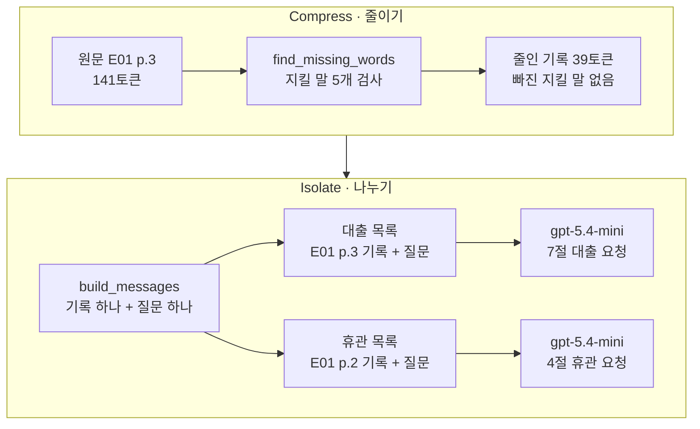
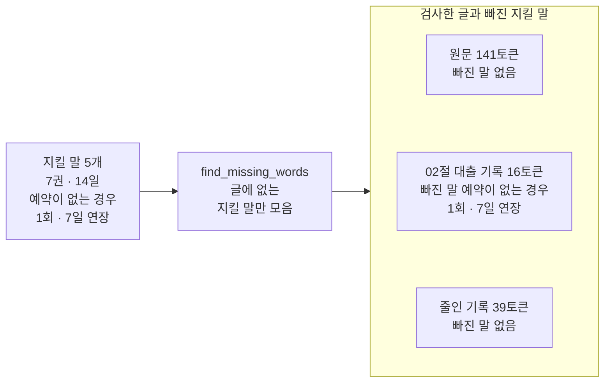
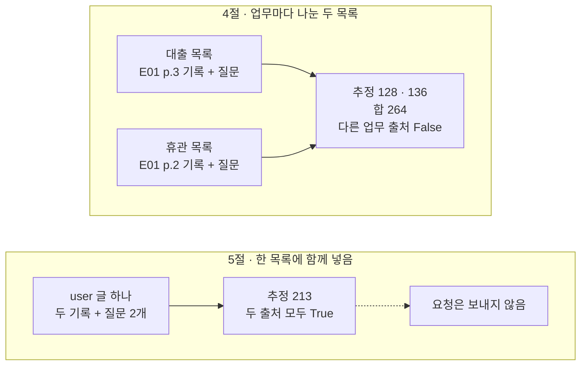
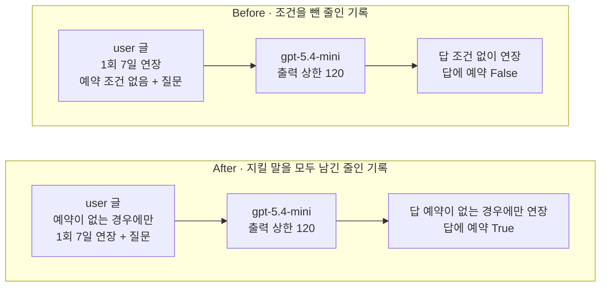

# 03-Compress와-Isolate

## _src 본문 (HTML 원본)

```html
<!--meta: 강의 1h | 실습 2h | 코드 Jupyter Notebook | 새 용어 6 -->
<h2 id="b1"><span class="no">1</span>학습 목표</h2>
<div class="goal"><p>이 절을 마치면 다음을 할 수 있습니다.</p><ul><li>원문을 줄이기 전에 질문에 필요한 지킬 말을 정하고, 줄인 기록에 모두 남았는지 코드로 확인할 수 있습니다.</li><li>업무마다 메시지 목록을 따로 만들고, 다른 업무의 기록이 섞이지 않았는지와 추정 입력을 비교할 수 있습니다.</li><li>조건이 빠진 줄인 기록이 답을 어떻게 바꾸는지 Before/After 출력으로 설명할 수 있습니다.</li></ul></div>
<h2 id="b2"><span class="no">2</span>이 내용을 배우는 이유</h2>
<p>02절에서는 질문에 필요한 기록만 골라 넣었습니다. 그런데 고른 자료가 원문 문단 그대로면 여전히 깁니다. 02절 기록처럼 한 문장으로 줄이면 짧아지지만, 원문의 조건이 빠질 수 있습니다.</p>
<p>이 절은 LangChain 팀이 묶은 네 이름 가운데 나머지 둘을 다룹니다. 줄이기(Compress)는 원문 표현을 줄이되 답에 필요한 사실과 조건을 남기는 일입니다. 나누기(Isolate)는 업무마다 메시지 목록을 따로 만들어, 요청 하나에 한 업무의 자료만 넣는 일입니다.</p>
<p>줄이기에서 자주 하는 실수가 있습니다. 짧게 만드는 데만 신경 쓰다가 「단, …」 같은 조건을 빼는 것입니다. 이 절의 Before가 그 실수를 실제 요청으로 확인합니다.</p>
<p><strong>이 절의 질문</strong> — 원문을 줄이거나 업무별로 나눌 때, 무엇을 남기고 무엇을 확인해야 답이 원문의 조건을 지킬까요?</p>
<h2 id="b3"><span class="no">3</span>앞에서 배운 내용</h2>
<table><thead><tr><th>앞 절</th><th>배운 것</th><th>이 절에서 이어지는 곳</th></tr></thead><tbody>
<tr><td>Ch 2 01~03절</td><td>딕셔너리 <code>copy()</code></td><td>6절 조건을 뺀 기록 만들기</td></tr>
<tr><td>Ch 7 01절</td><td>확인 단어를 <code>in</code>으로 표시, 인덱스 두 번 <code>messages[0][1]</code></td><td>3절 지킬 말 검사, 4절 user 글 꺼내기, 6·7절 「예약」 확인</td></tr>
<tr><td>01절</td><td>E01 2쪽 근거 문단과 휴관 질문, 600·120·40 → 440, 바깥 이름을 읽는 <code>count_tokens()</code></td><td>준비 셀에서 가져옴, 4절 휴관 기록·질문과 <code>build_messages()</code></td></tr>
<tr><td>02절</td><td>기록 키 <code>출처</code>·<code>기관</code>·<code>주제</code>·<code>내용</code>, 출처 표시 <code>[E01 p.3]</code>, <code>find_cited_notes()</code></td><td>3절 02절 대출 기록 검사, 4절 기록 모양과 출처 되짚기</td></tr>
</tbody></table>
<p>02절은 「기록은 원문을 줄여 적은 것이라 조건이 빠질 수 있다」고 적고 이 절로 넘겼습니다. 이 절은 02절 대출 기록을 E01 3쪽 원문과 대조하는 데서 시작합니다.</p>
<p>페르소나·과업 명세·수업 예산·모델 설정은 02절 값을 그대로 씁니다. 모델의 출력 상한도 출력 예약분 120입니다. 이 절은 파일을 쓰지 않고, 원문과 기록을 셀 안에 적습니다.</p>
<h2 id="b4"><span class="no">4</span>핵심 개념</h2>
<h3>비유로 시작하기</h3>
<p>01·02절의 긴 책상이 이번에는 작은 책상 두 개로 나뉘었습니다. 두 책상은 떨어져 서 있고, 책상마다 파란 명찰·주황 클립보드·노란 메모지·빈 답안지와 연필이 있습니다. 책상마다 초록 탭 카드도 한 장씩 있습니다.</p>
<p>왼쪽 책상 앞 바닥에는 회색 줄이 가득한 긴 종이 한 장과 초록 형광펜이 있습니다. 긴 종이에는 몇 줄만 초록으로 칠해져 있습니다. 왼쪽 책상 카드의 짧은 세 줄도 같은 초록으로 칠해져 있습니다.</p>
{{img:03-5-두-책상과-긴-종이|떨어져 선 작은 나무 책상 두 개에 각각 파란 명찰·주황 클립보드·노란 메모지·초록 탭 카드·빈 답안지와 연필이 있고, 왼쪽 책상 앞 바닥에 몇 줄만 초록 형광펜으로 칠한 긴 종이와 형광펜이 놓였으며, 왼쪽 책상 카드의 세 줄도 초록으로 칠해진 삽화|긴 종이에서 칠한 줄만 카드에 옮겨 적고, 일마다 책상을 따로 씁니다. 책상 하나에는 그 일의 카드만 올립니다.}}
<p><strong>그림 읽기</strong> — 바닥의 긴 종이에서 왼쪽 책상 카드로 봅니다. 긴 종이의 줄 대부분은 칠하지 않았고, 초록으로 칠한 몇 줄만 있습니다. 왼쪽 카드에는 초록으로 칠한 짧은 줄만 있습니다. 그다음 두 책상 사이의 빈 바닥을 봅니다. 오른쪽 책상의 카드는 회색 줄이고, 긴 종이와 이어져 있지 않습니다.</p>
<p>긴 종이는 E01 3쪽 원문이고, 초록으로 칠한 줄은 사람이 고른 지킬 말입니다. 왼쪽 카드는 지킬 말을 남기며 줄여 적은 대출 기록입니다. 칠한 줄 수는 노트북의 지킬 말 개수와 같지 않습니다.</p>
<p>두 책상은 대출 업무와 휴관 업무의 메시지 목록이고, 빈 바닥은 두 목록을 따로 보낸다는 뜻입니다. 오른쪽 카드는 휴관 기록입니다. 파란 명찰·주황 클립보드·노란 메모지·답안지의 뜻은 01·02절과 같습니다. 02절의 기록 카드 상자는 이 그림에 없습니다.</p>
<h3>줄이기 — 짧게 만들되 지킬 말은 남깁니다</h3>
<p>줄이기(Compress)는 원문의 표현을 줄여 토큰 수를 줄이되, 답에 필요한 사실과 조건은 남기는 일입니다. 긴 공지문을 친구에게 문자로 옮길 때 날짜와 「단, …」 조건은 빼지 않는 것과 비슷합니다. 노트북 3절은 E01 3쪽 「4. 자료 대출」 원문을 줄인 기록으로 옮겼습니다.</p>
<p>줄이기 전에 지킬 말부터 정합니다. 지킬 말은 이번 질문에 답하려고 원문에서 꼭 남길 말을 사람이 고른 목록입니다. 대출 연장 질문의 지킬 말은 <code>['7권', '14일', '예약이 없는 경우', '1회', '7일 연장']</code>이었습니다. 영상 자료와 연장 신청 방법은 이번 질문에 쓰지 않아 고르지 않았습니다.</p>
{{mermaid:03-2-지킬-말-검사|초록 상자 지킬 말 5개가 파란 상자 find_missing_words로 이어지고, 오른쪽 칸의 노란 상자 세 개에 원문 141토큰 빠진 말 없음, 02절 대출 기록 16토큰 빠진 말 예약이 없는 경우 1회 7일 연장, 줄인 기록 39토큰 빠진 말 없음이 위에서 아래로 있는 흐름도|같은 지킬 말로 세 글을 검사하면 원문과 줄인 기록은 빠진 말이 없고, 가장 짧은 02절 기록은 조건 쪽 지킬 말 세 개가 빠졌습니다.}}
<p><strong>도식 읽기</strong> — 왼쪽에서 오른쪽으로 읽습니다. 초록 상자는 사람이 정한 지킬 말 다섯 개이고, 파란 상자는 글에 없는 지킬 말만 모으는 함수 <code>find_missing_words()</code>입니다. 오른쪽 칸의 노란 상자 세 개는 세 글을 검사한 출력입니다.</p>
<p>위 상자는 원문 141토큰, 아래 상자는 줄인 기록 39토큰이고, 둘 다 빠진 말이 없었습니다. 가운데 상자는 02절 대출 기록입니다. 16토큰으로 가장 짧지만 <code>['예약이 없는 경우', '1회', '7일 연장']</code>이 빠졌습니다. 짧다는 것만으로는 잘 줄였다고 할 수 없습니다.</p>
<p>지킬 말 검사는 목록에 적은 말이 글에 들어 있는지만 봅니다. 목록에 적지 않은 조건이 빠지거나, 말은 남았는데 뜻이 바뀌면 알려 주지 않습니다. 그래서 줄인 기록에도 출처를 남기고, 뜻은 원문과 나란히 놓고 사람이 확인합니다.</p>
<h3>나누기 — 업무마다 목록을 따로 만듭니다</h3>
<p>나누기(Isolate)는 서로 다른 업무의 자료를 한 메시지 목록에 섞지 않고, 업무마다 목록을 따로 만들어 보내는 일입니다. 두 과목 숙제를 과목별 공책에 따로 적는 것과 비슷합니다. 노트북 4절은 대출 연장 안내와 휴관 안내 두 업무의 목록을 같은 함수 <code>build_messages()</code>로 따로 만들었습니다.</p>
{{mermaid:03-1-줄이기와-나누기|위 칸 Compress에는 초록 상자 원문 E01 p.3 141토큰, 파란 상자 find_missing_words 지킬 말 5개 검사, 노란 상자 줄인 기록 39토큰 빠진 지킬 말 없음이 있고, 아래 칸 Isolate에는 파란 상자 build_messages가 초록 상자 대출 목록과 휴관 목록으로 갈라져 각각 보라 상자 gpt-5.4-mini 7절 대출 요청과 4절 휴관 요청으로 이어지는 흐름도|원문을 지킬 말을 남기며 줄인 뒤, 업무마다 따로 만든 목록을 요청 하나씩으로 보냅니다.}}
<p><strong>도식 읽기</strong> — 위 칸이 줄이기, 아래 칸이 나누기이고, 칸마다 왼쪽에서 오른쪽으로 읽습니다. 위 칸의 초록 상자는 원문, 파란 상자는 지킬 말 검사, 노란 상자는 출력으로 확인한 줄인 기록의 검사 결과입니다.</p>
<p>아래 칸의 파란 상자는 기록 하나와 질문 하나로 목록을 만드는 함수입니다. 초록 상자 두 개가 그 함수로 만든 대출 목록과 휴관 목록입니다. 보라 상자는 목록마다 따로 보낸 요청으로, 휴관 목록은 4절에서, 대출 목록은 7절 After에서 보냈습니다.</p>
<p>두 목록을 만든 뒤 출력 <code>대출 목록에 휴관 출처가 있는가: False</code>와 <code>휴관 목록에 대출 출처가 있는가: False</code>를 확인했습니다. 휴관 답에서 찾은 기록도 <code>['E01 p.2']</code> 하나였습니다. 어느 기록을 어느 목록에 넣을지는 사람이 코드에 정했고, 모델이 업무를 나눈 것이 아닙니다.</p>
<p>LangChain 글은 나누기의 예로 일을 여러 서브에이전트에 나눠 맡기는 방법도 듭니다. 서브에이전트마다 도구·지시·컨텍스트 윈도를 따로 두는 방식입니다. 이 절에는 에이전트가 없습니다. 서브에이전트가 따로 받은 컨텍스트로 일하는 모양은 Ch 26 01절에서 다룹니다.</p>
<h3>이 절에서 쓰는 말</h3>
<table><thead><tr><th>용어</th><th>뜻</th><th>이 절에서 보이는 모습</th></tr></thead><tbody>
<tr><td>줄이기(Compress)</td><td>원문 표현을 줄여 토큰 수를 줄이되, 답에 필요한 사실과 조건은 남기는 일</td><td><code>원문 토큰 수: 141</code>, <code>줄인 기록 토큰 수: 39</code></td></tr>
<tr><td>원문</td><td>줄이기 전의 문서 글. 출처 표시가 가리키는 쪽의 글</td><td><code>[E01 p.3] 4. 자료 대출</code></td></tr>
<tr><td>지킬 말</td><td>이번 질문에 답하려고 원문에서 꼭 남길 말을 사람이 고른 목록</td><td><code>지킬 말: ['7권', '14일', '예약이 없는 경우', '1회', '7일 연장']</code></td></tr>
<tr><td>줄인 기록</td><td>사람이 원문을 읽고 지킬 말을 남기며 줄여 적은 기록. 키는 02절 기록과 같음</td><td><code>줄인 기록에서 빠진 지킬 말: []</code></td></tr>
<tr><td>나누기(Isolate)</td><td>서로 다른 업무의 자료를 한 목록에 섞지 않고, 업무마다 목록을 따로 만들어 보내는 일</td><td><code>대출 목록에 휴관 출처가 있는가: False</code></td></tr>
<tr><td>업무별 메시지 목록</td><td>업무 하나의 기록과 질문만 담은 메시지 목록. 요청 하나에 목록 하나를 넣음</td><td><code>loan_messages</code>, <code>closure_messages</code></td></tr>
</tbody></table>
<h2 id="b5"><span class="no">5</span>실행 예제</h2>
<p>노트북은 E01 3쪽 원문을 담고 지킬 말을 정한 뒤, 02절 기록과 줄인 기록을 검사합니다. 그다음 01절 휴관 근거도 같은 방법으로 줄이고, 두 업무의 목록을 따로 만들어 휴관 목록을 보냅니다. 값 바꿔 보기에서는 두 업무를 한 목록에 넣고 추정 입력만 셉니다.</p>
<p>실제 OpenAI 모델을 temperature 0으로 부르는 요청은 휴관 목록·Before·After 세 번입니다. 이 페이지의 출력은 2026-09-21에 실행한 결과입니다. 예상 비용은 0.01달러 미만이고, 답 문장은 실행마다 달라질 수 있습니다.</p>
<p>강의 시간에는 노트북 3·4·6절(Compress, Isolate, Before)을 설명합니다. 5·7절(값 바꿔 보기, After)은 함께 실행하고 실습 시간에 읽습니다.</p>
{{notebook:03-Compress와-Isolate|example}}
<p class="look"><b>확인할 점</b> — 3절 <code>02절 대출 기록에서 빠진 지킬 말: ['예약이 없는 경우', '1회', '7일 연장']</code>을 봅니다. 같은 절 <code>줄인 기록 토큰 수: 39</code>도 확인합니다. 4절 <code>대출 목록에 휴관 출처가 있는가: False</code>와 <code>답의 출처 표시와 같은 기록: ['E01 p.2']</code>를 봅니다. 5절 <code>한 목록 추정 입력 합계: 213</code>을 확인합니다.</p>
<h3>두 업무를 한 목록에 넣으면</h3>
<p>노트북 5절은 목록을 나누는지 하나만 바꿨습니다. 두 줄인 기록과 두 질문을 user 글 하나에 함께 넣었고, 요청은 보내지 않았습니다.</p>
{{mermaid:03-3-한-목록에-함께|위 칸 4절 업무마다 나눈 두 목록에는 초록 상자 대출 목록 E01 p.3 기록과 휴관 목록 E01 p.2 기록이 노란 상자 추정 128 136 합 264 다른 업무 출처 False로 모이고, 아래 칸 5절 한 목록에 함께 넣음에는 초록 상자 user 글 하나 두 기록 질문 2개가 노란 상자 추정 213 두 출처 모두 True를 거쳐 회색 상자 요청은 보내지 않음으로 이어지는 그림|나눈 두 목록의 추정 입력 합은 264로 한 목록 213보다 큽니다. 한 목록에는 두 업무의 출처가 모두 들어갑니다.}}
<p><strong>도식 읽기</strong> — 위 칸이 4절의 나눈 두 목록, 아래 칸이 5절의 한 목록이고, 칸마다 왼쪽에서 오른쪽으로 읽습니다. 초록 상자는 목록에 넣은 글이고, 노란 상자는 출력으로 확인한 추정 입력과 출처 검사입니다. 아래 칸 끝의 회색 상자는 실행하지 않은 단계입니다.</p>
<p>한 목록은 <code>한 목록 추정 입력 합계: 213</code>이었고, 나눈 두 목록의 합은 264였습니다. 나눈 두 목록에는 페르소나와 과업 명세 55토큰이 한 번 더 들어가, 추정 입력 합이 한 목록보다 51토큰 많았습니다. 실제로 보내면 요청마다 01절의 형식 표시 몫도 더 붙습니다. 이번 예에서 나누기는 전체 토큰을 줄이지 않았습니다.</p>
<p>대신 한 목록에는 <code>한 목록에 두 출처가 모두 있는가: True</code>처럼 두 업무의 기록이 함께 실립니다. 대출 질문에 답할 때도 휴관 기록이 모델에 갑니다. 이 목록을 보냈을 때 답이 달라지는지는 이번에 실행하지 않았습니다. 넣은 자료 때문에 답이 틀어지는 경우는 04절에서 다룹니다.</p>
<h2 id="b6"><span class="no">6</span>일부러 실패해 보기</h2>
<p>Before에서는 원문을 줄이다가 조건을 빼먹습니다. 3절 줄인 기록을 복사해 「다른 이용자의 예약이 없는 경우에만」만 뺐습니다. 지킬 말 검사는 <code>조건을 뺀 기록에서 빠진 지킬 말: ['예약이 없는 경우']</code>로 빠진 말을 찾았지만, 그대로 보냈습니다.</p>
<p>After에서 고치는 곳은 줄인 기록의 <code>내용</code> 하나입니다. 지킬 말을 모두 남긴 3절 기록으로 만든 4절 대출 목록을 보냅니다. 질문·페르소나·과업 명세·출력 상한 120은 두 요청이 같습니다.</p>
{{notebook:03-Compress와-Isolate|failure}}
<p>Before 답의 첫 문장은 <code>네, 미르시립도서관에서 빌린 도서는 1회 7일 연장할 수 있습니다.</code>였습니다. 원문은 다른 이용자의 예약이 없을 때만 연장할 수 있다고 했습니다. 출력 <code>답에 「예약」이 있는가: False</code>처럼 답에 조건이 없었고, 오류도 나지 않았습니다.</p>
<p>문장 끝의 <code>[E01 p.3]</code>은 맞는 쪽을 가리켰습니다. 그래도 그 쪽 원문의 조건은 답에 없었습니다. 모델은 받은 기록대로 답했고, 조건은 원문을 줄이는 단계에서 이미 빠졌습니다.</p>
<p>After 답의 첫 문장은 <code>네, 다른 이용자의 예약이 없는 경우에만 1회 7일 연장할 수 있습니다.</code>였습니다. 출력은 <code>답에 「예약」이 있는가: True</code>였습니다. 실제 입력은 <code>실제 입력 토큰 수: 142</code>로 추정 128보다 14 많아, 여유분 40 안에 들었습니다.</p>
{{mermaid:03-4-Before-After|위 칸 Before에는 초록 상자 user 글 1회 7일 연장 예약 조건 없음 + 질문, 보라 상자 gpt-5.4-mini 출력 상한 120, 빨간 상자 답 조건 없이 연장 답에 예약 False가 차례로 있고, 아래 칸 After에는 초록 상자 user 글 예약이 없는 경우에만 1회 7일 연장 + 질문, 보라 상자 gpt-5.4-mini 출력 상한 120, 노란 상자 답 예약이 없는 경우에만 연장 답에 예약 True가 차례로 있는 비교 그림|조건을 뺀 기록으로 보낸 Before 답은 조건 없이 연장할 수 있다고 했고, 조건을 남긴 After 답에는 예약 조건이 들어갔습니다.}}
<p><strong>도식 읽기</strong> — 위 칸이 Before, 아래 칸이 After이고, 칸마다 왼쪽에서 오른쪽으로 읽습니다. 초록 상자는 user 글에 넣은 줄인 기록과 질문이고, 보라 상자는 출력 상한 120인 같은 모델 객체입니다. 위 칸 끝의 빨간 상자는 Before의 결함 결과로, 조건 없이 연장할 수 있다는 답입니다.</p>
<p>아래 칸 끝의 노란 상자는 After 출력으로 확인한 값입니다. 「1회 7일 연장」과 둘째 문장 「대출 기준은 7권·14일입니다.」는 두 답에 모두 있어 결과 상자에 넣지 않았습니다. 이 비교는 질문 하나를 한 번씩 보낸 결과입니다.</p>
<h2 id="b7"><span class="no">7</span>주의할 점과 실무 메모</h2>
<ul><li>지킬 말은 질문마다 다시 고릅니다. 질문이 「연장은 어떻게 신청하나요?」로 바뀌면, 이번에 뺀 신청 방법이 지킬 말이 됩니다.</li>
<li>지킬 말 검사는 말이 글에 있는지만 봅니다. 목록에 적지 않은 조건이 빠지거나 뜻이 바뀐 것은 찾지 못하므로, 줄인 기록은 원문과 나란히 놓고 읽습니다.</li>
<li>답의 출처 표시가 맞는 쪽을 가리켜도, 기록에서 빠진 조건은 답에 나오지 않았습니다. 출처 표시는 원문을 다시 찾아가는 길이지, 조건이 남았다는 증거가 아닙니다.</li>
<li>휴관 기록 글은 탐색 실행 뒤 정했습니다. 처음 줄인 글은 「매주 월요일과 법정 공휴일은 휴관하며」로 적었습니다. 답은 둘을 모두 정기 휴관일로 합쳐 적었습니다. 그래서 원문의 「정기 휴관일」과 「법정 공휴일에도 휴관」 구분을 남기는 글로 바꿨습니다. 흐름을 보여 주려고 정한 예입니다.</li>
<li>이 절은 사람이 원문을 줄였습니다. 모델에게 대화 기록을 요약하게 하는 방법은 Ch 16 03절에서 다룹니다. Ch 22 03절은 요약 미들웨어가 만든 요약문에 중요한 조건이 남았는지 직접 확인합니다.</li>
<li>나누면 요청마다 페르소나와 과업 명세 55토큰이 다시 들어갑니다. 이번 예에서 나눈 두 목록의 추정 입력 합은 한 목록보다 51토큰 많았습니다. 실제로 보내면 요청마다 01절의 형식 표시 몫도 더 붙습니다.</li>
<li>목록을 나눈 것은 보안 격리가 아닙니다. 사람이 코드로 목록에 넣을 글을 정했을 뿐, 접근 권한을 검사하지 않았습니다. 같은 목록에 넣은 글은 구분 표시를 붙여도 모두 모델에 갑니다.</li>
<li>업무를 나누는 기준과 요청 순서는 사람이 코드에 정했습니다. 모델이 업무를 고르거나 다른 모델을 부르지 않았으므로, 이 노트북의 코드는 에이전트가 아닙니다.</li>
<li>교재 출력은 Linux의 Python 3.12.13으로 만들었습니다. 패키지는 langchain 1.4.0, langchain-core 1.6.2, langchain-openai 1.6.0입니다. openai 3.8.0, tiktoken 0.14.0도 함께 썼습니다. 다른 버전과 Windows·macOS에서는 실행하지 않았습니다.</li></ul>
<h2 id="b8"><span class="no">8</span>정리와 다음 절</h2>
<ul><li>E01 3쪽 원문 141토큰을 줄인 기록 39토큰으로 옮겼고, 지킬 말 다섯 개가 모두 남은 것을 코드로 확인했습니다. 02절 대출 기록은 16토큰이었지만 조건 쪽 지킬 말 세 개가 빠져 있었습니다.</li><li>대출·휴관 업무의 목록을 따로 만들었고, 어느 목록에도 다른 업무의 출처가 없었습니다. 나눈 두 목록의 추정 입력 합 264는 한 목록 213보다 컸습니다.</li><li>조건을 뺀 줄인 기록으로 보낸 Before 답은 조건 없이 연장할 수 있다고 했습니다. 조건을 남긴 After 답에는 「예약이 없는 경우에만」이 들어갔습니다.</li></ul>
<p><strong>다음 학습과 이어지는 지점</strong> — 04절에서는 컨텍스트에 넣은 자료 때문에 답이 틀어지는 경우를 네 가지 이름으로 나눠 봅니다. 다른 업무의 자료가 섞인 목록은 그중 한 경우의 조건입니다. 모델이 요약을 만드는 줄이기는 Ch 16 03절과 Ch 22 03절에서 이어집니다. 서브에이전트로 나누는 방법은 Ch 26 01절에서 다룹니다.</p>
<h2 id="b9"><span class="no">9</span>복습 문제</h2>
<details class="quiz"><summary>문제 1 · 짧은 기록</summary><p class="quiz-q">02절 대출 기록은 16토큰으로 줄인 기록 39토큰보다 짧습니다. 연장 질문에 02절 기록을 쓰면 안 되는 까닭은 무엇인가요?</p><p class="quiz-a"><b>해설</b> — 연장 질문에 필요한 조건이 빠졌기 때문입니다. 3절 출력 <code>02절 대출 기록에서 빠진 지킬 말: ['예약이 없는 경우', '1회', '7일 연장']</code>이 그 사실을 보여 줍니다. 짧다는 것만으로는 잘 줄였다고 할 수 없습니다.</p></details>
<details class="quiz"><summary>문제 2 · 지킬 말 다시 고르기</summary><p class="quiz-q">질문이 「연장은 어떻게 신청하나요?」로 바뀌면 지킬 말에 무엇을 더해야 하나요?</p><p class="quiz-a"><b>해설</b> — E01 3쪽 원문의 「반납 예정일 전」과 신청 방법(앱·홈페이지·전화)을 더합니다. 이번 대출 연장 질문에서는 쓰지 않아 뺀 말입니다.</p></details>
<details class="quiz"><summary>문제 3 · 검사의 한계</summary><p class="quiz-q">함수 <code>find_missing_words()</code>가 빈 목록 <code>[]</code>을 반환하면, 줄인 기록의 뜻이 원문과 같다고 할 수 있나요?</p><p class="quiz-a"><b>해설</b> — 할 수 없습니다. 이 함수는 목록에 적은 말이 글에 들어 있는지만 봅니다. 목록에 없는 조건이 빠졌거나 말의 뜻이 바뀐 것은 원문과 나란히 놓고 사람이 확인합니다.</p></details>
<details class="quiz"><summary>문제 4 · 나누기로 얻은 것</summary><p class="quiz-q">5절에서 한 목록의 추정 입력은 213, 나눈 두 목록의 합은 264였습니다. 토큰이 늘었는데도 나눈 목록으로 보내면 무엇을 얻나요?</p><p class="quiz-a"><b>해설</b> — 요청마다 그 업무의 기록만 모델에 갑니다. 4절 출력처럼 대출 목록에는 휴관 출처가, 휴관 목록에는 대출 출처가 없었습니다. 한 목록으로 보냈을 때 답이 달라지는지는 이번에 실행하지 않았습니다.</p></details>
<details class="quiz"><summary>문제 5 · 맞는 출처, 빠진 조건</summary><p class="quiz-q">Before 답에는 맞는 쪽을 가리키는 <code>[E01 p.3]</code>이 붙었습니다. 원문의 조건을 지킨 답이라고 볼 수 있나요?</p><p class="quiz-a"><b>해설</b> — 볼 수 없습니다. 답은 조건 없이 연장할 수 있다고 했고, <code>답에 「예약」이 있는가: False</code>였습니다. 조건은 줄인 기록을 만들 때 이미 빠졌습니다.</p></details>
<h2 id="b10"><span class="no">10</span>참고 자료</h2>
<p>문서는 2026-09-17에 다시 열어 확인했습니다. 원문은 Ch 9에서 쓰는 가상 기관 문서 <code>E01.pdf</code>의 2쪽과 3쪽을 읽고 옮겼습니다.</p>
<ul><li><div><a href="https://www.langchain.com/blog/context-engineering-for-agents">LangChain, Context Engineering</a></div>줄이기(요약·잘라 내기)와 나누기(서브에이전트·실행 환경·상태 객체)의 예 · 2025-07-02 · 확인 2026-09-17</li><li><div><a href="https://www.anthropic.com/engineering/effective-context-engineering-for-ai-agents">Anthropic, Effective context engineering for AI agents</a></div>대화 요약으로 이어 가기, 서브에이전트의 짧은 요약 · 2025-09-29 · 확인 2026-09-17</li></ul>
```

## 노트북 셀 (순서대로)

### [0] markdown {'html': 'skip'}

# Compress와 Isolate

**이 노트북에서 할 일**

1. 도서관 안내 원문을 줄인 기록으로 옮기고, 꼭 남길 말이 남았는지 코드로 확인합니다.
2. 대출 업무와 휴관 업무의 메시지 목록을 따로 만들어, 다른 업무의 기록이 섞이지 않았는지 봅니다.
3. 조건이 빠진 줄인 기록(Before)과 조건을 남긴 줄인 기록(After)으로 같은 질문을 보내 답을 비교합니다.

**준비물** — 프로젝트 폴더 `.env` 파일의 `OPENAI_API_KEY`가 필요합니다. 원문과 기록은 셀 안에 적고, 파일은 만들지 않습니다.

인터넷 서비스에 요청을 모두 3번 보냅니다. 모두 `gpt-5.4-mini`입니다.
실행 시간은 1분 안팎이고, 예상 비용은 0.01달러 미만으로 잡았습니다.
요금은 Ch 6 06절에서 2026-09-17에 확인한 mini 공식 요금 기준입니다.

**강의와 실습 범위** — 강의 시간에는 3·4·6절(Compress, Isolate, Before)을 설명합니다.
5·7절(값 바꿔 보기, After)은 함께 실행하고 실습 시간에 읽습니다.

**기준 버전** — 실습 폴더에 고정한 패키지 판을 씁니다. langchain 1.4.0, langchain-core 1.6.2, langchain-openai 1.6.0입니다.
openai 3.8.0, tiktoken 0.14.0, python-dotenv 1.2.3도 함께 씁니다.

교재 출력은 Linux의 Python 3.12.13으로 만들었습니다. 다른 버전과 Windows·macOS에서는 이번에 실행하지 않았습니다.

실습 폴더 `labs/part2/ch08-context-engineering`에서 `uv sync --locked`를 실행합니다.
그다음 이 폴더의 `.venv` 커널을 고르고 첫 셀부터 순서대로 실행합니다.

### [1] markdown {'html': 'skip'}

## 오늘 볼 그림


위 칸이 줄이기(Compress), 아래 칸이 나누기(Isolate)입니다. 칸마다 왼쪽에서 오른쪽으로 읽습니다.
초록 상자는 원문과 메시지 목록, 파란 상자는 노트북 코드의 단계입니다. 노란 상자는 출력으로 확인한 검사 결과, 보라 상자는 모델입니다.
원문을 줄인 기록은 업무마다 따로 만든 목록에 들어가고, 목록 하나가 요청 하나로 갑니다.

### [2] markdown {}

## 1. 준비

첫 셀은 패키지를 설치하고 설치된 버전을 출력합니다. 설치에는 몇십 초가 걸릴 수 있습니다.
01·02절과 같은 패키지 판을 씁니다.

### [3] code {'execution': {'iopub.execute_input': '2026-09-21T04:59:47.897460Z', 'iopub.status.busy': '2026-09-21T04:59:47.896924Z', 'iopub.status.idle': '2026-09-21T04:59:48.367368Z', 'shell.execute_reply': '2026-09-21T04:59:48.366938Z'}, 'lesson_role': 'setup'}

```python
# 이 절에서 쓰는 패키지를 설치하고 버전을 확인합니다
%pip install -q "langchain==1.4.0" "langchain-openai==1.6.0" "python-dotenv==1.2.3" "tiktoken==0.14.0"
from importlib.metadata import version

print("langchain:", version("langchain"))
print("langchain-core:", version("langchain-core"))
print("langchain-openai:", version("langchain-openai"))
print("openai:", version("openai"))
print("tiktoken:", version("tiktoken"))
print("python-dotenv:", version("python-dotenv"))
```

출력:
```
Note: you may need to restart the kernel to use updated packages.
langchain: 1.4.0
langchain-core: 1.6.2
langchain-openai: 1.6.0
openai: 3.8.0
tiktoken: 0.14.0
python-dotenv: 1.2.3

```

### [4] markdown {}

**결과 읽기** — 출력 줄은 `langchain: 1.4.0`, `openai: 3.8.0`, `tiktoken: 0.14.0` 등 여섯 줄입니다.
준비물에 적은 기준 버전과 같습니다.

토큰 수를 세는 라이브러리와 모델 함수를 불러오고, 앞에서 배운 함수 세 개를 가져옵니다. 이 절은 파일을 쓰지 않아 모듈 `json`·`tempfile`은 부르지 않습니다.

앞에서 배운 함수는 `llm_tools.py`에 모아 두었습니다. 파일을 열면 코드를 볼 수 있습니다. 노트북과 같은 폴더(`notebooks/`)에 있는 파일입니다.
이 노트북은 01절 `input_budget()`·`count_tokens()`와 02절 `find_cited_notes()`를 가져옵니다.

### [5] code {'execution': {'iopub.execute_input': '2026-09-21T04:59:48.368554Z', 'iopub.status.busy': '2026-09-21T04:59:48.368453Z', 'iopub.status.idle': '2026-09-21T04:59:48.741351Z', 'shell.execute_reply': '2026-09-21T04:59:48.740881Z'}, 'lesson_role': 'setup'}

```python
# 토큰 수를 세는 라이브러리와 모델 함수를 불러옵니다
import tiktoken

from langchain.chat_models import init_chat_model
# 01·02절 함수 세 개를 도구 파일에서 가져옵니다
from llm_tools import count_tokens, find_cited_notes, input_budget
```

출력:
```

```

### [6] markdown {}

01·02절과 같은 셀로 API 키가 있는지 확인합니다. 키 값은 출력하지 않고, 있는지만 봅니다.
`True` 값이 나오면 다음으로 넘어갑니다.

### [7] code {'execution': {'iopub.execute_input': '2026-09-21T04:59:48.742143Z', 'iopub.status.busy': '2026-09-21T04:59:48.742090Z', 'iopub.status.idle': '2026-09-21T04:59:48.746192Z', 'shell.execute_reply': '2026-09-21T04:59:48.745822Z'}, 'lesson_role': 'setup'}

```python
# .env 파일에서 OpenAI API 키를 읽습니다(키 값은 출력하지 않습니다)
import os
from dotenv import find_dotenv, load_dotenv

env_path = find_dotenv(usecwd=True)
load_dotenv(env_path)
has_key = os.getenv("OPENAI_API_KEY") is not None
print("OPENAI_API_KEY 설정 여부:", has_key)
assert has_key, "프로젝트 폴더의 .env 파일에 OPENAI_API_KEY를 적어 주세요."
```

출력:
```
OPENAI_API_KEY 설정 여부: True

```

### [8] markdown {}

## 2. 02절에서 이어 쓰는 글과 수업 예산표

페르소나와 과업 명세는 02절과 글자까지 같습니다. 과업 명세는 문장마다 끝에 출처 표시를 적게 합니다.
출처 표시 `[E01 p.2]`는 모양을 보여 주는 예입니다.

### [9] code {'execution': {'iopub.execute_input': '2026-09-21T04:59:48.746851Z', 'iopub.status.busy': '2026-09-21T04:59:48.746806Z', 'iopub.status.idle': '2026-09-21T04:59:48.748538Z', 'shell.execute_reply': '2026-09-21T04:59:48.748167Z'}}

```python
# 02절과 같은 페르소나와 과업 명세를 만듭니다
persona_text = "당신은 미르시립도서관 안내 담당자입니다."
task_text = "주어진 근거에 있는 정보만 쓰세요. 두 문장 이내로 답하고, 문장마다 끝에 출처를 [E01 p.2]처럼 적으세요."
print("페르소나:", persona_text)
print("과업 명세:", task_text)
```

출력:
```
페르소나: 당신은 미르시립도서관 안내 담당자입니다.
과업 명세: 주어진 근거에 있는 정보만 쓰세요. 두 문장 이내로 답하고, 문장마다 끝에 출처를 [E01 p.2]처럼 적으세요.

```

### [10] markdown {}

**결과 읽기** — 두 줄은 `페르소나:`와 `과업 명세:`로 시작합니다. 과업 명세 줄에 `문장마다 끝에 출처를`이 있습니다.

수업 예산표도 01·02절과 같은 값으로 이어 씁니다. 수업 예산 600에서 출력 예약분 120과 여유분 40을 먼저 뗍니다.
세 값을 담고, 준비 셀에서 가져온 01절 함수 `input_budget()`으로 입력 가용분을 구합니다.
실행 전에 예상합니다. 01·02절처럼 440일 것입니다.

### [11] code {'execution': {'iopub.execute_input': '2026-09-21T04:59:48.749152Z', 'iopub.status.busy': '2026-09-21T04:59:48.749109Z', 'iopub.status.idle': '2026-09-21T04:59:48.751049Z', 'shell.execute_reply': '2026-09-21T04:59:48.750695Z'}}

```python
# 01·02절과 같은 수업 예산·출력 예약분·여유분으로 입력 가용분을 계산합니다
total_budget = 600
output_reserve = 120
safety_margin = 40
available = input_budget(total_budget, output_reserve, safety_margin)
print("수업 예산:", total_budget)
print("출력 예약분:", output_reserve)
print("여유분:", safety_margin)
print("입력 가용분:", available)
```

출력:
```
수업 예산: 600
출력 예약분: 120
여유분: 40
입력 가용분: 440

```

### [12] markdown {}

**결과 읽기** — 네 줄은 `수업 예산: 600`, `출력 예약분: 120`, `여유분: 40`, `입력 가용분: 440`입니다.
이 절에서 만드는 메시지 목록도 모두 입력 가용분 440 안에 들어야 합니다.

요청 전에 토큰 수를 세려고 01·02절처럼 토큰화 규칙 객체를 만듭니다.
함수 `tiktoken.encoding_for_model()`은 모델 이름을 받아 토큰화 규칙 객체를 반환합니다.
가져온 함수 `count_tokens()`에는 이 객체를 첫 인자로, 토큰 수를 셀 글을 둘째 인자로 넣습니다.

### [13] code {'execution': {'iopub.execute_input': '2026-09-21T04:59:48.751570Z', 'iopub.status.busy': '2026-09-21T04:59:48.751516Z', 'iopub.status.idle': '2026-09-21T04:59:48.863360Z', 'shell.execute_reply': '2026-09-21T04:59:48.862929Z'}}

```python
# 01·02절처럼 모델의 토큰화 규칙을 불러옵니다(가져온 count_tokens()에 첫 인자로 넣습니다)
encoding = tiktoken.encoding_for_model("gpt-5.4-mini")
print("토큰화 규칙 이름:", encoding.name)
```

출력:
```
토큰화 규칙 이름: o200k_base

```

### [14] markdown {}

**결과 읽기** — 출력 줄은 `토큰화 규칙 이름: o200k_base`로 01·02절과 같습니다.

모델 객체는 02절처럼 출력 예약분을 출력 상한(`max_tokens`)으로 주어 만듭니다. 이 셀은 요청을 보내지 않습니다.
마지막 줄 `assert`는 예산표의 출력 예약분이 모델 설정에 그대로 들어갔는지 확인합니다.

### [15] code {'execution': {'iopub.execute_input': '2026-09-21T04:59:48.864001Z', 'iopub.status.busy': '2026-09-21T04:59:48.863950Z', 'iopub.status.idle': '2026-09-21T04:59:49.796360Z', 'shell.execute_reply': '2026-09-21T04:59:49.795935Z'}}

```python
# 출력 예약분을 출력 상한으로 준 모델을 준비합니다(02절과 같은 설정)
model = init_chat_model(
    "openai:gpt-5.4-mini",
    temperature=0,
    reasoning_effort="none",
    max_tokens=output_reserve,
)
print("모델 이름:", model.model_name)
print("temperature:", model.temperature)
print("출력 상한(max_tokens):", model.max_tokens)
assert model.max_tokens == output_reserve
```

출력:
```
모델 이름: gpt-5.4-mini
temperature: 0.0
출력 상한(max_tokens): 120

```

### [16] markdown {}

**결과 읽기** — 출력 줄은 `모델 이름: gpt-5.4-mini`, `temperature: 0.0`, `출력 상한(max_tokens): 120`입니다. `assert`도 통과했습니다.
이 노트북의 출력은 2026-09-21에 이 모델로 실행한 결과입니다. 실행마다 답 문장이 달라질 수 있습니다.
Ch 6 01절에서 본 것처럼 temperature 0은 Ch 5 06절의 뽑기를 끈 설정(`do_sample=False`)과 같은 것이 아닙니다.

### [17] markdown {}

## 3. Compress — 원문을 줄이고 지킬 말 확인하기

02절 대출 기록의 내용은 E01 3쪽 원문을 한 문장으로 옮겨 적은 것이었습니다.
이번에는 그 원문을 직접 보고, 조건을 남기며 줄입니다.

줄이기(Compress)는 원문의 표현을 줄여 토큰 수를 줄이되, 답에 필요한 사실과 조건은 남기는 일입니다.
긴 공지문을 친구에게 문자로 옮길 때 날짜와 「단, …」 조건은 빼지 않는 것과 비슷합니다.

먼저 E01 3쪽 「4. 자료 대출」 원문 세 문단을 변수에 담습니다. 01절처럼 같은 이름에 글을 `+`로 이어 다시 담습니다.
실행 전에 예상합니다. 원문은 제목 줄과 다섯 문장이라 100토큰을 넘을 것입니다.

### [18] code {'execution': {'iopub.execute_input': '2026-09-21T04:59:49.797124Z', 'iopub.status.busy': '2026-09-21T04:59:49.797053Z', 'iopub.status.idle': '2026-09-21T04:59:49.807334Z', 'shell.execute_reply': '2026-09-21T04:59:49.806928Z'}}

```python
# E01 3쪽 「4. 자료 대출」 원문 세 문단을 담고, 글자 수와 토큰 수를 셉니다
loan_original = "[E01 p.3] 4. 자료 대출\n"
loan_original = loan_original + "회원 한 사람이 한 번에 빌릴 수 있는 자료는 도서 7권과 영상 자료 2점입니다. "
loan_original = loan_original + "대출 기간은 도서 14일, 영상 자료 7일입니다.\n"
loan_original = loan_original + "대출 기간은 다른 이용자의 예약이 없는 경우 1회에 한해 7일 연장할 수 있습니다. "
loan_original = loan_original + "연장은 반납 예정일 전에 앱, 홈페이지, 전화(032-000-1998)로 신청합니다.\n"
loan_original = loan_original + "정기간행물 최신호, 참고도서(사전·연감), 향토자료는 관내에서만 열람할 수 있고 대출되지 않습니다."
print("원문:")
print(loan_original)
print("원문 글자 수:", len(loan_original))
print("원문 토큰 수:", count_tokens(encoding, loan_original))
```

출력:
```
원문:
[E01 p.3] 4. 자료 대출
회원 한 사람이 한 번에 빌릴 수 있는 자료는 도서 7권과 영상 자료 2점입니다. 대출 기간은 도서 14일, 영상 자료 7일입니다.
대출 기간은 다른 이용자의 예약이 없는 경우 1회에 한해 7일 연장할 수 있습니다. 연장은 반납 예정일 전에 앱, 홈페이지, 전화(032-000-1998)로 신청합니다.
정기간행물 최신호, 참고도서(사전·연감), 향토자료는 관내에서만 열람할 수 있고 대출되지 않습니다.
원문 글자 수: 243
원문 토큰 수: 141

```

### [19] markdown {}

**결과 읽기** — 라벨 줄 `원문:` 아래에 네 줄이 나옵니다. 둘째 줄이 권수와 기간, 셋째 줄이 연장 조건입니다.
마지막 두 줄은 `원문 글자 수: 243`과 `원문 토큰 수: 141`입니다.

이 절의 대출 업무 질문은 빌린 도서의 대출 기간을 연장할 수 있는지 묻습니다.
이 질문에 답하려고 원문에서 꼭 남길 말을 사람이 고릅니다. 이 목록을 지킬 말이라고 부르겠습니다.
지킬 말에는 사실(권수·기간)과 조건(예약이 없는 경우·1회·7일 연장)을 함께 넣었습니다.

### [20] code {'execution': {'iopub.execute_input': '2026-09-21T04:59:49.808076Z', 'iopub.status.busy': '2026-09-21T04:59:49.808007Z', 'iopub.status.idle': '2026-09-21T04:59:49.810123Z', 'shell.execute_reply': '2026-09-21T04:59:49.809733Z'}}

```python
# 대출 업무의 질문과, 원문을 줄여도 꼭 남길 지킬 말 목록을 정합니다
loan_question = "미르시립도서관에서 빌린 도서의 대출 기간을 연장할 수 있나요?"
keep_words = ["7권", "14일", "예약이 없는 경우", "1회", "7일 연장"]
print("질문:", loan_question)
print("지킬 말:", keep_words)
```

출력:
```
질문: 미르시립도서관에서 빌린 도서의 대출 기간을 연장할 수 있나요?
지킬 말: ['7권', '14일', '예약이 없는 경우', '1회', '7일 연장']

```

### [21] markdown {}

**결과 읽기** — 출력 줄은 `질문:` 줄과 `지킬 말: ['7권', '14일', '예약이 없는 경우', '1회', '7일 연장']`입니다.
영상 자료, 연장 신청 방법, 대출되지 않는 자료는 이번 질문의 지킬 말로 고르지 않았습니다.
질문이 「연장은 어떻게 신청하나요?」로 바뀌면 지킬 말도 다시 골라야 합니다.

글 하나와 지킬 말 목록을 받아, 글에 없는 말만 목록으로 반환하는 함수를 정의합니다.
Ch 7 01절 확인 단어처럼 `in`으로 글 안에 그 말이 있는지 봅니다. 이 셀은 정의만 하므로 출력이 없습니다.

### [22] code {'execution': {'iopub.execute_input': '2026-09-21T04:59:49.810744Z', 'iopub.status.busy': '2026-09-21T04:59:49.810688Z', 'iopub.status.idle': '2026-09-21T04:59:49.812166Z', 'shell.execute_reply': '2026-09-21T04:59:49.811836Z'}}

```python
# 글에 들어 있지 않은 지킬 말만 모아 반환하는 함수를 정의합니다
def find_missing_words(text, words):
    missing = []
    for word in words:
        if word not in text:
            missing.append(word)
    return missing
```

출력:
```

```

### [23] markdown {}

**결과 읽기** — 정의만 하는 셀이라 출력이 없습니다.

먼저 원문과 02절 대출 기록을 검사합니다. 원문에는 지킬 말이 모두 있어야 합니다.
실행 전에 예상합니다. 02절 기록에는 연장 이야기가 없으니 조건 쪽 말이 빠졌을 것입니다.

### [24] code {'execution': {'iopub.execute_input': '2026-09-21T04:59:49.812690Z', 'iopub.status.busy': '2026-09-21T04:59:49.812626Z', 'iopub.status.idle': '2026-09-21T04:59:49.814408Z', 'shell.execute_reply': '2026-09-21T04:59:49.814111Z'}}

```python
# 원문과 02절 대출 기록에서 빠진 지킬 말을 찾습니다
note_02_text = "도서는 7권까지 14일 동안 대출할 수 있습니다."
original_missing = find_missing_words(loan_original, keep_words)
note_02_missing = find_missing_words(note_02_text, keep_words)
print("원문에서 빠진 지킬 말:", original_missing)
print("02절 대출 기록에서 빠진 지킬 말:", note_02_missing)
print("02절 대출 기록 토큰 수:", count_tokens(encoding, note_02_text))
```

출력:
```
원문에서 빠진 지킬 말: []
02절 대출 기록에서 빠진 지킬 말: ['예약이 없는 경우', '1회', '7일 연장']
02절 대출 기록 토큰 수: 16

```

### [25] markdown {}

**결과 읽기** — 출력 줄은 `원문에서 빠진 지킬 말: []`과 `02절 대출 기록에서 빠진 지킬 말: ['예약이 없는 경우', '1회', '7일 연장']`입니다.
마지막 줄은 `02절 대출 기록 토큰 수: 16`입니다.
02절 기록은 권수를 묻는 02절 질문에는 충분했지만, 연장을 묻는 이번 질문에 필요한 조건은 모두 빠졌습니다.

이제 지킬 말을 모두 남기며 원문을 줄인 기록을 만듭니다. 키는 02절 기록과 같은 `출처`·`기관`·`주제`·`내용`입니다.
사람이 원문을 읽고 줄여 적은 이 기록을 줄인 기록이라고 부르겠습니다. 모델에게 줄이게 한 것이 아닙니다.

실행 전에 예상합니다. 빠진 지킬 말은 없고, 토큰 수는 원문 141보다 적을 것입니다.

### [26] code {'execution': {'iopub.execute_input': '2026-09-21T04:59:49.814941Z', 'iopub.status.busy': '2026-09-21T04:59:49.814890Z', 'iopub.status.idle': '2026-09-21T04:59:49.817082Z', 'shell.execute_reply': '2026-09-21T04:59:49.816720Z'}}

```python
# 지킬 말을 모두 남긴 줄인 기록을 만들고, 빠진 말과 토큰 수를 확인합니다
loan_note = {
    "출처": "E01 p.3",
    "기관": "미르시립도서관",
    "주제": "대출",
    "내용": "회원 한 사람의 도서 대출 기준은 7권·14일이며, 다른 이용자의 예약이 없는 경우에만 1회 7일 연장할 수 있습니다.",
}
loan_missing = find_missing_words(loan_note["내용"], keep_words)
print("줄인 기록에서 빠진 지킬 말:", loan_missing)
print("줄인 기록 글자 수:", len(loan_note["내용"]))
print("줄인 기록 토큰 수:", count_tokens(encoding, loan_note["내용"]))
assert loan_missing == []
```

출력:
```
줄인 기록에서 빠진 지킬 말: []
줄인 기록 글자 수: 66
줄인 기록 토큰 수: 39

```

### [27] markdown {}

**결과 읽기** — 출력 줄은 `줄인 기록에서 빠진 지킬 말: []`, `줄인 기록 글자 수: 66`, `줄인 기록 토큰 수: 39`입니다. `assert`도 통과했습니다.
원문 141토큰이 39토큰으로 줄었습니다. 영상 자료와 신청 방법처럼 지킬 말이 아닌 내용은 뺐습니다.

지킬 말 검사는 목록에 적은 말이 글에 들어 있는지만 봅니다. 줄인 기록의 뜻이 원문과 같은지는 사람이 원문과 나란히 놓고 읽어 확인합니다.
지킬 말 목록에 적지 않은 조건이 빠지면 검사는 알려 주지 않습니다.

### [28] markdown {}

## 4. Isolate — 업무마다 메시지 목록 나누기

나누기(Isolate)는 서로 다른 업무의 자료를 한 메시지 목록에 섞지 않고, 업무마다 목록을 따로 만들어 보내는 일입니다.
두 과목 숙제를 과목별 공책에 따로 적는 것과 비슷합니다.
이 노트북의 업무는 둘입니다. 3절의 대출 연장 안내와, 01절에서 다룬 휴관 안내입니다.

휴관 업무의 기록도 같은 방법으로 줄입니다. 01절 근거 문단(E01 2쪽)에서 지킬 말 셋을 정하고, 조건을 남긴 기록을 만듭니다.
질문은 01절 질문과 글자까지 같습니다.

### [29] code {'execution': {'iopub.execute_input': '2026-09-21T04:59:49.817586Z', 'iopub.status.busy': '2026-09-21T04:59:49.817545Z', 'iopub.status.idle': '2026-09-21T04:59:49.819450Z', 'shell.execute_reply': '2026-09-21T04:59:49.819102Z'}}

```python
# 휴관 업무의 줄인 기록·질문·지킬 말을 만들고, 빠진 말과 토큰 수를 확인합니다
closure_note = {
    "출처": "E01 p.2",
    "기관": "미르시립도서관",
    "주제": "휴관",
    "내용": "매주 월요일은 정기 휴관일이고 법정 공휴일에도 휴관하며, 공휴일이 월요일과 겹치면 다음 화요일도 휴관합니다.",
}
closure_question = "미르시립도서관의 정기 휴관일은 언제이고, 공휴일이 월요일과 겹치면 어떻게 되나요?"
closure_keep_words = ["월요일", "법정 공휴일", "화요일"]
closure_missing = find_missing_words(closure_note["내용"], closure_keep_words)
print("휴관 기록에서 빠진 지킬 말:", closure_missing)
print("휴관 기록 토큰 수:", count_tokens(encoding, closure_note["내용"]))
```

출력:
```
휴관 기록에서 빠진 지킬 말: []
휴관 기록 토큰 수: 40

```

### [30] markdown {}

**결과 읽기** — 출력 줄은 `휴관 기록에서 빠진 지킬 말: []`과 `휴관 기록 토큰 수: 40`입니다.
01절 원문의 「법정 공휴일에도 휴관」과 「그 다음 날인 화요일」 조건이 줄인 기록에 남았습니다.

업무 하나의 기록과 질문을 받아 메시지 목록을 만드는 함수를 정의합니다. 목록 모양은 02절과 같은 system·developer·user 세 메시지입니다.
user 글은 출처 표시를 붙인 기록 한 줄, 빈 줄, 질문 순서입니다.
함수는 Ch 5에서 본 것처럼 바깥 이름 `persona_text`와 `task_text`를 읽습니다. 이 셀은 정의만 하므로 출력이 없습니다.

### [31] code {'execution': {'iopub.execute_input': '2026-09-21T04:59:49.819957Z', 'iopub.status.busy': '2026-09-21T04:59:49.819913Z', 'iopub.status.idle': '2026-09-21T04:59:49.821455Z', 'shell.execute_reply': '2026-09-21T04:59:49.821200Z'}}

```python
# 기록 하나와 질문 하나로 Ch 7 모양의 메시지 목록을 만들어 반환하는 함수를 정의합니다
def build_messages(note, question):
    user_text = "[" + note["출처"] + "] " + note["내용"] + "\n\n" + "질문: " + question
    messages = [
        ("system", persona_text),
        ("developer", task_text),
        ("user", user_text),
    ]
    return messages
```

출력:
```

```

### [32] markdown {}

**결과 읽기** — 정의만 하는 셀이라 출력이 없습니다.

같은 함수로 대출 목록과 휴관 목록을 따로 만듭니다. 목록의 셋째 메시지에서 user 글을 꺼내 다른 업무의 출처 표시가 있는지 봅니다.

인덱스 `loan_messages[2][1]`은 셋째 튜플의 둘째 값, 곧 user 글입니다. Ch 7 01절에서 쓴 인덱스 두 번 모양입니다.
실행 전에 예상합니다. 두 목록 모두 다른 업무의 출처가 없을 것입니다.

### [33] code {'execution': {'iopub.execute_input': '2026-09-21T04:59:49.822074Z', 'iopub.status.busy': '2026-09-21T04:59:49.822012Z', 'iopub.status.idle': '2026-09-21T04:59:49.824226Z', 'shell.execute_reply': '2026-09-21T04:59:49.823845Z'}}

```python
# 대출 업무와 휴관 업무의 메시지 목록을 따로 만들고, 다른 업무의 출처가 섞였는지 봅니다
loan_messages = build_messages(loan_note, loan_question)
closure_messages = build_messages(closure_note, closure_question)
loan_user_text = loan_messages[2][1]
closure_user_text = closure_messages[2][1]
print("대출 목록 user 글:")
print(loan_user_text)
print("대출 목록에 휴관 출처가 있는가:", "[E01 p.2]" in loan_user_text)
print("휴관 목록에 대출 출처가 있는가:", "[E01 p.3]" in closure_user_text)
```

출력:
```
대출 목록 user 글:
[E01 p.3] 회원 한 사람의 도서 대출 기준은 7권·14일이며, 다른 이용자의 예약이 없는 경우에만 1회 7일 연장할 수 있습니다.

질문: 미르시립도서관에서 빌린 도서의 대출 기간을 연장할 수 있나요?
대출 목록에 휴관 출처가 있는가: False
휴관 목록에 대출 출처가 있는가: False

```

### [34] markdown {}

**결과 읽기** — 라벨 줄 `대출 목록 user 글:` 아래 첫 줄은 `[E01 p.3] 회원 한 사람의 도서 대출 기준은`으로 시작합니다. 빈 줄 다음은 `질문:` 줄입니다.
마지막 두 줄은 `대출 목록에 휴관 출처가 있는가: False`와 `휴관 목록에 대출 출처가 있는가: False`입니다.
어느 기록을 어느 목록에 넣을지는 사람이 코드에 정했습니다. 모델이 업무를 나눈 것이 아닙니다.

두 목록의 추정 입력을 01절 예산표처럼 셉니다. 페르소나와 과업 명세는 두 목록에 똑같이 들어가므로 한 번 세어 변수에 담습니다.
실행 전에 예상합니다. 짧은 기록 한 줄씩이라 두 목록 모두 440 안에 들어갈 것입니다.

### [35] code {'execution': {'iopub.execute_input': '2026-09-21T04:59:49.824763Z', 'iopub.status.busy': '2026-09-21T04:59:49.824719Z', 'iopub.status.idle': '2026-09-21T04:59:49.826835Z', 'shell.execute_reply': '2026-09-21T04:59:49.826494Z'}}

```python
# 두 목록의 추정 입력을 세어 입력 가용분과 비교합니다(요청은 보내지 않습니다)
shared_tokens = count_tokens(encoding, persona_text) + count_tokens(encoding, task_text)
loan_estimate = shared_tokens + count_tokens(encoding, loan_user_text)
closure_estimate = shared_tokens + count_tokens(encoding, closure_user_text)
print("페르소나 + 과업 명세 토큰 수:", shared_tokens)
print("대출 목록 추정 입력 합계:", loan_estimate)
print("휴관 목록 추정 입력 합계:", closure_estimate)
print("대출 목록이 입력 가용분 안에 드는가:", loan_estimate <= available)
print("휴관 목록이 입력 가용분 안에 드는가:", closure_estimate <= available)
```

출력:
```
페르소나 + 과업 명세 토큰 수: 55
대출 목록 추정 입력 합계: 128
휴관 목록 추정 입력 합계: 136
대출 목록이 입력 가용분 안에 드는가: True
휴관 목록이 입력 가용분 안에 드는가: True

```

### [36] markdown {}

**결과 읽기** — 출력 줄은 `페르소나 + 과업 명세 토큰 수: 55`, `대출 목록 추정 입력 합계: 128`, `휴관 목록 추정 입력 합계: 136`입니다.
마지막 두 줄은 모두 `True`입니다. 두 목록은 따로 보내므로 요청마다 입력 가용분 440과 비교합니다.

휴관 목록을 먼저 보냅니다. 대출 목록은 7절 After에서 보냅니다. 요청 하나에는 목록 하나만 넣습니다.
답은 여러 줄일 수 있어 라벨 줄 `답:`을 따로 출력합니다.

실행 전에 예상합니다. 답에는 휴관 기록의 출처 표시만 붙을 것입니다.

### [37] code {'execution': {'iopub.execute_input': '2026-09-21T04:59:49.827341Z', 'iopub.status.busy': '2026-09-21T04:59:49.827299Z', 'iopub.status.idle': '2026-09-21T04:59:50.485839Z', 'shell.execute_reply': '2026-09-21T04:59:50.484884Z'}}

```python
# 휴관 목록 하나만 보냅니다(요청 1번)
closure_response = model.invoke(closure_messages)
print("답:")
print(closure_response.text)
```

출력:
```
답:
미르시립도서관의 정기 휴관일은 매주 월요일이며, 법정 공휴일에도 휴관합니다. [E01 p.2] 공휴일이 월요일과 겹치면 다음 화요일도 휴관합니다. [E01 p.2]

```

### [38] markdown {}

**결과 읽기** — 라벨 줄 아래 답은 두 문장입니다. 첫 문장은 `미르시립도서관의 정기 휴관일은 매주 월요일이며, 법정 공휴일에도 휴관합니다.`입니다.
둘째 문장은 `공휴일이 월요일과 겹치면 다음 화요일도 휴관합니다.`입니다. 두 문장 끝에 모두 `[E01 p.2]`가 붙었습니다.

휴관 기록에 남긴 두 조건이 답에 모두 들어갔습니다. 실행마다 답 문장이 달라질 수 있습니다.

휴관 답의 토큰 수와 끝난 이유를 보고, 답에 적힌 출처 표시를 두 줄인 기록에서 찾습니다.
찾을 때는 준비 셀에서 가져온 02절 함수 `find_cited_notes()`를 씁니다. 답 글과 기록 목록을 받아, 출처 표시가 답 글에 들어 있는 기록만 목록으로 반환합니다.
찾은 기록은 출처만 모아 한 줄로 출력합니다. 반복문 안에서는 `append`만 합니다.

### [39] code {'execution': {'iopub.execute_input': '2026-09-21T04:59:50.488077Z', 'iopub.status.busy': '2026-09-21T04:59:50.487889Z', 'iopub.status.idle': '2026-09-21T04:59:50.492762Z', 'shell.execute_reply': '2026-09-21T04:59:50.491873Z'}}

```python
# 휴관 답의 토큰 수와 끝난 이유를 보고, 답에 적힌 출처를 두 기록에서 찾습니다
closure_usage = closure_response.usage_metadata
print("실제 입력 토큰 수:", closure_usage["input_tokens"])
print("실제 출력 토큰 수:", closure_usage["output_tokens"])
print("끝난 이유:", closure_response.response_metadata["finish_reason"])
all_notes = [loan_note, closure_note]
closure_cited = find_cited_notes(closure_response.text, all_notes)
cited_sources = []
for note in closure_cited:
    cited_sources.append(note["출처"])
print("답의 출처 표시와 같은 기록:", cited_sources)
```

출력:
```
실제 입력 토큰 수: 150
실제 출력 토큰 수: 66
끝난 이유: stop
답의 출처 표시와 같은 기록: ['E01 p.2']

```

### [40] markdown {}

**결과 읽기** — 출력 줄은 `실제 입력 토큰 수: 150`, `실제 출력 토큰 수: 66`, `끝난 이유: stop`입니다.
마지막 줄은 `답의 출처 표시와 같은 기록: ['E01 p.2']`입니다. 두 기록 가운데 휴관 기록 하나만 찾았습니다.

이 요청에는 휴관 기록만 실렸으므로, 답이 대출 기록을 쓸 수 없었습니다. 추정 136과 실제 150의 차이는 14로, 01·02절과 같은 값이었습니다.

### [41] markdown {}

## 5. 값 바꿔 보기 — 두 업무를 한 목록에 함께 넣으면

바꾸는 것은 목록을 나누는지 하나뿐입니다. 두 줄인 기록과 두 질문을 user 글 하나에 함께 넣습니다.
기록과 질문의 글자는 4절과 같습니다. 이 셀은 글을 만들고 세기만 하고, 요청은 보내지 않습니다.

실행 전에 예상합니다. 한 목록에는 두 출처가 모두 들어갑니다.
페르소나와 과업 명세를 한 번만 넣으니, 추정 입력은 나눈 두 목록의 합보다 작을 것입니다.

### [42] code {'execution': {'iopub.execute_input': '2026-09-21T04:59:50.493828Z', 'iopub.status.busy': '2026-09-21T04:59:50.493726Z', 'iopub.status.idle': '2026-09-21T04:59:50.497701Z', 'shell.execute_reply': '2026-09-21T04:59:50.496925Z'}}

```python
# 두 업무의 기록과 질문을 user 글 하나에 함께 넣고, 나눈 두 목록과 비교합니다(요청은 보내지 않습니다)
mixed_user_text = "[E01 p.3] " + loan_note["내용"] + "\n"
mixed_user_text = mixed_user_text + "[E01 p.2] " + closure_note["내용"] + "\n\n"
mixed_user_text = mixed_user_text + "질문 1: " + loan_question + "\n"
mixed_user_text = mixed_user_text + "질문 2: " + closure_question
mixed_estimate = shared_tokens + count_tokens(encoding, mixed_user_text)
separated_total = loan_estimate + closure_estimate
has_both_sources = "[E01 p.3]" in mixed_user_text and "[E01 p.2]" in mixed_user_text
print("한 목록에 두 출처가 모두 있는가:", has_both_sources)
print("한 목록 추정 입력 합계:", mixed_estimate)
print("나눈 두 목록 추정 입력의 합:", separated_total)
```

출력:
```
한 목록에 두 출처가 모두 있는가: True
한 목록 추정 입력 합계: 213
나눈 두 목록 추정 입력의 합: 264

```

### [43] markdown {}

**결과 읽기** — 출력 줄은 `한 목록에 두 출처가 모두 있는가: True`, `한 목록 추정 입력 합계: 213`, `나눈 두 목록 추정 입력의 합: 264`입니다.
나눈 두 목록에는 페르소나와 과업 명세 55토큰이 한 번 더 들어가, 두 요청을 합한 추정 입력이 51토큰 많습니다.

이번 예에서 나누기는 전체 토큰을 줄이지 않았습니다. 나누기로 얻은 것은 요청마다 그 업무의 기록만 모델에 간다는 점입니다.
한 목록으로 보내면 대출 질문에 답할 때도 휴관 기록이 함께 모델에 갑니다. 과업 명세의 「두 문장 이내」도 질문 두 개와 맞지 않습니다.
이 목록을 보냈을 때 답이 어떻게 달라지는지는 이번에 실행하지 않았습니다.

### [44] markdown {'lesson_part': 'before'}

## 6. Before — 조건이 빠진 줄인 기록으로 답하기

원문을 줄이다가 조건을 빼먹은 경우를 봅니다. 3절 줄인 기록을 복사해 키 `내용`만 바꿉니다.
「다른 이용자의 예약이 없는 경우에만」을 뺐고, 나머지 글자는 같습니다.
메서드 `copy()`는 Ch 2에서 배운 대로 딕셔너리를 복사합니다. 복사본을 고쳐도 `loan_note`는 그대로입니다.

실행 전에 예상합니다. 지킬 말 검사가 빠진 말 하나를 찾아낼 것입니다.

### [45] code {'execution': {'iopub.execute_input': '2026-09-21T04:59:50.498911Z', 'iopub.status.busy': '2026-09-21T04:59:50.498801Z', 'iopub.status.idle': '2026-09-21T04:59:50.501316Z', 'shell.execute_reply': '2026-09-21T04:59:50.500912Z'}, 'lesson_part': 'before'}

```python
# 조건을 뺀 줄인 기록으로 대출 목록을 만들고, 빠진 지킬 말과 추정 입력을 봅니다(요청은 보내지 않습니다)
dropped_note = loan_note.copy()
dropped_note["내용"] = "회원 한 사람의 도서 대출 기준은 7권·14일이며, 1회 7일 연장할 수 있습니다."
dropped_missing = find_missing_words(dropped_note["내용"], keep_words)
before_messages = build_messages(dropped_note, loan_question)
before_estimate = shared_tokens + count_tokens(encoding, before_messages[2][1])
print("조건을 뺀 기록에서 빠진 지킬 말:", dropped_missing)
print("3절 줄인 기록에서 빠진 지킬 말:", find_missing_words(loan_note["내용"], keep_words))
print("추정 입력 합계:", before_estimate)
```

출력:
```
조건을 뺀 기록에서 빠진 지킬 말: ['예약이 없는 경우']
3절 줄인 기록에서 빠진 지킬 말: []
추정 입력 합계: 119

```

### [46] markdown {'lesson_part': 'before'}

**결과 읽기** — 출력 줄은 `조건을 뺀 기록에서 빠진 지킬 말: ['예약이 없는 경우']`와 `3절 줄인 기록에서 빠진 지킬 말: []`입니다.
마지막 줄은 `추정 입력 합계: 119`로, 대출 목록 128보다 9토큰 적습니다.
검사는 빠진 말을 찾았지만, 이번에는 그대로 보내 답이 어떻게 되는지 봅니다.

조건을 뺀 목록을 보냅니다. 질문·페르소나·과업 명세·모델 설정은 After와 같습니다.
실행 전에 예상합니다. 기록에 조건이 없으니 답에도 조건 없이 연장할 수 있다고 나올 것입니다.

### [47] code {'execution': {'iopub.execute_input': '2026-09-21T04:59:50.502113Z', 'iopub.status.busy': '2026-09-21T04:59:50.502039Z', 'iopub.status.idle': '2026-09-21T04:59:51.265255Z', 'shell.execute_reply': '2026-09-21T04:59:51.263936Z'}, 'lesson_part': 'before'}

```python
# 조건을 뺀 줄인 기록이 든 목록을 보냅니다(요청 1번)
before_response = model.invoke(before_messages)
print("답:")
print(before_response.text)
```

출력:
```
답:
네, 미르시립도서관에서 빌린 도서는 1회 7일 연장할 수 있습니다. [E01 p.3] 대출 기준은 7권·14일입니다. [E01 p.3]

```

### [48] markdown {'lesson_part': 'before'}

**결과 읽기** — 라벨 줄 아래 답은 두 문장입니다. 첫 문장은 `네, 미르시립도서관에서 빌린 도서는 1회 7일 연장할 수 있습니다.`입니다.
원문은 다른 이용자의 예약이 없을 때만 연장할 수 있다고 했습니다. 이 답만 읽으면 예약이 있어도 연장할 수 있다고 생각하게 됩니다.

오류는 나지 않았고, 문장 끝에는 `[E01 p.3]`이 붙었습니다. 출처 표시는 맞는 쪽을 가리키지만, 그 쪽 원문의 조건은 답에 없습니다.

답의 토큰 수와 끝난 이유를 봅니다. 답 글에 「예약」이라는 말이 있는지도 `in`으로 확인합니다.
이 확인은 Ch 7 01절 확인 단어 표시처럼 말이 있는지만 봅니다. 답의 품질 점수가 아닙니다.

### [49] code {'execution': {'iopub.execute_input': '2026-09-21T04:59:51.266776Z', 'iopub.status.busy': '2026-09-21T04:59:51.266687Z', 'iopub.status.idle': '2026-09-21T04:59:51.269227Z', 'shell.execute_reply': '2026-09-21T04:59:51.268758Z'}, 'lesson_part': 'before'}

```python
# Before 답의 토큰 수와 끝난 이유를 보고, 답에 「예약」이라는 말이 있는지 봅니다
before_usage = before_response.usage_metadata
print("실제 입력 토큰 수:", before_usage["input_tokens"])
print("실제 출력 토큰 수:", before_usage["output_tokens"])
print("끝난 이유:", before_response.response_metadata["finish_reason"])
print("답에 「예약」이 있는가:", "예약" in before_response.text)
```

출력:
```
실제 입력 토큰 수: 133
실제 출력 토큰 수: 56
끝난 이유: stop
답에 「예약」이 있는가: False

```

### [50] markdown {'lesson_part': 'before'}

**결과 읽기** — 출력 줄은 `실제 입력 토큰 수: 133`, `실제 출력 토큰 수: 56`, `끝난 이유: stop`입니다.
마지막 줄은 `답에 「예약」이 있는가: False`입니다.

모델은 받은 기록대로 답했습니다. 조건은 원문을 줄이는 단계에서 이미 빠졌습니다. 이 결과는 질문 하나를 한 번 보낸 결과입니다.

### [51] markdown {'lesson_part': 'after'}

## 7. After — 지킬 말을 모두 남긴 줄인 기록으로 답하기

고치는 곳은 줄인 기록의 `내용` 하나입니다. 지킬 말을 모두 남긴 3절 기록으로 만든 4절 대출 목록 `loan_messages`를 보냅니다.
페르소나·과업 명세·질문·모델 설정은 Before와 같습니다.

실행 전에 예상합니다. 답에 「예약이 없는 경우」라는 조건이 들어갈 것입니다.

### [52] code {'execution': {'iopub.execute_input': '2026-09-21T04:59:51.270174Z', 'iopub.status.busy': '2026-09-21T04:59:51.270096Z', 'iopub.status.idle': '2026-09-21T04:59:51.856252Z', 'shell.execute_reply': '2026-09-21T04:59:51.855309Z'}, 'lesson_part': 'after'}

```python
# 지킬 말을 모두 남긴 줄인 기록이 든 4절 대출 목록을 보냅니다(요청 1번)
after_response = model.invoke(loan_messages)
print("답:")
print(after_response.text)
```

출력:
```
답:
네, 다른 이용자의 예약이 없는 경우에만 1회 7일 연장할 수 있습니다. [E01 p.3] 대출 기준은 7권·14일입니다. [E01 p.3]

```

### [53] markdown {'lesson_part': 'after'}

**결과 읽기** — 라벨 줄 아래 답은 두 문장입니다. 첫 문장은 `네, 다른 이용자의 예약이 없는 경우에만 1회 7일 연장할 수 있습니다.`입니다.
끝에는 `[E01 p.3]`이 붙었습니다. 줄인 기록에 남긴 조건이 답의 첫 문장에 들어갔습니다.

둘째 문장 `대출 기준은 7권·14일입니다.`는 Before 답의 둘째 문장과 같습니다. 그래서 After에서 새로 생긴 차이로 보지 않습니다.

After 답의 토큰 수와 끝난 이유를 봅니다. 4절에서 센 추정 입력과 실제 입력의 차이도 01·02절처럼 여유분과 비교합니다.
마지막 줄에서 답 글에 「예약」이라는 말이 있는지 Before와 같은 방법으로 확인합니다.

### [54] code {'execution': {'iopub.execute_input': '2026-09-21T04:59:51.858200Z', 'iopub.status.busy': '2026-09-21T04:59:51.858074Z', 'iopub.status.idle': '2026-09-21T04:59:51.861723Z', 'shell.execute_reply': '2026-09-21T04:59:51.860950Z'}, 'lesson_part': 'after'}

```python
# After 답의 토큰 수·끝난 이유·추정과의 차이를 보고, 답에 「예약」이라는 말이 있는지 봅니다
after_usage = after_response.usage_metadata
print("실제 입력 토큰 수:", after_usage["input_tokens"])
print("실제 출력 토큰 수:", after_usage["output_tokens"])
print("끝난 이유:", after_response.response_metadata["finish_reason"])
input_gap = after_usage["input_tokens"] - loan_estimate
print("실제 입력 - 추정 입력:", input_gap)
print("차이가 여유분 안에 드는가:", input_gap <= safety_margin)
print("답에 「예약」이 있는가:", "예약" in after_response.text)
```

출력:
```
실제 입력 토큰 수: 142
실제 출력 토큰 수: 52
끝난 이유: stop
실제 입력 - 추정 입력: 14
차이가 여유분 안에 드는가: True
답에 「예약」이 있는가: True

```

### [55] markdown {'lesson_part': 'after'}

**결과 읽기** — 출력 줄은 `실제 입력 토큰 수: 142`, `실제 출력 토큰 수: 52`, `끝난 이유: stop`입니다.
그 아래 `실제 입력 - 추정 입력: 14`와 `차이가 여유분 안에 드는가: True`가 나왔습니다. 마지막 줄은 `답에 「예약」이 있는가: True`입니다.

두 목록의 입력 차이는 줄인 기록에 넣은 조건 한 구절뿐이었고, 답에 조건이 들어갔는지가 달라졌습니다.
이 비교는 질문 하나를 한 번씩 보낸 결과입니다. 조건을 남긴 기록이 모든 질문에서 조건 있는 답을 만든다고는 말하지 않습니다.

## 정리

- 원문 141토큰을 줄인 기록 39토큰으로 옮겼고, 사람이 고른 지킬 말 다섯 개가 모두 남은 것을 코드로 확인했습니다.
- 대출 업무와 휴관 업무의 목록을 같은 함수로 따로 만들었고, 어느 목록에도 다른 업무의 출처가 없었습니다. 두 요청을 합한 입력은 한 목록보다 많았습니다.
- 조건을 뺀 줄인 기록으로 보낸 Before 답은 조건 없이 연장할 수 있다고 했습니다. 조건을 남긴 After 답에는 「예약이 없는 경우에만」이 들어갔습니다.

다음 04절에서는 컨텍스트에 넣은 자료 때문에 답이 틀어지는 경우를 네 가지 이름으로 나눠 봅니다.

## 그림

### 03-1-줄이기와-나누기.mmd



- 설명 대상 문장: 노트북 4절은 대출 연장 안내와 휴관 안내 두 업무의 목록을 같은 함수 `build_messages()`로 따로 만들었습니다.
- 캡션: 원문을 지킬 말을 남기며 줄인 뒤, 업무마다 따로 만든 목록을 요청 하나씩으로 보냅니다.
- 읽는 법: 위 칸 Compress → 아래 칸 Isolate, 칸마다 왼쪽에서 오른쪽으로. 초록 상자는 3절 원문(`원문 토큰 수: 141`)과 4절 두 목록, 파란 상자는 `find_missing_words`(3절)·`build_messages`(4절), 노란 상자는 3절 `줄인 기록에서 빠진 지킬 말: []`·`줄인 기록 토큰 수: 39`, 보라 상자는 4절 휴관 요청과 7절 대출 요청의 `gpt-5.4-mini`. 노트북 「오늘 볼 그림」.
- alt: 위 칸 Compress에는 초록 상자 원문 E01 p.3 141토큰, 파란 상자 find_missing_words 지킬 말 5개 검사, 노란 상자 줄인 기록 39토큰 빠진 지킬 말 없음이 있고, 아래 칸 Isolate에는 파란 상자 build_messages가 초록 상자 대출 목록과 휴관 목록으로 갈라져 각각 보라 상자 gpt-5.4-mini 7절 대출 요청과 4절 휴관 요청으로 이어지는 흐름도

### 03-2-지킬-말-검사.mmd



- 설명 대상 문장: 짧다는 것만으로는 잘 줄였다고 할 수 없습니다.
- 캡션: 같은 지킬 말로 세 글을 검사하면 원문과 줄인 기록은 빠진 말이 없고, 가장 짧은 02절 기록은 조건 쪽 지킬 말 세 개가 빠졌습니다.
- 읽는 법: 왼쪽에서 오른쪽으로, 오른쪽 칸은 위에서 아래로. 초록 상자는 3절 `지킬 말: ['7권', '14일', '예약이 없는 경우', '1회', '7일 연장']`, 파란 상자는 함수 `find_missing_words`, 노란 상자는 3절 출력 `원문 토큰 수: 141`·`원문에서 빠진 지킬 말: []`, `02절 대출 기록에서 빠진 지킬 말: ['예약이 없는 경우', '1회', '7일 연장']`·`02절 대출 기록 토큰 수: 16`, `줄인 기록에서 빠진 지킬 말: []`·`줄인 기록 토큰 수: 39`.
- alt: 초록 상자 지킬 말 5개가 파란 상자 find_missing_words로 이어지고, 오른쪽 칸의 노란 상자 세 개에 원문 141토큰 빠진 말 없음, 02절 대출 기록 16토큰 빠진 말 예약이 없는 경우 1회 7일 연장, 줄인 기록 39토큰 빠진 말 없음이 위에서 아래로 있는 흐름도

### 03-3-한-목록에-함께.mmd



- 설명 대상 문장: 이번 예에서 나누기는 전체 토큰을 줄이지 않았습니다.
- 캡션: 나눈 두 목록의 추정 입력 합은 264로 한 목록 213보다 큽니다. 한 목록에는 두 업무의 출처가 모두 들어갑니다.
- 읽는 법: 위 칸 4절 → 아래 칸 5절, 칸마다 왼쪽에서 오른쪽으로. 초록 상자는 목록에 넣은 글, 노란 상자는 4절 `대출 목록 추정 입력 합계: 128`·`휴관 목록 추정 입력 합계: 136`·`대출 목록에 휴관 출처가 있는가: False`와 5절 `나눈 두 목록 추정 입력의 합: 264`·`한 목록 추정 입력 합계: 213`·`한 목록에 두 출처가 모두 있는가: True`, 회색 상자는 실행하지 않은 요청.
- alt: 위 칸 4절 업무마다 나눈 두 목록에는 초록 상자 대출 목록 E01 p.3 기록과 휴관 목록 E01 p.2 기록이 노란 상자 추정 128 136 합 264 다른 업무 출처 False로 모이고, 아래 칸 5절 한 목록에 함께 넣음에는 초록 상자 user 글 하나 두 기록 질문 2개가 노란 상자 추정 213 두 출처 모두 True를 거쳐 회색 상자 요청은 보내지 않음으로 이어지는 그림

### 03-4-Before-After.mmd



- 설명 대상 문장: 모델은 받은 기록대로 답했고, 조건은 원문을 줄이는 단계에서 이미 빠졌습니다.
- 캡션: 조건을 뺀 기록으로 보낸 Before 답은 조건 없이 연장할 수 있다고 했고, 조건을 남긴 After 답에는 예약 조건이 들어갔습니다.
- 읽는 법: 위 칸 Before → 아래 칸 After, 칸마다 왼쪽에서 오른쪽으로. 초록 상자는 user 글에 넣은 줄인 기록과 질문(6절 `조건을 뺀 기록에서 빠진 지킬 말: ['예약이 없는 경우']`, 4절 대출 목록), 보라 상자는 2절 `출력 상한(max_tokens): 120` 모델, 빨간 상자는 Before 결함 결과(6절 답 `네, 미르시립도서관에서 빌린 도서는 1회 7일 연장할 수 있습니다.`·`답에 「예약」이 있는가: False`), 노란 상자는 7절 답 `네, 다른 이용자의 예약이 없는 경우에만 1회 7일 연장할 수 있습니다.`·`답에 「예약」이 있는가: True`. 두 답에 모두 있던 「1회 7일 연장」 결과와 둘째 문장 「대출 기준은 7권·14일입니다.」는 결과 상자에 넣지 않음(규격 §5-3).
- alt: 위 칸 Before에는 초록 상자 user 글 1회 7일 연장 예약 조건 없음 + 질문, 보라 상자 gpt-5.4-mini 출력 상한 120, 빨간 상자 답 조건 없이 연장 답에 예약 False가 차례로 있고, 아래 칸 After에는 초록 상자 user 글 예약이 없는 경우에만 1회 7일 연장 + 질문, 보라 상자 gpt-5.4-mini 출력 상한 120, 노란 상자 답 예약이 없는 경우에만 연장 답에 예약 True가 차례로 있는 비교 그림

### 03-5-두-책상과-긴-종이.prompt.md

# 삽화 — 03-5 두 책상과 긴 종이

- 상태: 2026-09-17 생성·검수 통과(1회 생성). 모델 nano_banana_pro(서버 표기 nano_banana_2), 16:9, 2k(2752×1536), 장당 2크레딧, 합계 2크레딧(잔액 2844 → 2842 확인). 채택 job 67fee777-537f-40a0-ab7f-504d1a78ac0a. 기기 셸 `curl`로 받아 `uv run --no-project --with pillow`로 폭 1100px(1100×614) 저장(`/tmp/ch08-03/resize.py`). 원본 SHA-256 `d0f08dd2b6070b39adc2e14db38f5cd5d8bf337385d870a682f98ffa0212c041`, 저장 PNG SHA-256 `8397b2c0981161eaae20cfecfed1726330e486b69481982783c367b23def7e7c`. 채택 job 결과를 다시 받아(해시 같음) 같은 폭으로 줄여 저장 PNG와 픽셀 대조, 차이 0(bbox 없음, `/tmp/ch08-03/cmp.py`).
- 검수 메모(저장 파일 기준): 흰 바탕, 같은 모양의 작은 연한 나무 책상 두 개가 넓은 빈 바닥을 사이에 두고 서 있음. 두 책상 모두 연파랑 명찰, 주황 클립보드, 연노랑 메모지, 연초록 탭 흰 카드, 오른쪽의 빈 흰 종이와 연필. 왼쪽 카드의 짧은 세 줄은 초록 형광 띠, 오른쪽 카드의 세 줄은 회색. 왼쪽 책상 앞 바닥(다리 앞)에 회색 물결 줄이 가득한 긴 종이, 그중 네 줄 정도가 초록 형광 띠, 종이 위에 초록 형광펜. 글자·숫자·사람·손·화면·화살표·상자 없음. 그림만 보고 「긴 종이에서 칠한 줄만 왼쪽 카드로 옮겼고, 책상 두 개가 따로 있다」가 읽힘. 약점: 프롬프트의 「exactly three」와 달리 긴 종이의 칠한 줄이 네 줄 정도라 카드 세 줄과 수가 맞지 않음 → 그림 읽기는 「몇 줄만」으로 쓰고 「칠한 줄 수는 지킬 말 개수와 같지 않다」고 적음.
- 설명 대상 문장: 긴 종이는 E01 3쪽 원문이고, 초록으로 칠한 줄은 사람이 고른 지킬 말입니다. 왼쪽 카드는 지킬 말을 남기며 줄여 적은 대출 기록입니다. 두 책상은 대출 업무와 휴관 업무의 메시지 목록이고, 빈 바닥은 두 목록을 따로 보낸다는 뜻입니다.
- 넣을 자리: 03절 핵심 개념 「비유로 시작하기」 둘째 단락 바로 아래
- 구성 요소와 배치: 바닥 긴 종이(원문)와 초록 형광 띠(지킬 말)·형광펜 / 왼쪽 책상(대출 목록: 파란 명찰 = system 페르소나, 주황 클립보드 = developer 과업 명세, 노란 메모지 = 질문, 칠한 줄 카드 = 줄인 대출 기록, 답안지 = 출력 예약분) / 오른쪽 책상(휴관 목록, 회색 줄 카드 = 휴관 기록) / 두 책상 사이 빈 바닥(따로 보내는 요청)
- 시선 순서: 바닥 긴 종이의 칠한 줄 → 왼쪽 카드의 칠한 줄 → 두 책상 사이 빈 바닥 → 오른쪽 책상
- 앞 절·앞 챕터와 이어짐: 01-5·02-5 책상 요소(파란 명찰·주황 클립보드·노란 메모지·답안지와 연필)와 Ch 7 한 책상 색 약속을 그대로 씀. 02-5 초록 탭 카드(고른 기록)를 이어 씀. 01-5 긴 책상 하나 → 작은 책상 두 개(업무별 목록), 02-5 바닥 기록 카드 상자는 이 그림에 없음 — 그림 읽기에 적음. Ch 7 05-5의 연초록 형광 띠(근거 줄)와 모양이 비슷하지만 여기서는 지킬 말. 개선 전 도식 `03-압축과-분리.svg/.excalidraw`는 지우지 않고 본문에서 쓰지 않음.
- 대응: 03-1 도식(Compress 원문 → 줄인 기록, Isolate 두 목록).

## 프롬프트 (채택본)

Simple flat educational illustration, white background, limited soft palette, clean outlines, plain everyday objects, no text, no letters, no numbers, no logos.
View from slightly above and in front of two identical small plain light wooden desks standing side by side, with a clear empty gap of white floor between the two desks and wide white space around everything.
On each desk lie neatly: one small light blue name badge, one light orange clipboard, one small pale yellow sticky note, one small white index card with one light green tab on its top edge and exactly three short gray lines, and on the right side of the desk top one blank white answer sheet with one plain pencil beside it.
On the floor directly in front of the left desk lies one long tall sheet of paper covered with many gray wavy lines; exactly three of those lines are marked with light green highlighter stripes, and one light green highlighter pen lies on the sheet.
The three short lines on the index card on the left desk are also marked with light green highlighter stripes.
No people, no hands, no monitors, no screens, no computers, no arrows, no shelves, no boxes, no labels, no signs, no writing, no other objects.

