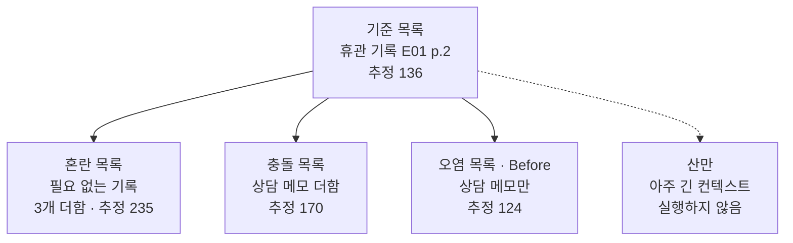
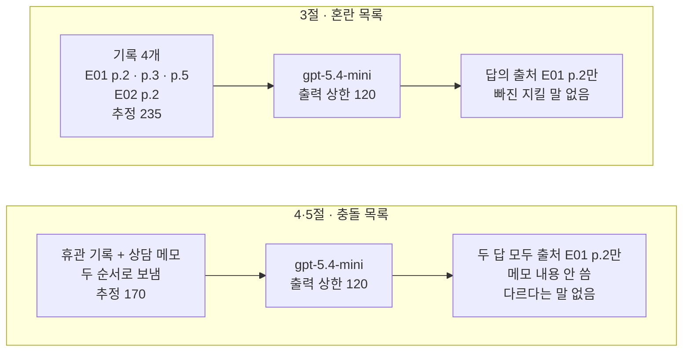
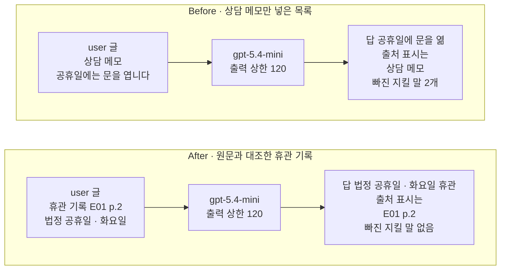
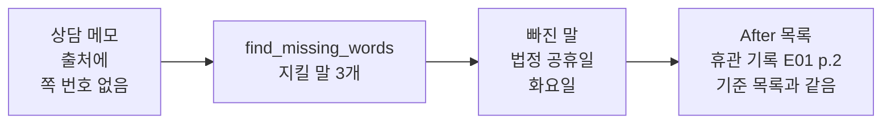

# 04-네-가지-실패-모드

## _src 본문 (HTML 원본)

```html
<!--meta: 강의 1h | 실습 2h | 코드 Jupyter Notebook | 새 용어 6 -->
<h2 id="b1"><span class="no">1</span>학습 목표</h2>
<div class="goal"><p>이 절을 마치면 다음을 할 수 있습니다.</p><ul><li>컨텍스트 오염·산만·혼란·충돌의 뜻을 출처 글의 정의로 설명하고, 컨텍스트 로트와 구분할 수 있습니다.</li><li>목록에 넣은 조건과 답에서 확인한 것을 나눠, 출처 표시와 지킬 말 검사 출력으로 기록할 수 있습니다.</li><li>틀린 기록 하나가 답을 어떻게 바꾸는지 Before/After 출력으로 설명하고, 넣기 전에 기록을 원문과 대조할 수 있습니다.</li></ul></div>
<h2 id="b2"><span class="no">2</span>이 내용을 배우는 이유</h2>
<p>01~03절에서는 컨텍스트에 무엇을 넣고 뺄지 정했습니다. 예산을 세고, 기록을 고르고, 원문을 줄이고, 업무마다 목록을 나눴습니다. 이번에는 반대쪽에서 봅니다. 넣은 자료 때문에 답이 틀어지는 경우입니다.</p>
<p>블로그 글 「How Long Contexts Fail」에서 Drew Breunig는 이런 경우를 네 이름으로 나눴습니다. LangChain 팀의 컨텍스트 엔지니어링 글이 그 이름을 옮겨 소개합니다. 이 절은 네 이름을 오염·산만·혼란·충돌이라고 부릅니다. 업계가 함께 정한 공식 오류 코드는 아닙니다.</p>
<p>이름을 붙일 때 자주 하는 실수가 있습니다. 목록에 틀린 기록이나 필요 없는 기록을 넣었으니 답도 틀어졌다고 적는 것입니다. 이 절은 네 조건을 실제로 보내고, 답에서 확인한 것만 적습니다.</p>
<p><strong>이 절의 질문</strong> — 컨텍스트에 넣은 기록이 답을 틀어지게 하는지 어떻게 확인하고, 틀린 기록은 어디에서 막아야 할까요?</p>
<h2 id="b3"><span class="no">3</span>앞에서 배운 내용</h2>
<table><thead><tr><th>앞 절</th><th>배운 것</th><th>이 절에서 이어지는 곳</th></tr></thead><tbody>
<tr><td>Ch 5 05절</td><td>컨텍스트 로트: 입력이 길어질수록 필요한 정보를 찾아 쓰는 결과가 나빠지는 현상</td><td>4 핵심 개념에서 산만과 구분</td></tr>
<tr><td>Ch 7 01·07절</td><td>확인 단어 표시(품질 점수 아님), 형식은 맞지만 내용이 틀린 답인 내용 오류</td><td>3~7절 답 검사, 6절 Before 답</td></tr>
<tr><td>01절</td><td>600·120·40 → 440, <code>input_budget()</code>, <code>count_tokens()</code>, 휴관 질문</td><td>준비 셀에서 가져옴, 모든 목록의 추정 입력</td></tr>
<tr><td>02절</td><td>기록 키 <code>출처</code>·<code>기관</code>·<code>주제</code>·<code>내용</code>, 적어 두기, 주차 기록, <code>find_cited_notes()</code></td><td>3절 필요 없는 기록, 답의 출처 표시 되짚기, 6절 요청마다 다시 들어가는 기록</td></tr>
<tr><td>03절</td><td>휴관 기록과 지킬 말, <code>find_missing_words()</code>, 대출 기록, 두 업무를 한 목록에 넣은 추정</td><td>2절 기준 목록, 답 검사, 3절 한 목록에 여러 기록을 넣어 실제로 보내기</td></tr>
</tbody></table>
<p>03절은 두 업무를 한 목록에 넣은 추정만 세고 요청은 보내지 않았습니다. 이 절은 기록 여러 개를 한 목록에 넣어 실제로 보냅니다. 그래서 기록 목록을 받는 함수 <code>build_notes_messages()</code>를 새로 정의합니다.</p>
<p>페르소나·과업 명세·수업 예산·모델 설정은 03절 값을 그대로 씁니다. 휴관 기록은 03절에서 E01 2쪽 원문을 읽고 줄인 기록이고, 이 절에서 맞는 기록의 기준입니다. 이 절도 파일을 쓰지 않습니다.</p>
<h2 id="b4"><span class="no">4</span>핵심 개념</h2>
<h3>비유로 시작하기</h3>
<p>작은 나무 책상 네 개가 두 줄로 놓여 있습니다. 책상마다 빈 답안지와 연필이 있고, 세 책상에는 노란 메모지도 보입니다. 책상마다 올려 둔 카드와 종이가 다릅니다.</p>
{{img:04-5-네-책상|두 줄로 놓인 작은 나무 책상 네 개 가운데 왼쪽 위 책상에는 초록 탭 카드와 회색·보라 탭 카드가, 오른쪽 위 책상에는 초록 탭 카드와 물결 줄이 있는 갈색 종잇조각이, 왼쪽 아래 책상에는 아주 높은 종이 더미가, 오른쪽 아래 책상에는 갈색 종잇조각만 있고 답안지에 같은 갈색 물결 줄이 적힌 삽화|책상마다 올린 종이가 다릅니다. 갈색 종잇조각만 올린 책상에서는 답안지에 종잇조각과 같은 줄이 적혔습니다.}}
<p><strong>그림 읽기</strong> — 오른쪽 아래 책상부터 봅니다. 갈색 종잇조각 하나만 있고, 답안지에 종잇조각과 같은 갈색 물결 줄이 적혀 있습니다. 오른쪽 위 책상에는 같은 종잇조각이 초록 탭 카드 옆에 있지만 답안지는 비어 있습니다. 왼쪽 위 책상에는 초록 탭 카드 옆에 회색·보라 탭 카드가 더 있습니다. 왼쪽 아래 책상은 책상 위로 높이 솟은 종이 더미에 초록 탭 카드가 거의 가려져 있습니다.</p>
<p>초록 탭 카드는 03절 휴관 기록이고, 갈색 종잇조각은 원문과 다른 상담 메모입니다. 오른쪽 아래가 6절 Before의 오염 목록이고, 답안지의 갈색 줄은 메모를 따라 적은 답입니다. 오른쪽 위는 4절 충돌 목록, 왼쪽 위는 3절 혼란 목록입니다. 더한 카드 수는 노트북의 기록 수와 같지 않습니다.</p>
<p>왼쪽 아래 종이 더미는 아주 긴 컨텍스트인 산만입니다. 이 절 노트북에서는 실행하지 않았습니다. 노란 메모지와 답안지의 뜻은 01~03절과 같고, 파란 명찰과 주황 클립보드는 이 그림에 넣지 않았습니다. 위 두 책상의 빈 답안지는 이번 답에서 틀어진 곳을 찾지 못했다는 뜻입니다.</p>
<h3>네 이름의 뜻</h3>
<p>컨텍스트 오염(Context Poisoning)은 환각이나 다른 오류가 컨텍스트에 들어가, 뒤에서 되풀이해 쓰이는 경우입니다. 잘못 적힌 인수인계 메모를 다음 담당자도 사실로 믿고 쓰는 것과 비슷합니다. 노트북 6절 Before는 원문과 다른 상담 메모만 넣었고, 답이 그 틀린 내용을 되풀이했습니다.</p>
<p>Before 답은 Ch 7 07절에서 내용 오류라고 부른 경우입니다. 오염은 그 내용 오류가 목록에 넣은 틀린 기록에서 왔을 때 붙이는 이름입니다. 02절처럼 기록을 적어 두고 요청마다 골라 넣으면, 틀린 기록도 요청마다 다시 들어갑니다. 이번 노트북은 요청 한 번만 보냈고, 틀린 답이 다음 요청에 다시 쓰이는 모습은 실행하지 않았습니다.</p>
<p>컨텍스트 산만(Context Distraction)은 아주 긴 컨텍스트에 치우쳐, 모델이 학습한 것을 덜 쓰는 경우입니다. 두꺼운 업무 일지를 넘기다가 새 방법을 떠올리지 않고 예전에 한 일만 따라 하는 것과 비슷합니다. Breunig 글의 예는 기록이 10만 토큰을 훨씬 넘자 게임 에이전트가 새 계획 대신 기록 속 행동을 되풀이한 사례입니다. 수업 예산 600으로는 만들 수 없어 노트북에서 실행하지 않았습니다.</p>
<p>컨텍스트 혼란(Context Confusion)은 필요 없는 내용이 컨텍스트에 있어, 모델이 그 내용을 답에 쓰는 경우입니다. 그 결과 답이 나빠집니다. 휴관일을 물었는데 옆에 놓인 급여 안내문의 「공휴일이면 그 전 영업일」을 섞어 답하는 것과 비슷합니다. 노트북 3절은 휴관 기록 뒤에 대출·주차·급여 기록을 더해 보냈습니다. Breunig 글의 예는 도구를 여러 개 줄 때 도구 호출 성적이 더 나빠진 결과입니다.</p>
<p>컨텍스트 충돌(Context Clash)은 컨텍스트에 새로 쌓인 정보가 이미 있는 다른 정보와 맞지 않는 경우입니다. 같은 안내 게시판에 「공휴일 휴관」과 「공휴일 개관」이 함께 붙어 있는 것과 비슷합니다. 노트북 4·5절은 휴관 기록과 상담 메모를 한 목록에 넣고, 두 순서로 보냈습니다.</p>
{{mermaid:04-1-네-이름과-목록|맨 위 초록 상자 기준 목록 휴관 기록 E01 p.2 추정 136에서 아래로 초록 상자 혼란 목록 필요 없는 기록 3개 더함 추정 235, 충돌 목록 상담 메모 더함 추정 170, 오염 목록 Before 상담 메모만 추정 124가 이어지고, 회색 상자 산만 아주 긴 컨텍스트 실행하지 않음으로는 점선이 이어지는 흐름도|기준 목록에서 기록을 더하거나 바꿔 세 목록을 만들었습니다. 산만은 실행하지 않았습니다.}}
<p><strong>도식 읽기</strong> — 위에서 아래로 읽습니다. 맨 위 초록 상자는 휴관 기록 하나만 넣은 기준 목록이고, 추정 입력은 136입니다. 아래 초록 상자 셋은 기준 목록에서 기록을 더하거나 바꾼 목록입니다.</p>
<p>혼란 목록은 필요 없는 기록 세 개를 더해 추정 235, 충돌 목록은 상담 메모를 더해 170이었습니다. 오염 목록은 휴관 기록 자리에 상담 메모만 넣어 124였습니다. 오른쪽 끝 회색 상자는 실행하지 않은 산만이고, 점선으로 이었습니다. 그림은 넣은 조건만 보여 주고, 답에서 무엇이 보였는지는 담지 않았습니다.</p>
<h3>산만과 컨텍스트 로트</h3>
<p>두 말 모두 긴 컨텍스트를 다룹니다. Ch 5 05절의 컨텍스트 로트는 입력이 길어질수록 필요한 정보를 찾아 쓰는 결과가 나빠지는 현상입니다. 길이를 바꿔 가며 재는 말입니다.</p>
<p>산만은 긴 기록 때문에 모델이 기록 속 내용에 치우친 사례에 붙인 이름입니다. Breunig 글은 길이에 따라 정확도가 떨어진 연구도 산만의 근거로 듭니다. 7번 블록의 Databricks 연구가 그 예입니다. 이 교재는 길이에 따른 저하 자체를 컨텍스트 로트라고 부릅니다. 긴 기록 속 행동을 되풀이하며 학습한 것을 덜 쓰는 모습은 산만이라고 부릅니다.</p>
<p>입력 길이에 따른 변화는 05절에서 같은 근거를 두고 잽니다. 이 절에서는 산만을 실행하지 않았으므로 결과를 말하지 않습니다.</p>
<h3>넣은 조건과 답에서 확인한 것</h3>
<p>네 이름은 입력에서 무엇을 확인할지 정하는 데 씁니다. 목록에 상담 메모를 넣은 것은 조건이고, 답이 메모를 따랐는지는 답을 읽어야 압니다. 노트북은 요청마다 함수 <code>check_answer()</code>로 두 가지를 출력했습니다.</p>
<p>하나는 답의 출처 표시와 같은 기록의 출처입니다. 다른 하나는 답에서 빠진 휴관 지킬 말입니다. 이 검사는 Ch 7 01절 확인 단어 표시처럼 말이 있는지만 봅니다. 답의 품질 점수가 아닙니다.</p>
<h3>이 절에서 쓰는 말</h3>
<table><thead><tr><th>용어</th><th>뜻</th><th>이 절에서 보이는 모습</th></tr></thead><tbody>
<tr><td>실패 모드</td><td>컨텍스트에 넣은 자료 때문에 답이 틀어지는 경우를 모양별로 나눈 이름. 공식 오류 코드 아님</td><td>오염·산만·혼란·충돌 네 이름</td></tr>
<tr><td>컨텍스트 오염(Context Poisoning)</td><td>환각이나 다른 오류가 컨텍스트에 들어가 뒤에서 되풀이해 쓰이는 경우</td><td>6절 <code>Before 목록 기록 출처: 상담 메모</code></td></tr>
<tr><td>컨텍스트 산만(Context Distraction)</td><td>아주 긴 컨텍스트에 치우쳐 모델이 학습한 것을 덜 쓰는 경우. 컨텍스트 로트와 다른 말</td><td>실행하지 않음</td></tr>
<tr><td>컨텍스트 혼란(Context Confusion)</td><td>필요 없는 내용이 컨텍스트에 있어 모델이 그 내용을 답에 써서 답이 나빠지는 경우</td><td>3절 <code>혼란 목록 기록 수: 4</code></td></tr>
<tr><td>컨텍스트 충돌(Context Clash)</td><td>새로 쌓인 정보가 컨텍스트 안의 다른 정보와 맞지 않는 경우</td><td>4절 <code>충돌 목록 추정 입력 합계: 170</code></td></tr>
<tr><td>기준 목록</td><td>이 절에서 맞는 기록의 기준으로 쓴, 휴관 기록 하나만 넣은 메시지 목록</td><td><code>기준 목록 추정 입력 합계: 136</code></td></tr>
</tbody></table>
<h2 id="b5"><span class="no">5</span>실행 예제</h2>
<p>노트북은 03절 휴관 기록으로 기준 목록을 만든 뒤, 필요 없는 기록 세 개를 더한 혼란 목록을 보냅니다. 그다음 상담 메모를 더한 충돌 목록을 보내고, 값 바꿔 보기에서 두 기록의 순서만 바꿔 한 번 더 보냅니다. 요청마다 답의 출처 표시와 빠진 지킬 말을 출력합니다.</p>
<p>실제 OpenAI 모델을 temperature 0으로 부르는 요청은 모두 다섯 번입니다. 이 페이지의 출력은 2026-09-21에 실행한 결과입니다. 예상 비용은 0.01달러 미만이고, 답 문장은 실행마다 달라질 수 있습니다.</p>
<p>강의 시간에는 노트북 3·4·6절(혼란, 충돌, Before)을 설명합니다. 5·7절(값 바꿔 보기, After)은 함께 실행하고 실습 시간에 읽습니다.</p>
{{notebook:04-네-가지-실패-모드|example}}
<p class="look"><b>확인할 점</b> — 3절 <code>혼란 목록 추정 입력 합계: 235</code>와 <code>혼란 목록 답 검사: {'답의 출처 표시와 같은 기록': ['E01 p.2'], '답에서 빠진 지킬 말': []}</code>를 봅니다. 4절 충돌 목록의 답에 상담 메모의 말이 있는지 읽습니다. 5절 <code>충돌 목록과 추정 입력이 같은가: True</code>와 순서를 바꾼 답을 4절 답과 비교합니다.</p>
<h3>혼란과 충돌 조건을 넣었을 때</h3>
{{mermaid:04-2-혼란과-충돌|위 칸 3절 혼란 목록에는 초록 상자 기록 4개 E01 p.2 p.3 p.5 E02 p.2 추정 235, 보라 상자 gpt-5.4-mini 출력 상한 120, 노란 상자 답의 출처 E01 p.2만 빠진 지킬 말 없음이 차례로 있고, 아래 칸 4·5절 충돌 목록에는 초록 상자 휴관 기록 + 상담 메모 두 순서로 보냄 추정 170, 보라 상자 gpt-5.4-mini, 노란 상자 두 답 모두 출처 E01 p.2만 메모 내용 안 씀 다르다는 말 없음이 차례로 있는 흐름도|혼란 목록과 충돌 목록의 답은 이번에 모두 휴관 기록만 출처로 적었고, 빠진 지킬 말이 없었습니다.}}
<p><strong>도식 읽기</strong> — 위 칸이 3절 혼란 목록, 아래 칸이 4·5절 충돌 목록이고, 칸마다 왼쪽에서 오른쪽으로 읽습니다. 초록 상자는 넣은 기록, 보라 상자는 출력 상한 120인 모델, 노란 상자는 답 검사 출력입니다.</p>
<p>혼란 목록의 답은 <code>답의 출처 표시와 같은 기록</code>이 <code>['E01 p.2']</code>였고, 대출·주차·급여 이야기가 없었습니다. 충돌 목록은 상담 메모를 뒤에 둔 순서와 앞에 둔 순서로 보냈습니다. 두 답 모두 휴관 기록만 출처로 적었고, 「공휴일에는 문을 엽니다」를 쓰지 않았습니다.</p>
<p>그래서 이번 기록은 「혼란·충돌 조건을 넣었고, 이번 답에서는 틀어진 곳을 찾지 못했다」입니다. 모델이 왜 휴관 기록을 따랐는지는 이 실행으로 알 수 없습니다. 질문 하나를 조건마다 한 번 보낸 결과라, 이 조건들이 늘 괜찮다고 결론 내리지 않습니다.</p>
<p>충돌 목록의 답에는 두 기록이 서로 다르다는 말도 없었습니다. 답만 읽으면 목록에 맞지 않는 기록이 있었는지 알 수 없습니다. 그래서 답과 함께 어떤 기록을 넣었는지를 남깁니다.</p>
<h2 id="b6"><span class="no">6</span>일부러 실패해 보기</h2>
<p>Before에서는 휴관 기록 자리에 상담 메모만 넣습니다. 메모는 원문과 달리 공휴일에 문을 연다고 적었습니다. 넣기 전에 원문과 대조하지 않고 그대로 보냅니다.</p>
<p>After에서 고치는 곳은 목록에 넣는 기록 하나입니다. 넣기 전에 상담 메모를 03절 지킬 말로 검사하고, 빠진 말이 있으면 원문과 대조한 휴관 기록으로 바꿉니다. 질문·페르소나·과업 명세·출력 상한 120은 두 요청이 같습니다.</p>
{{notebook:04-네-가지-실패-모드|failure}}
<p>Before 답의 둘째 문장은 <code>공휴일에는 문을 열며, 공휴일이 월요일과 겹쳐도 휴관하지 않습니다 [상담 메모].</code>였습니다. 원문은 법정 공휴일에도 휴관하고, 월요일과 겹치면 화요일도 휴관한다고 했습니다. 답은 상담 메모의 틀린 내용을 그대로 되풀이했고, 오류는 나지 않았습니다.</p>
<p>검사 출력은 <code>'답의 출처 표시와 같은 기록': ['상담 메모']</code>와 <code>'답에서 빠진 지킬 말': ['법정 공휴일', '화요일']</code>이었습니다. 출처 표시로 되짚으면 틀린 내용은 상담 메모에서 왔습니다. 메모는 출처에 문서 이름도 쪽 번호도 없어, 원문으로 되짚어 확인할 수 없는 글입니다.</p>
{{mermaid:04-4-메모-대조|초록 상자 상담 메모 출처에 쪽 번호 없음에서 파란 상자 find_missing_words 지킬 말 3개, 노란 상자 빠진 말 법정 공휴일 화요일, 초록 상자 After 목록 휴관 기록 E01 p.2 기준 목록과 같음으로 이어지는 흐름도|상담 메모를 지킬 말로 검사해 빠진 말 두 개를 찾고, 원문과 대조한 휴관 기록으로 바꿨습니다.}}
<p><strong>도식 읽기</strong> — 왼쪽에서 오른쪽으로 읽습니다. 초록 상자 상담 메모는 출처에 쪽 번호가 없어 원문으로 되짚어 갈 수 없습니다. 파란 상자는 03절 함수 <code>find_missing_words()</code>이고, 노란 상자는 출력 <code>상담 메모에서 빠진 지킬 말: ['법정 공휴일', '화요일']</code>입니다.</p>
<p>오른쪽 초록 상자는 메모 대신 휴관 기록을 넣은 After 목록입니다. 노트북은 <code>assert after_messages == base_messages</code>로 2절 기준 목록과 같은 목록인지 확인했습니다. 메모를 고칠지, 뺄지, 원문 기록으로 바꿀지는 사람이 정했습니다.</p>
{{mermaid:04-3-Before-After|위 칸 Before에는 초록 상자 user 글 상담 메모 공휴일에는 문을 엽니다, 보라 상자 gpt-5.4-mini 출력 상한 120, 빨간 상자 답 공휴일에 문을 엶 출처 표시는 상담 메모 빠진 지킬 말 2개가 차례로 있고, 아래 칸 After에는 초록 상자 user 글 휴관 기록 E01 p.2 법정 공휴일 화요일, 보라 상자 gpt-5.4-mini 출력 상한 120, 노란 상자 답 법정 공휴일 화요일 휴관 출처 표시는 E01 p.2 빠진 지킬 말 없음이 차례로 있는 비교 그림|상담 메모만 넣은 Before 답은 공휴일에 문을 연다고 했고, 원문과 대조한 기록을 넣은 After 답에는 두 조건이 들어갔습니다.}}
<p><strong>도식 읽기</strong> — 위 칸이 Before, 아래 칸이 After이고, 칸마다 왼쪽에서 오른쪽으로 읽습니다. 초록 상자는 user 글에 넣은 기록이고, 보라 상자는 출력 상한 120인 같은 모델 객체입니다. 위 칸 끝의 빨간 상자는 Before의 결함 결과로, 공휴일에 문을 연다는 답입니다.</p>
<p>아래 칸 끝의 노란 상자는 After 출력으로 확인한 값입니다. After 답은 <code>공휴일이 월요일과 겹치면 다음 화요일도 휴관합니다.</code>를 담았고, 검사 출력은 <code>'답의 출처 표시와 같은 기록': ['E01 p.2']</code>였습니다. 두 답에 모두 있던 「정기 휴관일은 매주 월요일」은 결과 상자에 넣지 않았습니다. 이 비교는 질문 하나를 한 번씩 보낸 결과입니다.</p>
<h2 id="b7"><span class="no">7</span>주의할 점과 실무 메모</h2>
<ul><li>네 이름은 Breunig 글이 사례를 나눈 이름이고, 공식 오류 코드가 아닙니다. 한 답에 두 이름이 함께 맞을 수도 있습니다. 예를 들어 틀린 메모가 맞는 기록과 함께 들어가면 오염과 충돌을 함께 확인합니다.</li>
<li>조건을 넣은 것과 답에서 확인한 것을 따로 적습니다. 이번에 혼란·충돌 목록의 답에서 틀어진 곳을 찾지 못한 것은 질문 하나·한 번씩의 결과입니다. 다른 질문이나 더 긴 목록에서도 같다고 말하지 않습니다.</li>
<li>답의 출처 표시만 믿지 않습니다. 이번 Before 답은 넣은 상담 메모를 출처로 적었지만 내용은 틀렸습니다. 02절 <code>find_cited_notes()</code>로 표시를 넣은 기록과 대조하고, 그 기록도 원문과 대조합니다.</li>
<li>지킬 말 검사는 말이 답에 있는지만 봅니다. 「화요일에는 휴관하지 않습니다」처럼 말은 있고 뜻이 반대인 답은 찾지 못하므로, 답은 원문과 나란히 놓고 읽습니다.</li>
<li>상담 메모 글은 탐색 실행에서 두 글을 보내 본 뒤 정했습니다. 「정기 휴관일은 매주 월요일 하루뿐입니다」만 적은 메모는 답이 공휴일 정보가 근거에 없다고 했습니다. 공휴일에 문을 연다고 적은 메모는 답이 그 말을 되풀이했습니다. 이 메모는 오염의 흐름을 보여 주려고 정한 예입니다.</li>
<li>산만은 이 절에서 실행하지 않았습니다. Breunig 글은 Databricks 연구를 인용합니다. Llama 3.1 405b의 정확도가 32k 토큰 무렵부터 떨어지기 시작했다는 연구입니다. 이 수치는 이번에 확인하지 않은 다른 모델의 결과입니다. 이 교재는 이런 길이별 저하를 컨텍스트 로트라고 부르고, 05절에서 잽니다.</li>
<li>틀린 기록을 막는 곳은 목록에 넣기 전입니다. 02절처럼 적어 둔 기록은 요청마다 다시 들어가므로, 출처가 문서 쪽이 아닌 기록은 원문과 대조한 뒤 넣습니다.</li>
<li>누군가 문서에 일부러 지시문을 숨겨 모델을 조종하는 공격은 이 절에서 다루지 않았습니다. 문서 속 프롬프트 인젝션은 Ch 16 06절에서 다룹니다.</li>
<li>교재 출력은 Linux의 Python 3.12.13으로 만들었습니다. 패키지는 langchain 1.4.0, langchain-core 1.6.2, langchain-openai 1.6.0입니다. openai 3.8.0, tiktoken 0.14.0도 함께 썼습니다. 다른 버전과 Windows·macOS에서는 실행하지 않았습니다.</li></ul>
<h2 id="b8"><span class="no">8</span>정리와 다음 절</h2>
<ul><li>오염·산만·혼란·충돌은 컨텍스트에 넣은 자료 때문에 답이 틀어지는 경우를 나눈 이름입니다. 산만은 아주 긴 컨텍스트의 사례라 실행하지 않았고, 컨텍스트 로트와 다른 말입니다.</li><li>필요 없는 기록을 더한 혼란 목록과 상담 메모를 더한 충돌 목록을 보냈습니다. 이번 답은 모두 휴관 기록만 출처로 적었습니다. 넣은 조건과 답에서 확인한 것은 따로 적습니다.</li><li>상담 메모만 넣은 Before 답은 공휴일에 문을 연다는 틀린 내용을 되풀이했습니다. 메모를 지킬 말로 검사하고 원문과 대조한 기록으로 바꾼 After 답에는 두 조건이 들어갔습니다.</li></ul>
<p><strong>다음 학습과 이어지는 지점</strong> — 05절에서는 같은 근거를 둔 채 입력 길이만 늘려, 답이 달라지는지 잽니다. Ch 9 05절은 검색이 가져온 관련 없는 자료를 이 절의 이름과 이어 봅니다. 모델이 도구 설명을 보고 도구를 고르는 실험은 Ch 19 04절에서 다룹니다.</p>
<h2 id="b9"><span class="no">9</span>복습 문제</h2>
<details class="quiz"><summary>문제 1 · 조건과 확인</summary><p class="quiz-q">3절 혼란 목록에는 필요 없는 기록 세 개를 넣었습니다. 「혼란이 생겼다」고 기록해도 되나요?</p><p class="quiz-a"><b>해설</b> — 안 됩니다. 답 검사 출력은 <code>'답의 출처 표시와 같은 기록': ['E01 p.2']</code>였고, 대출·주차·급여 이야기가 답에 없었습니다. 「혼란 조건을 넣었고, 이번 답에서는 보이지 않았다」고 적습니다.</p></details>
<details class="quiz"><summary>문제 2 · 드러나지 않은 충돌</summary><p class="quiz-q">4절 충돌 목록의 답은 휴관 기록을 따랐고 틀린 말이 없었습니다. 그래도 넣은 기록을 함께 남겨야 하는 까닭은 무엇인가요?</p><p class="quiz-a"><b>해설</b> — 답에는 두 기록이 서로 다르다는 말이 없어, 답만 읽으면 맞지 않는 기록이 있었는지 알 수 없기 때문입니다. 틀린 메모는 다음 요청 목록에 또 들어갈 수 있습니다.</p></details>
<details class="quiz"><summary>문제 3 · 출처 표시</summary><p class="quiz-q">Before 답의 출처 표시는 넣은 기록인 상담 메모와 같았습니다. 그렇다면 이 답을 믿어도 되나요?</p><p class="quiz-a"><b>해설</b> — 믿으면 안 됩니다. 출처 표시는 답이 어느 기록에서 왔는지만 알려 줍니다. 그 상담 메모가 원문과 달라, 답에서도 <code>'답에서 빠진 지킬 말': ['법정 공휴일', '화요일']</code>이 나왔습니다. 넣을 기록을 먼저 원문과 대조합니다.</p></details>
<details class="quiz"><summary>문제 4 · 산만과 컨텍스트 로트</summary><p class="quiz-q">「입력이 길어지면 결과가 나빠진다」는 말을 들었습니다. 산만과 컨텍스트 로트 가운데 어느 말에 가깝고, 이 절에서 확인했나요?</p><p class="quiz-a"><b>해설</b> — 길이에 따라 결과가 나빠지는 현상은 Ch 5 05절의 컨텍스트 로트입니다. 산만은 긴 기록 때문에 모델이 기록 속 내용에 치우친 사례의 이름입니다. 이 절은 둘 다 실행하지 않았고, 길이에 따른 변화는 05절에서 잽니다.</p></details>
<details class="quiz"><summary>문제 5 · 막는 곳</summary><p class="quiz-q">상담 메모의 틀린 내용이 답에 나오지 않게 하려면, 모델을 부르기 전 어디에서 무엇을 확인해야 하나요?</p><p class="quiz-a"><b>해설</b> — 기록을 목록에 넣기 전에 확인합니다. 출처가 문서 쪽인지 보고, 지킬 말로 검사합니다. 7절처럼 빠진 말이 있으면 원문과 대조한 기록으로 바꿉니다.</p></details>
<h2 id="b10"><span class="no">10</span>참고 자료</h2>
<p>문서는 2026-09-17에 다시 열어 확인했습니다. 기록 내용은 Ch 9에서 쓰는 가상 기관 문서 <code>E01.pdf</code>·<code>E02.pdf</code>를 읽고 옮겨 적었습니다. 상담 메모는 이 절이 일부러 틀리게 적은 글입니다.</p>
<ul><li><div><a href="https://www.dbreunig.com/2025/06/22/how-contexts-fail-and-how-to-fix-them.html">Drew Breunig, How Long Contexts Fail</a></div>오염·산만·혼란·충돌 네 이름의 정의와 사례 · 2025-06-22 · 확인 2026-09-17</li><li><div><a href="https://www.langchain.com/blog/context-engineering-for-agents">LangChain, Context Engineering</a></div>네 이름을 옮겨 소개하고 적어 두기·골라 넣기·줄이기·나누기와 함께 설명 · 2025-07-02 · 확인 2026-09-17</li></ul>
```

## 노트북 셀 (순서대로)

### [0] markdown {'html': 'skip'}

# 네 가지 실패 모드

**이 노트북에서 할 일**

1. 휴관 목록에 필요 없는 기록이나 맞지 않는 기록을 더해 보내고, 답의 출처 표시와 지킬 말을 검사합니다.
2. 맞지 않는 두 기록의 순서만 바꿔 보내고 답을 비교합니다.
3. 틀린 상담 메모만 넣은 목록(Before)과 원문과 대조해 고친 목록(After)으로 같은 질문을 보냅니다.

**준비물** — 프로젝트 폴더 `.env` 파일의 `OPENAI_API_KEY`가 필요합니다. 기록은 셀 안에 적고, 파일은 만들지 않습니다.

인터넷 서비스에 요청을 모두 5번 보냅니다. 모두 `gpt-5.4-mini`입니다.
실행 시간은 1분 안팎이고, 예상 비용은 0.01달러 미만으로 잡았습니다.
요금은 Ch 6 06절에서 2026-09-17에 확인한 mini 공식 요금 기준입니다.

**강의와 실습 범위** — 강의 시간에는 3·4·6절(혼란, 충돌, Before)을 설명합니다.
5·7절(값 바꿔 보기, After)은 함께 실행하고 실습 시간에 읽습니다.

**기준 버전** — 실습 폴더에 고정한 패키지 판을 씁니다. langchain 1.4.0, langchain-core 1.6.2, langchain-openai 1.6.0입니다.
openai 3.8.0, tiktoken 0.14.0, python-dotenv 1.2.3도 함께 씁니다.

교재 출력은 Linux의 Python 3.12.13으로 만들었습니다. 다른 버전과 Windows·macOS에서는 이번에 실행하지 않았습니다.

실습 폴더 `labs/part2/ch08-context-engineering`에서 `uv sync --locked`를 실행합니다.
그다음 이 폴더의 `.venv` 커널을 고르고 첫 셀부터 순서대로 실행합니다.

### [1] markdown {'html': 'skip'}

## 오늘 볼 그림


위에서 아래로 읽습니다. 맨 위 초록 상자는 03절 휴관 기록 하나만 넣은 기준 목록입니다.
아래 초록 상자 셋은 기준 목록에서 기록을 더하거나 바꾼 목록입니다. 상자마다 적힌 추정은 요청 전에 센 입력 토큰 수입니다.

점선으로 이은 회색 상자인 산만은 이 노트북에서 실행하지 않습니다. 목록마다 답에서 무엇이 보였는지는 셀 출력으로 확인합니다.

### [2] markdown {}

## 1. 준비

첫 셀은 패키지를 설치하고 설치된 버전을 출력합니다. 설치에는 몇십 초가 걸릴 수 있습니다.
01~03절과 같은 패키지 판을 씁니다.

### [3] code {'execution': {'iopub.execute_input': '2026-09-21T05:00:39.882500Z', 'iopub.status.busy': '2026-09-21T05:00:39.882342Z', 'iopub.status.idle': '2026-09-21T05:00:40.323444Z', 'shell.execute_reply': '2026-09-21T05:00:40.322913Z'}, 'lesson_role': 'setup'}

```python
# 이 절에서 쓰는 패키지를 설치하고 버전을 확인합니다
%pip install -q "langchain==1.4.0" "langchain-openai==1.6.0" "python-dotenv==1.2.3" "tiktoken==0.14.0"
from importlib.metadata import version

print("langchain:", version("langchain"))
print("langchain-core:", version("langchain-core"))
print("langchain-openai:", version("langchain-openai"))
print("openai:", version("openai"))
print("tiktoken:", version("tiktoken"))
print("python-dotenv:", version("python-dotenv"))
```

출력:
```
Note: you may need to restart the kernel to use updated packages.
langchain: 1.4.0
langchain-core: 1.6.2
langchain-openai: 1.6.0
openai: 3.8.0
tiktoken: 0.14.0
python-dotenv: 1.2.3

```

### [4] markdown {}

**결과 읽기** — 출력 줄은 `langchain: 1.4.0`, `openai: 3.8.0`, `tiktoken: 0.14.0` 등 여섯 줄입니다.
준비물에 적은 기준 버전과 같습니다.

토큰 수를 세는 라이브러리와 모델 함수를 불러오고, 앞에서 배운 함수 네 개를 가져옵니다. 이 절도 파일을 쓰지 않아 모듈 `json`·`tempfile`은 부르지 않습니다.

앞에서 배운 함수는 `llm_tools.py`에 모아 두었습니다. 파일을 열면 코드를 볼 수 있습니다. 노트북과 같은 폴더(`notebooks/`)에 있는 파일입니다.
이 노트북은 01절 `input_budget()`·`count_tokens()`, 02절 `find_cited_notes()`, 03절 `find_missing_words()`를 가져옵니다.

### [5] code {'execution': {'iopub.execute_input': '2026-09-21T05:00:40.324572Z', 'iopub.status.busy': '2026-09-21T05:00:40.324485Z', 'iopub.status.idle': '2026-09-21T05:00:40.685057Z', 'shell.execute_reply': '2026-09-21T05:00:40.684605Z'}, 'lesson_role': 'setup'}

```python
# 토큰 수를 세는 라이브러리와 모델 함수를 불러옵니다
import tiktoken

from langchain.chat_models import init_chat_model
# 01~03절 함수 네 개를 도구 파일에서 가져옵니다
from llm_tools import count_tokens, find_cited_notes, find_missing_words, input_budget
```

출력:
```

```

### [6] markdown {}

01~03절과 같은 셀로 API 키가 있는지 확인합니다. 키 값은 출력하지 않고, 있는지만 봅니다.
`True` 값이 나오면 다음으로 넘어갑니다.

### [7] code {'execution': {'iopub.execute_input': '2026-09-21T05:00:40.685844Z', 'iopub.status.busy': '2026-09-21T05:00:40.685787Z', 'iopub.status.idle': '2026-09-21T05:00:40.689596Z', 'shell.execute_reply': '2026-09-21T05:00:40.689255Z'}, 'lesson_role': 'setup'}

```python
# .env 파일에서 OpenAI API 키를 읽습니다(키 값은 출력하지 않습니다)
import os
from dotenv import find_dotenv, load_dotenv

env_path = find_dotenv(usecwd=True)
load_dotenv(env_path)
has_key = os.getenv("OPENAI_API_KEY") is not None
print("OPENAI_API_KEY 설정 여부:", has_key)
assert has_key, "프로젝트 폴더의 .env 파일에 OPENAI_API_KEY를 적어 주세요."
```

출력:
```
OPENAI_API_KEY 설정 여부: True

```

### [8] markdown {}

## 2. 03절에서 이어 쓰는 글과 수업 예산표

페르소나와 과업 명세는 02·03절과 글자까지 같습니다. 과업 명세는 문장마다 끝에 출처 표시를 적게 합니다.
출처 표시 `[E01 p.2]`는 모양을 보여 주는 예입니다.

### [9] code {'execution': {'iopub.execute_input': '2026-09-21T05:00:40.690136Z', 'iopub.status.busy': '2026-09-21T05:00:40.690087Z', 'iopub.status.idle': '2026-09-21T05:00:40.691948Z', 'shell.execute_reply': '2026-09-21T05:00:40.691572Z'}}

```python
# 02·03절과 같은 페르소나와 과업 명세를 만듭니다
persona_text = "당신은 미르시립도서관 안내 담당자입니다."
task_text = "주어진 근거에 있는 정보만 쓰세요. 두 문장 이내로 답하고, 문장마다 끝에 출처를 [E01 p.2]처럼 적으세요."
print("페르소나:", persona_text)
print("과업 명세:", task_text)
```

출력:
```
페르소나: 당신은 미르시립도서관 안내 담당자입니다.
과업 명세: 주어진 근거에 있는 정보만 쓰세요. 두 문장 이내로 답하고, 문장마다 끝에 출처를 [E01 p.2]처럼 적으세요.

```

### [10] markdown {}

**결과 읽기** — 두 줄은 `페르소나:`와 `과업 명세:`로 시작합니다. 과업 명세 줄에 `문장마다 끝에 출처를`이 있습니다.

수업 예산표도 01~03절과 같은 값으로 이어 씁니다. 수업 예산 600에서 출력 예약분 120과 여유분 40을 먼저 뗍니다.
세 값을 담고, 준비 셀에서 가져온 01절 함수 `input_budget()`으로 입력 가용분을 구합니다.
실행 전에 예상합니다. 01~03절처럼 440일 것입니다.

### [11] code {'execution': {'iopub.execute_input': '2026-09-21T05:00:40.692462Z', 'iopub.status.busy': '2026-09-21T05:00:40.692417Z', 'iopub.status.idle': '2026-09-21T05:00:40.694170Z', 'shell.execute_reply': '2026-09-21T05:00:40.693879Z'}}

```python
# 01~03절과 같은 수업 예산·출력 예약분·여유분으로 입력 가용분을 계산합니다
total_budget = 600
output_reserve = 120
safety_margin = 40
available = input_budget(total_budget, output_reserve, safety_margin)
print("수업 예산:", total_budget)
print("출력 예약분:", output_reserve)
print("여유분:", safety_margin)
print("입력 가용분:", available)
```

출력:
```
수업 예산: 600
출력 예약분: 120
여유분: 40
입력 가용분: 440

```

### [12] markdown {}

**결과 읽기** — 네 줄은 `수업 예산: 600`, `출력 예약분: 120`, `여유분: 40`, `입력 가용분: 440`입니다.
이 절에서 보내는 메시지 목록도 모두 입력 가용분 440 안에 들어야 합니다.

요청 전에 토큰 수를 세려고 01~03절처럼 토큰화 규칙 객체를 만듭니다.
함수 `tiktoken.encoding_for_model()`은 모델 이름을 받아 토큰화 규칙 객체를 반환합니다.
가져온 함수 `count_tokens()`에는 이 객체를 첫 인자로, 토큰 수를 셀 글을 둘째 인자로 넣습니다.

### [13] code {'execution': {'iopub.execute_input': '2026-09-21T05:00:40.694715Z', 'iopub.status.busy': '2026-09-21T05:00:40.694655Z', 'iopub.status.idle': '2026-09-21T05:00:40.796667Z', 'shell.execute_reply': '2026-09-21T05:00:40.796195Z'}}

```python
# 01~03절처럼 모델의 토큰화 규칙을 불러옵니다(가져온 count_tokens()에 첫 인자로 넣습니다)
encoding = tiktoken.encoding_for_model("gpt-5.4-mini")
print("토큰화 규칙 이름:", encoding.name)
```

출력:
```
토큰화 규칙 이름: o200k_base

```

### [14] markdown {}

**결과 읽기** — 출력 줄은 `토큰화 규칙 이름: o200k_base`로 01~03절과 같습니다.

모델 객체는 02·03절처럼 출력 예약분을 출력 상한(`max_tokens`)으로 주어 만듭니다. 이 셀은 요청을 보내지 않습니다.
마지막 줄 `assert`는 예산표의 출력 예약분이 모델 설정에 그대로 들어갔는지 확인합니다.

### [15] code {'execution': {'iopub.execute_input': '2026-09-21T05:00:40.797364Z', 'iopub.status.busy': '2026-09-21T05:00:40.797310Z', 'iopub.status.idle': '2026-09-21T05:00:41.728173Z', 'shell.execute_reply': '2026-09-21T05:00:41.727742Z'}}

```python
# 출력 예약분을 출력 상한으로 준 모델을 준비합니다(02·03절과 같은 설정)
model = init_chat_model(
    "openai:gpt-5.4-mini",
    temperature=0,
    reasoning_effort="none",
    max_tokens=output_reserve,
)
print("모델 이름:", model.model_name)
print("temperature:", model.temperature)
print("출력 상한(max_tokens):", model.max_tokens)
assert model.max_tokens == output_reserve
```

출력:
```
모델 이름: gpt-5.4-mini
temperature: 0.0
출력 상한(max_tokens): 120

```

### [16] markdown {}

**결과 읽기** — 출력 줄은 `모델 이름: gpt-5.4-mini`, `temperature: 0.0`, `출력 상한(max_tokens): 120`입니다. `assert`도 통과했습니다.
이 노트북의 출력은 2026-09-21에 이 모델로 실행한 결과입니다. 실행마다 답 문장이 달라질 수 있습니다.
Ch 6 01절에서 본 것처럼 temperature 0은 Ch 5 06절의 뽑기를 끈 설정(`do_sample=False`)과 같은 것이 아닙니다.

이 절은 03절의 휴관 업무를 이어 씁니다. 휴관 기록·질문·지킬 말은 03절과 글자까지 같습니다.
휴관 기록은 E01 2쪽 원문을 읽고 지킬 말을 남기며 줄인 기록입니다. 이 절에서는 이 기록을 맞는 기록의 기준으로 씁니다.

### [17] code {'execution': {'iopub.execute_input': '2026-09-21T05:00:41.728988Z', 'iopub.status.busy': '2026-09-21T05:00:41.728912Z', 'iopub.status.idle': '2026-09-21T05:00:41.731108Z', 'shell.execute_reply': '2026-09-21T05:00:41.730728Z'}}

```python
# 03절과 같은 휴관 기록·질문·지킬 말을 만듭니다
closure_note = {
    "출처": "E01 p.2",
    "기관": "미르시립도서관",
    "주제": "휴관",
    "내용": "매주 월요일은 정기 휴관일이고 법정 공휴일에도 휴관하며, 공휴일이 월요일과 겹치면 다음 화요일도 휴관합니다.",
}
closure_question = "미르시립도서관의 정기 휴관일은 언제이고, 공휴일이 월요일과 겹치면 어떻게 되나요?"
closure_keep_words = ["월요일", "법정 공휴일", "화요일"]
print("휴관 기록 출처:", closure_note["출처"])
print("질문:", closure_question)
print("지킬 말:", closure_keep_words)
```

출력:
```
휴관 기록 출처: E01 p.2
질문: 미르시립도서관의 정기 휴관일은 언제이고, 공휴일이 월요일과 겹치면 어떻게 되나요?
지킬 말: ['월요일', '법정 공휴일', '화요일']

```

### [18] markdown {}

**결과 읽기** — 출력 줄은 `휴관 기록 출처: E01 p.2`, `질문:` 줄, `지킬 말: ['월요일', '법정 공휴일', '화요일']`입니다.

준비 셀에서 가져온 두 함수로 넣을 기록과 답을 검사합니다. 03절 함수 `find_missing_words()`는 글 하나와 말 목록을 받아, 글에 없는 말만 목록으로 반환합니다.
이 절에서는 원문을 줄인 기록뿐 아니라 모델의 답 글에도 이 함수를 씁니다.
02절 함수 `find_cited_notes()`는 답 글과 기록 목록을 받아, 출처 표시가 답 글에 들어 있는 기록만 반환합니다.
답에 적힌 출처 표시가 이번 목록에 넣은 기록에 없으면 빈 목록이 나옵니다.

03절 함수 `build_messages()`는 기록 하나만 받았습니다. 이 절은 한 목록에 기록을 여러 개 넣으므로, 기록 목록을 받는 함수를 새로 정의합니다.
user 글은 02절 근거 글처럼 기록마다 출처 표시를 붙인 한 줄, 빈 줄, 질문 순서입니다.
반복문 안에서는 글을 `+`로 이어 같은 이름에 다시 담기만 합니다. 이 셀은 정의만 하므로 출력이 없습니다.

### [19] code {'execution': {'iopub.execute_input': '2026-09-21T05:00:41.731656Z', 'iopub.status.busy': '2026-09-21T05:00:41.731603Z', 'iopub.status.idle': '2026-09-21T05:00:41.733516Z', 'shell.execute_reply': '2026-09-21T05:00:41.733189Z'}}

```python
# 기록 목록과 질문 하나로 Ch 7 모양의 메시지 목록을 만들어 반환하는 함수를 정의합니다
def build_notes_messages(notes, question):
    evidence_text = ""
    for note in notes:
        evidence_text = evidence_text + "[" + note["출처"] + "] " + note["내용"] + "\n"
    user_text = evidence_text + "\n" + "질문: " + question
    messages = [
        ("system", persona_text),
        ("developer", task_text),
        ("user", user_text),
    ]
    return messages
```

출력:
```

```

### [20] markdown {}

**결과 읽기** — 정의만 하는 셀이라 출력이 없습니다.

휴관 기록 하나만 넣은 목록을 만듭니다. 이 절에서는 이 목록을 기준 목록이라고 부르겠습니다.
기록이 하나면 user 글이 03절 `build_messages()`로 만든 휴관 목록과 같습니다.
실행 전에 예상합니다. 추정 입력은 03절 휴관 목록과 같은 136일 것입니다.

### [21] code {'execution': {'iopub.execute_input': '2026-09-21T05:00:41.734110Z', 'iopub.status.busy': '2026-09-21T05:00:41.734053Z', 'iopub.status.idle': '2026-09-21T05:00:41.742159Z', 'shell.execute_reply': '2026-09-21T05:00:41.741758Z'}}

```python
# 휴관 기록 하나만 넣은 기준 목록을 만들고 추정 입력을 셉니다(요청은 보내지 않습니다)
base_notes = [closure_note]
base_messages = build_notes_messages(base_notes, closure_question)
shared_tokens = count_tokens(encoding, persona_text) + count_tokens(encoding, task_text)
base_estimate = shared_tokens + count_tokens(encoding, base_messages[2][1])
print("기준 목록 user 글:")
print(base_messages[2][1])
print("기준 목록 추정 입력 합계:", base_estimate)
```

출력:
```
기준 목록 user 글:
[E01 p.2] 매주 월요일은 정기 휴관일이고 법정 공휴일에도 휴관하며, 공휴일이 월요일과 겹치면 다음 화요일도 휴관합니다.

질문: 미르시립도서관의 정기 휴관일은 언제이고, 공휴일이 월요일과 겹치면 어떻게 되나요?
기준 목록 추정 입력 합계: 136

```

### [22] markdown {}

**결과 읽기** — 라벨 줄 `기준 목록 user 글:` 아래 첫 줄은 `[E01 p.2] 매주 월요일은 정기 휴관일이고`로 시작합니다. 빈 줄 다음은 `질문:` 줄입니다.
마지막 줄은 `기준 목록 추정 입력 합계: 136`으로 03절 휴관 목록과 같습니다.
기준 목록은 7절 After에서 보냅니다. 3~6절은 이 목록에서 기록을 더하거나 바꿔 보냅니다.

### [23] markdown {}

## 3. 혼란 — 필요 없는 기록을 함께 넣기

컨텍스트에 넣은 자료 때문에 답이 틀어지는 경우를 Drew Breunig는 네 가지로 나눴습니다. LangChain 팀의 컨텍스트 엔지니어링 글이 이 이름을 옮겨 소개합니다.
이 절에서는 네 이름을 한국어로 오염·산만·혼란·충돌이라고 부르겠습니다. 이 이름들을 실패 모드라고 묶어 부릅니다.

- 오염(Context Poisoning): 환각이나 다른 오류가 컨텍스트에 들어가, 뒤에서 되풀이해 쓰이는 경우입니다.
- 산만(Context Distraction): 아주 긴 컨텍스트에 치우쳐, 모델이 학습한 것을 덜 쓰는 경우입니다.
- 혼란(Context Confusion): 질문에 필요 없는 내용이 컨텍스트에 있어, 모델이 그 내용을 답에 쓰는 경우입니다. 그 결과 답이 나빠집니다.
- 충돌(Context Clash): 새로 쌓인 정보가 컨텍스트 안의 다른 정보와 맞지 않는 경우입니다.

산만은 그 글에서 10만 토큰을 넘는 긴 기록의 사례로 나옵니다. 수업 예산 600으로는 만들 수 없어 이 노트북에서 실행하지 않습니다.
이름은 입력에서 무엇을 확인할지 정하는 데 씁니다. 목록에 그런 기록을 넣었다고 답이 틀어졌다고 적지 않고, 답을 읽어 확인합니다.

먼저 혼란입니다. 휴관 질문에 필요 없는 기록 세 개를 휴관 기록 뒤에 더합니다.
03절 대출 기록, 02절 주차 기록, 그리고 E02 2쪽 별빛제과 급여 기록입니다. 급여 기록은 다른 기관의 글인데 「공휴일」이라는 말이 들어 있습니다.

### [24] code {'execution': {'iopub.execute_input': '2026-09-21T05:00:41.742805Z', 'iopub.status.busy': '2026-09-21T05:00:41.742737Z', 'iopub.status.idle': '2026-09-21T05:00:41.745021Z', 'shell.execute_reply': '2026-09-21T05:00:41.744680Z'}}

```python
# 휴관 질문에 필요 없는 기록 세 개를 만들고, 휴관 기록과 함께 혼란 목록에 넣을 기록 목록을 만듭니다
loan_note = {"출처": "E01 p.3", "기관": "미르시립도서관", "주제": "대출", "내용": "회원 한 사람의 도서 대출 기준은 7권·14일이며, 다른 이용자의 예약이 없는 경우에만 1회 7일 연장할 수 있습니다."}
parking_note = {"출처": "E01 p.5", "기관": "미르시립도서관", "주제": "주차", "내용": "회원은 최초 2시간 무료입니다."}
pay_note = {"출처": "E02 p.2", "기관": "별빛제과", "주제": "급여", "내용": "급여는 매월 25일에 지급되며, 25일이 주말이나 공휴일이면 그 전 영업일에 지급합니다."}
confusion_notes = [closure_note, loan_note, parking_note, pay_note]
confusion_sources = []
for note in confusion_notes:
    confusion_sources.append(note["출처"])
print("혼란 목록 기록 수:", len(confusion_notes))
print("혼란 목록 기록 출처:", confusion_sources)
```

출력:
```
혼란 목록 기록 수: 4
혼란 목록 기록 출처: ['E01 p.2', 'E01 p.3', 'E01 p.5', 'E02 p.2']

```

### [25] markdown {}

**결과 읽기** — 출력 줄은 `혼란 목록 기록 수: 4`와 `혼란 목록 기록 출처: ['E01 p.2', 'E01 p.3', 'E01 p.5', 'E02 p.2']`입니다.
휴관 질문에 필요한 기록은 첫 기록 하나이고, 나머지 셋은 필요 없는 기록입니다.

답을 받은 뒤 두 가지를 검사하는 함수를 정의합니다. 답의 출처 표시와 같은 기록의 출처, 그리고 답에서 빠진 휴관 지킬 말입니다.
가져온 두 함수를 그대로 부르고, 결과는 한국어 키 두 개의 딕셔너리로 반환합니다. 지킬 말 목록은 바깥 이름 `closure_keep_words`를 읽습니다.

이 검사는 Ch 7 01절 확인 단어 표시처럼 말이 있는지만 봅니다. 답의 품질 점수가 아닙니다. 이 셀은 정의만 하므로 출력이 없습니다.

### [26] code {'execution': {'iopub.execute_input': '2026-09-21T05:00:41.745564Z', 'iopub.status.busy': '2026-09-21T05:00:41.745519Z', 'iopub.status.idle': '2026-09-21T05:00:41.747101Z', 'shell.execute_reply': '2026-09-21T05:00:41.746848Z'}}

```python
# 답 글과 넣은 기록 목록으로, 답의 출처 표시와 같은 기록과 답에서 빠진 지킬 말을 모아 반환하는 함수를 정의합니다
def check_answer(answer_text, notes):
    cited = find_cited_notes(answer_text, notes)
    cited_sources = []
    for note in cited:
        cited_sources.append(note["출처"])
    missing = find_missing_words(answer_text, closure_keep_words)
    check = {"답의 출처 표시와 같은 기록": cited_sources, "답에서 빠진 지킬 말": missing}
    return check
```

출력:
```

```

### [27] markdown {}

**결과 읽기** — 정의만 하는 셀이라 출력이 없습니다.

혼란 목록을 만들고 추정 입력을 셉니다. 질문·페르소나·과업 명세는 기준 목록과 같고, user 글의 기록만 늘었습니다.
실행 전에 예상합니다. 기록 세 개가 늘어 기준 목록 136보다 커지지만, 입력 가용분 440 안에는 들 것입니다.

### [28] code {'execution': {'iopub.execute_input': '2026-09-21T05:00:41.747697Z', 'iopub.status.busy': '2026-09-21T05:00:41.747630Z', 'iopub.status.idle': '2026-09-21T05:00:41.749512Z', 'shell.execute_reply': '2026-09-21T05:00:41.749156Z'}}

```python
# 기록 네 개를 넣은 혼란 목록을 만들고 추정 입력을 입력 가용분과 비교합니다(요청은 보내지 않습니다)
confusion_messages = build_notes_messages(confusion_notes, closure_question)
confusion_estimate = shared_tokens + count_tokens(encoding, confusion_messages[2][1])
print("혼란 목록 추정 입력 합계:", confusion_estimate)
print("기준 목록보다 늘어난 토큰 수:", confusion_estimate - base_estimate)
print("입력 가용분 안에 드는가:", confusion_estimate <= available)
```

출력:
```
혼란 목록 추정 입력 합계: 235
기준 목록보다 늘어난 토큰 수: 99
입력 가용분 안에 드는가: True

```

### [29] markdown {}

**결과 읽기** — 출력 줄은 `혼란 목록 추정 입력 합계: 235`, `기준 목록보다 늘어난 토큰 수: 99`, `입력 가용분 안에 드는가: True`입니다.
필요 없는 기록 세 개가 99토큰을 더했습니다.

혼란 목록을 보냅니다. 답은 여러 줄일 수 있어 라벨 줄 `답:`을 따로 출력합니다.
실행 전에 예상해 봅니다. 모델이 필요 없는 기록을 답에 쓰면, 대출·주차·급여 이야기나 그 출처 표시가 답에 나올 것입니다.

### [30] code {'execution': {'iopub.execute_input': '2026-09-21T05:00:41.750039Z', 'iopub.status.busy': '2026-09-21T05:00:41.749995Z', 'iopub.status.idle': '2026-09-21T05:00:42.481397Z', 'shell.execute_reply': '2026-09-21T05:00:42.480667Z'}}

```python
# 혼란 목록을 보냅니다(요청 1번)
confusion_response = model.invoke(confusion_messages)
print("답:")
print(confusion_response.text)
```

출력:
```
답:
미르시립도서관의 정기 휴관일은 매주 월요일이며, 법정 공휴일에도 휴관합니다. [E01 p.2] 공휴일이 월요일과 겹치면 다음 화요일도 휴관합니다. [E01 p.2]

```

### [31] markdown {}

**결과 읽기** — 라벨 줄 아래 답은 두 문장입니다. 첫 문장은 `미르시립도서관의 정기 휴관일은 매주 월요일이며, 법정 공휴일에도 휴관합니다.`입니다.
둘째 문장은 `공휴일이 월요일과 겹치면 다음 화요일도 휴관합니다.`이고, 두 문장 끝에 모두 `[E01 p.2]`가 붙었습니다.
대출·주차·급여 이야기는 답에 나오지 않았습니다. 실행마다 답 문장이 달라질 수 있습니다.

### [32] code {'execution': {'iopub.execute_input': '2026-09-21T05:00:42.482946Z', 'iopub.status.busy': '2026-09-21T05:00:42.482830Z', 'iopub.status.idle': '2026-09-21T05:00:42.485661Z', 'shell.execute_reply': '2026-09-21T05:00:42.485163Z'}}

```python
# 혼란 목록 답의 토큰 수와 끝난 이유를 보고, 출처 표시와 지킬 말을 검사합니다
confusion_usage = confusion_response.usage_metadata
print("실제 입력 토큰 수:", confusion_usage["input_tokens"])
print("실제 출력 토큰 수:", confusion_usage["output_tokens"])
print("끝난 이유:", confusion_response.response_metadata["finish_reason"])
confusion_check = check_answer(confusion_response.text, confusion_notes)
print("혼란 목록 답 검사:", confusion_check)
```

출력:
```
실제 입력 토큰 수: 249
실제 출력 토큰 수: 66
끝난 이유: stop
혼란 목록 답 검사: {'답의 출처 표시와 같은 기록': ['E01 p.2'], '답에서 빠진 지킬 말': []}

```

### [33] markdown {}

**결과 읽기** — 출력 줄은 `실제 입력 토큰 수: 249`, `실제 출력 토큰 수: 66`, `끝난 이유: stop`입니다.
마지막 줄은 `혼란 목록 답 검사: {'답의 출처 표시와 같은 기록': ['E01 p.2'], '답에서 빠진 지킬 말': []}`입니다.
네 기록 가운데 휴관 기록 하나만 출처로 찾았고, 빠진 지킬 말도 없습니다.

필요 없는 기록 세 개를 넣었지만, 이번 답에서는 모델이 그 기록을 쓴 흔적을 찾지 못했습니다.
그래서 「혼란이 생겼다」가 아니라 「혼란 조건을 넣었고, 이번 답에서는 보이지 않았다」고 적습니다.
대신 추정 입력은 기준 목록보다 99토큰 많았습니다. 이 결과는 질문 하나를 한 번 보낸 결과입니다.

### [34] markdown {}

## 4. 충돌 — 맞지 않는 기록을 함께 넣기

이번에는 휴관 기록과 맞지 않는 기록을 더합니다. 앞선 상담에서 누군가 원문을 확인하지 않고 적어 둔 상담 메모라고 가정합니다.

메모 글은 이 노트북이 일부러 틀리게 적었습니다. 원문은 법정 공휴일에도 휴관한다고 했지만, 메모는 공휴일에 문을 연다고 적었습니다.
키는 02절 기록과 같습니다. 다만 출처가 문서 쪽이 아니라 `상담 메모`입니다.

실행 전에 예상합니다. 두 기록이 한 목록에 있으니, 추정 입력은 기준 목록보다 크고 혼란 목록보다 작을 것입니다.

### [35] code {'execution': {'iopub.execute_input': '2026-09-21T05:00:42.486700Z', 'iopub.status.busy': '2026-09-21T05:00:42.486609Z', 'iopub.status.idle': '2026-09-21T05:00:42.489941Z', 'shell.execute_reply': '2026-09-21T05:00:42.488966Z'}}

```python
# 원문과 다른 상담 메모를 만들고, 휴관 기록 뒤에 더한 충돌 목록의 추정 입력을 셉니다(요청은 보내지 않습니다)
memo_note = {
    "출처": "상담 메모",
    "기관": "미르시립도서관",
    "주제": "휴관",
    "내용": "미르시립도서관은 매주 월요일 하루만 휴관하고, 공휴일에는 문을 엽니다.",
}
clash_notes = [closure_note, memo_note]
clash_messages = build_notes_messages(clash_notes, closure_question)
clash_estimate = shared_tokens + count_tokens(encoding, clash_messages[2][1])
print("충돌 목록 user 글:")
print(clash_messages[2][1])
print("충돌 목록 추정 입력 합계:", clash_estimate)
```

출력:
```
충돌 목록 user 글:
[E01 p.2] 매주 월요일은 정기 휴관일이고 법정 공휴일에도 휴관하며, 공휴일이 월요일과 겹치면 다음 화요일도 휴관합니다.
[상담 메모] 미르시립도서관은 매주 월요일 하루만 휴관하고, 공휴일에는 문을 엽니다.

질문: 미르시립도서관의 정기 휴관일은 언제이고, 공휴일이 월요일과 겹치면 어떻게 되나요?
충돌 목록 추정 입력 합계: 170

```

### [36] markdown {}

**결과 읽기** — 라벨 줄 `충돌 목록 user 글:` 아래 두 줄이 기록입니다. 첫 줄은 `[E01 p.2]`, 둘째 줄은 `[상담 메모]`로 시작합니다.
마지막 줄은 `충돌 목록 추정 입력 합계: 170`입니다.
첫 줄은 공휴일에도 휴관한다고 하고, 둘째 줄은 공휴일에 문을 연다고 합니다. 같은 기관·같은 주제인데 두 기록이 맞지 않습니다.

충돌 목록을 보냅니다. 실행 전에 예상해 봅니다. 답이 두 기록 가운데 하나를 따르거나, 두 기록이 다르다고 밝힐 수 있습니다.

### [37] code {'execution': {'iopub.execute_input': '2026-09-21T05:00:42.491569Z', 'iopub.status.busy': '2026-09-21T05:00:42.491466Z', 'iopub.status.idle': '2026-09-21T05:00:43.425937Z', 'shell.execute_reply': '2026-09-21T05:00:43.424956Z'}}

```python
# 충돌 목록을 보냅니다(요청 1번)
clash_response = model.invoke(clash_messages)
print("답:")
print(clash_response.text)
```

출력:
```
답:
미르시립도서관의 정기 휴관일은 매주 월요일이며, 법정 공휴일에도 휴관합니다. [E01 p.2]  
공휴일이 월요일과 겹치면 다음 화요일도 휴관합니다. [E01 p.2]

```

### [38] markdown {}

**결과 읽기** — 라벨 줄 아래 답은 3절 혼란 목록의 답과 같은 두 문장이고, 이번에는 두 줄로 나뉘었습니다. 두 문장 끝에 모두 `[E01 p.2]`가 붙었습니다.
답은 휴관 기록을 따랐고, 상담 메모의 「공휴일에는 문을 엽니다」는 쓰지 않았습니다.
두 기록이 서로 다르다는 말은 답에 없습니다. 답만 읽으면 목록에 맞지 않는 기록이 있었는지 알 수 없습니다.

### [39] code {'execution': {'iopub.execute_input': '2026-09-21T05:00:43.428474Z', 'iopub.status.busy': '2026-09-21T05:00:43.428290Z', 'iopub.status.idle': '2026-09-21T05:00:43.432341Z', 'shell.execute_reply': '2026-09-21T05:00:43.431677Z'}}

```python
# 충돌 목록 답의 토큰 수와 끝난 이유를 보고, 출처 표시와 지킬 말을 검사합니다
clash_usage = clash_response.usage_metadata
print("실제 입력 토큰 수:", clash_usage["input_tokens"])
print("실제 출력 토큰 수:", clash_usage["output_tokens"])
print("끝난 이유:", clash_response.response_metadata["finish_reason"])
clash_check = check_answer(clash_response.text, clash_notes)
print("충돌 목록 답 검사:", clash_check)
```

출력:
```
실제 입력 토큰 수: 184
실제 출력 토큰 수: 67
끝난 이유: stop
충돌 목록 답 검사: {'답의 출처 표시와 같은 기록': ['E01 p.2'], '답에서 빠진 지킬 말': []}

```

### [40] markdown {}

**결과 읽기** — 출력 줄은 `실제 입력 토큰 수: 184`, `실제 출력 토큰 수: 67`, `끝난 이유: stop`입니다.
마지막 줄은 `충돌 목록 답 검사: {'답의 출처 표시와 같은 기록': ['E01 p.2'], '답에서 빠진 지킬 말': []}`입니다. 상담 메모는 출처로 찾지 못했습니다.

충돌 조건을 넣었지만, 이번 답은 원문과 맞는 휴관 기록 쪽을 따랐습니다. 그렇다고 맞지 않는 기록을 넣어도 괜찮다는 뜻은 아닙니다.
모델이 왜 휴관 기록을 따랐는지는 이번 실행으로 알 수 없습니다. 기록 순서를 바꾸면 어떻게 되는지 다음 절에서 봅니다.

### [41] markdown {}

## 5. 값 바꿔 보기 — 두 기록의 순서만 바꾸기

바꾸는 것은 충돌 목록 안 두 기록의 순서 하나뿐입니다. 상담 메모를 앞에, 휴관 기록을 뒤에 둡니다.
Breunig 글의 충돌 사례는 정보를 여러 차례 나눠 준 대화였습니다. 이 노트북은 한 user 글 안에서 어느 기록이 뒤에 오는지만 바꿔 봅니다.

실행 전에 예상합니다. 글자는 같고 순서만 달라, 추정 입력은 충돌 목록과 같은 170일 것입니다.

### [42] code {'execution': {'iopub.execute_input': '2026-09-21T05:00:43.433704Z', 'iopub.status.busy': '2026-09-21T05:00:43.433549Z', 'iopub.status.idle': '2026-09-21T05:00:43.437172Z', 'shell.execute_reply': '2026-09-21T05:00:43.436459Z'}}

```python
# 상담 메모를 앞에 둔 목록을 만들고 추정 입력을 셉니다(요청은 보내지 않습니다)
reversed_notes = [memo_note, closure_note]
reversed_messages = build_notes_messages(reversed_notes, closure_question)
reversed_estimate = shared_tokens + count_tokens(encoding, reversed_messages[2][1])
print("순서를 바꾼 목록의 첫 기록 출처:", reversed_notes[0]["출처"])
print("순서를 바꾼 목록 추정 입력 합계:", reversed_estimate)
print("충돌 목록과 추정 입력이 같은가:", reversed_estimate == clash_estimate)
```

출력:
```
순서를 바꾼 목록의 첫 기록 출처: 상담 메모
순서를 바꾼 목록 추정 입력 합계: 170
충돌 목록과 추정 입력이 같은가: True

```

### [43] markdown {}

**결과 읽기** — 출력 줄은 `순서를 바꾼 목록의 첫 기록 출처: 상담 메모`, `순서를 바꾼 목록 추정 입력 합계: 170`입니다.
마지막 줄은 `충돌 목록과 추정 입력이 같은가: True`입니다.

순서를 바꾼 목록을 보냅니다. 실행 전에 예상해 봅니다. 4절 답은 앞에 둔 휴관 기록을 따랐습니다. 앞에 둔 기록을 따른다면 이번 답은 상담 메모를 따를 것입니다.

### [44] code {'execution': {'iopub.execute_input': '2026-09-21T05:00:43.438557Z', 'iopub.status.busy': '2026-09-21T05:00:43.438457Z', 'iopub.status.idle': '2026-09-21T05:00:44.153376Z', 'shell.execute_reply': '2026-09-21T05:00:44.151982Z'}}

```python
# 순서를 바꾼 목록을 보내고, 출처 표시와 지킬 말을 검사합니다(요청 1번)
reversed_response = model.invoke(reversed_messages)
print("답:")
print(reversed_response.text)
reversed_check = check_answer(reversed_response.text, reversed_notes)
print("순서를 바꾼 목록 답 검사:", reversed_check)
```

출력:
```
답:
미르시립도서관의 정기 휴관일은 매주 월요일이며, 법정 공휴일에도 휴관합니다. [E01 p.2]  
공휴일이 월요일과 겹치면 다음 화요일도 휴관합니다. [E01 p.2]
순서를 바꾼 목록 답 검사: {'답의 출처 표시와 같은 기록': ['E01 p.2'], '답에서 빠진 지킬 말': []}

```

### [45] markdown {}

**결과 읽기** — 라벨 줄 `답:` 아래 답은 4절 충돌 목록의 답과 같은 두 문장이고, 끝마다 `[E01 p.2]`가 붙었습니다.
마지막 줄은 `순서를 바꾼 목록 답 검사: {'답의 출처 표시와 같은 기록': ['E01 p.2'], '답에서 빠진 지킬 말': []}`입니다.
상담 메모가 앞에 와도 이번 답은 휴관 기록을 따랐습니다.

순서를 바꿔도 이번에는 답이 달라지지 않았습니다. 두 순서를 한 번씩 보낸 결과라, 순서가 답에 영향을 주지 않는다고 결론 내리지는 않습니다.

### [46] markdown {'lesson_part': 'before'}

## 6. Before — 상담 메모만 든 목록으로 답하기

이번에는 휴관 기록 자리에 상담 메모만 들어간 목록입니다. 02절처럼 기록을 적어 두고 요청마다 골라 넣으면, 틀린 기록도 요청마다 다시 들어갑니다.
오염은 이렇게 틀린 내용이 컨텍스트에 들어가 되풀이해 쓰이는 경우입니다.
이번 노트북은 요청 한 번만 보냈고, 틀린 답이 다음 요청에 다시 쓰이는 모습은 실행하지 않았습니다.

실행 전에 예상합니다. 기록이 하나라 추정 입력은 기준 목록 136보다 작을 것입니다.

### [47] code {'execution': {'iopub.execute_input': '2026-09-21T05:00:44.155582Z', 'iopub.status.busy': '2026-09-21T05:00:44.155410Z', 'iopub.status.idle': '2026-09-21T05:00:44.159362Z', 'shell.execute_reply': '2026-09-21T05:00:44.158743Z'}, 'lesson_part': 'before'}

```python
# 상담 메모 하나만 넣은 목록을 만들고 추정 입력을 셉니다(요청은 보내지 않습니다)
before_notes = [memo_note]
before_messages = build_notes_messages(before_notes, closure_question)
before_estimate = shared_tokens + count_tokens(encoding, before_messages[2][1])
print("Before 목록 기록 출처:", before_notes[0]["출처"])
print("Before 목록 추정 입력 합계:", before_estimate)
```

출력:
```
Before 목록 기록 출처: 상담 메모
Before 목록 추정 입력 합계: 124

```

### [48] markdown {'lesson_part': 'before'}

**결과 읽기** — 출력 줄은 `Before 목록 기록 출처: 상담 메모`와 `Before 목록 추정 입력 합계: 124`입니다.
기록을 넣기 전에 원문과 대조하지 않고 그대로 보냅니다.

상담 메모만 든 목록을 보냅니다. 질문·페르소나·과업 명세·모델 설정은 After와 같습니다.
실행 전에 예상해 봅니다. 목록에 원문과 다른 메모만 있으니, 답도 메모를 따라 공휴일에 문을 연다고 할 것입니다.

### [49] code {'execution': {'iopub.execute_input': '2026-09-21T05:00:44.160537Z', 'iopub.status.busy': '2026-09-21T05:00:44.160426Z', 'iopub.status.idle': '2026-09-21T05:00:44.819342Z', 'shell.execute_reply': '2026-09-21T05:00:44.818009Z'}, 'lesson_part': 'before'}

```python
# 상담 메모만 든 목록을 보냅니다(요청 1번)
before_response = model.invoke(before_messages)
print("답:")
print(before_response.text)
```

출력:
```
답:
미르시립도서관의 정기 휴관일은 매주 월요일입니다 [상담 메모]. 공휴일에는 문을 열며, 공휴일이 월요일과 겹쳐도 휴관하지 않습니다 [상담 메모].

```

### [50] markdown {'lesson_part': 'before'}

**결과 읽기** — 라벨 줄 아래 답은 두 문장입니다. 첫 문장은 `미르시립도서관의 정기 휴관일은 매주 월요일입니다 [상담 메모].`입니다.
둘째 문장은 `공휴일에는 문을 열며, 공휴일이 월요일과 겹쳐도 휴관하지 않습니다 [상담 메모].`입니다.
원문은 법정 공휴일에도 휴관하고, 월요일과 겹치면 화요일도 휴관한다고 했습니다. 답은 상담 메모의 틀린 내용을 그대로 되풀이했습니다.

오류는 나지 않았습니다. 두 문장 끝의 출처 표시는 목록에 넣은 상담 메모를 가리킵니다.
실행마다 답 문장과 출처 표시가 달라질 수 있습니다.

### [51] code {'execution': {'iopub.execute_input': '2026-09-21T05:00:44.821319Z', 'iopub.status.busy': '2026-09-21T05:00:44.821151Z', 'iopub.status.idle': '2026-09-21T05:00:44.824561Z', 'shell.execute_reply': '2026-09-21T05:00:44.823922Z'}, 'lesson_part': 'before'}

```python
# Before 답의 토큰 수와 끝난 이유를 보고, 출처 표시와 지킬 말을 검사합니다
before_usage = before_response.usage_metadata
print("실제 입력 토큰 수:", before_usage["input_tokens"])
print("실제 출력 토큰 수:", before_usage["output_tokens"])
print("끝난 이유:", before_response.response_metadata["finish_reason"])
before_check = check_answer(before_response.text, before_notes)
print("Before 답 검사:", before_check)
```

출력:
```
실제 입력 토큰 수: 138
실제 출력 토큰 수: 58
끝난 이유: stop
Before 답 검사: {'답의 출처 표시와 같은 기록': ['상담 메모'], '답에서 빠진 지킬 말': ['법정 공휴일', '화요일']}

```

### [52] markdown {'lesson_part': 'before'}

**결과 읽기** — 출력 줄은 `실제 입력 토큰 수: 138`, `실제 출력 토큰 수: 58`, `끝난 이유: stop`입니다.
마지막 줄은 `Before 답 검사: {'답의 출처 표시와 같은 기록': ['상담 메모'], '답에서 빠진 지킬 말': ['법정 공휴일', '화요일']}`입니다.
답의 출처 표시와 같은 기록은 상담 메모이고, 휴관 지킬 말 두 개가 답에서 빠졌습니다.

출처 표시로 되짚으면 이 답은 상담 메모에서 왔습니다. 메모는 출처에 문서 이름도 쪽 번호도 없어, 원문으로 되짚어 확인할 수 없는 글입니다.
틀린 기록 하나가 목록에 들어가자, 틀린 내용이 그 기록을 출처로 단 답으로 나왔습니다. 이 결과는 질문 하나를 한 번 보낸 결과입니다.

### [53] markdown {'lesson_part': 'after'}

## 7. After — 원문과 대조해 고친 기록으로 답하기

고치는 곳은 목록에 넣는 기록 하나입니다. 넣기 전에 상담 메모를 03절 지킬 말로 검사하고, 출처가 문서 쪽인지 봅니다.
지킬 말은 03절에서 E01 2쪽 원문을 읽고 고른 말입니다. 빠진 말이 있으면 메모를 빼고, 원문을 대조해 줄인 휴관 기록을 넣습니다.

바꾼 목록은 2절 기준 목록과 같아야 합니다. 마지막 줄 `assert`로 확인합니다.

실행 전에 예상합니다. 상담 메모에서는 공휴일과 화요일 쪽 지킬 말이 빠졌을 것입니다.

### [54] code {'execution': {'iopub.execute_input': '2026-09-21T05:00:44.826033Z', 'iopub.status.busy': '2026-09-21T05:00:44.825913Z', 'iopub.status.idle': '2026-09-21T05:00:44.829385Z', 'shell.execute_reply': '2026-09-21T05:00:44.828806Z'}, 'lesson_part': 'after'}

```python
# 상담 메모를 지킬 말로 검사한 뒤, 원문과 대조한 휴관 기록으로 바꾼 목록을 만듭니다(요청은 보내지 않습니다)
memo_missing = find_missing_words(memo_note["내용"], closure_keep_words)
print("상담 메모 출처:", memo_note["출처"])
print("상담 메모에서 빠진 지킬 말:", memo_missing)
after_notes = [closure_note]
after_messages = build_notes_messages(after_notes, closure_question)
print("After 목록 기록 출처:", after_notes[0]["출처"])
assert after_messages == base_messages
```

출력:
```
상담 메모 출처: 상담 메모
상담 메모에서 빠진 지킬 말: ['법정 공휴일', '화요일']
After 목록 기록 출처: E01 p.2

```

### [55] markdown {'lesson_part': 'after'}

**결과 읽기** — 출력 줄은 `상담 메모 출처: 상담 메모`와 `상담 메모에서 빠진 지킬 말: ['법정 공휴일', '화요일']`입니다.
마지막 줄은 `After 목록 기록 출처: E01 p.2`이고, `assert`도 통과했습니다. After 목록은 2절 기준 목록과 같습니다.
메모에는 원문으로 되짚어 갈 쪽 번호가 없고, 지킬 말도 두 개 빠졌습니다.

고친 목록을 보냅니다. 실행 전에 예상합니다. 답에 법정 공휴일과 화요일 조건이 들어갈 것입니다.

### [56] code {'execution': {'iopub.execute_input': '2026-09-21T05:00:44.830875Z', 'iopub.status.busy': '2026-09-21T05:00:44.830755Z', 'iopub.status.idle': '2026-09-21T05:00:45.446357Z', 'shell.execute_reply': '2026-09-21T05:00:45.444829Z'}, 'lesson_part': 'after'}

```python
# 원문과 대조한 휴관 기록이 든 목록을 보냅니다(요청 1번)
after_response = model.invoke(after_messages)
print("답:")
print(after_response.text)
```

출력:
```
답:
미르시립도서관의 정기 휴관일은 매주 월요일이며, 법정 공휴일에도 휴관합니다. [E01 p.2] 공휴일이 월요일과 겹치면 다음 화요일도 휴관합니다. [E01 p.2]

```

### [57] markdown {'lesson_part': 'after'}

**결과 읽기** — 라벨 줄 아래 답은 두 문장이고, 끝마다 `[E01 p.2]`가 붙었습니다. 첫 문장은 `미르시립도서관의 정기 휴관일은 매주 월요일이며, 법정 공휴일에도 휴관합니다.`입니다.
둘째 문장은 `공휴일이 월요일과 겹치면 다음 화요일도 휴관합니다.`입니다. 원문의 두 조건이 답에 들어갔습니다.

이 답은 3~5절 세 답과 글자까지 같습니다. 휴관 기록이 든 네 목록은 이번에 기록을 더하거나 순서를 바꿔도 답이 같았습니다.

### [58] code {'execution': {'iopub.execute_input': '2026-09-21T05:00:45.448197Z', 'iopub.status.busy': '2026-09-21T05:00:45.448057Z', 'iopub.status.idle': '2026-09-21T05:00:45.452092Z', 'shell.execute_reply': '2026-09-21T05:00:45.451266Z'}, 'lesson_part': 'after'}

```python
# After 답의 토큰 수·끝난 이유·추정과의 차이를 보고, 출처 표시와 지킬 말을 검사합니다
after_usage = after_response.usage_metadata
print("실제 입력 토큰 수:", after_usage["input_tokens"])
print("실제 출력 토큰 수:", after_usage["output_tokens"])
print("끝난 이유:", after_response.response_metadata["finish_reason"])
input_gap = after_usage["input_tokens"] - base_estimate
print("실제 입력 - 추정 입력:", input_gap)
print("차이가 여유분 안에 드는가:", input_gap <= safety_margin)
after_check = check_answer(after_response.text, after_notes)
print("After 답 검사:", after_check)
```

출력:
```
실제 입력 토큰 수: 150
실제 출력 토큰 수: 66
끝난 이유: stop
실제 입력 - 추정 입력: 14
차이가 여유분 안에 드는가: True
After 답 검사: {'답의 출처 표시와 같은 기록': ['E01 p.2'], '답에서 빠진 지킬 말': []}

```

### [59] markdown {'lesson_part': 'after'}

**결과 읽기** — 출력 줄은 `실제 입력 토큰 수: 150`, `실제 출력 토큰 수: 66`, `끝난 이유: stop`입니다.
그 아래 `실제 입력 - 추정 입력: 14`와 `차이가 여유분 안에 드는가: True`가 나왔습니다. 차이 14는 01~03절과 같은 값입니다.
마지막 줄은 `After 답 검사: {'답의 출처 표시와 같은 기록': ['E01 p.2'], '답에서 빠진 지킬 말': []}`입니다.

Before 목록과 After 목록의 차이는 넣은 기록 하나였습니다. After 답에서는 출처 표시가 넣은 기록과 이어졌고, 빠진 지킬 말도 없었습니다.
Before 답에는 「공휴일」이라는 말이 있었지만 뜻은 원문과 반대였습니다. 이번에는 「법정 공휴일」과 「화요일」이 없어 검사가 빠진 말을 찾았습니다.

「화요일에는 휴관하지 않습니다」처럼 말은 있고 뜻이 반대인 답은 이 검사로 찾지 못합니다. 그런 답은 원문과 나란히 놓고 사람이 읽습니다.

## 정리

- 혼란 목록과 충돌 목록을 보냈지만, 이번 답에서는 두 경우 모두 틀어진 곳을 찾지 못했습니다. 넣은 조건과 답에서 확인한 것은 따로 적습니다.
- 상담 메모와 휴관 기록의 순서를 바꿔도 이번 답은 휴관 기록을 따랐고, 두 기록이 맞지 않는다는 말은 답에 없었습니다.
- 상담 메모만 넣은 Before 답은 공휴일에 문을 연다는 틀린 내용을 되풀이했습니다. 원문과 대조한 기록으로 바꾼 After 답에는 두 조건이 들어갔습니다.

다음 05절에서는 같은 근거를 둔 채 입력 길이만 늘려, 답이 달라지는지 잽니다.

## 그림

### 04-1-네-이름과-목록.mmd



- 설명 대상 문장: 아래 초록 상자 셋은 기준 목록에서 기록을 더하거나 바꾼 목록입니다.
- 캡션: 기준 목록에서 기록을 더하거나 바꿔 세 목록을 만들었습니다. 산만은 실행하지 않았습니다.
- 읽는 법: 위에서 아래로. 초록 상자는 넣은 기록(2절 `기준 목록 추정 입력 합계: 136`, 3절 `혼란 목록 기록 수: 4`·`혼란 목록 추정 입력 합계: 235`, 4절 `충돌 목록 추정 입력 합계: 170`, 6절 `Before 목록 기록 출처: 상담 메모`·`Before 목록 추정 입력 합계: 124`), 회색 점선 상자는 실행하지 않은 산만. 답에서 보인 것은 이 그림에 넣지 않음(노트북 「오늘 볼 그림」에도 씀).
- alt: 맨 위 초록 상자 기준 목록 휴관 기록 E01 p.2 추정 136에서 아래로 초록 상자 혼란 목록 필요 없는 기록 3개 더함 추정 235, 충돌 목록 상담 메모 더함 추정 170, 오염 목록 Before 상담 메모만 추정 124가 이어지고, 회색 상자 산만 아주 긴 컨텍스트 실행하지 않음으로는 점선이 이어지는 흐름도

### 04-2-혼란과-충돌.mmd



- 설명 대상 문장: 그래서 이번 기록은 「혼란·충돌 조건을 넣었고, 이번 답에서는 틀어진 곳을 찾지 못했다」입니다.
- 캡션: 혼란 목록과 충돌 목록의 답은 이번에 모두 휴관 기록만 출처로 적었고, 빠진 지킬 말이 없었습니다.
- 읽는 법: 위 칸 3절 → 아래 칸 4·5절, 칸마다 왼쪽에서 오른쪽으로. 초록 상자는 넣은 기록(3절 `혼란 목록 기록 출처: ['E01 p.2', 'E01 p.3', 'E01 p.5', 'E02 p.2']`·`235`, 4·5절 `170`·`충돌 목록과 추정 입력이 같은가: True`), 보라 상자는 2절 `출력 상한(max_tokens): 120` 모델, 노란 상자는 답 검사 출력(3절 `혼란 목록 답 검사: {'답의 출처 표시와 같은 기록': ['E01 p.2'], '답에서 빠진 지킬 말': []}`, 4절 `충돌 목록 답 검사: …['E01 p.2']…[]`, 5절 `순서를 바꾼 목록 답 검사: …['E01 p.2']…[]`와 답 글). 두 칸 결과는 조건의 효과가 아니라 이번 답에서 보인 것.
- alt: 위 칸 3절 혼란 목록에는 초록 상자 기록 4개 E01 p.2 p.3 p.5 E02 p.2 추정 235, 보라 상자 gpt-5.4-mini 출력 상한 120, 노란 상자 답의 출처 E01 p.2만 빠진 지킬 말 없음이 차례로 있고, 아래 칸 4·5절 충돌 목록에는 초록 상자 휴관 기록 + 상담 메모 두 순서로 보냄 추정 170, 보라 상자 gpt-5.4-mini, 노란 상자 두 답 모두 출처 E01 p.2만 메모 내용 안 씀 다르다는 말 없음이 차례로 있는 흐름도

### 04-3-Before-After.mmd



- 설명 대상 문장: 답은 상담 메모의 틀린 내용을 그대로 되풀이했고, 오류는 나지 않았습니다.
- 캡션: 상담 메모만 넣은 Before 답은 공휴일에 문을 연다고 했고, 원문과 대조한 기록을 넣은 After 답에는 두 조건이 들어갔습니다.
- 읽는 법: 위 칸 Before → 아래 칸 After, 칸마다 왼쪽에서 오른쪽으로. 초록 상자는 user 글에 넣은 기록(4절 상담 메모 글, 2절 휴관 기록), 보라 상자는 2절 `출력 상한(max_tokens): 120` 모델, 빨간 상자는 Before 결함 결과(6절 답 `공휴일에는 문을 열며, 공휴일이 월요일과 겹쳐도 휴관하지 않습니다 [상담 메모].`·`Before 답 검사: {'답의 출처 표시와 같은 기록': ['상담 메모'], '답에서 빠진 지킬 말': ['법정 공휴일', '화요일']}`), 노란 상자는 7절 답 `공휴일이 월요일과 겹치면 다음 화요일도 휴관합니다.`·`After 답 검사: {'답의 출처 표시와 같은 기록': ['E01 p.2'], '답에서 빠진 지킬 말': []}`. 두 답에 모두 있던 「정기 휴관일은 매주 월요일」은 결과 상자에 넣지 않음(규격 §5-3). 출처 표시는 Before 상담 메모·After E01 p.2로 달라 두 상자에 모두 적음.
- alt: 위 칸 Before에는 초록 상자 user 글 상담 메모 공휴일에는 문을 엽니다, 보라 상자 gpt-5.4-mini 출력 상한 120, 빨간 상자 답 공휴일에 문을 엶 출처 표시는 상담 메모 빠진 지킬 말 2개가 차례로 있고, 아래 칸 After에는 초록 상자 user 글 휴관 기록 E01 p.2 법정 공휴일 화요일, 보라 상자 gpt-5.4-mini 출력 상한 120, 노란 상자 답 법정 공휴일 화요일 휴관 출처 표시는 E01 p.2 빠진 지킬 말 없음이 차례로 있는 비교 그림

### 04-4-메모-대조.mmd



- 설명 대상 문장: 넣기 전에 상담 메모를 03절 지킬 말로 검사하고, 빠진 말이 있으면 원문과 대조한 휴관 기록으로 바꿉니다.
- 캡션: 상담 메모를 지킬 말로 검사해 빠진 말 두 개를 찾고, 원문과 대조한 휴관 기록으로 바꿨습니다.
- 읽는 법: 왼쪽에서 오른쪽으로. 초록 상자 상담 메모(7절 `상담 메모 출처: 상담 메모`), 파란 상자 03절 함수 `find_missing_words()`와 2절 `지킬 말: ['월요일', '법정 공휴일', '화요일']`, 노란 상자 7절 `상담 메모에서 빠진 지킬 말: ['법정 공휴일', '화요일']`, 초록 상자 7절 `After 목록 기록 출처: E01 p.2`와 `assert after_messages == base_messages` 통과.
- alt: 초록 상자 상담 메모 출처에 쪽 번호 없음에서 파란 상자 find_missing_words 지킬 말 3개, 노란 상자 빠진 말 법정 공휴일 화요일, 초록 상자 After 목록 휴관 기록 E01 p.2 기준 목록과 같음으로 이어지는 흐름도

### 04-5-네-책상.prompt.md

# 삽화 — 04-5 네 책상

- 상태: 2026-09-17 생성·검수 통과(1회 생성). 모델 nano_banana_pro(서버 표기 nano_banana_2), 16:9, 2k(2752×1536), 장당 2크레딧, 합계 2크레딧(잔액 2842 → 2840 확인). 채택 job f9a8c66e-ce7b-43aa-bece-753a096eed8b. 기기 셸 `curl`로 받아 `uv run --no-project --with pillow`로 폭 1100px(1100×614) 저장(`/tmp/ch08-04/resize.py`). 원본 SHA-256 `fec345205fe1fbfa75028770b0443ca7dcc25b87f3958f2c7180d515080315db`, 저장 PNG SHA-256 `86bc7df62a932c7699f14497d090166864c24b359c4768f7c591981fe07fb6d4`. 채택 job 결과를 다시 받아(해시 같음) 같은 폭으로 줄여 저장 PNG와 픽셀 대조, 차이 0(bbox 없음, `/tmp/ch08-04/cmp.py`).
- 검수 메모(저장 파일 기준): 흰 바탕, 같은 모양의 연한 나무 책상 네 개가 2×2로 떨어져 있음. 네 책상 모두 오른쪽에 흰 답안지와 연필. 왼쪽 위: 연노랑 메모지, 연초록 탭 흰 카드 한 장 옆에 회색 탭·보라 탭 흰 카드 두 장, 답안지 빔. 오른쪽 위: 연노랑 메모지, 연초록 탭 카드 옆에 짙은 갈색 물결 줄이 있는 찢어진 연갈색 종잇조각, 답안지 빔. 왼쪽 아래: 책상 위로 높이 솟은 흰 종이 더미, 더미 아래쪽에 연초록 탭이 살짝 보임, 연노랑 메모지는 보이지 않음(더미에 가려짐), 답안지 빔. 오른쪽 아래: 연노랑 메모지, 찢어진 연갈색 종잇조각 하나(카드 없음), 답안지에 조각과 같은 짙은 갈색 물결 줄. 글자·숫자·사람·손·화면·화살표 없음. 그림만 보고 「갈색 조각만 있는 책상에서만 답안지에 조각과 같은 줄이 적혔다」와 「책상마다 올린 종이가 다르다」가 읽힘. 약점: 프롬프트의 갈색 탭 카드가 빠져 더한 카드가 두 장(노트북은 기록 세 개) → 그림 읽기에 「더한 카드 수는 노트북의 기록 수와 같지 않습니다」. 오른쪽 위 카드와 조각이 「서로 기울어진」 모양은 약함 → 그림 읽기는 「옆에 있다」로만 씀. 왼쪽 아래 메모지 안 보임 → 그림 읽기에서 「세 책상에는 노란 메모지」.
- 설명 대상 문장: 초록 탭 카드는 03절 휴관 기록이고, 갈색 종잇조각은 원문과 다른 상담 메모입니다. 오른쪽 아래가 6절 Before의 오염 목록이고, 답안지의 갈색 줄은 메모를 따라 적은 답입니다.
- 넣을 자리: 04절 핵심 개념 「비유로 시작하기」 첫 단락 바로 아래
- 구성 요소와 배치: 왼쪽 위 책상(혼란 목록: 초록 탭 카드 = 휴관 기록, 다른 색 탭 카드 = 필요 없는 기록) / 오른쪽 위(충돌 목록: 초록 탭 카드 + 갈색 조각 = 상담 메모) / 왼쪽 아래(산만: 아주 높은 종이 더미 = 아주 긴 컨텍스트, 실행하지 않음) / 오른쪽 아래(오염 목록 Before: 갈색 조각만, 답안지 갈색 줄 = 메모를 따라 적은 답) / 노란 메모지 = 질문, 답안지와 연필 = 출력 예약분(01~03절 뜻)
- 시선 순서: 오른쪽 아래 답안지의 갈색 줄 → 오른쪽 위 종잇조각과 빈 답안지 → 왼쪽 위 여러 탭 카드 → 왼쪽 아래 종이 더미
- 앞 절·앞 챕터와 이어짐: 01-5·02-5·03-5 책상의 노란 메모지·답안지와 연필, 02-5 초록 탭 카드(고른 기록)·회색·보라 탭 카드(고르지 않은 기록), 03-5 떨어진 작은 책상을 이어 씀. 파란 명찰·주황 클립보드는 네 책상에 모두 그리면 복잡해 뺐고 그림 읽기에 적음. 개선 전 비유 「인수인계 노트」의 뜻(틀린 기록을 다음 사람이 사실로 씀)은 오염의 일상 예 문장으로 옮김. 개선 전 도식 `04-실패-진단.svg/.excalidraw`는 지우지 않고 본문에서 쓰지 않음.
- 대응: 04-1 도식(기준 목록 → 혼란·충돌·오염 목록, 산만 실행 안 함).

## 프롬프트 (채택본)

Simple flat educational illustration, white background, limited soft palette, clean outlines, plain everyday objects, no text, no letters, no numbers, no logos.
Four identical small plain light wooden desks arranged in a neat two-by-two grid, seen from slightly above and in front, with wide empty white floor between the desks.
Every desk has one small pale yellow sticky note and, on the right side of the desk top, one white answer sheet with one plain pencil beside it.
Top-left desk: one small white index card with a light green tab, plus three more small white index cards with a gray tab, a brown tab and a purple tab, spread out next to it. Its answer sheet is blank.
Top-right desk: one small white index card with a light green tab and, right next to it, one small torn scrap of pale brown paper with one short dark brown wavy line; the card and the scrap are tilted away from each other. Its answer sheet is blank.
Bottom-left desk: one extremely tall stack of plain white paper sheets, clearly taller than the desk itself, towering on the desk top, with one small white index card with a light green tab almost hidden at the very bottom of the stack. Its answer sheet is blank.
Bottom-right desk: only one small torn scrap of pale brown paper with one short dark brown wavy line, and no index card. Its answer sheet has one short dark brown wavy line in exactly the same color and shape as the line on the scrap.
No people, no hands, no monitors, no screens, no computers, no arrows, no shelves, no boxes, no labels, no signs, no writing, no other objects.

