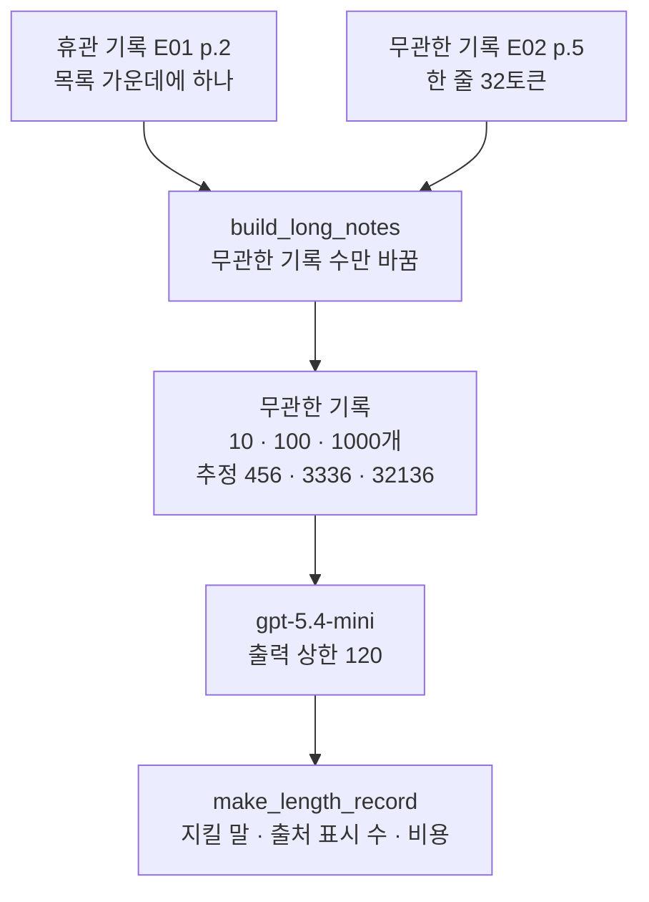
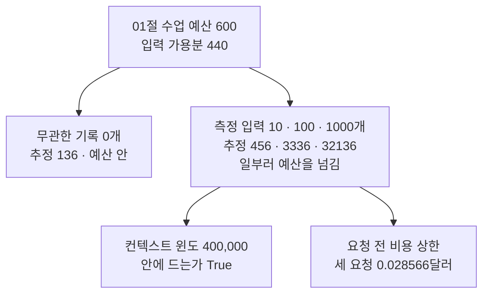
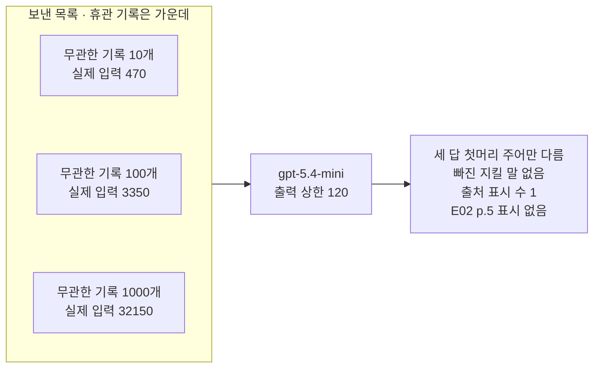
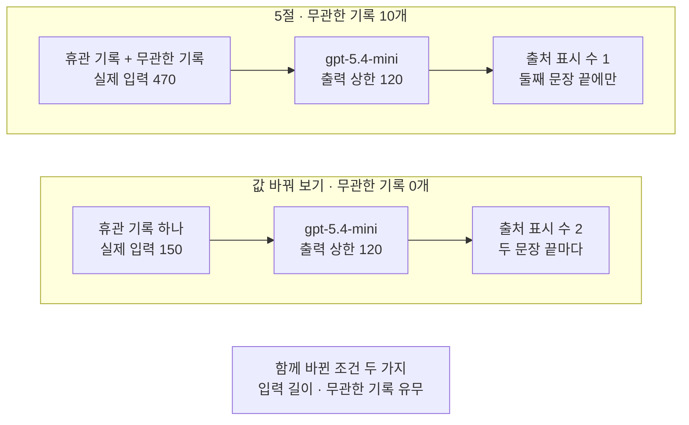

# 05-Context-rot-측정

## _src 본문 (HTML 원본)

```html
<!--meta: 강의 1h | 실습 2h | 코드 Jupyter Notebook | 새 용어 6 -->
<h2 id="b1"><span class="no">1</span>학습 목표</h2>
<div class="goal"><p>이 절을 마치면 다음을 할 수 있습니다.</p><ul><li>컨텍스트 로트의 뜻을 Ch 5 05절 정의로 설명하고, 입력 길이만 바꾸는 측정 목록을 코드로 만들 수 있습니다.</li><li>01절 수업 예산을 일부러 넘기는 측정 입력을, 컨텍스트 윈도와 요청 전 비용 상한으로 따로 확인할 수 있습니다.</li><li>길이별 답의 지킬 말·출처 표시 수·비용을 담은 요청 기록을 읽고, 결론을 실행한 범위로 한정해 적을 수 있습니다.</li></ul></div>
<h2 id="b2"><span class="no">2</span>이 내용을 배우는 이유</h2>
<p>04절에서는 넣은 기록의 종류 때문에 답이 틀어지는 경우를 봤습니다. 이번에는 기록의 양입니다. 에이전트의 입력에는 문서와 대화 기록이 계속 쌓이고, 필요한 기록 한 줄은 그 가운데 어딘가에 있습니다.</p>
<p>Ch 5 05절에서는 입력이 길어질수록 필요한 정보를 찾아 쓰는 결과가 나빠지는 현상을 컨텍스트 로트라고 불렀습니다. 그 절의 로컬 모델은 시스템 메시지가 없는 입력에서 근거 자리에 따라 답이 달랐습니다. 길이에 따른 저하는 보지 못했습니다. 서비스 모델에서 길이만 바꿔 잰 적은 아직 없습니다.</p>
<p>긴 입력을 재려면 01절에서 정한 수업 예산을 넘겨야 합니다. 그래서 이 절은 무엇을 같게 두고 무엇을 바꿀지, 얼마까지 넘길지를 요청 전에 정합니다.</p>
<p><strong>이 절의 질문</strong> — 같은 휴관 기록을 둔 채 입력만 길게 하면 답이 달라질까요? 그 결과를 어디까지 말할 수 있을까요?</p>
<h2 id="b3"><span class="no">3</span>앞에서 배운 내용</h2>
<table><thead><tr><th>앞 절</th><th>배운 것</th><th>이 절에서 이어지는 곳</th></tr></thead><tbody>
<tr><td>Ch 5 05절</td><td>컨텍스트 로트(입력 길이 기준), 무관한 문장, 근거 앞 문장 수. 노트북이 본 것은 근거 자리에 따른 차이</td><td>3절 측정 목록, 실험 결과 해석의 비교</td></tr>
<tr><td>Ch 6 06절·Ch 7 08절</td><td>캐시 입력, mini 요금, <code>estimate_openai_cost()</code></td><td>3절 요청 전 비용 상한, 요청 기록의 예상 비용</td></tr>
<tr><td>01절</td><td>600·120·40 → 440, <code>input_budget()</code>, <code>count_tokens()</code>, 컨텍스트 윈도 400,000토큰</td><td>측정 입력이 예산을 넘는지 확인</td></tr>
<tr><td>02절</td><td>기록 키, 별빛제과 주차 기록 E02 p.5, <code>find_cited_notes()</code></td><td>3절 무관한 기록, 답 검사</td></tr>
<tr><td>03·04절</td><td>휴관 기록·질문·지킬 말, <code>find_missing_words()</code>, <code>build_notes_messages()</code>, <code>check_answer()</code>, 컨텍스트 산만</td><td>모든 요청에 같은 휴관 기록, 답 검사, 산만과 구분</td></tr>
</tbody></table>
<p>04절 함수 <code>build_notes_messages()</code>는 기록이 몇 개든 한 줄씩 이어 붙이므로 이 절에서 그대로 씁니다. 새로 정의하는 함수는 세 개입니다. 기록 목록을 만드는 <code>build_long_notes()</code>, 출처 표시를 세는 <code>count_marks()</code>, 요청 기록 한 줄을 만드는 <code>make_length_record()</code>입니다. 요청 한 번의 측정값을 담은 이 딕셔너리는 Ch 6·7처럼 요청 기록이라고 부릅니다. 02절 기록(사실 한 문장)과 다른 말입니다.</p>
<p>페르소나·과업 명세·모델 설정(출력 상한 120)은 04절 값을 그대로 씁니다. 이 절도 파일을 쓰지 않습니다.</p>
<h2 id="b4"><span class="no">4</span>핵심 개념</h2>
<h3>비유로 시작하기</h3>
<p>작은 나무 책상 세 개가 한 줄로 서 있습니다. 책상마다 흰 종이 더미가 있고, 더미 높이만 다릅니다. 더미마다 초록 탭 카드가 한 장씩 꽂혀 있습니다.</p>
{{img:05-5-세-종이-더미|한 줄로 선 작은 나무 책상 세 개에 흰 종이 더미가 왼쪽부터 낮게, 중간 높이로, 책상보다 높게 쌓여 있고, 더미마다 초록 탭 카드가 한 장씩 꽂혀 있으며, 책상마다 노란 메모지와 똑같은 줄이 적힌 답안지와 연필이 있는 삽화|종이 더미의 높이만 다르고, 더미마다 초록 탭 카드는 한 장이며 답안지는 세 책상이 같습니다.}}
<p><strong>그림 읽기</strong> — 왼쪽부터 종이 더미가 낮고, 중간이고, 아주 높습니다. 더미마다 초록 탭 카드가 한 장씩 꽂혀 있습니다. 왼쪽 더미에서는 카드가 앞면에 보이고, 가운데와 오른쪽 더미에서는 옆으로 반쯤 나와 있습니다. 세 책상의 답안지에는 똑같은 회색 줄이 적혀 있습니다.</p>
<p>종이 더미는 무관한 기록이고, 초록 탭 카드는 03·04절 휴관 기록입니다. 세 책상이 노트북 5절의 무관한 기록 10·100·1000개 목록이고, 같은 답안지는 세 답이 같았다는 뜻입니다. 더미 높이는 기록 수의 비율을 그대로 나타내지 않습니다. 노란 메모지는 질문, 답안지와 연필은 출력 예약분으로 01~04절과 같은 뜻입니다.</p>
<p>04절 그림의 높은 종이 더미는 실행하지 않은 산만이었습니다. 이 그림의 더미는 컨텍스트 로트를 재려고 실제로 보낸 긴 입력입니다. 무관한 기록 0개 목록과 파란 명찰·주황 클립보드는 그림에 넣지 않았습니다.</p>
<h3>컨텍스트 로트와 이 절이 재는 것</h3>
<p>컨텍스트 로트(context rot)는 입력이 길어질수록 모델이 필요한 정보를 찾아 쓰는 결과가 나빠지는 현상입니다. 두꺼운 회의록일수록 한 줄을 놓치기 쉬운 것과 비슷합니다. Ch 5 05절에서 배운 뜻 그대로 씁니다.</p>
<p>이 절 노트북은 휴관 기록 하나를 목록 가운데에 두고, 앞뒤 무관한 기록 수만 10·100·1000개로 바꿨습니다. 무관한 기록은 02절 별빛제과 주차 기록 한 줄을 되풀이했고, 한 줄이 32토큰입니다.</p>
<p>04절 컨텍스트 산만은 긴 기록에 모델이 치우친 사례에 붙인 이름이었습니다. 이 절은 길이를 바꿔 가며 답을 비교하므로 컨텍스트 로트를 잽니다. 산만은 이 절에서도 재지 않았습니다.</p>
{{mermaid:05-1-측정-설계|초록 상자 휴관 기록 E01 p.2 목록 가운데에 하나와 초록 상자 무관한 기록 E02 p.5 한 줄 32토큰이 파란 상자 build_long_notes 무관한 기록 수만 바꿈으로 모이고, 노란 상자 무관한 기록 10 100 1000개 추정 456 3336 32136, 보라 상자 gpt-5.4-mini 출력 상한 120, 파란 상자 make_length_record 지킬 말 출처 표시 수 비용으로 이어지는 위에서 아래 흐름도|휴관 기록은 하나로 두고 무관한 기록 수만 바꿔 세 목록을 만들고, 답마다 요청 기록 한 줄을 남깁니다.}}
<p><strong>도식 읽기</strong> — 위에서 아래로 읽습니다. 맨 위 초록 상자 두 개는 넣는 기록입니다. 파란 상자 <code>build_long_notes()</code> 함수가 무관한 기록 수만 바꿔 목록을 만듭니다.</p>
<p>노란 상자는 요청 전에 센 추정 입력 456·3336·32136입니다. 보라 상자는 출력 상한 120인 모델이고, 마지막 파란 상자 <code>make_length_record()</code> 함수가 답을 요청 기록 한 줄로 만듭니다.</p>
<h3>같게 둔 조건과 바꾼 값</h3>
<p>답이 달라졌을 때 까닭이 길이라고 말하려면, 길이 말고는 모두 같아야 합니다. 이 절에서 같게 둔 조건은 질문, 휴관 기록, 페르소나와 과업 명세, 모델 설정입니다. 무관한 기록의 글과 휴관 기록의 자리(가운데)도 같습니다. 바꾼 값은 무관한 기록 수 하나입니다.</p>
<p>가장 짧은 측정 입력에도 무관한 기록 10개를 넣었습니다. 무관한 기록이 없는 목록과 비교하면, 기록이 있는지 없는지도 함께 바뀌기 때문입니다. 노트북 6절 값 바꿔 보기에서 이 차이를 직접 봅니다.</p>
<h3>예산을 일부러 넘기는 측정</h3>
<p>01절 수업 예산 600은 보통 요청에서 입력을 줄이려고 정한 예입니다. 세 측정 입력은 추정 456·3336·32136토큰으로 모두 입력 가용분 440을 넘습니다. 예산표를 잘못 쓴 것이 아니라, 긴 입력을 재려고 일부러 넘긴 것입니다.</p>
<p>그래서 예산 대신 두 가지를 요청 전에 확인했습니다. 모델의 컨텍스트 윈도 400,000토큰 안에 드는지와, 요청 전 비용 상한입니다. 비용 상한은 캐시 입력이 없고 답이 출력 예약분 120토큰을 모두 쓴다고 보고 계산한 값입니다. 노트북 5절에서 실제 입력은 추정보다 14토큰 많았습니다. 그래서 이 값은 01절 여유분을 더하지 않은 어림입니다.</p>
<p>식은 입력 토큰 수에 0.75를, 출력 토큰 수에 4.50을 곱해 더한 뒤 100만으로 나눈 것입니다. 가장 긴 목록은 <code>(32136 × 0.75 + 120 × 4.50) / 1000000</code>으로 약 0.0246달러입니다. 노트북에서 세 요청의 상한 합계는 <code>0.028566</code>달러였습니다. 실제 입력 32150으로 다시 계산하면 약 0.02465달러로 조금 큽니다. 정확한 상한이 필요하면 추정 입력에 여유분 40을 더해 계산합니다.</p>
{{mermaid:05-2-예산과-측정-입력|맨 위 초록 상자 01절 수업 예산 600 입력 가용분 440에서 왼쪽 노란 상자 무관한 기록 0개 추정 136 예산 안과 오른쪽 노란 상자 측정 입력 10 100 1000개 추정 456 3336 32136 일부러 예산을 넘김으로 갈라지고, 오른쪽 상자에서 노란 상자 컨텍스트 윈도 400,000 안에 드는가 True와 노란 상자 요청 전 비용 상한 세 요청 0.028566달러로 이어지는 흐름도|세 측정 입력은 수업 예산을 일부러 넘기므로, 컨텍스트 윈도와 요청 전 비용 상한을 따로 확인했습니다.}}
<p><strong>도식 읽기</strong> — 위에서 아래로 읽습니다. 맨 위 초록 상자는 01절 수업 예산 600과 입력 가용분 440입니다. 왼쪽 노란 상자 무관한 기록 0개 목록(추정 136)은 예산 안이고, 오른쪽 노란 상자 세 측정 입력은 예산을 넘습니다.</p>
<p>오른쪽 아래 두 노란 상자는 예산 대신 확인한 값입니다. 컨텍스트 윈도 안에 드는가는 True였고, 세 요청의 요청 전 비용 상한은 0.028566달러였습니다.</p>
<h3>답이 나빠졌는지 무엇으로 보나</h3>
<p>요청 전에 확인 항목 세 가지를 정했습니다. 답에서 빠진 지킬 말, 답의 출처 표시와 같은 기록, 출처 표시 수입니다. 과업 명세가 문장마다 출처를 적게 했으므로, 두 문장 답에 표시가 하나면 과업 명세를 덜 따른 답으로 봅니다.</p>
<p>세 항목은 말과 표시가 있는지만 봅니다. Ch 7 01절 확인 단어 표시처럼 답의 품질 점수가 아닙니다. 답의 뜻은 원문을 읽어 확인합니다.</p>
<h3>이 절에서 쓰는 말</h3>
<table><thead><tr><th>용어</th><th>뜻</th><th>이 절에서 보이는 모습</th></tr></thead><tbody>
<tr><td>컨텍스트 로트(context rot)</td><td>입력이 길어질수록 필요한 정보를 찾아 쓰는 결과가 나빠지는 현상. Ch 5 05절과 같은 뜻이고 04절 산만과 다른 말</td><td>무관한 기록 10·100·1000개 목록 비교</td></tr>
<tr><td>무관한 기록</td><td>질문과 관계없이 입력을 길게 만드는 기록. Ch 5 05절 무관한 문장과 같은 역할</td><td><code>무관한 기록 출처: E02 p.5</code></td></tr>
<tr><td>근거 앞 기록 수</td><td>휴관 기록 앞에 놓인 무관한 기록의 수. 휴관 기록의 자리를 나타냄</td><td><code>build_long_notes(1000, 500)</code></td></tr>
<tr><td>같게 둔 조건</td><td>길이 말고 다른 까닭을 막으려고 모든 요청에서 바꾸지 않은 값</td><td>질문·휴관 기록·모델 설정·가운데 자리</td></tr>
<tr><td>측정 입력</td><td>답이 길이에 따라 달라지는지 재려고 만든 입력. 이 절에서는 수업 예산을 일부러 넘김</td><td><code>입력 가용분 안에 드는가: False False False</code></td></tr>
<tr><td>출처 표시 수</td><td>답 글에 휴관 기록의 출처 표시가 들어간 횟수</td><td><code>'출처 표시 수': 1</code></td></tr>
</tbody></table>
<h2 id="b5"><span class="no">5</span>실행 예제</h2>
<p>노트북은 앞 절 함수를 도구 파일 <code>llm_tools.py</code>에서 가져온 뒤, 무관한 기록 10·100·1000개 목록을 만듭니다. 요청 전에 추정 입력과 비용 상한을 세고, 세 목록을 한 번씩 보내 요청 기록 한 줄씩 만듭니다. 값 바꿔 보기로 무관한 기록 0개 목록을 보내고, 마지막에 네 요청 기록을 한 표로 모읍니다.</p>
<p>실제 OpenAI 모델을 temperature 0으로 부르는 요청은 모두 네 번입니다. 이 페이지의 출력은 2026-09-21에 실행한 결과입니다. 요청 전 비용 상한은 0.03달러 안팎이고, 답 문장은 실행마다 달라질 수 있습니다.</p>
<p>강의 시간에는 노트북 3·5·7절(측정 입력 만들기, 세 길이 요청, 요청 기록표와 해석)을 설명합니다. 4·6절(요청 기록 함수, 값 바꿔 보기)은 함께 실행하고 실습 시간에 읽습니다.</p>
{{notebook:05-Context-rot-측정}}
<p class="look"><b>확인할 점</b> — 5절 세 요청 기록의 <code>'출처 표시 수': 1</code>과 <code>'답에서 빠진 지킬 말': []</code>을 봅니다. 1000개 목록 요청 기록의 <code>'캐시 입력 토큰 수': 32000</code>과 예상 비용을 요청 전 어림과 비교합니다. 6절 요청 기록의 <code>'출처 표시 수': 2</code>와 7절 요청 기록표를 봅니다.</p>
<h3>세 길이의 답</h3>
{{mermaid:05-3-세-길이의-답|왼쪽 칸 보낸 목록 휴관 기록은 가운데 안에 초록 상자 무관한 기록 10개 실제 입력 470, 100개 실제 입력 3350, 1000개 실제 입력 32150이 위에서 아래로 있고, 칸에서 보라 상자 gpt-5.4-mini 출력 상한 120을 거쳐 노란 상자 세 답 첫머리 주어만 다름 빠진 지킬 말 없음 출처 표시 수 1 E02 p.5 표시 없음으로 이어지는 흐름도|무관한 기록 10·100·1000개 목록의 세 답은 첫머리 주어만 달랐고, 출처 표시 수는 모두 1이었습니다.}}
<p><strong>도식 읽기</strong> — 왼쪽 칸의 초록 상자 세 개가 보낸 목록이고, 위에서 아래로 무관한 기록 10·100·1000개입니다. 실제 입력은 470·3350·32150토큰이었고, 세 목록은 가운데 보라 상자 모델에 따로 보냈습니다.</p>
<p>오른쪽 노란 상자는 세 요청 기록에서 확인한 값입니다. 세 답은 첫머리 주어 「미르시립도서관은」이 있고 없는 것만 달랐습니다. 빠진 지킬 말이 없었고, 출처 표시 수는 모두 1이었습니다. 무관한 기록의 출처 표시 E02 p.5는 어느 답에도 없었습니다.</p>
<p>세 답은 모두 「미르시립도서관은 매주 월요일이 정기 휴관일이며 법정 공휴일에도 휴관합니다.」로 시작했습니다. 둘째 문장 「공휴일이 월요일과 겹치면 다음 화요일도 휴관합니다.」 끝에만 <code>[E01 p.2]</code>가 붙었습니다. 입력이 470토큰에서 32150토큰으로 약 68배 길어졌지만, 이번 세 답에서는 달라진 곳을 찾지 못했습니다.</p>
<h3>캐시 입력과 실제 비용</h3>
<p>1000개 목록 요청 기록의 <code>'캐시 입력 토큰 수': 32000</code>은 입력 대부분이 캐시 입력 요금으로 계산됐다는 뜻입니다. Ch 6 06절에서 본 것처럼, 캐시 입력은 앞선 요청과 앞부분이 같은 입력에서 생길 수 있습니다. 교재 출력 바로 앞의 새 커널 실행에서도 같은 목록을 보냈습니다. 그 실행의 1000개 목록 요청은 캐시 입력이 0이었고, 예상 비용은 0.024338달러였습니다.</p>
<p>그래서 이 요청의 예상 비용은 <code>'예상 비용(달러)': 0.002773</code>으로, 요청 전 어림 0.024642의 9분의 1쯤입니다. 앞선 실행처럼 캐시 입력이 없으면 비용은 요청 전 어림에 가까우므로, 비용은 요청 전 어림으로 준비합니다. 캐시가 언제 생기고 얼마나 유지되는지는 이번에 확인하지 않았습니다.</p>
<h2 id="b6"><span class="no">6</span>실험 결과 해석</h2>
<p>먼저 길이입니다. 무관한 기록 10·100·1000개 세 요청은 답의 글자, 빠진 지킬 말, 출처 표시 수가 모두 같았습니다. 이번 세 요청에서는 입력 길이에 따라 답이 나빠진 모습, 곧 컨텍스트 로트를 보지 못했습니다.</p>
<p>다음은 값 바꿔 보기입니다. 무관한 기록을 0개로 줄이자, 답의 두 문장 끝에 모두 출처 표시가 붙어 출처 표시 수가 2가 됐습니다. 지킬 말은 0개 답과 10개 답 모두 빠지지 않았습니다.</p>
{{mermaid:05-4-0개와-10개|위 칸 5절 무관한 기록 10개에는 초록 상자 휴관 기록과 무관한 기록 실제 입력 470, 보라 상자 gpt-5.4-mini 출력 상한 120, 노란 상자 출처 표시 수 1 둘째 문장 끝에만이 차례로 있고, 아래 칸 값 바꿔 보기 무관한 기록 0개에는 초록 상자 휴관 기록 하나 실제 입력 150, 보라 상자 gpt-5.4-mini 출력 상한 120, 노란 상자 출처 표시 수 2 두 문장 끝마다가 차례로 있으며, 맨 아래 회색 상자에 함께 바뀐 조건 두 가지 입력 길이와 무관한 기록 유무가 적힌 비교 그림|무관한 기록 0개 답만 출처 표시가 두 번이었지만, 두 목록 사이에는 길이와 무관한 기록 유무가 함께 바뀌었습니다.}}
<p><strong>도식 읽기</strong> — 위 칸이 5절 무관한 기록 10개, 아래 칸이 6절 값 바꿔 보기 0개이고, 칸마다 왼쪽에서 오른쪽으로 읽습니다. 초록 상자는 보낸 목록, 보라 상자는 같은 모델 객체, 노란 상자는 요청 기록의 출처 표시 수입니다. 두 답에 모두 있던 「빠진 지킬 말 없음」은 결과 상자에 넣지 않았습니다.</p>
<p>맨 아래 회색 상자는 두 목록 사이에 함께 바뀐 조건입니다. 0개 목록은 짧기도 하지만, 무관한 기록이 아예 없습니다. 그래서 출처 표시 수의 차이를 길이 탓으로 말할 수 없습니다.</p>
<p>04절 혼란 목록에는 서로 다른 기록 네 개가 있었지만, 답의 두 문장 끝에 모두 출처 표시가 붙었습니다. 그러니 「기록이 여러 개면 표시가 줄어든다」고도 말할 수 없습니다. 출처 표시 수가 왜 달라졌는지는 이번 실행으로 알 수 없습니다.</p>
<p>Ch 5 05절과는 조건이 많이 다릅니다. Ch 5 05절은 내 컴퓨터의 작은 모델 Qwen2.5-0.5B-Instruct를 썼습니다. 무관한 문장 수와 근거 자리 세 곳을 바꿨고, 시스템 메시지가 없는 입력에서는 가운데 자리가 모두 틀렸습니다. 같은 절에서 Ch 5 04절 시스템 지시를 넣자 가운데 자리도 모두 맞았습니다. 이 절은 서비스 모델 <code>gpt-5.4-mini</code>에 system·developer 메시지를 함께 보냈고, 휴관 기록은 가운데에만 두었습니다.</p>
<p>두 절은 모델, 지시 글, 토큰화 규칙, 입력 길이 범위가 모두 다릅니다. 그래서 「서비스 모델은 가운데 자리도 잘 찾는다」처럼 두 결과를 한 규칙으로 묶지 않습니다. 노트북에서는 서비스 모델의 근거 자리를 바꾸지 않았습니다.</p>
<p>결론의 범위는 모델 하나, 질문 하나, 길이 세 가지, 조건마다 한 번입니다. 같은 기록 한 줄을 되풀이한 연습용 입력이라, 서로 다른 글이 쌓인 실제 긴 문서와 다릅니다. 벡터 데이터베이스 회사 Chroma는 2025년 보고서를 냈습니다. 모델 18개에서 입력이 길수록 결과가 믿기 어려워졌다는 보고입니다. 이번에 그 모습을 보지 못한 것은 이 좁은 범위의 결과입니다.</p>
<h2 id="b7"><span class="no">7</span>주의할 점과 실무 메모</h2>
<ul><li>무관한 기록 수 10·100·1000과 값 바꿔 보기 0개는 탐색 실행 뒤 정했습니다. 교재를 만들 때 0·10·20·40·100·1000개 목록을 먼저 보냈습니다. 0개 답만 출처 표시가 두 번이었고, 나머지는 한 번이었습니다. 그래서 측정 입력은 10개부터 두고 0개는 값 바꿔 보기로 옮겼으며, 출처 표시 수를 확인 항목에 더했습니다. 흐름을 보여 주려고 정한 예입니다.</li>
<li>탐색에서 휴관 기록을 맨 앞에 둔 1000개 목록도 한 번 보냈고, 답은 가운데에 둔 목록의 답과 같았습니다. 한 번 본 결과라 결론에 쓰지 않았고, 노트북에도 넣지 않았습니다.</li>
<li>무관한 기록은 같은 한 줄의 되풀이입니다. 질문과 비슷하지만 틀린 기록을 섞는 실행은 하지 않았습니다. 그런 기록은 04절 혼란·충돌 조건과도 겹치므로, 섞으면 무엇을 쟀는지 따로 적습니다.</li>
<li>지킬 말과 출처 표시 검사는 말과 표시가 있는지만 봅니다. 「화요일에는 휴관하지 않습니다」처럼 말은 있고 뜻이 반대인 답은 찾지 못하므로, 답은 원문과 나란히 놓고 읽습니다.</li>
<li>입력 요금은 입력 토큰 수에 비례합니다. 무관한 기록을 10000개로 늘리면 추정 입력은 320,136토큰으로 컨텍스트 윈도 안입니다. 그러나 요청 전 비용 상한은 약 0.24달러입니다. 이 조건은 실행하지 않았습니다.</li>
<li>캐시 입력 토큰 수는 앞선 요청에 따라 실행마다 달라집니다. 예상 비용을 비교할 때는 캐시 입력 토큰 수를 함께 적고, 예산은 캐시가 없다고 보고 잡습니다.</li>
<li>걸린 시간은 재지 않았습니다. 긴 입력이 처리 시간을 얼마나 늘리는지는 이번에 확인하지 않았습니다.</li>
<li>조건마다 한 번씩 보냈습니다. 같은 조건을 여러 번 보내거나 여러 질문으로 평가하는 방법은 Ch 11·15에서 다룹니다.</li>
<li>교재 출력은 Linux의 Python 3.12.13으로 만들었습니다. 패키지는 langchain 1.4.0, langchain-core 1.6.2, langchain-openai 1.6.0입니다. openai 3.8.0, tiktoken 0.14.0도 함께 썼습니다. 다른 버전과 Windows·macOS에서는 실행하지 않았습니다.</li></ul>
<h2 id="b8"><span class="no">8</span>정리와 다음 절</h2>
<ul><li>휴관 기록을 가운데에 두고 무관한 기록 수만 10·100·1000개로 바꿨습니다. 입력이 470~32150토큰으로 길어져도 이번 세 답의 지킬 말과 출처 표시 수는 같았습니다.</li><li>측정 입력은 수업 예산 600을 일부러 넘겼습니다. 대신 컨텍스트 윈도 400,000과 요청 전 비용 상한 0.028566달러를 먼저 확인했습니다. 캐시 입력이 생긴 요청은 어림보다 적게 들었습니다.</li><li>무관한 기록 0개 답만 출처 표시가 두 번이었습니다. 길이와 기록 유무가 함께 바뀐 비교라 컨텍스트 로트의 결과로 쓰지 않습니다.</li></ul>
<p><strong>다음 학습과 이어지는 지점</strong> — 06절에서는 문서 목록을 먼저 보고 필요한 문서의 본문만 여는 단계적 공개를 배웁니다. 입력 설계 몇 가지를 같은 질문으로 보내 토큰 수와 비용을 비교합니다. 이 절에서 본 것처럼 입력 토큰 수가 늘면 요청 전 비용 상한도 함께 늡니다.</p>
<h2 id="b9"><span class="no">9</span>복습 문제</h2>
<details class="quiz"><summary>문제 1 · 같게 둔 조건</summary><p class="quiz-q">무관한 기록 10·100·1000개 세 목록에서 바꾼 값은 무엇이고, 같게 둔 조건은 무엇인가요?</p><p class="quiz-a"><b>해설</b> — 바꾼 값은 무관한 기록 수 하나입니다. 질문, 휴관 기록, 페르소나와 과업 명세, 모델 설정, 무관한 기록의 글, 휴관 기록의 가운데 자리는 같게 두었습니다. 그래야 답이 달라졌을 때 길이 말고 다른 까닭을 줄일 수 있습니다.</p></details>
<details class="quiz"><summary>문제 2 · 예산을 넘긴 요청</summary><p class="quiz-q">세 측정 입력은 입력 가용분 440을 넘었습니다. 그래도 보낸 까닭과, 대신 요청 전에 확인한 두 가지는 무엇인가요?</p><p class="quiz-a"><b>해설</b> — 긴 입력에서 답이 달라지는지 재려고 일부러 넘겼습니다. 대신 컨텍스트 윈도 400,000토큰 안에 드는지(<code>True</code>)와 요청 전 비용 상한(세 요청 <code>0.028566</code>달러)을 확인했습니다.</p></details>
<details class="quiz"><summary>문제 3 · 어림 계산</summary><p class="quiz-q">무관한 기록 300개 목록이면 추정 입력과 요청 전 비용 상한은 얼마쯤일까요? 기록 0개 목록의 추정은 136, 한 줄은 32토큰입니다.</p><p class="quiz-a"><b>해설</b> — 추정 입력은 <code>136 + 32 × 300</code>으로 9736토큰입니다. 비용 상한은 <code>(9736 × 0.75 + 120 × 4.50) / 1000000</code>으로 약 0.0078달러입니다. 여유분 40을 더하면 약 0.0079달러입니다. 이번에 실행하지 않은 조건이라, 실제로 보낼 때는 다시 셉니다.</p></details>
<details class="quiz"><summary>문제 4 · 0개와 10개</summary><p class="quiz-q">동료가 「0개 답은 출처 표시가 두 번, 10개부터는 한 번이니 입력이 길어지면 과업 명세를 덜 따른다」고 합니다. 무엇이라고 답하나요?</p><p class="quiz-a"><b>해설</b> — 0개와 10개 사이에서는 길이와 함께 무관한 기록이 있는지도 바뀌어, 길이 탓이라고 가를 수 없습니다. 길이만 바꾼 10·100·1000개 사이에서는 출처 표시 수가 같았습니다. 조건마다 한 번 보낸 결과라는 점도 함께 말합니다.</p></details>
<details class="quiz"><summary>문제 5 · 결론의 범위</summary><p class="quiz-q">「32150토큰에서도 답이 같았으니 이 모델에는 컨텍스트 로트가 없다」고 정리해도 되나요?</p><p class="quiz-a"><b>해설</b> — 안 됩니다. 이번 결과는 모델 하나, 질문 하나, 같은 기록을 되풀이한 입력, 가운데 자리, 조건마다 한 번의 범위입니다. 다른 연구는 여러 모델에서 입력이 길수록 결과가 믿기 어려워졌다고 보고했으므로, 내 입력 모양으로 다시 잽니다.</p></details>
<h2 id="b10"><span class="no">10</span>참고 자료</h2>
<p>문서는 2026-09-17에 다시 열어 확인했습니다. 기록 내용은 02·03절에서 가상 기관 문서 <code>E01.pdf</code>·<code>E02.pdf</code>를 읽고 옮겨 적은 것입니다. 요금은 Ch 6 06절에서 확인한 값과 같습니다.</p>
<ul><li><div><a href="https://www.trychroma.com/research/context-rot">Chroma, Context Rot: How Increasing Input Tokens Impacts LLM Performance</a></div>모델 18개에서 입력 길이에 따라 결과가 달라진 기술 보고서 · 2025-07-14 · 확인 2026-09-17</li><li><div><a href="https://developers.openai.com/api/docs/models/gpt-5.4-mini">OpenAI GPT-5.4 mini 모델 안내</a></div>컨텍스트 윈도 400,000토큰과 100만 토큰당 요금 · 확인 2026-09-17</li></ul>
```

## 노트북 셀 (순서대로)

### [0] markdown {'html': 'skip'}

# 컨텍스트 로트(Context rot) 측정

**이 노트북에서 할 일**

1. 휴관 기록 하나를 목록 가운데에 두고, 무관한 기록 수만 10·100·1000개로 바꾼 입력 세 개를 만듭니다.
2. 세 입력을 한 번씩 보내고, 답의 지킬 말·출처 표시·토큰 수·예상 비용을 기록합니다.
3. 무관한 기록을 0개로 바꿔 한 번 더 보내고, 길이만 바뀐 비교인지 따져 봅니다.

**준비물** — 프로젝트 폴더 `.env` 파일의 `OPENAI_API_KEY`가 필요합니다. 요청 기록은 셀 안에 담고, 파일은 만들지 않습니다.

인터넷 서비스에 요청을 모두 4번 보냅니다. 모두 `gpt-5.4-mini`입니다.

가장 긴 요청의 입력은 3만 토큰이 넘습니다. 01절 수업 예산 600을 일부러 넘기는 측정입니다.
실행 시간은 1분 안팎이고, 예상 비용은 0.03달러 안팎입니다. 요금은 Ch 6 06절에서 2026-09-17에 확인한 mini 공식 요금 기준입니다.

**강의와 실습 범위** — 강의 시간에는 3·5·7절(측정 입력, 세 길이 요청, 요청 기록표)을 설명합니다.
4·6절(기록 함수, 값 바꿔 보기)은 함께 실행하고 실습 시간에 읽습니다.

**기준 버전** — 실습 폴더에 고정한 패키지 판을 씁니다. langchain 1.4.0, langchain-core 1.6.2, langchain-openai 1.6.0입니다.
openai 3.8.0, tiktoken 0.14.0, python-dotenv 1.2.3도 함께 씁니다.

교재 출력은 Linux의 Python 3.12.13으로 만들었습니다. 다른 버전과 Windows·macOS에서는 이번에 실행하지 않았습니다.

실습 폴더 `labs/part2/ch08-context-engineering`에서 `uv sync --locked`를 실행합니다.
그다음 이 폴더의 `.venv` 커널을 고르고 첫 셀부터 순서대로 실행합니다.

### [1] markdown {'html': 'skip'}

## 오늘 볼 그림


위에서 아래로 읽습니다. 맨 위 초록 상자 두 개는 넣을 기록입니다. 휴관 기록은 늘 하나이고, 무관한 기록만 개수가 바뀝니다.
파란 상자는 이 노트북에서 정의하는 함수이고, 노란 상자는 요청 전에 센 추정 입력입니다.

보라 상자 모델의 답은 마지막 파란 상자 함수로 요청 기록 한 줄이 됩니다. 답에서 무엇이 보였는지는 셀 출력으로 확인합니다.

### [2] markdown {}

## 1. 준비

첫 셀은 패키지를 설치하고 설치된 버전을 출력합니다. 설치에는 몇십 초가 걸릴 수 있습니다.
01~04절과 같은 패키지 판을 씁니다.

### [3] code {'execution': {'iopub.execute_input': '2026-09-21T05:01:20.591962Z', 'iopub.status.busy': '2026-09-21T05:01:20.591773Z', 'iopub.status.idle': '2026-09-21T05:01:21.038092Z', 'shell.execute_reply': '2026-09-21T05:01:21.037489Z'}, 'lesson_role': 'setup'}

```python
# 이 절에서 쓰는 패키지를 설치하고 버전을 확인합니다
%pip install -q "langchain==1.4.0" "langchain-openai==1.6.0" "python-dotenv==1.2.3" "tiktoken==0.14.0"
from importlib.metadata import version

print("langchain:", version("langchain"))
print("langchain-core:", version("langchain-core"))
print("langchain-openai:", version("langchain-openai"))
print("openai:", version("openai"))
print("tiktoken:", version("tiktoken"))
print("python-dotenv:", version("python-dotenv"))
```

출력:
```
Note: you may need to restart the kernel to use updated packages.
langchain: 1.4.0
langchain-core: 1.6.2
langchain-openai: 1.6.0
openai: 3.8.0
tiktoken: 0.14.0
python-dotenv: 1.2.3

```

### [4] markdown {}

**결과 읽기** — 출력 줄은 `langchain: 1.4.0`, `openai: 3.8.0`, `tiktoken: 0.14.0` 등 여섯 줄입니다.
준비물에 적은 기준 버전과 같습니다.

토큰 수를 세는 라이브러리와 모델 함수를 불러오고, 앞에서 배운 함수 여섯 개를 가져옵니다. 이 절도 파일을 쓰지 않아 모듈 `json`·`tempfile`은 부르지 않습니다.

앞에서 배운 함수는 `llm_tools.py`에 모아 두었습니다. 파일을 열면 코드를 볼 수 있습니다. 노트북과 같은 폴더(`notebooks/`)에 있는 파일입니다.
이 노트북은 01절 `input_budget()`·`count_tokens()`, 03절 `find_missing_words()`, 04절 `build_notes_messages()`·`check_answer()`를 가져옵니다.
Ch 7 08절 `estimate_openai_cost()`도 가져옵니다.

도구 파일 판은 04절 판이 함수 바깥 이름에서 읽던 값을 인자로 받습니다. 함수 `build_notes_messages()`는 페르소나와 과업 명세를 앞의 두 인자로 받습니다.
함수 `check_answer()`는 지킬 말 목록을 셋째 인자로 받습니다.

### [5] code {'execution': {'iopub.execute_input': '2026-09-21T05:01:21.039409Z', 'iopub.status.busy': '2026-09-21T05:01:21.039295Z', 'iopub.status.idle': '2026-09-21T05:01:21.405404Z', 'shell.execute_reply': '2026-09-21T05:01:21.404970Z'}, 'lesson_role': 'setup'}

```python
# 토큰 수를 세는 라이브러리와 모델 함수를 불러옵니다
import tiktoken

from langchain.chat_models import init_chat_model
# 01·03·04절과 Ch 7 08절 함수 여섯 개를 도구 파일에서 가져옵니다
from llm_tools import build_notes_messages, check_answer, count_tokens, estimate_openai_cost, find_missing_words, input_budget
```

출력:
```

```

### [6] markdown {}

01~04절과 같은 셀로 API 키가 있는지 확인합니다. 키 값은 출력하지 않고, 있는지만 봅니다.
`True` 값이 나오면 다음으로 넘어갑니다.

### [7] code {'execution': {'iopub.execute_input': '2026-09-21T05:01:21.406213Z', 'iopub.status.busy': '2026-09-21T05:01:21.406157Z', 'iopub.status.idle': '2026-09-21T05:01:21.410073Z', 'shell.execute_reply': '2026-09-21T05:01:21.409815Z'}, 'lesson_role': 'setup'}

```python
# .env 파일에서 OpenAI API 키를 읽습니다(키 값은 출력하지 않습니다)
import os
from dotenv import find_dotenv, load_dotenv

env_path = find_dotenv(usecwd=True)
load_dotenv(env_path)
has_key = os.getenv("OPENAI_API_KEY") is not None
print("OPENAI_API_KEY 설정 여부:", has_key)
assert has_key, "프로젝트 폴더의 .env 파일에 OPENAI_API_KEY를 적어 주세요."
```

출력:
```
OPENAI_API_KEY 설정 여부: True

```

### [8] markdown {}

## 2. 04절에서 이어 쓰는 글과 함수

페르소나와 과업 명세는 02~04절과 글자까지 같습니다. 과업 명세는 문장마다 끝에 출처 표시를 적게 합니다.
출처 표시 `[E01 p.2]`는 모양을 보여 주는 예입니다.

### [9] code {'execution': {'iopub.execute_input': '2026-09-21T05:01:21.410804Z', 'iopub.status.busy': '2026-09-21T05:01:21.410742Z', 'iopub.status.idle': '2026-09-21T05:01:21.412496Z', 'shell.execute_reply': '2026-09-21T05:01:21.412186Z'}}

```python
# 02~04절과 같은 페르소나와 과업 명세를 만듭니다
persona_text = "당신은 미르시립도서관 안내 담당자입니다."
task_text = "주어진 근거에 있는 정보만 쓰세요. 두 문장 이내로 답하고, 문장마다 끝에 출처를 [E01 p.2]처럼 적으세요."
print("페르소나:", persona_text)
print("과업 명세:", task_text)
```

출력:
```
페르소나: 당신은 미르시립도서관 안내 담당자입니다.
과업 명세: 주어진 근거에 있는 정보만 쓰세요. 두 문장 이내로 답하고, 문장마다 끝에 출처를 [E01 p.2]처럼 적으세요.

```

### [10] markdown {}

**결과 읽기** — 두 줄은 `페르소나:`와 `과업 명세:`로 시작합니다. 과업 명세 줄에 `문장마다 끝에 출처를`이 있습니다.

수업 예산표도 01~04절과 같은 값으로 이어 씁니다. 세 값을 담고, 준비 셀에서 가져온 01절 함수 `input_budget()`으로 입력 가용분을 구합니다.
실행 전에 예상합니다. 01~04절처럼 440일 것입니다.

### [11] code {'execution': {'iopub.execute_input': '2026-09-21T05:01:21.413097Z', 'iopub.status.busy': '2026-09-21T05:01:21.413046Z', 'iopub.status.idle': '2026-09-21T05:01:21.415172Z', 'shell.execute_reply': '2026-09-21T05:01:21.414746Z'}}

```python
# 01~04절과 같은 수업 예산·출력 예약분·여유분으로 입력 가용분을 계산합니다
total_budget = 600
output_reserve = 120
safety_margin = 40
available = input_budget(total_budget, output_reserve, safety_margin)
print("수업 예산:", total_budget)
print("출력 예약분:", output_reserve)
print("여유분:", safety_margin)
print("입력 가용분:", available)
```

출력:
```
수업 예산: 600
출력 예약분: 120
여유분: 40
입력 가용분: 440

```

### [12] markdown {}

**결과 읽기** — 네 줄은 `수업 예산: 600`, `출력 예약분: 120`, `여유분: 40`, `입력 가용분: 440`입니다.
이 절의 측정 입력은 이 입력 가용분을 일부러 넘깁니다. 까닭은 3절에서 설명합니다.

요청 전에 토큰 수를 세려고 01~04절처럼 토큰화 규칙 객체를 만듭니다. 가져온 함수 `count_tokens()`에 첫 인자로 넣을 객체입니다.

### [13] code {'execution': {'iopub.execute_input': '2026-09-21T05:01:21.415728Z', 'iopub.status.busy': '2026-09-21T05:01:21.415680Z', 'iopub.status.idle': '2026-09-21T05:01:21.522607Z', 'shell.execute_reply': '2026-09-21T05:01:21.522194Z'}}

```python
# 01~04절처럼 모델의 토큰화 규칙을 불러옵니다(가져온 count_tokens()에 첫 인자로 넣습니다)
encoding = tiktoken.encoding_for_model("gpt-5.4-mini")
print("토큰화 규칙 이름:", encoding.name)
```

출력:
```
토큰화 규칙 이름: o200k_base

```

### [14] markdown {}

**결과 읽기** — 출력 줄은 `토큰화 규칙 이름: o200k_base`로 01~04절과 같습니다.

모델 객체는 02~04절처럼 출력 예약분을 출력 상한(`max_tokens`)으로 주어 만듭니다. 이 셀은 요청을 보내지 않습니다.
입력이 길어져도 답에 줄 자리는 120토큰으로 같습니다.

### [15] code {'execution': {'iopub.execute_input': '2026-09-21T05:01:21.523283Z', 'iopub.status.busy': '2026-09-21T05:01:21.523232Z', 'iopub.status.idle': '2026-09-21T05:01:22.461352Z', 'shell.execute_reply': '2026-09-21T05:01:22.461036Z'}}

```python
# 출력 예약분을 출력 상한으로 준 모델을 준비합니다(02~04절과 같은 설정)
model = init_chat_model(
    "openai:gpt-5.4-mini",
    temperature=0,
    reasoning_effort="none",
    max_tokens=output_reserve,
)
print("모델 이름:", model.model_name)
print("temperature:", model.temperature)
print("출력 상한(max_tokens):", model.max_tokens)
assert model.max_tokens == output_reserve
```

출력:
```
모델 이름: gpt-5.4-mini
temperature: 0.0
출력 상한(max_tokens): 120

```

### [16] markdown {}

**결과 읽기** — 출력 줄은 `모델 이름: gpt-5.4-mini`, `temperature: 0.0`, `출력 상한(max_tokens): 120`입니다. `assert`도 통과했습니다.
이 노트북의 출력은 2026-09-21에 이 모델로 실행한 결과입니다. 실행마다 답 문장이 달라질 수 있습니다.
Ch 6 01절에서 본 것처럼 temperature 0은 Ch 5 06절의 뽑기를 끈 설정(`do_sample=False`)과 같은 것이 아닙니다.

휴관 기록·질문·지킬 말은 03·04절과 글자까지 같습니다. 휴관 기록은 E01 2쪽 원문을 읽고 지킬 말을 남기며 줄인 기록입니다.
이 절에서는 이 기록 하나가 모든 입력에 똑같이 들어갑니다.

### [17] code {'execution': {'iopub.execute_input': '2026-09-21T05:01:22.462114Z', 'iopub.status.busy': '2026-09-21T05:01:22.462054Z', 'iopub.status.idle': '2026-09-21T05:01:22.464299Z', 'shell.execute_reply': '2026-09-21T05:01:22.463892Z'}}

```python
# 03·04절과 같은 휴관 기록·질문·지킬 말을 만듭니다
closure_note = {
    "출처": "E01 p.2",
    "기관": "미르시립도서관",
    "주제": "휴관",
    "내용": "매주 월요일은 정기 휴관일이고 법정 공휴일에도 휴관하며, 공휴일이 월요일과 겹치면 다음 화요일도 휴관합니다.",
}
closure_question = "미르시립도서관의 정기 휴관일은 언제이고, 공휴일이 월요일과 겹치면 어떻게 되나요?"
closure_keep_words = ["월요일", "법정 공휴일", "화요일"]
print("휴관 기록 출처:", closure_note["출처"])
print("질문:", closure_question)
print("지킬 말:", closure_keep_words)
```

출력:
```
휴관 기록 출처: E01 p.2
질문: 미르시립도서관의 정기 휴관일은 언제이고, 공휴일이 월요일과 겹치면 어떻게 되나요?
지킬 말: ['월요일', '법정 공휴일', '화요일']

```

### [18] markdown {}

**결과 읽기** — 출력 줄은 `휴관 기록 출처: E01 p.2`, `질문:` 줄, `지킬 말: ['월요일', '법정 공휴일', '화요일']`입니다.

준비 셀에서 가져온 세 함수로 목록을 만들고 답을 검사합니다. 03절 함수 `find_missing_words()`는 글 하나와 말 목록을 받아, 글에 없는 말만 목록으로 반환합니다.
04절 함수 `build_notes_messages()`는 기록 목록과 질문으로 Ch 7 모양의 메시지 목록을 만듭니다. 기록이 천 개여도 반복문이 한 줄씩 이어 붙입니다.

04절 함수 `check_answer()`는 답의 출처 표시와 같은 기록의 출처, 답에서 빠진 지킬 말을 딕셔너리로 반환합니다.
이 검사는 말이 있는지만 봅니다. 답의 품질 점수가 아닙니다.

## 3. 무관한 기록 수만 바꾼 입력 만들기

Ch 5 05절에서 컨텍스트 로트(context rot)라는 말을 배웠습니다. 입력이 길어질수록 필요한 정보를 찾아 쓰는 결과가 나빠지는 현상입니다.
04절의 산만은 긴 기록에 모델이 치우친 사례에 붙인 이름이라, 이 절이 재는 것과 다릅니다.

길이 때문인지 가르려면 길이 말고는 모두 같게 둡니다. 질문·휴관 기록·과업 명세·모델 설정은 모든 요청에서 같습니다.
휴관 기록은 늘 목록 가운데에 둡니다. 바꾸는 값은 휴관 기록 앞뒤에 넣는 무관한 기록의 수 하나입니다.

무관한 기록은 02절 기록 가운데 별빛제과 주차 기록을 씁니다. 휴관 질문과 관계없는 기록입니다.
실행 전에 예상합니다. 이 기록에는 휴관 지킬 말이 하나도 없을 것입니다.

### [19] code {'execution': {'iopub.execute_input': '2026-09-21T05:01:22.464919Z', 'iopub.status.busy': '2026-09-21T05:01:22.464867Z', 'iopub.status.idle': '2026-09-21T05:01:22.472789Z', 'shell.execute_reply': '2026-09-21T05:01:22.472426Z'}}

```python
# 휴관 질문과 관계없는 기록 하나를 만들고, 지킬 말이 들어 있는지와 한 줄의 토큰 수를 봅니다
filler_note = {"출처": "E02 p.5", "기관": "별빛제과", "주제": "주차", "내용": "본사 주차장은 선착순이며 월 3만 원의 주차비가 급여에서 공제됩니다."}
filler_line = "[" + filler_note["출처"] + "] " + filler_note["내용"] + "\n"
print("무관한 기록 출처:", filler_note["출처"])
print("무관한 기록에서 빠진 지킬 말:", find_missing_words(filler_note["내용"], closure_keep_words))
print("무관한 기록 한 줄 토큰 수:", count_tokens(encoding, filler_line))
```

출력:
```
무관한 기록 출처: E02 p.5
무관한 기록에서 빠진 지킬 말: ['월요일', '법정 공휴일', '화요일']
무관한 기록 한 줄 토큰 수: 32

```

### [20] markdown {}

**결과 읽기** — 출력 줄은 `무관한 기록 출처: E02 p.5`, `무관한 기록에서 빠진 지킬 말: ['월요일', '법정 공휴일', '화요일']`, `무관한 기록 한 줄 토큰 수: 32`입니다.
지킬 말 세 개가 모두 빠졌으므로, 이 기록에는 휴관 조건이 없습니다. 답에 지킬 말이 나오면 휴관 기록에서 온 말입니다.
한 줄 32토큰은 user 글에 들어가는 모양 그대로 센 값입니다.

Ch 5 05절 `make_document()` 함수는 무관한 문장 수와 근거 앞 문장 수를 받아 문서를 만들었습니다. 같은 생각으로 기록 목록을 만드는 함수를 정의합니다.
함수 `build_long_notes()`는 무관한 기록 수와 근거 앞 기록 수를 받습니다. 무관한 기록을 근거 앞 기록 수만큼 담고, 휴관 기록 하나와 나머지 무관한 기록을 담습니다.

함수 `range()`는 Ch 2에서 배운 대로 정한 횟수만큼 반복합니다. 반복 번호 `i`는 이 함수에서 쓰지 않습니다.
이 셀은 정의만 하므로 출력이 없습니다.

### [21] code {'execution': {'iopub.execute_input': '2026-09-21T05:01:22.473360Z', 'iopub.status.busy': '2026-09-21T05:01:22.473309Z', 'iopub.status.idle': '2026-09-21T05:01:22.475286Z', 'shell.execute_reply': '2026-09-21T05:01:22.474969Z'}}

```python
# 무관한 기록 수와 근거 앞 기록 수를 받아, 휴관 기록 하나를 그 자리에 둔 기록 목록을 반환하는 함수를 정의합니다
def build_long_notes(filler_count, before_count):
    notes = []
    for i in range(before_count):
        notes.append(filler_note)
    notes.append(closure_note)
    after_count = filler_count - before_count
    for i in range(after_count):
        notes.append(filler_note)
    return notes
```

출력:
```

```

### [22] markdown {}

**결과 읽기** — 정의만 하는 셀이라 출력이 없습니다.

세 조건의 목록을 만듭니다. 근거 앞 기록 수를 무관한 기록 수의 절반으로 주어, 휴관 기록이 늘 가운데에 옵니다.
실행 전에 예상합니다. 기록 수는 휴관 기록 하나를 더해 11·101·1001개이고, 가운데 자리에는 휴관 기록이 있을 것입니다.

### [23] code {'execution': {'iopub.execute_input': '2026-09-21T05:01:22.475876Z', 'iopub.status.busy': '2026-09-21T05:01:22.475827Z', 'iopub.status.idle': '2026-09-21T05:01:22.477837Z', 'shell.execute_reply': '2026-09-21T05:01:22.477517Z'}}

```python
# 무관한 기록 10·100·1000개 조건의 목록을 만들고, 가운데 자리에 휴관 기록이 있는지 봅니다
notes_10 = build_long_notes(10, 5)
notes_100 = build_long_notes(100, 50)
notes_1000 = build_long_notes(1000, 500)
print("기록 수(10·100·1000개 조건):", len(notes_10), len(notes_100), len(notes_1000))
print("가운데 자리의 기록 출처:", notes_10[5]["출처"], notes_100[50]["출처"], notes_1000[500]["출처"])
assert notes_1000[500] == closure_note
```

출력:
```
기록 수(10·100·1000개 조건): 11 101 1001
가운데 자리의 기록 출처: E01 p.2 E01 p.2 E01 p.2

```

### [24] markdown {}

**결과 읽기** — 출력 줄은 `기록 수(10·100·1000개 조건): 11 101 1001`과 `가운데 자리의 기록 출처: E01 p.2 E01 p.2 E01 p.2`입니다. `assert`도 통과했습니다.
세 목록 모두 휴관 기록이 하나이고, 휴관 기록 앞뒤의 무관한 기록 수가 같습니다.

세 목록으로 메시지 목록을 만들고, 요청 전에 추정 입력을 셉니다. 페르소나와 과업 명세의 토큰 수는 세 목록이 같습니다.
실행 전에 예상합니다. 무관한 기록 한 줄이 32토큰이므로, 기록이 하나 늘 때마다 추정 입력도 32씩 늘 것입니다.

### [25] code {'execution': {'iopub.execute_input': '2026-09-21T05:01:22.478348Z', 'iopub.status.busy': '2026-09-21T05:01:22.478298Z', 'iopub.status.idle': '2026-09-21T05:01:22.488463Z', 'shell.execute_reply': '2026-09-21T05:01:22.488123Z'}}

```python
# 세 목록으로 메시지 목록을 만들고, 요청 전에 추정 입력을 셉니다(요청은 보내지 않습니다)
messages_10 = build_notes_messages(persona_text, task_text, notes_10, closure_question)
messages_100 = build_notes_messages(persona_text, task_text, notes_100, closure_question)
messages_1000 = build_notes_messages(persona_text, task_text, notes_1000, closure_question)
shared_tokens = count_tokens(encoding, persona_text) + count_tokens(encoding, task_text)
estimate_10 = shared_tokens + count_tokens(encoding, messages_10[2][1])
estimate_100 = shared_tokens + count_tokens(encoding, messages_100[2][1])
estimate_1000 = shared_tokens + count_tokens(encoding, messages_1000[2][1])
print("추정 입력 합계(10·100·1000개):", estimate_10, estimate_100, estimate_1000)
print("입력 가용분 안에 드는가:", estimate_10 <= available, estimate_100 <= available, estimate_1000 <= available)
print("가장 긴 user 글에서 빠진 지킬 말:", find_missing_words(messages_1000[2][1], closure_keep_words))
```

출력:
```
추정 입력 합계(10·100·1000개): 456 3336 32136
입력 가용분 안에 드는가: False False False
가장 긴 user 글에서 빠진 지킬 말: []

```

### [26] markdown {}

**결과 읽기** — 출력 줄은 `추정 입력 합계(10·100·1000개): 456 3336 32136`입니다. 그 아래 `입력 가용분 안에 드는가: False False False`가 나왔습니다.
마지막 줄 `가장 긴 user 글에서 빠진 지킬 말: []`은 1001줄 글 안에도 휴관 기록이 들어 있다는 확인입니다.
456에서 3336까지 기록 90개가 늘어 2880토큰이 늘었습니다. 한 줄에 32토큰씩으로 예상과 같습니다.

세 목록은 모두 01절 입력 가용분 440을 넘습니다. 수업 예산 600은 01절에서 흐름을 보여 주려고 정한 예산입니다.
보통 요청은 이 예산표로 입력을 먼저 줄입니다. 이 절은 긴 입력에서 답이 달라지는지 재려고 일부러 예산을 넘깁니다.

그래서 넘겨도 되는지는 두 가지로 따로 확인합니다. 하나는 01절에서 본 모델의 컨텍스트 윈도 400,000토큰입니다.
다른 하나는 비용입니다. 입력 요금은 입력 토큰 수에 비례하므로, 긴 요청 한 번이 짧은 요청 여러 번보다 비쌀 수 있습니다.

비용은 준비 셀에서 가져온 Ch 7 08절 함수 `estimate_openai_cost()`로 어림합니다. 사용량 딕셔너리를 받아 요청 한 번의 예상 비용(달러)을 반환합니다.
기본값은 Ch 6 06절에서 확인한 mini 요금입니다. 100만 토큰당 입력 0.75, 캐시 입력 0.075, 출력 4.50달러입니다.

요청 전에 컨텍스트 윈도와 비교하고, 세 목록의 예상 비용 상한을 어림합니다. 캐시 입력은 없고, 답이 출력 예약분 120토큰을 모두 쓴다고 봅니다.
사용량 대신 추정 입력과 출력 예약분으로 딕셔너리를 만들어 같은 함수에 넣습니다.
실행 전에 예상합니다. 가장 긴 목록 한 번이 합계의 대부분을 차지할 것입니다.

### [27] code {'execution': {'iopub.execute_input': '2026-09-21T05:01:22.489018Z', 'iopub.status.busy': '2026-09-21T05:01:22.488972Z', 'iopub.status.idle': '2026-09-21T05:01:22.491116Z', 'shell.execute_reply': '2026-09-21T05:01:22.490756Z'}}

```python
# 컨텍스트 윈도와 비교하고, 세 목록의 예상 비용 상한을 요청 전에 어림합니다(요청은 보내지 않습니다)
context_window = 400000
print("컨텍스트 윈도 안에 드는가:", estimate_1000 <= context_window)
planned_10 = estimate_openai_cost({"input_tokens": estimate_10, "output_tokens": output_reserve})
planned_100 = estimate_openai_cost({"input_tokens": estimate_100, "output_tokens": output_reserve})
planned_1000 = estimate_openai_cost({"input_tokens": estimate_1000, "output_tokens": output_reserve})
planned_total = planned_10 + planned_100 + planned_1000
print("예상 비용 상한(달러, 10·100·1000개):", round(planned_10, 6), round(planned_100, 6), round(planned_1000, 6))
print("세 요청 예상 비용 상한 합계(달러):", round(planned_total, 6))
```

출력:
```
컨텍스트 윈도 안에 드는가: True
예상 비용 상한(달러, 10·100·1000개): 0.000882 0.003042 0.024642
세 요청 예상 비용 상한 합계(달러): 0.028566

```

### [28] markdown {}

**결과 읽기** — 출력 줄은 `컨텍스트 윈도 안에 드는가: True`와 `예상 비용 상한(달러, 10·100·1000개): 0.000882 0.003042 0.024642`입니다.
마지막 줄은 `세 요청 예상 비용 상한 합계(달러): 0.028566`입니다. 가장 긴 목록 한 번이 합계의 대부분입니다.

가장 긴 목록도 컨텍스트 윈도의 10분의 1이 안 됩니다. 비용 상한 합계는 준비물에 적은 예상 비용 안입니다.
01절에서 본 것처럼 추정 입력은 실제보다 조금 적게 나오므로, 이 값은 여유분을 더하지 않은 어림입니다. 정확한 상한이 필요하면 추정 입력에 여유분 40을 더해 계산합니다.

무관한 기록을 한 번 더 10배 늘리면 추정 입력이 32만 토큰을 넘고, 비용 상한도 10배쯤 됩니다. 그래서 이 노트북은 1000개에서 멈춥니다.

## 4. 답을 기록할 함수

요청을 보내기 전에, 무엇이 보이면 「답이 나빠졌다」고 적을지 정합니다. 세 가지를 봅니다.

- 답에서 빠진 지킬 말: 빠진 말이 생기면 휴관 조건을 놓친 답입니다.
- 답의 출처 표시와 같은 기록: 휴관 기록 대신 무관한 기록 출처가 나오면 필요 없는 기록을 쓴 답입니다.
- 출처 표시 수: 과업 명세는 문장마다 출처를 적게 했습니다. 두 문장 답에 표시가 하나면 과업 명세를 덜 따른 답입니다.

세 항목 모두 말과 표시가 있는지만 봅니다. 답의 뜻은 답 원문을 읽어 확인합니다.

출처 표시 수를 세는 함수를 정의합니다. 메서드 `split()`에 표시 글을 주면, 답 글을 표시가 있던 자리마다 나눈 목록을 반환합니다.
나뉜 글의 수는 표시 수보다 하나 많으므로 1을 뺍니다. Ch 7 06절에서 줄을 나눌 때 쓴 메서드와 같습니다.
이 셀은 정의만 하므로 출력이 없습니다.

### [29] code {'execution': {'iopub.execute_input': '2026-09-21T05:01:22.491617Z', 'iopub.status.busy': '2026-09-21T05:01:22.491574Z', 'iopub.status.idle': '2026-09-21T05:01:22.493308Z', 'shell.execute_reply': '2026-09-21T05:01:22.492976Z'}}

```python
# 답 글에 출처 표시가 몇 번 들어 있는지 세어 반환하는 함수를 정의합니다
def count_marks(answer_text, mark):
    pieces = answer_text.split(mark)
    mark_count = len(pieces) - 1
    return mark_count
```

출력:
```

```

### [30] markdown {}

**결과 읽기** — 정의만 하는 셀이라 출력이 없습니다.

요청 한 번의 결과를 요청 기록 한 줄로 만드는 함수를 정의합니다. 02절 기록(사실 한 문장)과 구분하려고, 이 딕셔너리는 요청 기록이라고 부릅니다. 함수 `check_answer()`가 반환한 딕셔너리에 키 다섯 개를 더합니다.
더하는 키는 `무관한 기록 수`, `실제 입력 토큰 수`, `캐시 입력 토큰 수`, `출처 표시 수`, `예상 비용(달러)`입니다.

캐시 입력 토큰 수는 Ch 6 06절에서 본 값입니다. 앞선 요청과 앞부분이 같은 입력은 일부가 캐시 입력 요금으로 계산될 수 있습니다.
답을 검사할 기록 목록에는 휴관 기록과 무관한 기록을 하나씩만 넣습니다. 같은 기록이 천 번 들어간 목록을 그대로 넣으면 같은 출처가 여러 번 나오기 때문입니다.
이 셀은 정의만 하므로 출력이 없습니다.

### [31] code {'execution': {'iopub.execute_input': '2026-09-21T05:01:22.493841Z', 'iopub.status.busy': '2026-09-21T05:01:22.493793Z', 'iopub.status.idle': '2026-09-21T05:01:22.495760Z', 'shell.execute_reply': '2026-09-21T05:01:22.495367Z'}}

```python
# 무관한 기록 수와 응답 객체로, 답 검사·토큰 수·출처 표시 수·예상 비용을 담은 기록 한 줄을 반환하는 함수를 정의합니다
def make_length_record(filler_count, run_response):
    run_usage = run_response.usage_metadata
    record = check_answer(run_response.text, [closure_note, filler_note], closure_keep_words)
    closure_mark = "[" + closure_note["출처"] + "]"
    run_cost = estimate_openai_cost(run_usage)
    record["무관한 기록 수"] = filler_count
    record["실제 입력 토큰 수"] = run_usage["input_tokens"]
    record["캐시 입력 토큰 수"] = run_usage["input_token_details"]["cache_read"]
    record["출처 표시 수"] = count_marks(run_response.text, closure_mark)
    record["예상 비용(달러)"] = round(run_cost, 6)
    return record
```

출력:
```

```

### [32] markdown {}

**결과 읽기** — 정의만 하는 셀이라 출력이 없습니다.

## 5. 세 길이를 한 번씩 보내기

무관한 기록 10개 목록부터 보냅니다. 요청은 셀마다 하나씩, 세 셀로 나눠 보냅니다.
실행 전에 예상해 봅니다. 휴관 기록이 그대로 들어 있으니 지킬 말 세 개가 모두 답에 나올 것입니다.

### [33] code {'execution': {'iopub.execute_input': '2026-09-21T05:01:22.496224Z', 'iopub.status.busy': '2026-09-21T05:01:22.496182Z', 'iopub.status.idle': '2026-09-21T05:01:23.219205Z', 'shell.execute_reply': '2026-09-21T05:01:23.218331Z'}}

```python
# 무관한 기록 10개 목록을 보내고 기록 한 줄을 만듭니다(요청 1번)
response_10 = model.invoke(messages_10)
print("답:")
print(response_10.text)
print("끝난 이유:", response_10.response_metadata["finish_reason"])
print("실제 출력 토큰 수:", response_10.usage_metadata["output_tokens"])
record_10 = make_length_record(10, response_10)
print("기록:", record_10)
```

출력:
```
답:
미르시립도서관은 매주 월요일이 정기 휴관일이며 법정 공휴일에도 휴관합니다. 공휴일이 월요일과 겹치면 다음 화요일도 휴관합니다. [E01 p.2]
끝난 이유: stop
실제 출력 토큰 수: 58
기록: {'답의 출처 표시와 같은 기록': ['E01 p.2'], '답에서 빠진 지킬 말': [], '무관한 기록 수': 10, '실제 입력 토큰 수': 470, '캐시 입력 토큰 수': 0, '출처 표시 수': 1, '예상 비용(달러)': 0.000614}

```

### [34] markdown {}

**결과 읽기** — 라벨 줄 아래 답은 두 문장입니다. 첫 문장은 `미르시립도서관은 매주 월요일이 정기 휴관일이며 법정 공휴일에도 휴관합니다.`입니다.
둘째 문장은 `공휴일이 월요일과 겹치면 다음 화요일도 휴관합니다.`이고, 끝에만 `[E01 p.2]`가 붙었습니다.
그 아래 줄은 `끝난 이유: stop`과 `실제 출력 토큰 수: 58`입니다.

마지막 줄 요청 기록에서 `'답에서 빠진 지킬 말': []`, `'실제 입력 토큰 수': 470`, `'출처 표시 수': 1`을 봅니다.
지킬 말은 모두 남았습니다. 출처 표시는 둘째 문장 끝에 한 번이라, 문장마다 적으라는 과업 명세를 덜 따랐습니다.
무관한 기록의 출처 표시 「E02 p.5」는 답에 없습니다. 실행마다 답 문장이 달라질 수 있습니다.

무관한 기록 100개 목록을 보냅니다. 추정 입력은 10개 목록보다 7배쯤 깁니다.
실행 전에 예상해 봅니다. 입력이 길어져 답이 나빠진다면, 지킬 말이 빠지거나 출처 표시가 달라질 것입니다.

### [35] code {'execution': {'iopub.execute_input': '2026-09-21T05:01:23.220746Z', 'iopub.status.busy': '2026-09-21T05:01:23.220585Z', 'iopub.status.idle': '2026-09-21T05:01:23.827399Z', 'shell.execute_reply': '2026-09-21T05:01:23.826061Z'}}

```python
# 무관한 기록 100개 목록을 보내고 기록 한 줄을 만듭니다(요청 1번)
response_100 = model.invoke(messages_100)
print("답:")
print(response_100.text)
print("끝난 이유:", response_100.response_metadata["finish_reason"])
print("실제 출력 토큰 수:", response_100.usage_metadata["output_tokens"])
record_100 = make_length_record(100, response_100)
print("기록:", record_100)
```

출력:
```
답:
매주 월요일이 정기 휴관일이며 법정 공휴일에도 휴관합니다. 공휴일이 월요일과 겹치면 다음 화요일도 휴관합니다. [E01 p.2]
끝난 이유: stop
실제 출력 토큰 수: 50
기록: {'답의 출처 표시와 같은 기록': ['E01 p.2'], '답에서 빠진 지킬 말': [], '무관한 기록 수': 100, '실제 입력 토큰 수': 3350, '캐시 입력 토큰 수': 2816, '출처 표시 수': 1, '예상 비용(달러)': 0.000837}

```

### [36] markdown {}

**결과 읽기** — 라벨 줄 아래 답은 `매주 월요일이 정기 휴관일이며`로 시작하는 두 문장이고, 끝에만 `[E01 p.2]`가 붙었습니다.
출력 줄은 `끝난 이유: stop`, `실제 출력 토큰 수: 50`입니다. 요청 기록에서 `'실제 입력 토큰 수': 3350`과 `'출처 표시 수': 1`을 봅니다.

10개 목록의 답과 견주면 첫머리 주어 「미르시립도서관은」만 빠졌고, 나머지 글자는 같습니다.
입력은 10개 목록보다 7배쯤 길었지만, 지킬 말과 출처 표시에서는 달라진 점을 찾지 못했습니다.
요청 기록의 `'캐시 입력 토큰 수': 2816`은 입력 앞부분 가운데 캐시 입력 요금으로 계산된 토큰 수입니다. 캐시 입력은 7절 표에서 함께 봅니다.

무관한 기록 1000개 목록을 보냅니다. 이 노트북에서 가장 긴 요청이고, 예상 비용도 가장 큽니다.
실행 전에 예상해 봅니다. 휴관 기록 앞에 무관한 기록이 500줄 있습니다. 길이 탓에 휴관 기록을 놓친다면 지킬 말이 빠질 것입니다.

### [37] code {'execution': {'iopub.execute_input': '2026-09-21T05:01:23.829402Z', 'iopub.status.busy': '2026-09-21T05:01:23.829245Z', 'iopub.status.idle': '2026-09-21T05:01:24.633682Z', 'shell.execute_reply': '2026-09-21T05:01:24.632933Z'}}

```python
# 무관한 기록 1000개 목록을 보내고 기록 한 줄을 만듭니다(요청 1번)
response_1000 = model.invoke(messages_1000)
print("답:")
print(response_1000.text)
print("끝난 이유:", response_1000.response_metadata["finish_reason"])
print("실제 출력 토큰 수:", response_1000.usage_metadata["output_tokens"])
record_1000 = make_length_record(1000, response_1000)
print("기록:", record_1000)
```

출력:
```
답:
미르시립도서관은 매주 월요일이 정기 휴관일이며 법정 공휴일에도 휴관합니다. 공휴일이 월요일과 겹치면 다음 화요일도 휴관합니다. [E01 p.2]
끝난 이유: stop
실제 출력 토큰 수: 58
기록: {'답의 출처 표시와 같은 기록': ['E01 p.2'], '답에서 빠진 지킬 말': [], '무관한 기록 수': 1000, '실제 입력 토큰 수': 32150, '캐시 입력 토큰 수': 32000, '출처 표시 수': 1, '예상 비용(달러)': 0.002773}

```

### [38] markdown {}

**결과 읽기** — 라벨 줄 아래 답은 10개 목록의 답과 글자까지 같습니다. 출력 줄은 `끝난 이유: stop`, `실제 출력 토큰 수: 58`입니다.
요청 기록에서 `'답에서 빠진 지킬 말': []`, `'실제 입력 토큰 수': 32150`, `'출처 표시 수': 1`을 봅니다.
휴관 기록 앞에 무관한 기록이 500줄 있었지만, 이번 답은 지킬 말을 모두 담았습니다.

요청 기록의 `'캐시 입력 토큰 수': 32000`은 입력 대부분이 캐시 입력 요금으로 계산됐다는 뜻입니다.
그래서 `'예상 비용(달러)': 0.002773`이 요청 전 어림 0.024642보다 훨씬 작습니다.

교재 출력 바로 앞의 새 커널 실행에서 같은 목록을 보냈습니다. 그 실행의 이 요청은 캐시 입력이 0이었고, 예상 비용은 0.024338달러로 요청 전 어림에 가까웠습니다.
캐시 입력은 앞선 요청에 따라 실행마다 달라집니다. 처음 보내는 입력이면 비용은 요청 전 어림에 가깝다고 보고 준비합니다.

## 6. 값 바꿔 보기 — 무관한 기록 0개

바꾸는 값은 무관한 기록 수 하나입니다. 10개를 0개로 줄여, 휴관 기록 하나만 든 목록을 만듭니다.
이 목록은 04절 기준 목록과 같은 모양입니다. 추정 입력은 가장 짧고, 수업 예산 안에 듭니다.

실행 전에 예상합니다. 길이만 줄었다고 보면, 답은 10개 목록의 답과 같은 모양일 것입니다.

### [39] code {'execution': {'iopub.execute_input': '2026-09-21T05:01:24.635376Z', 'iopub.status.busy': '2026-09-21T05:01:24.635255Z', 'iopub.status.idle': '2026-09-21T05:01:24.639102Z', 'shell.execute_reply': '2026-09-21T05:01:24.638360Z'}}

```python
# 무관한 기록 0개 목록을 만들고 추정 입력을 셉니다(요청은 보내지 않습니다)
notes_0 = build_long_notes(0, 0)
messages_0 = build_notes_messages(persona_text, task_text, notes_0, closure_question)
estimate_0 = shared_tokens + count_tokens(encoding, messages_0[2][1])
print("기록 수:", len(notes_0))
print("추정 입력 합계:", estimate_0)
print("입력 가용분 안에 드는가:", estimate_0 <= available)
assert notes_0 == [closure_note]
```

출력:
```
기록 수: 1
추정 입력 합계: 136
입력 가용분 안에 드는가: True

```

### [40] markdown {}

**결과 읽기** — 출력 줄은 `기록 수: 1`, `추정 입력 합계: 136`, `입력 가용분 안에 드는가: True`입니다. `assert`도 통과했습니다.
추정 136은 04절 기준 목록과 같은 값입니다.

무관한 기록 0개 목록을 보냅니다. 앞의 세 요청과 같은 함수로 요청 기록 한 줄을 만듭니다.

### [41] code {'execution': {'iopub.execute_input': '2026-09-21T05:01:24.640357Z', 'iopub.status.busy': '2026-09-21T05:01:24.640239Z', 'iopub.status.idle': '2026-09-21T05:01:25.242788Z', 'shell.execute_reply': '2026-09-21T05:01:25.241853Z'}}

```python
# 무관한 기록 0개 목록을 보내고 기록 한 줄을 만듭니다(요청 1번)
response_0 = model.invoke(messages_0)
print("답:")
print(response_0.text)
print("끝난 이유:", response_0.response_metadata["finish_reason"])
print("실제 출력 토큰 수:", response_0.usage_metadata["output_tokens"])
record_0 = make_length_record(0, response_0)
print("기록:", record_0)
```

출력:
```
답:
미르시립도서관의 정기 휴관일은 매주 월요일이며, 법정 공휴일에도 휴관합니다. [E01 p.2] 공휴일이 월요일과 겹치면 다음 화요일도 휴관합니다. [E01 p.2]
끝난 이유: stop
실제 출력 토큰 수: 66
기록: {'답의 출처 표시와 같은 기록': ['E01 p.2'], '답에서 빠진 지킬 말': [], '무관한 기록 수': 0, '실제 입력 토큰 수': 150, '캐시 입력 토큰 수': 0, '출처 표시 수': 2, '예상 비용(달러)': 0.000409}

```

### [42] markdown {}

**결과 읽기** — 라벨 줄 아래 답은 두 문장이고, 두 문장 끝에 모두 `[E01 p.2]`가 붙었습니다. 첫 문장은 `미르시립도서관의 정기 휴관일은 매주 월요일이며, 법정 공휴일에도 휴관합니다.`입니다.
요청 기록에서 `'실제 입력 토큰 수': 150`, `'출처 표시 수': 2`, `'답에서 빠진 지킬 말': []`을 봅니다.

예상과 달리 출처 표시 수가 10개 목록의 1과 달랐습니다. 지킬 말은 두 답 모두 빠지지 않았습니다.
0개 목록과 10개 목록은 길이만 다른 것이 아닙니다. 0개 목록에는 무관한 기록이 아예 없습니다.
그래서 이 차이가 길이 때문인지, 무관한 기록이 있어서인지 이 비교로는 가를 수 없습니다.

## 7. 요청 기록표로 비교하기

네 요청 기록을 무관한 기록 수 순서로 모아 한 표로 출력합니다. 한 줄에 요청 하나입니다.
반복문은 이미 받은 요청 기록을 출력만 하고, 요청을 보내지 않습니다. 마지막 줄은 네 요청의 예상 비용 합계입니다.

### [43] code {'execution': {'iopub.execute_input': '2026-09-21T05:01:25.244179Z', 'iopub.status.busy': '2026-09-21T05:01:25.244054Z', 'iopub.status.idle': '2026-09-21T05:01:25.247787Z', 'shell.execute_reply': '2026-09-21T05:01:25.247274Z'}}

```python
# 네 기록을 무관한 기록 수 순서로 모아 한 줄에 한 요청씩 출력합니다
length_records = [record_0, record_10, record_100, record_1000]
total_cost = 0
print("기록표(무관한 기록 수 | 실제 입력 토큰 수 | 캐시 입력 토큰 수 | 출처 표시 수 | 답의 출처 표시와 같은 기록 | 답에서 빠진 지킬 말 | 예상 비용(달러)):")
for record in length_records:
    total_cost = total_cost + record["예상 비용(달러)"]
    print(record["무관한 기록 수"], "|", record["실제 입력 토큰 수"], "|", record["캐시 입력 토큰 수"], "|", record["출처 표시 수"], "|", record["답의 출처 표시와 같은 기록"], "|", record["답에서 빠진 지킬 말"], "|", record["예상 비용(달러)"])
print("네 요청 예상 비용 합계(달러):", round(total_cost, 6))
```

출력:
```
기록표(무관한 기록 수 | 실제 입력 토큰 수 | 캐시 입력 토큰 수 | 출처 표시 수 | 답의 출처 표시와 같은 기록 | 답에서 빠진 지킬 말 | 예상 비용(달러)):
0 | 150 | 0 | 2 | ['E01 p.2'] | [] | 0.000409
10 | 470 | 0 | 1 | ['E01 p.2'] | [] | 0.000614
100 | 3350 | 2816 | 1 | ['E01 p.2'] | [] | 0.000837
1000 | 32150 | 32000 | 1 | ['E01 p.2'] | [] | 0.002773
네 요청 예상 비용 합계(달러): 0.004633

```

### [44] markdown {}

**결과 읽기** — 라벨 줄 아래 네 줄은 `0 | 150 | 0 | 2 | ['E01 p.2'] | [] | 0.000409`부터 `1000 | 32150 | 32000 | 1 | ['E01 p.2'] | [] | 0.002773`까지입니다.
마지막 줄은 `네 요청 예상 비용 합계(달러): 0.004633`입니다.

무관한 기록 10·100·1000개 세 줄은 출처 표시 수 1, 빠진 지킬 말 없음으로 같았습니다. 실제 입력 토큰 수만 470에서 32150으로 늘었습니다.
네 줄 모두 답의 출처 표시와 같은 기록은 휴관 기록 하나였습니다. 출처 표시 수가 2인 줄은 0개 목록 하나뿐입니다.

## 실험 결과 해석

무관한 기록을 10개에서 1000개로 늘려 입력이 470토큰에서 32150토큰으로 길어졌습니다. 세 답은 첫머리 주어 「미르시립도서관은」이 있고 없는 것만 달랐고, 지킬 말과 출처 표시 수는 같았습니다.
이번 세 요청에서는 입력 길이에 따라 답이 나빠진 모습을 보지 못했습니다.

값 바꿔 보기에서 무관한 기록을 0개로 줄이자 출처 표시 수가 2로 달라졌습니다.
이 비교는 길이와 함께 무관한 기록이 있는지도 바뀌어, 컨텍스트 로트를 잰 결과로 쓰지 않습니다. 왜 달라졌는지도 이번 실행으로 알 수 없습니다.

이 결론은 모델 하나, 질문 하나, 길이 세 가지를 한 번씩 보낸 범위입니다. 같은 기록을 되풀이한 연습용 입력이고, 휴관 기록은 늘 가운데에 있었습니다.
Ch 5 05절은 내 컴퓨터의 작은 모델로 근거 자리를 바꿔 봤고, 이 절은 서비스 모델로 길이만 바꿨습니다. 조건이 달라 두 결과를 한 규칙으로 묶지 않습니다.

## 정리

- 휴관 기록을 가운데에 두고 무관한 기록만 10·100·1000개로 늘렸습니다. 입력이 470~32150토큰으로 길어져도 세 답의 지킬 말과 출처 표시 수는 같았습니다.
- 측정 입력은 수업 예산을 일부러 넘겼으므로, 컨텍스트 윈도와 예상 비용을 요청 전에 따로 확인했습니다. 캐시 입력이 생기면 실제 비용은 어림보다 작아졌습니다.
- 무관한 기록 0개 답만 출처 표시가 2번이었습니다. 길이와 기록 유무가 함께 바뀐 비교라 길이 탓으로 보지 않습니다.

다음 06절에서는 필요한 문서의 본문만 골라 여는 단계적 공개를 배우고, 입력 설계 몇 가지를 같은 질문으로 비교합니다.

## 그림

### 05-1-측정-설계.mmd



- 설명 대상 문장: 파란 상자 `build_long_notes()` 함수가 무관한 기록 수만 바꿔 목록을 만듭니다.
- 캡션: 휴관 기록은 하나로 두고 무관한 기록 수만 바꿔 세 목록을 만들고, 답마다 요청 기록 한 줄을 남깁니다.
- 읽는 법: 위에서 아래로. 초록 상자는 넣는 기록(2절 `휴관 기록 출처: E01 p.2`, 3절 `무관한 기록 출처: E02 p.5`·`무관한 기록 한 줄 토큰 수: 32`), 파란 상자는 정의한 함수 `build_long_notes`·`make_length_record`, 노란 상자는 3절 출력 `추정 입력 합계(10·100·1000개): 456 3336 32136`, 보라 상자는 2절 `출력 상한(max_tokens): 120` 모델. 답에서 보인 것은 이 그림에 넣지 않음(노트북 「오늘 볼 그림」에도 씀).
- alt: 초록 상자 휴관 기록 E01 p.2 목록 가운데에 하나와 초록 상자 무관한 기록 E02 p.5 한 줄 32토큰이 파란 상자 build_long_notes 무관한 기록 수만 바꿈으로 모이고, 노란 상자 무관한 기록 10 100 1000개 추정 456 3336 32136, 보라 상자 gpt-5.4-mini 출력 상한 120, 파란 상자 make_length_record 지킬 말 출처 표시 수 비용으로 이어지는 위에서 아래 흐름도

### 05-2-예산과-측정-입력.mmd



- 설명 대상 문장: 그래서 예산 대신 두 가지를 요청 전에 확인했습니다.
- 캡션: 세 측정 입력은 수업 예산을 일부러 넘기므로, 컨텍스트 윈도와 요청 전 비용 상한을 따로 확인했습니다.
- 읽는 법: 위에서 아래로. 초록 상자는 2절 `수업 예산: 600`·`입력 가용분: 440`, 왼쪽 노란 상자는 6절 `추정 입력 합계: 136`·`입력 가용분 안에 드는가: True`, 오른쪽 노란 상자는 3절 `추정 입력 합계(10·100·1000개): 456 3336 32136`·`입력 가용분 안에 드는가: False False False`, 아래 노란 상자는 3절 `컨텍스트 윈도 안에 드는가: True`와 `세 요청 예상 비용 상한 합계(달러): 0.028566`. 400,000은 01절 용어 표·OpenAI 모델 안내 값을 노트북 변수 `context_window`에 담은 것.
- alt: 맨 위 초록 상자 01절 수업 예산 600 입력 가용분 440에서 왼쪽 노란 상자 무관한 기록 0개 추정 136 예산 안과 오른쪽 노란 상자 측정 입력 10 100 1000개 추정 456 3336 32136 일부러 예산을 넘김으로 갈라지고, 오른쪽 상자에서 노란 상자 컨텍스트 윈도 400,000 안에 드는가 True와 노란 상자 요청 전 비용 상한 세 요청 0.028566달러로 이어지는 흐름도

### 05-3-세-길이의-답.mmd



- 설명 대상 문장: 입력이 470토큰에서 32150토큰으로 약 68배 길어졌지만, 이번 세 답에서는 달라진 곳을 찾지 못했습니다.
- 캡션: 무관한 기록 10·100·1000개 목록의 세 답은 첫머리 주어만 달랐고, 출처 표시 수는 모두 1이었습니다.
- 읽는 법: 왼쪽 칸(위에서 아래로 10·100·1000개) → 보라 상자 → 오른쪽 노란 상자. 초록 상자는 5절 기록의 `'실제 입력 토큰 수': 470`·`3350`·`32150`, 보라 상자는 2절 `출력 상한(max_tokens): 120` 모델, 노란 상자는 5절 세 답 글(100개 답만 첫머리 「미르시립도서관은」 없음 — 앞선 새 커널 실행은 100·1000개 답에 없음)과 기록의 `'답에서 빠진 지킬 말': []`·`'출처 표시 수': 1`·`'답의 출처 표시와 같은 기록': ['E01 p.2']`(무관한 기록 E02 p.5 없음). 세 목록은 한 번씩 따로 보냄.
- alt: 왼쪽 칸 보낸 목록 휴관 기록은 가운데 안에 초록 상자 무관한 기록 10개 실제 입력 470, 100개 실제 입력 3350, 1000개 실제 입력 32150이 위에서 아래로 있고, 칸에서 보라 상자 gpt-5.4-mini 출력 상한 120을 거쳐 노란 상자 세 답 첫머리 주어만 다름 빠진 지킬 말 없음 출처 표시 수 1 E02 p.5 표시 없음으로 이어지는 흐름도

### 05-4-0개와-10개.mmd



- 설명 대상 문장: 그래서 출처 표시 수의 차이를 길이 탓으로 말할 수 없습니다.
- 캡션: 무관한 기록 0개 답만 출처 표시가 두 번이었지만, 두 목록 사이에는 길이와 무관한 기록 유무가 함께 바뀌었습니다.
- 읽는 법: 위 칸 5절 10개 → 아래 칸 6절 0개, 칸마다 왼쪽에서 오른쪽으로. 초록 상자는 5절 `'실제 입력 토큰 수': 470`·6절 `'실제 입력 토큰 수': 150` 목록, 보라 상자는 같은 모델 객체, 노란 상자는 5절 `'출처 표시 수': 1`(둘째 문장 끝에만 `[E01 p.2]`)·6절 `'출처 표시 수': 2`(두 문장 끝마다). 두 답에 모두 있던 `'답에서 빠진 지킬 말': []`은 결과 상자에 넣지 않음(규격 §5-3). 맨 아래 회색 상자는 함께 바뀐 조건(설명 상자, 출력 값 아님).
- alt: 위 칸 5절 무관한 기록 10개에는 초록 상자 휴관 기록과 무관한 기록 실제 입력 470, 보라 상자 gpt-5.4-mini 출력 상한 120, 노란 상자 출처 표시 수 1 둘째 문장 끝에만이 차례로 있고, 아래 칸 값 바꿔 보기 무관한 기록 0개에는 초록 상자 휴관 기록 하나 실제 입력 150, 보라 상자 gpt-5.4-mini 출력 상한 120, 노란 상자 출처 표시 수 2 두 문장 끝마다가 차례로 있으며, 맨 아래 회색 상자에 함께 바뀐 조건 두 가지 입력 길이와 무관한 기록 유무가 적힌 비교 그림

### 05-5-세-종이-더미.prompt.md

# 삽화 — 05-5 세 종이 더미

- 상태: 2026-09-17 생성·검수 통과(1회 생성). 모델 nano_banana_pro(서버 표기 nano_banana_2), 16:9, 2k(2752×1536), 장당 2크레딧, 합계 2크레딧(생성 전 잔액 2840). 채택 job e377f5dd-a4d4-4698-ac2c-97e32cd9b745. 기기 셸 `curl`로 받아 `uv run --no-project --with pillow`로 폭 1100px(1100×614) 저장(`/tmp/ch08-05/resize.py`). 원본 SHA-256 `fbe3f7f43135f9af250f0cc3da653bd3972af22d5c14a71e02df4cb4c2745d93`, 저장 PNG SHA-256 `6acd1f3a71246778b8a9dca56f9dc29b860001dc0afc3e2b73247df1c1a9fd4c`. 채택 job 결과를 다시 받아(해시 같음) 같은 폭으로 줄여 저장 PNG와 픽셀 대조, 차이 0(bbox 없음, `/tmp/ch08-05/cmp.py`).
- 검수 메모(저장 파일 기준): 흰 바탕, 같은 모양의 연한 나무 책상 세 개가 한 줄로 떨어져 있음. 책상마다 앞 모서리에 연노랑 메모지, 오른쪽에 흰 답안지와 연필, 세 답안지 모두 같은 회색 줄(짧은 줄 두 개 + 아래 줄) 모양. 왼쪽 책상은 낮은 종이 더미(앞면 가운데쯤에 초록 탭 카드가 보임), 가운데 책상은 중간 높이 더미(오른쪽 옆으로 초록 탭 카드가 반쯤 나옴, 더미 가운데보다 약간 아래), 오른쪽 책상은 책상보다 높이 솟은 더미(옆으로 초록 탭 카드가 반쯤 나옴, 더미 가운데쯤). 글자·숫자·사람·손·화면·동전·화살표 없음. 그림만 보고 「더미 높이만 다르고 카드는 더미마다 한 장, 답안지는 같다」가 읽힘. 약점: 왼쪽 카드는 옆으로 나오지 않고 앞면에 보임, 가운데 카드가 정확히 가운데는 아님 → 그림 읽기는 「더미마다 한 장씩 꽂혀 있다」와 「왼쪽은 앞면, 나머지는 옆으로 반쯤」으로만 쓰고 정확한 가운데라고 쓰지 않음. 답안지 줄은 프롬프트의 「두 줄」보다 한 줄 많아 그림 읽기에서 줄 수를 세지 않고 「똑같은 회색 줄」로 씀.
- 설명 대상 문장: 종이 더미는 무관한 기록이고, 초록 탭 카드는 03·04절 휴관 기록입니다. 세 책상이 노트북 5절의 무관한 기록 10·100·1000개 목록이고, 같은 답안지는 세 답이 같았다는 뜻입니다.
- 넣을 자리: 05절 핵심 개념 「비유로 시작하기」 첫 단락 바로 아래
- 구성 요소와 배치: 왼쪽·가운데·오른쪽 책상(무관한 기록 10·100·1000개 목록) / 흰 종이 더미 = 무관한 기록(높이 = 양, 비율은 그대로 아님) / 초록 탭 카드 = 휴관 기록(더미마다 하나) / 같은 답안지 = 같았던 세 답 / 노란 메모지 = 질문, 답안지와 연필 = 출력 예약분(01~04절 뜻)
- 시선 순서: 왼쪽에서 오른쪽으로 높아지는 더미 → 더미마다 초록 탭 카드 → 세 답안지가 같음
- 앞 절·앞 챕터와 이어짐: 01-5~04-5 책상의 노란 메모지·답안지와 연필, 02-5~04-5 초록 탭 카드(휴관 기록), 03-5·04-5 떨어진 작은 책상. 04-5 왼쪽 아래의 아주 높은 종이 더미는 「산만(실행 안 함)」이었고, 이 그림의 더미는 컨텍스트 로트를 재려고 실제로 보낸 긴 입력이라고 그림 읽기에 적음. Ch 5 05-5 쟁반 세 개(주황 블록 자리만 다름 = 근거 자리)와 달리, 이 그림은 카드 자리가 아니라 더미 높이(길이)가 다름. 파란 명찰·주황 클립보드, 값 바꿔 보기 0개 목록은 그리지 않음. 개선 전 도식 `05-길이와-위치.svg/.excalidraw`는 지우지 않고 본문에서 쓰지 않음.
- 대응: 05-1 도식(휴관 기록 하나 + 무관한 기록 수만 바꿈), 05-3 도식(세 답이 같음).

## 프롬프트 (채택본)

Simple flat educational illustration, white background, limited soft palette, clean outlines, plain everyday objects, no text, no letters, no numbers, no logos.
Three identical small plain light wooden desks standing in one straight row from left to right, seen from slightly above and in front, with wide empty white floor between the desks.
Every desk has one small pale yellow sticky note near the front edge and, on the right side of the desk top, one white answer sheet with one plain pencil beside it. All three answer sheets look exactly the same: each shows the same two short gray lines.
On the left side of each desk top stands one neat stack of plain white paper sheets. The left desk has a low stack of only a few sheets. The middle desk has a medium stack about as tall as a book. The right desk has a very tall stack that rises far above the desk, taller than the desk itself.
In every stack, exactly one white index card with a light green tab is clearly sticking halfway out of the side of the stack, exactly at the middle of that stack's height, so the green tab is low on the short stack and high on the tall stack.
No people, no hands, no monitors, no screens, no computers, no arrows, no coins, no shelves, no boxes, no labels, no signs, no writing, no other objects.

