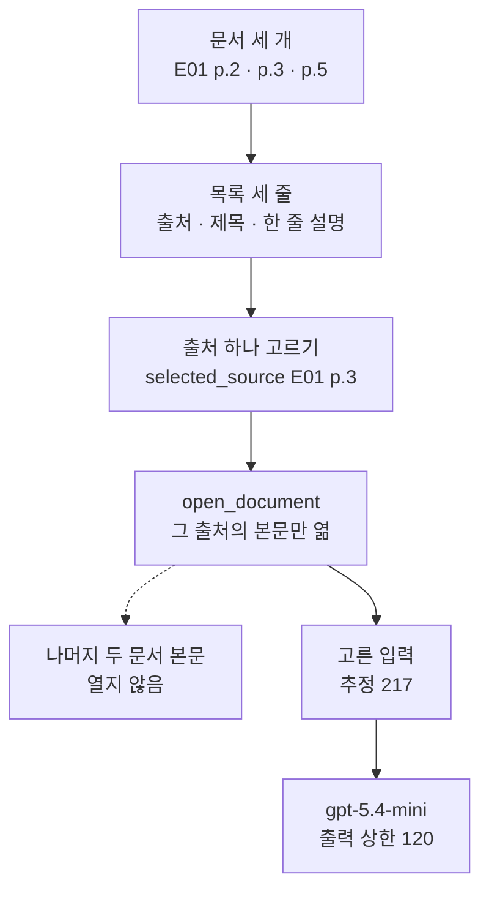
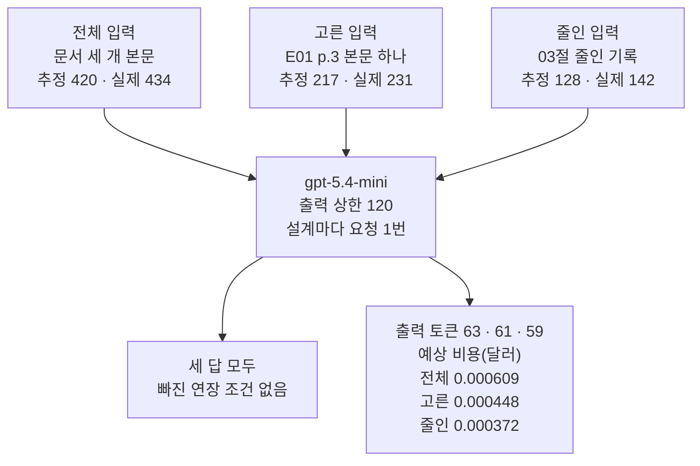
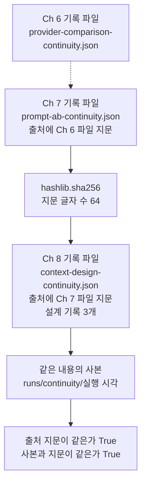
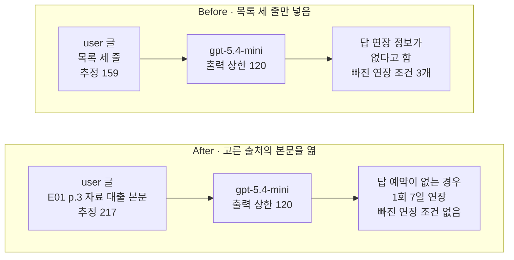

# 06-단계적-공개와-설계-비교

## _src 본문 (HTML 원본)

```html
<!--meta: 강의 1h | 실습 1h | 코드 Jupyter Notebook | 새 용어 6 -->
<h2 id="b1"><span class="no">1</span>학습 목표</h2>
<div class="goal"><p>이 절을 마치면 다음을 할 수 있습니다.</p><ul><li>단계적 공개의 세 단계를 설명하고, 목록 줄이 답의 근거를 대신하지 못하는 까닭을 말할 수 있습니다.</li><li>세 입력 설계를 같은 질문으로 보내 토큰 수·예상 비용·빠진 조건을 기록하고 비교할 수 있습니다.</li><li>Ch 7 기록 파일의 지문을 출처로 적어 기록 파일과 사본을 남기고, 다시 읽어 확인할 수 있습니다.</li></ul></div>
<h2 id="b2"><span class="no">2</span>이 내용을 배우는 이유</h2>
<p>05절에서는 무관한 기록을 1000개까지 늘려도, 이번 세 답에서 컨텍스트 로트를 보지 못했습니다. 그렇다고 문서를 모두 넣어도 된다는 뜻은 아닙니다. 입력 토큰 수만큼 비용이 늘고, 04절 혼란 조건처럼 필요 없는 자료도 함께 들어갑니다.</p>
<p>문서가 여러 개면 사람은 먼저 목록을 보고 필요한 문서만 엽니다. 에이전트 도구도 같은 방식을 씁니다. AI 회사 Anthropic의 Agent Skills 글에서는 스킬 이름과 설명만 먼저 시스템 프롬프트에 넣습니다. 스킬 본문은 작업에 필요하다고 볼 때 읽습니다.</p>
<p>이 절은 에이전트를 만들지 않습니다. 사람이 목록을 읽고 출처를 코드에 적습니다. 모델은 마지막에 받은 메시지 목록으로 답만 씁니다.</p>
<p><strong>이 절의 질문</strong> — 문서 목록을 먼저 보고 필요한 본문만 열면, 본문을 모두 넣거나 줄인 기록을 넣을 때와 무엇이 달라질까요? 그 결과는 어떻게 남겨야 뒤에서 다시 확인할 수 있을까요?</p>
<h2 id="b3"><span class="no">3</span>앞에서 배운 내용</h2>
<table><thead><tr><th>앞 절</th><th>배운 것</th><th>이 절에서 이어지는 곳</th></tr></thead><tbody>
<tr><td>Ch 6 06절·Ch 7 08절</td><td>mini 요금과 캐시 입력, <code>estimate_openai_cost()</code>, 파일 지문, 기록 사슬, 사본 폴더</td><td>3절 Ch 7 파일 읽기와 지문, 6절 기록 파일</td></tr>
<tr><td>01절</td><td>600·120·40 → 440, <code>input_budget()</code>, <code>count_tokens()</code></td><td>5절 세 설계의 추정 입력</td></tr>
<tr><td>02절</td><td>한 문장 기록, 기록에 없는 조건은 출처로 원문 확인</td><td>4절 목록의 한 줄 설명</td></tr>
<tr><td>03절</td><td>자료 대출 원문·질문·지킬 말, 줄인 기록, <code>find_missing_words()</code></td><td>4절 본문, 5절 줄인 입력</td></tr>
<tr><td>04절</td><td><code>build_notes_messages()</code>, 컨텍스트 혼란</td><td>모든 메시지 목록, 전체 입력의 필요 없는 본문</td></tr>
<tr><td>05절</td><td>세 길이에서 컨텍스트 로트를 보지 못함, 결론의 범위</td><td>세 설계 결과를 읽는 태도</td></tr>
</tbody></table>
<p>페르소나·과업 명세·모델 설정(출력 상한 120)은 05절과 같습니다. 새로 정의하는 함수는 두 개입니다. 출처로 문서를 찾는 <code>open_document()</code>와 요청 한 번을 요청 기록 한 줄로 만드는 <code>make_design_record()</code>입니다. 이 절의 기록 파일은 Ch 7 08절처럼 요청 기록을 담은 파일이고, 02절 기록 파일과 다른 파일입니다.</p>
<p>파일 지문은 Ch 7 08절에서 풀었던 뜻 그대로 씁니다. 파일 바이트 전체로 계산해, 한 글자만 달라도 다른 글이 되는 값입니다.</p>
<h2 id="b4"><span class="no">4</span>핵심 개념</h2>
<h3>비유로 시작하기</h3>
<p>나무 책상 뒤에 낮은 책꽂이가 있습니다. 책꽂이에는 회색 책과 연갈색 책이 꽂혀 있고, 둘 사이 한 칸이 비어 있습니다. 책상 위에는 작은 목록 카드, 펼친 하늘색 책, 노란 메모지, 답안지와 연필이 있습니다.</p>
{{img:06-5-목록-카드와-책|책상 뒤 책꽂이에 회색 책과 연갈색 책이 꽂혀 있고 가운데 칸이 비어 있으며, 책상 위에 색 점 세 개가 찍힌 흰 목록 카드, 펼친 하늘색 책, 노란 메모지, 답안지와 연필이 놓인 삽화|목록 카드를 보고 하늘색 책 한 권만 꺼내 펼쳤고, 나머지 두 권은 책꽂이에 그대로 있습니다.}}
<p><strong>그림 읽기</strong> — 목록 카드에는 줄이 세 개 있고, 줄마다 앞에 회색·하늘색·연갈색 점이 하나씩 있습니다. 책꽂이의 빈칸은 가운데이고, 그 자리의 하늘색 책이 책상 위에 펼쳐져 있습니다. 회색 책과 연갈색 책은 닫힌 채 책꽂이에 남아 있습니다.</p>
<p>목록 카드는 노트북 4절의 목록 세 줄이고, 점 색은 줄마다 가리키는 문서입니다. 펼친 하늘색 책은 고른 출처 E01 p.3의 본문, 닫힌 두 권은 열지 않은 두 문서입니다. 노란 메모지는 질문, 답안지와 연필은 출력 예약분으로 01~05절과 같은 뜻입니다.</p>
<p>책꽂이 빈칸은 가운데지만, 노트북 목록에서 E01 p.3은 둘째 줄입니다. 그림의 자리는 줄 순서와 상관이 없습니다. 초록 탭 카드(기록)와 파란 명찰·주황 클립보드는 이 그림에 넣지 않았습니다.</p>
<h3>단계적 공개</h3>
<p>단계적 공개(progressive disclosure)는 자세한 내용을 필요한 단계에서 보여 주는 방법입니다. 도서관에서 목록 카드로 책을 고른 뒤, 그 책만 서가에서 꺼내 읽는 것과 비슷합니다. 이 절 노트북에서는 목록 보기, 출처 고르기, 본문 열기의 세 단계입니다.</p>
{{mermaid:06-1-목록에서-본문으로|초록 상자 문서 세 개 E01 p.2 p.3 p.5에서 초록 상자 목록 세 줄 출처 제목 한 줄 설명, 파란 상자 출처 하나 고르기 selected_source E01 p.3, 파란 상자 open_document 그 출처의 본문만 엶, 노란 상자 고른 입력 추정 217, 보라 상자 gpt-5.4-mini 출력 상한 120으로 이어지고, open_document에서 회색 점선으로 나머지 두 문서 본문 열지 않음이 갈라지는 위에서 아래 흐름도|목록에서 출처 하나를 고르고 그 본문만 열어, 추정 217토큰의 고른 입력을 만듭니다.}}
<p><strong>도식 읽기</strong> — 위에서 아래로 읽습니다. 맨 위 초록 상자 두 개는 문서 세 개와, 본문을 뺀 목록 세 줄입니다. 파란 상자 두 개는 사람이 출처를 고르는 코드 줄과, 그 출처의 본문을 여는 함수 <code>open_document()</code>입니다.</p>
<p>점선 화살표 끝의 회색 상자는 열지 않은 두 문서입니다. 노란 상자는 요청 전에 센 고른 입력의 추정 토큰 수 217이고, 보라 상자는 출력 상한 120인 모델입니다.</p>
<h3>목록 줄은 근거가 아닙니다</h3>
<p>목록 한 줄은 출처 표시, 제목, 한 줄 설명입니다. 한 줄 설명은 02절 기록 파일의 한 문장 기록과 같은 글입니다. 예를 들어 둘째 줄은 「4. 자료 대출: 도서는 7권까지 14일 동안 대출할 수 있습니다.」입니다.</p>
<p>이 줄에서 빠진 지킬 말은 <code>['예약이 없는 경우', '1회', '7일 연장']</code>이었습니다. 목록은 어느 본문을 열지 고르는 데 쓰는 짧은 글이고, 답의 근거를 대신하지 않습니다. 02절에서 기록에 없는 조건은 출처로 원문을 확인한다고 했고, 이 절은 그 확인을 본문 열기로 합니다.</p>
<h3>세 입력 설계</h3>
<p>입력 설계는 이번 요청의 메시지 목록에 무엇을 넣을지 정한 방식입니다. 이 절은 같은 대출 연장 질문으로 세 설계를 비교합니다.</p>
<table><thead><tr><th>설계</th><th>user 글에 넣는 것</th><th>추정 입력</th><th>따로 확인할 점</th></tr></thead><tbody>
<tr><td>전체 입력(full)</td><td>목록의 문서 세 개 본문</td><td>420</td><td>필요 없는 두 본문도 들어감(04절 혼란 조건)</td></tr>
<tr><td>고른 입력(selected)</td><td>고른 출처 E01 p.3 본문 하나</td><td>217</td><td>출처를 잘못 고르면 조건이 처음부터 빠짐</td></tr>
<tr><td>줄인 입력(compressed)</td><td>03절 줄인 대출 기록 한 문장</td><td>128</td><td>줄일 때 남기지 않은 내용은 답에도 쓸 수 없음</td></tr>
</tbody></table>
<p>세 목록 모두 01절 입력 가용분 440 안에 듭니다. 질문·페르소나·과업 명세·모델 설정은 세 요청이 같고, user 글의 근거만 다릅니다. 줄인 입력의 추정 128은 03절 대출 목록과 같은 값입니다.</p>
<h3>사람이 고르는 이 절과 Ch 9</h3>
<p>이 절에서는 사람이 목록을 읽고 <code>selected_source = "E01 p.3"</code>를 코드에 적습니다. 모델은 문서를 고르지 않고, 도구를 부르지도 않습니다. 문서가 세 개라 사람이 고를 수 있습니다.</p>
<p>Ch 9 01절은 같은 E01 문서를 PDF에서 쪽마다 읽고, 사람이 고르던 일을 검색이 맡습니다. 모델이 목록을 보고 스스로 본문을 여는 방식은 도구와 에이전트를 배운 뒤에 다룹니다.</p>
<h3>이 절에서 쓰는 말</h3>
<table><thead><tr><th>용어</th><th>뜻</th><th>이 절에서 보이는 모습</th></tr></thead><tbody>
<tr><td>단계적 공개(progressive disclosure)</td><td>자세한 내용을 필요한 단계에서 보여 주는 방법. 이 절에서는 목록 보기 → 출처 고르기 → 본문 열기</td><td><code>open_document(documents, selected_source)</code></td></tr>
<tr><td>목록 줄</td><td>출처 표시·제목·한 줄 설명으로 된 한 줄. 본문을 고르는 데 쓰고 근거를 대신하지 않음</td><td><code>[E01 p.3] 4. 자료 대출: 도서는 7권까지 14일 동안 대출할 수 있습니다.</code></td></tr>
<tr><td>입력 설계</td><td>이번 요청의 메시지 목록에 무엇을 넣을지 정한 방식</td><td>전체·고른·줄인 입력</td></tr>
<tr><td>전체 입력(full)</td><td>후보 문서의 본문을 모두 넣은 목록</td><td><code>추정 입력 합계(전체·고른·줄인): 420 217 128</code>의 420</td></tr>
<tr><td>고른 입력(selected)</td><td>고른 출처의 본문 하나만 넣은 목록</td><td><code>selected_messages</code></td></tr>
<tr><td>줄인 입력(compressed)</td><td>사람이 원문을 읽고 조건을 남기며 줄인 기록을 넣은 목록</td><td>03절 <code>loan_note</code></td></tr>
</tbody></table>
<h2 id="b5"><span class="no">5</span>실행 예제</h2>
<p>노트북은 앞 절 함수를 도구 파일 <code>llm_tools.py</code>에서 가져온 뒤, Ch 7 08절 기록 파일을 읽고 지문을 계산합니다. 목록을 만들어 출처 하나의 본문을 열고, 세 입력 설계를 한 번씩 보내 요청 기록 한 줄씩 만듭니다. 세 요청 기록은 Ch 7 파일 지문을 출처로 적어 기록 파일과 사본에 남기고, 값 바꿔 보기로 다른 출처를 엽니다.</p>
<p>실제 OpenAI 모델을 temperature 0으로 부르는 요청은 Before·After를 합쳐 모두 다섯 번입니다. 이 페이지의 출력은 2026-09-21에 실행한 결과입니다. 예상 비용은 0.01달러 미만이고, 답 문장은 실행마다 달라질 수 있습니다.</p>
<p>강의 시간에는 노트북 4·5·8·9절(목록에서 본문 열기, 세 입력 설계, Before, After)을 설명합니다. 3·6·7절(Ch 7 기록 파일 읽기, 기록 파일로 남기기, 값 바꿔 보기)은 함께 실행하고 실습 시간에 읽습니다.</p>
{{notebook:06-단계적-공개와-설계-비교|example}}
<p class="look"><b>확인할 점</b> — 3절 <code>고른 경로: labs/part2/ch08-context-engineering</code>와 <code>지문 글자 수: 64</code>를 봅니다. 4절 <code>목록 줄에서 빠진 지킬 말</code>과 5절 요청 기록표의 출력 토큰 수·예상 비용을 비교합니다. 6절 세 확인 줄이 모두 <code>True</code>인지, 7절에서 목록에 없는 출처가 <code>None</code>인지 봅니다.</p>
<h3>세 설계의 답과 비용</h3>
{{mermaid:06-2-세-입력-설계|위에 초록 상자 전체 입력 문서 세 개 본문 추정 420 실제 434, 고른 입력 E01 p.3 본문 하나 추정 217 실제 231, 줄인 입력 03절 줄인 기록 추정 128 실제 142가 나란히 있고, 세 상자가 보라 상자 gpt-5.4-mini 출력 상한 120 설계마다 요청 1번으로 모인 뒤, 노란 상자 세 답 모두 빠진 연장 조건 없음과 노란 상자 출력 토큰 63 61 59 예상 비용 전체 0.000609 고른 0.000448 줄인 0.000372로 갈라지는 흐름도|세 설계의 답에서 연장 조건은 모두 빠지지 않았고, 이번 예상 비용은 입력이 큰 순서였습니다.}}
<p><strong>도식 읽기</strong> — 위에서 아래로 읽습니다. 맨 위 초록 상자 세 개가 세 설계의 목록이고, 상자마다 요청 전 추정 입력과 실제 입력 토큰 수를 적었습니다. 세 목록은 가운데 보라 상자 모델에 한 번씩 따로 보냈습니다.</p>
<p>아래 왼쪽 노란 상자는 세 답에 공통으로 확인한 값입니다. 오른쪽 노란 상자는 설계별 출력 토큰 수와 예상 비용이고, 적힌 순서는 전체·고른·줄인 입력입니다.</p>
<p>전체 입력의 답은 연장 조건과 신청 방법을 한 문장에 담았고, 출처 표시는 <code>[E01 p.3]</code> 하나였습니다. 이용 시간·찾아오시는 길 본문의 내용은 이번 답에 없었습니다. 필요 없는 본문을 넣었지만, 이번 답에서는 그 내용을 쓴 곳을 찾지 못했습니다.</p>
<p>고른 입력의 답은 전체 입력의 답과 같은 사실을 어순만 조금 바꿔 적었습니다. 출력도 61토큰으로 전체 입력의 63토큰과 비슷했습니다. 줄인 입력의 답은 둘째 문장이 <code>회원 한 사람의 도서 대출 기준은 7권·14일입니다.</code>였고, 원문에 있던 신청 방법은 없었습니다.</p>
<p>예상 비용은 전체·고른·줄인 입력 순으로, 이번에는 입력이 큰 순서였습니다. 세 답의 출력이 59~63토큰으로 비슷했기 때문입니다. 출력 요금 4.50달러는 입력 요금 0.75달러의 6배입니다. 그래서 입력 203토큰의 요금은 출력 약 34토큰의 요금과 같습니다.</p>
<p>입력 토큰 수는 설계가 정하지만, 출력 토큰 수는 요청마다 달라집니다. 이번 9절 After는 5절 고른 입력과 같은 목록이고 답도 같았습니다. 교재 출력 바로 앞의 새 커널 실행에서는 같은 목록의 After 답이 104토큰이었습니다. 그래서 설계마다 한 번 보낸 이번 결과로 비용 순위를 정하지 않습니다.</p>
<h3>기록 파일과 기록 사슬</h3>
{{mermaid:06-3-기록-사슬|위에서 아래로 초록 상자 Ch 6 기록 파일 provider-comparison-continuity.json에서 회색 점선으로 초록 상자 Ch 7 기록 파일 prompt-ab-continuity.json 출처에 Ch 6 파일 지문, 파란 상자 hashlib.sha256 지문 글자 수 64, 초록 상자 Ch 8 기록 파일 context-design-continuity.json 출처에 Ch 7 파일 지문 설계 기록 3개, 초록 상자 같은 내용의 사본 runs/continuity/실행 시각, 노란 상자 출처 지문이 같은가 True 사본과 지문이 같은가 True로 이어지는 흐름도|Ch 7 기록 파일의 지문을 이 절 기록 파일의 출처로 적고, 같은 내용의 사본까지 지문으로 확인했습니다.}}
<p><strong>도식 읽기</strong> — 위에서 아래로 읽습니다. 맨 위 초록 상자 두 개는 앞 챕터의 기록 파일입니다. 두 상자를 잇는 점선은 Ch 7 08절에서 이미 이어 둔 연결이라, 이 노트북에서는 실행하지 않았습니다.</p>
<p>파란 상자 <code>hashlib.sha256()</code>이 Ch 7 파일의 지문을 계산하고, 그 지문이 이 절 기록 파일의 출처에 들어갑니다. 아래 초록 상자는 실행 시각 폴더에 쓴 사본이고, 노란 상자는 6절에서 다시 읽어 확인한 두 줄입니다.</p>
<p>기록 파일의 최상위 키는 <code>['run_id', 'run_date', 'source_chapter', 'source_record', 'settings', 'question', 'results']</code>입니다. 키 <code>source_record</code>에는 프로젝트 맨 위에서 본 Ch 7 파일 경로, 지문, Ch 7 실행 이름을 적었습니다. 키 <code>results</code>에는 한국어 키로 된 세 설계의 요청 기록이 들어 있습니다.</p>
<p>이 파일은 노트북을 실행할 때마다 덮어씁니다. 사본은 실행마다 새 폴더에 남아, 앞선 실행의 기록을 지우지 않습니다. Ch 7 08절 노트북을 다시 실행하면 그 파일의 지문이 바뀌므로, 이 노트북도 다시 실행해 출처를 새로 적습니다.</p>
<h3>작업 폴더와 경로 고르기</h3>
<p>노트북은 후보 경로 세 개 가운데 <code>runs</code> 폴더와 <code>notebooks</code> 폴더가 모두 있는 첫 후보를 실습 폴더로 고릅니다. 교재 출력은 프로젝트 맨 위에서 실행해 긴 경로가 나왔습니다. <code>notebooks</code> 폴더에서 열면 <code>..</code>, 실습 폴더 맨 위에서 열면 <code>.</code>이 나옵니다.</p>
<p>Ch 6 06절과 Ch 7 08절 노트북은 <code>../runs</code> 폴더가 있는지만 보고 경로를 골랐습니다. 그래서 두 노트북은 <code>notebooks</code> 폴더나 프로젝트 맨 위에서 엽니다. 이 절 노트북은 실습 폴더 맨 위에서 열어도 경로를 찾습니다.</p>
<h3>값 바꿔 보기 — 다른 출처 열기</h3>
<p>7절에서는 고른 출처만 E01 p.5로 바꿨습니다. 찾아오시는 길 본문에서 빠진 지킬 말은 다섯 개 모두였고, 추정 입력은 <code>추정 입력 합계: 192</code>였습니다. 192는 입력 가용분 안이라, 예산표로는 잘못 고른 것을 알 수 없습니다.</p>
<p>목록에 없는 출처 E01 p.4를 넣으면 <code>목록에 없는 출처로 연 결과: None</code>이 나왔습니다. 본문을 쓰기 전에 연 결과가 <code>None</code>인지 확인합니다.</p>
<h2 id="b6"><span class="no">6</span>일부러 실패해 보기</h2>
<p>Before에서는 4절 목록 세 줄만 user 글에 넣어 보냅니다. 목록을 본 뒤 본문을 여는 단계를 빼먹은 경우입니다. 질문·페르소나·과업 명세·출력 상한 120은 5절 세 요청과 같습니다.</p>
<p>After에서 고치는 곳은 목록 다음 단계 하나입니다. 목록에서 고른 출처의 본문을 열어, 목록 줄 대신 본문을 넣습니다. 노트북은 이 목록이 5절 고른 입력과 같은지 <code>==</code>로 확인한 뒤 보냅니다.</p>
{{notebook:06-단계적-공개와-설계-비교|failure}}
<p>Before 답의 첫 문장은 <code>주어진 근거에는 도서 대출 기간을 연장할 수 있는지에 대한 정보가 없습니다.</code>였습니다. 둘째 문장은 목록 줄의 권수·기간만 되풀이했습니다. 검사 출력은 <code>답에서 빠진 연장 조건: ['예약이 없는 경우', '1회', '7일 연장']</code>이었습니다.</p>
<p>오류는 나지 않았고, 모델은 모르는 것을 모른다고 답했습니다. 그러나 연장할 수 있는지는 자료 대출 본문에 있습니다. 이번 요청은 답할 수 있는 질문인데도 답을 얻지 못한 채 끝났습니다.</p>
{{mermaid:06-4-Before-After|위 칸 Before 목록 세 줄만 넣음에는 초록 상자 user 글 목록 세 줄 추정 159, 보라 상자 gpt-5.4-mini 출력 상한 120, 빨간 상자 답 연장 정보가 없다고 함 빠진 연장 조건 3개가 차례로 있고, 아래 칸 After 고른 출처의 본문을 엶에는 초록 상자 user 글 E01 p.3 자료 대출 본문 추정 217, 보라 상자 gpt-5.4-mini 출력 상한 120, 노란 상자 답 예약이 없는 경우 1회 7일 연장 빠진 연장 조건 없음이 차례로 있는 비교 그림|목록 세 줄만 넣은 Before 답은 연장 정보가 없다고 했고, 본문을 연 After 답에는 연장 조건 세 개가 들어갔습니다.}}
<p><strong>도식 읽기</strong> — 위 칸이 Before, 아래 칸이 After이고, 칸마다 왼쪽에서 오른쪽으로 읽습니다. 초록 상자는 user 글에 넣은 근거와 추정 입력이고, 보라 상자는 출력 상한 120인 같은 모델 객체입니다. 위 칸 끝의 빨간 상자는 Before의 결함 결과로, 연장 조건이 모두 빠진 답입니다.</p>
<p>아래 칸 끝의 노란 상자는 After 출력으로 확인한 값입니다. After 답은 <code>네, 대출 기간은 다른 이용자의 예약이 없는 경우 1회에 한해 7일 연장할 수 있으며,</code>로 시작했습니다. 두 답에 모두 있던 <code>[E01 p.3]</code> 출처 표시는 결과 상자에 넣지 않았습니다.</p>
<p>After 목록은 5절 고른 입력과 같았고, 이번에는 답도 5절 답과 글자까지 같았습니다. 교재 출력 바로 앞의 새 커널 실행에서는 같은 목록의 After 답이 출력 104토큰으로 5절 답과 달랐습니다. 이 비교는 질문 하나를 한 번씩 보낸 결과입니다.</p>
<h2 id="b7"><span class="no">7</span>주의할 점과 실무 메모</h2>
<ul><li>답에서 확인할 말을 지킬 말 다섯 개가 아니라 연장 조건 세 개로 정한 것은 탐색 실행 뒤입니다. 교재를 만들 때 세 설계를 먼저 보냈습니다. 전체·고른 입력의 답은 연장 질문에 권수·기간을 다시 적지 않았습니다. 그래서 이 질문에 꼭 필요한 연장 조건만 답 확인에 썼습니다. 흐름을 보여 주려고 정한 예입니다.</li>
<li>목록의 한 줄 설명이 틀리거나 서로 비슷하면, 사람도 잘못 고릅니다. 이 절의 한 줄 설명은 02절 기록 글을 그대로 썼습니다. 설명을 어떻게 써야 잘 고르는지는 이번에 재지 않았습니다.</li>
<li>출처를 잘못 고른 목록은 요청하지 않고 지킬 말 검사로만 봤습니다. 잘못 고른 본문을 실제로 보냈을 때의 답은 이번에 확인하지 않았습니다.</li>
<li>예상 비용은 출력 토큰 수에 따라 달라집니다. 같은 목록의 답이 이번에는 5절·9절 모두 61토큰이었고, 앞선 새 커널 실행에서는 61토큰과 104토큰이었습니다. 설계 사이의 비용을 비교하려면 같은 설계를 여러 번 보내야 하고, 그 방법은 Ch 11·15에서 다룹니다.</li>
<li>이번 입력은 모두 짧아 캐시 입력은 0이었습니다. 긴 문서를 되풀이해 보내면 05절처럼 캐시 입력이 생길 수 있으므로, 비용을 비교할 때 캐시 입력 토큰 수를 함께 적습니다.</li>
<li>걸린 시간은 재지 않았습니다. 목록을 보고 본문을 여는 단계가 늘면 사람이나 코드의 작업이 한 번 더 생깁니다.</li>
<li>노트북을 실행하면 <code>runs/context-design-continuity.json</code>을 덮어쓰고 사본 폴더가 하나 생깁니다. 앞 챕터 기록을 다시 만들어야 하면 Ch 6 06절 → Ch 7 08절 → 이 절 순서로 실행합니다.</li>
<li>작업 폴더 세 곳 가운데 교재 출력은 프로젝트 맨 위에서 만들었습니다. 경로 고르기는 Linux에서만 실행했고, Windows·macOS에서는 실행하지 않았습니다.</li>
<li>경로 고르기는 후보 폴더에 <code>runs</code>와 <code>notebooks</code>가 있는지만 봅니다. 그래서 Ch 7 실습 폴더의 <code>notebooks</code>처럼 다른 챕터 폴더에서 열면 그 챕터 폴더를 고릅니다. 그러면 6절이 기록 파일과 사본을 그 챕터의 <code>runs</code>에 씁니다. 이 노트북은 이 챕터의 세 작업 폴더 가운데 한 곳에서 엽니다. 다른 챕터 폴더에서 연 경우의 파일 쓰기는 이번에 실행하지 않았습니다.</li>
<li>교재 출력은 Linux의 Python 3.12.13으로 만들었습니다. 패키지는 langchain 1.4.0, langchain-core 1.6.2, langchain-openai 1.6.0입니다. openai 3.8.0, tiktoken 0.14.0도 함께 썼습니다.</li></ul>
<h2 id="b8"><span class="no">8</span>정리와 다음 절</h2>
<ul><li>목록을 먼저 보고 고른 출처 하나의 본문만 열었습니다. 목록만 넣은 Before 답에는 연장 조건이 모두 빠졌고, 본문을 연 After 답에는 모두 들어갔습니다.</li><li>전체·고른·줄인 입력의 추정 입력은 420·217·128이었고, 세 답 모두 연장 조건이 빠지지 않았습니다. 이번 예상 비용은 입력이 큰 순서였지만, 출력 토큰 수에 따라 바뀔 수 있어 한 번의 결과로 순위를 정하지 않습니다.</li><li>세 요청 기록을 Ch 7 기록 파일의 지문과 함께 기록 파일에 남겨 기록 사슬을 이었습니다. 출처를 잘못 고르면 짧은 입력이어도 조건이 처음부터 빠집니다.</li></ul>
<p><strong>다음 학습과 이어지는 지점</strong> — 07절은 이 챕터의 실습입니다. 도서관 안내 질문 세 개에 이 절의 본문 열기, 01절 예산표, 03절 줄인 기록과 지킬 말 검사를 함께 붙입니다. 수업 예산 한 값만 바꾼 두 실행을 비교하고, Ch 9로 넘어가는 연결은 07절에서 정리합니다.</p>
<h2 id="b9"><span class="no">9</span>복습 문제</h2>
<details class="quiz"><summary>문제 1 · 세 단계</summary><p class="quiz-q">이 절 노트북의 단계적 공개 세 단계를 순서대로 쓰고, 단계마다 쓴 변수나 함수를 하나씩 적으세요.</p><p class="quiz-a"><b>해설</b> — 목록 보기(<code>catalog</code>), 출처 고르기(<code>selected_source</code>), 본문 열기(<code>open_document()</code>)입니다. 모델은 세 단계가 끝난 뒤 받은 메시지 목록으로 답만 씁니다.</p></details>
<details class="quiz"><summary>문제 2 · 목록만 넣은 요청</summary><p class="quiz-q">목록 세 줄만 넣어 보내면 왜 연장 질문에 답하지 못하나요? 노트북 출력 하나를 근거로 드세요.</p><p class="quiz-a"><b>해설</b> — 목록 줄에는 연장 조건이 없습니다. 4절 <code>목록 줄에서 빠진 지킬 말: ['예약이 없는 경우', '1회', '7일 연장']</code>이 근거입니다. 목록은 본문을 고르는 데 쓰고, 조건은 본문을 열어 확인합니다.</p></details>
<details class="quiz"><summary>문제 3 · 비용 비교</summary><p class="quiz-q">고른 입력은 전체 입력보다 입력이 203토큰 적었고, 이번 예상 비용도 더 작았습니다. 고른 입력의 출력이 전체 입력보다 몇 토큰쯤 더 길면 두 설계의 예상 비용 순서가 바뀌나요?</p><p class="quiz-a"><b>해설</b> — 입력 203토큰의 요금은 <code>203 × 0.75 / 1000000</code>으로 약 0.000152달러입니다. 출력 한 토큰은 <code>4.50 / 1000000</code>달러이므로, 0.000152달러는 출력 약 34토큰의 요금입니다. 고른 입력의 출력이 34토큰쯤 넘게 길면 순서가 바뀝니다. 출력 토큰 수는 요청마다 달라지므로, 한 번의 결과로 설계의 비용 순위를 정하지 않습니다.</p></details>
<details class="quiz"><summary>문제 4 · 잘못 고른 출처</summary><p class="quiz-q">7절에서 E01 p.5를 고른 목록은 추정 입력 192로 입력 가용분 안이었습니다. 예산표만 보고 보내면 무엇을 놓치나요?</p><p class="quiz-a"><b>해설</b> — 예산표는 길이만 봅니다. 찾아오시는 길 본문에는 지킬 말 다섯 개가 모두 없어, 보내기 전에 지킬 말 검사를 해야 잘못 고른 것이 드러납니다.</p></details>
<details class="quiz"><summary>문제 5 · 기록 사슬</summary><p class="quiz-q">동료가 Ch 7 08절 노트북만 다시 실행했습니다. 이 절 기록 파일에는 어떤 문제가 생기고, 무엇을 해야 하나요?</p><p class="quiz-a"><b>해설</b> — Ch 7 기록 파일의 지문이 바뀌어, 이 절 기록 파일의 <code>source_record</code>에 적힌 지문과 맞지 않습니다. 이 절 노트북을 다시 실행해 새 지문을 출처로 적습니다.</p></details>
<h2 id="b10"><span class="no">10</span>참고 자료</h2>
<p>문서는 2026-09-17에 다시 열어 확인했습니다. 본문은 02·03절처럼 가상 기관 문서 <code>E01.pdf</code>를 읽고 옮겨 적었습니다. 요금은 Ch 6 06절에서 확인한 값과 같습니다.</p>
<ul><li><div><a href="https://www.anthropic.com/engineering/equipping-agents-for-the-real-world-with-agent-skills">Anthropic, Equipping agents for the real world with Agent Skills</a></div>스킬 이름과 설명을 먼저 넣고 본문은 필요할 때 읽는 사례 · 2025-10-16 · 확인 2026-09-17</li><li><div><a href="https://www.anthropic.com/engineering/effective-context-engineering-for-ai-agents">Anthropic, Effective context engineering for AI agents</a></div>가벼운 식별자를 두고 필요할 때 자료를 읽는 방식과 단계적 공개 · 2025-09-29 · 확인 2026-09-17</li></ul>
```

## 노트북 셀 (순서대로)

### [0] markdown {'html': 'skip'}

# 단계적 공개와 설계 비교

**이 노트북에서 할 일**

1. 문서 세 개의 목록을 먼저 보고, 질문에 필요한 문서 하나의 본문만 엽니다.
2. 전체 입력·고른 입력·줄인 입력을 같은 질문으로 보내고, 토큰 수와 비용을 기록합니다.
3. Ch 7 08절 기록 파일의 지문을 출처로 적어, 세 요청 기록을 기록 파일로 남깁니다.

**준비물** — 프로젝트 폴더 `.env` 파일의 `OPENAI_API_KEY`가 필요합니다. Ch 7 08절 노트북이 만든 기록 파일 `prompt-ab-continuity.json`이 있어야 합니다.
없으면 그 노트북을 먼저 실행합니다.

인터넷 서비스에 요청을 모두 5번 보냅니다. 모두 `gpt-5.4-mini`입니다.
실행 시간은 1분 안팎이고, 예상 비용은 0.01달러 미만입니다. 요금은 Ch 6 06절에서 2026-09-17에 확인한 mini 공식 요금 기준입니다.

**강의와 실습 범위** — 강의 시간에는 4·5·8·9절(본문 열기, 세 입력 설계, Before, After)을 설명합니다.
3·6·7절(Ch 7 파일 읽기, 기록 파일 남기기, 값 바꿔 보기)은 함께 실행하고 실습 시간에 읽습니다.

이 노트북은 실습 폴더 `runs`의 기록 파일 하나를 덮어쓰고, 사본 폴더 하나를 새로 만듭니다.
작업 폴더는 이 챕터의 `notebooks` 폴더, 실습 폴더 맨 위, 프로젝트 맨 위 가운데 어느 곳이어도 됩니다.
다른 챕터의 실습 폴더에서 열면 그 챕터 폴더를 고르므로, 그곳에서는 열지 않습니다.

**기준 버전** — 실습 폴더에 고정한 패키지 판을 씁니다. langchain 1.4.0, langchain-core 1.6.2, langchain-openai 1.6.0입니다.
openai 3.8.0, tiktoken 0.14.0, python-dotenv 1.2.3도 함께 씁니다.

교재 출력은 Linux의 Python 3.12.13으로 만들었습니다. 다른 버전과 Windows·macOS에서는 이번에 실행하지 않았습니다.

실습 폴더 `labs/part2/ch08-context-engineering`에서 `uv sync --locked`를 실행합니다.
그다음 이 폴더의 `.venv` 커널을 고르고 첫 셀부터 순서대로 실행합니다.

### [1] markdown {'html': 'skip'}

## 오늘 볼 그림


위에서 아래로 읽습니다. 맨 위 초록 상자 두 개는 문서 세 개와, 본문을 뺀 목록 세 줄입니다.
파란 상자 두 개는 사람이 출처 하나를 고르고, 함수가 그 출처의 본문만 여는 단계입니다.

회색 상자는 열지 않은 두 문서입니다. 노란 상자는 요청 전에 센 고른 입력의 추정 토큰 수이고, 보라 상자는 모델입니다.

### [2] markdown {}

## 1. 준비

첫 셀은 패키지를 설치하고 설치된 버전을 출력합니다. 설치에는 몇십 초가 걸릴 수 있습니다.
01~05절과 같은 패키지 판을 씁니다.

### [3] code {'execution': {'iopub.execute_input': '2026-09-21T05:02:22.213714Z', 'iopub.status.busy': '2026-09-21T05:02:22.213527Z', 'iopub.status.idle': '2026-09-21T05:02:22.661180Z', 'shell.execute_reply': '2026-09-21T05:02:22.660726Z'}, 'lesson_role': 'setup'}

```python
# 이 절에서 쓰는 패키지를 설치하고 버전을 확인합니다
%pip install -q "langchain==1.4.0" "langchain-openai==1.6.0" "python-dotenv==1.2.3" "tiktoken==0.14.0"
from importlib.metadata import version

print("langchain:", version("langchain"))
print("langchain-core:", version("langchain-core"))
print("langchain-openai:", version("langchain-openai"))
print("openai:", version("openai"))
print("tiktoken:", version("tiktoken"))
print("python-dotenv:", version("python-dotenv"))
```

출력:
```
Note: you may need to restart the kernel to use updated packages.
langchain: 1.4.0
langchain-core: 1.6.2
langchain-openai: 1.6.0
openai: 3.8.0
tiktoken: 0.14.0
python-dotenv: 1.2.3

```

### [4] markdown {}

**결과 읽기** — 출력 줄은 `langchain: 1.4.0`, `openai: 3.8.0`, `tiktoken: 0.14.0` 등 여섯 줄입니다.
준비물에 적은 기준 버전과 같습니다.

다섯 가지를 불러옵니다. 모듈 `hashlib`은 Ch 7 08절에서 파일 지문을 계산할 때 쓴 모듈입니다.
모듈 `json`과 `time`은 Ch 6 06절처럼 기록 파일을 쓰고, 실행 시각 글을 만들 때 씁니다.
나머지 두 줄은 토큰 수를 세는 라이브러리와 모델 객체를 만드는 함수입니다. 마지막 줄은 앞에서 배운 함수 다섯 개를 가져옵니다.

앞에서 배운 함수는 `llm_tools.py`에 모아 두었습니다. 파일을 열면 코드를 볼 수 있습니다. 노트북과 같은 폴더(`notebooks/`)에 있는 파일입니다.
이 노트북은 01절 `input_budget()`·`count_tokens()`, 03절 `find_missing_words()`, 04절 `build_notes_messages()`를 가져옵니다.
Ch 7 08절 `estimate_openai_cost()`도 가져옵니다.

### [5] code {'execution': {'iopub.execute_input': '2026-09-21T05:02:22.662242Z', 'iopub.status.busy': '2026-09-21T05:02:22.662153Z', 'iopub.status.idle': '2026-09-21T05:02:23.033767Z', 'shell.execute_reply': '2026-09-21T05:02:23.033372Z'}, 'lesson_role': 'setup'}

```python
# 파일 지문·JSON 글·시각 글을 다루는 모듈, 토큰 수를 세는 라이브러리, 모델 함수를 불러옵니다
import hashlib
import json
import time

import tiktoken

from langchain.chat_models import init_chat_model
# 01·03·04절과 Ch 7 08절 함수 다섯 개를 도구 파일에서 가져옵니다
from llm_tools import build_notes_messages, count_tokens, estimate_openai_cost, find_missing_words, input_budget
```

출력:
```

```

### [6] markdown {}

05절과 같은 셀로 API 키가 있는지 확인합니다. 키 값은 출력하지 않고, 있는지만 봅니다.
`True` 값이 나오면 다음으로 넘어갑니다.

### [7] code {'execution': {'iopub.execute_input': '2026-09-21T05:02:23.034515Z', 'iopub.status.busy': '2026-09-21T05:02:23.034459Z', 'iopub.status.idle': '2026-09-21T05:02:23.038686Z', 'shell.execute_reply': '2026-09-21T05:02:23.038264Z'}, 'lesson_role': 'setup'}

```python
# .env 파일에서 OpenAI API 키를 읽습니다(키 값은 출력하지 않습니다)
import os
from dotenv import find_dotenv, load_dotenv

env_path = find_dotenv(usecwd=True)
load_dotenv(env_path)
has_key = os.getenv("OPENAI_API_KEY") is not None
print("OPENAI_API_KEY 설정 여부:", has_key)
assert has_key, "프로젝트 폴더의 .env 파일에 OPENAI_API_KEY를 적어 주세요."
```

출력:
```
OPENAI_API_KEY 설정 여부: True

```

### [8] markdown {}

## 2. 05절에서 이어 쓰는 글과 함수

페르소나와 과업 명세는 02~05절과 글자까지 같습니다. 과업 명세는 문장마다 끝에 출처 표시를 적게 합니다.
출처 표시 `[E01 p.2]`는 모양을 보여 주는 예입니다.

### [9] code {'execution': {'iopub.execute_input': '2026-09-21T05:02:23.039294Z', 'iopub.status.busy': '2026-09-21T05:02:23.039242Z', 'iopub.status.idle': '2026-09-21T05:02:23.041168Z', 'shell.execute_reply': '2026-09-21T05:02:23.040838Z'}}

```python
# 02~05절과 같은 페르소나와 과업 명세를 만듭니다
persona_text = "당신은 미르시립도서관 안내 담당자입니다."
task_text = "주어진 근거에 있는 정보만 쓰세요. 두 문장 이내로 답하고, 문장마다 끝에 출처를 [E01 p.2]처럼 적으세요."
print("페르소나:", persona_text)
print("과업 명세:", task_text)
```

출력:
```
페르소나: 당신은 미르시립도서관 안내 담당자입니다.
과업 명세: 주어진 근거에 있는 정보만 쓰세요. 두 문장 이내로 답하고, 문장마다 끝에 출처를 [E01 p.2]처럼 적으세요.

```

### [10] markdown {}

**결과 읽기** — 두 줄은 `페르소나:`와 `과업 명세:`로 시작합니다. 과업 명세 줄에 `문장마다 끝에 출처를`이 있습니다.

수업 예산표도 01~05절과 같은 값으로 이어 씁니다. 세 값을 담고, 준비 셀에서 가져온 01절 함수 `input_budget()`으로 입력 가용분을 구합니다.
실행 전에 예상합니다. 01~05절처럼 440일 것입니다.

### [11] code {'execution': {'iopub.execute_input': '2026-09-21T05:02:23.041717Z', 'iopub.status.busy': '2026-09-21T05:02:23.041655Z', 'iopub.status.idle': '2026-09-21T05:02:23.043353Z', 'shell.execute_reply': '2026-09-21T05:02:23.043019Z'}}

```python
# 01~05절과 같은 수업 예산·출력 예약분·여유분으로 입력 가용분을 계산합니다
total_budget = 600
output_reserve = 120
safety_margin = 40
available = input_budget(total_budget, output_reserve, safety_margin)
print("수업 예산:", total_budget)
print("출력 예약분:", output_reserve)
print("여유분:", safety_margin)
print("입력 가용분:", available)
```

출력:
```
수업 예산: 600
출력 예약분: 120
여유분: 40
입력 가용분: 440

```

### [12] markdown {}

**결과 읽기** — 네 줄은 `수업 예산: 600`, `출력 예약분: 120`, `여유분: 40`, `입력 가용분: 440`입니다.
05절 측정 입력은 이 입력 가용분을 일부러 넘겼습니다. 이 절의 세 입력 설계는 다시 이 예산표와 비교합니다.

요청 전에 토큰 수를 세려고 01~05절처럼 토큰화 규칙 객체를 만듭니다. 가져온 함수 `count_tokens()`에 첫 인자로 넣을 객체입니다.

### [13] code {'execution': {'iopub.execute_input': '2026-09-21T05:02:23.043919Z', 'iopub.status.busy': '2026-09-21T05:02:23.043871Z', 'iopub.status.idle': '2026-09-21T05:02:23.147252Z', 'shell.execute_reply': '2026-09-21T05:02:23.146940Z'}}

```python
# 01~05절처럼 모델의 토큰화 규칙을 불러옵니다(가져온 count_tokens()에 첫 인자로 넣습니다)
encoding = tiktoken.encoding_for_model("gpt-5.4-mini")
print("토큰화 규칙 이름:", encoding.name)
```

출력:
```
토큰화 규칙 이름: o200k_base

```

### [14] markdown {}

**결과 읽기** — 출력 줄은 `토큰화 규칙 이름: o200k_base`로 01~05절과 같습니다.

모델 객체는 02~05절처럼 출력 예약분을 출력 상한(`max_tokens`)으로 주어 만듭니다. 이 셀은 요청을 보내지 않습니다.

### [15] code {'execution': {'iopub.execute_input': '2026-09-21T05:02:23.147962Z', 'iopub.status.busy': '2026-09-21T05:02:23.147910Z', 'iopub.status.idle': '2026-09-21T05:02:24.085310Z', 'shell.execute_reply': '2026-09-21T05:02:24.084906Z'}}

```python
# 출력 예약분을 출력 상한으로 준 모델을 준비합니다(02~05절과 같은 설정)
model = init_chat_model(
    "openai:gpt-5.4-mini",
    temperature=0,
    reasoning_effort="none",
    max_tokens=output_reserve,
)
print("모델 이름:", model.model_name)
print("temperature:", model.temperature)
print("출력 상한(max_tokens):", model.max_tokens)
assert model.max_tokens == output_reserve
```

출력:
```
모델 이름: gpt-5.4-mini
temperature: 0.0
출력 상한(max_tokens): 120

```

### [16] markdown {}

**결과 읽기** — 출력 줄은 `모델 이름: gpt-5.4-mini`, `temperature: 0.0`, `출력 상한(max_tokens): 120`입니다. `assert`도 통과했습니다.
이 노트북의 출력은 2026-09-21에 이 모델로 실행한 결과입니다. 실행마다 답 문장이 달라질 수 있습니다.
Ch 6 01절에서 본 것처럼 temperature 0은 Ch 5 06절의 뽑기를 끈 설정(`do_sample=False`)과 같은 것이 아닙니다.

준비 셀에서 가져온 세 함수를 이 절 곳곳에서 씁니다. 03절 함수 `find_missing_words()`는 글 하나와 말 목록을 받아, 글에 없는 말만 목록으로 반환합니다.
04절 함수 `build_notes_messages()`는 기록 목록과 질문으로 Ch 7 모양의 메시지 목록을 만듭니다. 페르소나와 과업 명세는 앞의 두 인자로 넣습니다.
이 절에서는 기록 대신 문서 본문이나 목록 줄을 넣어도 같은 모양으로 이어 붙입니다.

Ch 7 08절 함수 `estimate_openai_cost()`는 사용량 딕셔너리를 받아 요청 한 번의 예상 비용(달러)을 반환합니다. 기본값은 Ch 6 06절에서 확인한 mini 요금입니다.

## 3. Ch 7 기록 파일 읽기

Ch 7 08절은 과업 명세 세 버전의 기록을 JSON 파일 하나에 저장했습니다. 이 절은 그 파일을 읽고 지문을 계산해, 6절 기록 파일의 출처로 적습니다.

먼저 이 실습 폴더의 경로를 고릅니다. 노트북을 어느 폴더에서 열었는지에 따라 같은 폴더도 다른 경로로 보입니다.
후보는 프로젝트 맨 위에서 본 긴 경로, `notebooks` 폴더에서 본 한 칸 위 `..`, 실습 폴더 맨 위에서 본 `.`입니다.
후보 폴더 안에 `runs` 폴더와 `notebooks` 폴더가 모두 있으면 그 후보를 고르고 `break`로 반복을 멈춥니다.

실행 전에 예상합니다. 교재 출력은 프로젝트 맨 위에서 실행했으므로 긴 경로가 나올 것입니다.

### [17] code {'execution': {'iopub.execute_input': '2026-09-21T05:02:24.086036Z', 'iopub.status.busy': '2026-09-21T05:02:24.085983Z', 'iopub.status.idle': '2026-09-21T05:02:24.088372Z', 'shell.execute_reply': '2026-09-21T05:02:24.087954Z'}}

```python
# 작업 폴더에서 본 이 실습 폴더의 경로를 후보 세 개 가운데에서 고릅니다
lab_folder = None
for candidate in ["labs/part2/ch08-context-engineering", "..", "."]:
    has_runs = os.path.exists(candidate + "/runs")
    has_notebooks = os.path.exists(candidate + "/notebooks")
    if has_runs and has_notebooks:
        lab_folder = candidate
        break
print("실습 폴더를 찾았는가:", lab_folder is not None)
print("고른 경로:", lab_folder)
assert lab_folder is not None, "notebooks 폴더나 실습 폴더 맨 위에서 노트북을 열어 주세요."
```

출력:
```
실습 폴더를 찾았는가: True
고른 경로: labs/part2/ch08-context-engineering

```

### [18] markdown {}

**결과 읽기** — 출력 줄은 `실습 폴더를 찾았는가: True`와 `고른 경로: labs/part2/ch08-context-engineering`입니다. `assert`도 통과했습니다.
`notebooks` 폴더에서 열면 고른 경로가 `..`로, 실습 폴더 맨 위에서 열면 `.`로 나옵니다.

Ch 7 08절 기록 파일은 이 실습 폴더와 나란히 있는 `ch07-prompt-engineering` 폴더의 `runs` 안에 있습니다.
그래서 고른 경로 뒤에 `/../`를 붙여 한 칸 올라간 뒤 그 폴더로 들어갑니다.
이름 `ch07_relative`에는 프로젝트 맨 위에서 본 경로를 따로 담습니다. 6절에서 기록 파일에 출처로 적을 경로입니다.

파일을 읽어 최상위 키, 실행 이름, 요금 확인 날짜, mini 요금, 버전 수를 출력합니다. 읽는 방법은 Ch 7 08절과 같은 `with open` + `json.loads(file.read())`입니다.
실행 전에 예상합니다. 최상위 키는 여섯 개이고, 버전 수는 3일 것입니다.

### [19] code {'execution': {'iopub.execute_input': '2026-09-21T05:02:24.088960Z', 'iopub.status.busy': '2026-09-21T05:02:24.088910Z', 'iopub.status.idle': '2026-09-21T05:02:24.091665Z', 'shell.execute_reply': '2026-09-21T05:02:24.091316Z'}}

```python
# Ch 7 08절 기록 파일을 읽어 최상위 키·실행 이름·요금 확인 날짜·mini 요금·버전 수를 확인합니다
ch07_relative = "labs/part2/ch07-prompt-engineering/runs/prompt-ab-continuity.json"
ch07_path = lab_folder + "/../ch07-prompt-engineering/runs/prompt-ab-continuity.json"
assert os.path.exists(ch07_path), "Ch 7 08절 노트북을 먼저 실행해 기록 파일을 만들어 주세요."
with open(ch07_path, encoding="utf-8") as file:
    ch07_record = json.loads(file.read())
ch07_keys = list(ch07_record.keys())
ch07_prices = ch07_record["settings"]["pricing_usd_per_million"]
print("최상위 키:", ch07_keys)
print("Ch 7 실행 이름:", ch07_record["run_id"])
print("요금 확인 날짜:", ch07_record["settings"]["pricing_date"])
print("mini 요금:", ch07_prices)
print("버전 수:", len(ch07_record["versions"]))
assert ch07_prices == {"ordinary_input": 0.75, "cached_input": 0.075, "output": 4.50}
```

출력:
```
최상위 키: ['run_id', 'run_date', 'source_chapter', 'source_record', 'settings', 'versions']
Ch 7 실행 이름: ch07-prompt-ab-20260921T034935
요금 확인 날짜: 2026-09-17
mini 요금: {'ordinary_input': 0.75, 'cached_input': 0.075, 'output': 4.5}
버전 수: 3

```

### [20] markdown {}

**결과 읽기** — 첫 줄은 `최상위 키: ['run_id', 'run_date', 'source_chapter', 'source_record', 'settings', 'versions']`입니다.
둘째·셋째 줄은 `Ch 7 실행 이름: ch07-prompt-ab-20260921T034935`와 `요금 확인 날짜: 2026-09-17`입니다.
넷째·다섯째 줄은 `mini 요금: {'ordinary_input': 0.75, 'cached_input': 0.075, 'output': 4.5}`과 `버전 수: 3`이고, `assert`도 통과했습니다.

실행 이름 끝의 숫자는 Ch 7 08절을 실행한 시각입니다. 그 노트북을 다시 실행했다면 다른 시각이 보입니다.
키 `versions`는 버전 수만 세고, 버전 기록 안의 값은 읽지 않습니다. Ch 7 질문은 고객 문의라, 도서관 질문과 토큰 수를 비교하지 않기 때문입니다.

다음으로 Ch 7 08절에서 배운 파일 지문(SHA-256)을 계산합니다. 파일 바이트 전체로 계산해, 한 글자만 달라도 다른 글이 되는 값입니다.
모드 `"rb"`로 파일을 바이트 그대로 읽고, 함수 `hashlib.sha256()`과 메서드 `hexdigest()`로 64글자 글을 만듭니다.
실행 전에 예상합니다. 지문 글자 수는 64일 것입니다.

### [21] code {'execution': {'iopub.execute_input': '2026-09-21T05:02:24.092348Z', 'iopub.status.busy': '2026-09-21T05:02:24.092300Z', 'iopub.status.idle': '2026-09-21T05:02:24.094175Z', 'shell.execute_reply': '2026-09-21T05:02:24.093842Z'}}

```python
# Ch 7 기록 파일을 바이트 그대로 읽어 SHA-256 지문을 계산합니다(Ch 7 08절과 같은 방법)
with open(ch07_path, "rb") as file:
    ch07_bytes = file.read()
ch07_sha256 = hashlib.sha256(ch07_bytes).hexdigest()
print("지문 글자 수:", len(ch07_sha256))
```

출력:
```
지문 글자 수: 64

```

### [22] markdown {}

**결과 읽기** — 출력은 `지문 글자 수: 64` 한 줄입니다.
지문 글자는 Ch 7 08절 노트북을 다시 실행하면 바뀌므로 출력하지 않았습니다. 6절에서 이 지문을 기록 파일의 출처로 적습니다.

## 4. 목록을 먼저 보고 본문 열기

단계적 공개(progressive disclosure)는 자세한 내용을 필요한 단계에서 보여 주는 방법입니다.
도서관에서 목록 카드로 책을 고른 뒤, 그 책만 서가에서 꺼내 읽는 것과 비슷합니다.
이 절에서는 문서 목록을 먼저 보고, 질문에 필요한 문서 하나의 본문만 메시지 목록에 넣습니다.

먼저 E01 문서의 세 쪽에서 항목 하나씩 원문을 옮겨 적습니다. 자료 대출은 03절 원문에서 제목 줄을 뺀 글입니다.
이용 시간은 01절 근거 문단의 본문이고, 찾아오시는 길은 5쪽 원문입니다. 제목과 출처 표시는 다음 셀에서 따로 붙입니다.

### [23] code {'execution': {'iopub.execute_input': '2026-09-21T05:02:24.094844Z', 'iopub.status.busy': '2026-09-21T05:02:24.094794Z', 'iopub.status.idle': '2026-09-21T05:02:24.103264Z', 'shell.execute_reply': '2026-09-21T05:02:24.102896Z'}}

```python
# E01 문서 2·3·5쪽에서 항목 하나씩 본문을 옮겨 적고, 본문마다 토큰 수를 셉니다
hours_text = "평일(화~금) 이용 시간은 오전 9시부터 오후 10시까지입니다. 토요일과 일요일은 오전 9시부터 오후 6시까지 문을 엽니다.\n"
hours_text = hours_text + "매주 월요일은 정기 휴관일입니다. 법정 공휴일에도 휴관하며, 공휴일이 월요일과 겹치면 그 다음 날인 화요일에도 휴관합니다."
loan_text = "회원 한 사람이 한 번에 빌릴 수 있는 자료는 도서 7권과 영상 자료 2점입니다. 대출 기간은 도서 14일, 영상 자료 7일입니다.\n"
loan_text = loan_text + "대출 기간은 다른 이용자의 예약이 없는 경우 1회에 한해 7일 연장할 수 있습니다. "
loan_text = loan_text + "연장은 반납 예정일 전에 앱, 홈페이지, 전화(032-000-1998)로 신청합니다.\n"
loan_text = loan_text + "정기간행물 최신호, 참고도서(사전·연감), 향토자료는 관내에서만 열람할 수 있고 대출되지 않습니다."
way_text = "주소는 미르시 중앙동 도서관로 12입니다. 지하철 미르선 중앙역 3번 출구에서 걸어서 5분이며, 시내버스 12·34·56번이 도서관 앞에 정차합니다.\n"
way_text = way_text + "주차장은 80면이며 회원은 최초 2시간 무료, 이후 30분마다 500원입니다. 장애인 주차 구역 5면과 전기차 충전기 2기가 있습니다."
print("본문 토큰 수(이용 시간·자료 대출·찾아오시는 길):", count_tokens(encoding, hours_text), count_tokens(encoding, loan_text), count_tokens(encoding, way_text))
```

출력:
```
본문 토큰 수(이용 시간·자료 대출·찾아오시는 길): 88 128 103

```

### [24] markdown {}

**결과 읽기** — 출력 줄은 `본문 토큰 수(이용 시간·자료 대출·찾아오시는 길): 88 128 103`입니다.
세 본문을 모두 넣으면 본문만으로 300토큰이 넘습니다.

세 본문에 출처·제목·한 줄 설명을 붙여 문서 세 개를 만듭니다. 한 줄 설명은 02절 기록 파일의 한 문장 기록과 같은 글입니다.
그다음 본문을 뺀 목록을 만듭니다. 목록 한 줄은 출처 표시, 제목, 한 줄 설명입니다.

목록 줄도 04절 함수에 넣을 수 있게 키 `출처`와 `내용`으로 담습니다. 키 `내용`에는 제목과 설명을 이은 글이 들어갑니다.
실행 전에 예상합니다. 목록은 세 줄이고, 줄마다 본문보다 훨씬 짧을 것입니다.

### [25] code {'execution': {'iopub.execute_input': '2026-09-21T05:02:24.103899Z', 'iopub.status.busy': '2026-09-21T05:02:24.103848Z', 'iopub.status.idle': '2026-09-21T05:02:24.106123Z', 'shell.execute_reply': '2026-09-21T05:02:24.105817Z'}}

```python
# 문서 세 개에 출처·제목·한 줄 설명·본문을 붙이고, 본문을 뺀 목록을 만듭니다
documents = [
    {"출처": "E01 p.2", "제목": "2. 이용 시간", "설명": "매주 월요일은 정기 휴관일입니다.", "내용": hours_text},
    {"출처": "E01 p.3", "제목": "4. 자료 대출", "설명": "도서는 7권까지 14일 동안 대출할 수 있습니다.", "내용": loan_text},
    {"출처": "E01 p.5", "제목": "12. 찾아오시는 길", "설명": "회원은 최초 2시간 무료입니다.", "내용": way_text},
]
catalog = []
for document in documents:
    line_text = document["제목"] + ": " + document["설명"]
    catalog.append({"출처": document["출처"], "내용": line_text})
print("목록:")
for item in catalog:
    print("[" + item["출처"] + "] " + item["내용"])
```

출력:
```
목록:
[E01 p.2] 2. 이용 시간: 매주 월요일은 정기 휴관일입니다.
[E01 p.3] 4. 자료 대출: 도서는 7권까지 14일 동안 대출할 수 있습니다.
[E01 p.5] 12. 찾아오시는 길: 회원은 최초 2시간 무료입니다.

```

### [26] markdown {}

**결과 읽기** — 라벨 줄 `목록:` 아래 세 줄이 목록입니다. 둘째 줄은 `[E01 p.3] 4. 자료 대출: 도서는 7권까지 14일 동안 대출할 수 있습니다.`입니다.
셋째 줄 `[E01 p.5] 12. 찾아오시는 길: 회원은 최초 2시간 무료입니다.`의 설명은 02절 주차 기록과 같은 글입니다.

질문과 지킬 말은 03절과 글자까지 같습니다. 질문은 빌린 도서의 대출 기간을 연장할 수 있는지 묻습니다.
답에서 확인할 말은 지킬 말 가운데 연장 조건 세 개로 따로 적습니다. 권수와 기간은 연장 질문의 답에 꼭 들어가야 하는 말이 아니기 때문입니다.

### [27] code {'execution': {'iopub.execute_input': '2026-09-21T05:02:24.106632Z', 'iopub.status.busy': '2026-09-21T05:02:24.106588Z', 'iopub.status.idle': '2026-09-21T05:02:24.108226Z', 'shell.execute_reply': '2026-09-21T05:02:24.107946Z'}}

```python
# 03절과 같은 대출 연장 질문과 지킬 말을 만들고, 답에서 확인할 연장 조건 세 개를 따로 적습니다
loan_question = "미르시립도서관에서 빌린 도서의 대출 기간을 연장할 수 있나요?"
keep_words = ["7권", "14일", "예약이 없는 경우", "1회", "7일 연장"]
condition_words = ["예약이 없는 경우", "1회", "7일 연장"]
print("질문:", loan_question)
print("지킬 말:", keep_words)
print("답에서 확인할 연장 조건:", condition_words)
```

출력:
```
질문: 미르시립도서관에서 빌린 도서의 대출 기간을 연장할 수 있나요?
지킬 말: ['7권', '14일', '예약이 없는 경우', '1회', '7일 연장']
답에서 확인할 연장 조건: ['예약이 없는 경우', '1회', '7일 연장']

```

### [28] markdown {}

**결과 읽기** — 출력 줄은 `질문:` 줄, `지킬 말: ['7권', '14일', '예약이 없는 경우', '1회', '7일 연장']`, `답에서 확인할 연장 조건: ['예약이 없는 경우', '1회', '7일 연장']`입니다.

목록에서 출처로 문서를 찾아 반환하는 함수를 정의합니다. 함수 `open_document()`는 문서 목록과 출처 글을 받습니다.
반복문이 출처가 같은 문서를 만나면 `return`으로 그 문서를 반환합니다. 반복이 끝날 때까지 없으면 `None`을 반환합니다.

함수 안의 `return`은 반복문 안에 있어도 그 자리에서 함수를 끝냅니다. 이 셀은 정의만 하므로 출력이 없습니다.

### [29] code {'execution': {'iopub.execute_input': '2026-09-21T05:02:24.108738Z', 'iopub.status.busy': '2026-09-21T05:02:24.108682Z', 'iopub.status.idle': '2026-09-21T05:02:24.110212Z', 'shell.execute_reply': '2026-09-21T05:02:24.109886Z'}}

```python
# 문서 목록과 출처 글을 받아, 출처가 같은 문서를 찾아 반환하는 함수를 정의합니다(없으면 None)
def open_document(document_list, source):
    for document in document_list:
        if document["출처"] == source:
            return document
    return None
```

출력:
```

```

### [30] markdown {}

**결과 읽기** — 정의만 하는 셀이라 출력이 없습니다.

목록을 읽고 사람이 출처 하나를 고릅니다. 질문이 대출 연장이므로 목록 둘째 줄 「4. 자료 대출」의 출처를 고릅니다.
고른 출처로 본문을 열고, 본문과 목록 줄에서 빠진 지킬 말을 비교합니다. 이 단계에서 모델은 문서를 고르지 않습니다.

실행 전에 예상합니다. 본문에는 지킬 말이 모두 있고, 목록 줄에는 연장 조건이 빠졌을 것입니다.

### [31] code {'execution': {'iopub.execute_input': '2026-09-21T05:02:24.110719Z', 'iopub.status.busy': '2026-09-21T05:02:24.110657Z', 'iopub.status.idle': '2026-09-21T05:02:24.112511Z', 'shell.execute_reply': '2026-09-21T05:02:24.112212Z'}}

```python
# 목록을 보고 고른 출처 하나로 본문을 열고, 본문과 목록 줄에서 빠진 지킬 말을 비교합니다
selected_source = "E01 p.3"
selected_document = open_document(documents, selected_source)
catalog_line = open_document(catalog, selected_source)
print("고른 출처:", selected_source)
print("연 문서 제목:", selected_document["제목"])
print("연 본문에서 빠진 지킬 말:", find_missing_words(selected_document["내용"], keep_words))
print("목록 줄에서 빠진 지킬 말:", find_missing_words(catalog_line["내용"], keep_words))
```

출력:
```
고른 출처: E01 p.3
연 문서 제목: 4. 자료 대출
연 본문에서 빠진 지킬 말: []
목록 줄에서 빠진 지킬 말: ['예약이 없는 경우', '1회', '7일 연장']

```

### [32] markdown {}

**결과 읽기** — 출력 줄은 `고른 출처: E01 p.3`, `연 문서 제목: 4. 자료 대출`, `연 본문에서 빠진 지킬 말: []`입니다.
마지막 줄은 `목록 줄에서 빠진 지킬 말: ['예약이 없는 경우', '1회', '7일 연장']`입니다.

목록 줄에는 권수와 기간만 있고 연장 조건이 없습니다. 목록은 어느 본문을 열지 고르는 데 쓰는 짧은 글이고, 답의 근거를 대신하지 않습니다.
02절에서는 기록에 없는 조건을 출처로 원문에서 확인한다고 했습니다. 이 절은 그 확인을 본문 열기로 합니다.

함수 `open_document()`는 목록 줄에도 쓸 수 있습니다. 목록 줄에도 키 `출처`가 있기 때문입니다.

## 5. 세 입력 설계를 같은 질문으로 보내기

입력 설계는 이번 요청의 메시지 목록에 무엇을 넣을지 정한 방식입니다. 세 설계를 비교합니다.

- 전체 입력(full): 목록의 문서 세 개 본문을 모두 넣습니다.
- 고른 입력(selected): 4절에서 연 본문 하나만 넣습니다.
- 줄인 입력(compressed): 03절에서 사람이 원문을 읽고 줄인 대출 기록을 넣습니다.

질문·페르소나·과업 명세·모델 설정은 세 요청이 같습니다. 먼저 요청 전에 세 목록의 추정 입력을 셉니다.
실행 전에 예상합니다. 추정 입력은 전체, 고른, 줄인 입력 순서로 작아질 것입니다.

### [33] code {'execution': {'iopub.execute_input': '2026-09-21T05:02:24.113034Z', 'iopub.status.busy': '2026-09-21T05:02:24.112992Z', 'iopub.status.idle': '2026-09-21T05:02:24.115147Z', 'shell.execute_reply': '2026-09-21T05:02:24.114850Z'}}

```python
# 세 입력 설계의 메시지 목록을 만들고, 요청 전에 추정 입력을 셉니다(요청은 보내지 않습니다)
loan_note = {"출처": "E01 p.3", "기관": "미르시립도서관", "주제": "대출", "내용": "회원 한 사람의 도서 대출 기준은 7권·14일이며, 다른 이용자의 예약이 없는 경우에만 1회 7일 연장할 수 있습니다."}
full_messages = build_notes_messages(persona_text, task_text, documents, loan_question)
selected_messages = build_notes_messages(persona_text, task_text, [selected_document], loan_question)
compressed_messages = build_notes_messages(persona_text, task_text, [loan_note], loan_question)
shared_tokens = count_tokens(encoding, persona_text) + count_tokens(encoding, task_text)
full_estimate = shared_tokens + count_tokens(encoding, full_messages[2][1])
selected_estimate = shared_tokens + count_tokens(encoding, selected_messages[2][1])
compressed_estimate = shared_tokens + count_tokens(encoding, compressed_messages[2][1])
print("추정 입력 합계(전체·고른·줄인):", full_estimate, selected_estimate, compressed_estimate)
print("입력 가용분 안에 드는가:", full_estimate <= available, selected_estimate <= available, compressed_estimate <= available)
```

출력:
```
추정 입력 합계(전체·고른·줄인): 420 217 128
입력 가용분 안에 드는가: True True True

```

### [34] markdown {}

**결과 읽기** — 출력 줄은 `추정 입력 합계(전체·고른·줄인): 420 217 128`과 `입력 가용분 안에 드는가: True True True`입니다.

세 목록 모두 01절 입력 가용분 440 안에 듭니다. 전체 입력 420은 고른 입력 217의 두 배쯤이고, 가용분까지 20토큰이 남습니다.
줄인 입력 128은 03절 대출 목록의 추정 입력과 같은 값입니다. 같은 줄인 기록과 질문으로 만든 목록이기 때문입니다.

요청 한 번의 결과를 요청 기록 한 줄로 만드는 함수를 정의합니다. 함수 `make_design_record()`는 설계 이름과 응답 객체를 받습니다.
요청 기록의 키는 `설계`, `답`, `입력 토큰 수`, `캐시 입력 토큰 수`, `출력 토큰 수`, `끝난 이유`, `예상 비용(달러)`, `답에서 빠진 연장 조건`입니다.
이 셀은 정의만 하므로 출력이 없습니다.

### [35] code {'execution': {'iopub.execute_input': '2026-09-21T05:02:24.115654Z', 'iopub.status.busy': '2026-09-21T05:02:24.115598Z', 'iopub.status.idle': '2026-09-21T05:02:24.117487Z', 'shell.execute_reply': '2026-09-21T05:02:24.117163Z'}}

```python
# 설계 이름과 응답 객체로, 토큰 수·끝난 이유·예상 비용·답에서 빠진 연장 조건을 담은 기록 한 줄을 반환하는 함수를 정의합니다
def make_design_record(design_name, run_response):
    run_usage = run_response.usage_metadata
    run_cost = estimate_openai_cost(run_usage)
    record = {"설계": design_name, "답": run_response.text}
    record["입력 토큰 수"] = run_usage["input_tokens"]
    record["캐시 입력 토큰 수"] = run_usage["input_token_details"]["cache_read"]
    record["출력 토큰 수"] = run_usage["output_tokens"]
    record["끝난 이유"] = run_response.response_metadata["finish_reason"]
    record["예상 비용(달러)"] = round(run_cost, 6)
    record["답에서 빠진 연장 조건"] = find_missing_words(run_response.text, condition_words)
    return record
```

출력:
```

```

### [36] markdown {}

**결과 읽기** — 정의만 하는 셀이라 출력이 없습니다.

전체 입력부터 보냅니다. 요청은 셀마다 하나씩, 세 셀로 나눠 보냅니다.
이 목록에는 대출 질문에 필요 없는 이용 시간·찾아오시는 길 본문도 들어 있습니다. 04절 컨텍스트 혼란 조건과 같은 모양입니다.

실행 전에 예상해 봅니다. 자료 대출 본문이 들어 있으니 연장 조건 세 개가 답에 나올 것입니다.

### [37] code {'execution': {'iopub.execute_input': '2026-09-21T05:02:24.118030Z', 'iopub.status.busy': '2026-09-21T05:02:24.117987Z', 'iopub.status.idle': '2026-09-21T05:02:24.782602Z', 'shell.execute_reply': '2026-09-21T05:02:24.781747Z'}}

```python
# 전체 입력(full) 목록을 보내고 기록 한 줄을 만듭니다(요청 1번)
full_response = model.invoke(full_messages)
print("답:")
print(full_response.text)
full_record = make_design_record("전체 입력", full_response)
print("끝난 이유:", full_record["끝난 이유"])
print("입력 토큰 수:", full_record["입력 토큰 수"])
print("출력 토큰 수:", full_record["출력 토큰 수"])
print("답에서 빠진 연장 조건:", full_record["답에서 빠진 연장 조건"])
```

출력:
```
답:
네, 다른 이용자의 예약이 없는 경우에 한해 도서 대출 기간은 1회 7일 연장할 수 있으며, 반납 예정일 전에 앱·홈페이지·전화(032-000-1998)로 신청합니다. [E01 p.3]
끝난 이유: stop
입력 토큰 수: 434
출력 토큰 수: 63
답에서 빠진 연장 조건: []

```

### [38] markdown {}

**결과 읽기** — 라벨 줄 `답:` 아래 답은 한 문장이고, 첫머리는 `네, 다른 이용자의 예약이 없는 경우에 한해 도서 대출 기간은 1회 7일 연장할 수 있으며,`입니다.
신청 방법까지 적은 뒤 끝에 `[E01 p.3]`을 붙였습니다.
그 아래 줄은 `끝난 이유: stop`, `입력 토큰 수: 434`, `출력 토큰 수: 63`, `답에서 빠진 연장 조건: []`입니다.

연장 조건 세 개가 모두 답에 있고, 이용 시간·찾아오시는 길 본문의 내용은 이번 답에 없었습니다.
04절 혼란 조건처럼 필요 없는 본문을 넣었지만, 이번 답에서는 그 내용을 쓴 곳을 찾지 못했습니다. 실행마다 답 문장이 달라질 수 있습니다.

고른 입력을 보냅니다. 추정 입력은 전체 입력의 절반쯤입니다.
실행 전에 예상해 봅니다. 같은 자료 대출 본문이 들어 있으니, 연장 조건은 전체 입력의 답처럼 모두 나올 것입니다.

### [39] code {'execution': {'iopub.execute_input': '2026-09-21T05:02:24.784133Z', 'iopub.status.busy': '2026-09-21T05:02:24.784009Z', 'iopub.status.idle': '2026-09-21T05:02:25.565311Z', 'shell.execute_reply': '2026-09-21T05:02:25.563880Z'}}

```python
# 고른 입력(selected) 목록을 보내고 기록 한 줄을 만듭니다(요청 1번)
selected_response = model.invoke(selected_messages)
print("답:")
print(selected_response.text)
selected_record = make_design_record("고른 입력", selected_response)
print("끝난 이유:", selected_record["끝난 이유"])
print("입력 토큰 수:", selected_record["입력 토큰 수"])
print("출력 토큰 수:", selected_record["출력 토큰 수"])
print("답에서 빠진 연장 조건:", selected_record["답에서 빠진 연장 조건"])
```

출력:
```
답:
네, 대출 기간은 다른 이용자의 예약이 없는 경우 1회에 한해 7일 연장할 수 있으며, 반납 예정일 전에 앱·홈페이지·전화(032-000-1998)로 신청합니다. [E01 p.3]
끝난 이유: stop
입력 토큰 수: 231
출력 토큰 수: 61
답에서 빠진 연장 조건: []

```

### [40] markdown {}

**결과 읽기** — 라벨 줄 `답:` 아래 답은 한 문장이고, 첫머리는 `네, 대출 기간은 다른 이용자의 예약이 없는 경우 1회에 한해 7일 연장할 수 있으며,`입니다.
전체 입력의 답처럼 신청 방법까지 적은 뒤 끝에 `[E01 p.3]`을 붙였습니다.
그 아래 줄은 `끝난 이유: stop`, `입력 토큰 수: 231`, `출력 토큰 수: 61`, `답에서 빠진 연장 조건: []`입니다.

입력은 전체 입력 434보다 203토큰 적었고, 출력은 63과 61로 비슷했습니다. 두 답은 같은 사실을 어순만 조금 바꿔 적었습니다.
필요 없는 본문을 뺀 차이는 이번 답 글에서는 드러나지 않았습니다. 실행마다 답 문장이 달라질 수 있습니다.

줄인 입력을 보냅니다. 03절 줄인 기록 한 문장에 권수·기간과 연장 조건이 함께 들어 있습니다.
실행 전에 예상해 봅니다. 연장 조건 세 개가 모두 답에 나올 것입니다.

### [41] code {'execution': {'iopub.execute_input': '2026-09-21T05:02:25.567141Z', 'iopub.status.busy': '2026-09-21T05:02:25.566991Z', 'iopub.status.idle': '2026-09-21T05:02:26.330392Z', 'shell.execute_reply': '2026-09-21T05:02:26.329460Z'}}

```python
# 줄인 입력(compressed) 목록을 보내고 기록 한 줄을 만듭니다(요청 1번)
compressed_response = model.invoke(compressed_messages)
print("답:")
print(compressed_response.text)
compressed_record = make_design_record("줄인 입력", compressed_response)
print("끝난 이유:", compressed_record["끝난 이유"])
print("입력 토큰 수:", compressed_record["입력 토큰 수"])
print("출력 토큰 수:", compressed_record["출력 토큰 수"])
print("답에서 빠진 연장 조건:", compressed_record["답에서 빠진 연장 조건"])
```

출력:
```
답:
네, 다른 이용자의 예약이 없는 경우에만 1회 7일 연장할 수 있습니다. [E01 p.3]  
회원 한 사람의 도서 대출 기준은 7권·14일입니다. [E01 p.3]
끝난 이유: stop
입력 토큰 수: 142
출력 토큰 수: 59
답에서 빠진 연장 조건: []

```

### [42] markdown {}

**결과 읽기** — 라벨 줄 `답:` 아래 답은 두 문장이고, 문장마다 끝에 `[E01 p.3]`이 붙었습니다. 둘째 문장은 `회원 한 사람의 도서 대출 기준은 7권·14일입니다.`입니다.
그 아래 줄은 `끝난 이유: stop`, `입력 토큰 수: 142`, `출력 토큰 수: 59`, `답에서 빠진 연장 조건: []`입니다.

줄인 입력의 답에도 연장 조건 세 개가 모두 들어갔습니다. 03절에서 연장 조건을 남기며 줄인 기록을 넣은 목록입니다.
줄인 기록에 있던 권수·기간은 답의 둘째 문장이 됐습니다. 원문에 있던 신청 방법은 줄인 기록에 없고, 이번 답에도 없었습니다.

세 요청 기록을 한 표로 모읍니다. 반복문은 이미 받은 요청 기록을 출력만 하고, 요청을 보내지 않습니다.
마지막 줄은 세 요청의 예상 비용 합계입니다.

### [43] code {'execution': {'iopub.execute_input': '2026-09-21T05:02:26.333386Z', 'iopub.status.busy': '2026-09-21T05:02:26.333189Z', 'iopub.status.idle': '2026-09-21T05:02:26.337494Z', 'shell.execute_reply': '2026-09-21T05:02:26.336888Z'}}

```python
# 세 기록을 한 줄에 한 요청씩 출력하고, 예상 비용 합계를 구합니다
design_records = [full_record, selected_record, compressed_record]
total_cost = 0
print("기록표(설계 | 입력 토큰 수 | 캐시 입력 토큰 수 | 출력 토큰 수 | 끝난 이유 | 답에서 빠진 연장 조건 | 예상 비용(달러)):")
for record in design_records:
    total_cost = total_cost + record["예상 비용(달러)"]
    print(record["설계"], "|", record["입력 토큰 수"], "|", record["캐시 입력 토큰 수"], "|", record["출력 토큰 수"], "|", record["끝난 이유"], "|", record["답에서 빠진 연장 조건"], "|", record["예상 비용(달러)"])
print("세 요청 예상 비용 합계(달러):", round(total_cost, 6))
```

출력:
```
기록표(설계 | 입력 토큰 수 | 캐시 입력 토큰 수 | 출력 토큰 수 | 끝난 이유 | 답에서 빠진 연장 조건 | 예상 비용(달러)):
전체 입력 | 434 | 0 | 63 | stop | [] | 0.000609
고른 입력 | 231 | 0 | 61 | stop | [] | 0.000448
줄인 입력 | 142 | 0 | 59 | stop | [] | 0.000372
세 요청 예상 비용 합계(달러): 0.001429

```

### [44] markdown {}

**결과 읽기** — 라벨 줄 아래 세 줄은 `전체 입력 | 434 | 0 | 63 | stop | [] | 0.000609`, `고른 입력 | 231 | 0 | 61 | stop | [] | 0.000448`, `줄인 입력 | 142 | 0 | 59 | stop | [] | 0.000372`입니다.
마지막 줄은 `세 요청 예상 비용 합계(달러): 0.001429`입니다.

입력 토큰 수는 전체, 고른, 줄인 입력 순으로 작았고, 세 목록 모두 실제 입력이 추정보다 14 많았습니다.
이번에는 출력이 59~63토큰으로 비슷해, 예상 비용도 입력이 큰 순서였습니다.

출력 요금이 입력 요금의 6배라, 입력 203토큰의 요금은 출력 약 34토큰의 요금과 같습니다. 고른 입력의 출력이 34토큰쯤 더 길었다면 순서가 바뀌었습니다.
세 답 모두 연장 조건은 빠지지 않았고, 캐시 입력은 0이었습니다. 설계마다 한 번 보낸 결과라, 이 비용 차이를 설계의 순위로 쓰지 않습니다.

## 6. 기록 파일로 남기기

세 설계의 요청 기록을 JSON 파일 하나에 저장합니다. Ch 7 08절 기록 파일과 같은 방법입니다.
최상위 키는 Ch 7 기록 파일처럼 영어로 둡니다. 두 파일을 같은 이름으로 읽을 수 있게 하려는 것입니다. 요청 기록의 키는 한국어 그대로입니다.

키 `source_record`에는 출처를 적습니다. 3절 경로 `ch07_relative`, 3절 지문, Ch 7 실행 이름입니다.
키 `settings`에는 모델 설정과 요금을, 키 `question`에는 질문을, 키 `results`에는 세 요청 기록 목록을 담습니다.
실행 이름은 Ch 7 08절처럼 `ch08-context-`에 지금 시각을 이어 만듭니다.

실행 전에 예상합니다. 최상위 키는 일곱 개이고, 출처의 실행 이름은 3절 Ch 7 실행 이름과 같을 것입니다.

### [45] code {'execution': {'iopub.execute_input': '2026-09-21T05:02:26.338920Z', 'iopub.status.busy': '2026-09-21T05:02:26.338797Z', 'iopub.status.idle': '2026-09-21T05:02:26.342637Z', 'shell.execute_reply': '2026-09-21T05:02:26.341913Z'}}

```python
# 실행 이름·출처·고정 조건·질문·세 설계 기록을 딕셔너리 하나에 모읍니다
run_stamp = time.strftime("%Y%m%dT%H%M%S")
source_record = {"path": ch07_relative, "sha256": ch07_sha256, "run_id": ch07_record["run_id"]}
settings = {"model": "openai:gpt-5.4-mini", "temperature": 0, "reasoning_effort": "none", "max_tokens": output_reserve,
            "pricing_date": ch07_record["settings"]["pricing_date"], "pricing_usd_per_million": ch07_prices}
run_record = {"run_id": "ch08-context-" + run_stamp, "run_date": time.strftime("%Y-%m-%d"), "source_chapter": "ch08",
              "source_record": source_record, "settings": settings, "question": loan_question, "results": design_records}
run_keys = list(run_record.keys())
print("실행 이름:", run_record["run_id"])
print("최상위 키:", run_keys)
print("출처의 Ch 7 실행 이름:", run_record["source_record"]["run_id"])
```

출력:
```
실행 이름: ch08-context-20260921T050226
최상위 키: ['run_id', 'run_date', 'source_chapter', 'source_record', 'settings', 'question', 'results']
출처의 Ch 7 실행 이름: ch07-prompt-ab-20260921T034935

```

### [46] markdown {}

**결과 읽기** — 첫 줄은 `실행 이름: ch08-context-`로 시작하고, 뒤에 이 셀을 실행한 시각이 붙습니다.
둘째 줄은 `최상위 키: ['run_id', 'run_date', 'source_chapter', 'source_record', 'settings', 'question', 'results']`입니다.
셋째 줄은 `출처의 Ch 7 실행 이름: ch07-prompt-ab-20260921T034935`로, 3절에서 읽은 이름과 같습니다.

파일은 3절에서 고른 실습 폴더 경로 아래 `runs` 폴더에 씁니다. 사본은 `runs/continuity` 아래에 실행 시각 이름의 폴더를 새로 만들어 씁니다.
기록 파일은 실행할 때마다 덮어쓰지만, 사본은 실행마다 남습니다.
함수 `os.makedirs()`는 이미 있는 폴더면 오류를 내므로 앞선 사본을 덮어쓰지 않습니다. 파일 쓰기는 Ch 7 08절과 같은 `json.dumps()` + `with open` 모양입니다.

실행 전에 예상합니다. 두 파일이 모두 있다는 `True` 두 줄이 나올 것입니다.

### [47] code {'execution': {'iopub.execute_input': '2026-09-21T05:02:26.343925Z', 'iopub.status.busy': '2026-09-21T05:02:26.343817Z', 'iopub.status.idle': '2026-09-21T05:02:26.353256Z', 'shell.execute_reply': '2026-09-21T05:02:26.352729Z'}}

```python
# runs 폴더에 기록 파일을 쓰고, 실행 시각 이름의 폴더를 새로 만들어 같은 내용의 사본도 씁니다
record_path = lab_folder + "/runs/context-design-continuity.json"
copy_folder = lab_folder + "/runs/continuity/" + run_stamp
os.makedirs(copy_folder)
copy_path = copy_folder + "/context-design-continuity.json"
payload = json.dumps(run_record, ensure_ascii=False, indent=2)
with open(record_path, "w", encoding="utf-8") as file:
    file.write(payload)
with open(copy_path, "w", encoding="utf-8") as file:
    file.write(payload)
print("기록 파일이 있는가:", os.path.exists(record_path))
print("사본이 있는가:", os.path.exists(copy_path))
```

출력:
```
기록 파일이 있는가: True
사본이 있는가: True

```

### [48] markdown {}

**결과 읽기** — 두 줄은 `기록 파일이 있는가: True`와 `사본이 있는가: True`입니다. 파일 경로는 작업 폴더마다 달라서 출력하지 않았습니다.
이 셀만 다시 실행하면 같은 실행 시각 폴더가 이미 있어 `os.makedirs()`에서 `FileExistsError`가 납니다.
6절 첫 셀부터 다시 실행하면 새 실행 이름으로 기록 파일을 덮어쓰고, 사본 폴더가 하나 더 생깁니다.

쓴 파일을 다시 읽어 확인합니다. 출처 지문이 3절 지문과 같은지, 설계 기록이 세 개인지 봅니다.
기록 파일과 사본도 바이트로 읽어 지문을 비교합니다. 지문이 같으면 두 파일의 내용이 같다고 봅니다.

실행 전에 예상합니다. 두 줄은 `True`이고, 설계 기록 수는 3일 것입니다.

### [49] code {'execution': {'iopub.execute_input': '2026-09-21T05:02:26.354416Z', 'iopub.status.busy': '2026-09-21T05:02:26.354331Z', 'iopub.status.idle': '2026-09-21T05:02:26.359034Z', 'shell.execute_reply': '2026-09-21T05:02:26.358447Z'}}

```python
# 쓴 기록 파일을 다시 읽어 출처 지문·설계 기록 수를 확인하고, 사본과 지문을 비교합니다
with open(record_path, encoding="utf-8") as file:
    saved = json.loads(file.read())
with open(record_path, "rb") as file:
    record_bytes = file.read()
with open(copy_path, "rb") as file:
    copy_bytes = file.read()
record_sha256 = hashlib.sha256(record_bytes).hexdigest()
copy_sha256 = hashlib.sha256(copy_bytes).hexdigest()
print("출처 지문이 Ch 7 파일 지문과 같은가:", saved["source_record"]["sha256"] == ch07_sha256)
print("설계 기록 수:", len(saved["results"]))
print("기록 파일과 사본의 지문이 같은가:", record_sha256 == copy_sha256)
assert saved["source_record"]["sha256"] == ch07_sha256 and record_sha256 == copy_sha256
```

출력:
```
출처 지문이 Ch 7 파일 지문과 같은가: True
설계 기록 수: 3
기록 파일과 사본의 지문이 같은가: True

```

### [50] markdown {}

**결과 읽기** — 세 줄은 `출처 지문이 Ch 7 파일 지문과 같은가: True`, `설계 기록 수: 3`, `기록 파일과 사본의 지문이 같은가: True`입니다. `assert`도 통과했습니다.

이제 이 절의 기록 파일은 Ch 7 기록 파일의 경로·지문·실행 이름을 출처로 품습니다. Ch 7 기록 파일은 Ch 6 기록 파일을 출처로 적었습니다.
앞 파일의 지문을 뒤 파일이 적어 두는 이 연결을 Ch 7 08절에서 기록 사슬이라고 불렀습니다.
Ch 7 08절 노트북을 다시 실행하면 그 파일의 지문이 바뀝니다. 그러면 이 파일의 출처와 맞지 않으므로 이 노트북도 다시 실행합니다.

## 7. 값 바꿔 보기 — 고른 출처 바꾸기

바꾸는 값은 4절에서 고른 출처 하나입니다. 목록 둘째 줄 대신 셋째 줄의 출처를 고르고 본문을 엽니다.
목록에 없는 출처를 넣으면 함수가 무엇을 반환하는지도 봅니다. 요청은 보내지 않습니다.

실행 전에 예상합니다. 찾아오시는 길 본문에는 지킬 말이 하나도 없을 것입니다.

### [51] code {'execution': {'iopub.execute_input': '2026-09-21T05:02:26.359977Z', 'iopub.status.busy': '2026-09-21T05:02:26.359898Z', 'iopub.status.idle': '2026-09-21T05:02:26.362831Z', 'shell.execute_reply': '2026-09-21T05:02:26.362281Z'}}

```python
# 고른 출처만 E01 p.5로 바꿔 본문을 열고, 빠진 지킬 말과 추정 입력을 봅니다(요청은 보내지 않습니다)
changed_source = "E01 p.5"
changed_document = open_document(documents, changed_source)
changed_messages = build_notes_messages(persona_text, task_text, [changed_document], loan_question)
changed_estimate = shared_tokens + count_tokens(encoding, changed_messages[2][1])
print("바꾼 출처:", changed_source)
print("연 문서 제목:", changed_document["제목"])
print("연 본문에서 빠진 지킬 말:", find_missing_words(changed_document["내용"], keep_words))
print("추정 입력 합계:", changed_estimate)
print("목록에 없는 출처로 연 결과:", open_document(documents, "E01 p.4"))
```

출력:
```
바꾼 출처: E01 p.5
연 문서 제목: 12. 찾아오시는 길
연 본문에서 빠진 지킬 말: ['7권', '14일', '예약이 없는 경우', '1회', '7일 연장']
추정 입력 합계: 192
목록에 없는 출처로 연 결과: None

```

### [52] markdown {}

**결과 읽기** — 출력 줄은 `바꾼 출처: E01 p.5`, `연 문서 제목: 12. 찾아오시는 길`, `추정 입력 합계: 192`입니다.
셋째 줄 `연 본문에서 빠진 지킬 말: ['7권', '14일', '예약이 없는 경우', '1회', '7일 연장']`에서 다섯 개가 모두 빠졌습니다.
마지막 줄은 `목록에 없는 출처로 연 결과: None`입니다.

추정 입력 192는 입력 가용분 안이라, 예산표로는 잘못 고른 것을 알 수 없습니다. 연 본문을 지킬 말로 검사해야 드러납니다.
출처를 잘못 고르면 짧고 싼 입력이어도 답에 필요한 조건이 처음부터 빠집니다.
목록에 없는 출처는 `None`이 나오므로, 본문을 쓰기 전에 확인합니다.

### [53] markdown {'lesson_part': 'before'}

## 8. Before — 목록만 넣고 본문을 열지 않은 요청

Before에서는 4절 목록 세 줄만 user 글에 넣어 보냅니다. 목록을 본 뒤 본문을 여는 단계를 빼먹은 경우입니다.
질문·페르소나·과업 명세·출력 상한 120은 5절 세 요청과 같습니다.

실행 전에 예상해 봅니다. 목록 줄에는 연장 조건이 없으니, 답에서도 연장 조건이 빠질 것입니다.

### [54] code {'execution': {'iopub.execute_input': '2026-09-21T05:02:26.363762Z', 'iopub.status.busy': '2026-09-21T05:02:26.363666Z', 'iopub.status.idle': '2026-09-21T05:02:27.076023Z', 'shell.execute_reply': '2026-09-21T05:02:27.074900Z'}, 'lesson_part': 'before'}

```python
# 목록 세 줄만 넣은 메시지 목록을 만들어 보내고 기록 한 줄을 만듭니다(요청 1번)
before_messages = build_notes_messages(persona_text, task_text, catalog, loan_question)
before_estimate = shared_tokens + count_tokens(encoding, before_messages[2][1])
print("Before 추정 입력 합계:", before_estimate)
before_response = model.invoke(before_messages)
print("답:")
print(before_response.text)
before_record = make_design_record("목록만", before_response)
print("입력 토큰 수:", before_record["입력 토큰 수"])
print("출력 토큰 수:", before_record["출력 토큰 수"])
print("답에서 빠진 연장 조건:", before_record["답에서 빠진 연장 조건"])
```

출력:
```
Before 추정 입력 합계: 159
답:
주어진 근거에는 도서 대출 기간을 연장할 수 있는지에 대한 정보가 없습니다. [E01 p.3] 도서는 7권까지 14일 동안 대출할 수 있다고만 안내되어 있습니다. [E01 p.3]
입력 토큰 수: 173
출력 토큰 수: 60
답에서 빠진 연장 조건: ['예약이 없는 경우', '1회', '7일 연장']

```

### [55] markdown {'lesson_part': 'before'}

**결과 읽기** — 첫 줄은 `Before 추정 입력 합계: 159`입니다. 라벨 줄 `답:` 아래 첫 문장은 `주어진 근거에는 도서 대출 기간을 연장할 수 있는지에 대한 정보가 없습니다.`입니다.
둘째 문장은 권수와 기간만 안내되어 있다고 말합니다. 두 문장 끝에 모두 `[E01 p.3]`을 붙였습니다.
아래 줄은 `입력 토큰 수: 173`, `출력 토큰 수: 60`, `답에서 빠진 연장 조건: ['예약이 없는 경우', '1회', '7일 연장']`입니다.

목록 줄에 연장 조건이 없었고, 답에서도 연장 조건 세 개가 모두 빠졌습니다. 오류는 나지 않았고, 답은 목록 줄의 권수·기간만 되풀이했습니다.
연장할 수 있는지는 자료 대출 본문에 있습니다. 이번 요청은 답할 수 있는 질문인데도 답을 얻지 못한 채 끝났습니다.

첫 문장의 `[E01 p.3]`은 연장 정보가 없다는 말에 붙은 표시라, 연장 조건의 근거가 아닙니다. 실행마다 답 문장이 달라질 수 있습니다.

### [56] markdown {'lesson_part': 'after'}

## 9. After — 고른 출처의 본문을 연 요청

After에서 고치는 곳은 목록 다음 단계 하나입니다. 목록에서 고른 출처의 본문을 열어, 목록 줄 대신 본문을 넣습니다.
이 목록은 5절 고른 입력과 같은 목록이어야 합니다. 셀에서 `==`로 확인한 뒤 보냅니다.

실행 전에 예상합니다. 답에 연장 조건 세 개가 들어갈 것입니다.

### [57] code {'execution': {'iopub.execute_input': '2026-09-21T05:02:27.078611Z', 'iopub.status.busy': '2026-09-21T05:02:27.078426Z', 'iopub.status.idle': '2026-09-21T05:02:27.705280Z', 'shell.execute_reply': '2026-09-21T05:02:27.704095Z'}, 'lesson_part': 'after'}

```python
# 고른 출처의 본문을 연 목록이 5절 고른 입력과 같은지 확인하고, 보내서 기록 한 줄을 만듭니다(요청 1번)
after_document = open_document(documents, selected_source)
after_messages = build_notes_messages(persona_text, task_text, [after_document], loan_question)
print("5절 고른 입력과 같은 목록인가:", after_messages == selected_messages)
assert after_messages == selected_messages
after_response = model.invoke(after_messages)
print("답:")
print(after_response.text)
after_record = make_design_record("목록에서 고른 본문", after_response)
print("입력 토큰 수:", after_record["입력 토큰 수"])
print("출력 토큰 수:", after_record["출력 토큰 수"])
print("답에서 빠진 연장 조건:", after_record["답에서 빠진 연장 조건"])
```

출력:
```
5절 고른 입력과 같은 목록인가: True
답:
네, 대출 기간은 다른 이용자의 예약이 없는 경우 1회에 한해 7일 연장할 수 있으며, 반납 예정일 전에 앱·홈페이지·전화(032-000-1998)로 신청합니다. [E01 p.3]
입력 토큰 수: 231
출력 토큰 수: 61
답에서 빠진 연장 조건: []

```

### [58] markdown {'lesson_part': 'after'}

**결과 읽기** — 첫 줄은 `5절 고른 입력과 같은 목록인가: True`이고, `assert`도 통과했습니다.
라벨 줄 `답:` 아래 답은 한 문장이고, 첫머리는 `네, 대출 기간은 다른 이용자의 예약이 없는 경우 1회에 한해 7일 연장할 수 있으며,`입니다.
신청 방법까지 적었습니다. 아래 줄은 `입력 토큰 수: 231`, `출력 토큰 수: 61`, `답에서 빠진 연장 조건: []`입니다.

본문을 열자 연장 조건 세 개가 모두 답에 들어갔습니다. 질문·모델·과업 명세는 Before와 같고, user 글의 근거만 목록 줄에서 본문으로 바뀌었습니다.
이 목록은 5절 고른 입력과 같고, 이번에는 답도 5절 답과 글자까지 같았습니다.
교재 출력 바로 앞의 새 커널 실행에서는 같은 목록의 이 답이 대출되지 않는 자료 문장을 더해 출력 104토큰이었습니다. 같은 목록을 temperature 0으로 보내도 답 문장과 출력 토큰 수는 달라질 수 있습니다.

## 정리

- 목록을 먼저 보고 고른 출처 하나의 본문만 열었습니다. 목록만 넣은 Before 답에는 연장 조건이 모두 빠졌고, 본문을 연 After 답에는 모두 들어갔습니다.
- 전체·고른·줄인 입력의 추정 입력은 420·217·128이었고, 세 답 모두 연장 조건이 빠지지 않았습니다. 이번 예상 비용은 입력이 큰 순서였지만, 출력 토큰 수에 따라 바뀔 수 있습니다.
- 세 요청 기록을 Ch 7 기록 파일의 지문과 함께 기록 파일에 남겨 기록 사슬을 이었습니다. 출처를 잘못 고르면 짧은 입력이어도 조건이 처음부터 빠집니다.

다음 07절은 이 챕터의 실습입니다. 이 절의 본문 열기에 01절 예산표와 03절 지킬 말 검사를 함께 붙입니다. 수업 예산 한 값만 바꾼 두 실행을 비교합니다.

## 그림

### 06-1-목록에서-본문으로.mmd



- 설명 대상 문장: 이 절 노트북에서는 목록 보기, 출처 고르기, 본문 열기의 세 단계입니다.
- 캡션: 목록에서 출처 하나를 고르고 그 본문만 열어, 추정 217토큰의 고른 입력을 만듭니다.
- 읽는 법: 위에서 아래로. 초록 상자는 문서 세 개와 목록 세 줄(4절 `목록:` 아래 세 줄), 파란 상자는 사람이 적은 `selected_source = "E01 p.3"`과 함수 `open_document`(4절 `고른 출처: E01 p.3`), 회색 점선 상자는 열지 않은 두 문서, 노란 상자는 5절 출력 `추정 입력 합계(전체·고른·줄인): 420 217 128`의 217, 보라 상자는 2절 `출력 상한(max_tokens): 120` 모델. 노트북 「오늘 볼 그림」에도 씀.
- alt: 초록 상자 문서 세 개 E01 p.2 p.3 p.5에서 초록 상자 목록 세 줄 출처 제목 한 줄 설명, 파란 상자 출처 하나 고르기 selected_source E01 p.3, 파란 상자 open_document 그 출처의 본문만 엶, 노란 상자 고른 입력 추정 217, 보라 상자 gpt-5.4-mini 출력 상한 120으로 이어지고, open_document에서 회색 점선으로 나머지 두 문서 본문 열지 않음이 갈라지는 위에서 아래 흐름도

### 06-2-세-입력-설계.mmd



- 설명 대상 문장: 입력 토큰 수는 설계가 정하지만, 출력 토큰 수는 요청마다 달라집니다.
- 캡션: 세 설계의 답에서 연장 조건은 모두 빠지지 않았고, 이번 예상 비용은 입력이 큰 순서였습니다.
- 읽는 법: 위에서 아래로. 초록 상자 세 개는 5절 세 목록(추정 `420 217 128`, 실제 `입력 토큰 수: 434`·`231`·`142`), 보라 상자는 모델(요청 셀마다 1번), 왼쪽 노란 상자는 세 답 공통 `답에서 빠진 연장 조건: []`(한 설계의 효과로 적지 않음), 오른쪽 노란 상자는 기록표 `전체 입력 | 434 | 0 | 63 | stop | [] | 0.000609`·`고른 입력 | 231 | 0 | 61 | stop | [] | 0.000448`·`줄인 입력 | 142 | 0 | 59 | stop | [] | 0.000372`.
- alt: 위에 초록 상자 전체 입력 문서 세 개 본문 추정 420 실제 434, 고른 입력 E01 p.3 본문 하나 추정 217 실제 231, 줄인 입력 03절 줄인 기록 추정 128 실제 142가 나란히 있고, 세 상자가 보라 상자 gpt-5.4-mini 출력 상한 120 설계마다 요청 1번으로 모인 뒤, 노란 상자 세 답 모두 빠진 연장 조건 없음과 노란 상자 출력 토큰 63 61 59 예상 비용 전체 0.000609 고른 0.000448 줄인 0.000372로 갈라지는 흐름도

### 06-3-기록-사슬.mmd



- 설명 대상 문장: 파란 상자 `hashlib.sha256()`이 Ch 7 파일의 지문을 계산하고, 그 지문이 이 절 기록 파일의 출처에 들어갑니다.
- 캡션: Ch 7 기록 파일의 지문을 이 절 기록 파일의 출처로 적고, 같은 내용의 사본까지 지문으로 확인했습니다.
- 읽는 법: 위에서 아래로. 초록 상자는 파일(Ch 6·Ch 7 기록 파일, 이 절 기록 파일, 사본), 회색 점선은 Ch 7 08절이 이미 이어 둔 연결(이 노트북에서 실행 안 함), 파란 상자는 3절 `지문 글자 수: 64`를 낸 코드 단계, 노란 상자는 6절 출력 `출처 지문이 Ch 7 파일 지문과 같은가: True`·`기록 파일과 사본의 지문이 같은가: True`. `설계 기록 3개`는 6절 `설계 기록 수: 3`.
- alt: 위에서 아래로 초록 상자 Ch 6 기록 파일 provider-comparison-continuity.json에서 회색 점선으로 초록 상자 Ch 7 기록 파일 prompt-ab-continuity.json 출처에 Ch 6 파일 지문, 파란 상자 hashlib.sha256 지문 글자 수 64, 초록 상자 Ch 8 기록 파일 context-design-continuity.json 출처에 Ch 7 파일 지문 설계 기록 3개, 초록 상자 같은 내용의 사본 runs/continuity/실행 시각, 노란 상자 출처 지문이 같은가 True 사본과 지문이 같은가 True로 이어지는 흐름도

### 06-4-Before-After.mmd



- 설명 대상 문장: 위 칸 끝의 빨간 상자는 Before의 결함 결과로, 연장 조건이 모두 빠진 답입니다.
- 캡션: 목록 세 줄만 넣은 Before 답은 연장 정보가 없다고 했고, 본문을 연 After 답에는 연장 조건 세 개가 들어갔습니다.
- 읽는 법: 위 칸 Before, 아래 칸 After, 칸마다 왼쪽에서 오른쪽. 초록 상자는 user 글 근거(8절 `Before 추정 입력 합계: 159`, 5절 고른 입력 추정 217), 보라 상자는 같은 모델 객체, 빨간 상자는 8절 `답에서 빠진 연장 조건: ['예약이 없는 경우', '1회', '7일 연장']`(paired Before 결함 결과), 노란 상자는 9절 `답에서 빠진 연장 조건: []`. 두 답 공통 `[E01 p.3]` 출처 표시는 결과 상자에 넣지 않음(규격 §5-3).
- alt: 위 칸 Before 목록 세 줄만 넣음에는 초록 상자 user 글 목록 세 줄 추정 159, 보라 상자 gpt-5.4-mini 출력 상한 120, 빨간 상자 답 연장 정보가 없다고 함 빠진 연장 조건 3개가 차례로 있고, 아래 칸 After 고른 출처의 본문을 엶에는 초록 상자 user 글 E01 p.3 자료 대출 본문 추정 217, 보라 상자 gpt-5.4-mini 출력 상한 120, 노란 상자 답 예약이 없는 경우 1회 7일 연장 빠진 연장 조건 없음이 차례로 있는 비교 그림

### 06-5-목록-카드와-책.prompt.md

# 삽화 — 06-5 목록 카드와 책

- 상태: 2026-09-17 생성·검수 통과(1회 생성). 모델 nano_banana_pro(서버 표기 nano_banana_2), 16:9, 2k(2752×1536), 장당 2크레딧, 합계 2크레딧(생성 전 잔액 2838). 채택 job 2f0bae72-785f-4d96-a9dc-6f5c3ee0c5f6. 기기 셸 `curl`로 받아 `uv run --no-project --with pillow`로 폭 1100px(1100×614) 저장(`/tmp/ch08-06/resize.py`). 원본 SHA-256 `eb6fa7204589e9274986374549dab508bd00d08dcbde6f73ac8ffc6194f02996`, 저장 PNG SHA-256 `70f319515c4ca2d95297c9e1bd551c1aeb3e9076cb08a19c401f8c7c27d6d459`. 채택 job 결과를 다시 받아(해시 같음) 같은 폭으로 줄여 저장 PNG와 픽셀 대조, 차이 0(bbox 없음, `/tmp/ch08-06/cmp.py`).
- 검수 메모(저장 파일 기준): 흰 바탕, 연한 나무 책상과 바로 뒤 책꽂이 한 칸. 책꽂이 왼쪽 회색 책, 오른쪽 연갈색 책(모두 닫혀 서 있음), 가운데 칸은 흰 면으로 비어 있음. 책상 위 왼쪽부터 흰 목록 카드(줄 세 개, 줄 앞 점 회색·하늘색·연갈색), 펼친 하늘색 책(두 쪽에 회색 줄), 연노랑 메모지, 회색 줄이 여러 개 있는 흰 답안지와 연필. 글자·숫자·사람·손·화면·동전·화살표 없음. 그림만 보고 「목록 카드의 하늘색 점 ↔ 책꽂이 빈칸 ↔ 펼친 하늘색 책, 나머지 두 권은 닫힘」이 읽힘. 약점: 가운데 빈칸이 흰 면으로 칠해져 흰 판처럼 보일 수 있음 → 그림 읽기에서 「한 칸이 비어 있습니다」로만 쓰고 흰 판을 설명하지 않음. 답안지 줄 수는 세지 않음. 빈칸이 가운데라 목록 둘째 줄과 자리가 같아 보이지만, 그림 읽기에서 「그림의 자리는 줄 순서와 상관이 없습니다」로 적음.
- 설명 대상 문장: 목록 카드는 노트북 4절의 목록 세 줄이고, 점 색은 줄마다 가리키는 문서입니다. 펼친 하늘색 책은 고른 출처 E01 p.3의 본문, 닫힌 두 권은 열지 않은 두 문서입니다.
- 넣을 자리: 06절 핵심 개념 「비유로 시작하기」 첫 단락 바로 아래
- 구성 요소와 배치: 목록 카드 = 목록 세 줄(점 색 = 가리키는 문서) / 책꽂이의 닫힌 책 = 열지 않은 문서 본문 / 펼친 하늘색 책 = 고른 출처의 본문 / 노란 메모지 = 질문, 답안지와 연필 = 출력 예약분(01~05절 뜻)
- 시선 순서: 목록 카드의 하늘색 점 → 책꽂이 빈칸 → 펼친 하늘색 책 → 남은 두 권
- 앞 절·앞 챕터와 이어짐: 01-5~05-5 책상의 노란 메모지·답안지와 연필. 02-5 「기록 카드 상자」·초록 탭 카드(기록), 05-5 종이 더미는 이 그림에 없음. Ch 4 「카드 상자」·「서류철」과 겹치지 않게 서류철 대신 책, 카드 상자 대신 한 장짜리 목록 카드를 씀. 파란 명찰·주황 클립보드는 그리지 않음. 개선 전 도식 `06-단계적-공개.svg/.excalidraw`는 지우지 않고 본문에서 쓰지 않음.
- 대응: 06-1 도식(목록 → 출처 고르기 → 본문 열기, 나머지 두 문서 열지 않음).

## 프롬프트 (채택본)

Simple flat educational illustration, white background, limited soft palette, clean outlines, plain everyday objects, no text, no letters, no numbers, no logos.
One small plain light wooden desk seen from slightly above and in front, with a low plain wooden bookshelf standing directly behind the desk.
On the shelf stand only two closed books upright with their spines facing forward: a gray book on the left and a light brown book on the right, with one clearly empty gap between them where a third book is missing.
On the desk top, from left to right: one small white index card showing three short gray lines, each line starting with one small round colored dot, the dots are gray, light blue and light brown from top to bottom; next to it one light blue book lying open flat, showing two pages of plain gray lines; one small pale yellow sticky note; and one white answer sheet with one plain pencil beside it.
The light blue open book on the desk is clearly the book taken from the empty gap on the shelf. The gray book and the light brown book stay closed on the shelf.
No people, no hands, no monitors, no screens, no computers, no arrows, no coins, no boxes, no labels, no signs, no writing, no other objects.

