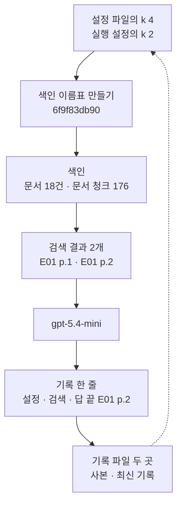
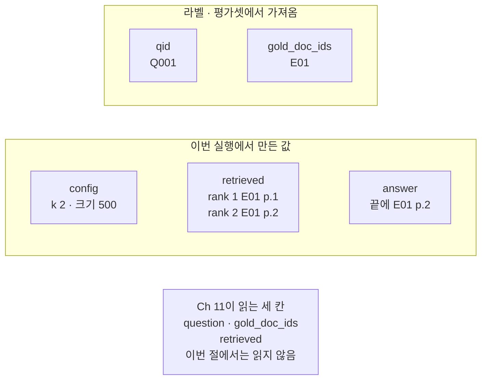
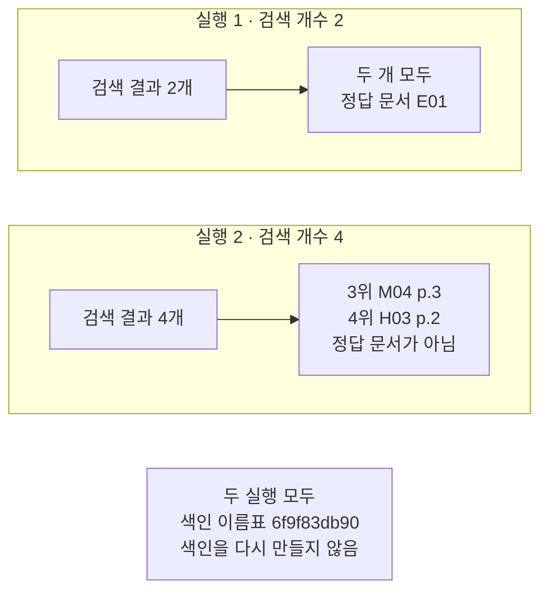
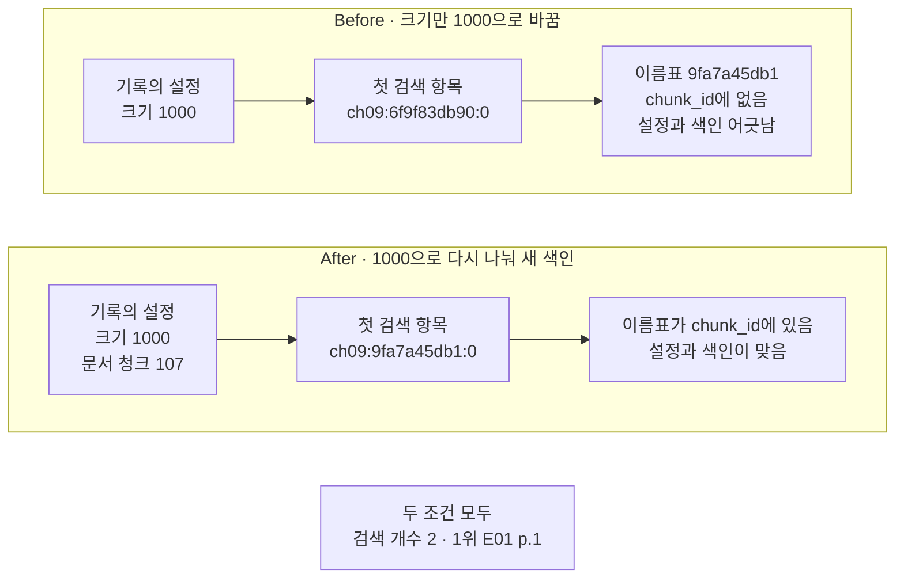

# 06-실험-하네스

## _src 본문 (HTML 원본)

```html
<!--meta: 강의 1h | 실습 1h | 코드 Jupyter Notebook | 새 용어 6 -->
<h2 id="b1"><span class="no">1</span>학습 목표</h2>
<div class="goal"><p>이 절을 마치면 다음을 할 수 있습니다.</p><ul><li>설정 파일에서 값을 읽어 값 하나만 바꾼 실행 설정을 만들고, 그 설정으로 색인과 검색과 답을 실행할 수 있습니다.</li><li>색인 결과를 바꾸는 설정만 골라 색인 이름표를 만들고, 검색 개수처럼 넣지 않는 설정을 구분할 수 있습니다.</li><li>라벨과 설정과 결과를 기록 한 줄로 파일에 남기고, 다음 챕터가 읽는 모양인지 확인할 수 있습니다.</li></ul></div>
<h2 id="b2"><span class="no">2</span>이 내용을 배우는 이유</h2>
<p>01절부터 05절까지는 설정을 바꿀 때마다 화면에서 결과를 읽었습니다. 검색 개수를 1에서 2로 바꾸고, 문서 청크 크기를 500에서 300으로 바꿔 봤습니다.</p>
<p>그런데 화면 출력은 커널을 다시 시작하면 사라집니다. 어제 실행에서 무엇이 좋았는지 다시 보려면 설정과 결과를 함께 적어 두어야 합니다.</p>
<p>이 절은 그 적어 두는 자리를 만듭니다. 한 실행의 설정과 검색 결과와 답을 줄 하나에 모아 파일에 남깁니다. 그러면 뒤 챕터가 그 줄을 읽어 검색 품질을 잴 수 있습니다.</p>
<p><strong>이 절의 질문</strong> — 설정을 바꿔 가며 실험할 때, 무엇을 함께 남겨야 나중에 같은 비교를 다시 할 수 있을까요?</p>
<h2 id="b3"><span class="no">3</span>앞에서 배운 내용</h2>
<table><thead><tr><th>앞 절</th><th>배운 것</th><th>이 절에서 이어지는 곳</th></tr></thead><tbody>
<tr><td>Ch 7 08절</td><td>파일 지문 <code>hashlib.sha256()</code>, 실행 이름 <code>time.strftime()</code>, 버전 기록 파일</td><td>3절 색인 이름표, 4절 입력 파일 지문, 5절 실행 이름</td></tr>
<tr><td>Ch 8 02·04절</td><td>기록의 두 키 출처·내용, 출처 표시, <code>find_cited_notes()</code></td><td>5절 기록 목록과 기록 검사</td></tr>
<tr><td>Ch 9 02절</td><td>로더 <code>load_pdf_pages()</code>, 크기와 겹침 설정</td><td>3절 문서 읽기와 나누기</td></tr>
<tr><td>Ch 9 03절</td><td><code>add_documents()</code>, <code>similarity_search_with_score()</code>, 검색 점수가 실행마다 조금 달라짐</td><td>3·5절 색인과 검색</td></tr>
<tr><td>Ch 9 04절</td><td><code>make_note()</code>, <code>build_notes_messages()</code>, 출처 인용 검사의 한계</td><td>5절 답 받기와 기록 검사</td></tr>
<tr><td>Ch 9 05절</td><td>정답 출처를 쪽 단위로 미리 적어 두기, 검색 누락</td><td>4절 정답 문서 ID와 견주기</td></tr>
</tbody></table>
<p>이 절은 01절에서 정한 「문서 청크」라는 말을 그대로 씁니다. 05절 정답 출처는 쪽까지 적은 값이고, 이 절 정답 문서 ID는 문서까지만 적은 값입니다.</p>
<h2 id="b4"><span class="no">4</span>핵심 개념</h2>
<h3>비유로 시작하기</h3>
<p>나무 책상 위에 세 가지가 왼쪽부터 나란히 놓여 있습니다. 둥근 받침에 달린 눈금 두 개, 흰 카드가 꽂힌 긴 상자, 짧은 가로줄이 그려진 흰 종이입니다.</p>
<p>상자에 꽂힌 카드 가운데 두 장만 위로 올라와 있습니다. 책상 앞 바닥에는 가로줄이 그려진 넓은 기록 용지가 있고, 첫 줄에만 무엇이 적혀 있습니다.</p>
{{img:06-5-실험-노트와-기록-용지|나무 책상 위에 눈금 두 개가 달린 둥근 받침과 흰 카드가 꽂힌 긴 상자와 가로줄이 그려진 작은 흰 종이가 있고, 책상 앞 바닥의 넓은 기록 용지 첫 줄에 회색 원 두 개와 흰 직사각형 두 개와 가로줄이 그려진 작은 직사각형이 나란히 있으며 아래 네 줄은 비어 있는 삽화|기록 용지의 첫 줄에 눈금 설정과 올라온 카드와 답이 함께 적혀 있습니다.}}
<p><strong>그림 읽기</strong> — 먼저 책상 위 왼쪽 눈금 두 개를 봅니다. 다음으로 가운데 상자에서 위로 올라온 카드 두 장을 봅니다. 그다음 오른쪽의 가로줄이 그려진 흰 종이를 봅니다.</p>
<p>마지막으로 책상 앞 기록 용지의 첫 줄을 봅니다. 그 줄에는 회색 원 두 개, 흰 직사각형 두 개, 가로줄이 그려진 작은 직사각형 하나가 왼쪽부터 나란히 있습니다. 책상 위 세 가지를 작게 옮겨 적은 모양입니다.</p>
<p>눈금은 실행 설정입니다. 눈금 하나를 돌리면 설정 하나가 바뀝니다. 긴 상자는 01절 그림과 같은 벡터스토어이고, 올라온 카드 두 장은 검색 결과입니다. 가로줄이 그려진 흰 종이는 01·04절 그림의 답안지처럼 답입니다.</p>
<p>기록 용지의 첫 줄이 이 절에서 만드는 기록 한 줄입니다. 설정과 근거와 답이 같은 줄에 있어서, 나중에 그 줄만 보고 어느 설정의 결과인지 알 수 있습니다. 아래 빈 네 줄은 다음 실행을 적을 자리입니다.</p>
<h3>실험 하네스와 실행 설정</h3>
<p>실험 하네스는 설정을 읽고, 같은 순서로 실행하고, 결과를 같은 모양으로 적는 코드입니다. 요리 저울과 타이머를 정해 두고 같은 순서로 만들어 보는 것과 비슷합니다. 노트북에서는 설정 파일 읽기부터 기록 파일 쓰기까지의 셀들이 그 일을 합니다.</p>
<p>실행 설정은 이번 한 번의 실행에 쓸 값 묶음입니다. 설정 파일은 그대로 두고 값 하나만 바꿔 만듭니다. 노트북 2절에서 설정 파일의 검색 개수 <code>4</code>를 <code>2</code>로 바꾼 것이 그 모습입니다.</p>
<h3>색인 이름표</h3>
<p>색인 이름표는 색인 설정 묶음에서 만든 짧은 글입니다. 옷장에 넣은 상자마다 무엇이 들었는지 적어 붙인 쪽지와 비슷합니다. 노트북 3절의 <code>색인 이름표: 6f9f83db90</code>이 그 모습입니다.</p>
<p>이름표는 Ch 7 08절 파일 지문과 같은 SHA-256으로 만듭니다. 다만 파일이 아니라 설정 묶음에서 만들고, 교재에서는 앞 10자만 씁니다. 설정 글은 <code>json.dumps()</code>에 <code>sort_keys=True</code>를 주어 키를 이름 순서로 놓습니다. 그래서 적는 순서가 달라도 같은 설정이면 같은 이름표가 나옵니다.</p>
<p>이름표에 넣는 설정은 색인 결과를 바꾸는 것만입니다. 어느 문서를 넣는지, 어떻게 나누는지, 어느 임베딩 모델을 쓰는지입니다. 검색 개수는 넣지 않습니다. 이미 만든 색인에서 몇 건을 가져올지만 바꾸기 때문입니다.</p>
{{mermaid:06-1-하네스-한-바퀴|초록 상자 설정 파일의 k 4와 실행 설정의 k 2에서 파란 상자 색인 이름표 만들기 6f9f83db90으로 내려가고, 초록 상자 색인 문서 18건 문서 청크 176, 노란 상자 검색 결과 2개 E01 p.1과 E01 p.2, 보라 상자 gpt-5.4-mini, 노란 상자 기록 한 줄 설정 검색 답 끝 E01 p.2, 초록 상자 기록 파일 두 곳 사본과 최신 기록으로 차례로 이어지며 맨 아래 상자에서 맨 위 상자로 점선 화살표가 돌아오는 흐름도|설정에서 시작해 기록 파일까지 한 바퀴입니다. 이름표는 같은 설정이면 색인을 다시 만들지 않아도 되는지를 가려 줍니다.}}
<p><strong>도식 읽기</strong> — 위에서 아래로 읽습니다. 맨 위 초록 상자는 설정입니다. 설정 파일의 검색 개수 4를 실행 설정에서 2로 바꿨습니다.</p>
<p>둘째 파란 상자는 이름표를 만드는 단계이고, 값은 <code>6f9f83db90</code>입니다. 이어지는 초록 상자는 문서 18건을 문서 청크 176개로 나눠 만든 색인입니다.</p>
<p>노란 상자 둘은 출력으로 확인한 값입니다. 검색 결과 두 건과, 설정·검색·답을 모은 기록 한 줄입니다. 보라 상자는 답을 쓴 모델이고, 맨 아래 초록 상자는 기록을 쓴 두 파일입니다.</p>
<p>맨 아래에서 맨 위로 돌아가는 점선은 기록을 읽어 다음 설정을 정하는 단계입니다. 이번 노트북에서는 그 단계를 실행하지 않았습니다.</p>
<h3>이 절에서 쓰는 말</h3>
<table><thead><tr><th>용어</th><th>뜻</th><th>이 절에서 보이는 모습</th></tr></thead><tbody>
<tr><td>실험 하네스</td><td>설정을 읽고 같은 순서로 실행한 뒤 결과를 같은 모양으로 적는 코드</td><td>노트북 2절부터 5절까지의 셀 묶음</td></tr>
<tr><td>실행 설정</td><td>이번 한 번의 실행에 쓸 값 묶음. 설정 파일에서 값 하나만 바꿔 만듦</td><td><code>실행 설정의 검색 개수: 2</code></td></tr>
<tr><td>색인 이름표</td><td>색인 결과를 바꾸는 설정 묶음에서 만든 짧은 글(index key)</td><td><code>색인 이름표: 6f9f83db90</code></td></tr>
<tr><td>실행 기록 한 줄</td><td>한 실행의 라벨·설정·검색 항목·답을 담은 딕셔너리 하나</td><td><code>기록의 키</code> 여덟 개</td></tr>
<tr><td>정답 문서 ID</td><td>질문의 답이 든 문서 이름 목록. 사람이 미리 적어 둔 라벨이고 문서 단위</td><td><code>정답 문서 ID: ['E01']</code></td></tr>
<tr><td>JSONL</td><td>한 줄에 JSON 하나를 두는 파일 형식. 줄을 덧붙여 기록을 쌓음</td><td><code>runs/continuity-ch09-search.jsonl</code></td></tr>
</tbody></table>
<p>기록·출처 표시는 Ch 8 02절과 이 챕터 04절의 뜻 그대로입니다. 파일 지문은 Ch 7 08절, 문서 청크는 01절 뜻입니다. 색인을 파일로 저장해 두었다가 다시 불러오는 일은 이번에 실행하지 않았습니다. 이름표는 그 저장소에 붙이는 이름이고, 이 절은 이름표를 만들어 대조하는 데까지만 썼습니다.</p>
<h2 id="b5"><span class="no">5</span>실행 예제</h2>
<p>노트북은 실습 폴더 설정 파일 <code>config.yaml</code>을 읽어 검색 개수 하나만 2로 바꿉니다. 그 설정으로 디지털 PDF 18건을 색인하고, Ch 11 평가셋의 Q001을 검색해 답을 받습니다. 그다음 기록 한 줄을 사본 파일과 최신 기록 파일에 씁니다.</p>
<p>인터넷 서비스에 요청을 모두 7번 보냅니다. 임베딩 모델 <code>text-embedding-3-small</code>에 6번, 답을 쓰는 <code>gpt-5.4-mini</code>에 1번입니다. 임베딩 요청 여섯 번은 색인 두 번과 검색 네 번입니다. 이 페이지의 출력은 2026-09-17에 실행한 결과이고, 예상 비용은 0.01달러 미만입니다. 답 문장은 실행마다 달라질 수 있습니다.</p>
<p>강의 시간에는 노트북 2·3·5절(설정 읽기, 색인 이름표, 기록 한 줄)을 설명합니다. 6절 값 바꿔 보기와 Before·After는 함께 실행하고 실습 시간에 읽습니다.</p>
{{notebook:06-실험-하네스|example}}
<p class="look"><b>확인할 점</b> — 2절 <code>설정 파일의 검색 개수: 4</code>와 <code>실행 설정의 검색 개수: 2</code>를 봅니다. 3절 <code>색인 이름표: 6f9f83db90</code>과 <code>문서 청크 수: 176</code>을 확인합니다. 5절 <code>기록에서 빠진 필수 키: []</code>와 <code>검색 항목의 순위: [1, 2]</code>를 봅니다.</p>
<h3>설정 파일에서 값 하나만 바꾸기</h3>
<p>설정 파일의 맨 위 키는 여덟 개입니다. 이 노트북은 그 가운데 <code>corpus</code>·<code>split</code>·<code>embedding</code>·<code>retrieval</code>·<code>generation</code> 다섯 묶음만 씁니다. 크기와 겹침은 <code>{'chunk_size': 500, 'chunk_overlap': 50}</code>으로 01~05절과 같았습니다.</p>
<p>남은 세 키는 이 노트북이 쓰지 않습니다. 키 <code>name</code>은 설정 파일이 정한 실험 이름이고, 이 노트북은 실행 설정에 <code>k2</code>를 새로 적었습니다. 묶음 <code>queries</code>는 실습 폴더 <code>harness.py</code>가 질문 여러 개를 한 번에 돌릴 때 쓰는 목록입니다. 묶음 <code>prices</code>는 비용을 어림할 때 쓰는 요금표입니다.</p>
<p>실행 설정에서 바꾼 값은 검색 개수 하나입니다. 파일의 <code>4</code>를 <code>2</code>로 바꾸고 이름을 <code>k2</code>로 적었습니다. 설정 파일 자체는 고치지 않았습니다. 같은 파일을 실습 폴더 테스트가 읽기 때문입니다.</p>
<h3>기록 한 줄에 무엇을 적는가</h3>
<p>기록 한 줄에는 키 여덟 개가 들어갑니다. <code>qid</code>·<code>question</code>·<code>gold_doc_ids</code>는 평가셋에서 읽은 라벨입니다. <code>source_chapter</code>·<code>source_run_id</code>는 어느 챕터의 어느 실행인지 적는 값입니다. 남은 셋은 <code>config</code>·<code>retrieved</code>·<code>answer</code>입니다.</p>
<p>라벨은 노트북이 새로 적지 않고 Ch 11 평가셋 파일에서 그대로 읽어 옵니다. 출력 <code>두 파일의 질문 글이 같은가: True</code>는 실습 자료의 질문 목록과도 글이 같다는 확인입니다. 라벨을 <code>config</code> 안에 넣지 않은 것도 같은 까닭입니다. 무엇을 바꿔서 결과가 달라졌는지 읽으려면 라벨과 설정이 섞이지 않아야 합니다.</p>
<p>검색 항목에는 본문 글을 넣지 않습니다. 문서 이름·문서 청크 이름·쪽 번호·순위·점수만 넣습니다. 출력 <code>첫 검색 항목</code>의 <code>'rank': 1</code>처럼 순위는 1부터 셉니다.</p>
<p>답은 기록의 <code>answer</code>에 글 그대로 들어갑니다. 이번 답은 두 문장이고 문장마다 끝에 <code>[E01 p.2]</code>가 붙었습니다. 01·04절 답은 표시를 문장마다 붙이지 않고 끝에 모았습니다. 같은 과업 명세에서도 답 모양이 달라집니다.</p>
{{mermaid:06-2-기록-한-줄|위 칸 라벨 평가셋에서 가져옴에는 초록 상자 qid Q001과 초록 상자 gold_doc_ids E01이 왼쪽에서 오른쪽으로 있고, 아래 칸 이번 실행에서 만든 값에는 초록 상자 config k 2 크기 500, 노란 상자 retrieved rank 1 E01 p.1과 rank 2 E01 p.2, 노란 상자 answer 끝에 E01 p.2가 차례로 있으며, 맨 아래 회색 상자에 Ch 11이 읽는 세 칸 question gold_doc_ids retrieved 이번 절에서는 읽지 않음이 있는 그림|기록 한 줄은 평가셋에서 가져온 라벨과 이번 실행에서 만든 값을 나란히 담습니다.}}
<p><strong>도식 읽기</strong> — 위 칸이 라벨, 아래 칸이 이번 실행에서 만든 값입니다. 칸마다 왼쪽에서 오른쪽으로 읽습니다. 위 칸 초록 상자 둘은 평가셋에서 읽은 <code>Q001</code>과 <code>['E01']</code>입니다.</p>
<p>아래 칸 첫 초록 상자는 사람이 정한 설정입니다. 이어지는 노란 상자 둘은 출력으로 확인한 검색 항목과 답입니다. 검색 항목의 순위는 1과 2였고, 답 끝에는 2쪽 출처 표시가 붙었습니다.</p>
<p>맨 아래 회색 상자는 Ch 11이 읽는 세 칸입니다. 이 절에서는 Ch 11 코드를 실행하지 않았습니다. 그래서 회색으로 두었습니다.</p>
<h3>검색 개수만 바꿔 보기</h3>
<p>노트북 6절은 검색 개수만 4로 바꿉니다. 출력 <code>색인 이름표가 같은가: True</code>처럼 이름표는 그대로였습니다. 검색 개수를 이름표에 넣지 않았으니 색인을 다시 만들지 않고 검색만 다시 했습니다.</p>
<p>검색 결과는 4건이 되었습니다. 1·2위는 5절과 같은 E01 두 건이고, 3위는 <code>M04 p.3 | 493</code>, 4위는 <code>H03 p.2 | 485</code>였습니다. 두 건은 정답 문서가 아닙니다.</p>
<p>이렇게 늘어난 근거가 답을 어떻게 바꾸는지는 이번에 실행하지 않았습니다. 05절에서 본 것처럼 필요 없는 내용이 목록에 함께 들어오는 조건입니다. 답이 나빠졌는지는 이 절 출력으로 말하지 않습니다.</p>
{{mermaid:06-3-검색-개수만-바꾸기|위 칸 실행 1 검색 개수 2에는 노란 상자 검색 결과 2개에서 노란 상자 두 개 모두 정답 문서 E01로 왼쪽에서 오른쪽으로 이어지고, 아래 칸 실행 2 검색 개수 4에는 노란 상자 검색 결과 4개에서 노란 상자 3위 M04 p.3과 4위 H03 p.2 정답 문서가 아님으로 이어지며, 맨 아래 회색 상자에 두 실행 모두 색인 이름표 6f9f83db90 색인을 다시 만들지 않음이 있는 비교 그림|검색 개수를 2에서 4로 늘리자 정답 문서가 아닌 문서 두 건이 3·4위로 들어왔습니다. 색인 이름표는 그대로입니다.}}
<p><strong>도식 읽기</strong> — 위 칸이 실행 1, 아래 칸이 실행 2입니다. 칸마다 왼쪽에서 오른쪽으로 읽습니다. 노란 상자는 모두 출력으로 확인한 값입니다.</p>
<p>위 칸은 검색 결과 2건이 모두 정답 문서 E01이었다는 출력입니다. 아래 칸은 검색 결과 4건 가운데 3·4위가 다른 문서였다는 출력입니다.</p>
<p>맨 아래 회색 상자는 두 실행에 모두 같았던 색인 이름표입니다. 한 조건의 결과가 아니라서 어느 칸에도 넣지 않았습니다.</p>
<h2 id="b6"><span class="no">6</span>일부러 실패해 보기</h2>
<p>실패 조건 Before는 문서 청크 크기를 1000으로 바꾼 실행 설정을 만들고, 색인은 500자로 만든 것을 그대로 씁니다. 검색은 오류 없이 끝나고 검색 항목도 만들어집니다.</p>
<p>고친 조건 After에서는 바꾼 설정 1000자로 문서를 다시 나눠 새 색인을 만들고 같은 질문을 검색합니다. 실패 조건 Before와 달라지는 것은 색인 하나입니다. 실행 설정과 검색 개수는 두 조건이 같습니다.</p>
<p>두 조건 모두 기록 파일을 쓰지 않습니다. 최신 기록 파일은 노트북 5절에서 쓴 실행 하나를 그대로 가리킵니다.</p>
{{notebook:06-실험-하네스|failure}}
<h3>Before — 기록의 설정과 검색한 색인이 어긋남</h3>
<p>Before 출력에서 바꾼 설정의 색인 이름표는 <code>9fa7a45db1</code>이었습니다. 그런데 첫 검색 항목의 이름은 <code>ch09:6f9f83db90:0</code>이었습니다. 이 이름은 500자로 만든 색인의 이름표를 담고 있습니다.</p>
<p>마지막 줄 <code>이름표가 chunk_id에 들어 있는가: False</code>가 그 어긋남을 보여 줍니다. 기록에 적을 설정은 1000자인데 검색한 색인은 500자 색인이었습니다.</p>
<p>이 기록을 그대로 파일에 쓰면, 1000자 설정으로 검색한 결과처럼 읽힙니다. 뒤 챕터가 그 줄을 읽어 설정과 결과를 짝지으면 틀린 짝이 됩니다. 검색이 오류를 내지 않았으므로 출력만 봐서는 드러나지 않습니다.</p>
<h3>After — 다시 만든 색인의 이름표가 맞음</h3>
<p>After에서는 1000자로 다시 나눠 문서 청크 <code>107</code>개를 만들었습니다. 5절의 176개보다 적습니다. 새 색인에 넣고 같은 질문을 검색했습니다.</p>
<p>검색 결과는 <code>E01 p.1 | 45</code>와 <code>E01 p.2 | 905</code>였습니다. 1위는 두 조건 모두 표지 45자였고, 2위 문서 청크는 2쪽 전체가 한 문서 청크에 들어와 905자였습니다.</p>
<p>첫 검색 항목의 이름은 <code>ch09:9fa7a45db1:0</code>이고, 마지막 줄은 <code>이름표가 chunk_id에 들어 있는가: True</code>였습니다. 이제 기록의 설정과 검색한 색인이 같습니다.</p>
{{mermaid:06-4-Before-After|위 칸 Before 크기만 1000으로 바꾸고 색인은 그대로에는 초록 상자 기록의 설정 크기 1000, 초록 상자 첫 검색 항목 ch09 6f9f83db90 0, 빨간 상자 바꾼 설정 이름표 9fa7a45db1이 chunk_id에 없음 설정과 색인이 어긋남이 왼쪽에서 오른쪽으로 있고, 아래 칸 After 크기 1000으로 다시 나눠 새 색인에는 초록 상자 기록의 설정 크기 1000 문서 청크 107, 초록 상자 첫 검색 항목 ch09 9fa7a45db1 0, 노란 상자 이름표가 chunk_id에 있음 설정과 색인이 맞음이 차례로 있으며, 맨 아래 회색 상자에 두 조건 모두 검색 개수 2 1위 E01 p.1이 있는 비교 그림|Before는 바꾼 설정의 이름표가 검색 항목의 chunk_id에 없습니다. After는 다시 만든 색인의 이름표가 그 자리에 있습니다.}}
<p><strong>도식 읽기</strong> — 위 칸이 Before, 아래 칸이 After입니다. 칸마다 왼쪽에서 오른쪽으로 읽습니다. 초록 상자는 기록에 적은 설정과 검색 항목입니다.</p>
<p>위 칸 끝의 빨간 상자는 Before 결함 결과입니다. 바꾼 설정의 이름표가 검색 항목의 이름에 없었습니다. 아래 칸 끝의 노란 상자는 After 출력으로 확인한 값입니다.</p>
<p>맨 아래 회색 상자는 두 조건에 모두 같았던 값입니다. 검색 개수는 2였고 1위는 표지였습니다. 그래서 어느 한쪽의 결과로 넣지 않았습니다.</p>
<h2 id="b7"><span class="no">7</span>주의할 점과 실무 메모</h2>
<ul><li><strong>이름표에 파일 내용 지문을 넣지 않았습니다.</strong> 이름표에 든 문서 값은 묶음 이름 목록뿐입니다. PDF 내용이 바뀌어도 같은 이름표가 나옵니다. 그래서 기록의 <code>inputs</code>에 자료 목록 지문과 평가셋 지문을 따로 남겼습니다. 실제 색인 저장소를 만들 때는 이 지문도 이름표에 넣습니다.</li>
<li><strong>앞 10자는 교재용 선택입니다.</strong> Ch 7 08절 파일 지문은 64글자를 그대로 썼습니다. 이 절은 눈으로 대조하려고 앞 10자만 씁니다. 실제 저장소에서는 자르지 않은 지문과 설정 자체를 함께 대조합니다.</li>
<li><strong>실습 폴더 <code>harness.py</code>에 같은 이름의 다른 함수가 있습니다.</strong> 그 파일의 <code>index_key()</code>도 문서 묶음·크기·임베딩으로 이름표를 만듭니다. 그러나 계산 방법이 SHA-1이라 같은 설정에서도 이 노트북과 다른 값이 나옵니다. 두 값을 섞어 쓰지 않습니다.</li>
<li><strong>설정 파일과 실습 자료는 읽기만 합니다.</strong> 실습 폴더 테스트 세 개가 <code>config.yaml</code>의 키 이름과 실습 자료 질문 목록의 값을 읽습니다. 그래서 이 노트북은 두 파일을 고치지 않습니다.</li>
<li><strong>최신 기록 파일은 다음 챕터가 읽습니다.</strong> 노트북을 다시 실행하면 이 파일 내용이 바뀌고 사본이 하나 더 생깁니다. 앞 실행 사본은 지우지 않습니다. 기록의 키 이름과 검색 항목의 키 이름도 바꾸지 않습니다.</li>
<li><strong>정답 문서 ID는 문서 단위입니다.</strong> 이번 실행에서 1·2위가 모두 E01이라 문서 단위 대조는 맞았습니다. 05절에서 본 것처럼 쪽까지 맞는지는 이 단위로 알 수 없습니다. 쪽 단위 확인은 05절 방법으로 따로 합니다.</li>
<li><strong>검색 개수 2는 흐름을 보여 주려고 정한 값입니다.</strong> 노트북을 만들기 전에 검색만 따로 실행해 1·2위가 E01임을 확인하고 정했습니다. Ch 11은 검색 항목이 5건보다 적으면 Recall@5 같은 지표를 계산하지 않습니다. 좋은 검색 개수를 고르는 방법은 이 절에서 다루지 않습니다.</li>
<li><strong>기록을 남긴 것과 검색이 좋은 것은 다릅니다.</strong> 이 절은 품질 점수를 계산하지 않았습니다. 기록 검사가 통과했다는 것은 모양이 맞다는 뜻입니다.</li>
<li><strong>한 번에 조건 하나만 바꿉니다.</strong> 문서 청크 크기와 답 모델을 함께 바꾸면 어느 쪽 때문에 결과가 달라졌는지 알 수 없습니다. 이 절 실행 1·2는 검색 개수만 다르고, Before·After는 색인을 다시 만들었는지만 다릅니다.</li>
<li><strong>여러 실행이 같은 파일에 함께 쓰는 경우는 다루지 않았습니다.</strong> 이번 실습은 커널 하나에서 파일 하나에 씁니다. 함수 <code>os.replace()</code>는 설치판 설명에 따르면 파일 이름을 바꾸고, 같은 이름이 있으면 덮어씁니다. 운영체제마다 이것이 얼마나 보장되는지는 이번에 확인하지 않았습니다.</li>
<li><strong>색인을 파일로 저장해 두고 다시 불러오는 일은 실행하지 않았습니다.</strong> 이름표는 그 저장소를 만들 때 쓰는 이름이고, 이 절은 이름표를 만들어 대조하는 데까지만 썼습니다.</li>
<li><strong>요금은 앞 절에서 확인한 값을 따릅니다.</strong> 설정 파일 <code>prices</code>의 확인일은 2026-09-07이고, 적힌 값은 Ch 6 06절에서 2026-09-17에 확인한 값과 같습니다. 노트북은 비용을 계산하지 않았고, 준비물의 0.01달러 미만은 어림입니다.</li>
<li><strong>교재 출력은 Linux의 Python 3.12.13으로 만들었습니다.</strong> 패키지는 pypdf 6.17.0, langchain 1.4.0, langchain-core 1.6.2입니다. 함께 쓴 판은 langchain-openai 1.6.0과 langchain-text-splitters 1.1.2입니다. 패키지 openai 판은 3.8.0이고 PyYAML 판은 6.0.3입니다. 다른 버전과 Windows·macOS에서는 실행하지 않았습니다.</li></ul>
<h2 id="b8"><span class="no">8</span>정리와 다음 절</h2>
<ul><li>실습 폴더 설정 파일을 읽어 검색 개수 하나만 바꾼 실행 설정을 만들었습니다. 그 설정으로 문서 18건을 색인해 Q001에 답을 받았습니다.</li><li>색인 결과를 바꾸는 설정만 골라 이름표 <code>6f9f83db90</code>을 만들고, 문서 청크 이름에 그 이름표를 적었습니다. 검색 개수를 4로 바꿨을 때 이름표는 그대로였습니다.</li><li>라벨·설정·검색 항목·답을 기록 한 줄로 모아 사본 파일과 최신 기록 파일에 쓰고 다시 읽었습니다. 설정만 바꾸고 색인을 다시 만들지 않은 Before는 이름표 대조로 잡았습니다.</li></ul>
<p><strong>다음 학습과 이어지는 지점</strong> — Ch 10 08절은 이 기록 모양을 그대로 씁니다. 나누는 방법과 임베딩 모델을 바꾼 설정 여섯 가지를 기록합니다. Ch 11 06절은 두 챕터의 최신 기록 파일을 읽습니다. 질문과 정답 문서 ID가 평가셋과 같은지 확인한 뒤 검색 지표만 계산합니다. 이 절 기록은 검색 항목이 두 건이라, Ch 11은 Recall@5 같은 지표를 계산하지 않고 저장한 항목 안에서만 잽니다.</p>
<h2 id="b9"><span class="no">9</span>복습 문제</h2>
<details class="quiz"><summary>문제 1 · 이름표에 넣지 않는 설정</summary><p class="quiz-q">색인 이름표에 검색 개수를 넣지 않은 까닭은 무엇인가요? 답 모델 이름은 왜 넣지 않나요?</p><p class="quiz-a"><b>해설</b> — 검색 개수는 이미 만든 색인에서 몇 건을 가져올지만 바꿉니다. 문서 청크의 벡터는 그대로입니다. 답 모델은 검색이 끝난 뒤에 쓰이므로 색인 결과를 바꾸지 않습니다. 노트북 6절에서 검색 개수를 4로 바꿨을 때 <code>색인 이름표가 같은가: True</code>였습니다.</p></details>
<details class="quiz"><summary>문제 2 · 라벨과 설정을 나누는 까닭</summary><p class="quiz-q">질문과 정답 문서 ID를 <code>config</code> 안에 넣지 않은 까닭은 무엇인가요?</p><p class="quiz-a"><b>해설</b> — 두 값은 사람이 미리 붙여 둔 라벨이고 실행마다 바꾸는 설정이 아닙니다. 설정과 섞이면 무엇을 바꿔서 결과가 달라졌는지 읽기 어렵습니다. Ch 11 검사도 설정 안에 라벨이 있으면 멈춥니다.</p></details>
<details class="quiz"><summary>문제 3 · Before가 위험한 까닭</summary><p class="quiz-q">Before에서 검색은 오류 없이 끝났습니다. 그런데도 기록을 파일에 쓰면 안 되는 까닭은 무엇인가요?</p><p class="quiz-a"><b>해설</b> — 기록에 적을 설정은 1000자인데 검색한 색인은 500자로 만든 색인이었습니다. 그 줄을 읽는 쪽은 1000자 설정의 결과로 짝짓게 됩니다. 검색 항목의 이름에 든 이름표가 <code>9fa7a45db1</code>이 아니라 <code>6f9f83db90</code>이라 어긋남이 보였습니다.</p></details>
<details class="quiz"><summary>문제 4 · 정답 문서 ID의 단위</summary><p class="quiz-q">05절 정답 출처 <code>E01 p.2</code>와 이 절 정답 문서 ID <code>['E01']</code>은 무엇이 다른가요?</p><p class="quiz-a"><b>해설</b> — 05절 값은 쪽까지 적은 값이고 이 절 값은 문서까지만 적은 값입니다. 문서 단위로 보면 E01의 어느 쪽이 올라와도 맞다고 나옵니다. 05절에서 본 2쪽 452자 기록처럼 답이 없는 부분이 올라온 경우도 맞다고 세집니다.</p></details>
<details class="quiz"><summary>문제 5 · 기록이 남았다는 것</summary><p class="quiz-q">동료가 「기록 검사가 통과했으니 검색 설정이 좋다」고 합니다. 이 절 출력으로 무엇이라고 답하나요?</p><p class="quiz-a"><b>해설</b> — 기록 검사는 필수 키·순위·출처 표시의 모양만 봅니다. 이 절은 품질 점수를 계산하지 않았습니다. 검색 개수를 4로 늘렸을 때 정답 문서가 아닌 <code>M04 p.3</code>과 <code>H03 p.2</code>가 들어온 것도 좋고 나쁨을 잰 결과가 아닙니다.</p></details>
<h2 id="b10"><span class="no">10</span>참고 자료</h2>
<p>문서는 2026-09-17에 다시 열어 확인했습니다. 설정 읽기·이름표·기록 파일 쓰기는 노트북 코드와 출력으로 확인했습니다.</p>
<ul><li><div><a href="https://pyyaml.org/wiki/PyYAMLDocumentation">PyYAML Documentation</a></div>함수 <code>safe_load(stream)</code>는 첫 문서를 파이썬 객체로 읽습니다. 표준 태그만 다루므로 믿을 수 없는 글에도 쓸 수 있다고 적혀 있습니다 · 확인 2026-09-17</li><li><div>설치판에서 확인한 동작</div>Python 3.12.13에서 확인했습니다. 함수 <code>os.replace</code> 설명은 파일이나 폴더 이름을 바꾸며 목적지를 덮어쓴다고 적혀 있습니다. 함수 <code>json.dumps()</code>에 <code>sort_keys=True</code>를 주면 적는 순서가 다른 두 딕셔너리가 같은 글이 됩니다. 메서드 <code>hexdigest()</code>가 반환한 글의 길이는 64였습니다 · 확인 2026-09-17</li><li><div><a href="https://developers.openai.com/api/docs/pricing">OpenAI API 요금</a></div>gpt-5.4-mini 요금, Ch 6 06절에서 확인한 값 · 확인 2026-09-17</li><li><div><a href="https://developers.openai.com/api/docs/models/text-embedding-3-small">OpenAI text-embedding-3-small 모델 안내</a></div>100만 토큰당 0.02달러 · 확인 2026-09-17</li></ul>
```

## 노트북 셀 (순서대로)

### [0] markdown {'html': 'skip'}

# 실험 하네스

**이 노트북에서 할 일**

1. 실습 폴더 설정 파일을 읽고, 검색 개수 하나만 바꾼 실행 설정을 만듭니다.
2. 색인 설정에 이름표를 붙여 문서 18건을 색인하고, Ch 11 평가셋의 Q001로 검색해 답을 받습니다.
3. 설정과 검색 결과와 답을 기록 한 줄로 파일에 쓰고, 다시 읽어 모양을 확인합니다.

**준비물** — 프로젝트 폴더 `.env` 파일의 `OPENAI_API_KEY`가 필요합니다. 데이터 파일은 세 가지입니다.

실습 자료 폴더 `labs/data/rag-corpus`의 디지털 PDF 18건과 목록 파일을 읽습니다.
설정은 실습 폴더 `labs/part3/ch09-rag-first-run/config.yaml`에서 읽습니다.
질문은 `labs/part3/ch11-evaluation/data/evaluation-queries.jsonl`에서 읽습니다.
이 파일들은 읽기만 하고 고치지 않습니다.

인터넷 서비스에 요청을 모두 7번 보냅니다. 임베딩 모델 `text-embedding-3-small`에 6번, `gpt-5.4-mini`에 1번입니다.
임베딩 요청 여섯 번은 색인 두 번과 검색 네 번입니다. 실행 시간은 1분 안팎입니다.

예상 비용은 0.01달러 미만으로 잡았습니다. 색인에 넣는 글이 01~05절보다 많아 색인 요청 한 번의 토큰 수가 큽니다.
임베딩 요금은 OpenAI 모델 안내(2026-09-17 확인)에 적힌 100만 토큰당 0.02달러입니다.
mini 요금은 Ch 6 06절에서 확인한 값입니다.

**이 노트북은 `labs/part3/ch09-rag-first-run/runs` 폴더에 파일을 씁니다.**
5절이 사본 파일 하나를 새로 만들고, 최신 기록 파일 하나를 바꿔 놓습니다. 다른 폴더의 파일은 바꾸지 않습니다.

**강의와 실습 범위** — 강의 시간에는 2·3·5절(설정 읽기, 색인 이름표, 기록 한 줄)을 설명합니다.
6절 값 바꿔 보기와 7절 Before·After는 함께 실행하고 실습 시간에 읽습니다.

**기준 버전** — 실습 폴더에 고정한 패키지 판을 씁니다. pypdf 6.17.0, langchain 1.4.0, langchain-core 1.6.2입니다.
함께 쓰는 판은 langchain-openai 1.6.0과 langchain-text-splitters 1.1.2입니다.
나머지는 PyYAML 6.0.3, openai 3.8.0, python-dotenv 1.2.3입니다.

교재 출력은 Linux의 Python 3.12.13으로 만들었습니다. 다른 버전과 Windows·macOS에서는 이번에 실행하지 않았습니다.

실습 폴더 `labs/part3/ch09-rag-first-run`에서 `uv sync --locked`를 실행합니다.
그다음 이 폴더의 `.venv` 커널을 고르고 첫 셀부터 순서대로 실행합니다.

### [1] markdown {'html': 'skip'}

## 오늘 볼 그림


위에서 아래로 읽습니다. 초록 상자는 설정과 색인과 기록 파일이고, 파란 상자는 이름표를 만드는 단계입니다.
노란 상자는 출력으로 확인한 검색 결과와 기록이고, 보라 상자는 실행한 답 모델입니다.
맨 아래에서 맨 위로 돌아가는 점선은 이번 노트북에서 하지 않은 단계입니다.

### [2] markdown {}

## 1. 준비

첫 셀은 패키지를 설치하고 설치된 버전을 출력합니다. 설치에는 몇십 초가 걸릴 수 있습니다.
05절 패키지에 설정 파일을 읽는 PyYAML 하나를 더했습니다.

### [3] code {'execution': {'iopub.execute_input': '2026-09-17T18:18:15.693693Z', 'iopub.status.busy': '2026-09-17T18:18:15.693544Z', 'iopub.status.idle': '2026-09-17T18:18:16.400020Z', 'shell.execute_reply': '2026-09-17T18:18:16.399471Z'}, 'lesson_role': 'setup'}

```python
# 이 절에서 쓰는 패키지를 설치하고 버전을 확인합니다
%pip install -q "pypdf==6.17.0" "langchain==1.4.0" "langchain-openai==1.6.0" "langchain-text-splitters==1.1.2" "python-dotenv==1.2.3" "pyyaml==6.0.3"
from importlib.metadata import version

print("pypdf:", version("pypdf"))
print("langchain:", version("langchain"))
print("langchain-core:", version("langchain-core"))
print("langchain-openai:", version("langchain-openai"))
print("langchain-text-splitters:", version("langchain-text-splitters"))
print("openai:", version("openai"))
print("python-dotenv:", version("python-dotenv"))
print("PyYAML:", version("pyyaml"))
```

출력:
```
Note: you may need to restart the kernel to use updated packages.
pypdf: 6.17.0
langchain: 1.4.0
langchain-core: 1.6.2
langchain-openai: 1.6.0
langchain-text-splitters: 1.1.2
openai: 3.8.0
python-dotenv: 1.2.3
PyYAML: 6.0.3

```

### [4] markdown {}

**결과 읽기** — 출력 줄은 `pypdf: 6.17.0`, `langchain: 1.4.0`, `PyYAML: 6.0.3` 등 여덟 줄입니다.
준비물에 적은 기준 버전과 같습니다.

설정 읽기, 파일 지문, 실행 이름, PDF 읽기, 검색, 모델 준비에 쓸 이름을 불러옵니다.
모듈 `hashlib`과 `json`은 Ch 7 08절에서, `time`은 Ch 7 08절 실행 이름에서 썼습니다. 패키지 `yaml`은 이 절에서 처음 씁니다.

### [5] code {'execution': {'iopub.execute_input': '2026-09-17T18:18:16.401007Z', 'iopub.status.busy': '2026-09-17T18:18:16.400929Z', 'iopub.status.idle': '2026-09-17T18:18:17.547453Z', 'shell.execute_reply': '2026-09-17T18:18:17.547266Z'}, 'lesson_role': 'setup'}

```python
# 설정 읽기·파일 지문·실행 이름·PDF 읽기·검색·모델 준비에 쓸 이름을 불러옵니다
import hashlib
import json
import os
import time

import yaml
from pypdf import PdfReader
from langchain_core.documents import Document
from langchain_text_splitters import RecursiveCharacterTextSplitter
from langchain_openai import OpenAIEmbeddings
from langchain_core.vectorstores import InMemoryVectorStore
from langchain.chat_models import init_chat_model
```

출력:
```

```

### [6] markdown {}

01·04·05절과 같은 셀로 API 키가 있는지 확인합니다. 키 값은 출력하지 않고, 있는지만 봅니다.
`True` 값이 나오면 다음으로 넘어갑니다.

### [7] code {'execution': {'iopub.execute_input': '2026-09-17T18:18:17.549416Z', 'iopub.status.busy': '2026-09-17T18:18:17.549312Z', 'iopub.status.idle': '2026-09-17T18:18:17.553690Z', 'shell.execute_reply': '2026-09-17T18:18:17.553525Z'}, 'lesson_role': 'setup'}

```python
# .env 파일에서 OpenAI API 키를 읽습니다(키 값은 출력하지 않습니다)
import os
from dotenv import find_dotenv, load_dotenv

env_path = find_dotenv(usecwd=True)
load_dotenv(env_path)
has_key = os.getenv("OPENAI_API_KEY") is not None
print("OPENAI_API_KEY 설정 여부:", has_key)
assert has_key, "프로젝트 폴더의 .env 파일에 OPENAI_API_KEY를 적어 주세요."
```

출력:
```
OPENAI_API_KEY 설정 여부: True

```

### [8] markdown {}

04·05절과 같은 설정으로 답을 쓸 모델 객체를 만듭니다. 이 셀은 요청을 보내지 않습니다.
temperature 값을 0으로 두어 매번 비슷한 답을 고르게 합니다.

### [9] code {'execution': {'iopub.execute_input': '2026-09-17T18:18:17.554189Z', 'iopub.status.busy': '2026-09-17T18:18:17.554113Z', 'iopub.status.idle': '2026-09-17T18:18:17.908833Z', 'shell.execute_reply': '2026-09-17T18:18:17.908490Z'}}

```python
# 실습에 쓸 모델을 준비합니다
model = init_chat_model(
    "openai:gpt-5.4-mini",
    temperature=0,
    reasoning_effort="none",
)
print("모델 이름:", model.model_name)
print("temperature:", model.temperature)
```

출력:
```
모델 이름: gpt-5.4-mini
temperature: 0.0

```

### [10] markdown {}

**결과 읽기** — 모델 이름 `gpt-5.4-mini`, temperature `0.0`이 보이면 준비가 끝났습니다.
이 노트북의 출력은 2026-09-17에 이 모델로 실행한 결과입니다.
실행마다 답 문장이 달라질 수 있습니다. Ch 6 01절에서 본 것처럼 temperature 0은 Ch 5 06절의 뽑기를 끈 설정과 같은 것이 아닙니다.

### [11] markdown {}

## 2. 실습 폴더 설정 파일 읽기

바꿀 값이 코드 여러 곳에 흩어져 있으면 무엇을 바꿨는지 나중에 알기 어렵습니다.
그래서 이 챕터 실습 폴더에는 바꿀 값만 모은 설정 파일 `config.yaml`이 있습니다.
먼저 작업 폴더에서 본 실습 폴더 경로의 앞부분을 고릅니다. 01~05절 경로 셀과 같은 방법이고, 읽을 파일이 여러 개라 앞부분만 고릅니다.

실행 전에 예상합니다. 프로젝트 맨 위에서 열었다면 첫째 후보를 고를 것입니다.

### [12] code {'execution': {'iopub.execute_input': '2026-09-17T18:18:17.909558Z', 'iopub.status.busy': '2026-09-17T18:18:17.909496Z', 'iopub.status.idle': '2026-09-17T18:18:17.911852Z', 'shell.execute_reply': '2026-09-17T18:18:17.911515Z'}}

```python
# 작업 폴더에서 본 실습 폴더 경로의 앞부분을 후보 세 개 가운데에서 고릅니다
candidates = ["labs/", "../../", "../../../"]
labs_prefix = None
for candidate in candidates:
    if os.path.exists(candidate + "data/rag-corpus/manifest.json"):
        labs_prefix = candidate
        break
assert labs_prefix is not None, "notebooks 폴더나 실습 폴더 맨 위에서 노트북을 열어 주세요."
corpus_path = labs_prefix + "data/rag-corpus/"
config_path = labs_prefix + "part3/ch09-rag-first-run/config.yaml"
queries_path = labs_prefix + "part3/ch11-evaluation/data/evaluation-queries.jsonl"
print("고른 앞부분:", labs_prefix)
print("설정 파일 경로:", config_path)
print("평가셋 경로:", queries_path)
```

출력:
```
고른 앞부분: labs/
설정 파일 경로: labs/part3/ch09-rag-first-run/config.yaml
평가셋 경로: labs/part3/ch11-evaluation/data/evaluation-queries.jsonl

```

### [13] markdown {}

**결과 읽기** — 출력 줄은 세 줄입니다. 첫 줄은 `고른 앞부분: labs/`이고, 다음 두 줄은 설정 파일과 평가셋 경로입니다.
교재 출력은 프로젝트 맨 위를 작업 폴더로 삼아 실행해서 첫째 후보를 골랐습니다.
`notebooks` 폴더에서 열면 셋째 후보가 나옵니다.

설정 파일을 글로 읽고 `yaml.safe_load()`로 딕셔너리로 바꿉니다.
설정 파일 형식 YAML은 들여쓰기로 층을 나타냅니다. 장 볼 목록을 묶음마다 줄여 적은 쪽지와 비슷합니다.
이 파일에서는 `split:` 아래 두 줄이 한 묶음이 되어, 딕셔너리 안의 딕셔너리로 들어옵니다.

실행 전에 예상합니다. 크기와 겹침은 01~05절과 같은 500과 50일 것입니다.

### [14] code {'execution': {'iopub.execute_input': '2026-09-17T18:18:17.912373Z', 'iopub.status.busy': '2026-09-17T18:18:17.912325Z', 'iopub.status.idle': '2026-09-17T18:18:17.915622Z', 'shell.execute_reply': '2026-09-17T18:18:17.915277Z'}}

```python
# 실습 폴더 설정 파일을 읽어 딕셔너리로 바꿉니다(요청 없음)
with open(config_path, encoding="utf-8") as file:
    config_text = file.read()
file_config = yaml.safe_load(config_text)
print("설정 파일의 맨 위 키:", file_config.keys())
print("문서 묶음:", file_config["corpus"]["tiers"])
print("크기와 겹침:", file_config["split"])
print("검색 개수:", file_config["retrieval"]["k"])
print("임베딩 모델:", file_config["embedding"]["model"])
print("답 모델:", file_config["generation"]["model"])
```

출력:
```
설정 파일의 맨 위 키: dict_keys(['name', 'corpus', 'split', 'embedding', 'retrieval', 'generation', 'queries', 'prices'])
문서 묶음: ['easy', 'medium', 'hard']
크기와 겹침: {'chunk_size': 500, 'chunk_overlap': 50}
검색 개수: 4
임베딩 모델: text-embedding-3-small
답 모델: openai:gpt-5.4-mini

```

### [15] markdown {}

**결과 읽기** — 출력 줄은 여섯 줄입니다. 맨 위 키는 `name`·`corpus`·`split`·`embedding`·`retrieval`·`generation`·`queries`·`prices` 여덟 개입니다.
크기와 겹침은 `{'chunk_size': 500, 'chunk_overlap': 50}`으로 01~05절과 같습니다.
검색 개수는 `4`이고 임베딩 모델은 `text-embedding-3-small`입니다.

이 파일에는 이 노트북이 쓰지 않는 묶음도 있습니다. 묶음 `queries`는 실습 폴더 `harness.py`가 질문 여러 개를 한 번에 돌릴 때 쓰는 목록입니다.
묶음 `prices`는 비용을 어림할 때 쓰는 요금표입니다. 이 노트북은 질문 하나만 보내고 비용을 계산하지 않습니다.

이제 이번 실행에 쓸 설정을 따로 만듭니다. 설정 파일은 그대로 두고, 값 하나만 바꾼 실행 설정을 만드는 것입니다.
바꾸는 값은 검색 개수 하나입니다. 이름은 `k2`로 적어 두어 나중에 기록에서 이 실행을 알아볼 수 있게 합니다.

묶음 `generation`에서는 모델 이름만 가져옵니다. 설정 파일의 `prompt` 값은 실습 폴더 `prompts.py`의 글을 고르는 이름이고, 이 노트북은 04·05절 과업 명세를 그대로 씁니다.

실행 전에 예상합니다. 설정 파일의 검색 개수는 4이고 실행 설정의 검색 개수는 2일 것입니다.

### [16] code {'execution': {'iopub.execute_input': '2026-09-17T18:18:17.916166Z', 'iopub.status.busy': '2026-09-17T18:18:17.916115Z', 'iopub.status.idle': '2026-09-17T18:18:17.917753Z', 'shell.execute_reply': '2026-09-17T18:18:17.917428Z'}}

```python
# 설정 파일 값을 그대로 쓰고 검색 개수 하나만 2로 바꾼 실행 설정을 만듭니다(요청 없음)
run_config = {"name": "k2",
              "corpus": file_config["corpus"],
              "split": file_config["split"],
              "embedding": file_config["embedding"],
              "retrieval": {"k": 2},
              "generation": {"model": file_config["generation"]["model"]}}
print("설정 파일의 검색 개수:", file_config["retrieval"]["k"])
print("실행 설정의 검색 개수:", run_config["retrieval"]["k"])
print("실행 설정 이름:", run_config["name"])
print("실행 설정의 키:", run_config.keys())
```

출력:
```
설정 파일의 검색 개수: 4
실행 설정의 검색 개수: 2
실행 설정 이름: k2
실행 설정의 키: dict_keys(['name', 'corpus', 'split', 'embedding', 'retrieval', 'generation'])

```

### [17] markdown {}

**결과 읽기** — 출력 줄은 네 줄입니다. 설정 파일의 검색 개수는 `4`이고 실행 설정의 검색 개수는 `2`입니다.
실행 설정 이름은 `k2`이고, 키는 여섯 개입니다.
파일에서 읽은 값 가운데 `queries`와 `prices`는 실행 설정에 넣지 않았습니다.

설정 파일은 고치지 않았습니다. 실습 폴더 `harness.py`와 그 테스트가 같은 파일을 읽기 때문입니다.

## 3. 색인 설정에 이름표 붙이기

색인을 다시 만들려면 문서를 다시 나누고 임베딩 요청을 다시 보내야 합니다.
그래서 같은 설정이면 색인을 다시 만들지 않는 것이 좋습니다. 이때 「같은 설정」인지 가려 주는 짧은 글이 색인 이름표입니다.
Ch 7 08절 파일 지문과 같은 SHA-256으로 만들지만, 파일이 아니라 설정 묶음에서 만들고 앞 10자만 씁니다.

함수 `json.dumps()`에 `sort_keys=True`를 주면 키를 이름 순서로 놓은 글을 만듭니다.
같은 설정을 적는 순서가 달라도 같은 글이 되고, 따라서 같은 이름표가 나옵니다. 이 셀은 정의만 하므로 출력이 없습니다.

### [18] code {'execution': {'iopub.execute_input': '2026-09-17T18:18:17.918308Z', 'iopub.status.busy': '2026-09-17T18:18:17.918262Z', 'iopub.status.idle': '2026-09-17T18:18:17.919744Z', 'shell.execute_reply': '2026-09-17T18:18:17.919510Z'}}

```python
# 색인 설정 묶음을 받아 앞 10자 이름표를 반환하는 함수를 정의합니다
def make_index_key(index_settings):
    settings_text = json.dumps(index_settings, sort_keys=True)
    settings_bytes = settings_text.encode("utf-8")
    long_key = hashlib.sha256(settings_bytes).hexdigest()
    return long_key[:10]
```

출력:
```

```

### [19] markdown {}

**결과 읽기** — 정의만 하는 셀이라 출력이 없습니다.

이름표에 넣을 설정은 색인 결과를 바꾸는 것만 고릅니다. 어느 문서를 넣는지, 어떻게 나누는지, 어느 임베딩 모델을 쓰는지입니다.
검색 개수는 넣지 않습니다. 이미 만든 색인에서 몇 건을 가져올지만 바꾸기 때문입니다.

답 모델도 넣지 않습니다. 답을 쓰는 단계는 색인 뒤에 오기 때문입니다.

실행 전에 예상합니다. 이름표는 10자 글이고, 설정 글의 키는 `corpus`·`embedding`·`split` 순서일 것입니다.

### [20] code {'execution': {'iopub.execute_input': '2026-09-17T18:18:17.920269Z', 'iopub.status.busy': '2026-09-17T18:18:17.920210Z', 'iopub.status.idle': '2026-09-17T18:18:17.921874Z', 'shell.execute_reply': '2026-09-17T18:18:17.921612Z'}}

```python
# 색인 결과를 바꾸는 설정만 골라 이름표를 만듭니다(요청 없음)
index_settings = {"corpus": run_config["corpus"],
                  "split": run_config["split"],
                  "embedding": run_config["embedding"]}
settings_text = json.dumps(index_settings, sort_keys=True)
index_key = make_index_key(index_settings)
print("색인 설정 글:", settings_text)
print("색인 이름표:", index_key)
```

출력:
```
색인 설정 글: {"corpus": {"tiers": ["easy", "medium", "hard"]}, "embedding": {"model": "text-embedding-3-small"}, "split": {"chunk_overlap": 50, "chunk_size": 500}}
색인 이름표: 6f9f83db90

```

### [21] markdown {}

**결과 읽기** — 출력 줄은 두 줄입니다. 설정 글의 키는 `corpus`·`embedding`·`split` 순서로 놓였습니다.
색인 이름표는 `6f9f83db90`입니다. 같은 설정에서는 언제 만들어도 같은 이름표가 나옵니다.

이름표를 문서 청크 이름에 적어 두면, 기록만 보고도 어느 색인에서 나온 결과인지 알 수 있습니다.

색인에 넣을 문서를 정합니다. 실습 자료 폴더에는 문서마다 이름·묶음·제목·파일 경로를 적은 목록 파일 `manifest.json`이 있습니다.
설정의 `corpus.tiers`에 적힌 묶음에 든 항목만 고릅니다. 스캔 문서 묶음은 설정에 없어서 빠집니다.

실행 전에 예상합니다. 목록에는 스캔 문서까지 있고, 고른 문서는 18건일 것입니다.

### [22] code {'execution': {'iopub.execute_input': '2026-09-17T18:18:17.922314Z', 'iopub.status.busy': '2026-09-17T18:18:17.922271Z', 'iopub.status.idle': '2026-09-17T18:18:17.924781Z', 'shell.execute_reply': '2026-09-17T18:18:17.924452Z'}}

```python
# 설정의 문서 묶음에 든 문서를 실습 자료 목록에서 모읍니다(요청 없음)
with open(corpus_path + "manifest.json", encoding="utf-8") as file:
    manifest_text = file.read()
manifest = json.loads(manifest_text)
picked_docs = []
doc_names = []
for item in manifest:
    if item["tier"] in run_config["corpus"]["tiers"]:
        picked_docs.append(item)
        doc_names.append(item["doc_id"])
print("자료 목록 항목 수:", len(manifest))
print("색인에 넣을 문서 수:", len(picked_docs))
print("문서 이름:", doc_names)
print("첫 문서의 파일 경로:", picked_docs[0]["file"])
```

출력:
```
자료 목록 항목 수: 21
색인에 넣을 문서 수: 18
문서 이름: ['E01', 'E02', 'E03', 'E04', 'E05', 'E06', 'H01', 'H02', 'H03', 'H04', 'H05', 'H06', 'M01', 'M02', 'M03', 'M04', 'M05', 'M06']
첫 문서의 파일 경로: pdf/easy/E01.pdf

```

### [23] markdown {}

**결과 읽기** — 출력 줄은 네 줄입니다. 자료 목록 항목 수는 `21`이고 색인에 넣을 문서 수는 `18`입니다.
빠진 세 건은 스캔 문서 묶음이라 설정의 문서 묶음 목록에 없습니다.
첫 문서의 파일 경로는 `pdf/easy/E01.pdf`로, 01~05절에서 읽은 문서와 같습니다.

문서 이름은 E01부터 M06까지 열여덟 개입니다. 01~05절은 E01 한 건만 색인했습니다.
문서가 여러 건이라 정답 문서 ID 대조에 뜻이 생깁니다. 검색이 E01을 나머지 열일곱 건보다 앞에 놓아야 맞습니다.

로더 함수 `load_pdf_pages()`는 02~05절과 같은 코드입니다.
PDF 경로와 문서 이름을 받아, 쪽마다 Document를 담은 목록을 반환합니다.
메타데이터에는 문서 이름 `doc_id`, 쪽 번호 `page`, 파일 이름 `source` 세 키를 적습니다. 이 셀은 정의만 하므로 출력이 없습니다.

### [24] code {'execution': {'iopub.execute_input': '2026-09-17T18:18:17.925332Z', 'iopub.status.busy': '2026-09-17T18:18:17.925271Z', 'iopub.status.idle': '2026-09-17T18:18:17.926907Z', 'shell.execute_reply': '2026-09-17T18:18:17.926609Z'}}

```python
# PDF 경로와 문서 이름을 받아, 쪽마다 본문과 메타데이터를 담은 Document 목록을 반환하는 로더 함수를 정의합니다
def load_pdf_pages(pdf_path, doc_id):
    reader = PdfReader(pdf_path)
    page_documents = []
    page_number = 1
    for page in reader.pages:
        metadata = {"doc_id": doc_id, "page": page_number, "source": doc_id + ".pdf"}
        page_document = Document(page_content=page.extract_text(), metadata=metadata)
        page_documents.append(page_document)
        page_number = page_number + 1
    return page_documents
```

출력:
```

```

### [25] markdown {}

**결과 읽기** — 정의만 하는 셀이라 출력이 없습니다.

고른 문서 18건을 모두 읽고, 실행 설정의 크기와 겹침으로 나눕니다.
그다음 문서 청크마다 `chunk_id` 키를 하나 더 적습니다. 값은 색인 이름표와 순서 번호를 이은 글입니다.
나중에 기록만 보고도 그 검색 결과가 어느 색인에서 나왔는지 알아볼 수 있게 하려는 것입니다.

실행 전에 예상합니다. 01~05절과 같은 500자·50자 설정이라, E01의 첫 문서 청크는 표지 45자일 것입니다.

### [26] code {'execution': {'iopub.execute_input': '2026-09-17T18:18:17.927438Z', 'iopub.status.busy': '2026-09-17T18:18:17.927387Z', 'iopub.status.idle': '2026-09-17T18:18:18.581318Z', 'shell.execute_reply': '2026-09-17T18:18:18.580893Z'}}

```python
# 고른 문서를 모두 읽어 쪽마다 Document를 만들고, 실행 설정대로 나눠 chunk_id를 적습니다(요청 없음)
pages = []
for item in picked_docs:
    pages = pages + load_pdf_pages(corpus_path + item["file"], item["doc_id"])
splitter = RecursiveCharacterTextSplitter(chunk_size=run_config["split"]["chunk_size"],
                                          chunk_overlap=run_config["split"]["chunk_overlap"])
chunks = splitter.split_documents(pages)
number = 0
for chunk in chunks:
    chunk.metadata["chunk_id"] = "ch09:" + index_key + ":" + str(number)
    number = number + 1
print("Document 수:", len(pages))
print("문서 청크 수:", len(chunks))
print("첫 문서 청크의 글자 수:", len(chunks[0].page_content))
print("첫 문서 청크의 메타데이터:", chunks[0].metadata)
```

출력:
```
Document 수: 93
문서 청크 수: 176
첫 문서 청크의 글자 수: 45
첫 문서 청크의 메타데이터: {'doc_id': 'E01', 'page': 1, 'source': 'E01.pdf', 'chunk_id': 'ch09:6f9f83db90:0'}

```

### [27] markdown {}

**결과 읽기** — 출력 줄은 네 줄입니다. 쪽마다 만든 Document 수는 `93`이고 문서 청크 수는 `176`입니다.
첫 문서 청크의 글자 수는 `45`로, 01~05절에서 본 E01 표지와 같습니다.
메타데이터에는 `chunk_id` 값 `ch09:6f9f83db90:0`이 더 붙었습니다.

문서 청크 이름은 색인 이름표와 순서 번호를 이은 글입니다. 문서 E01은 목록의 첫 문서라 번호 0부터 받습니다.

03~05절과 같은 방법으로 빈 벡터스토어를 만들어 문서 청크를 넣습니다. 임베딩 객체 이름도 `embedding_model`로 같습니다.
문서 청크 수가 01~05절의 8개보다 많지만, `add_documents()`는 여러 글을 한 요청으로 보냅니다(03절 설치판 확인).

실행 전에 예상합니다. 저장 항목 수는 문서 청크 수와 같을 것입니다.

### [28] code {'execution': {'iopub.execute_input': '2026-09-17T18:18:18.581973Z', 'iopub.status.busy': '2026-09-17T18:18:18.581916Z', 'iopub.status.idle': '2026-09-17T18:18:19.652518Z', 'shell.execute_reply': '2026-09-17T18:18:19.651951Z'}}

```python
# 문서 청크를 벡터스토어에 넣습니다(임베딩 요청 1번)
embedding_model = OpenAIEmbeddings(model=run_config["embedding"]["model"])
store = InMemoryVectorStore(embedding=embedding_model)
stored_ids = store.add_documents(chunks)
print("저장 ID 수:", len(stored_ids))
print("넣은 뒤 저장 항목 수:", len(store.store))
```

출력:
```
저장 ID 수: 176
넣은 뒤 저장 항목 수: 176

```

### [29] markdown {}

**결과 읽기** — 출력 줄은 두 줄입니다. 저장 ID 수와 저장 항목 수가 모두 `176`으로 문서 청크 수와 같습니다.
임베딩 요청은 한 번이었습니다. 문서 청크를 한 요청에 담아 보냈기 때문입니다.

01~05절 색인은 문서 청크 8개였습니다. 이번 색인은 글이 많아 요청 한 번의 토큰 수가 큽니다.

## 4. 평가셋에서 질문과 정답 문서 ID 가져오기

기록 한 줄에는 질문과 정답 문서 ID도 함께 적습니다. 이 두 값은 실행 설정이 아니라 사람이 미리 붙여 둔 라벨입니다.
그래서 이 노트북이 글을 새로 적지 않고, Ch 11 평가셋 파일에서 그대로 읽어 옵니다.
평가셋과 글자가 한 자라도 다르면 Ch 11이 두 값을 짝지을 수 없기 때문입니다.

평가셋은 한 줄에 JSON 하나를 둔 파일입니다. 첫 줄이 Q001입니다.
실행 전에 예상합니다. 정답 문서 ID는 원소 하나짜리 목록 `['E01']`일 것입니다.

### [30] code {'execution': {'iopub.execute_input': '2026-09-17T18:18:19.653727Z', 'iopub.status.busy': '2026-09-17T18:18:19.653642Z', 'iopub.status.idle': '2026-09-17T18:18:19.657821Z', 'shell.execute_reply': '2026-09-17T18:18:19.657495Z'}}

```python
# Ch 11 평가셋의 첫 줄에서 Q001을 읽습니다(요청 없음)
with open(queries_path, encoding="utf-8") as file:
    queries_text = file.read()
query_lines = queries_text.split("\n")
query = json.loads(query_lines[0])
print("질문 ID:", query["qid"])
print("질문:", query["question"])
print("정답 문서 ID:", query["gold_doc_ids"])
print("나눔 이름:", query["split"])
```

출력:
```
질문 ID: Q001
질문: 미르시립도서관의 정기 휴관일은 언제인가요?
정답 문서 ID: ['E01']
나눔 이름: dev

```

### [31] markdown {}

**결과 읽기** — 출력 줄은 네 줄입니다. 질문 ID는 `Q001`이고 정답 문서 ID는 `['E01']`입니다.
질문은 `미르시립도서관의 정기 휴관일은 언제인가요?`이고 나눔 이름은 `dev`입니다.

이 질문은 01·05절에서 쓴 휴관일 질문보다 짧습니다. 01·05절 질문에는 공휴일 조건이 한 문장 더 붙어 있었습니다.
이 절 기록은 Ch 11 평가셋과 짝지어야 해서, 평가셋에 적힌 글을 그대로 씁니다.
나눔 이름 `dev`는 설정을 고를 때 쓰는 질문 묶음이라는 표시입니다.

같은 질문이 실습 자료 폴더의 질문 목록에도 있습니다. 그 파일에는 정답 쪽까지 적혀 있습니다.
05절에서 사람이 적은 정답 출처는 `E01 p.2`처럼 쪽 단위였습니다. 이 절 기록과 Ch 11 평가셋의 정답 문서 ID는 `E01`처럼 문서 단위입니다.

두 말은 같은 질문을 가리키지만 단위가 다릅니다. 문서 단위로 보면, 05절 2쪽 452자 기록처럼 같은 문서의 다른 부분이 올라와도 맞다고 나옵니다.

실행 전에 예상합니다. 두 파일의 질문 글은 같을 것입니다.

### [32] code {'execution': {'iopub.execute_input': '2026-09-17T18:18:19.658704Z', 'iopub.status.busy': '2026-09-17T18:18:19.658640Z', 'iopub.status.idle': '2026-09-17T18:18:19.662899Z', 'shell.execute_reply': '2026-09-17T18:18:19.662508Z'}}

```python
# 실습 자료의 질문 목록에서 같은 질문을 찾아 정답 쪽까지 봅니다(요청 없음)
with open(corpus_path + "queries.jsonl", encoding="utf-8") as file:
    corpus_lines = file.read().split("\n")
corpus_query = json.loads(corpus_lines[0])
print("질문 ID:", corpus_query["qid"])
print("정답 문서:", corpus_query["doc_id"])
print("정답 쪽:", corpus_query["gold_pages"])
print("두 파일의 질문 글이 같은가:", corpus_query["question"] == query["question"])
```

출력:
```
질문 ID: Q001
정답 문서: E01
정답 쪽: [2]
두 파일의 질문 글이 같은가: True

```

### [33] markdown {}

**결과 읽기** — 출력 줄은 네 줄입니다. 정답 문서는 `E01`이고 정답 쪽은 `[2]`입니다.
마지막 줄은 `두 파일의 질문 글이 같은가: True`입니다. 두 파일이 같은 질문을 가리킨다는 뜻입니다.

05절 정답 출처 `E01 p.2`는 쪽까지 적은 값입니다. 이 절 기록의 정답 문서 ID는 문서까지만 적은 값입니다.
문서 단위로 보면 E01의 어느 쪽이 올라와도 맞다고 나옵니다. 05절에서 본 2쪽 452자 기록이 그런 경우입니다.
쪽까지 맞는지는 05절 방법으로 따로 봅니다.

기록에는 두 입력 파일의 지문도 함께 남깁니다. 같은 설정이라도 문서나 평가셋이 바뀌면 결과가 달라지기 때문입니다.
Ch 7 08절에서 본 것처럼 글을 UTF-8 바이트로 바꾼 뒤 `hashlib.sha256()`으로 지문을 냅니다.
지문은 64글자라 출력에서는 앞 10자만 봅니다.

실행 전에 예상합니다. 지문 글자 수는 64일 것입니다.

### [34] code {'execution': {'iopub.execute_input': '2026-09-17T18:18:19.663808Z', 'iopub.status.busy': '2026-09-17T18:18:19.663738Z', 'iopub.status.idle': '2026-09-17T18:18:19.666207Z', 'shell.execute_reply': '2026-09-17T18:18:19.665797Z'}}

```python
# 색인에 넣은 자료 목록과 평가셋의 파일 지문을 냅니다(Ch 7 08절과 같은 방법, 요청 없음)
manifest_bytes = manifest_text.encode("utf-8")
manifest_sha256 = hashlib.sha256(manifest_bytes).hexdigest()
queries_bytes = queries_text.encode("utf-8")
dataset_sha256 = hashlib.sha256(queries_bytes).hexdigest()
corpus_scope = "디지털 PDF " + str(len(picked_docs)) + "건"
print("자료 목록 지문의 앞 10자:", manifest_sha256[:10])
print("평가셋 지문의 앞 10자:", dataset_sha256[:10])
print("지문 글자 수:", len(manifest_sha256))
print("적어 둘 문서 범위:", corpus_scope)
```

출력:
```
자료 목록 지문의 앞 10자: 27541f4121
평가셋 지문의 앞 10자: 9544b332d5
지문 글자 수: 64
적어 둘 문서 범위: 디지털 PDF 18건

```

### [35] markdown {}

**결과 읽기** — 출력 줄은 네 줄입니다. 자료 목록 지문의 앞 10자는 `27541f4121`이고 평가셋 지문의 앞 10자는 `9544b332d5`입니다.
지문 글자 수는 `64`이고, 적어 둘 문서 범위는 `디지털 PDF 18건`입니다.

Ch 7 08절에서는 지문을 자르지 않고 64글자를 그대로 썼습니다. 색인 이름표만 앞 10자로 줄여 씁니다.

## 5. 검색하고 답을 받아 기록 한 줄 만들기

이제 실행 설정의 검색 개수로 Q001을 검색합니다. 03~05절과 같은 `similarity_search_with_score()`를 씁니다.
점수는 실행마다 소수 넷째 자리가 달라질 수 있습니다(03절 확인). 그래서 아래 출력에서는 점수 값보다 순서를 봅니다.

실행 전에 예상합니다. 문서 18건을 넣었지만 1·2위는 01~05절에서 본 E01 표지와 2쪽일 것입니다.

### [36] code {'execution': {'iopub.execute_input': '2026-09-17T18:18:19.666967Z', 'iopub.status.busy': '2026-09-17T18:18:19.666894Z', 'iopub.status.idle': '2026-09-17T18:18:19.817510Z', 'shell.execute_reply': '2026-09-17T18:18:19.816773Z'}}

```python
# Q001을 실행 설정의 검색 개수로 검색합니다(임베딩 요청 1번)
hits = store.similarity_search_with_score(query["question"], k=run_config["retrieval"]["k"])
print("검색 결과 수:", len(hits))
print("검색 결과(출처 | 글자 수 | 점수):")
for hit, score in hits:
    print(hit.metadata["doc_id"], "p." + str(hit.metadata["page"]), "|",
          len(hit.page_content), "|", round(score, 4))
```

출력:
```
검색 결과 수: 2
검색 결과(출처 | 글자 수 | 점수):
E01 p.1 | 45 | 0.6492
E01 p.2 | 498 | 0.5647

```

### [37] markdown {}

**결과 읽기** — 출력의 첫 줄은 `검색 결과 수: 2`입니다. 라벨 줄 아래 첫 줄은 `E01 p.1 | 45`로 시작하고, 둘째 줄은 `E01 p.2 | 498`로 시작합니다.
문서 18건을 넣었지만 1·2위는 모두 E01이었습니다. 두 문서 청크는 01~05절에서 본 표지 45자와 2쪽 498자입니다.

점수는 소수 넷째 자리가 실행마다 달라집니다. 그래서 값을 그대로 외지 않고 순서만 봅니다.
표지 45자가 1위인 것은 03·05절에서도 본 결과입니다. 표지에는 휴관 이야기가 없습니다.

함수 `make_note()`는 04·05절과 같은 코드입니다. 문서 청크 하나를 출처와 내용 두 키를 가진 기록으로 바꿉니다.
이 셀은 정의만 하므로 출력이 없습니다.

### [38] code {'execution': {'iopub.execute_input': '2026-09-17T18:18:19.818758Z', 'iopub.status.busy': '2026-09-17T18:18:19.818638Z', 'iopub.status.idle': '2026-09-17T18:18:19.821347Z', 'shell.execute_reply': '2026-09-17T18:18:19.820732Z'}}

```python
# 문서 청크 하나를 출처와 내용 두 키를 가진 기록으로 바꾸는 함수를 정의합니다(04·05절과 같은 코드)
def make_note(chunk):
    doc_id = chunk.metadata["doc_id"]
    page = chunk.metadata["page"]
    note = {"출처": f"{doc_id} p.{page}", "내용": chunk.page_content}
    return note
```

출력:
```

```

### [39] markdown {}

**결과 읽기** — 정의만 하는 셀이라 출력이 없습니다.

기록 파일에 적을 검색 항목은 기록과 모양이 다릅니다. 본문 글은 넣지 않고, 문서 이름·문서 청크 이름·쪽 번호·순위·점수만 넣습니다.
Ch 11이 순위와 문서 이름으로 검색 지표를 계산하기 때문입니다. 본문을 넣지 않아 파일도 짧게 남습니다.
이 셀도 정의만 합니다.

### [40] code {'execution': {'iopub.execute_input': '2026-09-17T18:18:19.822505Z', 'iopub.status.busy': '2026-09-17T18:18:19.822401Z', 'iopub.status.idle': '2026-09-17T18:18:19.824882Z', 'shell.execute_reply': '2026-09-17T18:18:19.824475Z'}}

```python
# 검색 결과 하나를 기록 파일에 적을 검색 항목으로 바꾸는 함수를 정의합니다
def make_hit_item(hit, score, rank):
    metadata = hit.metadata
    item = {"doc_id": metadata["doc_id"], "chunk_id": metadata["chunk_id"],
            "page": metadata["page"], "rank": rank, "score": round(score, 4)}
    return item
```

출력:
```

```

### [41] markdown {}

**결과 읽기** — 정의만 하는 셀이라 출력이 없습니다.

검색 결과를 두 가지로 옮깁니다. 모델에 넣을 기록 목록과, 기록 파일에 적을 검색 항목 목록입니다.
순위는 1부터 셉니다. Ch 11이 순위가 1부터 차례인지 확인하기 때문입니다.

실행 전에 예상합니다. 검색 출처는 `['E01 p.1', 'E01 p.2']`일 것입니다.

### [42] code {'execution': {'iopub.execute_input': '2026-09-17T18:18:19.826137Z', 'iopub.status.busy': '2026-09-17T18:18:19.826033Z', 'iopub.status.idle': '2026-09-17T18:18:19.829060Z', 'shell.execute_reply': '2026-09-17T18:18:19.828527Z'}}

```python
# 검색 결과를 04·05절 기록과, 기록 파일에 적을 검색 항목으로 옮깁니다(요청 없음)
notes = []
sources = []
retrieved = []
rank = 1
for hit, score in hits:
    note = make_note(hit)
    notes.append(note)
    sources.append(note["출처"])
    retrieved.append(make_hit_item(hit, score, rank))
    rank = rank + 1
print("기록 수:", len(notes))
print("검색 출처:", sources)
print("첫 검색 항목:", retrieved[0])
```

출력:
```
기록 수: 2
검색 출처: ['E01 p.1', 'E01 p.2']
첫 검색 항목: {'doc_id': 'E01', 'chunk_id': 'ch09:6f9f83db90:0', 'page': 1, 'rank': 1, 'score': 0.6492}

```

### [43] markdown {}

**결과 읽기** — 출력 줄은 세 줄입니다. 기록 수는 `2`이고 검색 출처는 `['E01 p.1', 'E01 p.2']`입니다.
첫 검색 항목에는 `'doc_id': 'E01'`과 `'rank': 1`이 있습니다. 본문 글은 들어 있지 않습니다.

기록에는 본문이 있고 검색 항목에는 없습니다. 모델에는 본문이 필요하고, Ch 11에는 순위와 문서 이름이 필요하기 때문입니다.

페르소나와 과업 명세는 05절과 같은 글입니다. 04절 글에 Ch 5 07절 보류 지시 한 문장을 더한 것입니다.
질문 Q001은 E01에 답이 있는 질문이라, 이번에는 보류 지시가 걸리지 않을 것으로 봅니다.

실행 전에 예상합니다. 과업 명세는 05절과 같은 세 문장일 것입니다.

### [44] code {'execution': {'iopub.execute_input': '2026-09-17T18:18:19.829961Z', 'iopub.status.busy': '2026-09-17T18:18:19.829884Z', 'iopub.status.idle': '2026-09-17T18:18:19.832067Z', 'shell.execute_reply': '2026-09-17T18:18:19.831583Z'}}

```python
# 05절과 같은 페르소나와 과업 명세를 적습니다(요청 없음)
persona_text = "당신은 미르시립도서관 안내 담당자입니다."
task_text = "주어진 근거에 있는 정보만 쓰세요. 두 문장 이내로 답하고, 문장마다 끝에 근거 앞에 붙은 출처 표시를 그대로 적으세요."
task_text = task_text + " 근거에 답이 없으면 추측하지 말고 '제공된 정보로는 확인할 수 없습니다'라고 답하세요."
print("페르소나:", persona_text)
print("과업 명세:", task_text)
```

출력:
```
페르소나: 당신은 미르시립도서관 안내 담당자입니다.
과업 명세: 주어진 근거에 있는 정보만 쓰세요. 두 문장 이내로 답하고, 문장마다 끝에 근거 앞에 붙은 출처 표시를 그대로 적으세요. 근거에 답이 없으면 추측하지 말고 '제공된 정보로는 확인할 수 없습니다'라고 답하세요.

```

### [45] markdown {}

**결과 읽기** — 출력 줄은 두 줄입니다. 과업 명세에는 `두 문장 이내로 답하고`와 `근거 앞에 붙은 출처 표시를 그대로 적으세요`가 있습니다.
끝에는 05절에서 더한 보류 지시 `제공된 정보로는 확인할 수 없습니다`가 있습니다.

페르소나는 Ch 8과 01·04·05절에서 쓴 글과 같습니다.

함수 `build_notes_messages()`는 04·05절과 같은 코드입니다. 기록마다 출처 표시를 앞에 붙여 근거 글을 만들고, 질문을 뒤에 이어 메시지 목록을 반환합니다.
이 셀도 정의만 합니다.

### [46] code {'execution': {'iopub.execute_input': '2026-09-17T18:18:19.832984Z', 'iopub.status.busy': '2026-09-17T18:18:19.832903Z', 'iopub.status.idle': '2026-09-17T18:18:19.835323Z', 'shell.execute_reply': '2026-09-17T18:18:19.834805Z'}}

```python
# 기록 목록과 질문으로 메시지 목록을 만드는 함수를 정의합니다(04·05절과 같은 코드)
def build_notes_messages(notes, question):
    evidence_text = ""
    for note in notes:
        evidence_text = evidence_text + "[" + note["출처"] + "] " + note["내용"] + "\n"
    user_text = evidence_text + "\n" + "질문: " + question
    messages = [
        ("system", persona_text),
        ("developer", task_text),
        ("user", user_text),
    ]
    return messages
```

출력:
```

```

### [47] markdown {}

**결과 읽기** — 정의만 하는 셀이라 출력이 없습니다.

검색 결과 두 건을 근거로 넣어 답을 받습니다. 이 노트북의 답 모델 요청은 이 셀 한 번뿐입니다.
입력 토큰 수도 함께 봅니다. 검색 개수를 늘려 근거 글이 길어지면 이 값이 커집니다.

실행 전에 예상합니다. 답 끝에는 2쪽 출처 표시가 붙을 것입니다.

### [48] code {'execution': {'iopub.execute_input': '2026-09-17T18:18:19.836153Z', 'iopub.status.busy': '2026-09-17T18:18:19.836074Z', 'iopub.status.idle': '2026-09-17T18:18:22.498698Z', 'shell.execute_reply': '2026-09-17T18:18:22.498046Z'}}

```python
# 검색 근거가 든 메시지 목록으로 답을 받습니다(gpt-5.4-mini 요청 1번)
messages = build_notes_messages(notes, query["question"])
response = model.invoke(messages)
answer_text = response.text
input_tokens = response.usage_metadata["input_tokens"]
print("메시지 수:", len(messages))
print("실제 입력 토큰 수:", input_tokens)
print("답:")
print(answer_text)
```

출력:
```
메시지 수: 3
실제 입력 토큰 수: 499
답:
미르시립도서관의 정기 휴관일은 매주 월요일입니다. [E01 p.2] 법정 공휴일에도 휴관하며, 공휴일이 월요일과 겹치면 그 다음 날인 화요일에도 휴관합니다. [E01 p.2]

```

### [49] markdown {}

**결과 읽기** — 출력의 첫 줄은 `메시지 수: 3`이고 둘째 줄은 `실제 입력 토큰 수: 499`입니다.

라벨 줄 아래 답은 `미르시립도서관의 정기 휴관일은 매주 월요일입니다. [E01 p.2] 법정 공휴일에도 휴관하며, 공휴일이 월요일과 겹치면 그 다음 날인 화요일에도 휴관합니다. [E01 p.2]`입니다.

답은 두 문장이고 문장마다 끝에 2쪽 출처 표시가 붙었습니다. 보류 문장은 없었습니다.
실행마다 답 문장이 달라질 수 있습니다.

과업 명세는 두 문장 이내로 답하고 문장마다 출처 표시를 적으라고 했습니다. 이번 답은 그대로 두 문장에 표시를 하나씩 붙였습니다.
01·04절 답은 표시를 문장마다 붙이지 않고 끝에 모았습니다. 같은 과업 명세에서도 답 모양이 달라집니다.
근거에 함께 든 표지 표시 `[E01 p.1]`은 답에 없었습니다.

이제 기록 한 줄을 모읍니다. 한 줄에 네 가지를 함께 적습니다.
평가셋에서 읽은 라벨, 이번 실행 설정, 검색 항목 목록, 답입니다.
설정 안에는 입력 파일 지문도 넣어 어느 자료로 실행했는지 남깁니다.

실행 이름은 실행한 시각으로 만듭니다. 그래서 실행마다 다른 글이 되고, 사본 파일 이름으로도 씁니다.
실행 전에 예상합니다. 기록의 키는 여덟 개일 것입니다.

### [50] code {'execution': {'iopub.execute_input': '2026-09-17T18:18:22.500234Z', 'iopub.status.busy': '2026-09-17T18:18:22.500099Z', 'iopub.status.idle': '2026-09-17T18:18:22.504017Z', 'shell.execute_reply': '2026-09-17T18:18:22.503426Z'}}

```python
# 라벨과 실행 설정과 검색 결과와 답을 기록 한 줄로 모읍니다(요청 없음)
input_record = {"corpus_scope": corpus_scope, "corpus_manifest_sha256": manifest_sha256,
                "evaluation_dataset_sha256": dataset_sha256}
logged_config = {"name": run_config["name"], "corpus": run_config["corpus"],
                 "split": run_config["split"], "embedding": run_config["embedding"],
                 "retrieval": run_config["retrieval"], "generation": run_config["generation"],
                 "inputs": input_record}
source_run_id = time.strftime("%Y%m%dT%H%M%S") + "-ch09"
record = {"qid": query["qid"], "question": query["question"],
          "gold_doc_ids": query["gold_doc_ids"], "source_chapter": "ch09",
          "source_run_id": source_run_id, "config": logged_config,
          "retrieved": retrieved, "answer": answer_text}
print("설정의 키:", logged_config.keys())
print("기록의 키:", record.keys())
```

출력:
```
설정의 키: dict_keys(['name', 'corpus', 'split', 'embedding', 'retrieval', 'generation', 'inputs'])
기록의 키: dict_keys(['qid', 'question', 'gold_doc_ids', 'source_chapter', 'source_run_id', 'config', 'retrieved', 'answer'])

```

### [51] markdown {}

**결과 읽기** — 출력 줄은 두 줄입니다. 설정의 키는 일곱 개이고, 마지막 키 `inputs`에 입력 파일 지문이 들어 있습니다.
기록의 키는 여덟 개입니다. 목록은 `qid`, `question`, `gold_doc_ids`, `source_chapter`, `source_run_id`, `config`, `retrieved`, `answer`입니다.

설정 안에는 질문과 정답 문서 ID를 넣지 않았습니다. 라벨과 설정을 섞으면 무엇을 바꿔서 결과가 달라졌는지 읽기 어렵습니다.
Ch 11 검사도 설정 안에 라벨이 있으면 멈춥니다.

함수 `find_cited_notes()`는 Ch 8 02절과 이 챕터 04·05절과 같은 코드입니다. 답 글에 출처 표시가 들어 있는 기록만 모읍니다.
이 셀도 정의만 합니다.

### [52] code {'execution': {'iopub.execute_input': '2026-09-17T18:18:22.505319Z', 'iopub.status.busy': '2026-09-17T18:18:22.505196Z', 'iopub.status.idle': '2026-09-17T18:18:22.508000Z', 'shell.execute_reply': '2026-09-17T18:18:22.507373Z'}}

```python
# 답 글에 출처 표시가 들어 있는 기록만 골라 반환하는 함수를 정의합니다(04·05절과 같은 코드)
def find_cited_notes(answer_text, notes):
    cited = []
    for note in notes:
        mark = "[" + note["출처"] + "]"
        if mark in answer_text:
            cited.append(note)
    return cited
```

출력:
```

```

### [53] markdown {}

**결과 읽기** — 정의만 하는 셀이라 출력이 없습니다.

파일에 쓰기 전에 기록이 다음 챕터가 읽는 모양인지 확인합니다. 세 가지를 봅니다.
필수 키가 모두 있는지, 순위가 1부터 차례인지, 답에 근거의 출처 표시가 있는지입니다.
Ch 11 검사는 이 세 가지가 어긋나면 멈춥니다. 그래서 어긋난 기록을 파일에 남기지 않는 것이 좋습니다.

실행 전에 예상합니다. 빠진 필수 키는 빈 목록일 것입니다.

### [54] code {'execution': {'iopub.execute_input': '2026-09-17T18:18:22.509032Z', 'iopub.status.busy': '2026-09-17T18:18:22.508936Z', 'iopub.status.idle': '2026-09-17T18:18:22.512020Z', 'shell.execute_reply': '2026-09-17T18:18:22.511503Z'}}

```python
# 기록이 다음 챕터가 읽는 모양인지 세 가지로 확인합니다(요청 없음)
record_keys = ["qid", "question", "gold_doc_ids", "source_chapter",
               "source_run_id", "config", "retrieved", "answer"]
missing_keys = []
for key in record_keys:
    if key not in record:
        missing_keys.append(key)
record_ranks = []
for item in record["retrieved"]:
    record_ranks.append(item["rank"])
cited_notes = find_cited_notes(record["answer"], notes)
print("기록에서 빠진 필수 키:", missing_keys)
print("검색 항목의 순위:", record_ranks)
print("답에 쓰인 출처 표시 수:", len(cited_notes))
```

출력:
```
기록에서 빠진 필수 키: []
검색 항목의 순위: [1, 2]
답에 쓰인 출처 표시 수: 1

```

### [55] markdown {}

**결과 읽기** — 출력 줄은 세 줄입니다. 빠진 필수 키는 `[]`이고 검색 항목의 순위는 `[1, 2]`입니다.
답에 쓰인 출처 표시 수는 `1`입니다. 기록 두 개 가운데 2쪽 하나만 답에 표시되었습니다.

이 검사는 모양만 봅니다. 출처 표시가 답 내용을 뒷받침하는지는 04·05절처럼 사람이 원문과 대조해야 합니다.

이제 파일에 씁니다. 두 곳에 씁니다.
첫째는 실행 이름이 붙은 사본 파일입니다. 실행마다 새 파일이 생기고, 앞 실행 기록을 덮어쓰지 않습니다.

둘째는 이름이 고정된 최신 기록 파일입니다. 다음 챕터는 이 파일만 읽습니다.

최신 기록 파일은 임시 이름으로 다 쓴 뒤 `os.replace()`로 이름만 바꿉니다.
설치판 설명에 따르면 이 함수는 파일 이름을 바꾸고 같은 이름이 있으면 덮어씁니다.
다른 챕터가 읽는 파일이라, 쓰는 도중의 글을 읽는 일을 줄이려고 이렇게 씁니다.
운영체제마다 이것이 얼마나 보장되는지는 이번에 확인하지 않았습니다.

실행 전에 예상합니다. 임시 파일은 이름을 바꾼 뒤 남지 않을 것입니다.

### [56] code {'execution': {'iopub.execute_input': '2026-09-17T18:18:22.513112Z', 'iopub.status.busy': '2026-09-17T18:18:22.513029Z', 'iopub.status.idle': '2026-09-17T18:18:22.520948Z', 'shell.execute_reply': '2026-09-17T18:18:22.520483Z'}}

```python
# 기록 한 줄을 사본 파일과 최신 기록 파일 두 곳에 씁니다(요청 없음)
runs_path = labs_prefix + "part3/ch09-rag-first-run/runs"
record_line = json.dumps(record, ensure_ascii=False) + "\n"
archive_folder = runs_path + "/continuity"
if not os.path.exists(archive_folder):
    os.makedirs(archive_folder)
archive_path = archive_folder + "/" + source_run_id + ".jsonl"
with open(archive_path, "w", encoding="utf-8") as file:
    file.write(record_line)
temp_path = runs_path + "/continuity-ch09-search.tmp"
pointer_path = runs_path + "/continuity-ch09-search.jsonl"
with open(temp_path, "w", encoding="utf-8") as file:
    file.write(record_line)
os.replace(temp_path, pointer_path)
print("기록 한 줄의 글자 수:", len(record_line))
print("임시 파일이 남았는가:", os.path.exists(temp_path))
```

출력:
```
기록 한 줄의 글자 수: 936
임시 파일이 남았는가: False

```

### [57] markdown {}

**결과 읽기** — 출력 줄은 두 줄입니다. 첫 줄은 기록 한 줄의 글자 수이고, 답 문장 길이에 따라 실행마다 달라집니다.
둘째 줄은 `임시 파일이 남았는가: False`입니다. 이름을 바꿔서 임시 이름이 사라졌다는 뜻입니다.

사본 파일은 실행 이름으로 만들어지고, 최신 기록 파일은 이름이 고정됩니다.
앞 실행 사본은 그대로 남고, 최신 기록 파일만 이번 실행 기록으로 바뀝니다.

쓴 파일을 다시 읽어 네 가지를 확인합니다. 질문 ID, 정답 문서 ID, 검색 항목 수, 답입니다.
다시 읽은 값이 앞 셀에서 만든 값과 같으면, 파일에 제대로 남았다고 봅니다.

실행 전에 예상합니다. 다시 읽은 검색 항목 수는 2일 것입니다.

### [58] code {'execution': {'iopub.execute_input': '2026-09-17T18:18:22.521980Z', 'iopub.status.busy': '2026-09-17T18:18:22.521908Z', 'iopub.status.idle': '2026-09-17T18:18:22.524980Z', 'shell.execute_reply': '2026-09-17T18:18:22.524505Z'}}

```python
# 최신 기록 파일을 다시 읽어 다음 챕터가 볼 값을 확인합니다(요청 없음)
with open(pointer_path, encoding="utf-8") as file:
    saved_text = file.read()
saved = json.loads(saved_text)
print("질문 ID:", saved["qid"])
print("정답 문서 ID:", saved["gold_doc_ids"])
print("검색 항목 수:", len(saved["retrieved"]))
print("첫 검색 항목의 chunk_id:", saved["retrieved"][0]["chunk_id"])
print("답:")
print(saved["answer"])
```

출력:
```
질문 ID: Q001
정답 문서 ID: ['E01']
검색 항목 수: 2
첫 검색 항목의 chunk_id: ch09:6f9f83db90:0
답:
미르시립도서관의 정기 휴관일은 매주 월요일입니다. [E01 p.2] 법정 공휴일에도 휴관하며, 공휴일이 월요일과 겹치면 그 다음 날인 화요일에도 휴관합니다. [E01 p.2]

```

### [59] markdown {}

**결과 읽기** — 출력 줄은 다섯 줄입니다. 질문 ID는 `Q001`, 정답 문서 ID는 `['E01']`, 검색 항목 수는 `2`입니다.
첫 검색 항목의 `chunk_id`는 `ch09:6f9f83db90:0`입니다. 라벨 줄 아래 답은 앞 셀에서 받은 답과 같습니다.

파일에 쓴 값이 그대로 다시 읽혔습니다. 다음 챕터는 이 파일에서 질문과 정답 문서 ID와 검색 항목을 읽습니다.

## 6. 값 바꿔 보기 — 검색 개수만 4로

실행 설정에서 검색 개수만 4로 바꿉니다. 설정 파일의 기본값과 같은 값입니다.
색인 이름표에 검색 개수를 넣지 않았으니 이름표는 그대로일 것입니다. 그러면 색인을 다시 만들지 않고 검색만 다시 합니다.

이 셀은 기록 파일을 쓰지 않습니다. 최신 기록 파일은 5절에서 쓴 실행 하나를 그대로 가리킵니다.

실행 전에 예상합니다. 이름표는 같고 검색 결과는 4건일 것입니다.

### [60] code {'execution': {'iopub.execute_input': '2026-09-17T18:18:22.525767Z', 'iopub.status.busy': '2026-09-17T18:18:22.525699Z', 'iopub.status.idle': '2026-09-17T18:18:22.670230Z', 'shell.execute_reply': '2026-09-17T18:18:22.669470Z'}}

```python
# 검색 개수만 4로 바꾼 실행 설정으로 색인 이름표와 검색 결과를 봅니다(임베딩 요청 1번)
wide_config = {"name": "k4", "corpus": run_config["corpus"], "split": run_config["split"],
               "embedding": run_config["embedding"], "retrieval": {"k": 4},
               "generation": run_config["generation"]}
wide_settings = {"corpus": wide_config["corpus"], "split": wide_config["split"],
                 "embedding": wide_config["embedding"]}
wide_key = make_index_key(wide_settings)
wide_hits = store.similarity_search_with_score(query["question"], k=wide_config["retrieval"]["k"])
print("색인 이름표가 같은가:", wide_key == index_key)
print("검색 결과 수:", len(wide_hits))
print("검색 결과(출처 | 글자 수 | 점수):")
for hit, score in wide_hits:
    print(hit.metadata["doc_id"], "p." + str(hit.metadata["page"]), "|",
          len(hit.page_content), "|", round(score, 4))
```

출력:
```
색인 이름표가 같은가: True
검색 결과 수: 4
검색 결과(출처 | 글자 수 | 점수):
E01 p.1 | 45 | 0.6492
E01 p.2 | 498 | 0.5647
M04 p.3 | 493 | 0.4936
H03 p.2 | 485 | 0.464

```

### [61] markdown {}

**결과 읽기** — 출력의 첫 줄은 `색인 이름표가 같은가: True`이고 둘째 줄은 `검색 결과 수: 4`입니다.
라벨 줄 아래 3위는 `M04 p.3 | 493`으로, 4위는 `H03 p.2 | 485`로 시작합니다.
1·2위는 5절과 같은 E01 두 건이었습니다.

검색 개수를 늘리자 정답 문서가 아닌 문서 두 건이 들어왔습니다. 그래도 색인은 다시 만들지 않았습니다.
검색 개수가 이름표에 들어 있지 않기 때문입니다. 늘어난 근거가 답을 어떻게 바꾸는지는 이번에 실행하지 않았습니다.

### [62] markdown {'lesson_part': 'before'}

## Before — 설정만 바꾸고 색인은 그대로 쓰기

실패 조건은 이렇습니다. 문서 청크 크기를 1000으로 바꾼 실행 설정을 만들고, 색인은 500자로 만든 것을 그대로 씁니다.
검색은 문제없이 끝나고 기록도 만들어집니다. 그런데 기록에 적힌 설정과 실제로 검색한 색인이 서로 다릅니다.

이 어긋남은 검색 항목의 `chunk_id`로 잡을 수 있습니다. 바꾼 설정으로 만든 이름표가 `chunk_id` 안에 있는지 보면 됩니다.
두 조건 Before와 After 모두 기록 파일을 쓰지 않습니다. 검색 개수는 두 조건 모두 2로 둡니다.

실행 전에 예상합니다. 바꾼 설정의 이름표는 `chunk_id`에 없을 것입니다.

### [63] code {'execution': {'iopub.execute_input': '2026-09-17T18:18:22.671693Z', 'iopub.status.busy': '2026-09-17T18:18:22.671582Z', 'iopub.status.idle': '2026-09-17T18:18:22.806188Z', 'shell.execute_reply': '2026-09-17T18:18:22.805611Z'}, 'lesson_part': 'before'}

```python
# 문서 청크 크기만 1000으로 바꾸고, 500자로 만든 색인을 그대로 써서 검색합니다(임베딩 요청 1번)
before_split = {"chunk_size": 1000, "chunk_overlap": 50}
before_settings = {"corpus": run_config["corpus"], "split": before_split,
                   "embedding": run_config["embedding"]}
before_key = make_index_key(before_settings)
before_hits = store.similarity_search_with_score(query["question"], k=2)
before_retrieved = []
rank = 1
for hit, score in before_hits:
    before_retrieved.append(make_hit_item(hit, score, rank))
    rank = rank + 1
print("바꾼 설정의 색인 이름표:", before_key)
print("첫 검색 항목의 chunk_id:", before_retrieved[0]["chunk_id"])
print("이름표가 chunk_id에 들어 있는가:", before_key in before_retrieved[0]["chunk_id"])
```

출력:
```
바꾼 설정의 색인 이름표: 9fa7a45db1
첫 검색 항목의 chunk_id: ch09:6f9f83db90:0
이름표가 chunk_id에 들어 있는가: False

```

### [64] markdown {'lesson_part': 'before'}

**결과 읽기** — 출력 줄은 세 줄입니다. 바꾼 설정의 색인 이름표는 `9fa7a45db1`인데 첫 검색 항목의 이름은 `ch09:6f9f83db90:0`입니다.
마지막 줄은 `이름표가 chunk_id에 들어 있는가: False`입니다.

검색은 오류 없이 끝났고 검색 항목도 만들어졌습니다. 그런데 기록에 적을 설정은 1000자이고 검색한 색인은 500자 색인입니다.
이 기록을 그대로 파일에 쓰면, 1000자 설정으로 검색한 결과처럼 읽힙니다. 이름표 대조가 그 어긋남을 보여 줍니다.

### [65] markdown {'lesson_part': 'after'}

## After — 바꾼 설정으로 색인을 다시 만들기

고친 조건에서는 바꾼 설정으로 문서를 다시 나누고 새 색인을 만듭니다. 실패 조건 Before와 달라지는 것은 색인 하나입니다.
`chunk_id`에도 새 이름표를 적습니다.

실행 전에 예상합니다. 크기를 키웠으니 문서 청크 수는 176보다 적을 것입니다.

### [66] code {'execution': {'iopub.execute_input': '2026-09-17T18:18:22.807760Z', 'iopub.status.busy': '2026-09-17T18:18:22.807635Z', 'iopub.status.idle': '2026-09-17T18:18:23.214337Z', 'shell.execute_reply': '2026-09-17T18:18:23.213698Z'}, 'lesson_part': 'after'}

```python
# 바꾼 설정으로 문서를 다시 나누고 새 색인을 만듭니다(임베딩 요청 1번)
after_splitter = RecursiveCharacterTextSplitter(chunk_size=before_split["chunk_size"],
                                                chunk_overlap=before_split["chunk_overlap"])
after_chunks = after_splitter.split_documents(pages)
number = 0
for chunk in after_chunks:
    chunk.metadata["chunk_id"] = "ch09:" + before_key + ":" + str(number)
    number = number + 1
after_store = InMemoryVectorStore(embedding=embedding_model)
after_store.add_documents(after_chunks)
print("문서 청크 수:", len(after_chunks))
print("넣은 뒤 저장 항목 수:", len(after_store.store))
```

출력:
```
문서 청크 수: 107
넣은 뒤 저장 항목 수: 107

```

### [67] markdown {'lesson_part': 'after'}

**결과 읽기** — 출력 줄은 두 줄입니다. 문서 청크 수는 `107`이고 저장 항목 수도 `107`입니다.
크기를 500에서 1000으로 키우자 문서 청크 수가 5절의 176보다 줄었습니다.

문서 글자 수는 그대로입니다. 그래서 임베딩 요청 한 번의 토큰 수는 5절 색인과 비슷합니다.
문서 청크 이름의 이름표도 새 이름표로 바뀌었습니다.

새 색인에서 같은 질문을 같은 검색 개수로 검색하고, 이름표를 다시 대조합니다.

실행 전에 예상합니다. 이번에는 이름표가 `chunk_id`에 들어 있을 것입니다.

### [68] code {'execution': {'iopub.execute_input': '2026-09-17T18:18:23.215577Z', 'iopub.status.busy': '2026-09-17T18:18:23.215478Z', 'iopub.status.idle': '2026-09-17T18:18:23.347589Z', 'shell.execute_reply': '2026-09-17T18:18:23.346813Z'}, 'lesson_part': 'after'}

```python
# 새 색인에서 같은 질문을 검색해 이름표가 맞는지 봅니다(임베딩 요청 1번)
after_hits = after_store.similarity_search_with_score(query["question"], k=2)
after_retrieved = []
rank = 1
print("검색 결과(출처 | 글자 수):")
for hit, score in after_hits:
    after_retrieved.append(make_hit_item(hit, score, rank))
    print(hit.metadata["doc_id"], "p." + str(hit.metadata["page"]), "|", len(hit.page_content))
    rank = rank + 1
print("첫 검색 항목의 chunk_id:", after_retrieved[0]["chunk_id"])
print("이름표가 chunk_id에 들어 있는가:", before_key in after_retrieved[0]["chunk_id"])
```

출력:
```
검색 결과(출처 | 글자 수):
E01 p.1 | 45
E01 p.2 | 905
첫 검색 항목의 chunk_id: ch09:9fa7a45db1:0
이름표가 chunk_id에 들어 있는가: True

```

### [69] markdown {'lesson_part': 'after'}

**결과 읽기** — 라벨 줄 아래 두 줄은 `E01 p.1 | 45`와 `E01 p.2 | 905`입니다.
첫 검색 항목의 이름은 `ch09:9fa7a45db1:0`이고, 마지막 줄은 `이름표가 chunk_id에 들어 있는가: True`입니다.

이제 기록의 설정과 검색한 색인이 같습니다. 1위는 두 조건 모두 표지 45자였습니다.
2위 문서 청크는 905자로, 2쪽 전체가 한 문서 청크에 들어왔습니다. 크기를 키운 설정의 결과입니다.

## 정리

- 실습 폴더 설정 파일에서 값을 읽어, 검색 개수 하나만 바꾼 실행 설정으로 색인과 검색과 답을 실행했습니다.
- 라벨·설정·검색 항목·답을 기록 한 줄로 모아 사본 파일과 최신 기록 파일에 쓰고, 파일을 다시 읽어 모양을 확인했습니다.
- 색인 설정을 바꾸고 색인을 다시 만들지 않으면 기록의 설정과 검색 결과가 어긋났습니다. 검색 항목의 `chunk_id` 이름표로 그것을 잡았습니다.

다음 학습에서는 이 기록 모양을 그대로 쓰면서 색인 설정을 여러 가지로 늘려 비교합니다.

## 그림

### 06-1-하네스-한-바퀴.mmd



- 설명 대상 문장: 실험 하네스는 설정을 읽고 같은 순서로 실행한 뒤 결과를 같은 모양의 기록으로 남기는 코드입니다.
- 캡션: 설정에서 시작해 기록 파일까지 한 바퀴입니다. 이름표는 같은 설정이면 색인을 다시 만들지 않아도 되는지를 가려 줍니다.
- 읽는 법: 위에서 아래로 읽습니다. 초록 = 설정과 색인과 기록 파일(`실행 k: 2`, `문서 수: 18`, `문서 청크 수: 176`), 파랑 = 이름표를 만드는 단계(`색인 이름표: 6f9f83db90`), 보라 = 실행한 답 모델, 노랑 = 출력으로 확인한 검색 결과와 기록(`검색 결과 수: 2`, `E01 p.1`, `E01 p.2`). 맨 아래에서 맨 위로 돌아가는 점선은 이번 노트북에서 하지 않은 단계입니다.
- alt: 초록 상자 설정 파일의 k 4와 실행 설정의 k 2에서 파란 상자 색인 이름표 만들기 6f9f83db90으로 내려가고, 초록 상자 색인 문서 18건 문서 청크 176, 노란 상자 검색 결과 2개 E01 p.1과 E01 p.2, 보라 상자 gpt-5.4-mini, 노란 상자 기록 한 줄 설정 검색 답 끝 E01 p.2, 초록 상자 기록 파일 두 곳 사본과 최신 기록으로 차례로 이어지며 맨 아래 상자에서 맨 위 상자로 점선 화살표가 돌아오는 흐름도

### 06-2-기록-한-줄.mmd



- 설명 대상 문장: 라벨은 평가셋에서 가져오고, 설정과 결과는 이번 실행에서 만듭니다. 둘을 한 줄에 함께 적어도 섞지 않습니다.
- 캡션: 기록 한 줄은 평가셋에서 가져온 라벨과 이번 실행에서 만든 값을 나란히 담습니다.
- 읽는 법: 위 칸이 라벨, 아래 칸이 이번 실행 값이고, 칸마다 왼쪽에서 오른쪽으로 읽습니다. 초록 = 평가셋에서 읽은 `질문 ID: Q001`과 `정답 문서 ID: ['E01']`, 그리고 사람이 정한 `config`. 노랑 = 출력으로 확인한 `retrieved`(`rank` 1·2)와 답. 맨 아래 회색 상자는 Ch 11이 읽는 세 칸이고 이번 절에서는 읽지 않았습니다.
- alt: 위 칸 라벨 평가셋에서 가져옴에는 초록 상자 qid Q001과 초록 상자 gold_doc_ids E01이 왼쪽에서 오른쪽으로 있고, 아래 칸 이번 실행에서 만든 값에는 초록 상자 config k 2 크기 500, 노란 상자 retrieved rank 1 E01 p.1과 rank 2 E01 p.2, 노란 상자 answer 끝에 E01 p.2가 차례로 있으며, 맨 아래 회색 상자에 Ch 11이 읽는 세 칸 question gold_doc_ids retrieved 이번 절에서는 읽지 않음이 있는 그림

### 06-3-검색-개수만-바꾸기.mmd



- 설명 대상 문장: 검색 개수는 이미 만든 색인에서 몇 건을 가져올지만 바꾸므로, 색인 이름표에 넣지 않습니다.
- 캡션: 검색 개수를 2에서 4로 늘리자 정답 문서가 아닌 문서 두 건이 3·4위로 들어왔습니다. 색인 이름표는 그대로입니다.
- 읽는 법: 위 칸이 실행 1, 아래 칸이 실행 2이고, 칸마다 왼쪽에서 오른쪽으로 읽습니다. 노랑 = 출력으로 확인한 값(`검색 결과 수: 2`와 `검색 결과 수: 4`, `M04 p.3`, `H03 p.2`). 맨 아래 회색 상자는 두 실행에 같았던 색인 이름표입니다.
- alt: 위 칸 실행 1 검색 개수 2에는 노란 상자 검색 결과 2개에서 노란 상자 두 개 모두 정답 문서 E01로 왼쪽에서 오른쪽으로 이어지고, 아래 칸 실행 2 검색 개수 4에는 노란 상자 검색 결과 4개에서 노란 상자 3위 M04 p.3과 4위 H03 p.2 정답 문서가 아님으로 이어지며, 맨 아래 회색 상자에 두 실행 모두 색인 이름표 6f9f83db90 색인을 다시 만들지 않음이 있는 비교 그림

### 06-4-Before-After.mmd



- 설명 대상 문장: 색인 설정을 바꾸면 색인을 다시 만들어야 하고, 기록의 `chunk_id`에 든 이름표로 그 짝을 확인할 수 있습니다.
- 캡션: Before는 바꾼 설정의 이름표가 검색 항목의 `chunk_id`에 없습니다. After는 다시 만든 색인의 이름표가 그 자리에 있습니다.
- 읽는 법: 위 칸이 Before, 아래 칸이 After이고, 칸마다 왼쪽에서 오른쪽으로 읽습니다. 초록 = 기록에 적은 설정과 검색 항목. 위 칸 끝 빨강 = Before 결함 결과(`이름표가 chunk_id에 들어 있는가: False`), 아래 칸 끝 노랑 = After 출력으로 확인한 값(`True`). 맨 아래 회색 상자는 두 조건에 모두 같았던 검색 개수와 1위 출처입니다.
- alt: 위 칸 Before 크기만 1000으로 바꾸고 색인은 그대로에는 초록 상자 기록의 설정 크기 1000, 초록 상자 첫 검색 항목 ch09 6f9f83db90 0, 빨간 상자 바꾼 설정 이름표 9fa7a45db1이 chunk_id에 없음 설정과 색인이 어긋남이 왼쪽에서 오른쪽으로 있고, 아래 칸 After 크기 1000으로 다시 나눠 새 색인에는 초록 상자 기록의 설정 크기 1000 문서 청크 107, 초록 상자 첫 검색 항목 ch09 9fa7a45db1 0, 노란 상자 이름표가 chunk_id에 있음 설정과 색인이 맞음이 차례로 있으며, 맨 아래 회색 상자에 두 조건 모두 검색 개수 2 1위 E01 p.1이 있는 비교 그림

### 06-5-실험-노트와-기록-용지.prompt.md

# 삽화 — 06-5 실험 노트와 기록 용지

- 상태: 2026-09-17 생성·검수 통과(1회 생성, 1차 채택). 모델 nano_banana_pro(서버 표기 nano_banana_2), 16:9, 2k(2752×1536), 장당 2크레딧, 합계 2크레딧(생성 전 잔액 2816 → 2814).
  - 채택 job 1cc07d6c-b3fa-43a6-8357-3303c76abf76. 기기 셸 `curl`로 받아 `uv run --no-project --with pillow`로 폭 1100px(1100×614) 저장(`/tmp/ch09-02/resize.py`). 원본 SHA-256 `b74d8d6712026b3cc9f2bb7b779e0a8a3e6a4d9e58ec6e9311d06222f4be9c31`, 저장 PNG SHA-256 `c41d19fd477232475cbf06a1777dcd0cf29efa7df87e43aafe8cc51fac46cd0c`. 채택 job 결과를 다시 받아(해시 같음) 같은 폭으로 줄여 저장 PNG와 픽셀 대조, 차이 0(bbox 없음, `/tmp/ch09-02/cmp.py`).
- 검수 메모(저장 파일 기준): 흰 바탕, 연한 나무 책상을 앞쪽 위에서 봄. 책상 위 왼쪽에 둥근 나무 받침과 회색 눈금 두 개, 가운데에 뚜껑 없는 나무 상자와 촘촘히 꽂힌 흰 카드 줄(가운데 두 장만 위로 올라옴), 오른쪽에 짧은 가로줄이 그려진 작은 흰 종이. 책상 앞 바닥에 가로줄로 다섯 칸을 나눈 넓은 기록 용지, 첫 줄에만 회색 원 두 개·흰 직사각형 두 개·가로줄이 그려진 작은 직사각형이 왼쪽부터 나란히 있고 아래 네 줄은 비어 있음. 글자·숫자·사람·손·화면·화살표 없음. 그림만 보고 「책상 위 세 가지(설정·올라온 카드·답)가 기록 용지 첫 줄에 작게 옮겨 적혀 있고, 아래는 다음 실행 자리」가 읽힘.
  - 약점: 오른쪽 흰 종이의 가로줄이 프롬프트의 두 개보다 한 줄 많게 보임 → 본문 「그림 읽기」와 alt에서 줄 수를 세지 않고 「가로줄이 그려진 흰 종이」로 적음. 상자 속 카드가 한 장씩 떨어져 보이지 않고 촘촘한 묶음으로 보임(가운데 올라온 두 장은 뚜렷함).
- 설명 대상 문장: 기록 용지의 한 줄에 눈금 설정과 올라온 카드와 답이 함께 적혀 있습니다.
- 넣을 자리: 06절 핵심 개념 「비유로 시작하기」 둘째 단락 바로 아래
- 구성 요소와 배치: 나무 책상 위 왼쪽 눈금 두 개 달린 작은 판(실행 설정) → 가운데 흰 카드가 꽂힌 긴 상자에서 두 장이 위로 올라옴(검색 결과) → 오른쪽 짧은 가로줄 두 개가 그려진 작은 흰 종이(답). 책상 앞에 가로줄 다섯 개가 그려진 넓은 기록 용지, 첫 줄에만 작은 원 두 개·작은 흰 직사각형 두 개·짧은 가로줄이 그려진 작은 직사각형이 나란히 있고 아래 네 줄은 비어 있음.
- 시선 순서: 왼쪽 눈금 판 → 가운데 올라온 카드 두 장 → 오른쪽 답 종이 → 기록 용지 첫 줄의 세 칸 → 아래 빈 줄
- 앞 절·앞 챕터와 이어짐: 01-5·03-5·05-5의 「카드가 꽂힌 긴 상자」(= 벡터스토어)와 흰 카드(= 문서 청크), 01-5·04-5의 답안지(= 답 자리)를 이어 씁니다. 새 요소는 눈금 판(= 실행 설정)과 기록 용지(= 기록 한 줄)입니다. 04-5의 초록 스티커(= 출처)는 이 그림에서 쓰지 않습니다. 개선 전 삽화 `06-실험-노트.png`(사람과 다이얼, 흩어진 메모)는 쓰지 않고 지우지 않습니다.
- 대응: 06-1 하네스 한 바퀴, 06-2 기록 한 줄.

## 프롬프트

Simple flat educational illustration, white background, limited soft palette,
clean outlines, plain everyday objects, no text, no letters, no numbers, no logos.
One plain light wooden desk, seen from the front and slightly above.
On the desk stand exactly three things in a row from left to right, with clear gaps between them.
Left: one small flat wooden plate holding two identical plain round grey knobs.
Middle: one long open wooden box without a lid, holding a single row of plain white cards; exactly two cards in the middle of that row stand clearly higher than all the other cards.
Right: one small white sheet of paper with exactly two short horizontal grey lines drawn on it.
In front of the desk, lying flat on the floor, one wide white sheet of paper ruled with five horizontal grey lines that make five empty rows.
Only the top row of that wide sheet is filled, and it holds three small drawings side by side: first two small plain grey circles, then two small plain white rectangles, then one small white rectangle with two short horizontal grey lines on it.
The four lower rows of the wide sheet are completely empty.
No people, no hands, no monitors, no screens, no computers, no arrows, no lines connecting objects, no labels, no writing, no pencils, no plants, no cups, no other objects.

