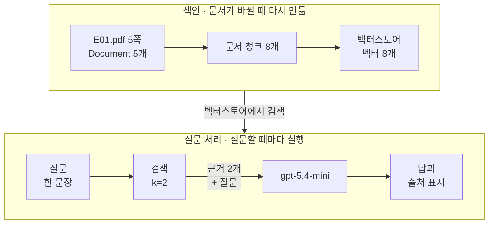
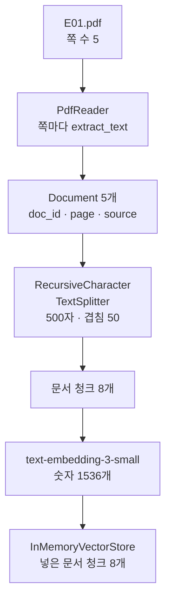
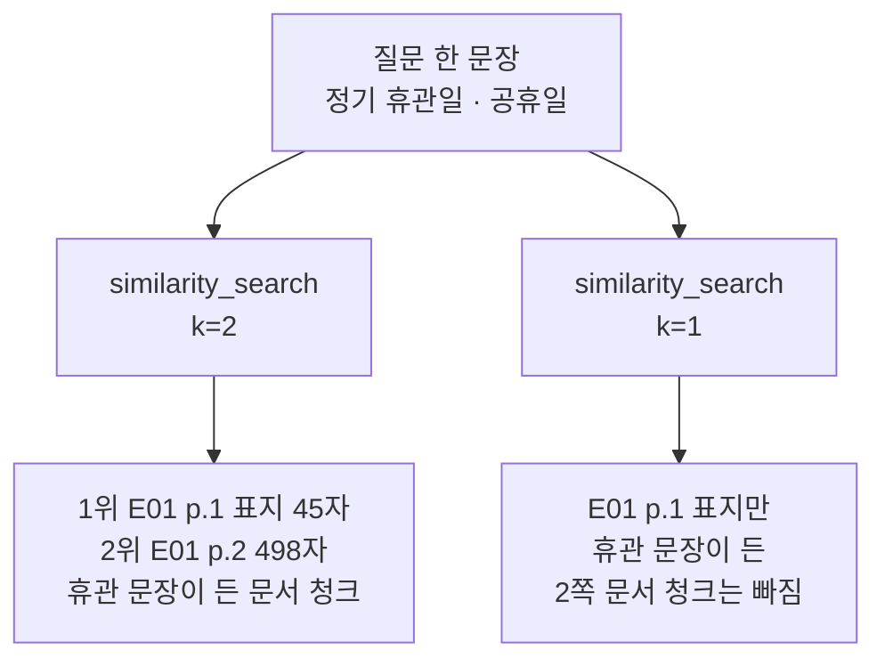
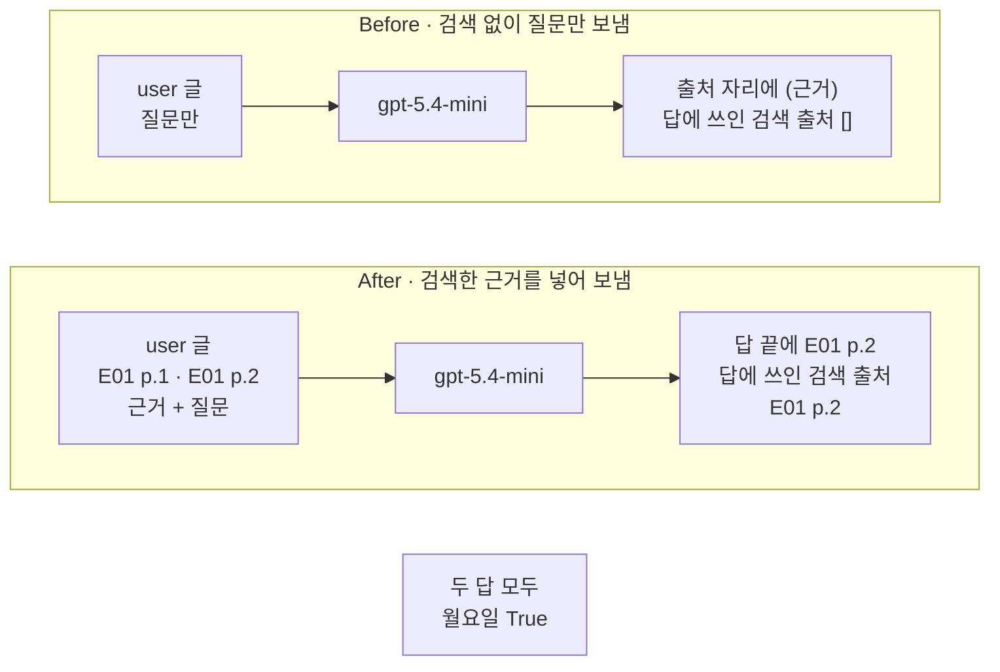

# 01-RAG-지도

## _src 본문 (HTML 원본)

```html
<!--meta: 강의 1h | 실습 1h | 코드 Jupyter Notebook | 새 용어 6 -->
<h2 id="b1"><span class="no">1</span>학습 목표</h2>
<div class="goal"><p>이 절을 마치면 다음을 할 수 있습니다.</p><ul><li>제공된 PDF를 쪽마다 읽어 Document 목록을 만들고, 문서 청크로 나눠 벡터스토어에 넣을 수 있습니다.</li><li>질문과 가까운 문서 청크를 검색하고, 가져오는 개수 k를 바꿨을 때 달라진 출처를 출력으로 말할 수 있습니다.</li><li>검색한 근거를 메시지 목록에 넣어 답을 받고, 답의 출처 표시가 검색 목록에 있는지 확인할 수 있습니다.</li></ul></div>
<h2 id="b2"><span class="no">2</span>이 내용을 배우는 이유</h2>
<p>Ch 8에서는 사람이 원문을 읽고, 질문에 필요한 기록을 골라 메시지에 넣었습니다. 이 일을 골라 넣기(Select)라고 불렀습니다. Ch 8 07절 실습에서도 사람이 목록을 보고 출처를 정했습니다. 문서가 몇 쪽뿐이면 이렇게 할 수 있지만, 문서가 수십 건으로 늘면 질문마다 사람이 고르기 어렵습니다.</p>
<p>이 챕터에서는 고르는 일을 검색이 맡습니다. 질문과 뜻이 가까운 문서의 한 부분을 코드가 찾아 메시지에 넣습니다. Ch 5 07절에서 본 것처럼, 모델이 답을 만드는 계산에는 자료를 찾아보는 단계가 없습니다. 그 앞에 검색 단계를 코드로 붙이는 것입니다.</p>
<p>01절은 전체 흐름을 한 번에 실행해 보는 지도입니다. PDF 읽기부터 답 받기까지, 단계마다 입력과 출력을 셀로 나눠 봅니다. 02절부터는 이 단계들을 하나씩 더 자세히 봅니다.</p>
<p>이 챕터에는 에이전트가 없습니다. 몇 개를 검색할지, 메시지에 무엇을 넣을지는 학생이 코드에 적습니다. 모델은 마지막에 답 문장만 씁니다. 어느 설정이 더 좋은지 재는 방법은 Ch 11에서 다룹니다.</p>
<p><strong>이 절의 질문</strong> — 사람이 고르던 근거를 검색이 고르게 하면, 모델에 무엇이 들어가고 답은 어떻게 달라질까요?</p>
<h2 id="b3"><span class="no">3</span>앞에서 배운 내용</h2>
<table><thead><tr><th>앞 절</th><th>배운 것</th><th>이 절에서 이어지는 곳</th></tr></thead><tbody>
<tr><td>Ch 4 05절</td><td>HTML 글에서 필요한 본문을 골라 꺼내기</td><td>2절 PDF에서 쪽마다 글 꺼내기</td></tr>
<tr><td>Ch 5 02절</td><td>임베딩 모델이 문장을 숫자 384개로 바꿈, 코사인 유사도 직접 계산</td><td>4절 서비스 임베딩, 5절 가까운 순서로 검색</td></tr>
<tr><td>Ch 5 07절</td><td>생성 계산에는 자료를 찾아보는 단계가 없음</td><td>Before 검색 없이 보낸 요청</td></tr>
<tr><td>Ch 6 01절</td><td><code>init_chat_model()</code>·<code>invoke()</code>, 속성 <code>text</code></td><td>1절 모델 준비, 8절 답 받기</td></tr>
<tr><td>Ch 7 01~03절</td><td>system 페르소나·developer 과업 명세·user 목록, 글 <code>+</code>로 잇기</td><td>7절 메시지 목록</td></tr>
<tr><td>Ch 8 02절</td><td>골라 넣기(Select), 메타데이터, 출처 표시 <code>[E01 p.3]</code>, 답에 쓰인 출처 찾기</td><td>2절 Document 메타데이터, 7·8절 출처 표시와 검사 함수</td></tr>
<tr><td>Ch 8 03·06절</td><td>휴관일 질문, 후보 경로를 <code>for</code>와 <code>break</code>로 고르기</td><td>2절 PDF 경로, 4절 질문</td></tr>
</tbody></table>
<p>Ch 8은 E01 문서의 글을 사람이 옮겨 적었습니다. 이 절은 같은 <code>E01.pdf</code>를 코드로 읽습니다. 노트북 2절 출력처럼 PDF에서 읽은 글은 띄어쓰기 한 곳과 줄바꿈이 Ch 8 글과 다릅니다. 이 절은 읽은 글을 고치지 않고 그대로 씁니다.</p>
<p>실습 폴더는 <code>labs/part3/ch09-rag-first-run</code>으로 바뀝니다. <code>.env</code> 파일의 <code>OPENAI_API_KEY</code>와 답을 쓰는 모델 설정은 Ch 8과 같습니다. 이 폴더에는 PDF를 읽는 pypdf와 글을 나누는 langchain-text-splitters가 더 있습니다.</p>
<h2 id="b4"><span class="no">4</span>핵심 개념</h2>
<h3>비유로 시작하기</h3>
<p>똑같은 나무 책상 두 개가 나란히 있습니다. 두 책상 위에는 파란 명찰, 주황 클립보드, 노란 메모지, 빈 답안지와 연필이 같은 자리에 놓여 있습니다. 책상마다 앞 바닥에 흰 카드가 한 줄로 꽂힌 긴 나무 상자가 하나씩 있습니다.</p>
<p>오른쪽 책상 위에만 흰 카드 두 장이 노란 메모지 옆에 놓여 있습니다. 오른쪽 상자 가운데에는 카드 두어 장이 빠진 빈칸이 보입니다. 왼쪽 상자는 빈칸 없이 꽉 차 있고, 왼쪽 책상에는 카드가 없습니다.</p>
{{img:01-5-두-책상과-카드-상자|나란히 놓인 똑같은 나무 책상 두 개에 파란 명찰·주황 클립보드·노란 메모지·빈 답안지와 연필이 있고, 오른쪽 책상에만 흰 카드 두 장이 노란 메모지 옆에 놓여 있으며, 책상마다 앞 바닥에 흰 카드가 한 줄로 꽂힌 긴 상자가 있는데 왼쪽 상자는 꽉 차 있고 오른쪽 상자 가운데에는 빈칸이 있는 삽화|두 책상은 같은 질문을 받았습니다. 오른쪽 책상에만 상자에서 골라 온 카드 두 장이 올라와 있습니다.}}
<p><strong>그림 읽기</strong> — 먼저 두 책상 위를 비교합니다. 명찰·클립보드·메모지·답안지는 같고, 오른쪽 책상에만 흰 카드 두 장이 더 있습니다. 다음으로 바닥 상자를 봅니다. 왼쪽 상자는 꽉 찼고, 오른쪽 상자에는 카드가 빠진 빈칸이 있습니다. 클립보드 위 연필과 상자 속 카드 수는 뜻이 없는 소품입니다.</p>
<p>책상 색 약속은 Ch 7·8과 같습니다. 파란 명찰은 system 페르소나, 주황 클립보드는 developer 과업 명세, 노란 메모지는 질문입니다. 바닥 상자는 문서 청크를 담아 둔 벡터스토어입니다. Ch 8 01절 그림처럼 책상 밖 바닥에 있는 것은 이번 요청에 들어가지 않습니다.</p>
<p>오른쪽 상자의 빈칸은 검색이 고른 문서 청크 두 개이고, 책상 위 카드 두 장은 user 글에 넣은 근거입니다. 왼쪽 책상은 검색 없이 질문만 보낸 Before, 오른쪽 책상은 검색한 근거를 넣은 After입니다.</p>
<h3>RAG — 먼저 검색하고, 그 근거로 답합니다</h3>
<p>검색 증강 생성(RAG, Retrieval-Augmented Generation)은 먼저 문서에서 근거를 검색하는 방식입니다. 그다음 그 근거를 넣어 답을 생성합니다. 허락된 책에서 필요한 쪽을 펴 보고 답을 쓰는 오픈북 시험과 비슷합니다. 노트북에서는 7절 user 글에 검색한 문서 청크 두 개가 들어갑니다.</p>
<p>검색에 쓸 문서는 미리 준비해 둡니다. 문서를 나누고 임베딩해 담아 두는 준비 작업을 색인(indexing)이라고 부릅니다. 그래서 RAG에는 실행 시점이 다른 흐름이 두 개 있습니다.</p>
{{mermaid:01-1-두-흐름|위 칸 색인에는 초록 상자 E01.pdf 5쪽 Document 5개, 문서 청크 8개, 벡터스토어 벡터 8개가 왼쪽에서 오른쪽으로 있고, 위 칸에서 아래 칸으로 벡터스토어에서 검색 화살표가 내려오며, 아래 칸 질문 처리에는 초록 상자 질문 한 문장, 파란 상자 검색 k=2, 근거 2개 + 질문 화살표, 보라 상자 gpt-5.4-mini, 노란 상자 답과 출처 표시가 왼쪽에서 오른쪽으로 있는 흐름도|색인은 문서가 바뀔 때 다시 만들고, 질문 처리는 질문할 때마다 실행합니다. 두 흐름은 벡터스토어에서 만납니다.}}
<p><strong>도식 읽기</strong> — 위 칸이 색인, 아래 칸이 질문 처리이고, 칸마다 왼쪽에서 오른쪽으로 읽습니다. 위 칸의 초록 상자 세 개는 노트북 2~4절에서 만든 자료입니다. PDF 5쪽이 Document 5개가 되고, 문서 청크 8개로 나뉘어 벡터스토어에 들어갑니다.</p>
<p>가운데 화살표는 아래 칸의 검색이 위 칸 벡터스토어를 쓴다는 뜻입니다. 아래 칸에서 초록 질문은 파란 검색 단계(5절, k=2)를 거칩니다. 검색한 근거 2개와 질문이 보라 모델로 가고, 노란 상자인 답과 출처 표시가 나옵니다(8절).</p>
<p>질문이 바뀌면 아래 칸만 다시 실행합니다. PDF 글, 나누는 설정, 임베딩 모델 가운데 하나가 바뀌면 위 칸 색인부터 다시 만듭니다. 흐름의 순서와 검색 개수는 파란 코드가 정하고, 모델은 마지막에 답 문장만 씁니다.</p>
<h3>이 절에서 쓰는 말</h3>
<table><thead><tr><th>용어</th><th>뜻</th><th>이 절에서 보이는 모습</th></tr></thead><tbody>
<tr><td>RAG(검색 증강 생성)</td><td>먼저 문서에서 근거를 검색하고, 그 근거를 넣어 답을 생성하는 방식</td><td>7절 user 글에 검색한 문서 청크 2개</td></tr>
<tr><td>색인(indexing)</td><td>검색할 수 있게 문서를 미리 나누고 임베딩해 담아 두는 준비 작업</td><td>2~4절, <code>벡터스토어에 넣은 문서 청크 수: 8</code></td></tr>
<tr><td>Document</td><td>본문 <code>page_content</code>와 메타데이터 <code>metadata</code>를 한 묶음으로 담는 LangChain 객체</td><td><code>Document 수: 5</code></td></tr>
<tr><td>문서 청크(chunk)</td><td>검색 단위로 자른 문서의 한 부분. Ch 6 04절 스트림 청크, Ch 5 조각(토큰)과 다름</td><td><code>문서 청크 수: 8</code></td></tr>
<tr><td>벡터스토어(vector store)</td><td>문서 청크와 그 벡터를 함께 담아 두고, 질문과 가까운 것을 찾아 주는 저장소</td><td><code>InMemoryVectorStore</code>(메모리에만 있음)</td></tr>
<tr><td>top-k 검색</td><td>질문과 가까운 순서로 문서 청크 k개를 가져오는 검색</td><td><code>k=1 출처: ['[E01 p.1]']</code></td></tr>
</tbody></table>
<p>메타데이터·임베딩·출처 표시는 앞 챕터와 같은 뜻입니다. 메타데이터는 Ch 8 02절의 내용 옆 설명 값이고, 임베딩은 Ch 5 02절의 글을 숫자 목록으로 바꾸는 일입니다. 출처 표시 모양도 Ch 8과 같은 <code>[E01 p.2]</code>입니다.</p>
<h2 id="b5"><span class="no">5</span>실행 예제</h2>
<p>노트북은 미르시립도서관 안내 PDF(E01) 5쪽을 읽어 문서 청크로 나누고 벡터스토어에 넣습니다. 그다음 Ch 8의 휴관일 질문으로 검색하고, 가져오는 개수 k를 2와 1로 바꿔 봅니다. 마지막으로 검색한 근거를 메시지 목록에 넣어 답을 받습니다.</p>
<p>인터넷 서비스에 요청을 모두 7번 보냅니다. 임베딩 모델 <code>text-embedding-3-small</code>에 4번, 답을 쓰는 <code>gpt-5.4-mini</code>에 3번입니다. 이 페이지의 출력은 2026-09-17에 실행한 결과이고, 예상 비용은 0.01달러 미만입니다. 답 문장은 실행마다 달라질 수 있습니다.</p>
<p>강의 시간에는 노트북 2~6절(PDF 읽기, 문서 청크, 임베딩, 검색, k 비교)을 설명합니다. 7~8절(메시지 목록, 답 받기)과 Before·After는 함께 실행하고 실습 시간에 읽습니다.</p>
{{notebook:01-RAG-지도|example}}
<p class="look"><b>확인할 점</b> — 2절 <code>Ch 8 글 「정기 휴관일입니다」가 있는가: False</code>를 봅니다. 3절 <code>문서 청크 수: 8</code>과 6절 <code>k=1 출처: ['[E01 p.1]']</code>을 확인합니다. 8절 <code>답에 쓰인 검색 출처: ['[E01 p.2]']</code>를 봅니다.</p>
<h3>PDF에서 벡터스토어까지</h3>
<p>노트북 2~4절이 색인입니다. 라이브러리 pypdf의 <code>PdfReader</code>로 PDF를 열고, 쪽마다 <code>extract_text()</code>로 글을 꺼냈습니다. 출력은 <code>쪽 수: 5</code>와 <code>2쪽 글자 수: 905</code>였습니다.</p>
{{mermaid:01-2-색인|초록 상자 E01.pdf 쪽 수 5에서 파란 상자 PdfReader 쪽마다 extract_text, 초록 상자 Document 5개 doc_id page source, 파란 상자 RecursiveCharacterTextSplitter 500자 겹침 50, 초록 상자 문서 청크 8개, 보라 상자 text-embedding-3-small 숫자 1536개, 초록 상자 InMemoryVectorStore 넣은 문서 청크 8개로 위에서 아래로 이어지는 흐름도|PDF 5쪽이 Document 5개, 문서 청크 8개가 되고, 임베딩 모델을 거쳐 벡터스토어에 8개가 들어갑니다.}}
<p><strong>도식 읽기</strong> — 위에서 아래로 읽습니다. 초록 상자는 PDF·Document·문서 청크·벡터스토어처럼 코드가 만든 자료이고, 파란 상자는 자료를 바꾸는 코드 단계입니다. 보라 상자는 인터넷 서비스로 부른 임베딩 모델입니다.</p>
<p>숫자는 노트북 출력에서 가져왔습니다. <code>Document 수: 5</code>, <code>문서 청크 수: 8</code>, <code>벡터스토어에 넣은 문서 청크 수: 8</code>입니다. 1536은 4절에서 질문 벡터로 확인한 숫자 개수이고, 문서 청크 벡터의 길이는 따로 출력하지 않았습니다.</p>
<p>문서 객체 Document는 본문과 메타데이터를 한 묶음으로 담습니다. 노트북은 메타데이터에 문서 이름 <code>doc_id</code>와 쪽 번호 <code>page</code>를 적었습니다. 문서 청크로 나눈 뒤에도 메타데이터가 복사되므로, 검색 결과에서 쪽 번호를 읽어 출처 표시를 만들 수 있습니다.</p>
<p>문서 청크(chunk)는 검색 단위로 자른 문서의 한 부분입니다. 긴 공지문을 문단 카드 몇 장에 나눠 옮기는 것과 비슷합니다. Ch 6 04절에서 스트리밍으로 도착한 답의 일부(스트림 청크)와는 다른 것입니다. Ch 5에서 「조각」이라고 부른 토큰과도 다릅니다.</p>
<p>노트북은 한 문서 청크를 최대 500자로 나눴습니다. 표지인 1쪽은 <code>1 | 45</code>로 나뉘지 않았고, 2쪽은 <code>2 | 498</code>과 <code>2 | 452</code> 두 개가 됐습니다. 나누는 규칙과 겹침 50자의 뜻은 02절에서 봅니다.</p>
<h3>검색 결과와 가져오는 개수 k</h3>
<p>메서드 <code>similarity_search()</code>는 질문을 임베딩한 뒤 가까운 문서 청크부터 k개를 반환합니다. 이 벡터스토어(<code>InMemoryVectorStore</code>)는 가까운 정도를 코사인 유사도로 잽니다. 코사인 유사도는 Ch 5 02절에서 직접 계산해 본 두 벡터의 가까운 정도입니다. 이렇게 가까운 순서로 k개를 가져오는 검색을 top-k 검색이라고 부릅니다.</p>
{{mermaid:01-3-k-비교|초록 상자 질문 한 문장 정기 휴관일 공휴일이 파란 상자 similarity_search k=2와 k=1로 갈라지고, k=2 아래 노란 상자에는 1위 E01 p.1 표지 45자와 2위 E01 p.2 498자 휴관 문장이 든 문서 청크가, k=1 아래 노란 상자에는 E01 p.1 표지만 있고 휴관 문장이 든 2쪽 문서 청크는 빠짐이 적힌 그림|같은 질문으로 k=2는 표지와 2쪽을 가져왔고, k=1은 표지만 가져와 휴관 문장이 든 2쪽 문서 청크가 빠졌습니다.}}
<p><strong>도식 읽기</strong> — 맨 위 초록 상자는 4절의 질문입니다. 왼쪽 갈래는 5절 k=2, 오른쪽 갈래는 6절 k=1이고, 파란 상자는 같은 메서드에서 k만 다른 호출입니다. 아래 노란 상자 두 개는 출력으로 확인한 검색 결과입니다.</p>
<p>k=2 결과의 첫 줄은 <code>[E01 p.1] | 45 | 미르시립도서관 이용 안내 미르시립도서</code>였습니다. 둘째 줄은 <code>[E01 p.2] | 498 | 1. 도서관 소개 미르시립도서관은 1</code>입니다. 1위는 표지였고, 휴관 문장은 2위 문서 청크 안에 있었습니다.</p>
<p>표지에는 질문에 나온 「미르시립도서관」이 있고 다른 글이 거의 없습니다. 가까운 순서는 뜻이 비슷한 정도로 매긴 것이고, 답이 들어 있는지를 판정한 것이 아닙니다. 그래서 k를 1로 줄이자 <code>k=1 출처: ['[E01 p.1]']</code>만 남고 답에 쓸 문장이 빠졌습니다.</p>
<h3>검색한 근거로 받은 답</h3>
<p>노트북 7절은 k=2 결과로 user 글을 만들었습니다. 문서 청크마다 출처 표시와 본문을 이어 붙이고, 끝에 질문을 붙였습니다. 과업 명세에는 실제 쪽 번호를 쓰지 않고 「근거 앞에 붙은 출처 표시를 그대로 적으세요」라고 적었습니다. 검색이 출처를 고르므로, 지시에 특정 쪽 번호를 미리 넣지 않은 것입니다.</p>
<p>8절 답은 <code>미르시립도서관의 정기 휴관일은 매주 월요일입니다.</code>로 시작했고, 끝에 <code>[E01 p.2]</code>가 붙었습니다. 검사 함수 <code>find_cited_marks()</code>는 검색 목록의 출처 표시 가운데 답에 들어 있는 것만 모읍니다. 결과는 <code>답에 쓰인 검색 출처: ['[E01 p.2]']</code>로, 표지 출처는 답에 쓰이지 않았습니다.</p>
<p>이 검사는 말과 표시가 있는지만 봅니다. 답의 품질 점수가 아닙니다. 과업 명세는 문장마다 출처를 적으라고 했지만, 이번 답은 끝에 한 번만 적었습니다. 근거의 「법정 공휴일에도 휴관」도 이번 답에는 나오지 않았습니다.</p>
<h2 id="b6"><span class="no">6</span>일부러 실패해 보기</h2>
<p>Before에서는 검색 단계를 뺍니다. 페르소나와 과업 명세는 그대로 두고, user 글에 질문만 넣어 같은 모델로 보냅니다. 과업 명세가 「주어진 근거에 있는 정보만 쓰세요」라고 해도, 주어진 근거가 없는 요청입니다.</p>
<p>After에서 고치는 곳은 user 글입니다. 질문을 보내기 전에 검색을 실행하고, 검색한 문서 청크 두 개를 출처 표시와 함께 넣습니다. 노트북은 7절에서 만든 메시지 목록을 다시 보냅니다.</p>
{{notebook:01-RAG-지도|failure}}
<p>질문만 보낸 Before 답은 <code>미르시립도서관의 정기 휴관일은 매주 월요일입니다.</code>로 시작했습니다. 둘째 문장도 공휴일과 화요일 휴관을 적었고, 두 문장 끝에는 출처 대신 <code>(근거)</code>라고 적었습니다. 근거를 하나도 받지 않았는데 휴관 요일을 적은 것입니다.</p>
<p>이번 답의 휴관 요일은 PDF 글과 맞았습니다. 그러나 근거를 받지 않았으므로 모델이 이 내용을 어디서 가져왔는지는 알 수 없습니다. 검사 결과 <code>답에 「월요일」이 있는가: True</code>는 8절 답과 같았고, <code>답에 쓰인 검색 출처: []</code>는 빈 목록이었습니다.</p>
<p>근거를 넣은 After 답은 둘째 문장이 <code>법정 공휴일이 월요일과 겹치면 그 다음 날인 화요일에도 휴관합니다.</code>였고, 끝에 <code>[E01 p.2]</code>가 붙었습니다. 검사 결과는 <code>답에 쓰인 검색 출처: ['[E01 p.2]']</code>였습니다. 이번 실행에서는 8절 답과 둘째 문장이 조금 달랐습니다.</p>
{{mermaid:01-4-Before-After|위 칸 Before에는 초록 상자 user 글 질문만, 보라 상자 gpt-5.4-mini, 빨간 상자 출처 자리에 (근거) 답에 쓰인 검색 출처 빈 목록이 차례로 있고, 아래 칸 After에는 초록 상자 user 글 E01 p.1 E01 p.2 근거 + 질문, 보라 상자 gpt-5.4-mini, 노란 상자 답 끝에 E01 p.2 답에 쓰인 검색 출처 E01 p.2가 차례로 있으며, 맨 아래 회색 상자에 두 답 모두 월요일 True가 따로 있는 비교 그림|질문만 보낸 Before 답에는 검색 출처가 없었고, 근거를 넣은 After 답에는 2쪽 출처 표시가 있었습니다. 「월요일」은 두 답에 모두 있었습니다.}}
<p><strong>도식 읽기</strong> — 위 칸이 Before, 아래 칸이 After이고, 칸마다 왼쪽에서 오른쪽으로 읽습니다. 초록 상자는 user 글에 넣은 내용이고, 보라 상자는 같은 모델입니다. 두 칸에서 다른 것은 user 글 하나입니다.</p>
<p>위 칸 끝의 빨간 상자는 Before 결함 결과로, 출처 자리에 <code>(근거)</code>만 있고 답에 쓰인 검색 출처가 빈 목록입니다. 아래 칸 끝의 노란 상자는 After 출력으로 확인한 값입니다. 맨 아래 회색 상자는 두 답에 모두 있던 「월요일」이라, 어느 한쪽의 효과로 넣지 않았습니다.</p>
<p>그래서 이 비교에서 달라진 것은 답이 맞았는지가 아니라, 답을 원문의 어느 쪽과 대조할 수 있는지입니다. After 답은 출처 표시로 2쪽을 가리키므로, 7절 user 글의 2쪽 근거와 문장을 나란히 읽어 확인할 수 있습니다. 한 번 실행한 결과이므로, 검색 없는 요청이 늘 이렇게 답한다고 일반화하지 않습니다.</p>
<h2 id="b7"><span class="no">7</span>주의할 점과 실무 메모</h2>
<ul><li>검색을 붙여도 근거 없는 답이 사라지지는 않습니다. 6절처럼 검색 결과에서 답이 든 문서 청크가 빠질 수 있고, 모델이 근거 밖 내용을 쓸 수도 있습니다. 검색 누락과 문서에 답이 없는 경우를 가르는 방법은 05절에서 다룹니다.</li>
<li>교재는 PDF 5쪽 전체를 색인했습니다. 교재를 만들 때 같은 설정으로 검색만 먼저 실행해(임베딩 요청 3번), 1쪽 표지 문서 청크가 1위라는 것을 봤습니다. k=2와 k=1 비교는 이 결과를 보여 주려고 정한 예입니다.</li>
<li>그 탐색에서 표지와 2쪽 문서 청크의 코사인 유사도 차이는 0.01보다 작았습니다. 판이나 실행 환경이 달라 순서가 바뀌면 k=1 결과도 달라질 수 있습니다. 먼저 검색 결과의 출처와 본문을 출력해 확인합니다.</li>
<li>PDF에서 읽은 글은 줄 끝에서 문장이 끊기고, 띄어쓰기가 원래 문서와 다를 수 있습니다. 답을 검사하는 말은 이런 차이에 흔들리지 않는 짧은 말(「월요일」)로 골랐습니다.</li>
<li>벡터스토어 <code>InMemoryVectorStore</code>는 파일에 쓰지 않고 노트북 메모리에만 있습니다. 커널을 다시 시작하면 색인부터 다시 실행하고, 임베딩 요청도 다시 보냅니다.</li>
<li>임베딩 요금은 OpenAI 모델 안내(2026-09-17 확인)에 적힌 100만 토큰당 0.02달러입니다. mini 요금은 Ch 6 06절에서 확인한 값입니다. 노트북의 예상 비용은 청구 금액이 아닙니다.</li>
<li>이 절은 pypdf를 직접 불러 쪽마다 읽었습니다. LangChain 문서에 나오는 PDF 로더 클래스는 이번에 실행하지 않았습니다.</li>
<li>인터넷에서 찾은 예제에 <code>from langchain.chains import RetrievalQA</code> 같은 줄이 있으면 옛 판의 코드입니다. 설치한 langchain 1.4.0에는 <code>langchain.chains</code> 모듈이 없습니다.</li>
<li>실습 자료 폴더 <code>labs/data/rag-corpus/pdf/</code>에는 가상 기관의 합성 PDF가 21건 있습니다. 폴더별로 easy 6건, medium 6건, hard 6건, 스캔본 3건입니다. 이 절은 easy 폴더의 <code>E01.pdf</code>만 씁니다.</li>
<li>교재 출력은 Linux의 Python 3.12.13으로 만들었습니다. 패키지는 pypdf 6.17.0, langchain 1.4.0, langchain-core 1.6.2입니다. langchain-openai 1.6.0과 langchain-text-splitters 1.1.2도 함께 썼습니다. 함께 쓴 openai 판은 3.8.0입니다. 다른 버전과 Windows·macOS에서는 실행하지 않았습니다.</li></ul>
<h2 id="b8"><span class="no">8</span>정리와 다음 절</h2>
<ul><li>PDF 5쪽을 Document 5개로 읽고 문서 청크 8개로 나눈 뒤, 임베딩해 벡터스토어에 넣었습니다. 이 준비 작업이 색인입니다.</li><li>질문과 가까운 문서 청크를 k=2로 검색하자 표지와 2쪽이 나왔고, k=1로 줄이자 휴관 문장이 든 2쪽이 빠졌습니다.</li><li>질문만 보낸 Before 답에는 검색 출처가 없었습니다. 근거를 넣은 After 답에는 2쪽 출처 표시가 있어 원문과 대조할 수 있었습니다.</li></ul>
<p><strong>다음 학습과 이어지는 지점</strong> — 02절에서는 이 흐름의 앞 두 단계인 PDF 읽기와 문서 청크 나누기를 더 자세히 봅니다. 01절에서 본 표지 45자 문서 청크처럼, 나누는 방법이 검색 결과에 어떤 문서 청크를 남기는지와 이어집니다.</p>
<h2 id="b9"><span class="no">9</span>복습 문제</h2>
<details class="quiz"><summary>문제 1 · 두 흐름</summary><p class="quiz-q">같은 PDF에 질문만 새로 바꾸면 노트북의 어느 단계부터 다시 실행하면 되나요? PDF 글이 바뀌면 어떤가요?</p><p class="quiz-a"><b>해설</b> — 질문만 바뀌면 5절 검색부터 다시 실행합니다. 벡터스토어는 그대로 씁니다. PDF 글, 나누는 설정, 임베딩 모델 가운데 하나가 바뀌면 2절부터 색인을 다시 만듭니다.</p></details>
<details class="quiz"><summary>문제 2 · 메타데이터</summary><p class="quiz-q">Document 메타데이터에 <code>page</code>를 적지 않았다면 7절에서 무엇을 만들 수 없나요?</p><p class="quiz-a"><b>해설</b> — 출처 표시 <code>[E01 p.2]</code>를 만들 수 없습니다. 문서 청크는 메타데이터를 복사해 받으므로, 쪽 번호가 있어야 검색 결과가 어느 쪽인지 적을 수 있습니다.</p></details>
<details class="quiz"><summary>문제 3 · k를 1로 줄이면</summary><p class="quiz-q">6절에서 k만 1로 바꿨더니 <code>k=1 출처: ['[E01 p.1]']</code>이 나왔습니다. 이 목록을 근거로 넣으면 무엇이 문제인가요?</p><p class="quiz-a"><b>해설</b> — 1위가 표지라서 휴관 문장이 든 2쪽 문서 청크가 빠집니다. 근거에 답할 문장이 없습니다. 가까운 순서는 답이 들어 있는지를 판정한 것이 아니므로, 답을 받기 전에 검색 결과를 출력해 확인합니다.</p></details>
<details class="quiz"><summary>문제 4 · 두 답의 차이</summary><p class="quiz-q">질문만 보낸 Before와 근거를 넣은 After 답 모두 「월요일」 검사가 <code>True</code>였습니다. 그래도 Before를 실패로 보는 까닭은 무엇인가요?</p><p class="quiz-a"><b>해설</b> — 답에 쓰인 검색 출처가 빈 목록이라, 답을 원문의 어느 쪽과 대조할지 알 수 없기 때문입니다. 근거를 받지 않았으니 내용이 어디서 왔는지도 알 수 없습니다. 말이 있는지만 봐서는 두 답을 구별하지 못합니다.</p></details>
<details class="quiz"><summary>문제 5 · 과업 명세의 출처 예시</summary><p class="quiz-q">Ch 8 과업 명세는 출처 예시로 <code>[E01 p.2]</code>를 적었습니다. 이 절 과업 명세에서 예시를 빼고 「근거 앞에 붙은 출처 표시를 그대로 적으세요」라고 쓴 까닭은 무엇인가요?</p><p class="quiz-a"><b>해설</b> — 이 절에서는 검색이 출처를 고릅니다. 지시에 특정 쪽 번호를 적어 두면, 검색 결과와 관계없이 그 번호를 따라 적을 수 있습니다. 그러면 출처 표시로 검색 목록을 확인하는 검사가 뜻을 잃습니다.</p></details>
<h2 id="b10"><span class="no">10</span>참고 자료</h2>
<p>문서는 2026-09-17에 다시 열어 확인했습니다. 검색 순서 계산은 실습 가상환경에 설치한 langchain-core 1.6.2 소스에서 확인했습니다. 근거 글은 수업용 가상 기관 문서 <code>E01.pdf</code>입니다.</p>
<ul><li><div><a href="https://docs.langchain.com/oss/python/langchain/retrieval">LangChain Retrieval</a></div>문서 로더·글 나누기·임베딩·벡터스토어와 검색 뒤 생성하는 두 단계 RAG · 확인 2026-09-17</li><li><div><a href="https://developers.openai.com/api/docs/guides/embeddings">OpenAI Embeddings 안내</a></div><code>text-embedding-3-small</code> 기본 벡터 길이 1536 · 확인 2026-09-17</li><li><div><a href="https://developers.openai.com/api/docs/models/text-embedding-3-small">OpenAI text-embedding-3-small 모델 안내</a></div>100만 토큰당 0.02달러 · 확인 2026-09-17</li><li><div><a href="https://pypdf.readthedocs.io/en/stable/user/extract-text.html">pypdf Extract Text from a PDF</a></div>쪽마다 글 꺼내기 · 확인 2026-09-17</li></ul>
```

## 노트북 셀 (순서대로)

### [0] markdown {'html': 'skip'}

# RAG 지도

**이 노트북에서 할 일**

1. 도서관 안내 PDF(E01) 5쪽을 쪽마다 읽어 문서 청크로 나누고, 임베딩해 벡터스토어에 넣습니다.
2. 질문과 가까운 문서 청크를 검색하고, 가져오는 개수 k를 2와 1로 바꿔 출처를 비교합니다.
3. 검색 없이 질문만 보낸 Before와, 검색한 근거를 넣은 After의 답과 출처 표시를 비교합니다.

**준비물** — 프로젝트 폴더 `.env` 파일의 `OPENAI_API_KEY`가 필요합니다. 데이터 파일은 `labs/data/rag-corpus/pdf/easy/E01.pdf`입니다.

인터넷 서비스에 요청을 모두 7번 보냅니다. 임베딩 모델 `text-embedding-3-small`에 4번, `gpt-5.4-mini`에 3번입니다.
실행 시간은 1분 안팎이고, 예상 비용은 0.01달러 미만으로 잡았습니다.
임베딩 요금은 OpenAI 모델 안내(2026-09-17 확인)에 적힌 100만 토큰당 0.02달러입니다.
mini 요금은 Ch 6 06절에서 확인한 값입니다.

**강의와 실습 범위** — 강의 시간에는 2~6절(PDF 읽기, 문서 청크, 임베딩, 검색, k 비교)을 설명합니다.
7~8절(메시지 목록, 답 받기)과 Before·After는 함께 실행하고 실습 시간에 읽습니다.

**기준 버전** — 실습 폴더에 고정한 패키지 판을 씁니다. pypdf 6.17.0, langchain 1.4.0, langchain-core 1.6.2입니다.
함께 쓰는 판은 langchain-openai 1.6.0, langchain-text-splitters 1.1.2입니다.
나머지는 openai 3.8.0과 python-dotenv 1.2.3입니다.

교재 출력은 Linux의 Python 3.12.13으로 만들었습니다. 다른 버전과 Windows·macOS에서는 이번에 실행하지 않았습니다.

실습 폴더 `labs/part3/ch09-rag-first-run`에서 `uv sync --locked`를 실행합니다.
그다음 이 폴더의 `.venv` 커널을 고르고 첫 셀부터 순서대로 실행합니다.

### [1] markdown {'html': 'skip'}

## 오늘 볼 그림


위 칸은 문서가 바뀔 때 다시 만드는 색인, 아래 칸은 질문할 때마다 실행하는 질문 처리입니다.
두 칸은 벡터스토어에서 만납니다. 초록 상자는 넣은 자료, 파란 상자는 코드 단계, 보라 상자는 모델입니다.
노란 상자는 출력으로 확인할 값입니다. 노트북 2~4절이 위 칸, 5~8절이 아래 칸을 차례로 실행합니다.

### [2] markdown {}

## 1. 준비

첫 셀은 패키지를 설치하고 설치된 버전을 출력합니다. 설치에는 몇십 초가 걸릴 수 있습니다.
Ch 8과 달리 PDF를 읽는 pypdf, 글을 나누는 langchain-text-splitters를 씁니다.

### [3] code {'execution': {'iopub.execute_input': '2026-09-17T14:55:21.382639Z', 'iopub.status.busy': '2026-09-17T14:55:21.382490Z', 'iopub.status.idle': '2026-09-17T14:55:22.019635Z', 'shell.execute_reply': '2026-09-17T14:55:22.019162Z'}, 'lesson_role': 'setup'}

```python
# 이 절에서 쓰는 패키지를 설치하고 버전을 확인합니다
%pip install -q "pypdf==6.17.0" "langchain==1.4.0" "langchain-openai==1.6.0" "langchain-text-splitters==1.1.2" "python-dotenv==1.2.3"
from importlib.metadata import version

print("pypdf:", version("pypdf"))
print("langchain:", version("langchain"))
print("langchain-core:", version("langchain-core"))
print("langchain-openai:", version("langchain-openai"))
print("langchain-text-splitters:", version("langchain-text-splitters"))
print("openai:", version("openai"))
print("python-dotenv:", version("python-dotenv"))
```

출력:
```
Note: you may need to restart the kernel to use updated packages.
pypdf: 6.17.0
langchain: 1.4.0
langchain-core: 1.6.2
langchain-openai: 1.6.0
langchain-text-splitters: 1.1.2
openai: 3.8.0
python-dotenv: 1.2.3

```

### [4] markdown {}

**결과 읽기** — 출력 줄은 `pypdf: 6.17.0`, `langchain: 1.4.0`, `openai: 3.8.0` 등 일곱 줄입니다.
준비물에 적은 기준 버전과 같습니다.

PDF 읽기, 문서 객체, 글 나누기, 임베딩, 벡터스토어, 모델 준비에 쓸 이름을 불러옵니다.
이름마다 처음 쓰는 절에서 무엇을 넣고 무엇을 반환하는지 설명합니다.

### [5] code {'execution': {'iopub.execute_input': '2026-09-17T14:55:22.020770Z', 'iopub.status.busy': '2026-09-17T14:55:22.020678Z', 'iopub.status.idle': '2026-09-17T14:55:23.139391Z', 'shell.execute_reply': '2026-09-17T14:55:23.139141Z'}, 'lesson_role': 'setup'}

```python
# PDF 읽기·문서 청크 나누기·임베딩·벡터스토어·모델 준비에 쓸 이름을 불러옵니다
import os

from pypdf import PdfReader
from langchain_core.documents import Document
from langchain_text_splitters import RecursiveCharacterTextSplitter
from langchain_openai import OpenAIEmbeddings
from langchain_core.vectorstores import InMemoryVectorStore
from langchain.chat_models import init_chat_model
```

출력:
```

```

### [6] markdown {}

Ch 8과 같은 셀로 API 키가 있는지 확인합니다. 키 값은 출력하지 않고, 있는지만 봅니다.
`True` 값이 나오면 다음으로 넘어갑니다.

### [7] code {'execution': {'iopub.execute_input': '2026-09-17T14:55:23.142438Z', 'iopub.status.busy': '2026-09-17T14:55:23.142340Z', 'iopub.status.idle': '2026-09-17T14:55:23.146653Z', 'shell.execute_reply': '2026-09-17T14:55:23.146444Z'}, 'lesson_role': 'setup'}

```python
# .env 파일에서 OpenAI API 키를 읽습니다(키 값은 출력하지 않습니다)
import os
from dotenv import find_dotenv, load_dotenv

env_path = find_dotenv(usecwd=True)
load_dotenv(env_path)
has_key = os.getenv("OPENAI_API_KEY") is not None
print("OPENAI_API_KEY 설정 여부:", has_key)
assert has_key, "프로젝트 폴더의 .env 파일에 OPENAI_API_KEY를 적어 주세요."
```

출력:
```
OPENAI_API_KEY 설정 여부: True

```

### [8] markdown {}

Ch 8과 같은 설정으로 답을 쓸 모델 객체를 만듭니다. 이 셀은 요청을 보내지 않습니다.
temperature 값을 0으로 두어 매번 비슷한 답을 고르게 합니다.

### [9] code {'execution': {'iopub.execute_input': '2026-09-17T14:55:23.147138Z', 'iopub.status.busy': '2026-09-17T14:55:23.147087Z', 'iopub.status.idle': '2026-09-17T14:55:23.468586Z', 'shell.execute_reply': '2026-09-17T14:55:23.468282Z'}}

```python
# 실습에 쓸 모델을 준비합니다
model = init_chat_model(
    "openai:gpt-5.4-mini",
    temperature=0,
    reasoning_effort="none",
)
print("모델 이름:", model.model_name)
print("temperature:", model.temperature)
```

출력:
```
모델 이름: gpt-5.4-mini
temperature: 0.0

```

### [10] markdown {}

**결과 읽기** — 모델 이름 `gpt-5.4-mini`, temperature `0.0`이 보이면 준비가 끝났습니다.
이 노트북의 출력은 2026-09-17에 이 모델로 실행한 결과입니다.
실행마다 답 문장이 달라질 수 있습니다. Ch 6 01절에서 본 것처럼 temperature 0은 Ch 5 06절의 뽑기를 끈 설정과 같은 것이 아닙니다.

### [11] markdown {}

## 2. PDF 파일을 찾아 쪽마다 읽기

노트북을 연 폴더에 따라 PDF까지 가는 경로가 다릅니다. Ch 8 06절처럼 후보 경로를 차례로 확인하고, 있는 경로에서 멈춥니다.
함수 `os.path.exists()`는 경로를 받아 파일이 있으면 `True`를 반환합니다.

후보는 세 개입니다. 프로젝트 맨 위, 실습 폴더 맨 위, `notebooks` 폴더에서 연 경우입니다.
실행 전에 예상합니다. `notebooks` 폴더에서 열었다면 셋째 후보, 프로젝트 맨 위에서 열었다면 첫째 후보를 고를 것입니다.

### [12] code {'execution': {'iopub.execute_input': '2026-09-17T14:55:23.469334Z', 'iopub.status.busy': '2026-09-17T14:55:23.469274Z', 'iopub.status.idle': '2026-09-17T14:55:23.471828Z', 'shell.execute_reply': '2026-09-17T14:55:23.471476Z'}}

```python
# 작업 폴더에서 본 E01.pdf 경로를 후보 세 개 가운데에서 고릅니다
candidates = [
    "labs/data/rag-corpus/pdf/easy/E01.pdf",
    "../../data/rag-corpus/pdf/easy/E01.pdf",
    "../../../data/rag-corpus/pdf/easy/E01.pdf",
]
pdf_path = None
for candidate in candidates:
    if os.path.exists(candidate):
        pdf_path = candidate
        break
print("PDF를 찾았는가:", pdf_path is not None)
print("고른 경로:", pdf_path)
assert pdf_path is not None, "notebooks 폴더나 실습 폴더 맨 위에서 노트북을 열어 주세요."
```

출력:
```
PDF를 찾았는가: True
고른 경로: labs/data/rag-corpus/pdf/easy/E01.pdf

```

### [13] markdown {}

**결과 읽기** — 출력 줄은 `PDF를 찾았는가: True`와 `고른 경로: labs/data/rag-corpus/pdf/easy/E01.pdf`입니다. `assert`도 통과했습니다.
교재 출력은 프로젝트 맨 위를 작업 폴더로 삼아 실행해서 첫째 후보를 골랐습니다.
`notebooks` 폴더에서 열면 셋째 후보, 실습 폴더 맨 위에서 열면 둘째 후보가 나옵니다.

라이브러리 pypdf의 `PdfReader`에 경로를 넣으면 PDF 객체를 반환합니다. 속성 `pages`는 쪽 목록입니다.
쪽 하나의 메서드 `extract_text()`는 그 쪽의 글을 문자열로 반환합니다.
Ch 8에서는 E01 2쪽 글을 사람이 옮겨 적었습니다. 이번에는 코드가 읽은 글이 Ch 8 글과 같은지 확인합니다.

### [14] code {'execution': {'iopub.execute_input': '2026-09-17T14:55:23.472380Z', 'iopub.status.busy': '2026-09-17T14:55:23.472331Z', 'iopub.status.idle': '2026-09-17T14:55:23.485287Z', 'shell.execute_reply': '2026-09-17T14:55:23.484971Z'}}

```python
# PDF의 쪽 수를 보고, 2쪽 글을 꺼내 「휴관」이 든 줄만 출력합니다
reader = PdfReader(pdf_path)
print("쪽 수:", len(reader.pages))
page_two_text = reader.pages[1].extract_text()
print("2쪽 글자 수:", len(page_two_text))
print("2쪽에서 「휴관」이 든 줄:")
for line in page_two_text.split("\n"):
    if "휴관" in line:
        print(line)
print("Ch 8 글 「정기 휴관일입니다」가 있는가:", "정기 휴관일입니다" in page_two_text)
```

출력:
```
쪽 수: 5
2쪽 글자 수: 905
2쪽에서 「휴관」이 든 줄:
매주 월요일은 정기 휴관일 입니다. 법정 공휴일에도 휴관하며, 공휴일이 월요일과 겹치면 그 다음 날인
화요일에도 휴관합니다.
Ch 8 글 「정기 휴관일입니다」가 있는가: False

```

### [15] markdown {}

**결과 읽기** — 출력 줄은 `쪽 수: 5`와 `2쪽 글자 수: 905`입니다.
라벨 줄 아래 두 줄이 「휴관」이 든 줄입니다. 첫 줄은 `매주 월요일은 정기 휴관일 입니다.`로 시작하고, 문장이 `그 다음 날인`에서 줄이 바뀝니다.
마지막 줄은 `Ch 8 글 「정기 휴관일입니다」가 있는가: False`입니다.

PDF에서 읽은 글은 「휴관일 입니다」처럼 띄어쓰기 한 곳이 Ch 8 글과 다르고, PDF 줄 끝에서 문장이 끊깁니다.
Ch 8은 이 띄어쓰기를 사람이 고쳐 옮겼습니다. 이 노트북은 PDF에서 읽은 글을 고치지 않고 그대로 씁니다.

다섯 쪽을 모두 문서 객체로 바꿉니다. 문서 객체 `Document`는 본문 `page_content`와 설명 값 `metadata`를 한 묶음으로 담는 LangChain 객체입니다.
메타데이터는 Ch 8 02절에서 배운 대로 내용 옆에 적어 두고 찾거나 고를 때 쓰는 설명 값입니다. 여기에는 문서 이름 `doc_id`와 쪽 번호 `page`를 적습니다.

### [16] code {'execution': {'iopub.execute_input': '2026-09-17T14:55:23.485826Z', 'iopub.status.busy': '2026-09-17T14:55:23.485769Z', 'iopub.status.idle': '2026-09-17T14:55:23.512350Z', 'shell.execute_reply': '2026-09-17T14:55:23.511960Z'}}

```python
# 다섯 쪽을 차례로 읽어, 쪽마다 본문과 메타데이터를 담은 Document 목록을 만듭니다
pages = []
page_number = 1
for page in reader.pages:
    page_document = Document(
        page_content=page.extract_text(),
        metadata={"doc_id": "E01", "page": page_number, "source": "E01.pdf"},
    )
    pages.append(page_document)
    page_number = page_number + 1
print("Document 수:", len(pages))
print("2쪽 메타데이터:", pages[1].metadata)
```

출력:
```
Document 수: 5
2쪽 메타데이터: {'doc_id': 'E01', 'page': 2, 'source': 'E01.pdf'}

```

### [17] markdown {}

**결과 읽기** — 출력 줄은 `Document 수: 5`와 `2쪽 메타데이터: {'doc_id': 'E01', 'page': 2, 'source': 'E01.pdf'}`입니다.

목록 번호는 0부터 세므로 `pages[1]`이 2쪽입니다. 쪽 번호는 사람이 읽는 번호라 1부터 적었습니다.

## 3. 쪽을 문서 청크로 나누기

한 쪽은 900자 안팎이라 검색해서 넣기에는 깁니다. 그래서 쪽을 더 작은 글 묶음으로 나눕니다.
이렇게 검색 단위로 자른 문서의 한 부분을 문서 청크(chunk)라고 부릅니다. 긴 공지문을 문단 카드 몇 장에 나눠 옮기는 것과 비슷합니다.

Ch 6 04절에서 스트리밍으로 도착한 답의 일부(스트림 청크)와는 다른 것입니다. Ch 5에서 「조각」이라고 부른 토큰과도 다릅니다.

도구 `RecursiveCharacterTextSplitter`는 글자 수 기준으로 글을 나눕니다. 인자 `chunk_size=500`은 한 문서 청크의 최대 글자 수입니다.
인자 `chunk_overlap=50`은 이웃한 두 문서 청크가 함께 갖는 글자 수입니다. 메서드 `split_documents()`는 Document 목록을 받아 더 작은 Document 목록을 반환합니다.

실행 전에 예상합니다. 짧은 1쪽은 하나, 긴 쪽은 둘로 나뉠 것입니다.

### [18] code {'execution': {'iopub.execute_input': '2026-09-17T14:55:23.512878Z', 'iopub.status.busy': '2026-09-17T14:55:23.512835Z', 'iopub.status.idle': '2026-09-17T14:55:23.514895Z', 'shell.execute_reply': '2026-09-17T14:55:23.514539Z'}}

```python
# 다섯 쪽을 500자 안팎의 문서 청크로 나누고, 문서 청크마다 쪽 번호와 글자 수를 출력합니다
splitter = RecursiveCharacterTextSplitter(chunk_size=500, chunk_overlap=50)
chunks = splitter.split_documents(pages)
print("문서 청크 수:", len(chunks))
print("문서 청크(쪽 | 글자 수):")
for chunk in chunks:
    print(chunk.metadata["page"], "|", len(chunk.page_content))
```

출력:
```
문서 청크 수: 8
문서 청크(쪽 | 글자 수):
1 | 45
2 | 498
2 | 452
3 | 498
3 | 462
4 | 492
4 | 412
5 | 270

```

### [19] markdown {}

**결과 읽기** — 첫 줄은 `문서 청크 수: 8`입니다. 라벨 줄 아래 여덟 줄은 쪽 번호와 글자 수입니다.
1쪽은 `1 | 45` 한 줄, 2쪽은 `2 | 498`과 `2 | 452` 두 줄입니다. 5쪽은 `5 | 270` 한 줄입니다.

1쪽은 표지라 45자뿐이어서 나뉘지 않았습니다. 문서 청크마다 원래 쪽의 메타데이터가 그대로 복사되어, 나뉜 뒤에도 쪽 번호를 읽을 수 있습니다.
나누는 규칙과 겹침은 02절에서 자세히 봅니다.

## 4. 문서 청크를 임베딩해 벡터스토어에 넣기

임베딩(embedding)은 글을 뜻이 비슷하면 가까운 숫자 목록(벡터)으로 바꾸는 일입니다. Ch 5 02절에서는 내 컴퓨터의 모델로 문장 하나를 숫자 384개로 바꿨습니다.
이번에는 OpenAI 임베딩 모델 `text-embedding-3-small`을 인터넷 서비스로 부릅니다.

클래스 `OpenAIEmbeddings`에 모델 이름을 넣어 임베딩 객체를 만듭니다. 메서드 `embed_query()`는 글 하나를 받아 숫자 목록을 반환합니다.
질문은 Ch 8 03절의 휴관일 질문과 같은 글입니다. 이 셀은 임베딩 요청을 1번 보냅니다.

실행 전에 예상합니다. 질문의 글자 수와 관계없이 숫자 개수는 정해져 있을 것입니다.

### [20] code {'execution': {'iopub.execute_input': '2026-09-17T14:55:23.515461Z', 'iopub.status.busy': '2026-09-17T14:55:23.515397Z', 'iopub.status.idle': '2026-09-17T14:55:23.728681Z', 'shell.execute_reply': '2026-09-17T14:55:23.727998Z'}}

```python
# 임베딩 객체를 만들고, 질문 한 문장을 숫자 목록으로 바꿔 길이를 봅니다(임베딩 요청 1번)
embedding_model = OpenAIEmbeddings(model="text-embedding-3-small")
question_text = "미르시립도서관의 정기 휴관일은 언제이고, 공휴일이 월요일과 겹치면 어떻게 되나요?"
question_vector = embedding_model.embed_query(question_text)
print("질문 글자 수:", len(question_text))
print("질문 벡터의 숫자 개수:", len(question_vector))
first_numbers = question_vector[:3]
print("앞 숫자 세 개:", first_numbers)
```

출력:
```
질문 글자 수: 45
질문 벡터의 숫자 개수: 1536
앞 숫자 세 개: [-0.007572174072265625, 0.06585693359375, 0.053009033203125]

```

### [21] markdown {}

**결과 읽기** — 출력 줄은 `질문 글자 수: 45`와 `질문 벡터의 숫자 개수: 1536`입니다. 마지막 줄은 앞 숫자 세 개입니다.
OpenAI 임베딩 안내도 이 모델의 기본 벡터 길이를 1536으로 적습니다. 숫자 하나하나의 뜻은 사람이 읽지 않습니다.
앞 숫자는 실행마다 조금 달라질 수 있어 비교에 쓰지 않습니다.

벡터스토어(vector store)는 문서 청크와 그 벡터를 함께 담아 두고, 질문 벡터와 가까운 것을 찾아 주는 저장소입니다.
메서드 `InMemoryVectorStore.from_documents()`는 문서 청크 목록과 임베딩 객체를 받아, 모든 문서 청크를 임베딩해 담은 저장소를 반환합니다.
저장소는 파일에 쓰지 않고 이 노트북의 메모리에만 있습니다. 여덟 문서 청크를 한 요청으로 보냅니다.

### [22] code {'execution': {'iopub.execute_input': '2026-09-17T14:55:23.729949Z', 'iopub.status.busy': '2026-09-17T14:55:23.729842Z', 'iopub.status.idle': '2026-09-17T14:55:23.897097Z', 'shell.execute_reply': '2026-09-17T14:55:23.895953Z'}}

```python
# 문서 청크 8개를 임베딩해 메모리 안의 벡터스토어에 넣습니다(임베딩 요청 1번)
store = InMemoryVectorStore.from_documents(chunks, embedding_model)
print("벡터스토어에 넣은 문서 청크 수:", len(store.store))
```

출력:
```
벡터스토어에 넣은 문서 청크 수: 8

```

### [23] markdown {}

**결과 읽기** — 출력 줄은 `벡터스토어에 넣은 문서 청크 수: 8`입니다. 3절의 문서 청크 수와 같습니다.
속성 `store`는 넣은 문서 청크와 벡터를 담은 딕셔너리이고, 여기서는 개수만 셌습니다.

여기까지가 색인(indexing)입니다. 색인은 검색할 수 있게 문서를 미리 나누고 임베딩해 담아 두는 준비 작업입니다.
PDF 글, 나누는 설정, 임베딩 모델 가운데 하나가 바뀌면 색인을 다시 만듭니다. 질문만 바뀌면 다시 만들지 않습니다.

## 5. 질문과 가까운 문서 청크 검색하기

메서드 `similarity_search()`는 질문 글과 개수 `k`를 받습니다. 안에서 질문을 임베딩하고, 가까운 문서 청크부터 k개를 반환합니다.
이 벡터스토어(`InMemoryVectorStore`)는 가까운 정도를 코사인 유사도로 잽니다. 코사인 유사도는 Ch 5 02절에서 직접 계산해 본 두 벡터의 가까운 정도입니다. 이렇게 가까운 순서로 k개를 가져오는 검색을 top-k 검색이라고 부릅니다.

검색한 문서 청크마다 출처 표시를 만듭니다. 모양은 Ch 8과 같은 `[E01 p.2]`입니다. 변수만 넣은 f-string(Ch 2 01절)으로 메타데이터 두 값을 이어 씁니다.
실행 전에 예상합니다. 휴관 문장이 든 2쪽 문서 청크가 목록에 들어올 것입니다.

### [24] code {'execution': {'iopub.execute_input': '2026-09-17T14:55:23.899550Z', 'iopub.status.busy': '2026-09-17T14:55:23.899402Z', 'iopub.status.idle': '2026-09-17T14:55:24.050599Z', 'shell.execute_reply': '2026-09-17T14:55:24.049737Z'}}

```python
# 질문과 가까운 문서 청크 2개를 검색해, 출처 표시와 앞부분 글을 출력합니다(임베딩 요청 1번)
hits = store.similarity_search(question_text, k=2)
hit_marks = []
print("k=2 검색 결과(출처 | 글자 수 | 앞 20자):")
for hit in hits:
    doc_id = hit.metadata["doc_id"]
    page = hit.metadata["page"]
    source_mark = f"[{doc_id} p.{page}]"
    hit_marks.append(source_mark)
    front_text = hit.page_content[:20].replace("\n", " ")
    print(source_mark, "|", len(hit.page_content), "|", front_text)
```

출력:
```
k=2 검색 결과(출처 | 글자 수 | 앞 20자):
[E01 p.1] | 45 | 미르시립도서관 이용 안내 미르시립도서
[E01 p.2] | 498 | 1. 도서관 소개 미르시립도서관은 1

```

### [25] markdown {}

**결과 읽기** — 라벨 줄 아래 두 줄이 가까운 순서입니다. 첫 줄은 `[E01 p.1] | 45 | 미르시립도서관 이용 안내 미르시립도서`입니다.
둘째 줄은 `[E01 p.2] | 498 | 1. 도서관 소개 미르시립도서관은 1`입니다.

1위는 표지 문서 청크였습니다. 표지에는 질문에 나온 「미르시립도서관」이 있고 다른 글이 거의 없습니다.
2위 문서 청크 498자 안에 3절에서 본 휴관 문장이 들어 있습니다. 앞 20자만 출력해서 여기서는 보이지 않고, 7절 user 글에서 보입니다.
가까운 순서는 뜻이 비슷한 정도로 매긴 것이고, 답이 들어 있는지를 판정한 것이 아닙니다.

## 6. 값 바꿔 보기 — k를 1로 줄이기

바꾸는 값은 가져오는 개수 k 하나입니다. 질문, 임베딩 모델, 벡터스토어는 그대로 둡니다.
실행 전에 예상합니다. 가까운 순서가 같다면 5절의 1위만 남을 것입니다.

### [26] code {'execution': {'iopub.execute_input': '2026-09-17T14:55:24.052127Z', 'iopub.status.busy': '2026-09-17T14:55:24.051987Z', 'iopub.status.idle': '2026-09-17T14:55:24.192666Z', 'shell.execute_reply': '2026-09-17T14:55:24.191337Z'}}

```python
# 같은 질문으로 k만 1로 바꿔 검색하고, 출처 표시를 모읍니다(임베딩 요청 1번)
hits_k1 = store.similarity_search(question_text, k=1)
marks_k1 = []
for hit in hits_k1:
    doc_id = hit.metadata["doc_id"]
    page = hit.metadata["page"]
    marks_k1.append(f"[{doc_id} p.{page}]")
print("k=2 출처:", hit_marks)
print("k=1 출처:", marks_k1)
assert len(hits_k1) == 1
```

출력:
```
k=2 출처: ['[E01 p.1]', '[E01 p.2]']
k=1 출처: ['[E01 p.1]']

```

### [27] markdown {}

**결과 읽기** — 출력 줄은 `k=2 출처: ['[E01 p.1]', '[E01 p.2]']`와 `k=1 출처: ['[E01 p.1]']`입니다. `assert`도 통과했습니다.

개수 k를 1로 줄이자 휴관 문장이 든 2쪽 문서 청크가 빠지고 표지만 남았습니다. 이 목록을 근거로 넣으면 답에 쓸 문장이 없습니다.
그래서 답을 받기 전에 검색 결과의 출처와 본문을 먼저 확인합니다. 이 노트북은 k=2 결과로 이어 갑니다.

## 7. 검색 결과로 메시지 목록 만들기

메시지 목록은 Ch 7·8과 같은 모양입니다. system에는 페르소나, developer에는 과업 명세, user에는 근거와 질문을 넣습니다.
Ch 8 과업 명세는 출처 예시 `[E01 p.2]`를 적었습니다. 이번에는 검색이 출처를 고르므로, 근거 앞에 붙은 출처 표시를 그대로 적게 합니다.

### [28] code {'execution': {'iopub.execute_input': '2026-09-17T14:55:24.194814Z', 'iopub.status.busy': '2026-09-17T14:55:24.194625Z', 'iopub.status.idle': '2026-09-17T14:55:24.198117Z', 'shell.execute_reply': '2026-09-17T14:55:24.197343Z'}}

```python
# system에 넣을 페르소나와 developer에 넣을 과업 명세를 만듭니다
persona_text = "당신은 미르시립도서관 안내 담당자입니다."
task_text = "주어진 근거에 있는 정보만 쓰세요. 두 문장 이내로 답하고, 문장마다 끝에 근거 앞에 붙은 출처 표시를 그대로 적으세요."
print("페르소나:", persona_text)
print("과업 명세:", task_text)
```

출력:
```
페르소나: 당신은 미르시립도서관 안내 담당자입니다.
과업 명세: 주어진 근거에 있는 정보만 쓰세요. 두 문장 이내로 답하고, 문장마다 끝에 근거 앞에 붙은 출처 표시를 그대로 적으세요.

```

### [29] markdown {}

**결과 읽기** — 두 줄은 `페르소나:`와 `과업 명세:`로 시작합니다. 과업 명세 줄에는 실제 쪽 번호가 없습니다.

5절 검색 결과로 user 글을 만듭니다. 문서 청크마다 출처 표시, 빈칸 한 칸, 본문, 빈 줄을 이어 붙입니다.
긴 글은 Ch 7 03절처럼 같은 이름에 `+`로 이어 다시 담습니다. 마지막에 `질문: `과 질문을 붙입니다.

### [30] code {'execution': {'iopub.execute_input': '2026-09-17T14:55:24.199494Z', 'iopub.status.busy': '2026-09-17T14:55:24.199377Z', 'iopub.status.idle': '2026-09-17T14:55:24.203118Z', 'shell.execute_reply': '2026-09-17T14:55:24.202467Z'}}

```python
# 검색한 문서 청크 2개에 출처 표시를 붙여 근거 글을 만들고, 질문을 이어 user 글과 메시지 목록을 만듭니다
evidence_text = ""
for hit in hits:
    doc_id = hit.metadata["doc_id"]
    page = hit.metadata["page"]
    source_mark = f"[{doc_id} p.{page}]"
    evidence_text = evidence_text + source_mark + " " + hit.page_content + "\n\n"
user_text = evidence_text + "질문: " + question_text
messages = [
    ("system", persona_text),
    ("developer", task_text),
    ("user", user_text),
]
print("메시지 수:", len(messages))
print("user 글:")
print(user_text)
```

출력:
```
메시지 수: 3
user 글:
[E01 p.1] 미르시립도서관 이용 안내
미르시립도서관
2026년판
발행 2026. 3. 1.
1

[E01 p.2] 1. 도서관 소개
미르시립도서관은 1998년 10월 미르시 중앙동에 문을 연 공공도서관입니다. 지상 4층, 지하 1층 규모
이며 장서 42만 권과 전자책 6만 종을 보유하고 있습니다. 2024년 리모델링을 마치고 3층에 '메이커 스
페이스'와 '조용한 열람실'을 새로 열었습니다.
도서관의 사명은 "누구나, 언제나, 무료로"입니다. 시민 모두가 자료를 자유롭게 이용하고 배울 수 있도
록 돕는 것을 최우선으로 합니다.
2. 이용 시간
평일(화~금) 이용 시간은 오전 9시부터 오후 10시까지입니다. 토요일과 일요일은 오전 9시부터 오후 6
시까지 문을 엽니다.
매주 월요일은 정기 휴관일 입니다. 법정 공휴일에도 휴관하며, 공휴일이 월요일과 겹치면 그 다음 날인
화요일에도 휴관합니다.
어린이자료실(1층)은 요일과 관계없이 오후 6시에 문을 닫습니다. 디지털자료실(2층)은 오후 9시까지
이용할 수 있습니다.
구역 평일 주말 비고
종합자료실(2층) 09:00~22:00 09:00~18:00

질문: 미르시립도서관의 정기 휴관일은 언제이고, 공휴일이 월요일과 겹치면 어떻게 되나요?

```

### [31] markdown {}

**결과 읽기** — 첫 줄은 `메시지 수: 3`입니다. 라벨 줄 `user 글:` 아래가 모델에 보낼 근거와 질문입니다.
맨 위 `[E01 p.1]` 뒤에 표지 다섯 줄이 있고, 빈 줄 다음 `[E01 p.2] 1. 도서관 소개`가 이어집니다.
2쪽 근거 가운데 `매주 월요일은 정기 휴관일 입니다.` 줄이 있고, 맨 끝 줄은 `질문:`으로 시작합니다.

Ch 8에서는 사람이 원문을 읽고 필요한 문단을 골라 user 글에 넣었습니다. 이번에는 5절 검색이 고른 문서 청크가 들어갔습니다.
표지처럼 답에 쓰지 않을 글도 함께 들어갔습니다. 무엇이 들어갔는지 이렇게 출력해 두면, 답이 이상할 때 검색부터 확인할 수 있습니다.

## 8. 답 받기

메시지 목록을 1절의 모델로 보냅니다. 답은 여러 줄일 수 있어 라벨 줄 `답:`을 따로 출력합니다.
실행 전에 예상합니다. 근거에 있는 월요일 휴관과 출처 표시 `[E01 p.2]`가 나올 것입니다.

### [32] code {'execution': {'iopub.execute_input': '2026-09-17T14:55:24.204422Z', 'iopub.status.busy': '2026-09-17T14:55:24.204297Z', 'iopub.status.idle': '2026-09-17T14:55:25.064920Z', 'shell.execute_reply': '2026-09-17T14:55:25.064464Z'}}

```python
# 검색 근거를 넣은 메시지 목록을 모델로 보내고 답을 봅니다(요청 1번)
response = model.invoke(messages)
answer_text = response.text
print("답:")
print(answer_text)
```

출력:
```
답:
미르시립도서관의 정기 휴관일은 매주 월요일입니다. 공휴일이 월요일과 겹치면 그 다음 날인 화요일에도 휴관합니다. [E01 p.2]

```

### [33] markdown {}

**결과 읽기** — 라벨 줄 아래 답은 `미르시립도서관의 정기 휴관일은 매주 월요일입니다.`로 시작합니다.
둘째 문장에 `화요일에도 휴관합니다`가 있고, 끝에 출처 표시 `[E01 p.2]`가 붙었습니다.
두 문장 모두 2쪽 근거에 있는 내용입니다. 근거의 「법정 공휴일에도 휴관」은 이번 답에 나오지 않았습니다.
과업 명세는 문장마다 출처를 적으라고 했지만, 이번 답은 끝에 한 번만 적었습니다.

답에 쓰인 출처 표시가 검색 목록의 출처인지 확인하는 함수를 정의합니다. Ch 8 02절 `find_cited_notes()`와 같은 모양입니다.
출처 표시 목록을 차례로 보며 답 글 안에 있는 것만 모아 반환합니다. 이 셀은 정의만 하므로 출력이 없습니다.

### [34] code {'execution': {'iopub.execute_input': '2026-09-17T14:55:25.066139Z', 'iopub.status.busy': '2026-09-17T14:55:25.066045Z', 'iopub.status.idle': '2026-09-17T14:55:25.068713Z', 'shell.execute_reply': '2026-09-17T14:55:25.068142Z'}}

```python
# 답 글과 출처 표시 목록을 받아, 답에 들어 있는 출처 표시만 모아 반환하는 함수를 정의합니다
def find_cited_marks(answer_text, marks):
    cited_marks = []
    for mark in marks:
        if mark in answer_text:
            cited_marks.append(mark)
    return cited_marks
```

출력:
```

```

### [35] markdown {}

**결과 읽기** — 정의만 하는 셀이라 출력이 없습니다.

답에 「월요일」이 있는지, 답에 쓰인 검색 출처가 무엇인지 봅니다. 말과 표시가 있는지만 보는 검사이고, 답의 품질 점수가 아닙니다.
실행 전에 예상합니다. 검색 출처는 2쪽 하나일 것입니다.

### [36] code {'execution': {'iopub.execute_input': '2026-09-17T14:55:25.069679Z', 'iopub.status.busy': '2026-09-17T14:55:25.069578Z', 'iopub.status.idle': '2026-09-17T14:55:25.071957Z', 'shell.execute_reply': '2026-09-17T14:55:25.071518Z'}}

```python
# 답에 「월요일」과 검색 목록의 출처 표시가 들어 있는지 확인합니다
has_monday = "월요일" in answer_text
cited = find_cited_marks(answer_text, hit_marks)
print("답에 「월요일」이 있는가:", has_monday)
print("답에 쓰인 검색 출처:", cited)
```

출력:
```
답에 「월요일」이 있는가: True
답에 쓰인 검색 출처: ['[E01 p.2]']

```

### [37] markdown {}

**결과 읽기** — 출력 줄은 `답에 「월요일」이 있는가: True`와 `답에 쓰인 검색 출처: ['[E01 p.2]']`입니다.

검색 목록의 두 출처 가운데 휴관 문장이 든 2쪽만 답에 쓰였고, 표지 `[E01 p.1]`은 쓰이지 않았습니다.

여기까지가 PDF에서 답까지 이어진 한 바퀴입니다. 이렇게 먼저 문서에서 근거를 검색하고, 그 근거를 넣어 답을 생성하는 방식을 RAG라고 부릅니다.
영문 Retrieval-Augmented Generation의 줄임말이고, 우리말로는 검색 증강 생성입니다. 허락된 책에서 필요한 쪽을 펴 보고 답을 쓰는 오픈북 시험과 비슷합니다.

### [38] markdown {'lesson_part': 'before'}

## Before — 검색 없이 질문만 보내기

검색 단계를 빼면 무엇이 달라지는지 봅니다. 페르소나와 과업 명세는 그대로 두고, user 글에 질문만 넣습니다.
Ch 5 07절에서 본 것처럼 모델이 답을 만드는 계산에는 자료를 찾아보는 단계가 없습니다.
실행 전에 예상합니다. 근거가 없으니 출처 표시를 적지 못할 것입니다.

### [39] code {'execution': {'iopub.execute_input': '2026-09-17T14:55:25.072976Z', 'iopub.status.busy': '2026-09-17T14:55:25.072900Z', 'iopub.status.idle': '2026-09-17T14:55:26.319655Z', 'shell.execute_reply': '2026-09-17T14:55:26.318705Z'}, 'lesson_part': 'before'}

```python
# 근거 없이 질문만 넣은 메시지 목록을 같은 모델로 보냅니다(요청 1번)
before_user_text = "질문: " + question_text
before_messages = [
    ("system", persona_text),
    ("developer", task_text),
    ("user", before_user_text),
]
before_response = model.invoke(before_messages)
before_text = before_response.text
print("답:")
print(before_text)
```

출력:
```
답:
미르시립도서관의 정기 휴관일은 매주 월요일입니다. (근거) 공휴일이 월요일과 겹치면 휴관하고, 그 다음 날인 화요일에 휴관합니다. (근거)

```

### [40] markdown {'lesson_part': 'before'}

**결과 읽기** — 라벨 줄 아래 답은 `미르시립도서관의 정기 휴관일은 매주 월요일입니다.`로 시작합니다.
둘째 문장은 `그 다음 날인 화요일에 휴관합니다.`로 끝나고, 두 문장 끝에 출처 대신 `(근거)`라고 적었습니다.

이번 요청의 user 글에는 근거가 하나도 없었습니다. 그런데도 모델은 휴관 요일을 적었습니다.
이번 답의 휴관 요일은 2절에서 본 PDF 글과 맞았습니다. 하지만 근거를 받지 않았으므로 모델이 이 내용을 어디서 가져왔는지는 알 수 없습니다.

같은 검사 함수로 Before 답을 봅니다. 출처 표시 목록은 5절 검색 결과 `hit_marks`를 씁니다.

### [41] code {'execution': {'iopub.execute_input': '2026-09-17T14:55:26.321593Z', 'iopub.status.busy': '2026-09-17T14:55:26.321422Z', 'iopub.status.idle': '2026-09-17T14:55:26.325584Z', 'shell.execute_reply': '2026-09-17T14:55:26.324697Z'}, 'lesson_part': 'before'}

```python
# Before 답에 「월요일」과 검색 목록의 출처 표시가 들어 있는지 확인합니다
before_monday = "월요일" in before_text
before_cited = find_cited_marks(before_text, hit_marks)
print("답에 「월요일」이 있는가:", before_monday)
print("답에 쓰인 검색 출처:", before_cited)
```

출력:
```
답에 「월요일」이 있는가: True
답에 쓰인 검색 출처: []

```

### [42] markdown {'lesson_part': 'before'}

**결과 읽기** — 출력 줄은 `답에 「월요일」이 있는가: True`와 `답에 쓰인 검색 출처: []`입니다.

「월요일」 검사는 8절 답과 같은 `True`라서, 말이 있는지만 봐서는 근거를 쓴 답과 구별되지 않습니다.
검색 출처는 빈 목록입니다. 답의 `(근거)`는 검색 목록의 출처 표시가 아니어서, 이 답을 PDF의 어느 쪽과 대조할지 알 수 없습니다.
과업 명세의 「주어진 근거에 있는 정보만 쓰세요」도 이번 답에서는 지켜지지 않았습니다.

### [43] markdown {'lesson_part': 'after'}

## After — 검색한 근거를 넣어 보내기

고치는 곳은 user 글입니다. 질문을 보내기 전에 5절 검색을 실행하고, 7절처럼 검색한 문서 청크를 출처 표시와 함께 넣습니다.
페르소나, 과업 명세, 질문, 모델은 Before와 같습니다. 7절에서 만든 메시지 목록 `messages`를 다시 보냅니다.

실행 전에 예상합니다. 8절처럼 월요일 휴관과 `[E01 p.2]`가 나올 것입니다.

### [44] code {'execution': {'iopub.execute_input': '2026-09-17T14:55:26.327277Z', 'iopub.status.busy': '2026-09-17T14:55:26.327147Z', 'iopub.status.idle': '2026-09-17T14:55:27.815847Z', 'shell.execute_reply': '2026-09-17T14:55:27.814962Z'}, 'lesson_part': 'after'}

```python
# 검색 근거를 넣은 7절 메시지 목록을 같은 모델로 다시 보냅니다(요청 1번)
after_response = model.invoke(messages)
after_text = after_response.text
print("답:")
print(after_text)
```

출력:
```
답:
미르시립도서관의 정기 휴관일은 매주 월요일입니다. 법정 공휴일이 월요일과 겹치면 그 다음 날인 화요일에도 휴관합니다. [E01 p.2]

```

### [45] markdown {'lesson_part': 'after'}

**결과 읽기** — 라벨 줄 아래 답은 `미르시립도서관의 정기 휴관일은 매주 월요일입니다.`로 시작합니다.
둘째 문장은 `법정 공휴일이 월요일과 겹치면 그 다음 날인 화요일에도 휴관합니다.`이고, 끝에 `[E01 p.2]`가 붙었습니다.

이번 실행에서는 8절 답과 둘째 문장이 조금 달랐습니다. 같은 목록을 temperature 0으로 보내도 늘 같은 답이 온다고 보장하지 않습니다.

같은 검사 함수로 After 답을 봅니다.

### [46] code {'execution': {'iopub.execute_input': '2026-09-17T14:55:27.818216Z', 'iopub.status.busy': '2026-09-17T14:55:27.818023Z', 'iopub.status.idle': '2026-09-17T14:55:27.821787Z', 'shell.execute_reply': '2026-09-17T14:55:27.821203Z'}, 'lesson_part': 'after'}

```python
# After 답에 「월요일」과 검색 목록의 출처 표시가 들어 있는지 확인합니다
after_monday = "월요일" in after_text
after_cited = find_cited_marks(after_text, hit_marks)
print("답에 「월요일」이 있는가:", after_monday)
print("답에 쓰인 검색 출처:", after_cited)
```

출력:
```
답에 「월요일」이 있는가: True
답에 쓰인 검색 출처: ['[E01 p.2]']

```

### [47] markdown {'lesson_part': 'after'}

**결과 읽기** — 출력 줄은 `답에 「월요일」이 있는가: True`와 `답에 쓰인 검색 출처: ['[E01 p.2]']`입니다.

두 답에는 모두 「월요일」이 있었습니다. 달라진 것은 답에 쓰인 검색 출처입니다.
검색 출처는 Before가 빈 목록, After가 2쪽 출처 표시였습니다. 출처 표시가 있어야 7절 user 글의 2쪽 근거와 답 문장을 대조할 수 있습니다.
검색을 붙여도 답이 맞는지는 이렇게 사람이 원문과 대조해 확인합니다.

## 정리

- PDF 5쪽을 Document 5개로 읽고 문서 청크 8개로 나눈 뒤, 임베딩해 벡터스토어에 넣었습니다(색인).
- 질문과 가까운 문서 청크를 k=2로 검색하자 표지와 2쪽이 나왔고, k=1로 줄이자 휴관 문장이 든 2쪽이 빠졌습니다.
- 질문만 보낸 Before 답에는 검색 출처가 없었고, 근거를 넣은 After 답에는 2쪽 출처 표시가 있었습니다.

다음 02절에서는 이 흐름의 앞 두 단계인 PDF 읽기와 문서 청크 나누기를 더 자세히 봅니다.

## 그림

### 01-1-두-흐름.mmd



- 설명 대상 문장: RAG에는 실행 시점이 다른 흐름이 두 개 있습니다. 색인은 문서가 바뀔 때 다시 만들고, 질문 처리는 질문할 때마다 실행합니다.
- 캡션: 색인은 문서가 바뀔 때 다시 만들고, 질문 처리는 질문할 때마다 실행합니다. 두 흐름은 벡터스토어에서 만납니다.
- 읽는 법: 위 칸(색인)과 아래 칸(질문 처리)을 칸마다 왼쪽에서 오른쪽으로. 초록 = 코드가 만든 자료·넣은 질문(2절 `Document 수: 5`, 3절 `문서 청크 수: 8`, 4절 `벡터스토어에 넣은 문서 청크 수: 8`), 파랑 = 검색 코드 단계(5절 k=2), 보라 = 실행한 `gpt-5.4-mini`, 노랑 = 출력으로 확인한 답과 출처 표시(8절). 가운데 화살표 = 아래 칸 검색이 위 칸 벡터스토어를 씀. 노트북 「오늘 볼 그림」에도 씀.
- alt: 위 칸 색인에는 초록 상자 E01.pdf 5쪽 Document 5개, 문서 청크 8개, 벡터스토어 벡터 8개가 왼쪽에서 오른쪽으로 있고, 위 칸에서 아래 칸으로 벡터스토어에서 검색 화살표가 내려오며, 아래 칸 질문 처리에는 초록 상자 질문 한 문장, 파란 상자 검색 k=2, 근거 2개 + 질문 화살표, 보라 상자 gpt-5.4-mini, 노란 상자 답과 출처 표시가 왼쪽에서 오른쪽으로 있는 흐름도

### 01-2-색인.mmd



- 설명 대상 문장: 노트북 2~4절이 색인입니다. PDF 5쪽이 Document 5개, 문서 청크 8개가 되고, 임베딩 모델을 거쳐 벡터스토어에 들어갑니다.
- 캡션: PDF 5쪽이 Document 5개, 문서 청크 8개가 되고, 임베딩 모델을 거쳐 벡터스토어에 8개가 들어갑니다.
- 읽는 법: 위에서 아래로. 초록 = 코드가 만든 자료(`쪽 수: 5`, `Document 수: 5`, `문서 청크 수: 8`, `벡터스토어에 넣은 문서 청크 수: 8`), 파랑 = 코드 단계(`PdfReader`·`extract_text()`, `RecursiveCharacterTextSplitter(chunk_size=500, chunk_overlap=50)`), 보라 = 인터넷 서비스 임베딩 모델. 1536은 4절 질문 벡터에서 확인한 `질문 벡터의 숫자 개수: 1536`(문서 청크 벡터 길이는 출력하지 않음).
- alt: 초록 상자 E01.pdf 쪽 수 5에서 파란 상자 PdfReader 쪽마다 extract_text, 초록 상자 Document 5개 doc_id page source, 파란 상자 RecursiveCharacterTextSplitter 500자 겹침 50, 초록 상자 문서 청크 8개, 보라 상자 text-embedding-3-small 숫자 1536개, 초록 상자 InMemoryVectorStore 넣은 문서 청크 8개로 위에서 아래로 이어지는 흐름도

### 01-3-k-비교.mmd



- 설명 대상 문장: 가까운 순서는 뜻이 비슷한 정도로 매긴 것이고, 답이 들어 있는지를 판정한 것이 아닙니다. k를 1로 줄이자 표지만 남고 답에 쓸 문장이 빠졌습니다.
- 캡션: 같은 질문으로 k=2는 표지와 2쪽을 가져왔고, k=1은 표지만 가져와 휴관 문장이 든 2쪽 문서 청크가 빠졌습니다.
- 읽는 법: 맨 위 초록 질문 → 왼쪽 갈래 5절 k=2, 오른쪽 갈래 6절 k=1(파랑 = 같은 메서드, k만 다름) → 노랑 = 출력으로 확인한 검색 결과. 5절 `[E01 p.1] | 45 | …`·`[E01 p.2] | 498 | …`, 6절 `k=1 출처: ['[E01 p.1]']`.
- alt: 초록 상자 질문 한 문장 정기 휴관일 공휴일이 파란 상자 similarity_search k=2와 k=1로 갈라지고, k=2 아래 노란 상자에는 1위 E01 p.1 표지 45자와 2위 E01 p.2 498자 휴관 문장이 든 문서 청크가, k=1 아래 노란 상자에는 E01 p.1 표지만 있고 휴관 문장이 든 2쪽 문서 청크는 빠짐이 적힌 그림

### 01-4-Before-After.mmd



- 설명 대상 문장: 이 비교에서 달라진 것은 답이 맞았는지가 아니라, 답을 원문의 어느 쪽과 대조할 수 있는지입니다.
- 캡션: 질문만 보낸 Before 답에는 검색 출처가 없었고, 근거를 넣은 After 답에는 2쪽 출처 표시가 있었습니다. 「월요일」은 두 답에 모두 있었습니다.
- 읽는 법: 위 칸 Before, 아래 칸 After, 칸마다 왼쪽에서 오른쪽으로. 초록 = user 글, 보라 = 같은 `gpt-5.4-mini`, 빨강 = Before 결함 결과(답의 `(근거)`, `답에 쓰인 검색 출처: []`), 노랑 = After 확인 값(답 끝 `[E01 p.2]`, `답에 쓰인 검색 출처: ['[E01 p.2]']`). 맨 아래 회색 = 두 답에 모두 있던 `답에 「월요일」이 있는가: True`(한쪽 효과로 넣지 않음, 규격 §5-3).
- alt: 위 칸 Before에는 초록 상자 user 글 질문만, 보라 상자 gpt-5.4-mini, 빨간 상자 출처 자리에 (근거) 답에 쓰인 검색 출처 빈 목록이 차례로 있고, 아래 칸 After에는 초록 상자 user 글 E01 p.1 E01 p.2 근거 + 질문, 보라 상자 gpt-5.4-mini, 노란 상자 답 끝에 E01 p.2 답에 쓰인 검색 출처 E01 p.2가 차례로 있으며, 맨 아래 회색 상자에 두 답 모두 월요일 True가 따로 있는 비교 그림

### 01-5-두-책상과-카드-상자.prompt.md

# 삽화 — 01-5 두 책상과 카드 상자

- 상태: 2026-09-17 생성·검수 통과(2회 생성, 두 번째 채택). 모델 nano_banana_pro(서버 표기 nano_banana_2), 16:9, 2k(2752×1536), 장당 2크레딧, 합계 4크레딧(생성 전 잔액 2834).
  - 1차 job 5a2c5436-1d26-4056-9712-fd2bd7fe5589(원본 SHA-256 17faafe2…a6a875) 탈락: 오른쪽 상자의 「두 장 빠진 빈칸」이 보이지 않고 앞줄에 작은 카드 두 장이 선 모양이라, 책상 위 카드가 상자에서 왔다는 관계가 읽히지 않음. 책상 윗면이 벽에 붙은 판처럼 정면으로 그려짐.
  - 2차(채택) job c1135ec1-a1fe-45c2-9dea-cb278b167ad5. 프롬프트에서 상자를 책상 앞 바닥의 「한 줄 긴 상자」로 바꾸고 「두 장 너비의 빈 공간」을 적음. 기기 셸 `curl`로 받아 `uv run --no-project --with pillow`로 폭 1100px(1100×614) 저장(`/tmp/ch09-01/resize.py`). 원본 SHA-256 `e30811932c9cedaf43a3e5fb3b9eb15d6eb4b11d4cfcb7d207b5192e3d1bf3de`, 저장 PNG SHA-256 `5e083f3d2a49126649b8be0df27b1c31a5669bd63cfe503c6e594815b2bc1fce`. 채택 job 결과를 다시 받아(해시 같음) 같은 폭으로 줄여 저장 PNG와 픽셀 대조, 차이 0(bbox 없음, `/tmp/ch09-01/cmp.py`).
- 검수 메모(저장 파일 기준): 흰 바탕, 똑같은 연한 나무 책상 두 개를 앞쪽 위에서 봄. 두 책상 위에 끈 달린 연파랑 명찰, 주황 클립보드(흰 종이와 연필이 끼워짐), 연노랑 메모지, 빈 흰 답안지와 연필이 같은 자리에 있음. 오른쪽 책상에만 흰 카드 두 장이 노란 메모지 아래 옆에 겹쳐 놓임. 책상마다 앞 바닥에 흰 카드가 한 줄로 꽂힌 긴 나무 상자. 왼쪽 상자는 빈칸 없이 꽉 참(카드 10장 안팎). 오른쪽 상자는 가운데 칸 하나가 비어 바닥이 보이고, 왼쪽 끝에 카드가 몰려 있음. 글자·숫자·사람·손·화면·화살표 없음. 그림만 보고 「오른쪽 책상에만 상자에서 꺼낸 카드 두 장이 올라왔다」가 읽힘. 약점: 클립보드 위에 연필이 하나 더 있음, 상자 속 카드 수와 간격이 고르지 않음(그림 읽기에 「뜻이 없는 소품」으로 적음), 빈칸 너비가 정확히 두 장인지는 그림만으로 알기 어려움(본문은 「두어 장이 빠진 빈칸」).
- 설명 대상 문장: 오른쪽 상자의 빈칸은 검색이 고른 문서 청크 두 개이고, 책상 위 카드 두 장은 user 글에 넣은 근거입니다. 왼쪽 책상은 검색 없이 질문만 보낸 Before, 오른쪽 책상은 검색한 근거를 넣은 After입니다.
- 넣을 자리: 01절 핵심 개념 「비유로 시작하기」 둘째 단락 바로 아래
- 구성 요소와 배치: 좌우 두 책상(같은 요청 두 번) → 책상 위 같은 물건(파란 명찰 = system 페르소나, 주황 클립보드 = developer 과업 명세, 노란 메모지 = 질문, 빈 답안지와 연필 = 답 자리) → 오른쪽 책상에만 카드 두 장(user 글에 넣은 근거 = 검색한 문서 청크 2개) → 책상마다 앞 바닥 상자(벡터스토어, 책상 밖이라 요청에 들어가지 않음) → 왼쪽 상자 꽉 참(검색하지 않음) / 오른쪽 상자 빈칸(검색이 고름)
- 시선 순서: 두 책상 위 비교 → 오른쪽 책상 카드 두 장 → 바닥 두 상자 비교 → 오른쪽 상자 빈칸
- 앞 절·앞 챕터와 이어짐: Ch 7·8 한 책상 색 약속(파란 명찰 = system, 주황 클립보드 = developer, 노란 메모지 = user 질문)과 Ch 8 01-5 「책상 밖 바닥 상자 = 이번 요청에 들어가지 않은 자료」를 이음. Ch 8 02-5 「기록 카드 상자」와 섞이지 않게 본문은 「카드가 꽂힌 긴 상자」로 부르고 「카드 상자」 단독은 쓰지 않음. 개선 전 삽화 `01-오픈북-비유.png`(2026-09-07, 사람이 그려진 오픈북)는 지우지 않고 본문에서 쓰지 않음(「오픈북 시험」은 RAG 정의의 일상 예로만 남김).
- 대응: 01-4 Before-After 도식(질문만 / 근거 + 질문).

## 프롬프트 (채택본, 2차)

Simple flat educational illustration, white background, limited soft palette, clean outlines, plain everyday objects, no text, no letters, no numbers, no logos.
Two identical plain light wooden desks stand side by side with a wide white gap between them, viewed from slightly above and in front.
On each desk top lie neatly: one small light blue name badge, one light orange clipboard, one small pale yellow sticky note, and one blank white answer sheet with a plain pencil.
In front of each desk on the floor stands one identical long open wooden box holding one single row of about twelve upright white index cards, all the same size, seen clearly from above.
The box in front of the left desk is completely full, every slot filled.
The box in front of the right desk has exactly two cards missing from the middle of the row, leaving one clearly visible empty space as wide as two cards.
On the right desk top, exactly two white index cards of the same size lie flat right next to the yellow sticky note. The left desk top has no index cards at all.
No people, no hands, no monitors, no screens, no computers, no arrows, no shelves, no books, no labels, no signs, no writing, no other objects.

## 프롬프트 (1차, 탈락)

Simple flat educational illustration, white background, limited soft palette, clean outlines, plain everyday objects, no text, no letters, no numbers, no logos.
Two identical plain light wooden desks stand side by side with a wide white gap between them, viewed from slightly above and in front.
On each desk lie neatly: one small light blue name badge, one light orange clipboard, one small pale yellow sticky note, and one blank white answer sheet with a plain pencil.
On the right desk only, two white index cards lie flat right next to the yellow sticky note. The left desk has no index cards at all.
On the floor beside each desk stands one identical open wooden box filled with rows of upright white index cards.
The box beside the left desk is completely full with no gaps.
The box beside the right desk has a clearly visible empty gap in its front row where exactly two cards are missing.
No people, no hands, no monitors, no screens, no computers, no arrows, no shelves, no books, no labels, no signs, no writing, no other objects.

