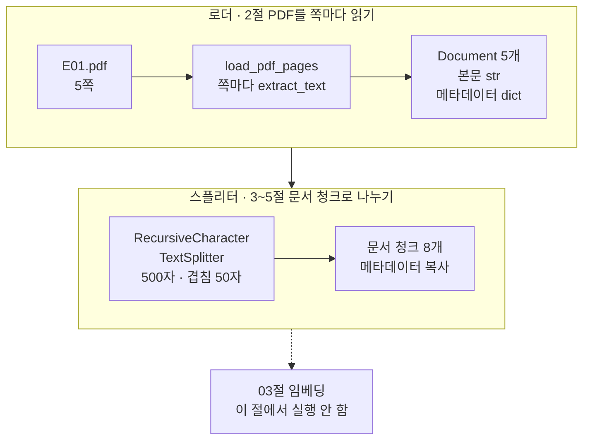
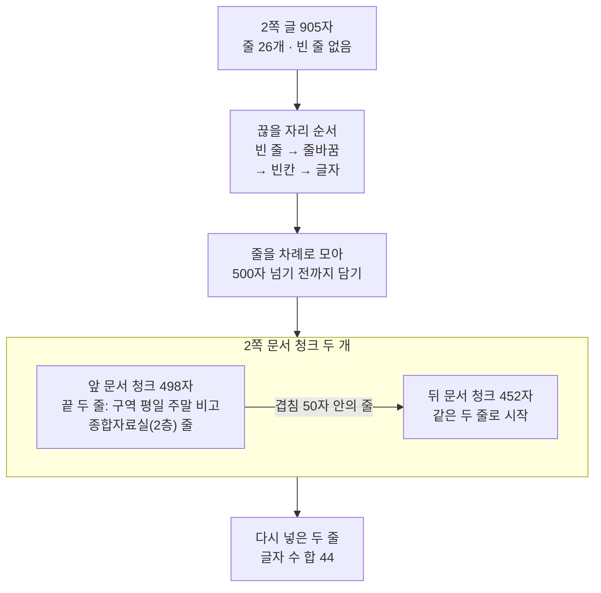
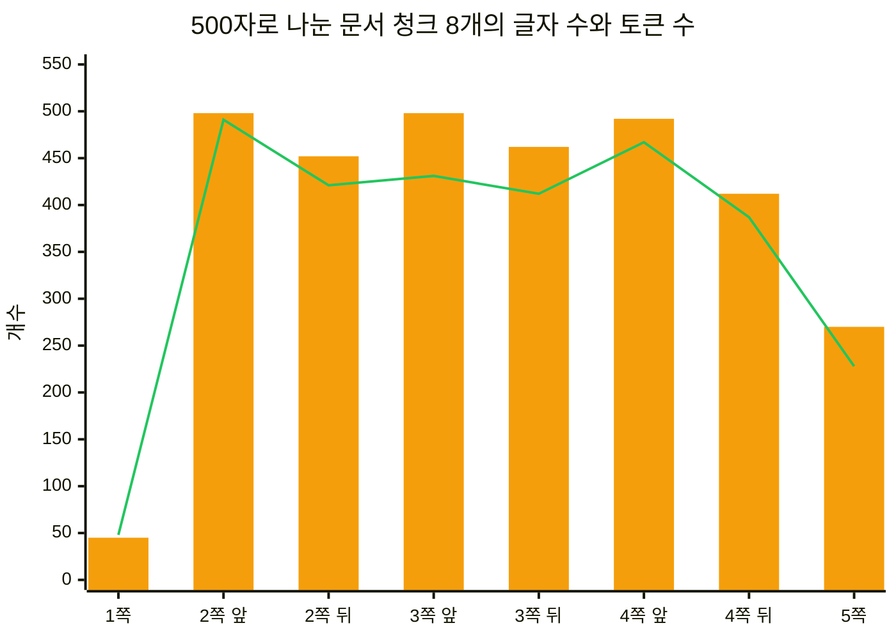
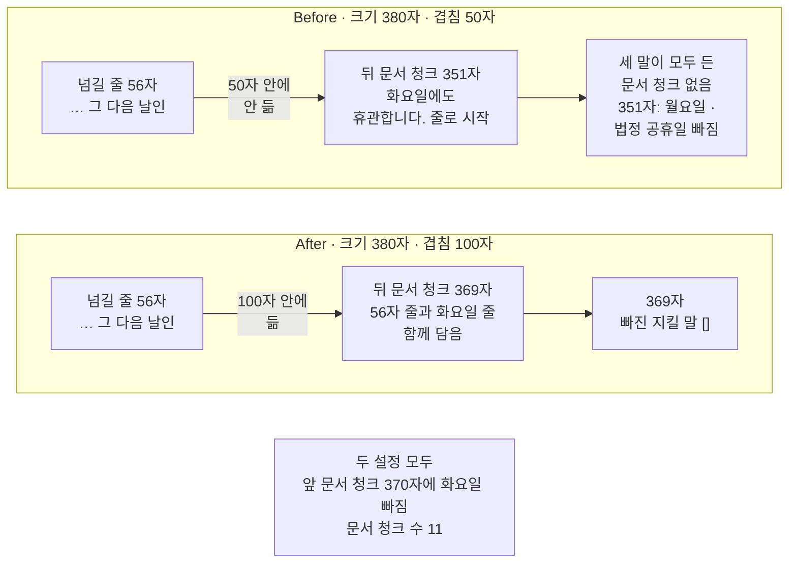

# 02-로더와-스플리터

## _src 본문 (HTML 원본)

```html
<!--meta: 강의 1h | 실습 2h | 코드 Jupyter Notebook | 새 용어 5 -->
<h2 id="b1"><span class="no">1</span>학습 목표</h2>
<div class="goal"><p>이 절을 마치면 다음을 할 수 있습니다.</p><ul><li>쪽마다 Document를 담은 목록을 반환하는 로더 함수를 만들고, 본문과 메타데이터의 자료형을 말할 수 있습니다.</li><li>스플리터가 줄을 모아 문서 청크를 만들고 겹침만큼 줄을 다시 넣는 규칙을, 실제 두 문서 청크의 경계로 설명할 수 있습니다.</li><li>크기와 겹침이 글자 수라는 것을 토큰 수와 구분해 말할 수 있습니다.</li><li>지킬 말 검사로 조건 문장이 한 문서 청크에 들어갔는지 확인할 수 있습니다.</li></ul></div>
<h2 id="b2"><span class="no">2</span>이 내용을 배우는 이유</h2>
<p>01절에서 검색은 문서 청크 단위로 결과를 가져왔습니다. k=1일 때는 표지 45자 문서 청크만 왔고, 휴관 문장은 2쪽 498자 문서 청크 안에 있었습니다. 모델이 받는 근거는 결국 문서 청크 한 장 한 장입니다.</p>
<p>그래서 나누는 방법이 근거의 모양을 정합니다. 한 조건 문장이 두 문서 청크로 갈라지면, 검색이 한쪽만 가져올 때 조건이 반만 들어갑니다. 쪽 번호 같은 메타데이터가 문서 청크에 남지 않으면 출처 표시도 만들 수 없습니다.</p>
<p>크기를 정하는 단위도 확인해야 합니다. Ch 8 01절 토큰 예산은 토큰으로 셌지만, 01절 스플리터의 500과 50은 다른 단위일 수 있습니다. 단위를 섞으면 예산표와 실제 입력이 어긋납니다.</p>
<p><strong>이 절의 질문</strong> — PDF 쪽 글은 어떤 규칙으로 문서 청크가 되고, 겹침 값은 조건 문장이 남는 자리를 어떻게 바꿀까요?</p>
<h2 id="b3"><span class="no">3</span>앞에서 배운 내용</h2>
<table><thead><tr><th>앞 절</th><th>배운 것</th><th>이 절에서 이어지는 곳</th></tr></thead><tbody>
<tr><td>Ch 2 01절</td><td><code>type()</code>으로 값의 자료형 보기</td><td>2절 본문·메타데이터 자료형</td></tr>
<tr><td>Ch 2 04절</td><td>함수 정의와 <code>return</code>, 정의 셀과 호출 셀 나누기</td><td>2절 로더 함수 <code>load_pdf_pages()</code></td></tr>
<tr><td>Ch 5 01절</td><td>모델이 글을 세는 단위인 토큰(조각)</td><td>4절 글자 수와 토큰 수</td></tr>
<tr><td>Ch 8 01절</td><td>tiktoken 토큰화 규칙, <code>count_tokens()</code>, 토큰 예산</td><td>4절 문서 청크 토큰 세기(도구 파일 <code>rag_tools.py</code>에서 가져옴)</td></tr>
<tr><td>Ch 8 03절</td><td>지킬 말과 <code>find_missing_words()</code></td><td>Before·After 휴관 조건 검사</td></tr>
<tr><td>Ch 9 01절</td><td><code>PdfReader</code>·Document·메타데이터, 500자·겹침 50으로 문서 청크 8개</td><td>2절 로더 함수, 3절 같은 설정 다시 보기</td></tr>
</tbody></table>
<p>01절에서 정한 대로 한정어 없는 말 대신 「문서 청크」라고 부릅니다. Ch 6 04절 스트림 청크와 다르고, Ch 5 「조각」(토큰)과도 다릅니다. 이 절은 모델에 요청을 보내지 않으므로 API 키가 없어도 노트북이 실행됩니다.</p>
<h2 id="b4"><span class="no">4</span>핵심 개념</h2>
<h3>비유로 시작하기</h3>
<p>나무 책상 왼쪽에 줄이 빼곡한 긴 종이 한 장이 있습니다. 오른쪽에는 크기가 같은 흰 카드 세 장이 한 줄로 놓여 있습니다. 긴 종이와 카드 세 장의 오른쪽 위에는 똑같은 초록 스티커가 붙어 있습니다.</p>
<p>카드마다 회색 줄이 있고, 몇 줄에는 노란 형광 띠가 칠해져 있습니다. 첫 카드는 마지막 줄, 가운데 카드는 첫 줄과 마지막 줄, 셋째 카드는 첫 줄에 띠가 있습니다.</p>
{{img:02-5-공지문과-문단-카드|나무 책상 왼쪽에 회색 줄이 많은 긴 종이 한 장이 있고 오른쪽 위에 초록 스티커가 붙어 있으며, 오른쪽에는 크기가 같은 흰 카드 세 장이 한 줄로 놓여 모두 같은 초록 스티커가 붙어 있고, 첫 카드의 마지막 줄과 가운데 카드의 첫 줄·마지막 줄, 셋째 카드의 첫 줄에 같은 노란 형광 띠가 칠해진 삽화|긴 종이를 카드 세 장에 나눠 옮겼습니다. 이웃한 두 카드는 노란 띠 줄을 한 번씩 함께 갖습니다.}}
<p><strong>그림 읽기</strong> — 먼저 초록 스티커를 봅니다. 긴 종이의 스티커가 카드 세 장에 모두 붙어 있습니다. 다음으로 카드 사이를 봅니다. 앞 카드의 마지막 노란 줄과 다음 카드의 첫 노란 줄이 짝을 이룹니다. 긴 종이의 노란 띠 수와 자리, 카드마다 다른 줄 수는 뜻이 없는 소품입니다.</p>
<p>긴 종이는 PDF 한 쪽을 읽은 Document입니다. 카드 한 장은 문서 청크이고, 카드에 옮기는 일이 스플리터가 하는 일입니다. 초록 스티커는 메타데이터로, 나눈 뒤에도 문서 청크마다 그대로 복사됩니다.</p>
<p>노란 띠는 겹침입니다. 앞 카드의 끝 줄을 다음 카드 첫머리에 한 번 더 적어, 경계에 걸린 문장이 한 카드 안에 남게 합니다. Ch 8 03절 그림의 초록 형광 띠는 지킬 말이었지만, 이 그림의 노란 띠는 겹침입니다. 이 카드들은 03절에서 01절의 카드가 꽂힌 긴 상자, 곧 벡터스토어에 들어갑니다.</p>
<h3>로더와 스플리터</h3>
<p>로더(loader)는 파일을 읽어 Document 목록으로 바꾸는 도구입니다. 두꺼운 안내 책자를 쪽마다 펼쳐 한 장씩 옮겨 적는 일과 비슷합니다. 노트북에서는 01절 셀 코드를 함수로 묶은 <code>load_pdf_pages()</code>가 로더입니다.</p>
<p>스플리터(text splitter)는 긴 글을 정한 크기 안의 문서 청크로 나누는 도구입니다. 긴 공지문을 크기가 같은 문단 카드 몇 장에 나눠 옮기는 일과 같습니다. 노트북에서는 01절과 같은 <code>RecursiveCharacterTextSplitter</code>를 씁니다.</p>
{{mermaid:02-1-로더와-스플리터|위 칸 로더에는 초록 상자 E01.pdf 5쪽, 파란 상자 load_pdf_pages 쪽마다 extract_text, 초록 상자 Document 5개 본문 str 메타데이터 dict가 왼쪽에서 오른쪽으로 있고, 아래 칸 스플리터에는 파란 상자 RecursiveCharacterTextSplitter 500자 겹침 50자, 초록 상자 문서 청크 8개 메타데이터 복사가 있으며, 맨 아래 회색 상자 03절 임베딩은 이 절에서 실행하지 않음이 점선 화살표로 이어진 흐름도|로더가 PDF 5쪽을 Document 5개로 읽고, 스플리터가 문서 청크 8개로 나눕니다. 메타데이터는 문서 청크마다 복사됩니다.}}
<p><strong>도식 읽기</strong> — 위 칸이 로더, 아래 칸이 스플리터이고, 칸마다 왼쪽에서 오른쪽으로 읽습니다. 초록 상자는 코드가 만든 자료, 파란 상자는 코드 단계입니다. 위 칸에서 E01.pdf 5쪽이 <code>load_pdf_pages()</code>를 거쳐 Document 5개가 됩니다.</p>
<p>문서 객체 Document의 본문은 글(<code>str</code>), 메타데이터는 딕셔너리(<code>dict</code>)였습니다. 아래 칸에서 스플리터가 500자·겹침 50자로 나눠 문서 청크 8개를 만듭니다. 맨 아래 회색 상자와 점선 화살표는 03절의 임베딩으로, 이 절에서는 실행하지 않습니다.</p>
<h3>이 절에서 쓰는 말</h3>
<table><thead><tr><th>용어</th><th>뜻</th><th>이 절에서 보이는 모습</th></tr></thead><tbody>
<tr><td>로더(loader)</td><td>파일을 읽어 Document 목록으로 바꾸는 도구</td><td><code>load_pdf_pages(pdf_path, "E01")</code>, <code>Document 수: 5</code></td></tr>
<tr><td>스플리터(text splitter)</td><td>긴 글을 정한 크기 안의 문서 청크로 나누는 도구</td><td><code>RecursiveCharacterTextSplitter</code>, <code>문서 청크 수: 8</code></td></tr>
<tr><td>크기(chunk size)</td><td>한 문서 청크의 최대 글자 수</td><td><code>chunk_size=500</code>, 300, 380</td></tr>
<tr><td>겹침(chunk overlap)</td><td>이웃한 두 문서 청크가 함께 갖는 글의 최대 글자 수. 스플리터가 끊어 낸 단위로 들어가며, E01에서는 그 단위가 줄</td><td><code>다시 넣은 두 줄의 글자 수 합: 44</code></td></tr>
<tr><td>끊을 자리 순서(separators)</td><td>스플리터가 끊을 자리를 찾는 차례. 빈 줄, 줄바꿈, 빈칸, 글자 하나</td><td>빈 줄이 없는 E01은 줄바꿈 자리에서 끊음</td></tr>
</tbody></table>
<p>메타데이터·지킬 말·토큰화 규칙은 앞 챕터와 같은 뜻입니다. 메타데이터는 Ch 8 02절의 내용 옆 설명 값입니다. 지킬 말은 Ch 8 03절에서 사람이 원문에서 고른 꼭 남길 말 목록입니다.</p>
<h2 id="b5"><span class="no">5</span>실행 예제</h2>
<p>노트북은 E01.pdf 5쪽을 로더 함수로 읽고, 쪽 글의 모양을 먼저 봅니다. 그다음 01절과 같은 설정으로 나눠 경계와 겹침을 확인합니다. 마지막으로 글자 수와 토큰 수를 나란히 보고, 크기를 300자로 바꿔 봅니다.</p>
<p>이 노트북은 모델에 요청을 보내지 않아 요금이 들지 않습니다. 라이브러리 tiktoken이 처음 실행할 때 토큰화 규칙 파일 두 개를 내려받습니다. 이 페이지의 출력은 2026-09-21에 실행한 결과이고, 같은 판에서는 다시 실행해도 같은 값이 나왔습니다.</p>
<p>강의 시간에는 노트북 2~4절(로더, 스플리터 규칙과 겹침, 글자 수와 토큰 수)을 설명합니다. 5절 값 바꿔 보기와 Before·After는 함께 실행하고 실습 시간에 읽습니다.</p>
{{notebook:02-로더와-스플리터|example}}
<p class="look"><b>확인할 점</b> — 2절 <code>2 | 905 | 26 | False | 2</code>에서 빈 줄이 없음을 봅니다. 3절 <code>다시 넣은 두 줄의 글자 수 합: 44</code>를 확인합니다. 4절 <code>2 | 498 | 491</code>과 <code>3 | 498 | 431</code>을 비교합니다.</p>
<h3>PDF 쪽 글의 모양</h3>
<p>로더 함수의 결과는 01절과 같았습니다. 출력은 <code>Document 수: 5</code>, <code>본문 자료형: &lt;class 'str'&gt;</code>, <code>메타데이터 자료형: &lt;class 'dict'&gt;</code>였습니다. 셀 코드를 함수로 묶어도 값은 바뀌지 않습니다.</p>
<p>쪽 글에는 세 가지 특징이 있었습니다. 다섯 쪽 모두 빈 줄이 없고, 인쇄된 줄마다 줄바꿈만 들어 있었습니다. 마지막 줄은 모두 쪽 번호 숫자 하나로, 쪽 아래 번호가 본문 글로 함께 읽혔습니다.</p>
<p>셋째로 2쪽 이용 시간 표는 <code>종합자료실(2층) 09:00~22:00 09:00~18:00</code>처럼 칸 경계가 빈칸 하나로 바뀌었습니다. 어느 시각이 평일 칸인지는 순서로만 알 수 있습니다. 추출한 글에서는 표의 칸 관계가 흐려질 수 있습니다.</p>
<h3>줄을 모으고 겹치는 규칙</h3>
<p>설치한 langchain-text-splitters 1.1.2 소스에서 끊는 규칙을 확인했습니다. 스플리터는 빈 줄, 줄바꿈, 빈칸, 글자 하나 순서로 끊을 자리를 찾습니다. E01에는 빈 줄이 없으니 줄바꿈 자리에서 끊고, 줄을 차례로 모아 500자를 넘기 전까지 한 문서 청크에 담습니다.</p>
{{mermaid:02-2-줄-모으기와-겹침|위에서 아래로 초록 상자 2쪽 글 905자 줄 26개 빈 줄 없음, 파란 상자 끊을 자리 순서 빈 줄 줄바꿈 빈칸 글자, 파란 상자 줄을 차례로 모아 500자 넘기 전까지 담기가 이어지고, 칸 안에 초록 상자 앞 문서 청크 498자 끝 두 줄 구역 평일 주말 비고와 종합자료실 줄에서 겹침 50자 안의 줄 화살표로 초록 상자 뒤 문서 청크 452자 같은 두 줄로 시작이 있으며, 맨 아래 노란 상자 다시 넣은 두 줄 글자 수 합 44가 있는 흐름도|2쪽 글은 줄바꿈 자리에서 끊겨 498자와 452자 문서 청크가 됐고, 앞 문서 청크의 끝 두 줄 44자가 뒤 문서 청크 앞에 다시 들어갔습니다.}}
<p><strong>도식 읽기</strong> — 위에서 아래로 읽습니다. 맨 위 초록 상자는 2절에서 본 2쪽 글이고, 파란 상자 두 개는 스플리터의 규칙입니다. 칸 안의 초록 상자 두 개가 3절에서 나온 2쪽 문서 청크 두 개입니다.</p>
<p>칸 안 화살표는 앞 문서 청크의 끝 두 줄이 뒤 문서 청크 앞에 다시 들어간 자리입니다. 두 줄은 <code>['구역 평일 주말 비고', '종합자료실(2층) 09:00~22:00 09:00~18:00']</code>로 두 문서 청크에서 같았습니다. 맨 아래 노란 상자는 출력으로 확인한 두 줄의 글자 수 합 44입니다.</p>
<p>겹침(chunk overlap)은 이웃한 두 문서 청크가 함께 갖는 글의 최대 글자 수입니다. 공지문을 카드에 옮길 때, 앞 카드의 마지막 줄을 다음 카드 첫머리에 한 번 더 적는 것과 같습니다. 노트북에서는 44자 두 줄이 겹침 50 안에 들어 다시 들어갔습니다.</p>
<p>이 도구는 줄을 쪼개서 겹치지 않습니다. 이 절의 설정에서는 앞 문서 청크 끝에서 겹침 안에 드는 줄만 다시 넣습니다. 스플리터는 줄 사이 줄바꿈까지 넣어 44자 두 줄을 45자로 재고 겹침 50과 견줍니다. 그래서 겹침 50은 정확히 50자를 겹친다는 뜻이 아닙니다.</p>
<h3>글자 수와 토큰 수</h3>
<p>크기 500과 겹침 50은 글자 수입니다. 이 스플리터는 기본으로 함수 <code>len</code>, 곧 글자 수로 길이를 셉니다. 모델이 세는 단위는 토큰으로, Ch 5 01절에서 「조각」이라고 부른 단위입니다.</p>
{{mermaid:02-3-글자-수와-토큰-수|가로축에 1쪽, 2쪽 앞, 2쪽 뒤, 3쪽 앞, 3쪽 뒤, 4쪽 앞, 4쪽 뒤, 5쪽, 세로축에 개수 0부터 550까지를 둔 그래프로, 주황 막대는 글자 수 45, 498, 452, 498, 462, 492, 412, 270이고, 초록 선은 토큰 수 48, 491, 421, 431, 412, 467, 387, 228이며, 1쪽에서만 초록 선이 막대 위에 있는 그림|주황 막대(글자 수)가 같은 498자여도 초록 선(토큰 수)은 2쪽 앞 491, 3쪽 앞 431로 다릅니다.}}
<p><strong>도식 읽기</strong> — 가로축은 500자로 나눈 문서 청크 8개이고, 세로축은 개수입니다. 주황 막대는 글자 수, 초록 선은 <code>text-embedding-3-small</code>의 규칙 <code>cl100k_base</code>로 센 토큰 수입니다. 막대 그래프라 범례가 없어 막대와 선의 모양으로 구분합니다.</p>
<p>2쪽 앞과 3쪽 앞 막대는 똑같이 498이지만, 선은 491과 431로 높이가 다릅니다. 1쪽 표지만 선 48이 막대 45보다 높습니다. 크기 500자는 글자 수 약속이라 토큰 수를 500 아래로 맞춰 주지 않습니다.</p>
<p>토큰 수는 규칙에 따라서도 달라집니다. 2쪽 첫 문서 청크를 답 모델 <code>gpt-5.4-mini</code>의 규칙 <code>o200k_base</code>로 세면 <code>330</code>이었습니다. 같은 498자가 임베딩 규칙으로는 491토큰입니다. 토큰 수를 적을 때는 어느 모델의 규칙으로 셌는지 함께 적습니다.</p>
<h3>크기를 300자로 줄이면</h3>
<p>노트북 5절은 겹침 50을 그대로 두고 크기만 300으로 바꿨습니다. 출력은 <code>500자 문서 청크 수: 8</code>과 <code>300자 문서 청크 수: 14</code>였습니다. 2쪽은 문서 청크 두 개에서 네 개가 됐고, 글자 수는 242·283·269·191이었습니다.</p>
<p>네 글자 수를 더하면 985자로 2쪽 905자보다 많습니다. 이웃한 문서 청크가 겹친 줄을 함께 갖기 때문입니다. 문서 청크가 늘면 03절에서 임베딩할 글도 늘어납니다. 어느 크기가 검색에 좋은지는 이 절에서 재지 않았습니다.</p>
<h2 id="b6"><span class="no">6</span>일부러 실패해 보기</h2>
<p>2쪽 휴관 조건은 PDF에서 두 줄에 걸쳐 있습니다. 첫 줄은 <code>그 다음 날인</code>으로 끝나고, 둘째 줄은 <code>화요일에도 휴관합니다.</code>입니다. 실패 조건인 Before는 크기를 380자, 겹침을 3절과 같은 50자로 둡니다.</p>
<p>휴관 조건이 한 문서 청크에 온전히 들어갔는지는 Ch 8 03절 지킬 말로 검사합니다. 지킬 말은 <code>closure_keep_words</code>의 세 말 「월요일」「법정 공휴일」「화요일」입니다. 검사 함수 <code>find_missing_words()</code>는 Ch 8 03절 함수를 도구 파일 <code>rag_tools.py</code>에서 가져옵니다.</p>
<p>After에서 고치는 값은 겹침 하나입니다. 50을 100으로 바꾸고, 크기 380자와 PDF는 Before와 같습니다.</p>
{{notebook:02-로더와-스플리터|failure}}
<p>Before에서 나온 2쪽 문서 청크는 세 개였습니다. 첫째는 <code>370 | ['화요일']</code>, 둘째는 <code>351 | ['월요일', '법정 공휴일']</code>이었습니다. 휴관 조건의 앞부분은 첫째에, 「화요일」은 둘째에 들어가 세 말을 모두 가진 문서 청크가 없었습니다.</p>
<p>경계를 보면 까닭이 보입니다. 첫째 문서 청크의 마지막 줄은 <code>앞 문서 청크 마지막 줄의 글자 수: 56</code>이었습니다. 겹침 50자를 두었지만, 56자 줄이 겹침 안에 들지 않아 겹친 줄이 없었습니다.</p>
<p>고친 뒤 After에서 둘째 문서 청크는 <code>369 | []</code>로, 빠진 지킬 말이 없었습니다. 첫 세 줄은 <code>시까지 문을 엽니다.</code>, 56자 휴관 줄, <code>화요일에도 휴관합니다.</code>였습니다. 앞 문서 청크 끝의 두 줄이 겹침 100자 안에 들어 다시 들어간 것입니다.</p>
{{mermaid:02-4-Before-After|위 칸 Before 크기 380자 겹침 50자에는 초록 상자 넘길 줄 56자, 50자 안에 안 듦 화살표, 초록 상자 뒤 문서 청크 351자 화요일에도 휴관합니다 줄로 시작, 빨간 상자 세 말이 모두 든 문서 청크 없음 351자 월요일 법정 공휴일 빠짐이 차례로 있고, 아래 칸 After 크기 380자 겹침 100자에는 초록 상자 넘길 줄 56자, 100자 안에 듦 화살표, 초록 상자 뒤 문서 청크 369자 56자 줄과 화요일 줄 함께 담음, 노란 상자 369자 빠진 지킬 말 빈 목록이 차례로 있으며, 맨 아래 회색 상자에 두 설정 모두 앞 문서 청크 370자에 화요일 빠짐 문서 청크 수 11이 따로 있는 비교 그림|겹침 50자에서는 56자 줄이 넘어가지 않아 휴관 조건이 갈라졌고, 겹침 100자에서는 369자 문서 청크에 조건 두 줄이 함께 들어갔습니다.}}
<p><strong>도식 읽기</strong> — 위 칸이 Before, 아래 칸이 After이고, 칸마다 왼쪽에서 오른쪽으로 읽습니다. 초록 상자는 나눈 글이고, 화살표 라벨은 56자 줄이 겹침 안에 드는지입니다. 두 칸에서 다른 값은 겹침 하나입니다.</p>
<p>위 칸 끝의 빨간 상자는 Before 결함 결과로, 세 말이 모두 든 문서 청크가 없습니다. 아래 칸 끝의 노란 상자는 After 출력으로 확인한 <code>369 | []</code>입니다. 맨 아래 회색 상자는 두 설정에서 같았던 값이라 어느 한쪽의 효과로 넣지 않았습니다.</p>
<p>After에서도 앞 문서 청크 370자는 「화요일」이 빠진 채 남았습니다. 겹침은 조건 전체를 담은 문서 청크를 하나 더 만들 뿐, 앞 문서 청크를 고치지 않습니다. 문서 청크 수는 11개로 같았지만, 같은 줄이 두 문서 청크에 들어가 임베딩할 글은 늘어납니다.</p>
<p>이 결과는 E01 2쪽과 크기 380자에서 본 것입니다. 크기나 PDF가 바뀌면 경계 자리도 바뀝니다. 나눈 뒤에는 지킬 말 같은 짧은 말로 조건이 한 문서 청크에 남았는지 다시 확인합니다.</p>
<h2 id="b7"><span class="no">7</span>주의할 점과 실무 메모</h2>
<ul><li>크기 380은 교재를 만들 때 여러 크기로 먼저 나눠 보고 고른 값입니다. 크기 100~600을 10자 간격으로, 겹침 0·50·60·80·100과 함께 나눴습니다. 휴관 세 말을 모두 가진 문서 청크가 없던 설정은 크기·겹침 짝 일곱 가지뿐이었습니다. 크기 130·140·370·380은 겹침 0에서, 크기 160·370·380은 겹침 50에서 갈라졌습니다.</li>
<li>그 가운데 380과 겹침 50→100은 흐름을 보여 주려고 정한 예입니다. 500자·겹침 50인 01절 설정에서는 휴관 조건이 498자 문서 청크 하나에 함께 들어갔습니다. 380이 좋은 크기라는 뜻이 아닙니다.</li>
<li>겹침 값은 PDF 한 줄의 글자 수와 견줘 정합니다. 같은 탐색에서 본 E01의 문장 줄은 대부분 54~61자였습니다. 10자를 넘는 줄 72개 가운데 30개가 이 길이였고, 표 줄과 제목 줄은 더 짧았습니다. 겹침 50으로는 이런 긴 줄이 한 줄도 넘어가지 못할 수 있습니다.</li>
<li>설치한 1.1.2 소스에서 한 줄이 크기보다 길면, 스플리터는 그 줄을 빈칸 자리에서 다시 나눕니다. E01 줄은 모두 크기보다 짧아, 이 동작은 이번에 실행하지 않았습니다.</li>
<li>쪽 끝의 쪽 번호 줄도 문서 청크 글에 들어갑니다. 표지 45자 문서 청크도 그대로 남았습니다. 이런 줄이나 쪽을 거르는 처리는 이 절에서 실행하지 않았습니다.</li>
<li>PDF 표는 칸 경계가 빈칸으로 바뀌어 칸 관계가 흐려질 수 있습니다. 표가 많은 PDF 읽기는 Ch 10 02절, HWP·HWPX 문서는 Ch 10 04절에서 다룹니다. 라이브러리 pypdf는 PDF만 읽습니다.</li>
<li>글자 수 대신 토큰 수로 크기를 재는 스플리터도 있습니다. 설치판에는 <code>from_tiktoken_encoder()</code>와 <code>TokenTextSplitter</code>가 있고, 이번에 실행하지 않았습니다. 나누는 방식 비교는 Ch 10 05절에서 다룹니다.</li>
<li>설치한 langchain-openai 1.6.0 소스에서 <code>OpenAIEmbeddings</code>는 보내기 전에 <code>cl100k_base</code>로 글을 토큰으로 바꿉니다. 한 번에 넣는 최대 토큰 수 기본값은 8191입니다. 3절 문서 청크 8개 가운데 토큰이 가장 많은 것도 491토큰이었습니다.</li>
<li>이 절은 pypdf로 쪽마다 읽는 로더 함수를 직접 만들었습니다. LangChain 문서에 나오는 PDF 로더 클래스는 이번에 실행하지 않았습니다.</li>
<li>라이브러리 tiktoken은 토큰화 규칙 파일을 처음 한 번 인터넷에서 내려받아 임시 폴더에 둡니다. 인터넷이 막힌 곳에서 어떻게 되는지는 이번에 실행하지 않았습니다.</li>
<li>교재 출력은 Linux의 Python 3.12.13으로 만들었습니다. 패키지는 pypdf 6.17.0, langchain-core 1.6.2입니다. langchain-text-splitters 1.1.2와 tiktoken 0.14.0도 함께 썼습니다. 다른 버전과 Windows·macOS에서는 실행하지 않았습니다.</li></ul>
<h2 id="b8"><span class="no">8</span>정리와 다음 절</h2>
<ul><li>로더 함수로 PDF 5쪽을 Document 5개로 읽었습니다. 본문은 글, 메타데이터는 딕셔너리였고, 나눈 뒤 문서 청크마다 복사됐습니다.</li><li>스플리터는 빈 줄이 없는 E01을 줄바꿈 자리에서 끊어 줄을 모았습니다. 겹침은 줄 단위로 들어가, 2쪽에서는 44자 두 줄이 다시 들어갔습니다.</li><li>크기와 겹침은 글자 수이고 토큰 수와 다릅니다. 56자 줄은 겹침 50으로는 넘어가지 않아 휴관 조건이 갈라졌고, 100으로는 한 문서 청크에 모였습니다.</li></ul>
<p><strong>다음 학습과 이어지는 지점</strong> — 03절에서는 나눈 문서 청크를 임베딩해 벡터스토어에 넣고 검색하는 단계를 봅니다. 01절 k=1 표지 결과처럼, 어떤 문서 청크가 가까운 순서로 올라오는지와 이어집니다.</p>
<h2 id="b9"><span class="no">9</span>복습 문제</h2>
<details class="quiz"><summary>문제 1 · 로더 함수의 반환값</summary><p class="quiz-q">로더 함수 <code>load_pdf_pages(pdf_path, "E01")</code>은 무엇을 반환하고, 2쪽 Document의 본문과 메타데이터는 어떤 자료형이었나요?</p><p class="quiz-a"><b>해설</b> — 쪽마다 Document 하나를 담은 목록 5개를 반환합니다. 본문 <code>page_content</code>는 글(<code>str</code>), 메타데이터 <code>metadata</code>는 딕셔너리(<code>dict</code>)였습니다. 메타데이터에는 <code>doc_id</code>·<code>page</code>·<code>source</code>가 들어 있습니다.</p></details>
<details class="quiz"><summary>문제 2 · 끊는 자리</summary><p class="quiz-q">E01 쪽 글에는 빈 줄이 없었습니다. 스플리터는 어느 자리에서 끊고, 문서 청크에 무엇을 모았나요?</p><p class="quiz-a"><b>해설</b> — 끊을 자리 순서에서 빈 줄 다음인 줄바꿈 자리에서 끊습니다. 그리고 PDF에 인쇄된 줄을 차례로 모아, 크기를 넘기 전까지 한 문서 청크에 담습니다.</p></details>
<details class="quiz"><summary>문제 3 · 겹침 50의 뜻</summary><p class="quiz-q">3절에서 겹침을 50으로 두었는데 다시 들어간 두 줄의 글자 수 합은 44였습니다. Before에서는 겹친 줄이 아예 없었습니다. 까닭은 무엇인가요?</p><p class="quiz-a"><b>해설</b> — 이 스플리터는 줄을 쪼개지 않고, 겹침 안에 드는 줄만 다시 넣습니다. 3절은 두 줄이 44자라 50 안에 들었습니다. Before에서는 넘길 줄이 56자라 50 안에 들지 않았습니다.</p></details>
<details class="quiz"><summary>문제 4 · 글자 수와 토큰 수</summary><p class="quiz-q">2쪽 첫 문서 청크는 498자, 임베딩 규칙 토큰 수 491, 답 모델 규칙 토큰 수 330이었습니다. 크기 500을 토큰 예산으로 바로 쓰면 무엇이 문제인가요?</p><p class="quiz-a"><b>해설</b> — 500은 글자 수라서 토큰 수와 단위가 다릅니다. 토큰 수는 글 내용과 규칙에 따라 달라지므로, 예산표에는 넣을 모델의 규칙으로 센 토큰 수를 적어야 합니다.</p></details>
<details class="quiz"><summary>문제 5 · After가 고친 것</summary><p class="quiz-q">After에서도 앞 문서 청크 370자는 「화요일」이 빠진 채 남았습니다. 그래도 After를 고친 결과로 보는 까닭은 무엇인가요?</p><p class="quiz-a"><b>해설</b> — 휴관 조건 두 줄을 모두 담은 369자 문서 청크가 새로 생겼기 때문입니다. 검색이 이 문서 청크를 가져오면 조건 전체가 근거에 들어갑니다. 겹침은 앞 문서 청크를 고치지 않고, 조건을 온전히 담은 문서 청크를 하나 더 만듭니다.</p></details>
<h2 id="b10"><span class="no">10</span>참고 자료</h2>
<p>문서는 2026-09-17에 다시 열어 확인했습니다. 끊을 자리 순서와 겹침 동작은 설치한 langchain-text-splitters 1.1.2 소스에서 확인했습니다. 토큰화 규칙 이름은 tiktoken 0.14.0과 langchain-openai 1.6.0 소스에서 확인했습니다.</p>
<ul><li><div><a href="https://docs.langchain.com/oss/python/integrations/splitters">LangChain Text splitter integrations</a></div>문서를 검색 단위로 나누는 스플리터, <code>RecursiveCharacterTextSplitter</code> 권장 · 확인 2026-09-17</li><li><div><a href="https://pypdf.readthedocs.io/en/stable/user/extract-text.html">pypdf Extract Text from a PDF</a></div>쪽마다 글 꺼내기 · 확인 2026-09-17</li><li><div><a href="https://github.com/openai/tiktoken">openai/tiktoken</a></div>OpenAI 모델의 토큰화 규칙을 내 컴퓨터에서 쓰는 라이브러리 · 확인 2026-09-17</li></ul>
```

## 노트북 셀 (순서대로)

### [0] markdown {'html': 'skip'}

# 로더와 스플리터

**이 노트북에서 할 일**

1. 직접 만든 로더 함수로 도서관 안내 PDF(E01) 5쪽을 Document 목록으로 읽습니다.
2. 스플리터가 줄을 모아 문서 청크를 만드는 규칙과 겹침, 글자 수와 토큰 수를 출력으로 봅니다.
3. 겹침이 한 줄보다 짧아 휴관 조건이 갈라지는 Before와, 겹침을 늘린 After를 비교합니다.

**준비물** — 데이터 파일은 `labs/data/rag-corpus/pdf/easy/E01.pdf`입니다.
이 노트북은 모델에 요청을 보내지 않으므로 API 키가 없어도 실행됩니다. 요금도 들지 않습니다.
라이브러리 tiktoken은 처음 실행할 때 토큰화 규칙 파일 두 개를 인터넷에서 내려받습니다. 실행 시간은 30초 안팎입니다.

**강의와 실습 범위** — 강의 시간에는 2~4절(로더, 스플리터 규칙과 겹침, 글자 수와 토큰 수)을 설명합니다.
5절 값 바꿔 보기와 Before·After는 함께 실행하고 실습 시간에 읽습니다.

**기준 버전** — 실습 폴더에 고정한 판을 씁니다. pypdf 6.17.0, langchain-core 1.6.2입니다.
함께 쓰는 판은 langchain-text-splitters 1.1.2와 tiktoken 0.14.0입니다.

교재 출력은 Linux의 Python 3.12.13으로 만들었습니다. 다른 버전과 Windows·macOS에서는 이번에 실행하지 않았습니다.

실습 폴더 `labs/part3/ch09-rag-first-run`에서 `uv sync --locked`를 실행합니다.
그다음 이 폴더의 `.venv` 커널을 고르고 첫 셀부터 순서대로 실행합니다.

### [1] markdown {'html': 'skip'}

## 오늘 볼 그림


위 칸은 PDF를 쪽마다 읽어 Document로 만드는 로더, 아래 칸은 Document를 문서 청크로 나누는 스플리터입니다.
초록 상자는 코드가 만든 자료, 파란 상자는 코드 단계입니다. 회색 상자는 이 절에서 실행하지 않는 다음 단계입니다.
노트북 2절이 위 칸, 3~5절이 아래 칸을 실행합니다.

### [2] markdown {}

## 1. 준비

첫 셀은 패키지를 설치하고 설치된 버전을 출력합니다. 설치에는 몇십 초가 걸릴 수 있습니다.
01절과 달리 임베딩·벡터스토어·모델은 쓰지 않고, 토큰을 세는 tiktoken을 씁니다.

### [3] code {'execution': {'iopub.execute_input': '2026-09-21T05:35:31.420948Z', 'iopub.status.busy': '2026-09-21T05:35:31.420896Z', 'iopub.status.idle': '2026-09-21T05:35:31.889014Z', 'shell.execute_reply': '2026-09-21T05:35:31.888291Z'}, 'lesson_role': 'setup'}

```python
# 이 절에서 쓰는 패키지를 설치하고 버전을 확인합니다
%pip install -q "pypdf==6.17.0" "langchain==1.4.0" "langchain-text-splitters==1.1.2" "tiktoken==0.14.0"
from importlib.metadata import version

print("pypdf:", version("pypdf"))
print("langchain-core:", version("langchain-core"))
print("langchain-text-splitters:", version("langchain-text-splitters"))
print("tiktoken:", version("tiktoken"))
```

출력:
```
Note: you may need to restart the kernel to use updated packages.
pypdf: 6.17.0
langchain-core: 1.6.2
langchain-text-splitters: 1.1.2
tiktoken: 0.14.0

```

### [4] markdown {}

**결과 읽기** — 출력 줄은 `pypdf: 6.17.0`, `langchain-core: 1.6.2`, `langchain-text-splitters: 1.1.2`, `tiktoken: 0.14.0`입니다.
준비물에 적은 기준 버전과 같습니다. 이 노트북의 출력은 2026-09-21에 실행한 결과입니다.

PDF 읽기, 문서 객체, 글 나누기, 토큰 세기에 쓸 이름을 불러옵니다.
이름마다 처음 쓰는 절에서 무엇을 넣고 무엇을 반환하는지 설명합니다.

앞에서 배운 함수는 `rag_tools.py`에 모아 두었습니다. 파일을 열면 코드를 볼 수 있습니다. 노트북과 같은 폴더(`notebooks/`)에 있는 파일입니다.
이 노트북은 Ch 8 01절 `count_tokens()`와 Ch 8 03절 `find_missing_words()`를 가져옵니다.
함수 `count_tokens()`는 Ch 8 도구 파일 판처럼 토큰화 규칙 객체를 첫 인자로 받습니다.

### [5] code {'execution': {'iopub.execute_input': '2026-09-21T05:35:31.889931Z', 'iopub.status.busy': '2026-09-21T05:35:31.889863Z', 'iopub.status.idle': '2026-09-21T05:35:32.181417Z', 'shell.execute_reply': '2026-09-21T05:35:32.180982Z'}, 'lesson_role': 'setup'}

```python
# PDF 읽기·Document·문서 청크 나누기·토큰 세기에 쓸 이름을 불러옵니다
import os

from pypdf import PdfReader
from langchain_core.documents import Document
from langchain_text_splitters import RecursiveCharacterTextSplitter
import tiktoken
# Ch 8 01·03절 함수 두 개를 도구 파일에서 가져옵니다
from rag_tools import count_tokens, find_missing_words
```

출력:
```

```

### [6] markdown {}

## 2. 로더 함수로 PDF 5쪽 읽기

먼저 01절과 같은 셀로 PDF 경로를 고릅니다. 후보 경로를 차례로 확인하고, 있는 경로에서 멈춥니다.
실행 전에 예상합니다. 01절과 같은 폴더에서 열었다면 같은 후보를 고를 것입니다.

### [7] code {'execution': {'iopub.execute_input': '2026-09-21T05:35:32.182532Z', 'iopub.status.busy': '2026-09-21T05:35:32.182459Z', 'iopub.status.idle': '2026-09-21T05:35:32.185096Z', 'shell.execute_reply': '2026-09-21T05:35:32.184790Z'}}

```python
# 작업 폴더에서 본 E01.pdf 경로를 후보 세 개 가운데에서 고릅니다
candidates = [
    "labs/data/rag-corpus/pdf/easy/E01.pdf",
    "../../data/rag-corpus/pdf/easy/E01.pdf",
    "../../../data/rag-corpus/pdf/easy/E01.pdf",
]
pdf_path = None
for candidate in candidates:
    if os.path.exists(candidate):
        pdf_path = candidate
        break
print("PDF를 찾았는가:", pdf_path is not None)
print("고른 경로:", pdf_path)
assert pdf_path is not None, "notebooks 폴더나 실습 폴더 맨 위에서 노트북을 열어 주세요."
```

출력:
```
PDF를 찾았는가: True
고른 경로: labs/data/rag-corpus/pdf/easy/E01.pdf

```

### [8] markdown {}

**결과 읽기** — 출력 줄은 `PDF를 찾았는가: True`와 `고른 경로: labs/data/rag-corpus/pdf/easy/E01.pdf`입니다.
교재 출력은 프로젝트 맨 위를 작업 폴더로 삼아 실행해서 첫째 후보를 골랐습니다.
`notebooks` 폴더에서 열면 셋째 후보가 나옵니다.

로더(loader)는 파일을 읽어 Document 목록으로 바꾸는 도구입니다. 두꺼운 안내 책자를 쪽마다 펼쳐 한 장씩 옮겨 적는 일과 비슷합니다.
01절 2절에서는 쪽마다 Document를 만드는 코드를 셀에 바로 적었습니다. 이번에는 그 코드를 함수 하나로 묶어 로더로 씁니다.

함수 `load_pdf_pages()`는 PDF 경로와 문서 이름을 받아, 쪽마다 Document를 담은 목록을 반환합니다.
메타데이터 `source`에는 문서 이름 뒤에 `.pdf`를 붙인 파일 이름을 적습니다. 이 셀은 정의만 하므로 출력이 없습니다.

### [9] code {'execution': {'iopub.execute_input': '2026-09-21T05:35:32.186000Z', 'iopub.status.busy': '2026-09-21T05:35:32.185928Z', 'iopub.status.idle': '2026-09-21T05:35:32.187924Z', 'shell.execute_reply': '2026-09-21T05:35:32.187605Z'}}

```python
# PDF 경로와 문서 이름을 받아, 쪽마다 본문과 메타데이터를 담은 Document 목록을 반환하는 로더 함수를 정의합니다
def load_pdf_pages(pdf_path, doc_id):
    reader = PdfReader(pdf_path)
    page_documents = []
    page_number = 1
    for page in reader.pages:
        metadata = {"doc_id": doc_id, "page": page_number, "source": doc_id + ".pdf"}
        page_document = Document(page_content=page.extract_text(), metadata=metadata)
        page_documents.append(page_document)
        page_number = page_number + 1
    return page_documents
```

출력:
```

```

### [10] markdown {}

**결과 읽기** — 정의만 하는 셀이라 출력이 없습니다.

로더 함수로 E01.pdf를 읽습니다. 본문 `page_content`와 메타데이터 `metadata`가 어떤 자료형인지도 봅니다.
함수 `type()`은 Ch 2 01절에서 배운 대로 값의 자료형을 반환합니다.
실행 전에 예상합니다. 본문은 글(문자열), 메타데이터는 딕셔너리일 것입니다.

### [11] code {'execution': {'iopub.execute_input': '2026-09-21T05:35:32.188487Z', 'iopub.status.busy': '2026-09-21T05:35:32.188433Z', 'iopub.status.idle': '2026-09-21T05:35:32.223991Z', 'shell.execute_reply': '2026-09-21T05:35:32.223567Z'}}

```python
# 로더 함수로 E01.pdf를 읽고, Document 수와 2쪽 메타데이터, 본문·메타데이터의 자료형을 봅니다
pages = load_pdf_pages(pdf_path, "E01")
print("Document 수:", len(pages))
print("2쪽 메타데이터:", pages[1].metadata)
print("본문 자료형:", type(pages[1].page_content))
print("메타데이터 자료형:", type(pages[1].metadata))
```

출력:
```
Document 수: 5
2쪽 메타데이터: {'doc_id': 'E01', 'page': 2, 'source': 'E01.pdf'}
본문 자료형: <class 'str'>
메타데이터 자료형: <class 'dict'>

```

### [12] markdown {}

**결과 읽기** — 출력 줄은 `Document 수: 5`와 `2쪽 메타데이터: {'doc_id': 'E01', 'page': 2, 'source': 'E01.pdf'}`입니다.
자료형 두 줄은 `본문 자료형: <class 'str'>`과 `메타데이터 자료형: <class 'dict'>`입니다.

01절에서 셀로 만든 Document와 같은 값입니다. 로더를 함수로 묶어도 결과는 달라지지 않았습니다.

스플리터로 나누기 전에 쪽 글의 모양을 봅니다. 쪽마다 글자 수, 줄 수, 빈 줄이 있는지, 마지막 줄을 출력합니다.
빈 줄은 줄바꿈 글자 `\n`이 두 번 이어진 자리입니다. 3절에서 스플리터가 끊을 자리를 고를 때 이 값을 씁니다.

### [13] code {'execution': {'iopub.execute_input': '2026-09-21T05:35:32.224739Z', 'iopub.status.busy': '2026-09-21T05:35:32.224663Z', 'iopub.status.idle': '2026-09-21T05:35:32.227006Z', 'shell.execute_reply': '2026-09-21T05:35:32.226647Z'}}

```python
# 쪽마다 글자 수, 줄 수, 빈 줄(줄바꿈 두 번)이 있는지, 마지막 줄을 출력합니다
print("쪽 글(쪽 | 글자 수 | 줄 수 | 빈 줄이 있는가 | 마지막 줄):")
for page_document in pages:
    page_text = page_document.page_content
    lines = page_text.split("\n")
    has_blank_line = "\n\n" in page_text
    print(page_document.metadata["page"], "|", len(page_text), "|", len(lines), "|", has_blank_line, "|", lines[-1])
```

출력:
```
쪽 글(쪽 | 글자 수 | 줄 수 | 빈 줄이 있는가 | 마지막 줄):
1 | 45 | 5 | False | 1
2 | 905 | 26 | False | 2
3 | 925 | 25 | False | 3
4 | 871 | 26 | False | 4
5 | 270 | 9 | False | 5

```

### [14] markdown {}

**결과 읽기** — 라벨 줄 아래 다섯 줄이 쪽마다의 값입니다. 2쪽 줄은 `2 | 905 | 26 | False | 2`입니다.
1쪽은 `1 | 45 | 5 | False | 1`, 5쪽은 `5 | 270 | 9 | False | 5`입니다.

다섯 쪽 모두 빈 줄이 없습니다. PDF에서 읽은 글은 인쇄된 줄마다 줄바꿈만 들어 있습니다.
마지막 줄은 모두 쪽 번호 숫자 하나입니다. 쪽 아래에 인쇄된 번호가 본문 글로 함께 읽힌 것입니다.

2쪽에는 구역별 이용 시간 표가 있습니다. 표가 글로 읽히면 어떤 모양인지, 시각이 든 줄만 골라 봅니다.

### [15] code {'execution': {'iopub.execute_input': '2026-09-21T05:35:32.227731Z', 'iopub.status.busy': '2026-09-21T05:35:32.227664Z', 'iopub.status.idle': '2026-09-21T05:35:32.229507Z', 'shell.execute_reply': '2026-09-21T05:35:32.229178Z'}}

```python
# 2쪽 글에서 「:00~」가 든 줄(이용 시간 표의 줄)만 골라 출력합니다
print("2쪽에서 「:00~」가 든 줄:")
for line in pages[1].page_content.split("\n"):
    if ":00~" in line:
        print(line)
```

출력:
```
2쪽에서 「:00~」가 든 줄:
종합자료실(2층) 09:00~22:00 09:00~18:00
어린이자료실(1층) 09:00~18:00 09:00~18:00 보호자 동반 권장
디지털자료실(2층) 09:00~21:00 09:00~18:00 1회 2시간
조용한 열람실(3층) 07:00~22:00 07:00~18:00 좌석 예약제
메이커 스페이스(3층) 13:00~20:00 13:00~17:00 사전 예약
카페 '책숲'(1층) 09:00~20:00 09:00~17:00 외부 위탁

```

### [16] markdown {}

**결과 읽기** — 라벨 줄 아래 여섯 줄이 표의 줄입니다. 첫 줄은 `종합자료실(2층) 09:00~22:00 09:00~18:00`입니다.
넷째 줄은 `조용한 열람실(3층) 07:00~22:00 07:00~18:00 좌석 예약제`입니다.

PDF 표의 칸 경계는 빈칸 하나로 바뀌었습니다. 어느 시각이 평일 칸이고 어느 시각이 주말 칸인지는 순서로만 알 수 있습니다.
이렇게 추출한 글에서는 표의 칸 관계가 흐려질 수 있습니다.

## 3. 스플리터가 문서 청크를 나누는 규칙

스플리터(text splitter)는 긴 글을 정한 크기 안의 문서 청크로 나누는 도구입니다. 01절에서 정한 대로 문서 청크는 검색 단위로 자른 문서의 한 부분입니다.
긴 공지문을 크기가 같은 문단 카드 몇 장에 나눠 옮기는 일과 같습니다. 이 노트북은 01절과 같은 `RecursiveCharacterTextSplitter`를 씁니다.

설치한 langchain-text-splitters 1.1.2 소스에서 끊는 규칙을 확인했습니다. 끊을 자리는 빈 줄, 줄바꿈, 빈칸, 글자 하나 순서로 찾습니다.
2절에서 본 것처럼 E01에는 빈 줄이 없으므로 줄바꿈 자리에서 끊습니다.

그다음 줄을 차례로 모아, 크기를 넘기 전까지 한 문서 청크에 담습니다.
한 줄이 크기보다 길면 그 줄을 다음 순서인 빈칸 자리에서 다시 나눕니다. 이름의 Recursive(되풀이)는 이 동작을 가리킵니다.

인자 `chunk_size=500`은 한 문서 청크의 최대 글자 수입니다. 이 도구는 기본으로 함수 `len`, 곧 글자 수로 길이를 셉니다.
실행 전에 예상합니다. 01절과 같은 설정이니 문서 청크 8개가 나올 것입니다.

### [17] code {'execution': {'iopub.execute_input': '2026-09-21T05:35:32.230158Z', 'iopub.status.busy': '2026-09-21T05:35:32.230106Z', 'iopub.status.idle': '2026-09-21T05:35:32.232103Z', 'shell.execute_reply': '2026-09-21T05:35:32.231775Z'}}

```python
# 01절과 같은 설정으로 다섯 쪽을 문서 청크로 나누고, 문서 청크마다 쪽·글자 수·메타데이터를 출력합니다
splitter = RecursiveCharacterTextSplitter(chunk_size=500, chunk_overlap=50)
chunks = splitter.split_documents(pages)
print("문서 청크 수:", len(chunks))
print("문서 청크(쪽 | 글자 수 | 메타데이터):")
for chunk in chunks:
    print(chunk.metadata["page"], "|", len(chunk.page_content), "|", chunk.metadata)
```

출력:
```
문서 청크 수: 8
문서 청크(쪽 | 글자 수 | 메타데이터):
1 | 45 | {'doc_id': 'E01', 'page': 1, 'source': 'E01.pdf'}
2 | 498 | {'doc_id': 'E01', 'page': 2, 'source': 'E01.pdf'}
2 | 452 | {'doc_id': 'E01', 'page': 2, 'source': 'E01.pdf'}
3 | 498 | {'doc_id': 'E01', 'page': 3, 'source': 'E01.pdf'}
3 | 462 | {'doc_id': 'E01', 'page': 3, 'source': 'E01.pdf'}
4 | 492 | {'doc_id': 'E01', 'page': 4, 'source': 'E01.pdf'}
4 | 412 | {'doc_id': 'E01', 'page': 4, 'source': 'E01.pdf'}
5 | 270 | {'doc_id': 'E01', 'page': 5, 'source': 'E01.pdf'}

```

### [18] markdown {}

**결과 읽기** — 첫 줄은 `문서 청크 수: 8`입니다. 라벨 줄 아래 여덟 줄이 문서 청크마다의 값입니다.
2쪽 두 줄은 `2 | 498 | {'doc_id': 'E01', 'page': 2, 'source': 'E01.pdf'}`와 `2 | 452 | {'doc_id': 'E01', 'page': 2, 'source': 'E01.pdf'}`입니다.

메서드 `split_documents()`는 Document 목록을 받아 더 작은 Document 목록을 반환합니다. 이 호출은 임베딩도 검색도 하지 않습니다.
모든 문서 청크에 원래 쪽의 메타데이터가 그대로 복사되었습니다. 그래서 문서 청크 하나만 봐도 E01의 몇 쪽인지 알 수 있습니다.

인자 `chunk_overlap=50`은 겹침입니다. 겹침(chunk overlap)은 이웃한 두 문서 청크가 함께 갖는 글의 최대 글자 수입니다.
공지문을 카드에 옮길 때, 앞 카드의 마지막 줄을 다음 카드 첫머리에 한 번 더 적는 것과 같습니다.
이 도구는 줄을 쪼개서 겹치지 않습니다. 앞 문서 청크 끝에서 50자 안에 드는 줄만 다음 문서 청크 앞에 다시 넣습니다(1.1.2 소스).

2쪽 두 문서 청크가 만나는 자리를 봅니다. 실행 전에 예상합니다. 앞 문서 청크의 끝 줄이 뒤 문서 청크 앞에도 있을 것입니다.

### [19] code {'execution': {'iopub.execute_input': '2026-09-21T05:35:32.232771Z', 'iopub.status.busy': '2026-09-21T05:35:32.232706Z', 'iopub.status.idle': '2026-09-21T05:35:32.234980Z', 'shell.execute_reply': '2026-09-21T05:35:32.234543Z'}}

```python
# 2쪽 두 문서 청크가 만나는 자리에서, 앞 문서 청크의 끝 두 줄과 뒤 문서 청크의 첫 두 줄을 봅니다
front_lines = chunks[1].page_content.split("\n")
back_lines = chunks[2].page_content.split("\n")
print("앞 문서 청크의 마지막 두 줄:", front_lines[-2:])
print("뒤 문서 청크의 처음 두 줄:", back_lines[:2])
overlap_length = len(back_lines[0]) + len(back_lines[1])
print("다시 넣은 두 줄의 글자 수 합:", overlap_length)
```

출력:
```
앞 문서 청크의 마지막 두 줄: ['구역 평일 주말 비고', '종합자료실(2층) 09:00~22:00 09:00~18:00']
뒤 문서 청크의 처음 두 줄: ['구역 평일 주말 비고', '종합자료실(2층) 09:00~22:00 09:00~18:00']
다시 넣은 두 줄의 글자 수 합: 44

```

### [20] markdown {}

**결과 읽기** — 첫 두 줄에 같은 목록 `['구역 평일 주말 비고', '종합자료실(2층) 09:00~22:00 09:00~18:00']`이 나왔습니다.
마지막 줄은 `다시 넣은 두 줄의 글자 수 합: 44`입니다.

앞 문서 청크의 끝 두 줄이 뒤 문서 청크 앞에 한 번 더 들어갔습니다. 두 줄의 글자 수 합 44는 겹침 50 안에 듭니다.
이 합은 줄바꿈 글자를 빼고 센 값입니다. 스플리터는 줄 사이 줄바꿈까지 넣어 45자로 재고 겹침 50과 견줍니다. 겹침 50은 정확히 50자를 겹친다는 뜻이 아닙니다.

## 4. 글자 수와 토큰 수

인자 `chunk_size`와 `chunk_overlap`은 글자 수입니다. 모델이 글을 세는 단위는 토큰입니다.
토큰은 Ch 5 01절에서 「조각」이라고 부른 단위입니다. Ch 8 01절에서는 tiktoken으로 `gpt-5.4-mini`의 토큰 수를 셌습니다.
이번에는 01절에서 쓴 임베딩 모델 `text-embedding-3-small`의 토큰화 규칙으로 문서 청크를 셉니다.

함수 `tiktoken.encoding_for_model()`은 모델 이름을 받아 토큰화 규칙 객체를 반환합니다(Ch 8 01절).
실행 전에 예상합니다. Ch 8 01절에서 본 규칙 이름 `o200k_base`와 같을까요?

### [21] code {'execution': {'iopub.execute_input': '2026-09-21T05:35:32.235699Z', 'iopub.status.busy': '2026-09-21T05:35:32.235631Z', 'iopub.status.idle': '2026-09-21T05:35:32.299723Z', 'shell.execute_reply': '2026-09-21T05:35:32.299264Z'}}

```python
# 임베딩 모델 이름으로 토큰화 규칙을 불러와 규칙 이름을 봅니다
embedding_model_name = "text-embedding-3-small"
encoding = tiktoken.encoding_for_model(embedding_model_name)
print("임베딩 모델 이름:", embedding_model_name)
print("토큰화 규칙 이름:", encoding.name)
```

출력:
```
임베딩 모델 이름: text-embedding-3-small
토큰화 규칙 이름: cl100k_base

```

### [22] markdown {}

**결과 읽기** — 출력 줄은 `임베딩 모델 이름: text-embedding-3-small`과 `토큰화 규칙 이름: cl100k_base`입니다.

Ch 8 01절 `gpt-5.4-mini`의 규칙 `o200k_base`와 이름이 다릅니다. 설치한 tiktoken 0.14.0 소스도 이 임베딩 모델에 `cl100k_base`를 씁니다.
설치한 langchain-openai 1.6.0 소스에서 01절의 `OpenAIEmbeddings`도 보내기 전에 이 규칙으로 글을 토큰으로 바꿉니다.

토큰 수는 준비 셀에서 가져온 함수 `count_tokens()`로 셉니다. 토큰화 규칙 객체와 글을 받아 토큰 수를 반환합니다.
3절 문서 청크 8개의 글자 수와 토큰 수를 나란히 출력합니다.
실행 전에 예상합니다. 글자 수가 같은 문서 청크는 토큰 수도 같을까요?

### [23] code {'execution': {'iopub.execute_input': '2026-09-21T05:35:32.300570Z', 'iopub.status.busy': '2026-09-21T05:35:32.300499Z', 'iopub.status.idle': '2026-09-21T05:35:32.310575Z', 'shell.execute_reply': '2026-09-21T05:35:32.310199Z'}}

```python
# 500자로 나눈 문서 청크마다 쪽·글자 수·토큰 수를 출력합니다
print("문서 청크(쪽 | 글자 수 | 토큰 수):")
for chunk in chunks:
    print(chunk.metadata["page"], "|", len(chunk.page_content), "|", count_tokens(encoding, chunk.page_content))
```

출력:
```
문서 청크(쪽 | 글자 수 | 토큰 수):
1 | 45 | 48
2 | 498 | 491
2 | 452 | 421
3 | 498 | 431
3 | 462 | 412
4 | 492 | 467
4 | 412 | 387
5 | 270 | 228

```

### [24] markdown {}

**결과 읽기** — 라벨 줄 아래 여덟 줄입니다. 2쪽 첫 줄은 `2 | 498 | 491`, 3쪽 첫 줄은 `3 | 498 | 431`입니다.
1쪽은 `1 | 45 | 48`, 5쪽은 `5 | 270 | 228`입니다.

2쪽과 3쪽 첫 문서 청크는 똑같이 498자인데 토큰 수는 491과 431로 다릅니다. 글에 든 숫자·기호·낱말에 따라 토큰 수가 달라집니다.
표지인 1쪽만 토큰 수가 글자 수보다 많았습니다. 크기 500자는 글자 수 약속이라, 토큰 수를 500 아래로 맞춰 주지는 않습니다.

같은 문서 청크를 답을 쓰는 모델 `gpt-5.4-mini`의 규칙으로도 셉니다. Ch 8 01절 예산표에서 쓴 규칙입니다.

### [25] code {'execution': {'iopub.execute_input': '2026-09-21T05:35:32.311291Z', 'iopub.status.busy': '2026-09-21T05:35:32.311228Z', 'iopub.status.idle': '2026-09-21T05:35:32.448010Z', 'shell.execute_reply': '2026-09-21T05:35:32.447612Z'}}

```python
# 2쪽 첫 문서 청크를 gpt-5.4-mini의 토큰화 규칙으로 세어 봅니다
answer_encoding = tiktoken.encoding_for_model("gpt-5.4-mini")
answer_token_ids = answer_encoding.encode(chunks[1].page_content)
print("답 모델 토큰화 규칙 이름:", answer_encoding.name)
print("2쪽 첫 문서 청크의 토큰 수(답 모델 규칙):", len(answer_token_ids))
```

출력:
```
답 모델 토큰화 규칙 이름: o200k_base
2쪽 첫 문서 청크의 토큰 수(답 모델 규칙): 330

```

### [26] markdown {}

**결과 읽기** — 출력 줄은 `답 모델 토큰화 규칙 이름: o200k_base`와 `2쪽 첫 문서 청크의 토큰 수(답 모델 규칙): 330`입니다.

같은 498자 문서 청크가 임베딩 규칙으로는 491토큰, 답 모델 규칙으로는 330토큰입니다.
그래서 토큰 수를 적을 때는 글자 수와 섞지 않고, 어느 모델의 규칙으로 셌는지 함께 적습니다.

## 5. 값 바꿔 보기 — 크기를 300자로 줄이기

바꾸는 값은 크기 `chunk_size` 하나입니다. 500을 300으로 바꾸고, 겹침 50과 PDF는 그대로 둡니다.
실행 전에 예상합니다. 문서 청크 수는 늘고, 2쪽 문서 청크는 모두 300자 이하일 것입니다.

### [27] code {'execution': {'iopub.execute_input': '2026-09-21T05:35:32.448818Z', 'iopub.status.busy': '2026-09-21T05:35:32.448743Z', 'iopub.status.idle': '2026-09-21T05:35:32.451636Z', 'shell.execute_reply': '2026-09-21T05:35:32.451227Z'}}

```python
# 겹침 50자는 그대로 두고 크기만 300자로 바꿔 나누고, 2쪽 문서 청크의 글자 수와 토큰 수를 봅니다
small_splitter = RecursiveCharacterTextSplitter(chunk_size=300, chunk_overlap=50)
small_chunks = small_splitter.split_documents(pages)
print("500자 문서 청크 수:", len(chunks))
print("300자 문서 청크 수:", len(small_chunks))
print("300자로 나눈 2쪽 문서 청크(글자 수 | 토큰 수):")
for chunk in small_chunks:
    if chunk.metadata["page"] == 2:
        print(len(chunk.page_content), "|", count_tokens(encoding, chunk.page_content))
```

출력:
```
500자 문서 청크 수: 8
300자 문서 청크 수: 14
300자로 나눈 2쪽 문서 청크(글자 수 | 토큰 수):
242 | 237
283 | 274
269 | 248
191 | 179

```

### [28] markdown {}

**결과 읽기** — 출력 줄은 `500자 문서 청크 수: 8`과 `300자 문서 청크 수: 14`입니다.
라벨 줄 아래 네 줄은 `242 | 237`, `283 | 274`, `269 | 248`, `191 | 179`입니다.

크기를 줄이자 2쪽은 문서 청크 두 개에서 네 개가 됐고, 모두 300자 이하입니다.
네 글자 수를 더하면 985자로 2쪽 905자보다 많습니다. 이웃한 문서 청크가 겹친 줄을 함께 갖기 때문입니다.
문서 청크가 많아지면 03절에서 임베딩할 글도 많아집니다. 어느 크기가 검색에 좋은지는 이 노트북에서 재지 않습니다.

### [29] markdown {'lesson_part': 'before'}

## Before — 겹침 50자로 크기 380자에 나누기

2쪽 휴관 조건은 PDF에서 두 줄에 걸쳐 있습니다. 첫 줄은 `…그 다음 날인`으로 끝나고, 둘째 줄은 `화요일에도 휴관합니다.`입니다.
이번에는 크기를 380자로 둡니다. 교재를 만들 때 여러 크기로 먼저 나눠 보고, 경계가 이 두 줄 사이에 오는 크기로 고른 값입니다.
겹침은 3절과 같은 50자입니다.

휴관 조건이 한 문서 청크에 온전히 들어갔는지는 Ch 8 03절 지킬 말로 검사합니다. 지킬 말은 사람이 원문에서 고른 꼭 남길 말 목록입니다.
검사 함수는 준비 셀에서 가져온 Ch 8 03절 `find_missing_words()`입니다. 글에 없는 지킬 말만 모아 반환합니다.

휴관 지킬 말은 Ch 8 03절의 `closure_keep_words`와 같은 세 말입니다. 2쪽 문서 청크마다 빠진 지킬 말을 출력합니다.
실행 전에 예상합니다. 경계가 두 줄 사이에 오면, 세 말을 모두 가진 문서 청크가 없을 것입니다.

### [30] code {'execution': {'iopub.execute_input': '2026-09-21T05:35:32.452409Z', 'iopub.status.busy': '2026-09-21T05:35:32.452339Z', 'iopub.status.idle': '2026-09-21T05:35:32.454582Z', 'shell.execute_reply': '2026-09-21T05:35:32.454267Z'}, 'lesson_part': 'before'}

```python
# 겹침 50자로 크기 380자에 나누고, 2쪽 문서 청크마다 빠진 휴관 지킬 말을 봅니다
closure_keep_words = ["월요일", "법정 공휴일", "화요일"]
before_splitter = RecursiveCharacterTextSplitter(chunk_size=380, chunk_overlap=50)
before_chunks = before_splitter.split_documents(pages)
print("2쪽 문서 청크(글자 수 | 빠진 지킬 말):")
for chunk in before_chunks:
    if chunk.metadata["page"] == 2:
        missing = find_missing_words(chunk.page_content, closure_keep_words)
        print(len(chunk.page_content), "|", missing)
```

출력:
```
2쪽 문서 청크(글자 수 | 빠진 지킬 말):
370 | ['화요일']
351 | ['월요일', '법정 공휴일']
191 | ['월요일', '법정 공휴일', '화요일']

```

### [31] markdown {'lesson_part': 'before'}

**결과 읽기** — 라벨 줄 아래 세 줄입니다. 첫 줄은 `370 | ['화요일']`, 둘째 줄은 `351 | ['월요일', '법정 공휴일']`입니다.
셋째 줄 `191`의 문서 청크에는 세 말이 모두 없습니다.

휴관 조건의 앞부분은 첫 문서 청크에, 「화요일」은 둘째 문서 청크에 들어갔습니다. 세 말을 모두 가진 2쪽 문서 청크는 없습니다.
검색이 첫 문서 청크만 가져오면, 공휴일과 겹칠 때 어느 요일에 쉬는지 빠진 근거가 들어갑니다. 검색은 이 노트북에서 실행하지 않았습니다.

갈라진 자리의 두 줄과, 넘어가지 못한 줄의 글자 수를 봅니다.

### [32] code {'execution': {'iopub.execute_input': '2026-09-21T05:35:32.455438Z', 'iopub.status.busy': '2026-09-21T05:35:32.455369Z', 'iopub.status.idle': '2026-09-21T05:35:32.457223Z', 'shell.execute_reply': '2026-09-21T05:35:32.456873Z'}, 'lesson_part': 'before'}

```python
# 휴관 조건이 갈라진 자리에서, 앞 문서 청크의 마지막 줄과 뒤 문서 청크의 첫 줄을 봅니다
before_front = before_chunks[1].page_content.split("\n")
before_back = before_chunks[2].page_content.split("\n")
print("앞 문서 청크의 마지막 줄:", before_front[-1])
print("뒤 문서 청크의 첫 줄:", before_back[0])
print("앞 문서 청크 마지막 줄의 글자 수:", len(before_front[-1]))
```

출력:
```
앞 문서 청크의 마지막 줄: 매주 월요일은 정기 휴관일 입니다. 법정 공휴일에도 휴관하며, 공휴일이 월요일과 겹치면 그 다음 날인
뒤 문서 청크의 첫 줄: 화요일에도 휴관합니다.
앞 문서 청크 마지막 줄의 글자 수: 56

```

### [33] markdown {'lesson_part': 'before'}

**결과 읽기** — 앞 문서 청크의 마지막 줄은 `그 다음 날인`으로 끝나고, 뒤 문서 청크의 첫 줄은 `화요일에도 휴관합니다.`입니다.
마지막 줄은 `앞 문서 청크 마지막 줄의 글자 수: 56`입니다.

겹침 50자를 두었지만 이 경계에서는 겹친 줄이 없었습니다. 넘겨야 할 줄이 56자라 겹침 50자 안에 들지 않았기 때문입니다.
3절에서 본 대로 이 도구는 줄을 쪼개서 겹치지 않습니다. 그래서 겹침 값은 PDF 한 줄의 글자 수와 견줘 정해야 합니다.

### [34] markdown {'lesson_part': 'after'}

## After — 겹침을 100자로 늘리기

고치는 값은 겹침 `chunk_overlap` 하나입니다. 50을 100으로 바꾸고, 크기 380자와 PDF는 Before와 같습니다.
100자는 Before에서 넘어가지 못한 56자 줄보다 깁니다.

실행 전에 예상합니다. 56자 줄이 다음 문서 청크 앞에 다시 들어가, 세 말을 모두 가진 문서 청크가 생길 것입니다.

### [35] code {'execution': {'iopub.execute_input': '2026-09-21T05:35:32.457953Z', 'iopub.status.busy': '2026-09-21T05:35:32.457900Z', 'iopub.status.idle': '2026-09-21T05:35:32.460225Z', 'shell.execute_reply': '2026-09-21T05:35:32.459750Z'}, 'lesson_part': 'after'}

```python
# 크기 380자는 그대로 두고 겹침만 100자로 바꿔 나누고, 2쪽 문서 청크마다 빠진 지킬 말을 봅니다
after_splitter = RecursiveCharacterTextSplitter(chunk_size=380, chunk_overlap=100)
after_chunks = after_splitter.split_documents(pages)
print("2쪽 문서 청크(글자 수 | 빠진 지킬 말):")
for chunk in after_chunks:
    if chunk.metadata["page"] == 2:
        missing = find_missing_words(chunk.page_content, closure_keep_words)
        print(len(chunk.page_content), "|", missing)
print("문서 청크 수(Before | After):", len(before_chunks), "|", len(after_chunks))
```

출력:
```
2쪽 문서 청크(글자 수 | 빠진 지킬 말):
370 | ['화요일']
369 | []
319 | ['월요일', '법정 공휴일', '화요일']
문서 청크 수(Before | After): 11 | 11

```

### [36] markdown {'lesson_part': 'after'}

**결과 읽기** — 라벨 줄 아래 둘째 줄이 `369 | []`입니다. 첫 줄 `370 | ['화요일']`은 Before와 같습니다.
마지막 줄은 `문서 청크 수(Before | After): 11 | 11`입니다.

둘째 문서 청크에서 빠진 지킬 말이 없어졌습니다. 휴관 조건 두 줄이 한 문서 청크에 함께 들어갔습니다.

첫 문서 청크는 Before와 같이 「화요일」이 빠진 채 남았습니다. 겹침은 조건 전체를 담은 문서 청크를 하나 더 만들 뿐, 앞 문서 청크를 고치지 않습니다.
이번에는 문서 청크 수가 11개로 같았습니다. 대신 같은 줄이 두 문서 청크에 들어가 임베딩할 글이 늘어납니다.

둘째 문서 청크의 첫 세 줄을 봅니다.

### [37] code {'execution': {'iopub.execute_input': '2026-09-21T05:35:32.460934Z', 'iopub.status.busy': '2026-09-21T05:35:32.460877Z', 'iopub.status.idle': '2026-09-21T05:35:32.462901Z', 'shell.execute_reply': '2026-09-21T05:35:32.462528Z'}, 'lesson_part': 'after'}

```python
# After 둘째 문서 청크의 처음 세 줄을 출력하고, 휴관 지킬 말이 모두 있는지 확인합니다
after_back = after_chunks[2].page_content.split("\n")
print("뒤 문서 청크의 처음 세 줄:")
for line in after_back[:3]:
    print(line)
after_missing = find_missing_words(after_chunks[2].page_content, closure_keep_words)
print("빠진 지킬 말:", after_missing)
assert after_missing == []
```

출력:
```
뒤 문서 청크의 처음 세 줄:
시까지 문을 엽니다.
매주 월요일은 정기 휴관일 입니다. 법정 공휴일에도 휴관하며, 공휴일이 월요일과 겹치면 그 다음 날인
화요일에도 휴관합니다.
빠진 지킬 말: []

```

### [38] markdown {'lesson_part': 'after'}

**결과 읽기** — 라벨 줄 아래 첫 줄은 `시까지 문을 엽니다.`입니다. 둘째 줄이 `매주 월요일은 정기 휴관일 입니다.`로 시작하는 56자 줄입니다.
셋째 줄은 `화요일에도 휴관합니다.`이고, 마지막 줄은 `빠진 지킬 말: []`입니다. `assert`도 통과했습니다.

앞 문서 청크 끝의 두 줄이 겹침 100자 안에 들어 뒤 문서 청크 앞에 다시 들어갔습니다.
이 결과는 E01 2쪽과 크기 380자에서 본 것입니다. 크기나 PDF가 바뀌면 경계 자리도 바뀌므로, 나눈 뒤 지킬 말로 다시 확인합니다.

## 정리

- 로더 함수 `load_pdf_pages()`로 PDF 5쪽을 Document 5개로 읽었고, 본문은 글·메타데이터는 딕셔너리였습니다.
- 스플리터는 빈 줄이 없는 E01을 줄바꿈 자리에서 끊어 500자 안에 줄을 모았고, 메타데이터를 문서 청크마다 복사했습니다.
- 크기와 겹침은 글자 수이고, 겹침은 줄 단위로 들어갑니다. 56자 줄은 겹침 50으로는 넘어가지 않고 100으로는 넘어갔습니다.

다음 03절에서는 이렇게 나눈 문서 청크를 임베딩해 벡터스토어에 넣고 검색하는 단계를 더 자세히 봅니다.

## 그림

### 02-1-로더와-스플리터.mmd



- 설명 대상 문장: 로더는 파일을 읽어 Document 목록으로 바꾸고, 스플리터는 긴 글을 정한 크기 안의 문서 청크로 나눕니다.
- 캡션: 로더가 PDF 5쪽을 Document 5개로 읽고, 스플리터가 문서 청크 8개로 나눕니다. 메타데이터는 문서 청크마다 복사됩니다.
- 읽는 법: 위 칸(로더)과 아래 칸(스플리터)을 칸마다 왼쪽에서 오른쪽으로. 초록 = 코드가 만든 자료(2절 `Document 수: 5`·`본문 자료형: <class 'str'>`·`메타데이터 자료형: <class 'dict'>`, 3절 `문서 청크 수: 8`), 파랑 = 코드 단계(`load_pdf_pages()`, `RecursiveCharacterTextSplitter(chunk_size=500, chunk_overlap=50)`), 회색 상자와 점선 화살표 = 이 절에서 실행하지 않는 03절 임베딩. 노트북 「오늘 볼 그림」에도 씀.
- alt: 위 칸 로더에는 초록 상자 E01.pdf 5쪽, 파란 상자 load_pdf_pages 쪽마다 extract_text, 초록 상자 Document 5개 본문 str 메타데이터 dict가 왼쪽에서 오른쪽으로 있고, 아래 칸 스플리터에는 파란 상자 RecursiveCharacterTextSplitter 500자 겹침 50자, 초록 상자 문서 청크 8개 메타데이터 복사가 있으며, 맨 아래 회색 상자 03절 임베딩은 이 절에서 실행하지 않음이 점선 화살표로 이어진 흐름도

### 02-2-줄-모으기와-겹침.mmd



- 설명 대상 문장: 스플리터는 빈 줄, 줄바꿈, 빈칸, 글자 하나 순서로 끊을 자리를 찾고, 줄을 모아 크기를 넘기 전까지 담습니다. 겹침 안에 드는 끝 줄만 다음 문서 청크 앞에 다시 넣습니다.
- 캡션: 2쪽 글은 줄바꿈 자리에서 끊겨 498자와 452자 문서 청크가 됐고, 앞 문서 청크의 끝 두 줄 44자가 뒤 문서 청크 앞에 다시 들어갔습니다.
- 읽는 법: 위에서 아래로. 초록 = 2절 2쪽 글(`2 | 905 | 26 | False | 2`)과 3절 2쪽 문서 청크 두 개(`2 | 498 | …`·`2 | 452 | …`), 파랑 = 스플리터 규칙(langchain-text-splitters 1.1.2 소스), 칸 안 화살표 = 끝 두 줄 `['구역 평일 주말 비고', '종합자료실(2층) 09:00~22:00 09:00~18:00']`을 다시 넣은 자리, 노랑 = 출력으로 확인한 `다시 넣은 두 줄의 글자 수 합: 44`.
- alt: 위에서 아래로 초록 상자 2쪽 글 905자 줄 26개 빈 줄 없음, 파란 상자 끊을 자리 순서 빈 줄 줄바꿈 빈칸 글자, 파란 상자 줄을 차례로 모아 500자 넘기 전까지 담기가 이어지고, 칸 안에 초록 상자 앞 문서 청크 498자 끝 두 줄 구역 평일 주말 비고와 종합자료실 줄에서 겹침 50자 안의 줄 화살표로 초록 상자 뒤 문서 청크 452자 같은 두 줄로 시작이 있으며, 맨 아래 노란 상자 다시 넣은 두 줄 글자 수 합 44가 있는 흐름도

### 02-3-글자-수와-토큰-수.mmd



- 설명 대상 문장: 크기 500자는 글자 수 약속이라 토큰 수를 500 아래로 맞춰 주지 않습니다. 글자 수가 같아도 토큰 수는 다릅니다.
- 캡션: 주황 막대(글자 수)가 같은 498자여도 초록 선(토큰 수)은 2쪽 앞 491, 3쪽 앞 431로 다릅니다.
- 읽는 법: 가로축은 4절 표의 문서 청크 8개(쪽 순서, 한 쪽에 둘이면 앞·뒤), 세로축은 개수. 주황 막대 = 글자 수, 초록 선 = `cl100k_base`(text-embedding-3-small 규칙) 토큰 수(`1 | 45 | 48` … `5 | 270 | 228`). 막대 그래프라 범례가 없어 막대와 선의 모양으로 구분. 1쪽만 선이 막대보다 높음.
- alt: 가로축에 1쪽, 2쪽 앞, 2쪽 뒤, 3쪽 앞, 3쪽 뒤, 4쪽 앞, 4쪽 뒤, 5쪽, 세로축에 개수 0부터 550까지를 둔 그래프로, 주황 막대는 글자 수 45, 498, 452, 498, 462, 492, 412, 270이고, 초록 선은 토큰 수 48, 491, 421, 431, 412, 467, 387, 228이며, 1쪽에서만 초록 선이 막대 위에 있는 그림

### 02-4-Before-After.mmd



- 설명 대상 문장: 겹침 50자를 두었지만, 56자 줄이 겹침 안에 들지 않아 휴관 조건이 두 문서 청크로 갈라졌습니다. 겹침을 100자로 늘리자 369자 문서 청크에 조건 두 줄이 함께 들어갔습니다.
- 캡션: 겹침 50자에서는 56자 줄이 넘어가지 않아 휴관 조건이 갈라졌고, 겹침 100자에서는 369자 문서 청크에 조건 두 줄이 함께 들어갔습니다.
- 읽는 법: 위 칸(Before)과 아래 칸(After)을 칸마다 왼쪽에서 오른쪽으로. 초록 = 나눈 글(넘길 줄 `… 그 다음 날인`·`앞 문서 청크 마지막 줄의 글자 수: 56`, Before `351 | ['월요일', '법정 공휴일']`·첫 줄 `화요일에도 휴관합니다.`, After 369자 문서 청크의 처음 세 줄), 화살표 라벨 = 56자 줄이 겹침 안에 드는지, 빨강 = Before 결함 결과(세 말이 모두 든 2쪽 문서 청크 없음), 노랑 = After 출력 `369 | []`·`빠진 지킬 말: []`, 회색 = 두 설정 공통 값(`370 | ['화요일']`, `문서 청크 수(Before | After): 11 | 11`)이라 결과 상자에 넣지 않음.
- alt: 위 칸 Before 크기 380자 겹침 50자에는 초록 상자 넘길 줄 56자, 50자 안에 안 듦 화살표, 초록 상자 뒤 문서 청크 351자 화요일에도 휴관합니다 줄로 시작, 빨간 상자 세 말이 모두 든 문서 청크 없음 351자 월요일 법정 공휴일 빠짐이 차례로 있고, 아래 칸 After 크기 380자 겹침 100자에는 초록 상자 넘길 줄 56자, 100자 안에 듦 화살표, 초록 상자 뒤 문서 청크 369자 56자 줄과 화요일 줄 함께 담음, 노란 상자 369자 빠진 지킬 말 빈 목록이 차례로 있으며, 맨 아래 회색 상자에 두 설정 모두 앞 문서 청크 370자에 화요일 빠짐 문서 청크 수 11이 따로 있는 비교 그림

### 02-5-공지문과-문단-카드.prompt.md

# 삽화 — 02-5 공지문과 문단 카드

- 상태: 2026-09-17 생성·검수 통과(2회 생성, 두 번째 채택). 모델 nano_banana_pro(서버 표기 nano_banana_2), 16:9, 2k(2752×1536), 장당 2크레딧, 합계 4크레딧(생성 전 잔액 2830).
  - 1차 job a4f7be1f-ef8d-4a2e-a4fd-addd42b4cbca(원본 SHA-256 `1c3b58a435d0d9ec8596a5ccc7c42717d423dbc07be91adef62297b9298aef68`) 탈락: 가운데 카드의 첫 줄·마지막 줄 노란 띠가 첫 카드 끝 띠보다 짧은 반쪽 띠라 「같은 줄을 함께 갖는다」가 읽히지 않음. 카드 윗부분에 붉은 줄(색인 카드 모양)이 있어 관계와 무관한 색이 섞임. 긴 종이의 노란 띠가 셋.
  - 2차(채택) job 5c628a59-29d9-4669-9b47-ac5fc4e2107c. 프롬프트에서 줄 수·띠 자리를 정하고 「모든 노란 띠는 길이·굵기·색이 같다」「붉은 줄·색 테두리 없음」을 적음. 기기 셸 `curl`로 받아 `uv run --no-project --with pillow`로 폭 1100px(1100×614) 저장(`/tmp/ch09-02/resize.py`). 원본 SHA-256 `846db2bb6a885c14a31f764599aaab629af8b11c08e135c34409a4ea7092af0e`, 저장 PNG SHA-256 `690ee5ec7dfc00eb3a5aa67b62a2537fe1309db063d5d866c13c5d9b90b65d0b`. 채택 job 결과를 다시 받아(해시 같음) 같은 폭으로 줄여 저장 PNG와 픽셀 대조, 차이 0(bbox 없음, `/tmp/ch09-02/cmp.py`).
- 검수 메모(저장 파일 기준): 흰 바탕, 연한 나무 책상 윗면을 앞쪽 위에서 봄. 왼쪽에 회색 줄이 많은 긴 흰 종이, 오른쪽 위 초록 둥근 스티커. 오른쪽에 크기가 같은 흰 카드 세 장이 간격을 두고 한 줄. 카드마다 오른쪽 위에 같은 초록 스티커. 첫 카드 마지막 줄, 가운데 카드 첫 줄·마지막 줄, 셋째 카드 첫 줄에 길이·색이 같은 노란 띠. 글자·숫자·사람·손·펜·화면·화살표 없음. 그림만 보고 「긴 종이를 카드로 나눴고 스티커가 카드마다 붙었으며, 이웃 카드가 노란 줄을 함께 갖는다」가 읽힘. 약점: 긴 종이의 노란 띠가 둘이 아니라 셋(위쪽 둘은 붙어 있음), 셋째 카드 줄 수가 다른 카드보다 적음 → 그림 읽기에 「뜻이 없는 소품」으로 적음.
- 설명 대상 문장: 긴 종이는 PDF 한 쪽을 읽은 Document입니다. 카드 한 장은 문서 청크이고, 초록 스티커는 메타데이터입니다. 노란 띠는 겹침입니다.
- 넣을 자리: 02절 핵심 개념 「비유로 시작하기」 둘째 단락 바로 아래
- 구성 요소와 배치: 왼쪽 긴 종이(Document 한 쪽) → 오른쪽 카드 세 장(문서 청크) → 모든 종이·카드의 같은 초록 스티커(메타데이터 복사) → 카드 경계의 노란 띠 짝(겹침, 앞 카드 끝 줄 = 다음 카드 첫 줄)
- 시선 순서: 긴 종이와 스티커 → 카드 세 장의 스티커 → 첫 카드 끝 띠와 가운데 카드 첫 띠 → 가운데 카드 끝 띠와 셋째 카드 첫 띠
- 앞 절·앞 챕터와 이어짐: 01절 일상 예 「긴 공지문을 문단 카드 몇 장에 나눠 옮기기」(문서 청크)와 01-5 「카드가 꽂힌 긴 상자」(카드 = 문서 청크, 상자 = 벡터스토어)를 이음. Ch 8 03-5 초록 형광 띠(지킬 말)와 색·뜻이 다르다는 문장을 본문 비유 단락에 둠. 「색인 카드」라는 말은 01 「색인(indexing)」과 겹쳐 쓰지 않음(개선 전 비유 「사서가 책을 색인 카드로 옮기기」). 개선 전 도식 `02-청크-경계.svg/.excalidraw`는 지우지 않고 본문에서 쓰지 않음.
- 대응: 02-2 줄 모으기와 겹침 도식, 02-4 Before-After.

## 프롬프트 (채택본, 2차)

Simple flat educational illustration, white background, limited soft palette, clean outlines, plain everyday objects, no text, no letters, no numbers, no logos.
A plain light wooden desk top seen from slightly above and in front.
On the left of the desk lies one tall plain white sheet of paper with exactly sixteen evenly spaced thin grey full-width horizontal lines. A small round green sticker sits on its top right corner. Exactly two of its lines are covered by a full-width pale yellow marker stripe: the sixth line and the eleventh line. No other stripes on the sheet.
On the right of the desk, three identical plain white cards lie flat in one neat horizontal row with clear gaps between them. Each card has exactly six evenly spaced thin grey full-width horizontal lines and a small round green sticker on its top right corner, the same sticker as on the sheet. The cards have no red lines and no colored borders.
First card: only its last line is covered by a full-width pale yellow stripe.
Second card: its first line and its last line are each covered by a full-width pale yellow stripe of exactly the same length and color as on the first card.
Third card: only its first line is covered by a full-width pale yellow stripe.
All yellow stripes are identical in length, thickness and color.
No people, no hands, no pens, no pencils, no monitors, no screens, no computers, no arrows, no boxes, no books, no labels, no signs, no writing, no other objects.

## 프롬프트 (1차, 탈락)

Simple flat educational illustration, white background, limited soft palette, clean outlines, plain everyday objects, no text, no letters, no numbers, no logos.
A plain light wooden desk top seen from directly above.
On the left side of the desk lies one tall white sheet of paper covered with about twenty-four evenly spaced thin grey horizontal lines standing for printed lines. A small round green sticker is stuck on its top right corner. Two of its grey lines, one at about one third of the height and one at about two thirds, are highlighted with a pale yellow marker stripe.
On the right side of the desk, three identical small white index cards lie flat in one neat horizontal row with small gaps between them. Each card shows about nine thin grey horizontal lines.
Each card has the same small round green sticker on its top right corner as the tall sheet.
The bottom grey line of the first card and the top grey line of the second card are both highlighted with the same pale yellow stripe. The bottom grey line of the second card and the top grey line of the third card are also both highlighted with the same pale yellow stripe. The first card top line and the third card bottom line are not highlighted.
No people, no hands, no pens, no monitors, no screens, no computers, no arrows, no boxes, no books, no labels, no signs, no writing, no other objects.

