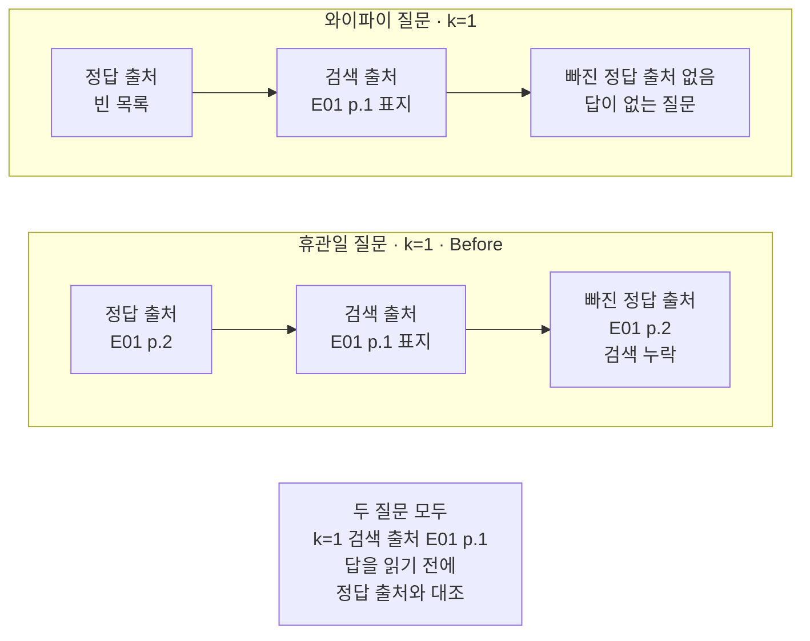
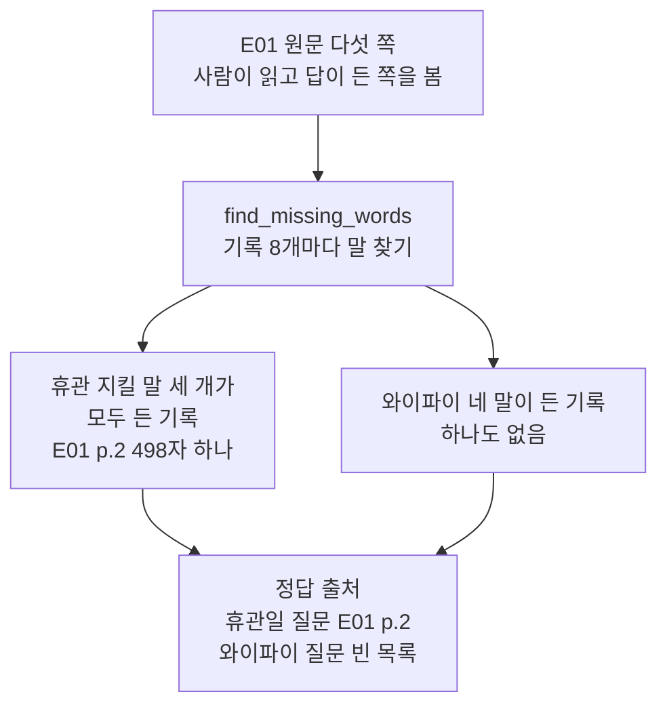
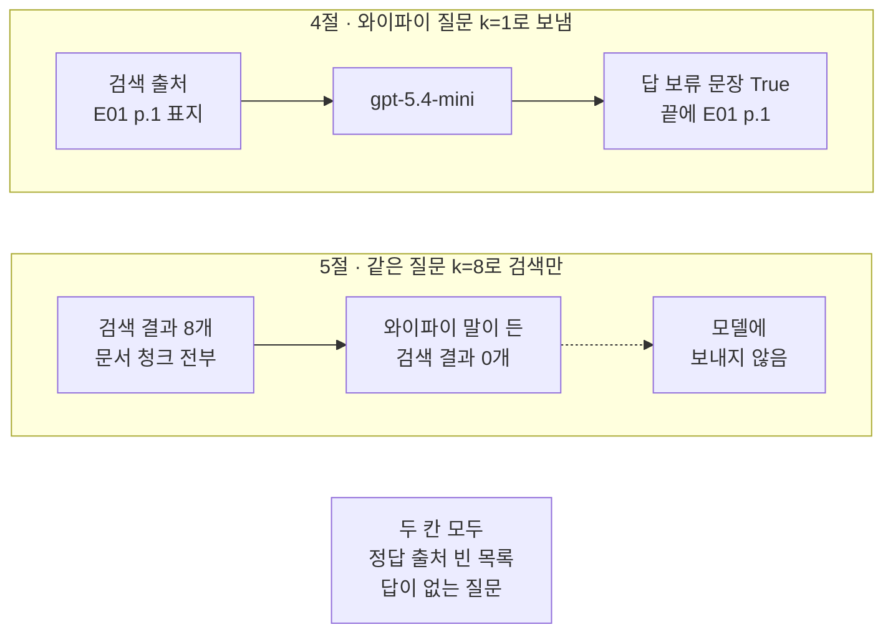
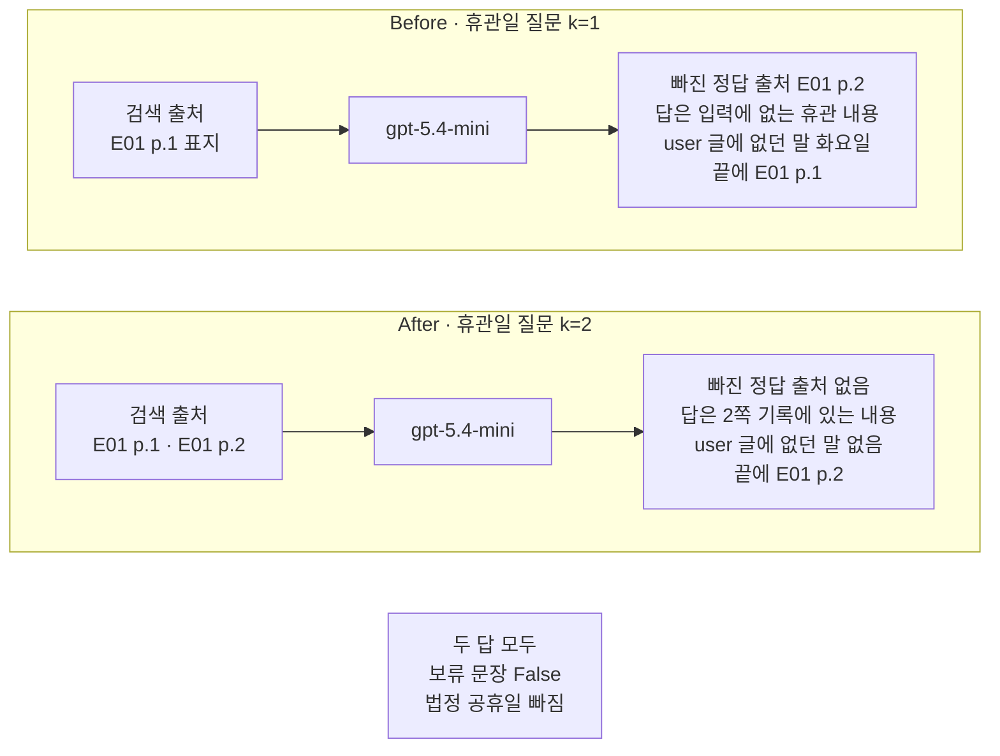

# 05-첫-실패-보기

## _src 본문 (HTML 원본)

```html
<!--meta: 강의 1h | 실습 2h | 코드 Jupyter Notebook | 새 용어 3 -->
<h2 id="b1"><span class="no">1</span>학습 목표</h2>
<div class="goal"><p>이 절을 마치면 다음을 할 수 있습니다.</p><ul><li>질문을 보내기 전에 답이 든 쪽의 출처를 적고, 검색 결과와 대조해 빠진 정답 출처를 찾을 수 있습니다.</li><li>검색 출처가 같은 두 질문을 정답 출처로 비교해, 검색 누락과 답이 없는 질문을 구분할 수 있습니다.</li><li>답이나 답 검사만으로는 검색 누락이 보이지 않는 까닭을 Before/After 출력으로 설명할 수 있습니다.</li></ul></div>
<h2 id="b2"><span class="no">2</span>이 내용을 배우는 이유</h2>
<p>04절까지는 검색한 근거를 넣어 답을 받고, 답의 출처 표시를 검사했습니다. 그런데 답이 이상할 때 그 까닭은 여러 곳에 있을 수 있습니다. 검색이 답이 든 문서 청크를 놓쳤을 수도 있고, 색인한 자료에 답이 아예 없을 수도 있습니다.</p>
<p>두 경우는 답만 보고 가르기 어렵습니다. 두 경우 모두 「확인할 수 없습니다」라는 보류 답이 올 수 있습니다. Ch 5 07절에서 본 것처럼 근거에 없는 내용을 적은 답이 올 수도 있습니다.</p>
<p>그래서 이 절은 질문을 보내기 전에 답이 든 쪽을 적어 두고, 답보다 검색 결과를 먼저 봅니다. 검색 누락은 일부러 k를 줄여 실제 E01 문서 청크로 만듭니다.</p>
<p><strong>이 절의 질문</strong> — 답이 이상할 때, 검색이 답이 든 문서 청크를 놓친 것인지 자료에 답이 없는 것인지 어떻게 가려낼까요?</p>
<h2 id="b3"><span class="no">3</span>앞에서 배운 내용</h2>
<table><thead><tr><th>앞 절</th><th>배운 것</th><th>이 절에서 이어지는 곳</th></tr></thead><tbody>
<tr><td>Ch 5 07절</td><td>환각, 답변 보류와 보류 문장, 보류 지시, <code>find_new_numbers()</code></td><td>4절 과업 명세의 보류 지시, <code>find_new_words()</code></td></tr>
<tr><td>Ch 8 03절</td><td>지킬 말과 <code>find_missing_words()</code></td><td>3절 정답 출처 확인</td></tr>
<tr><td>Ch 8 04절</td><td>오염·산만·혼란·충돌, 넣은 조건과 답에서 확인한 것 따로 적기, <code>check_answer()</code></td><td>After 혼란 조건, Before 답 검사</td></tr>
<tr><td>Ch 9 01절</td><td>휴관일 질문을 k=2로 검색하면 표지와 2쪽, k=1이면 표지만 나옴</td><td>Before·After 검색 개수</td></tr>
<tr><td>Ch 9 03절</td><td>검색 점수, 표지 45자가 검색 자리를 차지함</td><td>4절·Before 검색 결과</td></tr>
<tr><td>Ch 9 04절</td><td><code>make_note()</code>, <code>build_notes_messages()</code>, 출처 표시 검사는 표시가 답에 있는지만 봄</td><td>3·4절 기록과 목록, Before 답 검사</td></tr>
</tbody></table>
<p>Ch 8 04절 네 이름과 이 절의 새 말은 보는 자리가 다릅니다. 네 이름은 목록에 들어간 내용 때문에 답이 틀어진 경우를 나눕니다. 이 절의 검색 누락과 답이 없는 질문은 필요한 근거가 목록에 들어오지 않은 경우를 나눕니다.</p>
<p>관련 없는 문서 청크가 목록에 함께 들어오는 조건은 Ch 8 04절 혼란과 이어집니다. 혼란은 필요 없는 내용을 답에 써서 답이 나빠진 경우의 이름입니다. 그래서 조건을 넣은 것과 답이 나빠진 것은 따로 적습니다. 산만은 아주 긴 컨텍스트에 치우치는 경우의 이름이라 이 절과 다릅니다.</p>
<h2 id="b4"><span class="no">4</span>핵심 개념</h2>
<h3>비유로 시작하기</h3>
<p>똑같은 나무 책상 두 개가 나란히 있습니다. 책상마다 노란 메모지 한 장과 흰 카드 한 장이 올라 있습니다. 왼쪽 메모지에는 세모, 오른쪽 메모지에는 별이 그려져 있습니다. 두 책상의 흰 카드는 똑같이 가운데가 비어 있습니다.</p>
<p>책상마다 앞 바닥에 뚜껑 없는 긴 나무 상자가 있고, 흰 카드 일곱 장이 한 줄로 꽂혀 있습니다. 두 상자의 카드는 순서까지 같습니다. 카드 가운데에는 네모, 마름모, 하트, 세모, 초승달, 더하기, 육각형 모양이 하나씩 있습니다.</p>
{{img:05-5-두-책상과-상자-속-카드|똑같은 나무 책상 두 개에 세모와 별이 그려진 노란 메모지와 가운데가 빈 흰 카드가 하나씩 있고, 두 책상 앞 바닥의 같은 긴 상자에는 네모 마름모 하트 세모 초승달 더하기 육각형 카드가 꽂혀 있어, 세모 카드는 상자 안에 있고 별 카드는 어디에도 없는 삽화|왼쪽 메모지의 세모 카드는 상자 안에 있고, 오른쪽 메모지의 별 카드는 상자 어디에도 없습니다.}}
<p><strong>그림 읽기</strong> — 먼저 두 메모지의 모양을 봅니다. 다음으로 책상 위 카드를 봅니다. 두 카드 모두 가운데가 비어 있어 메모지 모양과 맞지 않습니다. 마지막으로 상자 안을 봅니다. 세모 카드는 넷째 자리에 있고, 별 카드는 두 상자 어디에도 없습니다.</p>
<p>노란 메모지는 질문이고, 메모지의 모양은 질문이 묻는 내용입니다. 긴 상자는 01절 그림과 같은 벡터스토어이고, 상자 속 카드는 문서 청크입니다. 카드 가운데 큰 모양이 문서 청크에 적힌 내용을 대신합니다.</p>
<p>책상 위 빈 카드는 k=1로 검색해 올라온 표지입니다. 표지에는 휴관이나 와이파이 이야기가 없어 모양이 비어 있습니다. 카드마다 위쪽에 붙은 작은 초록 동그라미는 모두 같아서, 04절 그림의 모양 스티커와 달리 이 그림에서는 뜻이 없습니다.</p>
<p>왼쪽은 휴관일 질문 Before입니다. 답이 든 카드가 상자에 있는데 책상에 올라오지 않았으니 검색 누락입니다. 오른쪽은 와이파이 질문입니다. 상자에 맞는 카드가 없으니 답이 없는 질문입니다. 두 책상 위는 똑같아서, 책상 위만 봐서는 둘을 가를 수 없습니다.</p>
<h3>정답 출처, 검색 누락, 답이 없는 질문</h3>
<p>정답 출처는 질문의 답이 든 쪽의 출처를, 질문을 보내기 전에 사람이 원문을 읽고 적은 목록입니다. 시험 문제를 내기 전에 답이 있는 교과서 쪽을 적어 두는 것과 비슷합니다. 노트북 3절의 <code>휴관일 질문의 정답 출처: ['E01 p.2']</code>가 그 모습입니다.</p>
<p>검색 누락은 정답 출처가 벡터스토어에는 있는데 검색 결과에 들지 않은 경우입니다. 답이 적힌 쪽이 책에 있는데 다른 쪽만 펴 본 것과 비슷합니다. 노트북 Before의 <code>검색 결과에 없는 정답 출처: ['E01 p.2']</code>가 그 모습입니다.</p>
<p>답이 없는 질문은 정답 출처가 빈 목록인 질문입니다. 색인한 자료 어디에도 답이 없습니다. 안내 책자에 없는 것을 묻는 손님의 질문과 비슷하고, 노트북에서는 <code>와이파이 질문의 정답 출처: []</code>로 보입니다.</p>
{{mermaid:05-1-검색-출처와-정답-출처|위 칸 와이파이 질문 k=1에는 초록 상자 정답 출처 빈 목록, 초록 상자 검색 출처 E01 p.1 표지, 노란 상자 빠진 정답 출처 없음 답이 없는 질문이 왼쪽에서 오른쪽으로 있고, 아래 칸 휴관일 질문 k=1 Before에는 초록 상자 정답 출처 E01 p.2, 초록 상자 검색 출처 E01 p.1 표지, 빨간 상자 빠진 정답 출처 E01 p.2 검색 누락이 차례로 있으며, 맨 아래 회색 상자에 두 질문 모두 k=1 검색 출처 E01 p.1 답을 읽기 전에 정답 출처와 대조가 있는 비교 그림|두 질문의 k=1 검색 출처는 표지로 같았습니다. 정답 출처를 대조해야 답이 없는 질문과 검색 누락이 갈립니다.}}
<p><strong>도식 읽기</strong> — 위 칸은 4절 와이파이 질문, 아래 칸은 Before 휴관일 질문입니다. 칸마다 왼쪽에서 오른쪽으로 읽습니다. 초록 상자 둘은 묻기 전에 적은 정답 출처와 검색 출처입니다. 두 칸의 검색 출처는 모두 <code>['E01 p.1']</code>인 표지였습니다.</p>
<p>위 칸 끝 노란 상자는 출력으로 확인한 값입니다. 정답 출처가 빈 목록이라 빠진 정답 출처도 없고, 답이 없는 질문입니다. 아래 칸 끝 빨간 상자는 Before의 결함 결과입니다. 정답 출처 <code>E01 p.2</code>가 검색 결과에서 빠진 검색 누락입니다.</p>
<p>맨 아래 회색 상자는 두 칸에 모두 같았던 검색 출처와, 읽는 순서를 적은 메모입니다. 모델 답은 이 그림에 넣지 않았습니다. 까닭을 가르는 값은 답이 아니라 정답 출처와 검색 출처이기 때문입니다.</p>
<h3>답보다 검색 결과를 먼저 보는 순서</h3>
<p>답이 이상할 때 먼저 정답 출처가 있는지 봅니다. 없으면 답이 없는 질문이라, 검색 개수를 바꿔도 근거가 생기지 않습니다. 정답 출처가 있으면 검색 결과에 들었는지 봅니다. 빠졌으면 검색 누락입니다.</p>
<p>정답 출처가 검색 결과에 들었는데도 답이 원문과 다르면, 목록에 든 내용과 답을 쓰는 쪽을 봅니다. Ch 8 04절 네 이름은 이 자리에서 씁니다. 이 절 After 답에서 「법정 공휴일」이 빠진 것도 이 자리의 일입니다. 네 이름 가운데 어느 것에 해당하는지와 빠진 까닭은 이번 실행으로 가리지 않았습니다.</p>
<h3>이 절에서 쓰는 말</h3>
<table><thead><tr><th>용어</th><th>뜻</th><th>이 절에서 보이는 모습</th></tr></thead><tbody>
<tr><td>정답 출처</td><td>질문의 답이 든 쪽의 출처를, 질문을 보내기 전에 사람이 원문을 읽고 적은 목록</td><td><code>휴관일 질문의 정답 출처: ['E01 p.2']</code></td></tr>
<tr><td>검색 누락</td><td>정답 출처가 벡터스토어에는 있는데 검색 결과에 들지 않은 경우</td><td>Before <code>검색 결과에 없는 정답 출처: ['E01 p.2']</code></td></tr>
<tr><td>답이 없는 질문</td><td>정답 출처가 빈 목록인 질문. 색인한 자료 어디에도 답이 없음</td><td><code>와이파이 질문의 정답 출처: []</code></td></tr>
</tbody></table>
<p>환각·답변 보류·보류 문장은 Ch 5 07절 뜻 그대로입니다. 지킬 말은 Ch 8 03절, 기록·출처 표시는 Ch 8 02절과 이 챕터 04절의 뜻입니다. 검색 출처는 검색 결과를 기록으로 옮긴 뒤 출처만 모은 목록이라, 새 용어로 따로 두지 않았습니다.</p>
<h2 id="b5"><span class="no">5</span>실행 예제</h2>
<p>노트북은 앞 절과 Ch 8에서 배운 함수를 도구 파일 <code>rag_tools.py</code>에서 가져옵니다. 그다음 01~04절과 같은 E01 문서 청크 8개를 벡터스토어에 넣습니다. 그다음 두 질문의 정답 출처를 적고, 답이 없는 와이파이 질문을 k=1로 보냅니다. 값 바꿔 보기에서는 와이파이 질문의 k를 8로 늘려 검색만 합니다.</p>
<p>인터넷 서비스에 요청을 모두 8번 보냅니다. 임베딩 모델 <code>text-embedding-3-small</code>에 5번, 답을 쓰는 <code>gpt-5.4-mini</code>에 3번입니다. 이 페이지의 출력은 2026-09-21에 실행한 결과이고, 예상 비용은 0.01달러 미만입니다. 답 문장은 실행마다 달라질 수 있습니다.</p>
<p>강의 시간에는 노트북 3·4절(정답 출처 적기, 답이 없는 질문)과 Before를 설명합니다. 5절 값 바꿔 보기와 After는 함께 실행하고 실습 시간에 읽습니다.</p>
{{notebook:05-첫-실패-보기|example}}
<p class="look"><b>확인할 점</b> — 3절 <code>휴관일 질문의 정답 출처: ['E01 p.2']</code>와 <code>와이파이 질문의 정답 출처: []</code>를 봅니다. 4절 <code>검색 출처: ['E01 p.1']</code>과 <code>보류 문장 있음: True</code>를 확인합니다. 5절 <code>와이파이 말이 하나라도 든 검색 결과 수: 0</code>을 봅니다.</p>
<h3>묻기 전에 정답 출처 적기</h3>
<p>3절은 문서 청크 8개를 04절 <code>make_note()</code>로 모두 기록으로 옮겼습니다. 출처는 쪽 번호까지만 적으므로 <code>E01 p.2 | 498</code>과 <code>E01 p.2 | 452</code>처럼 한 쪽의 두 기록은 출처가 같습니다. 그래서 정답 출처도 쪽 단위로 적습니다.</p>
<p>휴관일 질문은 01절 질문과 같은 글이고, 지킬 말은 Ch 8 03절의 「월요일」「법정 공휴일」「화요일」입니다. 기록마다 빠진 지킬 말을 보자 빈 목록은 <code>E01 p.2 | 498 | []</code> 한 줄뿐이었습니다. 같은 2쪽이라도 452자 기록에는 세 말이 없었습니다.</p>
<p>와이파이 질문은 E01 다섯 쪽을 읽어 답이 없는 내용으로 골랐습니다. 「와이파이」「Wi-Fi」「무선」「인터넷」 네 말로 찾자 기록 여덟 개 모두 <code>| 4</code>였습니다. 두 표를 보고 적은 정답 출처가 <code>['E01 p.2']</code>와 <code>[]</code>입니다.</p>
{{mermaid:05-2-정답-출처-적기|맨 위 초록 상자 E01 원문 다섯 쪽 사람이 읽고 답이 든 쪽을 봄에서 파란 상자 find_missing_words 기록 8개마다 말 찾기로 내려가고, 두 갈래로 노란 상자 휴관 지킬 말 세 개가 모두 든 기록 E01 p.2 498자 하나와 노란 상자 와이파이 네 말이 든 기록 하나도 없음으로 나뉜 뒤, 맨 아래 초록 상자 정답 출처 휴관일 질문 E01 p.2 와이파이 질문 빈 목록으로 모이는 흐름도|사람이 원문을 읽고 정한 정답 출처를, 기록마다 말을 찾는 표로 한 번 더 확인했습니다.}}
<p><strong>도식 읽기</strong> — 위에서 아래로 읽습니다. 맨 위 초록 상자는 사람이 읽은 E01 원문이고, 파란 상자는 Ch 8 03절 함수 <code>find_missing_words()</code>입니다. 이 함수로 기록 8개마다 말이 있는지 봤습니다.</p>
<p>왼쪽 노란 상자는 휴관 지킬 말 세 개가 모두 든 기록이 2쪽 498자 하나라는 출력입니다. 오른쪽 노란 상자는 와이파이 네 말이 든 기록이 하나도 없다는 출력입니다. 맨 아래 초록 상자는 두 출력을 보고 사람이 적은 정답 출처입니다.</p>
<p>말을 찾는 표는 원문 읽기를 대신하지 않습니다. 네 말과 다른 표기로 적힌 글은 찾지 못하기 때문입니다. 그래서 그림도 원문 읽기에서 시작합니다.</p>
<h3>답이 없는 질문과 값 바꿔 보기</h3>
<p>4절은 04절 과업 명세 뒤에 Ch 5 07절 보류 지시 한 문장을 더했습니다. 근거에 답이 없으면 「제공된 정보로는 확인할 수 없습니다」라고 답하게 한 것입니다. 와이파이 질문을 k=1로 검색하자 검색 출처는 <code>['E01 p.1']</code>인 표지였습니다.</p>
<p>이번 답은 <code>제공된 정보로는 확인할 수 없습니다. [E01 p.1]</code>이었습니다. 보류 문장 뒤에도 표지 출처 표시가 붙어, 답 검사에서 표지 기록 1개가 맞았습니다. 표지에는 와이파이 이야기가 없으므로, 이 표시는 답의 내용을 뒷받침하지 않습니다.</p>
<p>5절은 같은 질문의 k를 8로 늘려 검색만 했습니다. 문서 청크 8개가 모두 나왔지만 <code>와이파이 말이 하나라도 든 검색 결과 수: 0</code>이었습니다. 자료에 없는 내용은 검색 개수를 늘려도 생기지 않아서, 모델에는 다시 보내지 않았습니다.</p>
{{mermaid:05-3-답이-없는-질문과-k8|위 칸 4절 와이파이 질문 k=1로 보냄에는 초록 상자 검색 출처 E01 p.1 표지, 보라 상자 gpt-5.4-mini, 노란 상자 답 보류 문장 True 끝에 E01 p.1이 차례로 있고, 아래 칸 5절 같은 질문 k=8로 검색만에는 초록 상자 검색 결과 8개 문서 청크 전부, 노란 상자 와이파이 말이 든 검색 결과 0개, 회색 상자 모델에 보내지 않음이 점선 화살표로 이어지며, 맨 아래 회색 상자에 두 칸 모두 정답 출처 빈 목록 답이 없는 질문이 있는 비교 그림|답이 없는 와이파이 질문은 k=1에서 보류로 답했고, k=8로 모든 문서 청크를 검색해도 와이파이 말이 든 결과는 없었습니다.}}
<p><strong>도식 읽기</strong> — 위 칸이 4절, 아래 칸이 5절이고, 칸마다 왼쪽에서 오른쪽으로 읽습니다. 위 칸의 초록 상자는 검색 출처, 보라 상자는 모델, 노란 상자는 이번 답의 출력입니다.</p>
<p>아래 칸의 초록 상자는 k=8 검색 결과 8개이고, 노란 상자는 그 가운데 와이파이 말이 든 결과가 0개라는 출력입니다. 회색 상자는 실행하지 않은 단계라 점선 화살표로 이었습니다.</p>
<p>맨 아래 회색 상자는 두 칸에 모두 같은 정답 출처입니다. 그래서 어느 한 칸의 결과 상자에 넣지 않았습니다. 보류 답은 한 번 본 결과라, 답이 없는 질문에 늘 보류한다고 말하지 않습니다.</p>
<h2 id="b6"><span class="no">6</span>일부러 실패해 보기</h2>
<p>실패 조건 Before는 E01에 답이 있는 휴관일 질문을 4절과 같은 k=1로 보냅니다. 01절에서 k=1이면 표지만 나온 설정입니다. 페르소나, 과업 명세, 모델은 4절과 같습니다.</p>
<p>고친 조건 After에서 바꾸는 값은 검색 개수 하나입니다. 01절에서 쓴 k=2로 검색해 같은 모델로 보냅니다. 두 조건 모두 답과 함께 검색 결과에 없는 정답 출처를 출력합니다.</p>
{{notebook:05-첫-실패-보기|failure}}
<h3>Before — 답 검사로는 보이지 않은 검색 누락</h3>
<p>Before 검색 출처는 <code>['E01 p.1']</code>로, 4절 와이파이 질문과 같았습니다. 목록에는 휴관 문장이 든 근거가 하나도 들어가지 않았습니다.</p>
<p>이번 실행에서 Before 답은 보류하지 않았습니다. 답은 <code>미르시립도서관의 정기 휴관일은 매주 월요일입니다.</code>와 <code>공휴일이 월요일과 겹치면 휴관일은 다음 날인 화요일로 변경됩니다.</code>였고, 문장마다 끝에 <code>[E01 p.1]</code>이 붙었습니다. 목록의 근거는 표지뿐이라, 입력은 이 내용을 뒷받침하지 않습니다.</p>
<p>01절 2절에서 출력한 E01 2쪽 원문과 대조하면 「매주 월요일」은 같습니다. 원문은 공휴일이 월요일과 겹치면 그 다음 날인 화요일에도 휴관한다고 했습니다. 답의 「휴관일은 다음 날인 화요일로 변경」은 휴관일이 옮겨진다는 뜻으로 읽혀 원문과 다릅니다. 입력에 뒷받침이 없고 원문과 뜻도 다른 이 문장은 Ch 5 07절 뜻의 환각입니다. 모델이 이 내용을 어디에서 가져왔는지는 이 실행으로 알 수 없습니다.</p>
<p>답 검사 출력은 <code>답 검사: {'답의 출처 표시와 같은 기록': ['E01 p.1'], '답에서 빠진 지킬 말': ['법정 공휴일']}</code>이었습니다. 휴관 이야기가 없는 표지 기록이 표시 검사에 맞았습니다. 함수 <code>find_new_words()</code>는 표지와 질문에 없는 「화요일」을 찾아 <code>user 글에 없는데 답에 나온 말: ['화요일']</code>을 출력했습니다. 「월요일」은 질문에도 있는 말이라 새 말로 세지 않았습니다.</p>
<p>까닭을 보여 준 줄은 <code>검색 결과에 없는 정답 출처: ['E01 p.2']</code>입니다. 답 쪽 검사가 모두 이 결함을 놓쳤고, 묻기 전에 적은 정답 출처와 검색 출처를 대조한 줄만 검색 누락을 보여 줬습니다.</p>
<h3>After — 정답 출처가 검색 결과에 들어옴</h3>
<p>After 검색 출처는 <code>['E01 p.1', 'E01 p.2']</code>였습니다. 둘째 자리의 기록은 <code>E01 p.2 | 498</code>로, 3절 표에서 휴관 지킬 말이 모두 든 기록입니다. 검색 결과에 없는 정답 출처는 <code>[]</code>가 됐습니다.</p>
<p>답은 <code>공휴일이 월요일과 겹치면 그 다음 날인 화요일에도 휴관합니다.</code>를 담았고, 끝에 <code>[E01 p.2]</code>가 붙었습니다. 표지가 첫째 자리에 남아 혼란 조건이 들어갔지만, 이번 답에서는 표지 내용을 쓴 곳을 찾지 못했습니다.</p>
{{mermaid:05-4-Before-After|위 칸 Before 휴관일 질문 k=1에는 초록 상자 검색 출처 E01 p.1 표지, 보라 상자 gpt-5.4-mini, 빨간 상자 빠진 정답 출처 E01 p.2 답은 입력에 없는 휴관 내용 user 글에 없던 말 화요일 끝에 E01 p.1이 차례로 있고, 아래 칸 After 휴관일 질문 k=2에는 초록 상자 검색 출처 E01 p.1 E01 p.2, 보라 상자 gpt-5.4-mini, 노란 상자 빠진 정답 출처 없음 답은 2쪽 기록에 있는 내용 user 글에 없던 말 없음 끝에 E01 p.2가 차례로 있으며, 맨 아래 회색 상자에 두 답 모두 보류 문장 False 법정 공휴일 빠짐이 있는 비교 그림|k=1에서는 정답 출처 2쪽이 검색 결과에서 빠졌고 답은 입력에 없는 휴관 내용을 적었습니다. k=2에서는 2쪽이 들어와 답이 2쪽 기록의 내용을 담았습니다.}}
<p><strong>도식 읽기</strong> — 위 칸이 Before, 아래 칸이 After이고, 칸마다 왼쪽에서 오른쪽으로 읽습니다. 초록 상자는 검색 출처이고, 두 칸에서 다른 조건은 이 상자를 만든 검색 개수 하나입니다. 보라 상자는 같은 모델입니다.</p>
<p>위 칸 끝의 빨간 상자는 Before 결함 결과입니다. 정답 출처 2쪽이 빠졌고, 답은 입력에 없는 휴관 내용에 표지 표시를 붙였습니다. 입력에 없던 「화요일」도 답에 나왔습니다. 아래 칸 끝의 노란 상자는 After 출력으로 확인한 값이고, user 글에 없던 말은 없었습니다.</p>
<p>맨 아래 회색 상자는 두 답에 모두 같았던 값입니다. 두 답 모두 보류 문장이 없었고, 「법정 공휴일」이 빠졌습니다. 그래서 어느 한쪽의 효과로 넣지 않았습니다.</p>
<h3>세 요청을 한 표로 읽기</h3>
<p>마지막 셀의 표에서 와이파이 줄은 <code>와이파이 k=1 | ['E01 p.1'] | [] | [] | True | []</code>였습니다. Before 줄은 <code>Before 휴관일 k=1 | ['E01 p.1'] | ['E01 p.2'] | ['E01 p.2'] | False | ['화요일']</code>였습니다. 두 줄은 검색 출처가 같고 정답 출처만 달랐습니다.</p>
<p>답 쪽 칸만 보면 거꾸로 읽기 쉽습니다. 이번 실행에서 보류한 것은 답이 없는 와이파이 질문이었습니다. 답이 있는 Before는 보류하지 않고, After 답처럼 「매주 월요일」로 시작하는 답을 적었습니다. 그래서 답을 읽기 전에 검색 출처를 정답 출처와 먼저 대조합니다.</p>
<p>이 비교는 질문 두 개를 조건마다 한 번 보낸 결과입니다. 같은 목록을 다시 보내면 Before 답의 모양은 달라질 수 있습니다. 검색 결과에 없는 정답 출처는 모델 답과 상관없이 검색 결과와 적어 둔 목록으로 정해집니다.</p>
<h2 id="b7"><span class="no">7</span>주의할 점과 실무 메모</h2>
<ul><li>정답 출처는 사람이 원문을 읽고 정한 값입니다. 3절의 말 찾기 표는 그 판단을 한 번 더 확인할 뿐입니다. 와이파이 네 말은 흐름을 보여 주려고 고른 말이라, 다른 표기로 적힌 글은 찾지 못합니다.</li>
<li>두 질문과 k 값은 탐색 뒤 정한 예입니다. 휴관일 질문과 k=1은 01절 6절에서 표지만 나온 출력을 보고 정했습니다. 와이파이 질문은 E01 다섯 쪽을 읽고 답이 없는 내용으로 골랐습니다. 노트북을 만들기 전에 검색만 따로 실행해, k=1에서 표지가 나오는 것을 확인했습니다.</li>
<li>정답 출처를 쪽 단위로 적어서, 같은 쪽의 다른 문서 청크가 검색돼도 빠진 정답 출처는 없다고 나옵니다. 2쪽 452자 기록에는 휴관 지킬 말이 없습니다. 이번 After는 <code>E01 p.2 | 498</code> 기록이 들어온 것을 출력으로 확인했습니다.</li>
<li>보류 문장 검사는 글자가 같을 때만 <code>True</code>입니다. Ch 5 07절처럼 다른 말로 한 보류는 놓칩니다. 이번 와이파이 답처럼 보류 문장 뒤에 출처 표시가 붙어도 표시 검사에 맞으므로, 답 글도 함께 읽습니다.</li>
<li>보류한 답의 수만 세면 거꾸로 읽을 수 있습니다. 이번에는 답이 없는 질문이 보류했고, 답이 있는 Before가 근거 없는 답을 적었습니다. 답이 없는 질문의 보류와 답이 있는 질문의 답은 따로 셉니다.</li>
<li>함수 <code>find_new_words()</code>는 질문에 있는 말을 새 말로 세지 않고, 정한 말 목록 밖의 내용도 보지 않습니다. Before 답의 「화요일」은 찾았지만, 「매주 월요일」과 「다음 날인 화요일로 변경」이라는 뜻은 보지 못했습니다. 뜻은 원문과 대조해 확인합니다.</li>
<li>검색 개수 k를 늘려 검색 누락을 고치면 표지 같은 필요 없는 문서 청크도 함께 들어오고 입력도 길어집니다. k=2는 흐름을 보여 주는 값이고 좋은 k가 아닙니다. 검색이 정답 문서를 찾았는지 여러 질문으로 재는 방법은 Ch 11 01절부터 다룹니다.</li>
<li>Before 답 같은 근거 없는 답을 기록으로 적어 두고 다음 요청에 넣으면, Ch 8 04절 오염 조건이 됩니다. 이번에는 답을 다시 목록에 넣지 않았습니다.</li>
<li>요금은 Ch 6 06절에서 2026-09-17에 확인한 <code>gpt-5.4-mini</code> 값과, 03절에서 확인한 임베딩 값을 따릅니다. 노트북은 비용을 계산하지 않았고, 준비물의 0.01달러 미만은 어림입니다.</li>
<li>교재 출력은 Linux의 Python 3.12.13으로 만들었습니다. 패키지는 pypdf 6.17.0, langchain 1.4.0, langchain-core 1.6.2입니다. 함께 쓴 판은 langchain-openai 1.6.0과 langchain-text-splitters 1.1.2입니다. 패키지 openai 판은 3.8.0입니다. 다른 버전과 Windows·macOS에서는 실행하지 않았습니다.</li></ul>
<h2 id="b8"><span class="no">8</span>정리와 다음 절</h2>
<ul><li>질문을 보내기 전에 정답 출처를 적었습니다. 휴관일 질문은 <code>['E01 p.2']</code>, E01에 답이 없는 와이파이 질문은 빈 목록이었습니다.</li><li>두 질문 모두 k=1 검색 출처는 표지였습니다. 정답 출처와 대조해 와이파이 질문은 답이 없는 질문, 휴관일 질문 Before는 검색 누락으로 갈랐습니다.</li><li>이번 Before 답은 보류하지 않고 근거 없는 휴관 내용을 적었고, 답 검사로는 드러나지 않았습니다. k=2로 바꾼 After에서는 정답 출처가 검색 결과에 들어왔습니다.</li></ul>
<p><strong>다음 학습과 이어지는 지점</strong> — 06절에서는 k 같은 설정과 검색 결과, 답을 실행마다 기록 한 줄로 파일에 남깁니다. 이 절에서 화면으로 비교한 설정과 결과를, 나중에 다시 꺼내 비교할 수 있게 하는 단계입니다.</p>
<h2 id="b9"><span class="no">9</span>복습 문제</h2>
<details class="quiz"><summary>문제 1 · 정답 출처를 적는 때</summary><p class="quiz-q">정답 출처는 왜 질문을 보내기 전에 적어 두나요? 모델 답을 본 뒤 적으면 무엇이 문제인가요?</p><p class="quiz-a"><b>해설</b> — 답을 보고 적으면 답에 붙은 표시나 내용에 끌려 정답 출처를 정하게 됩니다. Before 답은 표지 <code>[E01 p.1]</code>을 붙였지만 원문의 답은 2쪽에 있습니다. 원문을 읽고 먼저 적어야 검색 결과와 나란히 대조할 수 있습니다.</p></details>
<details class="quiz"><summary>문제 2 · 같은 검색 출처</summary><p class="quiz-q">와이파이 질문과 Before 휴관일 질문의 검색 출처는 모두 <code>['E01 p.1']</code>이었습니다. 두 질문을 무엇으로 갈랐나요?</p><p class="quiz-a"><b>해설</b> — 정답 출처입니다. 와이파이 질문은 정답 출처가 빈 목록이라 답이 없는 질문입니다. 휴관일 질문은 정답 출처 <code>E01 p.2</code>가 검색 결과에 없어 검색 누락입니다.</p></details>
<details class="quiz"><summary>문제 3 · 답 검사가 놓친 것</summary><p class="quiz-q">Before 답 검사에서 표지 기록 <code>E01 p.1</code>이 답의 표시와 같다고 나왔습니다. 이 답이 표지를 근거로 썼다고 볼 수 있나요?</p><p class="quiz-a"><b>해설</b> — 볼 수 없습니다. 표지 45자에는 휴관 이야기가 없습니다. 표시 검사는 표시가 답에 있는지만 보므로, 근거 없는 답에 붙은 표시도 맞다고 합니다.</p></details>
<details class="quiz"><summary>문제 4 · k를 늘려도 안 되는 질문</summary><p class="quiz-q">5절에서 와이파이 질문의 k를 8로 늘렸습니다. 결과는 무엇이었고, 왜 모델에 다시 보내지 않았나요?</p><p class="quiz-a"><b>해설</b> — 문서 청크 8개가 모두 나왔지만 와이파이 말이 든 결과는 0개였습니다. 자료에 없는 내용은 검색 개수를 늘려도 근거로 들어오지 않으므로, 같은 질문을 다시 보내도 새 근거가 없습니다.</p></details>
<details class="quiz"><summary>문제 5 · 보류 수만 세면</summary><p class="quiz-q">동료가 「보류한 답이 한 개뿐이니 Before 답은 괜찮았다」고 합니다. 이 절 출력으로 무엇이라고 답하나요?</p><p class="quiz-a"><b>해설</b> — 이번에 보류한 것은 답이 없는 와이파이 질문이었습니다. 휴관일 질문 Before는 보류하지 않았지만 정답 출처 2쪽이 검색 결과에 없었고, 답은 입력에 없는 휴관 내용이었습니다. 한 번 본 결과이므로, 보류 수가 아니라 정답 출처 대조로 봐야 한다고 답합니다.</p></details>
<h2 id="b10"><span class="no">10</span>참고 자료</h2>
<p>문서는 2026-09-17에 다시 열어 확인했습니다. 검색 누락과 답이 없는 질문은 노트북 코드와 출력으로 확인했습니다.</p>
<ul><li><div><a href="https://www.dbreunig.com/2025/06/22/how-contexts-fail-and-how-to-fix-them.html">Drew Breunig, How Long Contexts Fail</a></div>오염·산만·혼란·충돌 네 이름의 정의 · 2025-06-22 · 확인 2026-09-17</li><li><div><a href="https://developers.openai.com/api/docs/pricing">OpenAI API 요금</a></div>gpt-5.4-mini 요금, Ch 6 06절에서 확인한 값 · 확인 2026-09-17</li><li><div><a href="https://developers.openai.com/api/docs/models/text-embedding-3-small">OpenAI text-embedding-3-small 모델 안내</a></div>100만 토큰당 0.02달러 · 확인 2026-09-17</li></ul>
```

## 노트북 셀 (순서대로)

### [0] markdown {'html': 'skip'}

# 첫 실패 보기

**이 노트북에서 할 일**

1. 01~04절과 같은 E01 문서 청크로, 질문마다 답이 든 쪽의 출처를 묻기 전에 적어 둡니다.
2. E01에 답이 없는 와이파이 질문을 k=1로 보내고, 답과 검색 출처를 적어 둔 출처와 대조합니다.
3. 휴관일 질문을 k=1로 보낸 Before와 k=2로 보낸 After를 비교해, 답만으로는 안 보이는 검색 누락을 찾습니다.

**준비물** — 프로젝트 폴더 `.env` 파일의 `OPENAI_API_KEY`가 필요합니다. 데이터 파일은 `labs/data/rag-corpus/pdf/easy/E01.pdf`입니다.

인터넷 서비스에 요청을 모두 8번 보냅니다. 임베딩 모델 `text-embedding-3-small`에 5번, `gpt-5.4-mini`에 3번입니다.
실행 시간은 1분 안팎이고, 예상 비용은 0.01달러 미만으로 잡았습니다.
임베딩 요금은 OpenAI 모델 안내(2026-09-17 확인)에 적힌 100만 토큰당 0.02달러입니다.
mini 요금은 Ch 6 06절에서 확인한 값입니다.

**강의와 실습 범위** — 강의 시간에는 3·4절(정답 출처 적기, 답이 없는 질문)과 Before를 설명합니다.
5절 값 바꿔 보기와 After는 함께 실행하고 실습 시간에 읽습니다.

**기준 버전** — 실습 폴더에 고정한 패키지 판을 씁니다. pypdf 6.17.0, langchain 1.4.0, langchain-core 1.6.2입니다.
함께 쓰는 판은 langchain-openai 1.6.0, langchain-text-splitters 1.1.2입니다.
나머지는 openai 3.8.0과 python-dotenv 1.2.3입니다.

교재 출력은 Linux의 Python 3.12.13으로 만들었습니다. 다른 버전과 Windows·macOS에서는 이번에 실행하지 않았습니다.

실습 폴더 `labs/part3/ch09-rag-first-run`에서 `uv sync --locked`를 실행합니다.
그다음 이 폴더의 `.venv` 커널을 고르고 첫 셀부터 순서대로 실행합니다.

### [1] markdown {'html': 'skip'}

## 오늘 볼 그림


위 칸은 4절 와이파이 질문, 아래 칸은 Before 휴관일 질문이고, 칸마다 왼쪽에서 오른쪽으로 읽습니다.
초록 상자는 묻기 전에 적은 정답 출처와 검색 출처입니다. 노란 상자는 출력으로 확인할 값, 빨간 상자는 Before의 결함 결과입니다.
두 칸의 검색 출처는 표지로 같습니다. 정답 출처가 달라서 끝 상자가 갈립니다.

### [2] markdown {}

## 1. 준비

첫 셀은 패키지를 설치하고 설치된 버전을 출력합니다. 설치에는 몇십 초가 걸릴 수 있습니다.
04절과 같은 패키지를 씁니다. 이 노트북은 임베딩 모델과 답을 쓰는 모델을 모두 부릅니다.

### [3] code {'execution': {'iopub.execute_input': '2026-09-21T05:46:28.114773Z', 'iopub.status.busy': '2026-09-21T05:46:28.114678Z', 'iopub.status.idle': '2026-09-21T05:46:28.618612Z', 'shell.execute_reply': '2026-09-21T05:46:28.617925Z'}, 'lesson_role': 'setup'}

```python
# 이 절에서 쓰는 패키지를 설치하고 버전을 확인합니다
%pip install -q "pypdf==6.17.0" "langchain==1.4.0" "langchain-openai==1.6.0" "langchain-text-splitters==1.1.2" "python-dotenv==1.2.3"
from importlib.metadata import version

print("pypdf:", version("pypdf"))
print("langchain:", version("langchain"))
print("langchain-core:", version("langchain-core"))
print("langchain-openai:", version("langchain-openai"))
print("langchain-text-splitters:", version("langchain-text-splitters"))
print("openai:", version("openai"))
print("python-dotenv:", version("python-dotenv"))
```

출력:
```
Note: you may need to restart the kernel to use updated packages.
pypdf: 6.17.0
langchain: 1.4.0
langchain-core: 1.6.2
langchain-openai: 1.6.0
langchain-text-splitters: 1.1.2
openai: 3.8.0
python-dotenv: 1.2.3

```

### [4] markdown {}

**결과 읽기** — 출력 줄은 `pypdf: 6.17.0`, `langchain: 1.4.0`, `openai: 3.8.0` 등 일곱 줄입니다.
준비물에 적은 기준 버전과 같습니다.

글 나누기, 임베딩, 벡터스토어, 모델 준비에 쓸 이름을 불러옵니다. 04절 준비 셀과 같은 이름입니다.

앞에서 배운 함수는 `rag_tools.py`에 모아 두었습니다. 파일을 열면 코드를 볼 수 있습니다. 노트북과 같은 폴더(`notebooks/`)에 있는 파일입니다.
이 노트북은 02절 `load_pdf_pages()`와 04절 `make_note()`를 가져옵니다.
Ch 8 02·03·04절 `find_cited_notes()`·`find_missing_words()`·`build_notes_messages()`·`check_answer()`도 가져옵니다.

### [5] code {'execution': {'iopub.execute_input': '2026-09-21T05:46:28.619843Z', 'iopub.status.busy': '2026-09-21T05:46:28.619606Z', 'iopub.status.idle': '2026-09-21T05:46:30.070524Z', 'shell.execute_reply': '2026-09-21T05:46:30.070142Z'}, 'lesson_role': 'setup'}

```python
# 문서 청크 나누기·임베딩·벡터스토어·모델 준비에 쓸 이름을 불러옵니다
import os

from langchain_text_splitters import RecursiveCharacterTextSplitter
from langchain_openai import OpenAIEmbeddings
from langchain_core.vectorstores import InMemoryVectorStore
from langchain.chat_models import init_chat_model
# 02·04절과 Ch 8 02·03·04절 함수 여섯 개를 도구 파일에서 가져옵니다
from rag_tools import build_notes_messages, check_answer, find_cited_notes, find_missing_words, load_pdf_pages, make_note
```

출력:
```

```

### [6] markdown {}

01·04절과 같은 셀로 API 키가 있는지 확인합니다. 키 값은 출력하지 않고, 있는지만 봅니다.
`True` 값이 나오면 다음으로 넘어갑니다.

### [7] code {'execution': {'iopub.execute_input': '2026-09-21T05:46:30.071796Z', 'iopub.status.busy': '2026-09-21T05:46:30.071676Z', 'iopub.status.idle': '2026-09-21T05:46:30.075927Z', 'shell.execute_reply': '2026-09-21T05:46:30.075554Z'}, 'lesson_role': 'setup'}

```python
# .env 파일에서 OpenAI API 키를 읽습니다(키 값은 출력하지 않습니다)
import os
from dotenv import find_dotenv, load_dotenv

env_path = find_dotenv(usecwd=True)
load_dotenv(env_path)
has_key = os.getenv("OPENAI_API_KEY") is not None
print("OPENAI_API_KEY 설정 여부:", has_key)
assert has_key, "프로젝트 폴더의 .env 파일에 OPENAI_API_KEY를 적어 주세요."
```

출력:
```
OPENAI_API_KEY 설정 여부: True

```

### [8] markdown {}

01·04절과 같은 설정으로 답을 쓸 모델 객체를 만듭니다. 이 셀은 요청을 보내지 않습니다.
temperature 값을 0으로 두어 매번 비슷한 답을 고르게 합니다.

### [9] code {'execution': {'iopub.execute_input': '2026-09-21T05:46:30.076707Z', 'iopub.status.busy': '2026-09-21T05:46:30.076618Z', 'iopub.status.idle': '2026-09-21T05:46:30.522640Z', 'shell.execute_reply': '2026-09-21T05:46:30.522190Z'}}

```python
# 실습에 쓸 모델을 준비합니다
model = init_chat_model(
    "openai:gpt-5.4-mini",
    temperature=0,
    reasoning_effort="none",
)
print("모델 이름:", model.model_name)
print("temperature:", model.temperature)
```

출력:
```
모델 이름: gpt-5.4-mini
temperature: 0.0

```

### [10] markdown {}

**결과 읽기** — 모델 이름 `gpt-5.4-mini`, temperature `0.0`이 보이면 준비가 끝났습니다.
이 노트북의 출력은 2026-09-21에 이 모델로 실행한 결과입니다.
실행마다 답 문장이 달라질 수 있습니다. Ch 6 01절에서 본 것처럼 temperature 0은 Ch 5 06절의 뽑기를 끈 설정과 같은 것이 아닙니다.

### [11] markdown {}

## 2. 01~04절과 같은 문서 청크와 벡터스토어 만들기

이 노트북도 01~04절과 같은 E01 문서 청크 8개로 시작합니다. 경로를 고르는 셀은 04절과 같은 코드입니다.
실행 전에 예상합니다. 프로젝트 맨 위에서 열었다면 첫째 후보를 고를 것입니다.

### [12] code {'execution': {'iopub.execute_input': '2026-09-21T05:46:30.523590Z', 'iopub.status.busy': '2026-09-21T05:46:30.523516Z', 'iopub.status.idle': '2026-09-21T05:46:30.526306Z', 'shell.execute_reply': '2026-09-21T05:46:30.525853Z'}}

```python
# 작업 폴더에서 본 E01.pdf 경로를 후보 세 개 가운데에서 고릅니다
candidates = [
    "labs/data/rag-corpus/pdf/easy/E01.pdf",
    "../../data/rag-corpus/pdf/easy/E01.pdf",
    "../../../data/rag-corpus/pdf/easy/E01.pdf",
]
pdf_path = None
for candidate in candidates:
    if os.path.exists(candidate):
        pdf_path = candidate
        break
print("PDF를 찾았는가:", pdf_path is not None)
print("고른 경로:", pdf_path)
assert pdf_path is not None, "notebooks 폴더나 실습 폴더 맨 위에서 노트북을 열어 주세요."
```

출력:
```
PDF를 찾았는가: True
고른 경로: labs/data/rag-corpus/pdf/easy/E01.pdf

```

### [13] markdown {}

**결과 읽기** — 출력 줄은 `PDF를 찾았는가: True`와 `고른 경로: labs/data/rag-corpus/pdf/easy/E01.pdf`입니다.
교재 출력은 프로젝트 맨 위를 작업 폴더로 삼아 실행해서 첫째 후보를 골랐습니다.
`notebooks` 폴더에서 열면 셋째 후보가 나옵니다.

준비 셀에서 가져온 02절 로더 함수 `load_pdf_pages()`는 PDF 경로와 문서 이름을 받아, 쪽마다 Document를 담은 목록을 반환합니다.
메타데이터에는 문서 이름 `doc_id`, 쪽 번호 `page`, 파일 이름 `source` 세 키를 적습니다.

로더 함수로 다섯 쪽을 읽고, 01~04절과 같은 크기 500자·겹침 50자로 나눕니다.
그다음 03·04절처럼 빈 벡터스토어를 만들어 문서 청크를 넣습니다. 임베딩 객체 이름도 `embedding_model`로 같습니다.
실행 전에 예상합니다. 04절처럼 문서 청크 8개가 모두 저장될 것입니다.

### [14] code {'execution': {'iopub.execute_input': '2026-09-21T05:46:30.527178Z', 'iopub.status.busy': '2026-09-21T05:46:30.527113Z', 'iopub.status.idle': '2026-09-21T05:46:30.885797Z', 'shell.execute_reply': '2026-09-21T05:46:30.884766Z'}}

```python
# E01.pdf를 문서 청크로 나누고, 04절과 같은 방법으로 벡터스토어에 넣습니다(임베딩 요청 1번)
pages = load_pdf_pages(pdf_path, "E01")
splitter = RecursiveCharacterTextSplitter(chunk_size=500, chunk_overlap=50)
chunks = splitter.split_documents(pages)
embedding_model_name = "text-embedding-3-small"
embedding_model = OpenAIEmbeddings(model=embedding_model_name)
store = InMemoryVectorStore(embedding=embedding_model)
stored_ids = store.add_documents(chunks)
print("Document 수:", len(pages))
print("문서 청크 수:", len(chunks))
print("넣은 뒤 저장 항목 수:", len(store.store))
```

출력:
```
Document 수: 5
문서 청크 수: 8
넣은 뒤 저장 항목 수: 8

```

### [15] markdown {}

**결과 읽기** — 출력 줄은 `Document 수: 5`, `문서 청크 수: 8`, `넣은 뒤 저장 항목 수: 8`입니다. 01~04절과 같은 수입니다.

## 3. 묻기 전에 정답 출처 적어 두기

답이 「확인할 수 없습니다」로 오면, 답만 읽어서는 까닭을 가를 수 없습니다.
검색이 답이 든 문서 청크를 놓쳤을 수도 있고, E01에 답이 아예 없을 수도 있습니다.
그래서 질문을 보내기 전에, 질문마다 답이 든 쪽의 출처를 먼저 적어 둡니다.

이 출처를 이 절에서는 정답 출처라고 부릅니다. 시험 문제를 내기 전에 답이 있는 교과서 쪽을 적어 두는 것과 비슷합니다.
노트북에서는 `["E01 p.2"]`처럼 04절 기록의 출처 모양으로 적습니다.

먼저 문서 청크 8개를 모두 04절 기록 모양으로 옮겨, 쪽마다 어떤 출처가 붙는지 봅니다.
옮기는 함수는 준비 셀에서 가져온 04절 `make_note()`입니다.

문서 청크 8개를 나눈 순서대로 기록으로 옮기고, 출처와 글자 수를 봅니다. 검색이 아니라서 요청을 보내지 않습니다.
실행 전에 예상합니다. 01절처럼 2쪽·3쪽·4쪽은 문서 청크가 둘씩이라, 같은 출처가 두 번씩 보일 것입니다.

### [16] code {'execution': {'iopub.execute_input': '2026-09-21T05:46:30.887650Z', 'iopub.status.busy': '2026-09-21T05:46:30.887347Z', 'iopub.status.idle': '2026-09-21T05:46:30.892044Z', 'shell.execute_reply': '2026-09-21T05:46:30.890003Z'}}

```python
# 문서 청크 8개를 모두 기록으로 옮기고, 기록마다 출처와 글자 수를 봅니다(요청 없음)
all_notes = []
for chunk in chunks:
    note = make_note(chunk)
    all_notes.append(note)
print("기록 수:", len(all_notes))
print("모든 기록(출처 | 글자 수):")
for note in all_notes:
    print(note["출처"], "|", len(note["내용"]))
```

출력:
```
기록 수: 8
모든 기록(출처 | 글자 수):
E01 p.1 | 45
E01 p.2 | 498
E01 p.2 | 452
E01 p.3 | 498
E01 p.3 | 462
E01 p.4 | 492
E01 p.4 | 412
E01 p.5 | 270

```

### [17] markdown {}

**결과 읽기** — 첫 줄은 `기록 수: 8`입니다. 라벨 줄 아래 여덟 줄은 `E01 p.1 | 45`로 시작합니다.
그다음 `E01 p.2 | 498`과 `E01 p.2 | 452`가 이어지고, 마지막 줄은 `E01 p.5 | 270`입니다.

출처는 쪽 번호까지만 적으므로, 한 쪽에서 나온 두 문서 청크는 출처가 같습니다.
그래서 이 절의 정답 출처도 쪽 단위로 적습니다.

기록마다 빠진 말은 준비 셀에서 가져온 Ch 8 03절 `find_missing_words()`로 봅니다. 글에 들어 있지 않은 말만 모아 반환합니다.

첫 질문은 01절 휴관일 질문과 같은 글입니다. 이름은 Ch 8에서 쓴 `closure_question`으로 둡니다.
지킬 말도 Ch 8 03절과 이 챕터 02절의 `closure_keep_words`와 같은 세 말입니다.
기록마다 빠진 지킬 말을 보면, 사람이 원문에서 읽은 휴관 문장이 어느 기록에 있는지 코드로 한 번 더 확인할 수 있습니다.

실행 전에 예상합니다. 세 말이 모두 든 기록은 2쪽의 498자 기록 하나일 것입니다.

### [18] code {'execution': {'iopub.execute_input': '2026-09-21T05:46:30.894584Z', 'iopub.status.busy': '2026-09-21T05:46:30.894346Z', 'iopub.status.idle': '2026-09-21T05:46:30.897437Z', 'shell.execute_reply': '2026-09-21T05:46:30.896994Z'}}

```python
# 01절 휴관일 질문과 Ch 8 03절 지킬 말로, 기록마다 빠진 지킬 말을 봅니다(요청 없음)
closure_question = "미르시립도서관의 정기 휴관일은 언제이고, 공휴일이 월요일과 겹치면 어떻게 되나요?"
closure_keep_words = ["월요일", "법정 공휴일", "화요일"]
print("휴관일 질문의 지킬 말이 빠진 기록(출처 | 글자 수 | 빠진 지킬 말):")
for note in all_notes:
    missing = find_missing_words(note["내용"], closure_keep_words)
    print(note["출처"], "|", len(note["내용"]), "|", missing)
```

출력:
```
휴관일 질문의 지킬 말이 빠진 기록(출처 | 글자 수 | 빠진 지킬 말):
E01 p.1 | 45 | ['월요일', '법정 공휴일', '화요일']
E01 p.2 | 498 | []
E01 p.2 | 452 | ['월요일', '법정 공휴일', '화요일']
E01 p.3 | 498 | ['월요일', '법정 공휴일', '화요일']
E01 p.3 | 462 | ['월요일', '법정 공휴일', '화요일']
E01 p.4 | 492 | ['월요일', '법정 공휴일', '화요일']
E01 p.4 | 412 | ['월요일', '법정 공휴일', '화요일']
E01 p.5 | 270 | ['월요일', '법정 공휴일', '화요일']

```

### [19] markdown {}

**결과 읽기** — 라벨 줄 아래 여덟 줄 가운데 빈 목록은 `E01 p.2 | 498 | []` 한 줄뿐입니다.
나머지 일곱 줄은 `['월요일', '법정 공휴일', '화요일']`로, 세 말이 모두 빠졌습니다.
같은 2쪽이라도 `E01 p.2 | 452` 기록에는 세 말이 없습니다.

둘째 질문은 와이파이 비밀번호를 묻습니다. E01 다섯 쪽을 읽어 보면 와이파이 이야기가 없습니다.
그래서 이 질문을 E01에 답이 없는 질문의 예로 씁니다.

코드로도 한 번 더 확인합니다. 와이파이는 「Wi-Fi」「무선」「인터넷」으로 적을 수도 있어 네 말을 함께 찾습니다.
실행 전에 예상합니다. 모든 기록에서 네 말이 모두 빠져, 빠진 말 수가 4일 것입니다.

### [20] code {'execution': {'iopub.execute_input': '2026-09-21T05:46:30.898443Z', 'iopub.status.busy': '2026-09-21T05:46:30.898363Z', 'iopub.status.idle': '2026-09-21T05:46:30.901018Z', 'shell.execute_reply': '2026-09-21T05:46:30.900426Z'}}

```python
# E01에 답이 없는 와이파이 질문과, 답에 나올 만한 말로 기록마다 빠진 말 수를 봅니다(요청 없음)
wifi_question = "미르시립도서관의 와이파이 비밀번호는 무엇인가요?"
wifi_words = ["와이파이", "Wi-Fi", "무선", "인터넷"]
print("와이파이 말이 빠진 기록(출처 | 빠진 말 수):")
for note in all_notes:
    missing = find_missing_words(note["내용"], wifi_words)
    print(note["출처"], "|", len(missing))
```

출력:
```
와이파이 말이 빠진 기록(출처 | 빠진 말 수):
E01 p.1 | 4
E01 p.2 | 4
E01 p.2 | 4
E01 p.3 | 4
E01 p.3 | 4
E01 p.4 | 4
E01 p.4 | 4
E01 p.5 | 4

```

### [21] markdown {}

**결과 읽기** — 라벨 줄 아래 여덟 줄이 `E01 p.1 | 4`부터 `E01 p.5 | 4`까지 모두 4입니다.
어느 기록에도 네 말이 하나도 없습니다.

이 표는 말이 있는지만 봅니다. 네 말과 다른 표기로 적힌 글은 찾지 못하므로, 원문을 읽은 판단이 먼저입니다.

두 표를 보고 질문마다 정답 출처를 적습니다. 휴관일 질문은 2쪽, 와이파이 질문은 빈 목록입니다.
이 목록은 질문을 보내기 전에 사람이 정한 값이라, 모델 답과 상관없이 실행할 때마다 같습니다.

### [22] code {'execution': {'iopub.execute_input': '2026-09-21T05:46:30.902036Z', 'iopub.status.busy': '2026-09-21T05:46:30.901918Z', 'iopub.status.idle': '2026-09-21T05:46:30.904504Z', 'shell.execute_reply': '2026-09-21T05:46:30.903924Z'}}

```python
# 원문을 읽고 위 두 표로 확인한 정답 출처를 질문마다 적어 둡니다
closure_answer_sources = ["E01 p.2"]
wifi_answer_sources = []
print("휴관일 질문의 정답 출처:", closure_answer_sources)
print("와이파이 질문의 정답 출처:", wifi_answer_sources)
```

출력:
```
휴관일 질문의 정답 출처: ['E01 p.2']
와이파이 질문의 정답 출처: []

```

### [23] markdown {}

**결과 읽기** — 출력 줄은 `휴관일 질문의 정답 출처: ['E01 p.2']`와 `와이파이 질문의 정답 출처: []`입니다.

정답 출처가 빈 목록인 질문을 이 절에서는 답이 없는 질문이라고 부릅니다. 색인한 자료 어디에도 답이 없는 질문입니다.
안내 책자에 없는 것을 묻는 손님의 질문과 비슷합니다.

## 4. 답이 없는 질문을 k=1로 보내기

메시지 목록은 01·04절과 같은 모양입니다. system에는 페르소나, developer에는 과업 명세, user에는 근거와 질문을 넣습니다.
과업 명세는 04절 글 뒤에 Ch 5 07절 보류 지시를 한 문장 더했습니다. 근거에 답이 없으면 정해 둔 보류 문장으로 답하게 합니다.
보류 문장은 Ch 5 07절과 같은 「제공된 정보로는 확인할 수 없습니다」이고, 이름도 같은 `abstain_sentence`로 둡니다.

### [24] code {'execution': {'iopub.execute_input': '2026-09-21T05:46:30.905321Z', 'iopub.status.busy': '2026-09-21T05:46:30.905208Z', 'iopub.status.idle': '2026-09-21T05:46:30.908139Z', 'shell.execute_reply': '2026-09-21T05:46:30.907242Z'}}

```python
# 04절 글에 Ch 5 07절 보류 지시를 한 문장 더한 과업 명세와 보류 문장을 만듭니다
persona_text = "당신은 미르시립도서관 안내 담당자입니다."
task_text = "주어진 근거에 있는 정보만 쓰세요. 두 문장 이내로 답하고, 문장마다 끝에 근거 앞에 붙은 출처 표시를 그대로 적으세요."
task_text = task_text + " 근거에 답이 없으면 추측하지 말고 '제공된 정보로는 확인할 수 없습니다'라고 답하세요."
abstain_sentence = "제공된 정보로는 확인할 수 없습니다"
print("페르소나:", persona_text)
print("과업 명세:", task_text)
print("보류 문장:", abstain_sentence)
```

출력:
```
페르소나: 당신은 미르시립도서관 안내 담당자입니다.
과업 명세: 주어진 근거에 있는 정보만 쓰세요. 두 문장 이내로 답하고, 문장마다 끝에 근거 앞에 붙은 출처 표시를 그대로 적으세요. 근거에 답이 없으면 추측하지 말고 '제공된 정보로는 확인할 수 없습니다'라고 답하세요.
보류 문장: 제공된 정보로는 확인할 수 없습니다

```

### [25] markdown {}

**결과 읽기** — 세 줄은 `페르소나:`, `과업 명세:`, `보류 문장:`으로 시작합니다.
과업 명세 줄은 04절 글 뒤에 `근거에 답이 없으면 추측하지 말고`로 시작하는 문장이 이어집니다.

메시지 목록은 04절처럼 준비 셀에서 가져온 `build_notes_messages()`로 만듭니다. 기록마다 대괄호 출처 표시와 내용을 이어 user 글을 만듭니다.
페르소나와 과업 명세는 앞의 두 인자로 넘깁니다.

와이파이 질문을 k=1로 검색해, 04절처럼 검색 결과를 기록으로 옮깁니다. 기록의 출처만 따로 모은 목록이 검색 출처입니다.
k=1은 01절 6절에서 휴관일 질문으로 한 번 쓴 값입니다. 그때는 표지 한 개만 나왔습니다.

실행 전에 예상합니다. 와이파이 기록이 없으니, 어떤 문서 청크가 나와도 답이 든 근거는 아닐 것입니다.

### [26] code {'execution': {'iopub.execute_input': '2026-09-21T05:46:30.909321Z', 'iopub.status.busy': '2026-09-21T05:46:30.909214Z', 'iopub.status.idle': '2026-09-21T05:46:31.037843Z', 'shell.execute_reply': '2026-09-21T05:46:31.037449Z'}}

```python
# 와이파이 질문을 k=1로 검색해 기록으로 옮기고, 검색 출처를 봅니다(임베딩 요청 1번)
wifi_hits = store.similarity_search(wifi_question, k=1)
wifi_notes = []
wifi_sources = []
for hit in wifi_hits:
    note = make_note(hit)
    wifi_notes.append(note)
    wifi_sources.append(note["출처"])
print("k=1 검색 결과(출처 | 글자 수 | 앞 20자):")
for note in wifi_notes:
    print(note["출처"], "|", len(note["내용"]), "|", note["내용"][:20].replace("\n", " "))
print("검색 출처:", wifi_sources)
```

출력:
```
k=1 검색 결과(출처 | 글자 수 | 앞 20자):
E01 p.1 | 45 | 미르시립도서관 이용 안내 미르시립도서
검색 출처: ['E01 p.1']

```

### [27] markdown {}

**결과 읽기** — 라벨 줄 아래 한 줄은 `E01 p.1 | 45 | 미르시립도서관 이용 안내 미르시립도서`입니다.
마지막 줄은 `검색 출처: ['E01 p.1']`입니다.

와이파이 질문에서도 01절 휴관일 질문처럼 표지가 가장 가까웠습니다. 표지 45자에는 도서관 이름과 발행 정보만 있습니다.

이 목록을 모델로 보냅니다. 답은 여러 줄일 수 있어 라벨 줄 `답:`을 따로 출력합니다.
끝 줄에서는 답에 보류 문장이 들어 있는지 `in`으로 봅니다.
실행 전에 예상합니다. 근거에 와이파이 이야기가 없으니, 보류 문장으로 답할 것입니다.

### [28] code {'execution': {'iopub.execute_input': '2026-09-21T05:46:31.038580Z', 'iopub.status.busy': '2026-09-21T05:46:31.038514Z', 'iopub.status.idle': '2026-09-21T05:46:31.736378Z', 'shell.execute_reply': '2026-09-21T05:46:31.735822Z'}}

```python
# 와이파이 질문 목록을 모델로 보내고, 답과 보류 문장이 있는지 봅니다(요청 1번)
wifi_messages = build_notes_messages(persona_text, task_text, wifi_notes, wifi_question)
wifi_response = model.invoke(wifi_messages)
wifi_text = wifi_response.text
print("답:")
print(wifi_text)
print("보류 문장 있음:", abstain_sentence in wifi_text)
```

출력:
```
답:
제공된 정보로는 확인할 수 없습니다. [E01 p.1]
보류 문장 있음: True

```

### [29] markdown {}

**결과 읽기** — 라벨 줄 아래 답은 `제공된 정보로는 확인할 수 없습니다. [E01 p.1]`입니다.
마지막 줄은 `보류 문장 있음: True`입니다.

이번 실행에서 모델은 과업 명세의 보류 문장으로 답했습니다. 그런데 보류 문장 뒤에도 표지 출처 표시 `[E01 p.1]`을 붙였습니다.
표지에는 와이파이 이야기가 없어서, 이 표시가 가리키는 기록은 답의 내용을 뒷받침하지 않습니다.

함수 `find_missing_sources()`는 정답 출처 가운데 검색 출처 목록에 없는 것만 모아 반환합니다.
모양은 `find_missing_words()`와 같고, 글 대신 검색 출처 목록에서 찾는 점만 다릅니다. 이 셀은 정의만 하므로 출력이 없습니다.

### [30] code {'execution': {'iopub.execute_input': '2026-09-21T05:46:31.737485Z', 'iopub.status.busy': '2026-09-21T05:46:31.737382Z', 'iopub.status.idle': '2026-09-21T05:46:31.739468Z', 'shell.execute_reply': '2026-09-21T05:46:31.738989Z'}}

```python
# 정답 출처 가운데 검색 출처 목록에 없는 것만 모아 반환하는 함수를 정의합니다
def find_missing_sources(hit_sources, answer_sources):
    missing = []
    for source in answer_sources:
        if source not in hit_sources:
            missing.append(source)
    return missing
```

출력:
```

```

### [31] markdown {}

**결과 읽기** — 정의만 하는 셀이라 출력이 없습니다.

답 글에 출처 표시가 든 기록은 준비 셀에서 가져온 Ch 8 02절 `find_cited_notes()`로 모읍니다.

함수 `find_new_words()`는 답에는 있지만 입력 글에는 없는 말만 모아 반환합니다.
Ch 5 07절 `find_new_numbers()`가 질문과 문서에 없던 숫자를 찾은 것과 같은 생각입니다. 이번에는 숫자 대신 3절에서 정한 말 목록으로 찾습니다.

입력 글로는 근거와 질문이 함께 든 user 글 `wifi_messages[2][1]`을 넣습니다. 04절에서 user 글을 꺼낸 모양과 같습니다.
이 셀도 정의만 합니다.

### [32] code {'execution': {'iopub.execute_input': '2026-09-21T05:46:31.740248Z', 'iopub.status.busy': '2026-09-21T05:46:31.740194Z', 'iopub.status.idle': '2026-09-21T05:46:31.742417Z', 'shell.execute_reply': '2026-09-21T05:46:31.741773Z'}}

```python
# 답에는 있지만 입력 글에는 없는 말만 모아 반환하는 함수를 정의합니다(Ch 5 07절 find_new_numbers와 같은 생각)
def find_new_words(answer_text, source_text, words):
    new_words = []
    for word in words:
        if word in answer_text and word not in source_text:
            new_words.append(word)
    return new_words
```

출력:
```

```

### [33] markdown {}

**결과 읽기** — 정의만 하는 셀이라 출력이 없습니다.

와이파이 답에서 세 가지를 봅니다. 답의 출처 표시와 같은 기록 수, 검색 결과에 없는 정답 출처, user 글에 없는데 답에 나온 말입니다.
실행 전에 예상합니다. 정답 출처가 빈 목록이라, 검색 결과에 없는 정답 출처도 빈 목록일 것입니다.

### [34] code {'execution': {'iopub.execute_input': '2026-09-21T05:46:31.743309Z', 'iopub.status.busy': '2026-09-21T05:46:31.743221Z', 'iopub.status.idle': '2026-09-21T05:46:31.745400Z', 'shell.execute_reply': '2026-09-21T05:46:31.745065Z'}}

```python
# 와이파이 답을 검사해, 검색 결과에 없는 정답 출처와 user 글에 없는데 답에 나온 말을 봅니다
wifi_cited = find_cited_notes(wifi_text, wifi_notes)
wifi_missing_sources = find_missing_sources(wifi_sources, wifi_answer_sources)
wifi_new_words = find_new_words(wifi_text, wifi_messages[2][1], wifi_words)
print("답의 출처 표시와 같은 기록 수:", len(wifi_cited))
print("검색 결과에 없는 정답 출처:", wifi_missing_sources)
print("user 글에 없는데 답에 나온 말:", wifi_new_words)
```

출력:
```
답의 출처 표시와 같은 기록 수: 1
검색 결과에 없는 정답 출처: []
user 글에 없는데 답에 나온 말: []

```

### [35] markdown {}

**결과 읽기** — 출력 줄은 `답의 출처 표시와 같은 기록 수: 1`과 `검색 결과에 없는 정답 출처: []`입니다.
마지막 줄은 `user 글에 없는데 답에 나온 말: []`입니다.

답의 표시가 넣은 표지 기록과 같아서 1개가 맞았습니다. 04절에서 본 것처럼 이 검사는 표시가 답에 있는지만 봅니다.
검색 결과에 없는 정답 출처가 빈 목록인 것은, 정답 출처가 처음부터 빈 목록이기 때문입니다. 검색이 무엇을 놓친 것이 아닙니다.
이번 답은 와이파이 네 말을 쓰지 않아, user 글에 없던 말도 없었습니다.

정리하면 와이파이 질문은 답이 없는 질문이고, 이번 실행에서 모델은 보류로 답했습니다.

## 5. 값 바꿔 보기 — 와이파이 질문의 k를 1에서 8로

바꾸는 값은 검색 개수 k 하나입니다. 문서 청크가 8개뿐이라, k=8이면 모든 문서 청크가 검색 결과에 들어옵니다.
이번에는 검색만 하고 모델에는 보내지 않습니다. 검색 결과마다 3절의 와이파이 네 말이 하나라도 있는지 셉니다.

실행 전에 예상합니다. 검색 결과는 8개이고, 와이파이 말이 든 결과는 0개일 것입니다.

### [36] code {'execution': {'iopub.execute_input': '2026-09-21T05:46:31.746028Z', 'iopub.status.busy': '2026-09-21T05:46:31.745967Z', 'iopub.status.idle': '2026-09-21T05:46:31.905272Z', 'shell.execute_reply': '2026-09-21T05:46:31.904814Z'}}

```python
# 와이파이 질문을 k=8로 검색해, 네 말 가운데 하나라도 든 검색 결과 수를 셉니다(임베딩 요청 1번)
wide_hits = store.similarity_search(wifi_question, k=8)
word_hit_count = 0
for hit in wide_hits:
    missing = find_missing_words(hit.page_content, wifi_words)
    if len(missing) < len(wifi_words):
        word_hit_count = word_hit_count + 1
print("k=8 검색 결과 수:", len(wide_hits))
print("와이파이 말이 하나라도 든 검색 결과 수:", word_hit_count)
```

출력:
```
k=8 검색 결과 수: 8
와이파이 말이 하나라도 든 검색 결과 수: 0

```

### [37] markdown {}

**결과 읽기** — 출력 줄은 `k=8 검색 결과 수: 8`과 `와이파이 말이 하나라도 든 검색 결과 수: 0`입니다.

검색 개수 k를 문서 청크 수만큼 늘려도 와이파이 말이 든 근거는 들어오지 않았습니다. 색인한 E01에 없는 내용은 검색 개수를 늘려도 생기지 않습니다.
그래서 이 질문은 k를 바꿔 다시 보내지 않았습니다. 이 결과는 3절 표와 같은 뜻을 검색으로 한 번 더 확인한 것입니다.

### [38] markdown {'lesson_part': 'before'}

## Before — 휴관일 질문을 k=1로 보내기

이번에는 E01에 답이 있는 휴관일 질문입니다. 정답 출처는 3절에서 적은 `['E01 p.2']`입니다.
실패 조건 Before는 4절 와이파이 질문과 같은 k=1로 검색해 목록을 만듭니다. 페르소나, 과업 명세, 모델도 4절과 같고, 질문만 다릅니다.

실행 전에 예상합니다. 01절 6절처럼 표지 한 개만 나와, 정답 출처 2쪽이 검색 결과에서 빠질 것입니다.

### [39] code {'execution': {'iopub.execute_input': '2026-09-21T05:46:31.906122Z', 'iopub.status.busy': '2026-09-21T05:46:31.906049Z', 'iopub.status.idle': '2026-09-21T05:46:32.069596Z', 'shell.execute_reply': '2026-09-21T05:46:32.069124Z'}, 'lesson_part': 'before'}

```python
# 휴관일 질문을 k=1로 검색해 기록으로 옮기고, 검색 출처를 봅니다(임베딩 요청 1번)
before_hits = store.similarity_search(closure_question, k=1)
before_notes = []
before_sources = []
for hit in before_hits:
    note = make_note(hit)
    before_notes.append(note)
    before_sources.append(note["출처"])
print("k=1 검색 결과(출처 | 글자 수 | 앞 20자):")
for note in before_notes:
    print(note["출처"], "|", len(note["내용"]), "|", note["내용"][:20].replace("\n", " "))
print("검색 출처:", before_sources)
```

출력:
```
k=1 검색 결과(출처 | 글자 수 | 앞 20자):
E01 p.1 | 45 | 미르시립도서관 이용 안내 미르시립도서
검색 출처: ['E01 p.1']

```

### [40] markdown {'lesson_part': 'before'}

**결과 읽기** — 라벨 줄 아래 한 줄은 `E01 p.1 | 45 | 미르시립도서관 이용 안내 미르시립도서`입니다.
마지막 줄은 `검색 출처: ['E01 p.1']`입니다.

01절 6절과 같은 표지 한 개이고, 4절 와이파이 질문의 검색 출처와도 같습니다.
정답 출처 `E01 p.2`는 검색 결과에 없습니다. 이 목록에는 휴관 문장이 든 근거가 하나도 들어가지 않습니다.

이 목록을 4절과 같은 모델로 보냅니다. 실행 전에 예상합니다. 근거에 휴관 이야기가 없으니, 4절처럼 보류 문장으로 답할 것입니다.

### [41] code {'execution': {'iopub.execute_input': '2026-09-21T05:46:32.070372Z', 'iopub.status.busy': '2026-09-21T05:46:32.070306Z', 'iopub.status.idle': '2026-09-21T05:46:32.762053Z', 'shell.execute_reply': '2026-09-21T05:46:32.761530Z'}, 'lesson_part': 'before'}

```python
# 휴관일 질문 목록을 같은 모델로 보내고, 답과 보류 문장이 있는지 봅니다(요청 1번)
before_messages = build_notes_messages(persona_text, task_text, before_notes, closure_question)
before_response = model.invoke(before_messages)
before_text = before_response.text
print("답:")
print(before_text)
print("보류 문장 있음:", abstain_sentence in before_text)
```

출력:
```
답:
미르시립도서관의 정기 휴관일은 매주 월요일입니다. [E01 p.1] 공휴일이 월요일과 겹치면 휴관일은 다음 날인 화요일로 변경됩니다. [E01 p.1]
보류 문장 있음: False

```

### [42] markdown {'lesson_part': 'before'}

**결과 읽기** — 라벨 줄 아래 답은 `미르시립도서관의 정기 휴관일은 매주 월요일입니다. [E01 p.1]`로 시작합니다.
둘째 문장은 `공휴일이 월요일과 겹치면 휴관일은 다음 날인 화요일로 변경됩니다.`이고, 끝에 `[E01 p.1]`이 붙었습니다.
마지막 줄은 `보류 문장 있음: False`입니다.

이번 실행에서는 보류 문장이 아니라 휴관 내용을 적은 답이 왔습니다. 목록의 근거는 표지 45자뿐이라, 이 내용을 뒷받침하는 글이 입력에 없습니다.
모델이 이 내용을 어디에서 가져왔는지는 이 실행으로 알 수 없습니다.

01절 2절에서 출력한 E01 2쪽 원문과 대조합니다. 「매주 월요일」은 원문과 같습니다.
원문은 법정 공휴일에도 휴관하고, 공휴일이 월요일과 겹치면 그 다음 날인 화요일에도 휴관한다고 했습니다.
답의 「휴관일은 다음 날인 화요일로 변경」은 휴관일이 옮겨진다는 뜻으로 읽혀, 원문과 다릅니다.
입력에 뒷받침이 없고 원문과 뜻도 다른 이 문장은 Ch 5 07절 뜻의 환각입니다.

검사 함수는 준비 셀에서 가져온 Ch 8 04절 `check_answer()`입니다. 지킬 말 목록은 셋째 인자로 `closure_keep_words`를 넘깁니다.
답의 출처 표시와 같은 기록, 답에서 빠진 지킬 말을 딕셔너리로 반환합니다.

Before 답을 검사하고, 검색 결과에 없는 정답 출처를 봅니다.
실행 전에 예상합니다. 검색 결과에 없는 정답 출처가 `['E01 p.2']`로 나올 것입니다.

### [43] code {'execution': {'iopub.execute_input': '2026-09-21T05:46:32.763087Z', 'iopub.status.busy': '2026-09-21T05:46:32.762945Z', 'iopub.status.idle': '2026-09-21T05:46:32.765870Z', 'shell.execute_reply': '2026-09-21T05:46:32.765533Z'}, 'lesson_part': 'before'}

```python
# Before 답을 검사하고, 검색 결과에 없는 정답 출처와 user 글에 없는데 답에 나온 지킬 말을 봅니다
before_check = check_answer(before_text, before_notes, closure_keep_words)
before_missing_sources = find_missing_sources(before_sources, closure_answer_sources)
before_new_words = find_new_words(before_text, before_messages[2][1], closure_keep_words)
print("답 검사:", before_check)
print("검색 결과에 없는 정답 출처:", before_missing_sources)
print("user 글에 없는데 답에 나온 말:", before_new_words)
```

출력:
```
답 검사: {'답의 출처 표시와 같은 기록': ['E01 p.1'], '답에서 빠진 지킬 말': ['법정 공휴일']}
검색 결과에 없는 정답 출처: ['E01 p.2']
user 글에 없는데 답에 나온 말: ['화요일']

```

### [44] markdown {'lesson_part': 'before'}

**결과 읽기** — 첫 줄은 `답 검사: {'답의 출처 표시와 같은 기록': ['E01 p.1'], '답에서 빠진 지킬 말': ['법정 공휴일']}`입니다.
둘째 줄은 `검색 결과에 없는 정답 출처: ['E01 p.2']`입니다. 마지막 줄은 `user 글에 없는데 답에 나온 말: ['화요일']`입니다.

답 검사는 표지 기록이 답의 표시와 같다고 했습니다. 표지에는 휴관 이야기가 없는데도 맞았으니, 표시 검사로는 근거 없는 답이 보이지 않습니다.
빠진 지킬 말은 답에 무엇이 없는지만 알려 줍니다. 검색이 놓친 것인지, 답을 쓰며 빠뜨린 것인지는 알려 주지 않습니다.

마지막 줄의 「화요일」은 표지 45자에도 질문에도 없는 말입니다. 입력에 없는 말이 답에 나온 것을 코드가 잡았습니다.
「월요일」은 질문에도 있는 말이라 `find_new_words()`가 새 말로 세지 않았습니다. Ch 5 07절에서 질문에 있던 숫자를 새 숫자로 세지 않은 것과 같은 한계입니다.

까닭을 보여 준 것은 둘째 줄입니다. 정답 출처가 벡터스토어에는 있는데 검색 결과에 들지 않은 경우를, 이 절에서는 검색 누락이라고 부릅니다.
답이 적힌 쪽이 책에 있는데 다른 쪽만 펴 본 것과 비슷합니다. 실패 조건 Before의 결함은 답 검사 줄이 아니라 이 줄에서 보입니다.

### [45] markdown {'lesson_part': 'after'}

## After — 휴관일 질문을 k=2로 다시 보내기

고치는 값은 검색 개수 k 하나입니다. 01절 5절에서 휴관일 질문으로 쓴 k=2로 검색합니다.
질문, 페르소나, 과업 명세, 모델은 Before와 같습니다.

실행 전에 예상합니다. 01절처럼 표지와 2쪽 문서 청크가 나와, 정답 출처가 검색 결과에 들어올 것입니다.

### [46] code {'execution': {'iopub.execute_input': '2026-09-21T05:46:32.766949Z', 'iopub.status.busy': '2026-09-21T05:46:32.766856Z', 'iopub.status.idle': '2026-09-21T05:46:32.919236Z', 'shell.execute_reply': '2026-09-21T05:46:32.918657Z'}, 'lesson_part': 'after'}

```python
# 휴관일 질문을 k=2로 검색해 기록으로 옮기고, 검색 출처를 봅니다(임베딩 요청 1번)
after_hits = store.similarity_search(closure_question, k=2)
after_notes = []
after_sources = []
for hit in after_hits:
    note = make_note(hit)
    after_notes.append(note)
    after_sources.append(note["출처"])
print("k=2 검색 결과(출처 | 글자 수 | 앞 20자):")
for note in after_notes:
    print(note["출처"], "|", len(note["내용"]), "|", note["내용"][:20].replace("\n", " "))
print("검색 출처:", after_sources)
```

출력:
```
k=2 검색 결과(출처 | 글자 수 | 앞 20자):
E01 p.1 | 45 | 미르시립도서관 이용 안내 미르시립도서
E01 p.2 | 498 | 1. 도서관 소개 미르시립도서관은 1
검색 출처: ['E01 p.1', 'E01 p.2']

```

### [47] markdown {'lesson_part': 'after'}

**결과 읽기** — 라벨 줄 아래 두 줄은 `E01 p.1 | 45 | 미르시립도서관 이용 안내 미르시립도서`와 `E01 p.2 | 498 | 1. 도서관 소개 미르시립도서관은 1`입니다.
마지막 줄은 `검색 출처: ['E01 p.1', 'E01 p.2']`입니다.

01절 5절과 같은 순서입니다. 둘째 자리에 3절 표에서 휴관 지킬 말이 모두 든 2쪽 498자 기록이 들어왔습니다.

표지는 그대로 첫째 자리에 남았습니다. 휴관일 질문에 필요 없는 내용이 목록에 함께 들어간 것입니다.
Ch 8 04절 이름으로는 혼란 조건입니다. 조건을 넣은 것과 답이 나빠졌는지는 답을 보고 따로 적습니다.

이 목록을 Before와 같은 모델로 보냅니다. 실행 전에 예상합니다. 01절 8절 답처럼 휴관 문장 끝에 2쪽 출처 표시가 붙을 것입니다.

### [48] code {'execution': {'iopub.execute_input': '2026-09-21T05:46:32.920298Z', 'iopub.status.busy': '2026-09-21T05:46:32.920217Z', 'iopub.status.idle': '2026-09-21T05:46:33.766925Z', 'shell.execute_reply': '2026-09-21T05:46:33.766437Z'}, 'lesson_part': 'after'}

```python
# k=2 목록을 같은 모델로 보내고, 답과 보류 문장이 있는지 봅니다(요청 1번)
after_messages = build_notes_messages(persona_text, task_text, after_notes, closure_question)
after_response = model.invoke(after_messages)
after_text = after_response.text
print("답:")
print(after_text)
print("보류 문장 있음:", abstain_sentence in after_text)
```

출력:
```
답:
미르시립도서관의 정기 휴관일은 매주 월요일입니다. 공휴일이 월요일과 겹치면 그 다음 날인 화요일에도 휴관합니다. [E01 p.2]
보류 문장 있음: False

```

### [49] markdown {'lesson_part': 'after'}

**결과 읽기** — 라벨 줄 아래 답은 `미르시립도서관의 정기 휴관일은 매주 월요일입니다.`로 시작합니다.
둘째 문장은 `공휴일이 월요일과 겹치면 그 다음 날인 화요일에도 휴관합니다.`이고, 끝에 `[E01 p.2]`가 붙었습니다.
마지막 줄은 `보류 문장 있음: False`입니다.

이번 답의 휴관 내용은 목록에 넣은 2쪽 기록에 있습니다. 출처 표시도 2쪽 기록을 가리켰고, 표지 표시는 답에 없습니다.
혼란 조건을 넣었지만, 이번 답에서는 표지 내용을 쓴 곳을 찾지 못했습니다.

After 답을 Before와 같은 세 가지로 검사합니다. 실행 전에 예상합니다. 검색 결과에 없는 정답 출처가 빈 목록일 것입니다.

### [50] code {'execution': {'iopub.execute_input': '2026-09-21T05:46:33.768219Z', 'iopub.status.busy': '2026-09-21T05:46:33.768078Z', 'iopub.status.idle': '2026-09-21T05:46:33.770855Z', 'shell.execute_reply': '2026-09-21T05:46:33.770449Z'}, 'lesson_part': 'after'}

```python
# After 답을 검사하고, 검색 결과에 없는 정답 출처와 user 글에 없는데 답에 나온 지킬 말을 봅니다
after_check = check_answer(after_text, after_notes, closure_keep_words)
after_missing_sources = find_missing_sources(after_sources, closure_answer_sources)
after_new_words = find_new_words(after_text, after_messages[2][1], closure_keep_words)
print("답 검사:", after_check)
print("검색 결과에 없는 정답 출처:", after_missing_sources)
print("user 글에 없는데 답에 나온 말:", after_new_words)
```

출력:
```
답 검사: {'답의 출처 표시와 같은 기록': ['E01 p.2'], '답에서 빠진 지킬 말': ['법정 공휴일']}
검색 결과에 없는 정답 출처: []
user 글에 없는데 답에 나온 말: []

```

### [51] markdown {'lesson_part': 'after'}

**결과 읽기** — 첫 줄은 `답 검사: {'답의 출처 표시와 같은 기록': ['E01 p.2'], '답에서 빠진 지킬 말': ['법정 공휴일']}`입니다.
둘째 줄은 `검색 결과에 없는 정답 출처: []`입니다. 마지막 줄은 `user 글에 없는데 답에 나온 말: []`입니다.

정답 출처 2쪽이 검색 결과에 들어와 검색 누락이 없어졌습니다. 답의 표시도 2쪽 기록과 같았습니다.

「법정 공휴일」은 After 답에도 빠졌습니다. 넣은 2쪽 기록에는 있던 말이라, 검색이 아니라 답을 쓰는 쪽에서 빠진 말입니다.
01절 8절 답에서도 같은 말이 빠졌습니다. Before 답에도 빠진 말이라, k를 바꾼 효과로 적지 않습니다.

마지막으로 세 요청의 값을 한 표로 모읍니다. 요청을 보내지 않고, 앞 셀에서 담아 둔 값만 출력합니다.
실행 전에 예상합니다. 와이파이와 Before는 검색 출처가 같고, 정답 출처는 다를 것입니다.

### [52] code {'execution': {'iopub.execute_input': '2026-09-21T05:46:33.771730Z', 'iopub.status.busy': '2026-09-21T05:46:33.771657Z', 'iopub.status.idle': '2026-09-21T05:46:33.774120Z', 'shell.execute_reply': '2026-09-21T05:46:33.773769Z'}, 'lesson_part': 'after'}

```python
# 세 요청의 검색 출처·정답 출처·검색 결과에 없는 정답 출처·보류 문장·user 글에 없던 말을 한 표로 봅니다(요청 없음)
print("요청 | 검색 출처 | 정답 출처 | 검색 결과에 없는 정답 출처 | 보류 문장 있음 | user 글에 없는데 답에 나온 말:")
print("와이파이 k=1 |", wifi_sources, "|", wifi_answer_sources, "|", wifi_missing_sources, "|", abstain_sentence in wifi_text, "|", wifi_new_words)
print("Before 휴관일 k=1 |", before_sources, "|", closure_answer_sources, "|", before_missing_sources, "|", abstain_sentence in before_text, "|", before_new_words)
print("After 휴관일 k=2 |", after_sources, "|", closure_answer_sources, "|", after_missing_sources, "|", abstain_sentence in after_text, "|", after_new_words)
```

출력:
```
요청 | 검색 출처 | 정답 출처 | 검색 결과에 없는 정답 출처 | 보류 문장 있음 | user 글에 없는데 답에 나온 말:
와이파이 k=1 | ['E01 p.1'] | [] | [] | True | []
Before 휴관일 k=1 | ['E01 p.1'] | ['E01 p.2'] | ['E01 p.2'] | False | ['화요일']
After 휴관일 k=2 | ['E01 p.1', 'E01 p.2'] | ['E01 p.2'] | [] | False | []

```

### [53] markdown {'lesson_part': 'after'}

**결과 읽기** — 라벨 줄 아래 첫 줄은 `와이파이 k=1 | ['E01 p.1'] | [] | [] | True | []`입니다.
둘째 줄은 `Before 휴관일 k=1 | ['E01 p.1'] | ['E01 p.2'] | ['E01 p.2'] | False | ['화요일']`입니다.
셋째 줄은 `After 휴관일 k=2 | ['E01 p.1', 'E01 p.2'] | ['E01 p.2'] | [] | False | []`입니다.

와이파이와 Before는 검색 출처가 같은 표지 하나였습니다. 두 줄을 가른 것은 정답 출처입니다.
와이파이는 정답 출처가 없는 답이 없는 질문이고, Before는 정답 출처 2쪽이 빠진 검색 누락입니다.

답 쪽 칸만 보면 거꾸로 읽기 쉽습니다. 이번 실행에서 보류한 것은 답이 없는 와이파이 질문이었습니다.
답이 있는 Before는 보류하지 않고, 근거 없는 휴관 내용을 적었습니다.
Before 답은 After 답과 같은 「매주 월요일」로 시작해서, 답만 읽으면 문제가 없어 보입니다.

그래서 답을 읽기 전에 검색 출처를 정답 출처와 먼저 대조합니다. After 줄은 k만 2로 바꿔 검색 누락이 없어진 결과입니다.
이 비교는 질문 두 개를 조건마다 한 번 보낸 결과입니다.

## 정리

- 질문을 보내기 전에 정답 출처를 적었습니다. 휴관일 질문은 `['E01 p.2']`, E01에 답이 없는 와이파이 질문은 빈 목록이었습니다.
- 두 질문 모두 k=1 검색 출처는 표지였습니다. 와이파이 질문은 답이 없는 질문, 휴관일 질문 Before는 검색 누락이었습니다.
- 이번 Before 답은 보류하지 않고 근거 없는 휴관 내용을 적었고, 답 검사로는 드러나지 않았습니다. k=2 After에서는 정답 출처가 검색 결과에 들어왔습니다.

다음 06절에서는 k 같은 설정과 검색 결과, 답을 실행마다 기록 한 줄로 파일에 남깁니다.

## 그림

### 05-1-검색-출처와-정답-출처.mmd



- 설명 대상 문장: 검색 누락은 정답 출처가 벡터스토어에는 있는데 검색 결과에 들지 않은 경우입니다. 답이 없는 질문은 정답 출처가 빈 목록인 질문입니다.
- 캡션: 두 질문의 k=1 검색 출처는 표지로 같았습니다. 정답 출처를 대조해야 답이 없는 질문과 검색 누락이 갈립니다.
- 읽는 법: 위 칸 4절 와이파이 질문, 아래 칸 Before 휴관일 질문, 칸마다 왼쪽에서 오른쪽으로. 초록 = 묻기 전에 적은 정답 출처(`와이파이 질문의 정답 출처: []`, `휴관일 질문의 정답 출처: ['E01 p.2']`)와 검색 출처(두 칸 `검색 출처: ['E01 p.1']`), 노랑 = 와이파이 `검색 결과에 없는 정답 출처: []`, 빨강 = Before 결함 결과 `검색 결과에 없는 정답 출처: ['E01 p.2']`, 회색 = 두 칸 공통 검색 출처와 읽는 순서 메모. 모델 답은 넣지 않음.
- alt: 위 칸 와이파이 질문 k=1에는 초록 상자 정답 출처 빈 목록, 초록 상자 검색 출처 E01 p.1 표지, 노란 상자 빠진 정답 출처 없음 답이 없는 질문이 왼쪽에서 오른쪽으로 있고, 아래 칸 휴관일 질문 k=1 Before에는 초록 상자 정답 출처 E01 p.2, 초록 상자 검색 출처 E01 p.1 표지, 빨간 상자 빠진 정답 출처 E01 p.2 검색 누락이 차례로 있으며, 맨 아래 회색 상자에 두 질문 모두 k=1 검색 출처 E01 p.1 답을 읽기 전에 정답 출처와 대조가 있는 비교 그림

### 05-2-정답-출처-적기.mmd



- 설명 대상 문장: 두 표를 보고 적은 정답 출처가 `['E01 p.2']`와 `[]`입니다.
- 캡션: 사람이 원문을 읽고 정한 정답 출처를, 기록마다 말을 찾는 표로 한 번 더 확인했습니다.
- 읽는 법: 위에서 아래로. 초록 맨 위 = E01 원문(사람이 읽음), 파랑 = `find_missing_words`(기록 8개), 노랑 왼쪽 = `E01 p.2 | 498 | []` 한 줄뿐, 노랑 오른쪽 = 여덟 줄 모두 `| 4`, 초록 맨 아래 = `휴관일 질문의 정답 출처: ['E01 p.2']`·`와이파이 질문의 정답 출처: []`.
- alt: 맨 위 초록 상자 E01 원문 다섯 쪽 사람이 읽고 답이 든 쪽을 봄에서 파란 상자 find_missing_words 기록 8개마다 말 찾기로 내려가고, 두 갈래로 노란 상자 휴관 지킬 말 세 개가 모두 든 기록 E01 p.2 498자 하나와 노란 상자 와이파이 네 말이 든 기록 하나도 없음으로 나뉜 뒤, 맨 아래 초록 상자 정답 출처 휴관일 질문 E01 p.2 와이파이 질문 빈 목록으로 모이는 흐름도

### 05-3-답이-없는-질문과-k8.mmd



- 설명 대상 문장: 자료에 없는 내용은 검색 개수를 늘려도 생기지 않아서, 모델에는 다시 보내지 않았습니다.
- 캡션: 답이 없는 와이파이 질문은 k=1에서 보류로 답했고, k=8로 모든 문서 청크를 검색해도 와이파이 말이 든 결과는 없었습니다.
- 읽는 법: 위 칸 4절, 아래 칸 5절, 칸마다 왼쪽에서 오른쪽으로. 초록 = 검색 출처 `['E01 p.1']`·k=8 `k=8 검색 결과 수: 8`, 보라 = `gpt-5.4-mini`, 노랑 = 답 `제공된 정보로는 확인할 수 없습니다. [E01 p.1]`·`보류 문장 있음: True`, `와이파이 말이 하나라도 든 검색 결과 수: 0`, 회색 점선 = 실행하지 않은 요청, 회색 맨 아래 = 두 칸 공통 정답 출처 `[]`.
- alt: 위 칸 4절 와이파이 질문 k=1로 보냄에는 초록 상자 검색 출처 E01 p.1 표지, 보라 상자 gpt-5.4-mini, 노란 상자 답 보류 문장 True 끝에 E01 p.1이 차례로 있고, 아래 칸 5절 같은 질문 k=8로 검색만에는 초록 상자 검색 결과 8개 문서 청크 전부, 노란 상자 와이파이 말이 든 검색 결과 0개, 회색 상자 모델에 보내지 않음이 점선 화살표로 이어지며, 맨 아래 회색 상자에 두 칸 모두 정답 출처 빈 목록 답이 없는 질문이 있는 비교 그림

### 05-4-Before-After.mmd



- 설명 대상 문장: 까닭을 보여 준 줄은 `검색 결과에 없는 정답 출처: ['E01 p.2']`입니다.
- 캡션: k=1에서는 정답 출처 2쪽이 검색 결과에서 빠졌고 답은 입력에 없는 휴관 내용을 적었습니다. k=2에서는 2쪽이 들어와 답이 2쪽 기록의 내용을 담았습니다.
- 읽는 법: 위 칸 Before, 아래 칸 After, 칸마다 왼쪽에서 오른쪽으로. 초록 = 검색 출처(`['E01 p.1']` / `['E01 p.1', 'E01 p.2']`, 다른 조건은 k 하나), 보라 = 같은 모델, 빨강 = Before 결함 결과(`검색 결과에 없는 정답 출처: ['E01 p.2']`, 답 `휴관일은 다음 날인 화요일로 변경됩니다.`, `user 글에 없는데 답에 나온 말: ['화요일']`, 끝 `[E01 p.1]`), 노랑 = After 확인 값(`검색 결과에 없는 정답 출처: []`, 답 `그 다음 날인 화요일에도 휴관합니다.`, `user 글에 없는데 답에 나온 말: []`, 끝 `[E01 p.2]`). 회색 = 두 답 공통(`보류 문장 있음: False`, 빠진 지킬 말 「법정 공휴일」) — 한쪽 효과로 넣지 않음(규격 §5-3).
- alt: 위 칸 Before 휴관일 질문 k=1에는 초록 상자 검색 출처 E01 p.1 표지, 보라 상자 gpt-5.4-mini, 빨간 상자 빠진 정답 출처 E01 p.2 답은 입력에 없는 휴관 내용 user 글에 없던 말 화요일 끝에 E01 p.1이 차례로 있고, 아래 칸 After 휴관일 질문 k=2에는 초록 상자 검색 출처 E01 p.1 E01 p.2, 보라 상자 gpt-5.4-mini, 노란 상자 빠진 정답 출처 없음 답은 2쪽 기록에 있는 내용 user 글에 없던 말 없음 끝에 E01 p.2가 차례로 있으며, 맨 아래 회색 상자에 두 답 모두 보류 문장 False 법정 공휴일 빠짐이 있는 비교 그림

### 05-5-두-책상과-상자-속-카드.prompt.md

# 삽화 — 05-5 두 책상과 상자 속 카드

- 상태: 2026-09-17 생성·검수 통과(2회 생성, 2차 채택). 모델 nano_banana_pro(서버 표기 nano_banana_2), 16:9, 2k(2752×1536), 장당 2크레딧, 합계 4크레딧(생성 전 잔액 2820 → 2816).
  - 1차 job e58ca083-d450-4cfb-b1e2-cb0e5b60fe9e 탈락: 왼쪽 책상 카드 스티커가 동그라미가 아니라 세모로 그려져, 「답이 든 카드가 이미 책상에 올라왔다」로 읽힘(검색 누락과 반대 관계). 상자 속 세모 카드도 가운데가 아니라 왼쪽 끝.
  - 2차 job 54dd57cc-2a72-4a62-a8dd-0012c44cadea 채택. 기기 셸 `curl`로 받아 `uv run --no-project --with pillow`로 폭 1100px(1100×614) 저장(`/tmp/ch09-02/resize.py`). 원본 SHA-256 `53be29b47dae811adb1d2f787ae9afded604b1e0671f5b42c9d89725cf6e4402`, 저장 PNG SHA-256 `6b002ea61a20b564f9c1dd06131e4135cb351b99927f2162a015d4f81fac1514`. 채택 job 결과를 다시 받아(해시 같음) 같은 폭으로 줄여 저장 PNG와 픽셀 대조, 차이 0(bbox 없음, `/tmp/ch09-02/cmp.py`).
- 검수 메모(저장 파일 기준): 흰 바탕, 같은 연한 나무 책상 두 개를 앞쪽 위에서 봄. 왼쪽 책상 위 노란 메모지에 회색 윤곽 세모, 오른쪽 책상 위 노란 메모지에 회색 윤곽 별. 두 책상 오른쪽에 같은 흰 카드(위쪽에 작은 초록 동그라미 스티커, 가운데 비어 있음). 두 책상 앞 바닥에 뚜껑 없는 같은 긴 나무 상자, 흰 카드 일곱 장이 왼쪽부터 네모·마름모·하트·세모·초승달·더하기·육각형(카드 가운데 큰 초록 모양, 위쪽 작은 초록 동그라미). 두 상자 모두 세모 카드가 넷째(가운데), 별 카드 없음. 글자·숫자·사람·손·화면·화살표·답안지 없음. 그림만 보고 「왼쪽은 메모지와 같은 모양 카드가 상자에 있는데 책상에 안 올라옴, 오른쪽은 같은 모양 카드가 아예 없음, 두 책상 위는 같음」이 읽힘.
  - 약점: 프롬프트는 상자 카드에 동그라미를 넣지 말라고 했지만 카드마다 위쪽에 작은 초록 동그라미 스티커가 붙음(책상 위 카드와 같은 스티커) → 그림 읽기에 「작은 초록 동그라미는 모두 같아 이 그림에서는 뜻이 없고, 카드 가운데 큰 모양이 내용」이라고 적음. 04-5는 스티커 모양이 출처였으나 이 그림은 큰 모양이 내용이라고 적음. 재생성 한도(1회)를 써서 더 만들지 않음.
- 설명 대상 문장: 왼쪽은 답이 든 카드가 상자에 있는데 책상에 올라오지 않은 검색 누락이고, 오른쪽은 상자에 맞는 카드가 없는 답이 없는 질문입니다.
- 넣을 자리: 05절 핵심 개념 「비유로 시작하기」 둘째 단락 바로 아래
- 구성 요소와 배치: 왼쪽 책상(세모 메모지·빈 카드) / 오른쪽 책상(별 메모지·빈 카드) → 각 책상 앞 바닥 같은 상자(일곱 장, 세모 넷째, 별 없음)
- 시선 순서: 두 메모지 모양 → 책상 위 빈 카드 → 상자 속 세모 카드(왼쪽)·별 카드 없음(오른쪽)
- 앞 절·앞 챕터와 이어짐: 01-5 두 책상과 「카드가 꽂힌 긴 상자」(= 벡터스토어), 01-5·03-5 흰 카드 = 문서 청크, 노란 메모지 = 질문(Ch 7·8·01-5 색 약속). 04-5의 모양 스티커(= 출처)는 이 그림에서 뜻을 쓰지 않음. 파란 명찰·주황 클립보드·답안지는 넣지 않음(이 절 그림은 검색 결과와 정답 출처 대조만 보여 줌). 개선 전 삽화 `05-지어낸-숫자.png`(안내원·빨간 경고)는 쓰지 않고 지우지 않음.
- 대응: 05-1 검색 출처와 정답 출처, 05-4 Before-After.

## 프롬프트 (채택본, 2차)

Simple flat educational illustration, white background, limited soft palette, clean outlines, plain everyday objects, no text, no letters, no numbers, no logos.
Two identical plain light wooden desks stand side by side, seen from the front and slightly above, with a clear gap between them.
On top of each desk lie exactly two things: one small square yellow sticky note on the left, and one plain white card on the right.
The white card on the left desk and the white card on the right desk are exactly the same: each has one small round green sticker carrying a simple white CIRCLE ring. Neither desk card shows a triangle or a star.
The yellow sticky note on the left desk has one simple grey outline TRIANGLE drawn on it. The yellow sticky note on the right desk has one simple grey outline STAR drawn on it.
On the floor directly in front of each desk stands one identical long open wooden box without a lid, holding a single row of seven upright white cards. Both boxes hold exactly the same seven cards in the same order, from left to right: square, diamond, heart, TRIANGLE, crescent moon, plus sign, hexagon. Each shape is white inside one small round green sticker at the top of the card. The triangle card is the fourth card, in the exact middle of each row.
No card in either box has a star. No card in either box has a circle.
No people, no hands, no monitors, no screens, no computers, no arrows, no lines connecting objects, no labels, no writing, no pencils, no answer sheets, no other objects.

## 프롬프트 (1차, 탈락)

1차는 책상 카드 모양을 「white circle shape」 한 번만 적고, 상자 카드 모양 목록에 순서를 주지 않았습니다(「a triangle, a square, a diamond, a heart, a crescent moon, a plus sign, and a hexagon」, 「the card with the triangle sticker stands in the middle of the row」). 결과는 왼쪽 책상 카드에 세모가 그려져 탈락했습니다.

