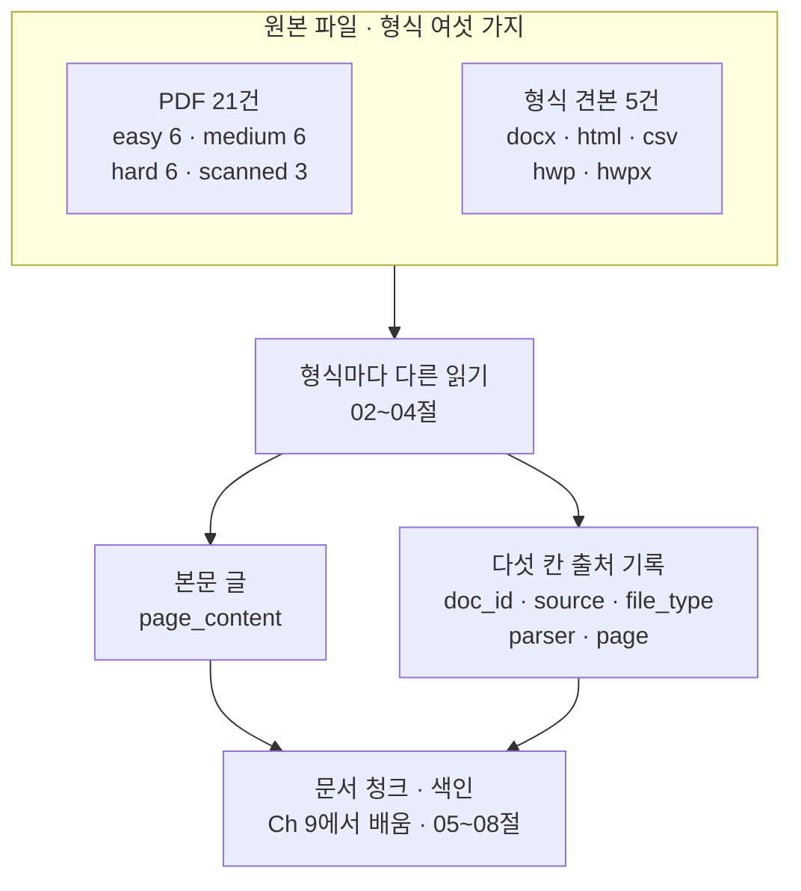
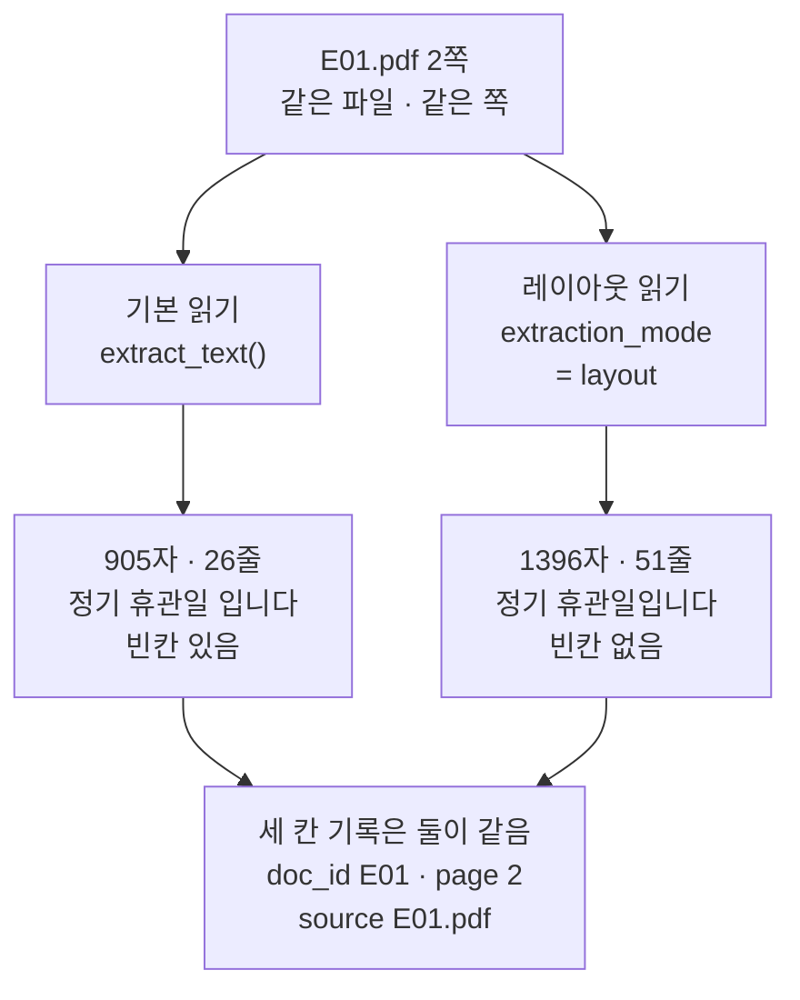
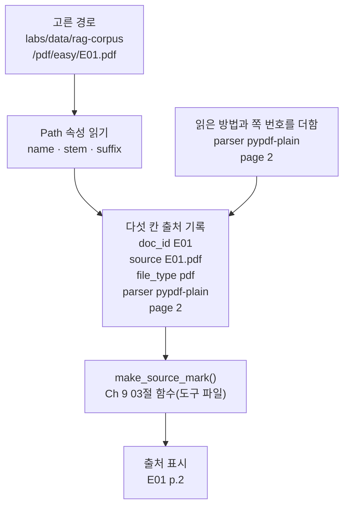
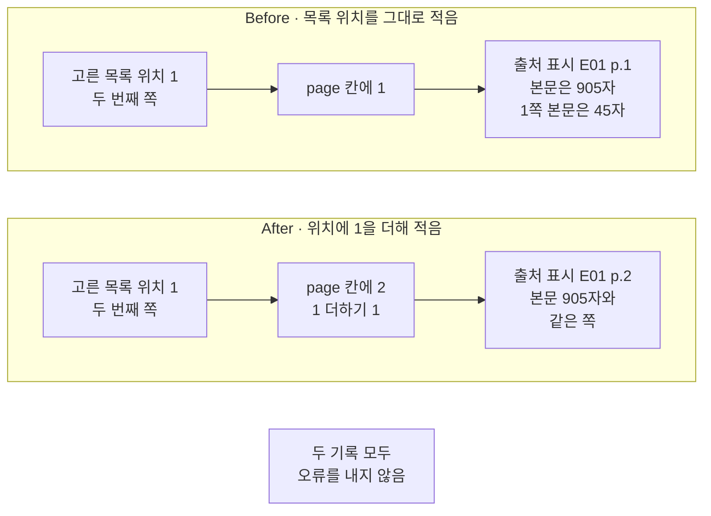

# 01-문서와-메타데이터

## _src 본문 (HTML 원본)

```html
<!--meta: 강의 1h | 실습 2h | 코드 01-문서와-메타데이터.ipynb | 새 용어 4 -->

<h2 id="b1"><span class="no">1</span>학습 목표</h2>
<div class="goal"><ul>
<li>이 절을 마치면 이 챕터가 읽을 문서 폴더를 열어 파일 수와 형식 가짓수를 셀 수 있습니다.</li>
<li>이 절을 마치면 PDF 한 쪽을 두 가지 방법으로 읽어 글자 수와 문장을 견줄 수 있습니다.</li>
<li>이 절을 마치면 다섯 칸 출처 기록을 만들고 쪽 번호를 1부터 세어 적을 수 있습니다.</li>
</ul></div>

<h2 id="b2"><span class="no">2</span>이 내용을 배우는 이유</h2>
<p>Ch 9는 PDF 한 종류만 읽었습니다. 로더 함수가 쪽마다 <code>Document</code> 하나를 만들고, 메타데이터에 <code>doc_id</code>·<code>page</code>·<code>source</code> 세 칸을 적었습니다. 세 칸으로 넉넉했던 까닭은 파일 형식도 하나였고 읽는 방법도 하나였기 때문입니다.</p>
<p>이 챕터는 형식이 여섯 가지입니다. 여섯 가지는 PDF, DOCX, HTML, CSV, HWP, HWPX입니다. 같은 PDF 안에서도 읽는 방법이 여럿이고, 방법을 바꾸면 뽑히는 글이 달라집니다. 그래서 기록에 파일 형식과 읽은 방법을 적는 칸을 더합니다.</p>
<p>이 두 칸이 없으면 나중에 되짚을 수 없습니다. 검색 결과가 나빠졌을 때 어느 도구로 읽은 글이 색인에 들어갔는지 알 수 없기 때문입니다. 01절은 기록의 칸을 정하고, 02~04절은 형식마다 파일을 실제로 읽습니다.</p>
<p>이 절이 쓰는 파일은 두 곳에 있습니다. 폴더 <code>labs/data/rag-corpus/</code>의 PDF 21건과 <code>labs/part3/ch10-document-processing/fixtures/</code>의 형식 견본 5건입니다. PDF 21건 가운데 스캔본 폴더의 3건은 글자 층이 없습니다. 남은 18건 가운데서도 <code>H05</code>는 세 쪽 모두 글자가 0자여서, 글을 얻은 문서는 17건입니다(08절에서 다시 셉니다).</p>

<h2 id="b3"><span class="no">3</span>앞에서 배운 내용</h2>
<ul>
<li><strong>문서 객체(Document)</strong> — Ch 9 01절에서 배웠습니다. 본문 글 <code>page_content</code>와 설명 값 <code>metadata</code> 두 자리를 가집니다.</li>
<li><strong>로더 함수</strong> — Ch 9 02절의 <code>load_pdf_pages()</code>는 PDF 경로와 문서 이름을 받습니다. 쪽마다 <code>Document</code> 하나를 만들고 쪽 번호를 1부터 세어 적습니다.</li>
<li><strong>출처 표시</strong> — Ch 9 03절의 <code>make_source_mark()</code>는 <code>doc_id</code>와 <code>page</code> 두 칸만 읽습니다. 그 두 값으로 <code>[E01 p.2]</code> 모양의 글을 만듭니다.</li>
<li><strong>문서 청크</strong> — Ch 9 01절에서 정한 말입니다. 검색 단위로 자른 문서의 한 부분을 가리키며, 이 챕터 05~08절이 이어받습니다.</li>
</ul>
<p>노트북은 Ch 9 02·03절 함수 두 개를 다시 적지 않고 도구 파일 <code>rag_tools.py</code>에서 가져옵니다.</p>

<h2 id="b4"><span class="no">4</span>핵심 개념</h2>
<h3>비유 — 접수대에서 같은 모양 봉투로 옮기기</h3>
<p>한 기관의 접수대에 신청서가 들어온다고 생각해 보세요. 어떤 것은 두꺼운 책자이고, 어떤 것은 한 장짜리 표이며, 어떤 것은 접힌 종이입니다. 담당자는 원본을 창고에 두고 처리 부서에는 같은 모양의 봉투로 넘깁니다.</p>
<p>봉투 앞면에는 늘 같은 자리에 같은 항목을 적습니다. 접수 번호, 원본 종류, 옮겨 적은 사람, 원본의 몇 쪽인지입니다. 처리 부서는 봉투만 보고 일하고, 원본이 필요하면 적힌 항목을 따라 창고에서 찾습니다. 로더가 하는 일도 이와 같습니다.</p>
{{img:01-5-서류와-봉투|다섯 줄 세 칸으로 놓인 평면 그림으로 왼쪽 칸에는 두께와 모양이 다른 서류 다섯 가지가 줄마다 하나씩 있고 가운데 칸에는 돋보기와 자와 핀셋과 붓과 종이집게가 줄마다 하나씩 있으며 오른쪽 칸에는 크기와 모양이 똑같은 흰 봉투 다섯 개가 줄마다 하나씩 놓여 있고 봉투마다 앞면 같은 자리에 짧은 빈 가로줄이 그려져 있음|원본 모양은 제각각이지만 다음 자리로 넘기는 봉투는 모두 같은 모양이고 앞면의 빈 줄도 같은 자리에 있습니다}}
<p><strong>그림 읽기</strong> — 다섯 줄을 한 줄씩 왼쪽에서 오른쪽으로 봅니다. 왼쪽 칸의 서류는 두께와 모양이 모두 다르고, 가운데 칸의 도구도 줄마다 다릅니다. 오른쪽 칸의 봉투 다섯 개는 크기와 모양이 같고 앞면의 짧은 빈 줄도 같은 자리에 있습니다. 왼쪽이 원본 파일, 가운데가 형식마다 다른 읽기, 오른쪽이 다섯 칸 출처 기록입니다.</p>

<h3>이 절에서 쓰는 말</h3>
<table><thead><tr><th>용어</th><th>뜻과 일상 예</th><th>이 절에서 보이는 모습</th></tr></thead><tbody>
<tr><td>파서(parser)</td><td>파일 안의 구조를 풀어 본문과 표 같은 내용을 꺼내는 프로그램. 같은 원본을 옮겨 적는 사람이 둘이면 옮긴 글이 달라지는 것과 같음</td><td>4절의 기본 읽기와 레이아웃 읽기, <code>parser</code> 칸의 <code>pypdf-plain</code></td></tr>
<tr><td>파일 형식(file type)</td><td>파일을 저장한 방식의 이름. 문서함에서 종이 묶음과 표 묶음을 나누어 두는 것과 같음</td><td>2절 견본 폴더의 확장자 다섯 가지, <code>file_type</code> 칸의 <code>pdf</code></td></tr>
<tr><td>출처 기록</td><td>본문 글이 어디에서 왔는지 적어 두는 다섯 칸짜리 딕셔너리. 봉투 앞면에 적는 항목과 같음</td><td>5절 <code>make_source_record()</code>가 만든 값, <code>메타데이터 칸 수: 5</code></td></tr>
<tr><td>출처 계보(provenance)</td><td>검색된 글을 원본 파일의 몇 쪽까지 거슬러 찾아갈 수 있게 남긴 자취. 택배 상자에 붙은 배송 이력과 같음</td><td>다섯 칸 가운데 <code>source</code>·<code>parser</code>·<code>page</code></td></tr>
</tbody></table>
<p>문서 객체·메타데이터·문서 청크·출처 표시는 Ch 9와 같은 뜻입니다. 메타데이터는 내용 옆에 적어 두는 설명 값이고, 문서 청크는 검색 단위로 자른 문서의 한 부분입니다. 출처 표시 모양도 Ch 9와 같은 <code>[E01 p.2]</code>입니다.</p>

<h3>도식 — 형식이 달라도 다음 단계에 넘기는 것은 둘뿐입니다</h3>
{{mermaid:01-1-형식과-기록|위 칸 원본 파일 형식 여섯 가지에 초록 상자 PDF 21건과 형식 견본 5건이 나란히 있고 그 아래로 파란 상자 형식마다 다른 읽기가 이어지며 거기서 초록 상자 본문 글과 초록 상자 다섯 칸 출처 기록 둘로 갈라진 뒤 회색 상자 문서 청크와 색인으로 다시 모이는 흐름도|원본 형식은 여섯 가지지만 읽고 난 뒤에는 본문 글과 다섯 칸 출처 기록 두 가지로 모입니다}}
<p><strong>도식 읽기</strong> — 위에서 아래로 봅니다. 맨 위 칸의 초록 상자 두 개가 이 챕터가 읽을 파일입니다. 노트북 2절 출력에서 <code>easy | 6</code>·<code>medium | 6</code>·<code>hard | 6</code>·<code>scanned | 3</code>을 세어 21건을 얻었고, 견본 폴더에서 확장자 다섯 가지를 보았습니다.</p>
<p>가운데 파란 상자가 02~04절에서 형식마다 다르게 하는 읽기입니다. 그 아래 초록 상자 두 개가 읽고 난 결과입니다. 맨 아래 회색 상자는 Ch 9에서 배운 단계이며, 이 절에서는 실행하지 않습니다.</p>

<h3>다섯 칸에 무엇을 적는가</h3>
<p>칸 이름은 형식이 달라도 같게 둡니다. 쪽 번호는 늘 <code>page</code>, 파일 이름은 늘 <code>source</code>입니다. 문서 이름 <code>doc_id</code>는 같은 문서를 다시 읽어도 바뀌지 않는 값을 씁니다. 이 챕터의 교육용 문서는 파일 이름 앞의 <code>E01</code>·<code>M03</code>·<code>H06</code>이 곧 문서 이름입니다.</p>
<table>
<tr><th>칸</th><th>예시</th><th>어디서 오는가</th><th>주의할 점</th></tr>
<tr><td><code>doc_id</code></td><td><code>E01</code></td><td>경로의 <code>stem</code></td><td>Ch 11이 정답표와 맞춰 보는 값이라 다시 읽어도 같아야 합니다.</td></tr>
<tr><td><code>source</code></td><td><code>E01.pdf</code></td><td>경로의 <code>name</code></td><td>이 실습은 파일 이름만 적습니다. 같은 이름이 여러 폴더에 있으면 경로도 따로 적습니다.</td></tr>
<tr><td><code>file_type</code></td><td><code>pdf</code></td><td>경로의 <code>suffix</code></td><td>확장자만 믿지 않고 실제로 읽은 결과와 함께 봅니다.</td></tr>
<tr><td><code>parser</code></td><td><code>pypdf-plain</code></td><td>사람이 정해 넣음</td><td>도구 이름과 설정을 함께 적습니다. 나중에 같은 조건으로 다시 읽을 때 씁니다.</td></tr>
<tr><td><code>page</code></td><td><code>2</code></td><td>사람이 정해 넣음</td><td>0부터 세는지 1부터 세는지 정해 두고 어기지 않습니다.</td></tr>
</table>
<p>세 칸은 경로에서 바로 얻습니다. 클래스 <code>Path</code>에 경로 글을 넣어 만들면 <code>name</code>·<code>stem</code>·<code>suffix</code> 세 값을 읽을 수 있습니다. 점 뒤에 괄호가 없으면 저장된 값을 읽는 표기이고, <code>exists()</code>처럼 괄호가 있으면 검사를 실행하는 메서드 호출입니다.</p>
<p>나머지 두 칸은 사람이 정해 넣습니다. 읽은 방법 이름과 쪽 번호입니다. 이 두 칸에서 실수가 나면 코드가 알려 주지 않으므로 6절에서 한 번 겪어 봅니다.</p>

<h2 id="b5"><span class="no">5</span>실행 예제</h2>
<p>내려받은 실습 폴더에서 노트북을 열고 위에서 아래로 실행합니다. API 키는 필요하지 않고 모델과 임베딩에는 요청을 한 번도 보내지 않습니다. 첫 셀의 패키지 설치만 인터넷을 씁니다. 먼저 문서 폴더의 파일 수와 형식을 세고, Ch 9 로더로 E01.pdf를 읽습니다.</p>
<p>이 페이지의 출력은 2026-09-21에 실행한 결과입니다. 모델을 부르지 않으므로 같은 판에서 다시 실행해도 같은 값이 나왔습니다. 새 커널로 두 번 실행해 열여섯 개 코드 셀의 출력이 모두 같은 것을 확인했습니다.</p>
<p>강의 시간에는 노트북 2~6절을 설명합니다. 문서 폴더 살펴보기, Ch 9 로더, 두 가지 읽기, 다섯 칸 출처 기록입니다. 7절 값 바꿔 보기와 Before·After는 함께 실행하고 실습 시간에 다시 읽습니다.</p>
<p>이어서 같은 2쪽을 두 가지 방법으로 읽습니다. 라이브러리 pypdf의 <code>extract_text()</code>는 글자 자리를 버리고 글자를 이어 붙입니다. 같은 메서드에 <code>extraction_mode="layout"</code>을 주면 빈칸과 줄 자리를 살립니다.</p>
{{mermaid:01-2-두-읽기|초록 상자 E01.pdf 2쪽에서 파란 상자 기본 읽기와 파란 상자 레이아웃 읽기로 갈라지고 각각 노란 상자 905자 26줄과 노란 상자 1396자 51줄로 이어진 뒤 노란 상자 세 칸 기록은 둘이 같음으로 다시 모이는 흐름도|2쪽을 두 방법으로 읽으면 905자와 1396자가 나오지만 Ch 9의 세 칸 기록은 둘이 똑같습니다}}
<p><strong>도식 읽기</strong> — 위에서 아래로 봅니다. 맨 위 초록 상자가 읽은 파일이고, 파란 상자 두 개가 노트북 4절이 실행한 두 방법입니다. 노란 상자 두 개는 출력으로 확인한 값입니다.</p>
<p>왼쪽 값은 <code>기본 읽기 글자 수: 905</code>와 <code>기본 읽기 줄 수: 26</code>입니다. 오른쪽 값은 <code>레이아웃 읽기 글자 수: 1396</code>과 <code>레이아웃 읽기 줄 수: 51</code>입니다. 두 글에서 Ch 8이 쓴 문장을 찾아보면 기본 읽기는 <code>False</code>, 레이아웃 읽기는 <code>True</code>였습니다. 기본 읽기에서는 「휴관일」과 「입니다」 사이에 빈칸이 들어갔기 때문입니다.</p>
<p>맨 아래 노란 상자가 이 절이 칸을 늘리는 까닭입니다. 본문은 다른데 Ch 9의 세 칸 기록은 두 결과에 똑같이 붙습니다. 그래서 읽은 방법을 적는 <code>parser</code> 칸과 형식을 적는 <code>file_type</code> 칸을 더합니다.</p>
{{mermaid:01-3-다섯-칸-기록|초록 상자 고른 경로에서 파란 상자 Path 속성 읽기로 내려오고 오른쪽 파란 상자 읽은 방법과 쪽 번호를 더함이 함께 초록 상자 다섯 칸 출처 기록으로 모인 뒤 파란 상자 make_source_mark 함수를 거쳐 노란 상자 출처 표시 E01 p.2로 이어지는 흐름도|경로에서 얻은 세 칸에 읽은 방법과 쪽 번호를 더하면 다섯 칸이 되고 Ch 9 함수가 그대로 출처 표시를 만듭니다}}
<p><strong>도식 읽기</strong> — 위에서 아래로 봅니다. 왼쪽 줄기가 경로에서 바로 얻는 세 칸이고, 오른쪽에서 들어오는 줄기가 사람이 정해 넣는 두 칸입니다. 노트북 5절 출력은 <code>name: E01.pdf</code>·<code>stem: E01</code>·<code>suffix: .pdf</code>였습니다.</p>
<p>가운데 초록 상자가 다 채운 기록입니다. 그 아래 파란 상자는 준비 셀에서 도구 파일로 가져온 Ch 9 03절 함수입니다. 이 함수는 <code>doc_id</code>와 <code>page</code> 두 칸만 읽으므로 칸이 늘어도 그대로 동작합니다. 노트북 6절 출력은 <code>출처 표시: [E01 p.2]</code>였고, Ch 9 04~07절이 답에서 찾던 글과 같습니다.</p>
{{notebook:01-문서와-메타데이터|example}}

<h2 id="b6"><span class="no">6</span>일부러 실패해 보기</h2>
<p>다섯 칸 가운데 <code>page</code>는 사람이 정해 넣는 칸입니다. Python 목록은 자리를 0부터 세고, 사람이 보는 PDF 쪽 번호는 1부터 셉니다. 속성 <code>reader.pages</code>도 목록이라 두 번째 쪽의 자리는 <code>1</code>입니다.</p>
<p>Before 셀은 그 자리 값을 그대로 쪽 번호로 적습니다. After 셀은 자리 값에 <code>1</code>을 더해 적습니다.</p>
{{mermaid:01-4-쪽-번호|위 칸 Before에는 초록 상자 고른 목록 위치 1과 파란 상자 page 칸에 1과 빨간 상자 출처 표시 E01 p.1 본문은 905자가 왼쪽에서 오른쪽으로 있고 아래 칸 After에는 초록 상자 고른 목록 위치 1과 파란 상자 page 칸에 2와 노란 상자 출처 표시 E01 p.2가 같은 방향으로 있으며 맨 아래에 회색 상자 두 기록 모두 오류를 내지 않음이 있는 비교 흐름도|같은 자리 값 1로 만든 두 기록이 서로 다른 쪽을 가리키고 둘 다 오류를 내지 않습니다}}
<p><strong>도식 읽기</strong> — 위 칸이 Before, 아래 칸이 After이고 칸마다 왼쪽에서 오른쪽으로 봅니다. 두 칸의 초록 상자는 같은 값 <code>1</code>입니다. 파란 상자에서 갈라집니다.</p>
<p>위 칸의 빨간 상자가 Before 결과입니다. 출력은 <code>출처 표시: [E01 p.1]</code>인데 <code>본문 글자 수: 905</code>는 2쪽 글자 수입니다. 출력 <code>1쪽 본문 글자 수: 45</code>와 견주면 다른 쪽임이 드러납니다. 아래 칸의 노란 상자는 After 결과이며 <code>출처 표시와 본문이 같은 쪽인가: True</code>였습니다.</p>
<p>맨 아래 회색 상자는 두 실행에 모두 해당합니다. 쪽 번호 <code>1</code>은 1 이상이라 값 검사에도 걸리지 않습니다. 사람이 원문 1쪽을 펼쳐 볼 때까지 어긋남이 드러나지 않습니다.</p>
{{notebook:01-문서와-메타데이터|failure}}

<h2 id="b7"><span class="no">7</span>주의할 점과 실무 메모</h2>
<ul>
<li><strong>문서 이름과 제목을 나눕니다.</strong> 제목은 사람이 읽으려고 붙인 값이라 고쳐질 수 있습니다. 칸 <code>doc_id</code>는 제목이나 파일 이름이 바뀌어도 같은 문서면 같은 값이어야 합니다.</li>
<li><strong>쪽 번호 기준을 한 가지로 둡니다.</strong> 라이브러리마다 첫 쪽을 0으로 주기도 하고 1로 주기도 합니다. 교재와 출처 표시는 사람이 보는 1부터로 맞춥니다.</li>
<li><strong>읽은 방법 이름에 설정까지 적습니다.</strong> 이 절은 <code>pypdf-plain</code>으로 적었습니다. 같은 도구라도 설정이 다르면 글이 달라지므로 도구 이름만으로는 되짚기 어렵습니다.</li>
<li><strong>실습 폴더 모듈에 같은 이름의 함수가 있습니다.</strong> <code>labs/part3/ch10-document-processing/document_processing.py</code>의 <code>normalize_metadata()</code>가 같은 다섯 칸을 만듭니다. 받는 인자 모양은 노트북 함수와 다르고, 쪽 번호가 1보다 작으면 오류를 냅니다. 이번 노트북에서는 그 모듈을 부르지 않았습니다.</li>
<li><strong>원본을 그대로 둡니다.</strong> 뽑은 글만 남기면 읽기를 잘못했을 때 다시 확인할 수 없습니다. 다섯 칸 기록이 원본까지 가는 길입니다.</li>
<li><strong>배포용 기록에서 뺄 값을 정합니다.</strong> 작성자 계정, 내부 서버 경로, 임시 폴더 이름은 검색에 필요하지 않으면 빼 둡니다.</li>
</ul>

<h2 id="b8"><span class="no">8</span>정리와 다음 절</h2>
<ul>
<li>이 챕터가 읽을 파일은 PDF 21건과 형식 견본 5건이고, 형식은 모두 여섯 가지입니다.</li>
<li>같은 쪽을 두 방법으로 읽으면 905자와 1396자로 달랐고, 찾은 문장도 달랐습니다.</li>
<li>그래서 Ch 9의 세 칸에 <code>file_type</code>과 <code>parser</code>를 더해 다섯 칸으로 적습니다.</li>
<li>Ch 9 03절의 <code>make_source_mark()</code>는 두 칸만 읽으므로 고치지 않고 그대로 씁니다.</li>
</ul>
<p><strong>다음 학습과 이어지는 지점</strong> — 02절에서는 같은 PDF를 pypdf가 아닌 다른 라이브러리로도 읽습니다. 표의 행과 칸이 남는지, 스캔본에서 글자가 아예 나오지 않는지 확인합니다. 그때 <code>parser</code> 칸에 적을 이름이 하나 더 늘어납니다.</p>
<p>03·04절은 DOCX·HTML·CSV와 HWPX를 읽어 같은 다섯 칸에 담습니다. 05~08절은 그 결과를 문서 청크로 나누어 색인합니다. Ch 11은 <code>doc_id</code>를 정답표와 맞춰 봅니다.</p>

<h2 id="b9"><span class="no">9</span>복습 문제</h2>
<details class="quiz" open><summary>문제 4개 · 해설 포함</summary>
<p class="quiz-q">1. [하] Ch 9의 세 칸에 <code>file_type</code>과 <code>parser</code>를 더한 까닭은 무엇입니까?</p>
<p class="quiz-a">이 챕터는 파일 형식이 여섯 가지이고 같은 형식에도 읽는 방법이 여럿이기 때문입니다. 노트북 4절에서 같은 2쪽을 두 방법으로 읽었더니 905자와 1396자가 나왔지만, 세 칸 기록은 두 결과에 똑같이 붙었습니다. 두 칸을 더해야 어느 방법으로 읽은 글인지 되짚을 수 있습니다.</p>
<p class="quiz-q">2. [중] 파일 이름을 그대로 문서 제목으로 쓰고 <code>doc_id</code>에도 같은 값을 넣으면 어떤 문제가 생깁니까?</p>
<p class="quiz-a">제목은 사람이 고칠 수 있고 여러 문서에서 겹칠 수도 있습니다. 제목이 바뀌면 같은 문서를 새 문서로 세고, 제목이 겹치면 다른 문서의 글이 한 문서로 묶입니다. 바뀌지 않는 업무 문서 번호나 경로와 내용 해시를 함께 쓴 값이 필요합니다.</p>
<p class="quiz-q">3. [중] 경로가 <code>.../easy/E01.pdf</code>일 때 <code>name</code>·<code>stem</code>·<code>suffix</code>는 각각 무엇입니까?</p>
<p class="quiz-a">속성 <code>name</code>은 <code>E01.pdf</code>, <code>stem</code>은 <code>E01</code>, <code>suffix</code>는 <code>.pdf</code>입니다. 이 세 값이 다섯 칸 가운데 <code>source</code>·<code>doc_id</code>·<code>file_type</code> 세 칸이 됩니다.</p>
<p class="quiz-q">4. [상] 두 번째 쪽의 목록 자리 <code>1</code>을 그대로 <code>page</code> 칸에 적으면 어떤 일이 벌어집니까?</p>
<p class="quiz-a">출처 표시가 <code>[E01 p.1]</code>이 되어 본문과 다른 쪽을 가리킵니다. 노트북 8절에서 본문 글자 수는 905자인데 1쪽 본문은 45자였습니다. 코드는 오류를 내지 않고, 쪽 번호가 1 이상이라 값 검사에도 걸리지 않습니다. 사람이 원문 1쪽을 펼쳐 볼 때까지 어긋남이 드러나지 않습니다.</p>
</details>

<h2 id="b10"><span class="no">10</span>참고 자료</h2>
<ul>
<li><div><a href="https://pypdf.readthedocs.io/en/stable/user/extract-text.html">pypdf 공식 문서 Extract Text from a PDF</a></div>확인 2026-09-18 · 기본 추출과 레이아웃 추출의 차이 참고.</li>
<li><div><a href="https://reference.langchain.com/python/langchain-core/documents">LangChain 공식 API Document</a></div>확인 2026-09-18 · <code>page_content</code>와 <code>metadata</code> 구조 참고.</li>
<li><div><a href="https://docs.python.org/3/library/pathlib.html">Python 공식 문서 pathlib</a></div>확인 2026-09-18 · <code>name</code>·<code>stem</code>·<code>suffix</code> 속성 참고.</li>
<li>실습 문서 모음 설명서 — <code>labs/data/rag-corpus/README.md</code> · 디지털 PDF 18건(글을 얻은 문서 17건)과 스캔본 3건의 구성 참고.</li>
<li>기준 버전은 Python 3.12.13과 pypdf 6.18.0입니다. 함께 쓰는 판은 langchain-core 1.6.2이고, 실습 폴더의 잠금 파일을 기준으로 삼습니다.</li>
</ul>
```

## 노트북 셀 (순서대로)

### [0] markdown {'html': 'skip'}

# 문서와 메타데이터

**이 노트북에서 할 일**

1. 이 챕터가 읽을 문서 폴더를 열어 파일이 몇 건이고 형식이 몇 가지인지 셉니다.
2. Ch 9 로더로 E01.pdf를 읽고, 같은 쪽을 다른 방법으로 한 번 더 읽어 두 글을 견줍니다.
3. 다섯 칸 출처 기록을 만들고, 쪽 번호를 잘못 적었을 때와 바로 적었을 때를 견줍니다.

**준비물** — API 키가 필요 없습니다. 모델과 임베딩에는 요청을 한 번도 보내지 않습니다.
첫 셀의 패키지 설치만 인터넷을 씁니다.
그래서 예상 비용은 0달러입니다. 실행 시간은 패키지 설치를 빼면 10초 안팎입니다.

데이터는 두 곳입니다. `labs/data/rag-corpus/` 폴더의 PDF와 `labs/part3/ch10-document-processing/fixtures/` 폴더의 형식 견본입니다.

**강의와 실습 범위** — 강의 시간에는 2~6절을 설명합니다.
문서 폴더 살펴보기, Ch 9 로더, 두 가지 읽기, 다섯 칸 출처 기록입니다.
7절 값 바꿔 보기와 8~9절 Before·After는 함께 실행하고 실습 시간에 다시 읽습니다.

**기준 버전** — 실습 폴더에 고정한 패키지 판을 씁니다. pypdf 6.18.0, langchain-core 1.6.2입니다.
Ch 9 실습 폴더의 pypdf는 6.17.0이라 판이 다릅니다.
교재 출력은 Linux의 Python 3.12.13으로 만들었습니다. 다른 버전과 Windows·macOS에서는 이번에 실행하지 않았습니다.

실습 폴더 `labs/part3/ch10-document-processing`에서 `uv sync --locked`를 실행합니다.
그다음 이 폴더의 `.venv` 커널을 고르고 첫 셀부터 순서대로 실행합니다.

### [1] markdown {'html': 'skip'}

## 오늘 볼 그림


위 칸은 이 챕터가 읽을 원본 파일입니다. 형식은 여섯 가지이고 읽는 방법도 형식마다 다릅니다.
읽고 난 뒤에 남는 것은 본문 글과 다섯 칸 출처 기록 두 가지뿐입니다.
초록 상자는 파일과 기록, 파란 상자는 코드 단계, 회색 상자는 이 절에서 실행하지 않는 Ch 9 단계입니다.

### [2] markdown {}

## 1. 준비

첫 셀은 패키지를 설치하고 설치된 버전을 출력합니다. 설치에는 몇십 초가 걸릴 수 있습니다.
Ch 9와 같은 pypdf로 PDF를 읽고, 같은 `Document`로 본문과 메타데이터를 묶습니다.

### [3] code {'execution': {'iopub.execute_input': '2026-09-21T06:25:29.334221Z', 'iopub.status.busy': '2026-09-21T06:25:29.333922Z', 'iopub.status.idle': '2026-09-21T06:25:29.783646Z', 'shell.execute_reply': '2026-09-21T06:25:29.783082Z'}, 'lesson_role': 'setup'}

```python
# 이 절에서 쓰는 패키지를 설치하고 버전을 확인합니다
%pip install -q "pypdf==6.18.0" "langchain-core==1.6.2"
from importlib.metadata import version

print("pypdf:", version("pypdf"))
print("langchain-core:", version("langchain-core"))
```

출력:
```
Note: you may need to restart the kernel to use updated packages.
pypdf: 6.18.0
langchain-core: 1.6.2

```

### [4] markdown {}

**결과 읽기** — 출력 줄은 `pypdf: 6.18.0`과 `langchain-core: 1.6.2` 두 줄입니다.
준비물에 적은 기준 버전과 같습니다.

다음 셀은 이 절에서 쓸 이름을 불러옵니다.
클래스 `Path`는 파일 경로를 다루는 Python 기본 기능입니다.
경로 글자를 넣어 만들면 파일 이름과 확장자를 따로 읽을 수 있습니다.
Ch 9에서는 경로를 글자 그대로 다뤘습니다. 이 절에서는 2절에서 확장자를 볼 때 처음 쓰고, 5절에서 세 속성을 함께 씁니다.

앞에서 배운 함수는 `rag_tools.py`에 모아 두었습니다. 파일을 열면 코드를 볼 수 있습니다. 노트북과 같은 폴더(`notebooks/`)에 있는 파일입니다.
이 노트북은 Ch 9 02절 `load_pdf_pages()`와 Ch 9 03절 `make_source_mark()`를 가져옵니다.

### [5] code {'execution': {'iopub.execute_input': '2026-09-21T06:25:29.784746Z', 'iopub.status.busy': '2026-09-21T06:25:29.784660Z', 'iopub.status.idle': '2026-09-21T06:25:29.954486Z', 'shell.execute_reply': '2026-09-21T06:25:29.954013Z'}, 'lesson_role': 'setup'}

```python
# 파일 찾기·경로 속성 읽기·PDF 읽기·문서 객체 만들기에 쓸 이름을 불러옵니다
import os
from pathlib import Path

from pypdf import PdfReader
from langchain_core.documents import Document
# Ch 9 02·03절 함수 두 개를 도구 파일에서 가져옵니다
from rag_tools import load_pdf_pages, make_source_mark
```

출력:
```

```

### [6] markdown {}

## 2. 이 챕터가 읽을 문서 폴더 찾기

노트북을 연 폴더에 따라 문서 폴더까지 가는 경로가 다릅니다.
Ch 9 01절처럼 후보 경로를 차례로 확인하고, 있는 경로에서 멈춥니다.
함수 `os.path.exists()`는 경로를 받아 파일이나 폴더가 있으면 `True`를 반환합니다.

후보는 세 개입니다. 프로젝트 맨 위, 실습 폴더 맨 위, `notebooks` 폴더에서 연 경우입니다.
실행 전에 예상합니다. 프로젝트 맨 위에서 열었다면 첫째 후보를 고를 것입니다.

### [7] code {'execution': {'iopub.execute_input': '2026-09-21T06:25:29.955270Z', 'iopub.status.busy': '2026-09-21T06:25:29.955192Z', 'iopub.status.idle': '2026-09-21T06:25:29.957334Z', 'shell.execute_reply': '2026-09-21T06:25:29.957010Z'}}

```python
# 작업 폴더에서 본 프로젝트 맨 위 경로를 후보 세 개 가운데에서 고릅니다
candidates = [".", "../../..", "../../../.."]
root_path = None
for candidate in candidates:
    if os.path.exists(candidate + "/labs/data/rag-corpus"):
        root_path = candidate
        break
print("프로젝트 맨 위를 찾았는가:", root_path is not None)
print("고른 경로:", root_path)
assert root_path is not None, "notebooks 폴더나 실습 폴더 맨 위에서 노트북을 열어 주세요."
```

출력:
```
프로젝트 맨 위를 찾았는가: True
고른 경로: .

```

### [8] markdown {}

**결과 읽기** — 출력 줄은 `프로젝트 맨 위를 찾았는가: True`와 `고른 경로: .`입니다. `assert`도 통과했습니다.
교재 출력은 프로젝트 맨 위를 작업 폴더로 삼아 실행해서 첫째 후보를 골랐습니다.
`notebooks` 폴더에서 열면 셋째 후보, 실습 폴더 맨 위에서 열면 둘째 후보가 나옵니다.

다음 셀은 고른 경로에 폴더 이름을 이어 붙여 두 폴더 경로를 만듭니다.
그다음 PDF 폴더 네 개의 파일 수를 셉니다.
함수 `os.listdir()`은 폴더 경로를 받아 그 안 파일과 폴더 이름 목록을 반환합니다.

### [9] code {'execution': {'iopub.execute_input': '2026-09-21T06:25:29.957920Z', 'iopub.status.busy': '2026-09-21T06:25:29.957867Z', 'iopub.status.idle': '2026-09-21T06:25:29.961605Z', 'shell.execute_reply': '2026-09-21T06:25:29.961331Z'}}

```python
# 문서 폴더와 견본 폴더 경로를 만들고, 난이도 폴더 네 개의 PDF 수를 셉니다
corpus_path = root_path + "/labs/data/rag-corpus"
fixtures_path = root_path + "/labs/part3/ch10-document-processing/fixtures"
tier_names = ["easy", "medium", "hard", "scanned"]
print("폴더 | PDF 수:")
for tier_name in tier_names:
    file_names = os.listdir(corpus_path + "/pdf/" + tier_name)
    print(tier_name, "|", len(file_names))
```

출력:
```
폴더 | PDF 수:
easy | 6
medium | 6
hard | 6
scanned | 3

```

### [10] markdown {}

**결과 읽기** — 라벨 줄 `폴더 | PDF 수:` 아래 네 줄이 폴더마다 센 결과입니다.
`easy | 6`, `medium | 6`, `hard | 6`, `scanned | 3`이므로 PDF는 모두 21건입니다.
`scanned` 3건은 글자 층이 없는 스캔본이고, 02절에서 확인합니다.

다음 셀은 형식 견본 폴더를 봅니다. 여기에는 PDF가 아닌 파일이 들어 있습니다.
속성 `suffix`는 파일 이름 끝의 확장자를 점까지 붙여 반환합니다.

### [11] code {'execution': {'iopub.execute_input': '2026-09-21T06:25:29.962082Z', 'iopub.status.busy': '2026-09-21T06:25:29.962039Z', 'iopub.status.idle': '2026-09-21T06:25:29.964083Z', 'shell.execute_reply': '2026-09-21T06:25:29.963785Z'}}

```python
# 견본 폴더의 파일 이름과 확장자를 봅니다
fixture_names = sorted(os.listdir(fixtures_path))
print("견본 파일 | 확장자:")
for fixture_name in fixture_names:
    print(fixture_name, "|", Path(fixture_name).suffix)
```

출력:
```
견본 파일 | 확장자:
legacy-signature.hwp | .hwp
minimal-marker.hwpx | .hwpx
sample.csv | .csv
sample.docx | .docx
sample.html | .html

```

### [12] markdown {}

**결과 읽기** — 라벨 줄 `견본 파일 | 확장자:` 아래 다섯 줄이 견본 파일입니다.
확장자는 `.hwp`, `.hwpx`, `.csv`, `.docx`, `.html` 다섯 가지입니다.
PDF까지 세면 이 챕터가 읽을 형식은 여섯 가지입니다.
형식마다 파일을 읽는 도구가 다르고, 그 도구를 02~04절에서 하나씩 씁니다.

### [13] markdown {}

## 3. Ch 9 로더로 E01.pdf 읽기

준비 셀에서 가져온 Ch 9 02절 로더 함수 `load_pdf_pages()`로 읽습니다.
이 함수는 PDF 경로와 문서 이름을 받아 쪽마다 `Document` 하나를 만듭니다.
메타데이터 칸은 `doc_id`, `page`, `source` 세 개입니다.

다음 셀에서 이 함수로 E01.pdf를 읽습니다.
문서 E01은 Ch 9 01~07절이 쓴 미르시립도서관 이용 안내 문서입니다.

### [14] code {'execution': {'iopub.execute_input': '2026-09-21T06:25:29.964691Z', 'iopub.status.busy': '2026-09-21T06:25:29.964643Z', 'iopub.status.idle': '2026-09-21T06:25:29.996329Z', 'shell.execute_reply': '2026-09-21T06:25:29.995838Z'}}

```python
# Ch 9 로더로 E01.pdf를 읽고 Document 수와 2쪽 메타데이터를 봅니다
pdf_path = corpus_path + "/pdf/easy/E01.pdf"
pages = load_pdf_pages(pdf_path, "E01")
print("Document 수:", len(pages))
print("2쪽 메타데이터:", pages[1].metadata)
print("2쪽 본문 글자 수:", len(pages[1].page_content))
```

출력:
```
Document 수: 5
2쪽 메타데이터: {'doc_id': 'E01', 'page': 2, 'source': 'E01.pdf'}
2쪽 본문 글자 수: 905

```

### [15] markdown {}

**결과 읽기** — 출력 줄은 `Document 수: 5`, `2쪽 메타데이터: {'doc_id': 'E01', 'page': 2, 'source': 'E01.pdf'}`, `2쪽 본문 글자 수: 905`입니다.
Ch 9 02절 출력과 같은 값입니다. 실습 폴더의 pypdf 판이 달라도 이 문서에서는 같은 글자 수가 나왔습니다.
목록 `pages`의 자리 1이 2쪽인 까닭은 로더가 쪽 번호를 1부터 세어 적기 때문입니다.

### [16] markdown {}

## 4. 같은 쪽을 다른 방법으로 한 번 더 읽기

PDF 파일은 글자를 쪽 위의 자리에 놓습니다.
그래서 같은 쪽이라도 어떤 순서로 글자를 이어 붙이느냐에 따라 결과가 달라집니다.
라이브러리 pypdf의 `extract_text()`는 자리 정보를 버리고 글자를 이어 붙입니다.
같은 메서드에 `extraction_mode="layout"`을 주면 빈칸과 줄 자리를 살려 이어 붙입니다.

실행 전에 예상합니다. 두 방법의 글자 수가 다를 것입니다.

### [17] code {'execution': {'iopub.execute_input': '2026-09-21T06:25:29.996892Z', 'iopub.status.busy': '2026-09-21T06:25:29.996843Z', 'iopub.status.idle': '2026-09-21T06:25:30.023326Z', 'shell.execute_reply': '2026-09-21T06:25:30.023061Z'}}

```python
# 같은 2쪽을 기본 읽기와 레이아웃 읽기로 읽어 글자 수와 줄 수를 봅니다
reader = PdfReader(pdf_path)
plain_text = reader.pages[1].extract_text()
layout_text = reader.pages[1].extract_text(extraction_mode="layout")
plain_lines = plain_text.split("\n")
layout_lines = layout_text.split("\n")
print("기본 읽기 글자 수:", len(plain_text))
print("기본 읽기 줄 수:", len(plain_lines))
print("레이아웃 읽기 글자 수:", len(layout_text))
print("레이아웃 읽기 줄 수:", len(layout_lines))
```

출력:
```
기본 읽기 글자 수: 905
기본 읽기 줄 수: 26
레이아웃 읽기 글자 수: 1396
레이아웃 읽기 줄 수: 51

```

### [18] markdown {}

**결과 읽기** — 출력 줄은 `기본 읽기 글자 수: 905`, `기본 읽기 줄 수: 26`입니다.
이어서 `레이아웃 읽기 글자 수: 1396`, `레이아웃 읽기 줄 수: 51`입니다.
레이아웃 읽기가 빈칸과 빈 줄을 더 넣어서 글자 수가 491자 많습니다.

다음 셀은 두 글에서 같은 문장을 찾아봅니다.
Ch 8 03절이 쓴 문장은 「매주 월요일은 정기 휴관일입니다」였습니다.

### [19] code {'execution': {'iopub.execute_input': '2026-09-21T06:25:30.024042Z', 'iopub.status.busy': '2026-09-21T06:25:30.023985Z', 'iopub.status.idle': '2026-09-21T06:25:30.025899Z', 'shell.execute_reply': '2026-09-21T06:25:30.025651Z'}}

```python
# 두 읽기에서 Ch 8이 쓴 문장 「정기 휴관일입니다」를 찾고, 「휴관」이 든 줄을 봅니다
closure_sentence = "정기 휴관일입니다"
print("기본 읽기에 있는가:", closure_sentence in plain_text)
print("레이아웃 읽기에 있는가:", closure_sentence in layout_text)
print("기본 읽기에서 「휴관」이 든 줄:")
for line in plain_lines:
    if "휴관" in line:
        print(line)
print("레이아웃 읽기에서 「휴관」이 든 줄:")
for line in layout_lines:
    if "휴관" in line:
        print(line)
```

출력:
```
기본 읽기에 있는가: False
레이아웃 읽기에 있는가: True
기본 읽기에서 「휴관」이 든 줄:
매주 월요일은 정기 휴관일 입니다. 법정 공휴일에도 휴관하며, 공휴일이 월요일과 겹치면 그 다음 날인
화요일에도 휴관합니다.
레이아웃 읽기에서 「휴관」이 든 줄:
매주 월요일은 정기 휴관일입니다. 법정 공휴일에도 휴관하며, 공휴일이 월요일과 겹치면 그 다음 날인
화요일에도 휴관합니다.

```

### [20] markdown {}

**결과 읽기** — 출력 줄은 `기본 읽기에 있는가: False`와 `레이아웃 읽기에 있는가: True`입니다.
라벨 줄 `기본 읽기에서 「휴관」이 든 줄:` 아래 첫 줄에 `정기 휴관일 입니다`가 있습니다. 「휴관일」과 「입니다」 사이에 빈칸이 들어갔습니다.
라벨 줄 `레이아웃 읽기에서 「휴관」이 든 줄:` 아래 첫 줄에는 `정기 휴관일입니다`로 빈칸 없이 붙어 있습니다.
Ch 9 01절도 기본 읽기에서 이 문장을 찾지 못해 `False`를 보았습니다.

읽는 방법 하나를 바꾸면 검색에 쓸 글이 이렇게 달라집니다.
그렇다면 Ch 9의 세 칸 기록은 두 결과를 어떻게 가려낼까요.

### [21] code {'execution': {'iopub.execute_input': '2026-09-21T06:25:30.026515Z', 'iopub.status.busy': '2026-09-21T06:25:30.026471Z', 'iopub.status.idle': '2026-09-21T06:25:30.028130Z', 'shell.execute_reply': '2026-09-21T06:25:30.027892Z'}}

```python
# Ch 9 로더가 만든 세 칸 기록을 두 읽기 결과에 그대로 붙일 수 있는지 봅니다
three_key_metadata = pages[1].metadata
print("세 칸 기록:", three_key_metadata)
print("두 읽기의 본문이 같은가:", plain_text == layout_text)
print("두 본문의 글자 수 차이:", len(layout_text) - len(plain_text))
print("이 기록에 읽은 방법을 적는 칸이 있는가:", "parser" in three_key_metadata)
```

출력:
```
세 칸 기록: {'doc_id': 'E01', 'page': 2, 'source': 'E01.pdf'}
두 읽기의 본문이 같은가: False
두 본문의 글자 수 차이: 491
이 기록에 읽은 방법을 적는 칸이 있는가: False

```

### [22] markdown {}

**결과 읽기** — 출력 줄은 `두 읽기의 본문이 같은가: False`와 `두 본문의 글자 수 차이: 491`입니다.
그런데 `세 칸 기록: {'doc_id': 'E01', 'page': 2, 'source': 'E01.pdf'}`은 두 결과에 똑같이 붙습니다.
마지막 줄 `이 기록에 읽은 방법을 적는 칸이 있는가: False`가 까닭입니다.
본문은 다른데 기록이 같으면, 나중에 어느 방법으로 읽은 글인지 되짚을 수 없습니다.

### [23] markdown {}

## 5. 다섯 칸 출처 기록 만들기

Ch 9는 PDF 한 가지만 다뤄서 세 칸으로 넉넉했습니다.
이 챕터는 형식이 여섯 가지이고 같은 형식에도 읽는 방법이 여럿입니다.
그래서 칸을 두 개 더 둡니다. 파일 형식을 적는 `file_type`과 읽은 방법을 적는 `parser`입니다.

세 칸 가운데 두 칸은 파일 경로에서 바로 얻을 수 있습니다.
속성 `name`은 확장자를 붙인 파일 이름, `stem`은 확장자를 뺀 이름, `suffix`는 확장자입니다.
점 뒤에 괄호가 없으면 저장된 값을 읽는 표기이고, `exists()`처럼 괄호가 있으면 검사를 실행하는 메서드입니다.

### [24] code {'execution': {'iopub.execute_input': '2026-09-21T06:25:30.028718Z', 'iopub.status.busy': '2026-09-21T06:25:30.028671Z', 'iopub.status.idle': '2026-09-21T06:25:30.030506Z', 'shell.execute_reply': '2026-09-21T06:25:30.030126Z'}}

```python
# 고른 PDF 경로에서 파일 이름·확장자를 뺀 이름·확장자를 읽습니다
pdf_path_object = Path(pdf_path)
print("경로 객체의 자료형:", type(pdf_path_object).__name__)
print("name:", pdf_path_object.name)
print("stem:", pdf_path_object.stem)
print("suffix:", pdf_path_object.suffix)
```

출력:
```
경로 객체의 자료형: PosixPath
name: E01.pdf
stem: E01
suffix: .pdf

```

### [25] markdown {}

**결과 읽기** — 출력 줄은 `경로 객체의 자료형: PosixPath`, `name: E01.pdf`, `stem: E01`, `suffix: .pdf`입니다.
이 이름은 Linux와 macOS에서 `PosixPath`이고 Windows에서는 다릅니다. 이번에는 Linux에서만 실행했습니다.
`stem` 값 `E01`이 Ch 9가 쓴 문서 이름과 같습니다. 이 문서 모음은 파일 이름 앞이 곧 문서 이름입니다.

다음 셀은 이 세 값에 쪽 번호와 읽은 방법을 더해 다섯 칸을 채우는 함수를 만듭니다.

### [26] code {'execution': {'iopub.execute_input': '2026-09-21T06:25:30.031143Z', 'iopub.status.busy': '2026-09-21T06:25:30.031090Z', 'iopub.status.idle': '2026-09-21T06:25:30.032782Z', 'shell.execute_reply': '2026-09-21T06:25:30.032410Z'}}

```python
# 파일 경로·쪽 번호·읽은 방법 이름을 받아 다섯 칸 출처 기록을 만들어 반환하는 함수를 정의합니다
def make_source_record(file_path, page, parser):
    path_object = Path(file_path)
    suffix = path_object.suffix
    file_type = suffix.replace(".", "").lower()
    record = {"doc_id": path_object.stem, "source": path_object.name,
              "file_type": file_type, "parser": parser, "page": page}
    return record
```

출력:
```

```

### [27] markdown {}

**결과 읽기** — 이 셀은 함수를 만들기만 하므로 출력이 없습니다.

`suffix` 값 `.pdf`에서 점을 빼고 소문자로 바꿔 `file_type` 칸에 넣습니다.
읽은 방법 이름은 사람이 정해 넘깁니다. 이번에는 pypdf의 기본 읽기라 `pypdf-plain`으로 적습니다.

### [28] code {'execution': {'iopub.execute_input': '2026-09-21T06:25:30.033293Z', 'iopub.status.busy': '2026-09-21T06:25:30.033243Z', 'iopub.status.idle': '2026-09-21T06:25:30.034888Z', 'shell.execute_reply': '2026-09-21T06:25:30.034571Z'}}

```python
# E01.pdf 2쪽을 기본 읽기로 읽은 결과의 출처 기록을 만듭니다
page_two_record = make_source_record(pdf_path, 2, "pypdf-plain")
print("출처 기록:", page_two_record)
print("기록의 칸 이름:", page_two_record.keys())
print("Ch 9 세 칸보다 늘어난 칸 수:", len(page_two_record) - len(three_key_metadata))
```

출력:
```
출처 기록: {'doc_id': 'E01', 'source': 'E01.pdf', 'file_type': 'pdf', 'parser': 'pypdf-plain', 'page': 2}
기록의 칸 이름: dict_keys(['doc_id', 'source', 'file_type', 'parser', 'page'])
Ch 9 세 칸보다 늘어난 칸 수: 2

```

### [29] markdown {}

**결과 읽기** — 출력 줄 `출처 기록:` 뒤에 `{'doc_id': 'E01', 'source': 'E01.pdf', 'file_type': 'pdf', 'parser': 'pypdf-plain', 'page': 2}`가 보입니다.
`기록의 칸 이름:` 줄에 다섯 칸 이름이 차례로 있고, `Ch 9 세 칸보다 늘어난 칸 수: 2`입니다.
같은 쪽을 레이아웃 읽기로 읽었다면 `parser` 칸에 `pypdf-layout`을 적습니다. 그 읽기는 02절에서 씁니다.

### [30] markdown {}

## 6. Ch 9 출처 표시 함수 그대로 쓰기

칸을 늘리면 앞 챕터 코드가 깨지지 않을지 걱정할 수 있습니다.
준비 셀에서 가져온 Ch 9 03절 `make_source_mark()`는 `doc_id`와 `page` 두 칸만 읽습니다.
그래서 칸이 늘어도 같은 함수가 그대로 동작합니다.

다음 셀은 다섯 칸 기록을 메타데이터로 삼아 `Document`를 만듭니다.
그리고 그 `Document`를 이 함수에 넘겨 출처 표시를 받습니다.

### [31] code {'execution': {'iopub.execute_input': '2026-09-21T06:25:30.035416Z', 'iopub.status.busy': '2026-09-21T06:25:30.035373Z', 'iopub.status.idle': '2026-09-21T06:25:30.037022Z', 'shell.execute_reply': '2026-09-21T06:25:30.036723Z'}}

```python
# 다섯 칸 기록을 메타데이터로 삼아 2쪽 Document를 만들고 출처 표시를 봅니다
page_two_document = Document(page_content=plain_text, metadata=page_two_record)
print("본문 글자 수:", len(page_two_document.page_content))
print("메타데이터 칸 수:", len(page_two_document.metadata))
print("출처 표시:", make_source_mark(page_two_document))
```

출력:
```
본문 글자 수: 905
메타데이터 칸 수: 5
출처 표시: [E01 p.2]

```

### [32] markdown {}

**결과 읽기** — 출력 줄은 `본문 글자 수: 905`, `메타데이터 칸 수: 5`, `출처 표시: [E01 p.2]`입니다.
Ch 9 04~07절이 답에서 찾던 출처 표시와 글자까지 같습니다.
칸을 늘려도 앞 챕터의 출처 검사 코드를 고치지 않아도 됩니다.

### [33] markdown {}

## 7. 값 하나만 바꿔 보기

바꾸는 값은 쪽 번호 하나입니다. 2에서 3으로 바꿉니다.
실행 전에 예상합니다. 출처 표시가 `[E01 p.3]`으로 바뀌고, 앞서 만든 2쪽 기록은 그대로일 것입니다.

### [34] code {'execution': {'iopub.execute_input': '2026-09-21T06:25:30.037500Z', 'iopub.status.busy': '2026-09-21T06:25:30.037459Z', 'iopub.status.idle': '2026-09-21T06:25:30.039241Z', 'shell.execute_reply': '2026-09-21T06:25:30.038922Z'}}

```python
# 같은 파일에서 쪽 번호만 3으로 바꾼 기록을 만들어 출처 표시를 견줍니다
page_three_record = make_source_record(pdf_path, 3, "pypdf-plain")
page_three_document = Document(page_content=pages[2].page_content, metadata=page_three_record)
print("2쪽 출처 표시:", make_source_mark(page_two_document))
print("3쪽 출처 표시:", make_source_mark(page_three_document))
print("2쪽 기록의 쪽 번호:", page_two_record["page"])
print("3쪽 본문 글자 수:", len(page_three_document.page_content))
```

출력:
```
2쪽 출처 표시: [E01 p.2]
3쪽 출처 표시: [E01 p.3]
2쪽 기록의 쪽 번호: 2
3쪽 본문 글자 수: 925

```

### [35] markdown {}

**결과 읽기** — 출력 줄은 `2쪽 출처 표시: [E01 p.2]`와 `3쪽 출처 표시: [E01 p.3]`입니다.
`2쪽 기록의 쪽 번호: 2`이므로 앞서 만든 기록은 그대로입니다. 함수가 부를 때마다 새 딕셔너리를 만들기 때문입니다.
출력 `3쪽 본문 글자 수: 925`는 2쪽의 905자와 다릅니다. 쪽이 바뀌면 본문도 함께 바뀌어야 합니다.

### [36] markdown {'lesson_part': 'before'}

## 8. 일부러 실패해 보기

쪽 번호는 사람이 정해 넣는 칸이라 실수가 나기 쉽습니다.
Python 목록은 자리를 0부터 세고, 사람이 보는 PDF 쪽 번호는 1부터 셉니다.
속성 `reader.pages`도 목록이라 두 번째 쪽의 자리는 `1`입니다.

Before 셀은 그 자리 값을 그대로 쪽 번호로 적습니다.
본문은 2쪽 글인데 출처 표시는 1쪽을 가리킵니다.

### [37] code {'execution': {'iopub.execute_input': '2026-09-21T06:25:30.039840Z', 'iopub.status.busy': '2026-09-21T06:25:30.039792Z', 'iopub.status.idle': '2026-09-21T06:25:30.041577Z', 'shell.execute_reply': '2026-09-21T06:25:30.041264Z'}, 'lesson_part': 'before'}

```python
# 두 번째 쪽의 목록 자리 1을 그대로 쪽 번호로 적어 기록을 만듭니다
selected_index = 1
wrong_record = make_source_record(pdf_path, selected_index, "pypdf-plain")
wrong_document = Document(page_content=plain_text, metadata=wrong_record)
print("고른 목록 자리:", selected_index)
print("기록한 쪽 번호:", wrong_record["page"])
print("출처 표시:", make_source_mark(wrong_document))
print("본문 글자 수:", len(wrong_document.page_content))
print("1쪽 본문 글자 수:", len(pages[0].page_content))
print("출처 표시와 본문이 같은 쪽인가:", wrong_record["page"] == selected_index + 1)
```

출력:
```
고른 목록 자리: 1
기록한 쪽 번호: 1
출처 표시: [E01 p.1]
본문 글자 수: 905
1쪽 본문 글자 수: 45
출처 표시와 본문이 같은 쪽인가: False

```

### [38] markdown {'lesson_part': 'before'}

**결과 읽기** — 출력 줄은 `기록한 쪽 번호: 1`과 `출처 표시: [E01 p.1]`입니다.
그런데 `본문 글자 수: 905`는 2쪽 글자 수이고, `1쪽 본문 글자 수: 45`는 이와 다릅니다.
마지막 줄 `출처 표시와 본문이 같은 쪽인가: False`가 어긋남을 보여 줍니다.

이 셀은 오류를 내지 않습니다. 쪽 번호 `1`은 1 이상이라 값 검사에도 걸리지 않습니다.
사람이 원문 1쪽을 펼쳐 볼 때까지 어긋남이 드러나지 않습니다.

### [39] markdown {'lesson_part': 'after'}

## 9. 고쳐서 다시 실행하기

목록 자리에 `1`을 더해 사람이 보는 쪽 번호로 바꿉니다.
같은 두 번째 쪽이 출처에도 2쪽으로 기록되는지 확인합니다.

### [40] code {'execution': {'iopub.execute_input': '2026-09-21T06:25:30.042137Z', 'iopub.status.busy': '2026-09-21T06:25:30.042094Z', 'iopub.status.idle': '2026-09-21T06:25:30.044014Z', 'shell.execute_reply': '2026-09-21T06:25:30.043685Z'}, 'lesson_part': 'after'}

```python
# 사람이 보는 쪽 번호는 1부터 시작하므로 목록 자리에 1을 더해 적습니다
page_number = selected_index + 1
fixed_record = make_source_record(pdf_path, page_number, "pypdf-plain")
fixed_document = Document(page_content=plain_text, metadata=fixed_record)
print("기록한 쪽 번호:", fixed_record["page"])
print("출처 표시:", make_source_mark(fixed_document))
print("출처 표시와 본문이 같은 쪽인가:", fixed_record["page"] == selected_index + 1)
print("Ch 9 로더가 적은 쪽 번호:", pages[selected_index].metadata["page"])
assert fixed_record["page"] == 2
```

출력:
```
기록한 쪽 번호: 2
출처 표시: [E01 p.2]
출처 표시와 본문이 같은 쪽인가: True
Ch 9 로더가 적은 쪽 번호: 2

```

### [41] markdown {'lesson_part': 'after'}

**결과 읽기** — 출력 줄은 `기록한 쪽 번호: 2`, `출처 표시: [E01 p.2]`, `출처 표시와 본문이 같은 쪽인가: True`입니다.
마지막 줄 `Ch 9 로더가 적은 쪽 번호: 2`는 Ch 9 로더가 이미 1부터 세고 있었음을 보여 줍니다.
`assert`도 통과했습니다. 두 셀의 차이는 `1`을 더했는지 하나뿐입니다.

### [42] markdown {'lesson_part': 'after'}

## 10. 정리

1. 이 챕터가 읽을 파일은 PDF 21건과 형식 견본 5건이고, 형식은 모두 여섯 가지입니다.
2. 같은 쪽을 두 방법으로 읽으면 글자 수가 905자와 1396자로 달랐고, 찾은 문장도 달랐습니다.
3. 그래서 출처 기록에 `file_type`과 `parser` 칸을 더해 다섯 칸으로 씁니다. Ch 9의 출처 표시 함수는 그대로 씁니다.

다음 02절에서는 같은 PDF를 다른 라이브러리로도 읽어 표와 스캔본에서 무엇이 빠지는지 봅니다.

## 그림

### 01-1-형식과-기록.mmd



- 설명 대상 문장: 파일 형식이 달라도 뒤 단계에 넘기는 기록의 칸 이름은 같습니다.
- 캡션: 원본 형식은 여섯 가지지만 읽고 난 뒤에는 본문 글과 다섯 칸 출처 기록 두 가지로 모입니다.
- 읽는 법: 위에서 아래로. 초록 = 파일과 기록(2절 출력 easy 6 · medium 6 · hard 6 · scanned 3, 견본 5건), 파랑 = 02~04절이 형식마다 다르게 하는 읽기 단계, 회색 = 이 절에서 실행하지 않는 Ch 9 단계(문서 청크와 색인). 노트북 「오늘 볼 그림」에도 씁니다.
- alt: 위 칸 원본 파일 형식 여섯 가지에 초록 상자 PDF 21건과 형식 견본 5건이 세로로 있고, 그 아래로 파란 상자 형식마다 다른 읽기가 이어지며, 거기서 초록 상자 본문 글과 초록 상자 다섯 칸 출처 기록 둘로 갈라진 뒤 회색 상자 문서 청크와 색인으로 다시 모이는 흐름도

### 01-2-두-읽기.mmd



- 설명 대상 문장: 같은 파일의 같은 쪽인데 읽는 방법에 따라 글자 수와 문장이 다릅니다.
- 캡션: 2쪽을 두 방법으로 읽으면 905자와 1396자가 나오지만 Ch 9의 세 칸 기록은 둘이 똑같습니다.
- 읽는 법: 위에서 아래로. 초록 = 읽은 파일, 파랑 = 4절이 실행한 두 읽기 방법, 노랑 = 출력으로 확인한 값(`기본 읽기 글자 수: 905`, `레이아웃 읽기 글자 수: 1396`, `두 읽기의 세 칸 기록이 같은가: True`). 맨 아래 노란 상자가 이 절이 칸을 늘리는 까닭입니다.
- alt: 초록 상자 E01.pdf 2쪽에서 파란 상자 기본 읽기와 파란 상자 레이아웃 읽기로 갈라지고 각각 노란 상자 905자 26줄과 노란 상자 1396자 51줄로 이어진 뒤 노란 상자 세 칸 기록은 둘이 같음으로 다시 모이는 흐름도

### 01-3-다섯-칸-기록.mmd



- 설명 대상 문장: 경로에서 세 칸을 얻고 읽은 방법과 쪽 번호를 더하면 다섯 칸이 채워집니다.
- 캡션: 경로에서 얻은 세 칸에 읽은 방법과 쪽 번호를 더하면 다섯 칸이 되고, Ch 9 함수가 그대로 출처 표시를 만듭니다.
- 읽는 법: 위에서 아래로. 초록 = 고른 경로와 다 채운 기록, 파랑 = 코드 단계(5절 `Path` 속성 읽기, 6절 `make_source_mark()`), 노랑 = 출력으로 확인한 출처 표시 `[E01 p.2]`. 왼쪽 위에서 내려오는 줄기가 경로에서 얻는 세 칸, 오른쪽에서 들어오는 줄기가 사람이 정해 넣는 두 칸입니다.
- alt: 초록 상자 고른 경로에서 파란 상자 Path 속성 읽기로 내려오고 오른쪽 파란 상자 읽은 방법과 쪽 번호를 더함이 함께 초록 상자 다섯 칸 출처 기록으로 모인 뒤 파란 상자 make_source_mark 함수를 거쳐 노란 상자 출처 표시 E01 p.2로 이어지는 흐름도

### 01-4-쪽-번호.mmd



- 설명 대상 문장: 목록 위치를 그대로 적으면 출처 표시가 옆 쪽을 가리킵니다.
- 캡션: 같은 위치 값 1로 만든 두 기록이 서로 다른 쪽을 가리키고, 둘 다 오류를 내지 않습니다.
- 읽는 법: 위 칸이 Before, 아래 칸이 After이고 칸마다 왼쪽에서 오른쪽으로. 초록 = 고른 목록 위치, 파랑 = `page` 칸에 넣기로 정한 값, 빨강 = Before 결함 결과(`출처 표시: [E01 p.1]`인데 본문은 905자), 노랑 = After 출력(`[E01 p.2]`). 맨 아래 회색 상자는 두 실행에 모두 해당하는 말입니다.
- alt: 위 칸 Before에는 초록 상자 고른 목록 위치 1, 파란 상자 page 칸에 1, 빨간 상자 출처 표시 E01 p.1 본문은 905자가 왼쪽에서 오른쪽으로 있고 아래 칸 After에는 초록 상자 고른 목록 위치 1, 파란 상자 page 칸에 2, 노란 상자 출처 표시 E01 p.2가 같은 방향으로 있으며 맨 아래에 회색 상자 두 기록 모두 오류를 내지 않음이 있는 비교 흐름도

### 01-5-서류와-봉투.prompt.md

# 01-5 서류와 봉투 (비유 삽화)

**상태** — 2026-09-18 채택. 모델 `nano_banana_pro`(응답 모델 이름 `nano_banana_2`), 16:9, 2k, `use_unlim: false`.
1차 job `b14b33cb-461d-4652-b1b2-3abd6d8ffd37`(2크레딧, 탈락), 2차 job `97390942-d75d-49b9-988c-e5efdf5d5f06`(2크레딧, 채택). 합 4크레딧, 생성 뒤 잔액 2808.
1차 탈락 사유: 책상을 비스듬히 그려 봉투가 네 개만 보였고, 봉투 앞면의 빈 줄이 세로로 그려져 서류와 봉투가 한 줄씩 짝지어 보이지 않았습니다.
2차에서 고친 것: 「위에서 내려다본 배치, 다섯 줄 세 칸, 줄마다 서류·도구·봉투 하나씩, 책상 없음, 빈 줄은 가로」를 적었습니다.
채택본은 폭 1100px로 줄여 `01-5-서류와-봉투.png`로 저장했고, 저장 PNG와 채택 job 결과(같은 폭으로 줄임)의 픽셀 차이가 없음을 확인했습니다(규격 §5-4). 원본 2752×1536은 저장하지 않았습니다.
1차 원본 SHA-256 `8b04d5c9871abe09ea122fdff4c71e22cb854916a49382a6693ab250a1f30097`, 채택본 원본 SHA-256 `339149632eb8a84155338a88f1bac4652ff10ffefe666a1c135c29da9ad5f212`.

**설명 대상 문장** — 담당자는 원본을 창고에 두고 처리 부서에는 같은 모양의 봉투로 넘깁니다. 봉투 앞면에는 늘 같은 자리에 같은 항목을 적습니다.

**구성 요소와 배치** — 왼쪽 칸에 모양과 두께가 다른 서류 다섯(두꺼운 책자, 빈 표가 인쇄된 낱장, 접힌 종이, 작은 카드, 두루마리), 가운데 칸에 서류마다 다른 손 도구 다섯(돋보기, 자, 핀셋, 붓, 종이집게), 오른쪽 칸에 크기와 모양이 똑같은 흰 봉투 다섯. 봉투 앞면 같은 자리에 짧은 빈 가로줄.

**시선 순서** — 왼쪽에서 오른쪽으로 한 줄씩. 왼쪽은 제각각, 오른쪽은 모두 같음.

**검수(그림만 보고 관계가 읽히는가)** — 읽힙니다. 다섯 줄이 나란해 서류 하나와 봉투 하나가 짝임을 알 수 있고, 오른쪽 봉투 다섯이 서로 같은 모양임이 바로 보입니다. 저장한 파일을 열어 보고 적었습니다.

**남은 점** — 봉투 앞면의 빈 줄은 네 줄로 그려졌습니다. 다섯 칸과 수가 맞지 않아 캡션과 그림 읽기에서 줄 수를 세지 않고 「같은 자리」만 짚었습니다.

**프롬프트**

```text
Simple flat educational illustration, white background, limited soft palette, clean outlines, plain everyday objects, no text, no letters, no numbers, no logos.

A flat lay seen from directly above, arranged as five horizontal rows and three columns on a plain white background. Left column, five paper documents of clearly different shapes and thickness, one per row: a thick bound booklet, a sheet printed with an empty ruled grid of boxes, a folded sheet, a small index card, a rolled paper scroll. Middle column, five different small hand tools, one per row directly to the right of its document: a magnifying glass, a straight ruler, tweezers, a small brush, a paper clip. Right column, five identical plain white rectangular envelopes lying flat face up, one per row, all exactly the same size, same shape and same outline as one another. On the face of every envelope, five short blank horizontal pencil lines are drawn one under another at the very same place. The five rows are evenly spaced and aligned. No arrows, no desk, no table, no monitors, no screens, no computers, no people, no hands, no printed words.
```

