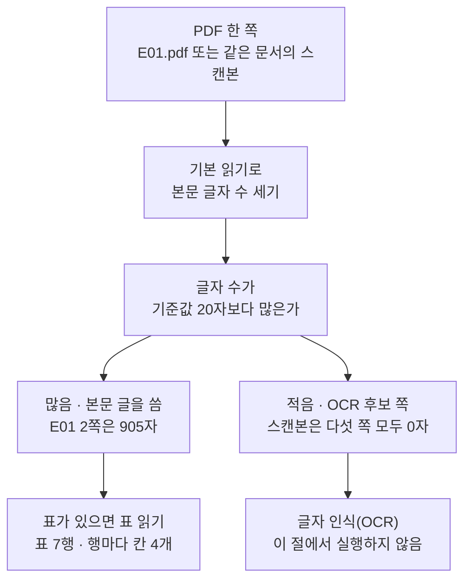
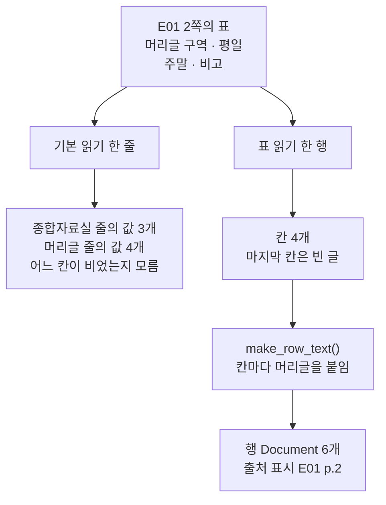
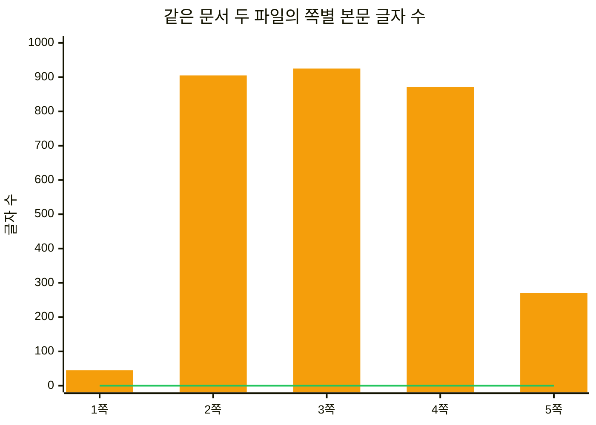
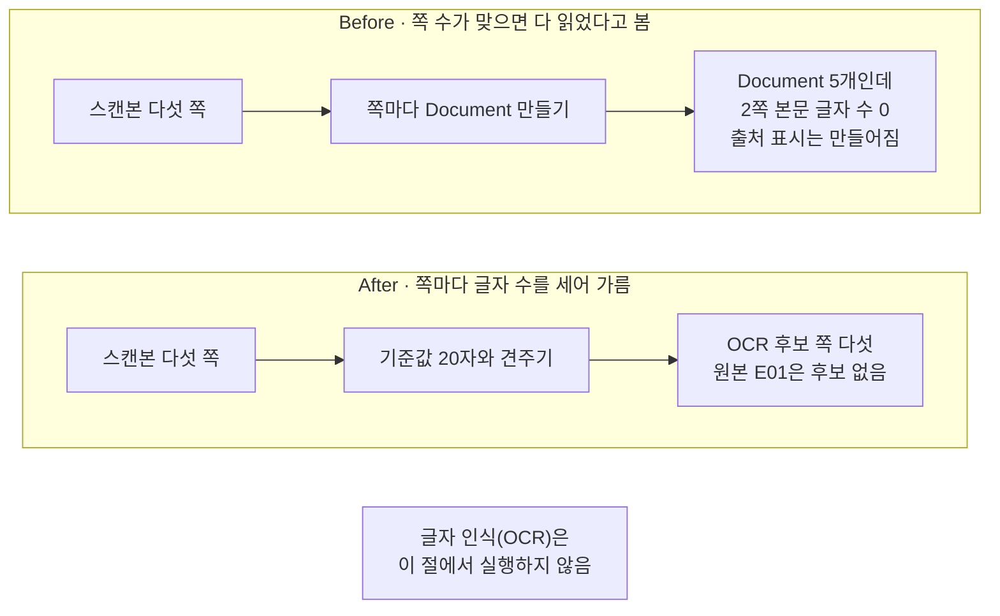

# 02-PDF와-표-OCR

## _src 본문 (HTML 원본)

```html
<!--meta: 강의 1h | 실습 2h | 코드 02-PDF와-표-OCR.ipynb | 새 용어 4 -->

<h2 id="b1"><span class="no">1</span>학습 목표</h2>
<div class="goal"><ul>
<li>이 절을 마치면 표가 있는 PDF 쪽을 기본 읽기와 표 읽기로 읽어 견줄 수 있습니다.</li>
<li>이 절을 마치면 표의 행마다 머리글을 붙여 검색에 쓸 한 줄 글을 만들 수 있습니다.</li>
<li>이 절을 마치면 쪽마다 본문 글자 수를 세어 OCR 후보 쪽을 가려낼 수 있습니다.</li>
</ul></div>

<h2 id="b2"><span class="no">2</span>이 내용을 배우는 이유</h2>
<p>01절에서 같은 쪽을 두 방법으로 읽어 글이 달라지는 것을 보았습니다. 그때 쓴 두 방법은 모두 글자를 순서대로 이어 붙이는 읽기였습니다. 이 절은 도구를 바꾸어 표의 행과 칸을 자리째 얻습니다.</p>
<p>표는 사람이 선과 자리를 보고 읽습니다. 기본 읽기는 그 선을 보지 않고 글자만 이어 붙입니다. 그래서 값이 없는 칸이 있는 행은 값의 개수부터 달라집니다. 머리글과 값의 짝이 사라지면 검색된 글만 보고 그 값이 무엇인지 알 수 없습니다.</p>
<p>이 챕터가 읽을 파일에는 스캔본도 3건 있습니다. 스캔본은 종이를 사진으로 찍어 PDF로 묶은 파일입니다. 본문이 그림으로만 들어 있어 뽑아낼 글자가 없습니다. 파일을 열었다는 사실과 검색에 쓸 본문을 얻었다는 사실은 다릅니다.</p>
<p>이 절이 읽는 파일은 두 개입니다. 01절과 같은 <code>E01.pdf</code>와, 같은 문서를 스캔해 만든 <code>S01-E01-scan.pdf</code>입니다. 두 파일을 같은 기준으로 재어 사람이 확인할 쪽을 가려냅니다.</p>

<h2 id="b3"><span class="no">3</span>앞에서 배운 내용</h2>
<ul>
<li><strong>다섯 칸 출처 기록</strong> — 01절에서 정했습니다. 칸은 <code>doc_id</code>·<code>source</code>·<code>file_type</code>·<code>parser</code>·<code>page</code> 다섯 개입니다.</li>
<li><strong>출처 기록 만들기</strong> — 01절의 <code>make_source_record()</code>는 경로에서 세 칸을 얻습니다. 읽은 방법과 쪽 번호 두 칸은 사람이 넘깁니다.</li>
<li><strong>출처 표시</strong> — Ch 9 03절의 <code>make_source_mark()</code>는 <code>doc_id</code>와 <code>page</code> 두 칸만 읽습니다. 그 두 값으로 <code>[E01 p.2]</code>를 만듭니다.</li>
<li><strong>두 가지 읽기</strong> — 01절에서 E01 2쪽을 기본 읽기로 905자, 레이아웃 읽기로 1396자 얻었습니다. 둘 다 글자를 이어 붙이는 읽기입니다.</li>
<li><strong>문서 객체(Document)</strong> — Ch 9 01절에서 배웠습니다. 본문 글 <code>page_content</code>와 설명 값 <code>metadata</code> 두 자리를 가집니다.</li>
</ul>
<p>노트북은 01절 <code>make_source_record()</code>와 Ch 9 03절 <code>make_source_mark()</code>를 도구 파일 <code>rag_tools.py</code>에서 가져옵니다.</p>

<h2 id="b4"><span class="no">4</span>핵심 개념</h2>
<h3>비유 — 칸막이가 있는 상자와 트인 상자</h3>
<p>물건을 담는 납작한 상자 두 개를 떠올려 보세요. 한 상자는 안이 트여 있고, 다른 상자는 칸막이로 칸이 나뉘어 있습니다. 같은 행 네 칸을 각각 담아 다음 사람에게 넘깁니다. 트인 상자에서는 넷이 똑같아 보이고, 칸막이 상자에서는 칸마다 자리가 남습니다.</p>
<p>트인 상자에서는 물건이 한 줄로 붙어 어느 자리 것인지 알 수 없습니다. 칸막이가 있는 상자에서는 물건마다 자리가 남고, 비어 있는 칸도 자리로 남습니다. 표를 읽는 두 방법의 차이가 이와 같습니다.</p>
<p>상자를 하나 더 생각해 보세요. 유리 액자에 든 서류 사진만 있고 옮겨 담을 물건이 없습니다. 스캔본이 그렇습니다. 사람이 보고 새로 적기 전에는 상자가 빈 채로 남습니다.</p>
{{img:02-5-칸막이-상자|평면 그림으로 크기가 같은 납작한 상자 세 개가 나란히 놓여 있고 왼쪽 상자는 칸막이가 없어 같은 모양의 둥근 알들이 바닥에 한 줄로 붙어 있으며 가운데 상자는 얇은 칸막이로 네 칸이 나뉘어 칸마다 네모 세모 동그라미 마름모가 하나씩 들어 있고 오른쪽 상자는 비어 있으며 그 아래에 회색 그림이 든 액자와 돋보기가 있고 세 상자 위쪽에 네 칸 격자가 그려진 종이 한 장이 있음|트인 상자에서는 물건이 모두 같아 보이고, 칸막이가 있는 상자에서는 칸마다 다른 자리가 남습니다}}
<p><strong>그림 읽기</strong> — 세 상자를 왼쪽에서 오른쪽으로 봅니다. 왼쪽 상자는 칸막이가 없고 알이 모두 같은 모양이라 어느 칸의 것인지 알 수 없습니다. 가운데 상자는 네 칸으로 나뉘어 칸마다 다른 모양이 한 자리씩 들어 있습니다. 오른쪽 상자는 비어 있고 그 아래에 액자와 돋보기가 놓여 있습니다. 위쪽 격자 종이가 원본 표입니다.</p>

<h3>이 절에서 쓰는 말</h3>
<table><thead><tr><th>용어</th><th>뜻과 일상 예</th><th>이 절에서 보이는 모습</th></tr></thead><tbody>
<tr><td>글자 층(text layer)</td><td>PDF 안에 저장된, 고르고 찾을 수 있는 글자 정보. 손으로 쓴 쪽지를 타자로 옮겨 적어 함께 끼워 둔 것과 같음</td><td>노트북 3절 <code>기본 읽기 글자 수: 905</code>가 나오는 쪽에는 있고, 9절 <code>스캔본 쪽별 글자 수: [0, 0, 0, 0, 0]</code>인 쪽에는 없음</td></tr>
<tr><td>표 읽기(table extraction)</td><td>표의 칸 경계와 행·칸 관계를 찾아 칸 목록으로 되살리는 처리. 선이 그려진 서식을 칸막이 상자에 옮겨 담는 것과 같음</td><td>노트북 4절 <code>extract_tables()</code>와 <code>첫 표의 행 수: 7</code></td></tr>
<tr><td>글자 인식(OCR, optical character recognition)</td><td>쪽 그림에 찍힌 글자 모양을 보고 글자로 바꾸는 별도 처리. 사진을 보며 사람이 타자로 옮겨 적는 일을 프로그램이 하는 것과 같음</td><td>이 절에서는 실행하지 않음. 노트북 9절이 그 처리를 걸 쪽만 가려냄</td></tr>
<tr><td>OCR 후보 쪽</td><td>본문 글자 수가 기준값보다 적어 사람이 확인하거나 글자 인식을 걸어야 하는 쪽. 복사가 흐린 장만 따로 빼 두는 것과 같음</td><td>노트북 9절 <code>스캔본의 OCR 후보 쪽: [1, 2, 3, 4, 5]</code></td></tr>
</tbody></table>
<p>파서·파일 형식·출처 기록·출처 계보는 01절과 같은 뜻입니다. 문서 청크와 출처 표시도 Ch 9에서 정한 뜻 그대로입니다. 이 절에서 늘어나는 것은 <code>parser</code> 칸에 적을 이름 하나입니다.</p>

<h3>도식 — 쪽마다 글자 수를 먼저 셉니다</h3>
{{mermaid:02-1-세-갈래|초록 상자 PDF 한 쪽에서 파란 상자 본문 글자 수 세기와 파란 상자 기준값 20자보다 많은가로 내려온 뒤 왼쪽으로 노란 상자 본문 글을 씀 E01 2쪽은 905자와 노란 상자 표 7행 행마다 칸 4개가 이어지고 오른쪽으로 노란 상자 OCR 후보 쪽 스캔본은 다섯 쪽 모두 0자와 회색 상자 글자 인식은 실행하지 않음이 이어지는 흐름도|글자가 넉넉한 쪽은 본문 글과 표의 칸을 내주고 글자가 없는 쪽은 OCR 후보로 따로 모입니다}}
<p><strong>도식 읽기</strong> — 위에서 아래로 봅니다. 맨 위 초록 상자가 읽을 파일의 한 쪽입니다. 그 아래 파란 상자 두 개가 이 절이 먼저 하는 일입니다. 쪽마다 본문 글자 수를 세고 기준값과 견줍니다.</p>
<p>거기서 길이 갈라집니다. 글자가 기준값보다 많으면 왼쪽으로 가서 본문 글을 쓰고, 표가 있으면 표 읽기를 한 번 더 합니다. 글자가 적으면 오른쪽으로 가서 OCR 후보 쪽이 됩니다. 맨 아래 회색 상자는 이 절에서 실행하지 않는 단계입니다.</p>

<h3>표를 읽는 두 방법이 남기는 것</h3>
<p>같은 표 한 행을 두 방법으로 읽으면 남는 모양이 다릅니다. 아래 표는 노트북 3절과 4절 출력을 나란히 놓은 것입니다.</p>
<table>
<tr><th>보는 값</th><th>기본 읽기</th><th>표 읽기</th></tr>
<tr><td>얻는 것</td><td>줄 하나짜리 글</td><td>칸의 글을 담은 목록</td></tr>
<tr><td>머리글 행</td><td><code>구역 평일 주말 비고</code> 줄 하나</td><td><code>['구역', '평일', '주말', '비고']</code></td></tr>
<tr><td>값이 없는 칸이 있는 행</td><td>값 3개(<code>첫 행 줄의 값 개수: 3</code>)</td><td>칸 4개, 마지막은 빈 글(<code>첫 행의 칸 수: 4</code>)</td></tr>
<tr><td>행과 머리글의 짝</td><td>줄 순서로만 남음</td><td>칸 번호로 남음</td></tr>
<tr><td><code>parser</code> 칸에 적는 이름</td><td><code>pypdf-plain</code></td><td><code>pdfplumber</code></td></tr>
</table>
<p>표 읽기 결과는 세 겹 목록입니다. 표 목록 안에 행 목록이 있고, 행 목록 안에 칸의 글이 있습니다. 그래서 칸 번호로 머리글의 짝을 찾을 수 있습니다.</p>
<p>다만 두 방법의 결과 가운데 어느 쪽이 늘 낫다고 정하지는 않습니다. 이번에 읽은 것은 선이 그려진 표 두 개뿐입니다. 선이 없는 표나 칸이 합쳐진 표에서는 이번과 같은 결과가 나오는지 실행하지 않았습니다.</p>

<h2 id="b5"><span class="no">5</span>실행 예제</h2>
<p>내려받은 실습 폴더에서 노트북을 열고 위에서 아래로 실행합니다. API 키는 필요하지 않고 모델과 임베딩에는 요청을 한 번도 보내지 않습니다. 첫 셀의 패키지 설치만 인터넷을 씁니다. 먼저 파일 두 개를 찾고, 01절과 같은 기본 읽기로 E01 2쪽을 읽습니다.</p>
<p>이 페이지의 출력은 2026-09-21에 실행한 결과입니다. 모델을 부르지 않으므로 같은 판에서 다시 실행해도 같은 값이 나왔습니다. 새 커널로 두 번 실행해 열여섯 개 코드 셀의 출력이 모두 같은 것을 확인했습니다.</p>
<p>강의 시간에는 노트북 2~6절을 설명합니다. 파일 두 개 찾기, 기본 읽기에 보이는 표, 표 읽기, 머리글 붙이기, 출처 기록입니다. 7절 값 바꿔 보기와 Before·After는 함께 실행하고 실습 시간에 다시 읽습니다.</p>
{{mermaid:02-2-표-머리글|초록 상자 E01 2쪽의 표에서 왼쪽 파란 상자 기본 읽기 한 줄을 거쳐 노란 상자 값 3개와 머리글 값 4개로 이어지고 오른쪽 파란 상자 표 읽기 한 행을 거쳐 노란 상자 칸 4개로 간 뒤 파란 상자 머리글 붙이기 함수와 노란 상자 행 Document 6개로 이어지는 흐름도|같은 표 한 행이 기본 읽기에서는 값 3개짜리 줄이 되고 표 읽기에서는 값이 없는 칸까지 남은 칸 4개가 됩니다}}
<p><strong>도식 읽기</strong> — 위에서 아래로 보고, 가운데에서 두 줄기로 갈라집니다. 맨 위 초록 상자가 E01 2쪽의 표이고 머리글은 네 개입니다. 왼쪽 줄기가 짝을 잃는 길이고 오른쪽 줄기가 짝을 남기는 길입니다.</p>
<p>왼쪽 노란 상자의 값은 노트북 3절 출력입니다. 머리글 줄은 <code>머리글 줄의 값 개수: 4</code>인데 첫 행 줄은 <code>첫 행 줄의 값 개수: 3</code>입니다. 원본에서 이 행의 비고 칸에 값이 없고, 기본 읽기는 그 칸을 아무 표시 없이 지나갔기 때문입니다.</p>
<p>오른쪽 노란 상자의 값은 노트북 4절 출력입니다. 같은 행이 <code>첫 행: ['종합자료실(2층)', '09:00~22:00', '09:00~18:00', '']</code>으로 나와 <code>첫 행의 칸 수: 4</code>입니다. 그 아래 파란 상자가 칸마다 머리글을 붙이는 함수이고, 노트북 6절에서 행 여섯 개가 <code>Document</code>가 됩니다.</p>
{{mermaid:02-3-쪽별-글자-수|가로축이 1쪽부터 5쪽이고 세로축이 글자 수 0부터 1000인 막대 차트로 주황 막대가 45 905 925 871 270이고 초록 선이 다섯 쪽 모두 0에 붙어 있는 그림|주황 막대가 원본 E01.pdf의 쪽별 글자 수이고 바닥에 붙은 초록 선이 스캔본의 다섯 쪽입니다}}
<p><strong>도식 읽기</strong> — 왼쪽에서 오른쪽으로 1쪽부터 5쪽까지 봅니다. 주황 막대는 노트북 9절 출력 <code>E01 쪽별 글자 수: [45, 905, 925, 871, 270]</code>입니다. 바닥에 붙은 초록 선은 <code>스캔본 쪽별 글자 수: [0, 0, 0, 0, 0]</code>입니다.</p>
<p>1쪽 막대만 45로 낮습니다. 그 쪽은 제목·기관 이름·발행 정보만 있는 표지 쪽입니다. 기준값을 50자처럼 높게 잡으면 표지 쪽까지 후보로 들어옵니다. 그래서 기준값을 <code>기준값(글자 수): 20</code>으로 잡았습니다.</p>
{{notebook:02-PDF와-표-OCR|example}}

<h2 id="b6"><span class="no">6</span>일부러 실패해 보기</h2>
<p>스캔본에서 <code>extract_text()</code>는 오류를 내지 않습니다. 빈 글을 반환하고 넘어갑니다. 그래서 쪽마다 <code>Document</code>를 만드는 코드는 끝까지 실행됩니다.</p>
<p>Before 셀은 쪽 수만큼 <code>Document</code>를 만들면 다 읽었다고 봅니다. After 셀은 쪽마다 본문 글자 수를 세어 기준값과 견줍니다.</p>
{{mermaid:02-4-스캔본-판정|위 칸 Before에 초록 상자 스캔본 다섯 쪽과 파란 상자 쪽마다 Document 만들기와 빨간 상자 Document 5개인데 2쪽 본문 글자 수 0이 왼쪽에서 오른쪽으로 있고 아래 칸 After에 같은 초록 상자와 파란 상자 기준값 20자와 견주기와 노란 상자 OCR 후보 쪽 다섯이 같은 방향으로 있으며 맨 아래에 회색 상자 글자 인식은 실행하지 않음이 있는 비교 흐름도|같은 스캔본에서 Before는 Document 다섯 개를 얻었다고 보고 After는 다섯 쪽 모두를 OCR 후보로 가릅니다}}
<p><strong>도식 읽기</strong> — 위 칸이 Before, 아래 칸이 After이고 칸마다 왼쪽에서 오른쪽으로 봅니다. 두 칸의 초록 상자는 같은 파일의 같은 다섯 쪽입니다. 파란 상자에서 갈라집니다.</p>
<p>위 칸의 빨간 상자가 Before 결과입니다. 출력 <code>만든 Document 수: 5</code>는 <code>스캔본 쪽 수: 5</code>와 같고 출처 표시도 <code>2쪽 출처 표시: [S01-E01-scan p.2]</code>로 만들어졌습니다. 그런데 <code>2쪽 본문 글자 수: 0</code>입니다. 같은 문서의 원본에서 2쪽은 905자였습니다.</p>
<p>아래 칸의 노란 상자가 After 결과입니다. 출력 <code>스캔본의 OCR 후보 쪽: [1, 2, 3, 4, 5]</code>와 <code>E01의 OCR 후보 쪽: []</code>가 두 파일을 가릅니다. 맨 아래 회색 상자는 두 실행에 모두 해당합니다. 후보로 가른 것은 글자를 얻은 것이 아니고, 글자 인식은 이 절에서 실행하지 않았습니다.</p>
{{notebook:02-PDF와-표-OCR|failure}}

<h2 id="b7"><span class="no">7</span>주의할 점과 실무 메모</h2>
<ul>
<li><strong>기준값은 문서 모음을 보고 정합니다.</strong> 이 절의 20자는 스캔본 0자와 원본에서 가장 짧은 45자를 먼저 확인한 뒤 그 사이에서 정한 값입니다. 흐름을 보여 주려고 정한 예이므로 다른 문서 모음에서는 쪽별 글자 수를 먼저 재어 다시 정합니다.</li>
<li><strong>파일 단위보다 쪽 단위로 가릅니다.</strong> 한 파일 안에서도 글자가 있는 쪽과 그림뿐인 쪽이 섞일 수 있습니다. 이번 스캔본은 다섯 쪽 모두 후보였지만, 섞인 파일은 이번에 실행하지 않았습니다.</li>
<li><strong>글자 인식 결과는 원본과 대조합니다.</strong> 글자 인식은 비슷한 모양의 글자를 잘못 읽을 수 있고 표의 행과 칸의 관계를 되살려 주지도 않습니다. 걸었다면 그 사실과 쓴 도구 이름을 <code>parser</code> 칸에 남깁니다.</li>
<li><strong>표 읽기가 찾지 못하는 표도 있습니다.</strong> 이번에 읽은 표는 선이 그려진 표입니다. 선 없이 띄어쓰기로만 벌려 놓은 표나 칸이 합쳐진 표는 02절에서 실행하지 않았습니다.</li>
<li><strong>실습 폴더 모듈에 같은 일을 하는 함수가 있습니다.</strong> <code>labs/part3/ch10-document-processing/document_processing.py</code>의 <code>load_pdf_tables_pdfplumber()</code>는 쪽 하나를 <code>Document</code> 하나로 만들고 표는 칸 사이에 <code>|</code>를 넣어 이어 붙입니다. 행마다 머리글을 붙이지는 않습니다. 같은 파일의 <code>detect_scanned_pdf()</code>는 기준값 <code>min_text_chars=20</code>을 기본값으로 쓰고 쪽의 빈칸을 뺀 글자 수를 셉니다. 이번 노트북에서는 그 모듈을 부르지 않았습니다.</li>
<li><strong>상용 문서 파서는 확인일과 함께 적습니다.</strong> 쪽 단위로 요금을 받는 서비스가 있고 요금과 조건은 바뀝니다. 도구 이름·판·확인일을 실행 기록에 남기면 나중에 같은 조건으로 다시 읽을 수 있습니다.</li>
</ul>

<h2 id="b8"><span class="no">8</span>정리와 다음 절</h2>
<ul>
<li>기본 읽기는 표의 한 행을 한 줄로 펴서 값 3개만 남겼고, 표 읽기는 값이 없는 칸까지 칸 4개로 남겼습니다.</li>
<li>행마다 머리글을 붙이면 값이 어느 칸의 값인지 글에 남습니다. 그 글을 <code>Document</code> 여섯 개로 담았습니다.</li>
<li>같은 쪽을 pdfplumber로 읽었으므로 <code>parser</code> 칸에는 <code>pdfplumber</code>를 적습니다. 다섯 칸 이름은 01절과 같습니다.</li>
<li>스캔본은 쪽 수만큼 <code>Document</code>를 만들 수 있어도 본문이 0자였고, 다섯 쪽 모두 OCR 후보가 되었습니다.</li>
</ul>
<p><strong>다음 학습과 이어지는 지점</strong> — 03절에서는 PDF가 아닌 형식을 읽습니다. DOCX·HTML·CSV 견본을 열어 형식마다 어디까지 구조가 남는지 봅니다. 그때도 같은 다섯 칸에 담고 <code>parser</code> 칸에 적을 이름이 더 늘어납니다.</p>
<p>04절은 HWP와 HWPX를 가릅니다. 05~08절은 이렇게 읽은 글을 문서 청크로 나누어 색인합니다. 이 절에서 만든 머리글 붙은 한 줄 글은 문서 청크로 나눌 때도 머리글이 함께 남는 모양입니다.</p>

<h2 id="b9"><span class="no">9</span>복습 문제</h2>
<details class="quiz" open><summary>문제 4개 · 해설 포함</summary>
<p class="quiz-q">1. [하] 글자 층과 글자 인식은 어떻게 다릅니까?</p>
<p class="quiz-a">글자 층은 PDF 안에 이미 저장된 글자 정보입니다. 기본 읽기는 그 정보를 읽습니다. 글자 인식은 쪽 그림의 글자 모양을 보고 글자를 새로 만드는 별도 처리입니다. 이 절에서는 글자 인식을 실행하지 않았습니다.</p>
<p class="quiz-q">2. [중] 기본 읽기로 표의 숫자를 모두 얻었는데도 표 질문에 답하지 못하는 까닭은 무엇입니까?</p>
<p class="quiz-a">값이 어느 칸의 값인지가 글에 남지 않기 때문입니다. 노트북 3절에서 머리글 줄은 값이 네 개였는데 첫 행 줄은 세 개였습니다. 값이 없는 칸이 표시 없이 지나가서 어느 칸이 비었는지 알 수 없습니다.</p>
<p class="quiz-q">3. [중] 표 읽기 결과에서 <code>['구역', '평일', '주말', '비고']</code> 다음에 오는 것은 무엇입니까?</p>
<p class="quiz-a">구역 여섯 행의 칸 목록입니다. 표 읽기 결과는 표 목록 안에 행 목록이 있고 행 목록 안에 칸의 글이 있는 세 겹 목록입니다. 노트북 4절에서 <code>첫 표의 행 수: 7</code>은 머리글 한 행에 구역 여섯 행을 더한 수입니다.</p>
<p class="quiz-q">4. [상] 스캔본을 읽어 <code>Document</code> 다섯 개를 만들었는데 어떤 점을 더 확인해야 합니까?</p>
<p class="quiz-a">쪽마다 본문 글자 수를 확인해야 합니다. 노트북 8절에서 <code>Document</code> 수는 쪽 수와 같은 다섯이었지만 2쪽 본문은 0자였습니다. 오류도 나지 않았고 출처 표시도 만들어졌습니다. 쪽 수가 맞는 것은 본문을 얻었다는 뜻이 아닙니다.</p>
</details>

<h2 id="b10"><span class="no">10</span>참고 자료</h2>
<ul>
<li><div><a href="https://pypdf.readthedocs.io/en/stable/user/extract-text.html">pypdf 공식 문서 Extract Text from a PDF</a></div>확인 2026-09-18 · 기본 추출이 남기는 글의 모양 참고.</li>
<li><div><a href="https://github.com/jsvine/pdfplumber/blob/stable/README.md">pdfplumber 공식 저장소 README</a></div>확인 2026-09-18 · <code>extract_tables()</code>가 반환하는 세 겹 목록과 표 찾기 설정 참고.</li>
<li><div><a href="https://github.com/jsvine/pdfplumber/blob/stable/LICENSE.txt">pdfplumber MIT License</a></div>확인 2026-09-18 · 수업과 배포 조건 참고.</li>
<li><div><a href="https://reference.langchain.com/python/langchain-core/documents">LangChain 공식 API Document</a></div>확인 2026-09-18 · <code>page_content</code>와 <code>metadata</code> 구조 참고.</li>
<li>실습 문서 모음 설명서 — <code>labs/data/rag-corpus/README.md</code> · 스캔본 3건의 기울기와 압축 설정 참고.</li>
<li>기준 버전은 Python 3.12.13과 pypdf 6.18.0입니다. 함께 쓰는 판은 pdfplumber 0.11.10과 langchain-core 1.6.2입니다. 판을 고정한 기준은 실습 폴더의 잠금 파일입니다.</li>
</ul>
```

## 노트북 셀 (순서대로)

### [0] markdown {'html': 'skip'}

# PDF와 표·OCR

**이 노트북에서 할 일**

1. 01절과 같은 E01.pdf에서 표가 있는 쪽을 기본 읽기로 보고 값의 개수를 셉니다.
2. 같은 쪽을 표 읽기로 읽어 행과 칸을 얻고, 칸마다 머리글을 붙입니다.
3. 같은 문서의 스캔본을 읽어 글자가 없는 쪽을 OCR 후보로 가릅니다.

**준비물** — API 키가 필요 없습니다. 모델과 임베딩에는 요청을 한 번도 보내지 않습니다.
첫 셀의 패키지 설치만 인터넷을 씁니다.
그래서 예상 비용은 0달러입니다. 실행 시간은 패키지 설치를 빼면 10초 안팎입니다.

데이터는 파일 두 개입니다. 폴더 `labs/data/rag-corpus/`의 `pdf/easy/E01.pdf`와 `pdf/scanned/S01-E01-scan.pdf`입니다.

**강의와 실습 범위** — 강의 시간에는 2~6절을 설명합니다.
파일 두 개 찾기, 기본 읽기에 보이는 표, 표 읽기, 머리글 붙이기, 출처 기록입니다.
7절 값 바꿔 보기와 8~9절 Before·After는 함께 실행하고 실습 시간에 다시 읽습니다.

**기준 버전** — 실습 폴더에 고정한 패키지 판을 씁니다. pypdf 6.18.0, pdfplumber 0.11.10, langchain-core 1.6.2입니다.
교재 출력은 Linux의 Python 3.12.13으로 만들었습니다. 다른 버전과 Windows·macOS에서는 이번에 실행하지 않았습니다.

실습 폴더 `labs/part3/ch10-document-processing`에서 `uv sync --locked`를 실행합니다.
그다음 이 폴더의 `.venv` 커널을 고르고 첫 셀부터 순서대로 실행합니다.

### [1] markdown {'html': 'skip'}

## 오늘 볼 그림


쪽마다 본문 글자 수를 먼저 셉니다. 그 값에 따라 다음 단계가 세 갈래로 갈립니다.
글자가 넉넉한 쪽은 본문 글을 쓰고, 표가 있으면 표 읽기를 한 번 더 합니다.
글자가 거의 없는 쪽은 OCR 후보로 따로 모읍니다. 회색 상자는 이 절에서 실행하지 않는 단계입니다.

### [2] markdown {}

## 1. 준비

첫 셀은 패키지를 설치하고 설치된 버전을 출력합니다. 설치에는 몇십 초가 걸릴 수 있습니다.
01절에서 쓴 pypdf와 `Document`에 표를 읽는 pdfplumber를 더합니다.

### [3] code {'execution': {'iopub.execute_input': '2026-09-21T06:25:31.284007Z', 'iopub.status.busy': '2026-09-21T06:25:31.283810Z', 'iopub.status.idle': '2026-09-21T06:25:31.735426Z', 'shell.execute_reply': '2026-09-21T06:25:31.734861Z'}, 'lesson_role': 'setup'}

```python
# 이 절에서 쓰는 패키지를 설치하고 버전을 확인합니다
%pip install -q "pypdf==6.18.0" "pdfplumber==0.11.10" "langchain-core==1.6.2"
from importlib.metadata import version

print("pypdf:", version("pypdf"))
print("pdfplumber:", version("pdfplumber"))
print("langchain-core:", version("langchain-core"))
```

출력:
```
Note: you may need to restart the kernel to use updated packages.
pypdf: 6.18.0
pdfplumber: 0.11.10
langchain-core: 1.6.2

```

### [4] markdown {}

**결과 읽기** — 출력 줄은 `pypdf: 6.18.0`, `pdfplumber: 0.11.10`, `langchain-core: 1.6.2` 세 줄입니다.
준비물에 적은 기준 버전과 같습니다.

다음 셀은 이 절에서 쓸 이름을 불러옵니다.
라이브러리 pdfplumber는 글자의 자리와 표의 칸 경계를 함께 다루는 도구입니다.
01절에서 쓴 `os`·`Path`·`PdfReader`·`Document`는 그대로 씁니다.

앞에서 배운 함수는 `rag_tools.py`에 모아 두었습니다. 파일을 열면 코드를 볼 수 있습니다. 노트북과 같은 폴더(`notebooks/`)에 있는 파일입니다.
이 노트북은 01절 `make_source_record()`와 Ch 9 03절 `make_source_mark()`를 가져옵니다.

### [5] code {'execution': {'iopub.execute_input': '2026-09-21T06:25:31.736528Z', 'iopub.status.busy': '2026-09-21T06:25:31.736438Z', 'iopub.status.idle': '2026-09-21T06:25:31.926441Z', 'shell.execute_reply': '2026-09-21T06:25:31.925925Z'}, 'lesson_role': 'setup'}

```python
# 파일 찾기·경로 속성 읽기·PDF 읽기·표 읽기·문서 객체 만들기에 쓸 이름을 불러옵니다
import os
from pathlib import Path

import pdfplumber
from pypdf import PdfReader
from langchain_core.documents import Document
# 01절과 Ch 9 03절 함수 두 개를 도구 파일에서 가져옵니다
from rag_tools import make_source_mark, make_source_record
```

출력:
```

```

### [6] markdown {}

## 2. 이 절에서 읽을 파일 두 개 찾기

01절과 같은 방법으로 프로젝트 맨 위 경로를 고릅니다.
후보 세 개를 차례로 확인하고, 있는 경로에서 멈춥니다.

실행 전에 예상합니다. 프로젝트 맨 위에서 열었다면 첫째 후보를 고를 것입니다.

### [7] code {'execution': {'iopub.execute_input': '2026-09-21T06:25:31.927268Z', 'iopub.status.busy': '2026-09-21T06:25:31.927181Z', 'iopub.status.idle': '2026-09-21T06:25:31.929250Z', 'shell.execute_reply': '2026-09-21T06:25:31.928924Z'}}

```python
# 작업 폴더에서 본 프로젝트 맨 위 경로를 후보 세 개 가운데에서 고릅니다
candidates = [".", "../../..", "../../../.."]
root_path = None
for candidate in candidates:
    if os.path.exists(candidate + "/labs/data/rag-corpus"):
        root_path = candidate
        break
print("고른 경로:", root_path)
assert root_path is not None, "notebooks 폴더나 실습 폴더 맨 위에서 노트북을 열어 주세요."
```

출력:
```
고른 경로: .

```

### [8] markdown {}

**결과 읽기** — 출력 줄은 `고른 경로: .`입니다. `assert`도 통과했습니다.
교재 출력은 프로젝트 맨 위를 작업 폴더로 삼아 실행해서 첫째 후보를 골랐습니다.

다음 셀은 읽을 파일 두 개의 경로를 만듭니다.
하나는 01절에서 읽은 E01.pdf이고, 하나는 같은 문서를 스캔해 만든 파일입니다.
스캔본은 종이를 사진으로 찍어 PDF로 묶은 파일이라 본문이 그림으로만 들어 있습니다.

### [9] code {'execution': {'iopub.execute_input': '2026-09-21T06:25:31.929822Z', 'iopub.status.busy': '2026-09-21T06:25:31.929773Z', 'iopub.status.idle': '2026-09-21T06:25:31.932076Z', 'shell.execute_reply': '2026-09-21T06:25:31.931724Z'}}

```python
# 읽을 파일 두 개의 경로를 만들고 파일이 있는지 확인합니다
corpus_path = root_path + "/labs/data/rag-corpus"
pdf_path = corpus_path + "/pdf/easy/E01.pdf"
scan_path = corpus_path + "/pdf/scanned/S01-E01-scan.pdf"
print("E01 파일이 있는가:", os.path.exists(pdf_path))
print("스캔본 파일이 있는가:", os.path.exists(scan_path))
print("스캔본 파일 이름:", Path(scan_path).name)
```

출력:
```
E01 파일이 있는가: True
스캔본 파일이 있는가: True
스캔본 파일 이름: S01-E01-scan.pdf

```

### [10] markdown {}

**결과 읽기** — 출력 줄은 `E01 파일이 있는가: True`와 `스캔본 파일이 있는가: True`입니다.
마지막 줄 `스캔본 파일 이름: S01-E01-scan.pdf`에서 이름 가운데의 `E01`이 원본 문서 이름입니다.
이 파일은 01절에서 센 `scanned` 폴더의 3건 가운데 하나입니다.

### [11] markdown {}

## 3. 기본 읽기에 표가 보이는 모습

01절에서 E01 2쪽을 기본 읽기로 읽어 905자를 얻었습니다.
그 쪽에는 자료실별 이용 시간을 적은 표가 하나 있습니다.
기본 읽기는 표의 선을 보지 않고 글자만 순서대로 이어 붙입니다.

실행 전에 예상합니다. 표의 한 행이 한 줄로 이어져 나올 것입니다.

### [12] code {'execution': {'iopub.execute_input': '2026-09-21T06:25:31.932581Z', 'iopub.status.busy': '2026-09-21T06:25:31.932537Z', 'iopub.status.idle': '2026-09-21T06:25:31.944919Z', 'shell.execute_reply': '2026-09-21T06:25:31.944576Z'}}

```python
# 01절과 같은 기본 읽기로 E01 2쪽을 읽고 줄 목록으로 나눕니다
reader = PdfReader(pdf_path)
plain_text = reader.pages[1].extract_text()
plain_lines = plain_text.split("\n")
print("기본 읽기 글자 수:", len(plain_text))
print("기본 읽기 줄 수:", len(plain_lines))
print("마지막 줄:", plain_lines[-1])
```

출력:
```
기본 읽기 글자 수: 905
기본 읽기 줄 수: 26
마지막 줄: 2

```

### [13] markdown {}

**결과 읽기** — 출력 줄은 `기본 읽기 글자 수: 905`와 `기본 읽기 줄 수: 26`입니다.
01절 4절에서 본 값과 같습니다. 같은 파일을 같은 방법으로 읽었기 때문입니다.
마지막 줄은 쪽 번호 `2`만 있는 줄입니다.

다음 셀은 표의 머리글 줄과 그 아래 첫 행 줄을 찾습니다.
그리고 줄을 빈칸으로 나누어 값이 몇 개인지 셉니다.
메서드 `split(" ")`은 글을 빈칸 자리에서 잘라 목록으로 만듭니다.

### [14] code {'execution': {'iopub.execute_input': '2026-09-21T06:25:31.945557Z', 'iopub.status.busy': '2026-09-21T06:25:31.945502Z', 'iopub.status.idle': '2026-09-21T06:25:31.947413Z', 'shell.execute_reply': '2026-09-21T06:25:31.947064Z'}}

```python
# 표의 머리글 줄과 첫 행 줄을 찾아 빈칸으로 나눈 값의 개수를 셉니다
header_line = ""
first_row_line = ""
for line in plain_lines:
    if "구역 평일" in line:
        header_line = line
    if "종합자료실" in line:
        first_row_line = line
header_values = header_line.split(" ")
first_row_values = first_row_line.split(" ")
print("머리글 줄:", header_line)
print("머리글 줄의 값 개수:", len(header_values))
print("첫 행 줄:", first_row_line)
print("첫 행 줄의 값 개수:", len(first_row_values))
```

출력:
```
머리글 줄: 구역 평일 주말 비고
머리글 줄의 값 개수: 4
첫 행 줄: 종합자료실(2층) 09:00~22:00 09:00~18:00
첫 행 줄의 값 개수: 3

```

### [15] markdown {}

**결과 읽기** — 출력 줄 `머리글 줄: 구역 평일 주말 비고`는 값이 네 개입니다.
그래서 `머리글 줄의 값 개수: 4`입니다.
그런데 `첫 행 줄: 종합자료실(2층) 09:00~22:00 09:00~18:00`은 값이 세 개뿐입니다.
출력 `첫 행 줄의 값 개수: 3`이 그 수입니다.

원본 표에서 이 행의 비고 칸에는 값이 없습니다. 기본 읽기는 값이 없는 칸을 아무 표시 없이 지나갑니다.
그래서 이 줄만 보면 어느 칸이 비었는지 알 수 없습니다.

### [16] markdown {}

## 4. 표 읽기로 행과 칸 얻기

라이브러리 pdfplumber는 쪽에 그려진 선의 자리를 보고 표의 칸 경계를 찾습니다.
메서드 `extract_tables()`는 찾은 표마다 행 목록을 만들고, 행마다 칸 목록을 넣어 반환합니다.
즉 표 목록 안에 행 목록이 있고, 행 목록 안에 칸의 글이 있는 세 겹 목록입니다.

`with` 줄은 파일을 다 쓰고 나면 자동으로 닫습니다.
Ch 2 05절에서 파일을 열 때 배운 모양이고, 이번에는 라이브러리 객체에 씁니다.

### [17] code {'execution': {'iopub.execute_input': '2026-09-21T06:25:31.947955Z', 'iopub.status.busy': '2026-09-21T06:25:31.947889Z', 'iopub.status.idle': '2026-09-21T06:25:31.971767Z', 'shell.execute_reply': '2026-09-21T06:25:31.971420Z'}}

```python
# pdfplumber로 같은 2쪽을 열어 찾은 표의 수와 행·칸을 봅니다
with pdfplumber.open(pdf_path) as pdf:
    selected_page = pdf.pages[1]
    tables = selected_page.extract_tables()
first_table = tables[0]
header_row = first_table[0]
print("찾은 표의 수:", len(tables))
print("첫 표의 행 수:", len(first_table))
print("머리글 행:", header_row)
print("첫 행:", first_table[1])
print("첫 행의 칸 수:", len(first_table[1]))
```

출력:
```
찾은 표의 수: 1
첫 표의 행 수: 7
머리글 행: ['구역', '평일', '주말', '비고']
첫 행: ['종합자료실(2층)', '09:00~22:00', '09:00~18:00', '']
첫 행의 칸 수: 4

```

### [18] markdown {}

**결과 읽기** — 출력 줄은 `찾은 표의 수: 1`과 `첫 표의 행 수: 7`입니다.
머리글 한 행에 구역 여섯 행을 더해 일곱 행입니다.
출력 `머리글 행: ['구역', '평일', '주말', '비고']`는 칸 네 개를 따로 담은 목록입니다.

다음 줄 `첫 행: ['종합자료실(2층)', '09:00~22:00', '09:00~18:00', '']`을 보세요.
마지막 칸이 빈 글 `''`로 남아 있어서 `첫 행의 칸 수: 4`입니다.
기본 읽기에서 사라졌던 「값이 없는 칸」이 표 읽기에서는 자리로 남습니다.

### [19] markdown {}

## 5. 칸마다 머리글 붙이기

칸 목록만으로는 검색에 쓸 수 없습니다. 값이 어느 칸의 값인지 글에 적혀 있지 않기 때문입니다.
그래서 행마다 머리글을 칸 앞에 붙여 한 줄로 만듭니다.
다음 셀은 머리글 하나와 칸 하나를 받아 짝지은 글을 만드는 함수를 정의합니다.

### [20] code {'execution': {'iopub.execute_input': '2026-09-21T06:25:31.972341Z', 'iopub.status.busy': '2026-09-21T06:25:31.972288Z', 'iopub.status.idle': '2026-09-21T06:25:31.974025Z', 'shell.execute_reply': '2026-09-21T06:25:31.973640Z'}}

```python
# 머리글 하나와 칸 하나를 받아 「머리글: 값」 꼴로 짝지은 글을 만들어 반환합니다
def make_cell_text(label, cell):
    value = cell
    if value == "":
        value = "(값 없음)"
    return label + ": " + value
```

출력:
```

```

### [21] markdown {}

**결과 읽기** — 이 셀은 함수를 만들기만 하므로 출력이 없습니다.

값이 없는 칸은 `(값 없음)`으로 바꿔 적습니다. 값이 없다는 사실도 검색 결과에서 읽히게 하려는 것입니다.

다음 셀은 위 함수를 칸마다 불러 한 행을 한 줄 글로 만듭니다.
변수 `cell_number`는 지금 몇 번째 칸인지 세는 번호입니다. 그 번호로 머리글 행에서 짝이 되는 말을 꺼냅니다.

### [22] code {'execution': {'iopub.execute_input': '2026-09-21T06:25:31.974560Z', 'iopub.status.busy': '2026-09-21T06:25:31.974508Z', 'iopub.status.idle': '2026-09-21T06:25:31.976278Z', 'shell.execute_reply': '2026-09-21T06:25:31.975920Z'}}

```python
# 머리글 행과 표의 한 행을 받아 칸마다 머리글을 붙인 한 줄 글을 만들어 반환합니다
def make_row_text(header_row, row):
    row_text = ""
    cell_number = 0
    for cell in row:
        cell_text = make_cell_text(header_row[cell_number], cell)
        if row_text != "":
            row_text = row_text + " / "
        row_text = row_text + cell_text
        cell_number = cell_number + 1
    return row_text
```

출력:
```

```

### [23] markdown {}

**결과 읽기** — 이 셀도 함수를 만들기만 하므로 출력이 없습니다.

칸 사이는 ` / `로 띄웁니다. 첫 칸 앞에는 붙이지 않으려고 글이 비어 있는지 먼저 봅니다.

### [24] code {'execution': {'iopub.execute_input': '2026-09-21T06:25:31.976768Z', 'iopub.status.busy': '2026-09-21T06:25:31.976723Z', 'iopub.status.idle': '2026-09-21T06:25:31.978509Z', 'shell.execute_reply': '2026-09-21T06:25:31.978128Z'}}

```python
# 머리글 없는 줄과 머리글을 붙인 줄을 견줍니다
first_row_text = make_row_text(header_row, first_table[1])
second_row_text = make_row_text(header_row, first_table[2])
print("기본 읽기 줄:", first_row_line)
print("머리글을 붙인 줄:", first_row_text)
print("둘째 행:", second_row_text)
```

출력:
```
기본 읽기 줄: 종합자료실(2층) 09:00~22:00 09:00~18:00
머리글을 붙인 줄: 구역: 종합자료실(2층) / 평일: 09:00~22:00 / 주말: 09:00~18:00 / 비고: (값 없음)
둘째 행: 구역: 어린이자료실(1층) / 평일: 09:00~18:00 / 주말: 09:00~18:00 / 비고: 보호자 동반 권장

```

### [25] markdown {}

**결과 읽기** — 출력 줄 `머리글을 붙인 줄:` 뒤에 `구역: 종합자료실(2층) / 평일: 09:00~22:00 / 주말: 09:00~18:00 / 비고: (값 없음)`이 보입니다.
바로 위 `기본 읽기 줄:`과 견주면 머리글 네 개와 `(값 없음)`이 늘어났습니다.

`둘째 행:` 줄도 보세요. 평일과 주말 값이 `09:00~18:00`으로 같은데 이제는 어느 쪽인지 적혀 있습니다.
이 행의 비고 칸에는 `보호자 동반 권장`이 들어 있습니다.

### [26] markdown {}

## 6. 다섯 칸 출처 기록에 읽은 방법 적기

준비 셀에서 가져온 01절 `make_source_record()`는 파일 경로·쪽 번호·읽은 방법을 받아 다섯 칸 기록을 만듭니다.
Ch 9 03절 `make_source_mark()`는 그 기록에서 두 칸만 읽어 출처 표시를 만듭니다.

01절에서는 `parser` 칸에 `pypdf-plain`을 적었습니다.
이번에는 같은 쪽을 pdfplumber로 읽었으므로 `pdfplumber`를 적습니다.
실습 폴더 모듈도 이 읽기에 같은 이름을 씁니다.

다음 셀은 머리글 아래 행마다 `Document` 하나를 만듭니다.
본문 글은 머리글을 붙인 줄이고, 메타데이터는 다섯 칸 기록입니다.
변수 `row_number`가 1인 첫 행은 머리글이라 건너뜁니다.

### [27] code {'execution': {'iopub.execute_input': '2026-09-21T06:25:31.979126Z', 'iopub.status.busy': '2026-09-21T06:25:31.979078Z', 'iopub.status.idle': '2026-09-21T06:25:31.981390Z', 'shell.execute_reply': '2026-09-21T06:25:31.981059Z'}}

```python
# 표의 머리글 아래 행마다 Document 하나를 만들어 목록에 담습니다
table_record = make_source_record(pdf_path, 2, "pdfplumber")
row_documents = []
row_number = 1
for row in first_table:
    if row_number > 1:
        row_text = make_row_text(header_row, row)
        row_document = Document(page_content=row_text, metadata=table_record)
        row_documents.append(row_document)
    row_number = row_number + 1
print("행 Document 수:", len(row_documents))
print("첫 행의 출처 표시:", make_source_mark(row_documents[0]))
print("첫 행의 기록:", row_documents[0].metadata)
```

출력:
```
행 Document 수: 6
첫 행의 출처 표시: [E01 p.2]
첫 행의 기록: {'doc_id': 'E01', 'source': 'E01.pdf', 'file_type': 'pdf', 'parser': 'pdfplumber', 'page': 2}

```

### [28] markdown {}

**결과 읽기** — 출력 줄은 `행 Document 수: 6`입니다. 일곱 행에서 머리글 한 행을 뺀 수입니다.
다음 줄 `첫 행의 출처 표시: [E01 p.2]`는 01절과 글자까지 같습니다.
마지막 줄 `첫 행의 기록:` 뒤에 `{'doc_id': 'E01', 'source': 'E01.pdf', 'file_type': 'pdf', 'parser': 'pdfplumber', 'page': 2}`가 보입니다.
칸 이름은 01절과 같고 `parser` 값만 달라졌습니다.

여섯 기록은 글자까지 같습니다. 표의 몇 번째 행인지는 이 기록에 없고, 03절에서 `row` 칸으로 그 자리를 적습니다.

### [29] markdown {}

## 7. 값 하나만 바꿔 보기

바꾸는 값은 쪽 번호 하나입니다. 2쪽에서 4쪽으로 바꿉니다.
E01 4쪽에는 시설 예약을 적은 표가 있습니다.

실행 전에 예상합니다. 머리글이 달라지고 행 수도 달라질 것입니다.

### [30] code {'execution': {'iopub.execute_input': '2026-09-21T06:25:31.981881Z', 'iopub.status.busy': '2026-09-21T06:25:31.981836Z', 'iopub.status.idle': '2026-09-21T06:25:32.003786Z', 'shell.execute_reply': '2026-09-21T06:25:32.003424Z'}}

```python
# 같은 코드에서 쪽 번호만 4로 바꿔 다른 표를 읽습니다
with pdfplumber.open(pdf_path) as pdf:
    fourth_page = pdf.pages[3]
    fourth_tables = fourth_page.extract_tables()
fourth_table = fourth_tables[0]
fourth_header = fourth_table[0]
print("4쪽에서 찾은 표의 수:", len(fourth_tables))
print("4쪽 첫 표의 행 수:", len(fourth_table))
print("4쪽 머리글 행:", fourth_header)
print("4쪽 첫 행:", make_row_text(fourth_header, fourth_table[1]))
```

출력:
```
4쪽에서 찾은 표의 수: 1
4쪽 첫 표의 행 수: 5
4쪽 머리글 행: ['시설', '정원', '이용료(시간당)', '예약 방법']
4쪽 첫 행: 시설: 강당(지하 1층) / 정원: 150명 / 이용료(시간당): 30,000원 / 예약 방법: 14일 전 홈페이지

```

### [31] markdown {}

**결과 읽기** — 출력 줄은 `4쪽에서 찾은 표의 수: 1`과 `4쪽 첫 표의 행 수: 5`입니다.
2쪽 표는 일곱 행이었고 4쪽 표는 다섯 행입니다.
출력 `4쪽 머리글 행: ['시설', '정원', '이용료(시간당)', '예약 방법']`처럼 머리글도 다릅니다.

마지막 줄 `4쪽 첫 행:` 뒤에 `시설: 강당(지하 1층) / 정원: 150명 / 이용료(시간당): 30,000원 / 예약 방법: 14일 전 홈페이지`가 보입니다.
머리글을 붙이는 함수는 고치지 않았습니다. 머리글 행을 인자로 받기 때문입니다.

### [32] markdown {'lesson_part': 'before'}

## 8. 일부러 실패해 보기

이제 같은 문서의 스캔본을 읽습니다.
파일을 열 수 있다는 사실과 검색에 쓸 본문을 얻었다는 사실은 다릅니다.
Before 셀은 그 둘을 가르지 않고, 쪽 수만큼 `Document`를 만들면 다 읽었다고 봅니다.

### [33] code {'execution': {'iopub.execute_input': '2026-09-21T06:25:32.004364Z', 'iopub.status.busy': '2026-09-21T06:25:32.004320Z', 'iopub.status.idle': '2026-09-21T06:25:32.009514Z', 'shell.execute_reply': '2026-09-21T06:25:32.009114Z'}, 'lesson_part': 'before'}

```python
# 스캔본의 쪽 수만큼 Document를 만들고 다 읽었다고 봅니다
scan_reader = PdfReader(scan_path)
scan_documents = []
page_number = 1
for page in scan_reader.pages:
    scan_record = make_source_record(scan_path, page_number, "pypdf-plain")
    scan_document = Document(page_content=page.extract_text(), metadata=scan_record)
    scan_documents.append(scan_document)
    page_number = page_number + 1
print("스캔본 쪽 수:", len(scan_reader.pages))
print("만든 Document 수:", len(scan_documents))
print("2쪽 출처 표시:", make_source_mark(scan_documents[1]))
print("2쪽 본문 글자 수:", len(scan_documents[1].page_content))
```

출력:
```
스캔본 쪽 수: 5
만든 Document 수: 5
2쪽 출처 표시: [S01-E01-scan p.2]
2쪽 본문 글자 수: 0

```

### [34] markdown {'lesson_part': 'before'}

**결과 읽기** — 출력 줄 `스캔본 쪽 수: 5`와 `만든 Document 수: 5`가 같습니다.
쪽마다 하나씩 만들었으니 다 읽은 것처럼 보입니다.
출처 표시도 `2쪽 출처 표시: [S01-E01-scan p.2]`로 만들어졌습니다.

그런데 마지막 줄은 `2쪽 본문 글자 수: 0`입니다.
같은 문서의 원본에서는 2쪽이 905자였습니다. 스캔본 2쪽은 본문이 한 글자도 없습니다.
이 셀은 오류를 내지 않습니다. 빈 글도 글이라서 `Document`를 만드는 데 걸림이 없습니다.

### [35] markdown {'lesson_part': 'after'}

## 9. 고쳐서 다시 실행하기

쪽마다 본문 글자 수를 세어 기준값과 견줍니다.
기준값보다 짧은 쪽은 사람이 확인할 OCR 후보로 모읍니다.
먼저 글자 수를 세는 함수를 정의합니다.

### [36] code {'execution': {'iopub.execute_input': '2026-09-21T06:25:32.010139Z', 'iopub.status.busy': '2026-09-21T06:25:32.010096Z', 'iopub.status.idle': '2026-09-21T06:25:32.011579Z', 'shell.execute_reply': '2026-09-21T06:25:32.011252Z'}, 'lesson_part': 'after'}

```python
# PDF 객체를 받아 쪽마다 본문 글자 수를 세어 목록으로 반환합니다
def count_page_lengths(pdf_reader):
    lengths = []
    for page in pdf_reader.pages:
        page_text = page.extract_text()
        lengths.append(len(page_text))
    return lengths
```

출력:
```

```

### [37] markdown {'lesson_part': 'after'}

**결과 읽기** — 이 셀은 함수를 만들기만 하므로 출력이 없습니다.

다음 셀은 글자 수 목록을 받아 짧은 쪽의 번호를 모으는 함수를 정의합니다.
쪽 번호는 01절처럼 1부터 세어 적습니다.

### [38] code {'execution': {'iopub.execute_input': '2026-09-21T06:25:32.012123Z', 'iopub.status.busy': '2026-09-21T06:25:32.012077Z', 'iopub.status.idle': '2026-09-21T06:25:32.013657Z', 'shell.execute_reply': '2026-09-21T06:25:32.013318Z'}, 'lesson_part': 'after'}

```python
# 글자 수 목록을 받아 기준값보다 짧은 쪽 번호를 모아 반환합니다
def find_ocr_candidates(lengths, minimum_chars):
    candidate_pages = []
    page_number = 1
    for length in lengths:
        if length < minimum_chars:
            candidate_pages.append(page_number)
        page_number = page_number + 1
    return candidate_pages
```

출력:
```

```

### [39] markdown {'lesson_part': 'after'}

**결과 읽기** — 이 셀은 함수를 만들기만 하므로 출력이 없습니다.

기준값은 20자로 둡니다. 스캔본은 모든 쪽이 0자였고, 원본에서 가장 짧은 쪽이 45자였습니다.
두 값을 미리 확인한 뒤 그 사이에서 정한 값입니다. 실습 폴더 모듈도 기본값으로 20자를 씁니다.

다음 셀은 스캔본과 원본을 같은 기준으로 재어 견줍니다.

### [40] code {'execution': {'iopub.execute_input': '2026-09-21T06:25:32.014235Z', 'iopub.status.busy': '2026-09-21T06:25:32.014194Z', 'iopub.status.idle': '2026-09-21T06:25:32.042071Z', 'shell.execute_reply': '2026-09-21T06:25:32.041766Z'}, 'lesson_part': 'after'}

```python
# 스캔본과 원본 E01을 같은 기준값으로 재어 OCR 후보 쪽을 견줍니다
minimum_chars = 20
scan_lengths = count_page_lengths(scan_reader)
origin_lengths = count_page_lengths(reader)
scan_candidates = find_ocr_candidates(scan_lengths, minimum_chars)
origin_candidates = find_ocr_candidates(origin_lengths, minimum_chars)
print("기준값(글자 수):", minimum_chars)
print("스캔본 쪽별 글자 수:", scan_lengths)
print("E01 쪽별 글자 수:", origin_lengths)
print("스캔본의 OCR 후보 쪽:", scan_candidates)
print("E01의 OCR 후보 쪽:", origin_candidates)
assert scan_candidates == [1, 2, 3, 4, 5]
```

출력:
```
기준값(글자 수): 20
스캔본 쪽별 글자 수: [0, 0, 0, 0, 0]
E01 쪽별 글자 수: [45, 905, 925, 871, 270]
스캔본의 OCR 후보 쪽: [1, 2, 3, 4, 5]
E01의 OCR 후보 쪽: []

```

### [41] markdown {'lesson_part': 'after'}

**결과 읽기** — 출력 줄은 `스캔본 쪽별 글자 수: [0, 0, 0, 0, 0]`과 `E01 쪽별 글자 수: [45, 905, 925, 871, 270]`입니다.
같은 문서인데 파일이 달라서 나온 차이입니다.

다음 두 줄이 이 절의 결과입니다. 출력 `스캔본의 OCR 후보 쪽: [1, 2, 3, 4, 5]`는 다섯 쪽 모두가 후보라는 뜻입니다.
다음 줄 `E01의 OCR 후보 쪽: []`는 후보가 없다는 뜻입니다. 가장 짧은 1쪽도 45자로 기준값 20자보다 깁니다.
`assert`도 통과했습니다.

후보로 가른 것과 글자를 얻은 것은 다릅니다. 글자 인식은 이 절에서 실행하지 않았습니다.

### [42] markdown {'lesson_part': 'after'}

## 10. 정리

1. 기본 읽기는 표의 한 행을 한 줄로 펴서 값 3개만 남겼고, 표 읽기는 값이 없는 칸까지 칸 4개로 남겼습니다.
2. 행마다 머리글을 붙이면 값이 어느 칸의 값인지 글에 남습니다. 출처 기록의 `parser` 칸에는 `pdfplumber`를 적습니다.
3. 스캔본은 쪽 수만큼 `Document`를 만들 수 있어도 본문이 0자였고, 다섯 쪽 모두 OCR 후보가 되었습니다.

다음 03절에서는 PDF가 아닌 형식을 읽습니다. DOCX·HTML·CSV 견본을 열어 형식마다 어디까지 구조가 남는지 봅니다.
그때도 같은 다섯 칸에 담고 `parser` 칸에 적을 이름이 더 늘어납니다.

## 그림

### 02-1-세-갈래.mmd



- 설명 대상 문장: 쪽마다 본문 글자 수를 먼저 세고, 그 값에 따라 다음 단계가 세 갈래로 갈립니다.
- 캡션: 글자가 넉넉한 쪽은 본문 글과 표의 칸을 내주고, 글자가 없는 쪽은 OCR 후보로 따로 모입니다
- 읽는 법: 위에서 아래로. 초록 = 읽을 파일, 파랑 = 노트북이 실행한 단계, 노랑 = 출력으로 확인한 값(`E01 쪽별 글자 수: [45, 905, 925, 871, 270]`, `첫 표의 행 수: 7`, `스캔본의 OCR 후보 쪽: [1, 2, 3, 4, 5]`). 맨 아래 회색 상자는 이 절에서 실행하지 않는 단계입니다.
- alt: 초록 상자 PDF 한 쪽에서 파란 상자 본문 글자 수 세기와 파란 상자 기준값 20자보다 많은가로 내려온 뒤 왼쪽으로 노란 상자 본문 글을 씀 E01 2쪽은 905자와 노란 상자 표 7행 행마다 칸 4개가 이어지고 오른쪽으로 노란 상자 OCR 후보 쪽 스캔본은 다섯 쪽 모두 0자와 회색 상자 글자 인식은 실행하지 않음이 이어지는 흐름도

### 02-2-표-머리글.mmd



- 설명 대상 문장: 기본 읽기는 표를 줄로 펴서 머리글과 값의 짝을 잃습니다.
- 캡션: 같은 표 한 행이 기본 읽기에서는 값 3개짜리 줄이 되고 표 읽기에서는 값이 없는 칸까지 남은 칸 4개가 됩니다
- 읽는 법: 위에서 아래로. 초록 = 원본 표, 파랑 = 노트북이 실행한 두 읽기와 직렬화 함수, 노랑 = 출력으로 확인한 값(`첫 행 줄의 값 개수: 3`, `첫 행의 칸 수: 4`, `행 Document 수: 6`). 왼쪽 줄기가 짝을 잃는 길, 오른쪽 줄기가 짝을 남기는 길입니다.
- alt: 초록 상자 E01 2쪽의 표에서 왼쪽 파란 상자 기본 읽기 한 줄을 거쳐 노란 상자 값 3개와 머리글 값 4개로 이어지고 오른쪽 파란 상자 표 읽기 한 행을 거쳐 노란 상자 칸 4개로 간 뒤 파란 상자 머리글 붙이기 함수와 노란 상자 행 Document 6개로 이어지는 흐름도

### 02-3-쪽별-글자-수.mmd



- 설명 대상 문장: 쪽마다 글자 수가 다르고, 스캔본은 모든 쪽이 0입니다.
- 캡션: 주황 막대가 원본 E01.pdf의 쪽별 글자 수이고 바닥에 붙은 초록 선이 스캔본의 다섯 쪽입니다
- 읽는 법: 왼쪽에서 오른쪽으로 1쪽부터 5쪽까지. 주황 막대는 `E01 쪽별 글자 수: [45, 905, 925, 871, 270]`이고 초록 선은 `스캔본 쪽별 글자 수: [0, 0, 0, 0, 0]`입니다. 1쪽 막대가 45로 낮은 것은 표지 쪽이기 때문이고, 그래서 기준값을 `기준값(글자 수): 20`으로 잡았습니다.
- alt: 가로축이 1쪽부터 5쪽이고 세로축이 글자 수 0부터 1000인 막대 차트로 주황 막대가 45 905 925 871 270이고 초록 선이 다섯 쪽 모두 0에 붙어 있는 그림

### 02-4-스캔본-판정.mmd



- 설명 대상 문장: 쪽 수가 맞아도 본문이 비어 있을 수 있습니다.
- 캡션: 같은 스캔본에서 Before는 Document 다섯 개를 얻었다고 보고 After는 다섯 쪽 모두를 OCR 후보로 가릅니다
- 읽는 법: 위 칸이 Before, 아래 칸이 After이고 칸마다 왼쪽에서 오른쪽으로 봅니다. 위 칸 빨간 상자가 Before 결과(`만든 Document 수: 5`, `2쪽 본문 글자 수: 0`)이고 아래 칸 노란 상자가 After 결과(`스캔본의 OCR 후보 쪽: [1, 2, 3, 4, 5]`, `E01의 OCR 후보 쪽: []`)입니다. 맨 아래 회색 상자는 두 실행에 모두 해당합니다.
- alt: 위 칸 Before에 초록 상자 스캔본 다섯 쪽과 파란 상자 쪽마다 Document 만들기와 빨간 상자 Document 5개인데 2쪽 본문 글자 수 0이 왼쪽에서 오른쪽으로 있고 아래 칸 After에 같은 초록 상자와 파란 상자 기준값 20자와 견주기와 노란 상자 OCR 후보 쪽 다섯이 같은 방향으로 있으며 맨 아래에 회색 상자 글자 인식은 실행하지 않음이 있는 비교 흐름도

### 02-5-칸막이-상자.prompt.md

# 02-5 칸막이 상자 (비유 삽화)

**상태** — 2026-09-18 채택. 모델 `nano_banana_pro`(응답 모델 이름 `nano_banana_2`), 16:9, 2k, `use_unlim: false`.
1차 job `93541862-aa7b-4025-816d-faff3b490a23`(2크레딧, 채택, 재생성 없음). 생성 뒤 잔액 2806.
채택본은 폭 1100px로 줄여 `02-5-칸막이-상자.png`로 저장했고, 저장 PNG와 채택 job 결과(같은 폭으로 줄임)의 픽셀 차이가 없음을 확인했습니다(규격 §5-4). 원본 2752×1536은 저장하지 않았습니다.
채택본 원본 SHA-256 `de6f157f2acdc7a6fec4fd5fc085b0349c4b2486284f9e5418c9bba9a35e12a6`.
01-5 탈락 사례에서 배운 것을 미리 적었습니다: 「위에서 내려다본 배치, 한 줄에 상자 세 개, 크기 같음, 책상 없음」.

**설명 대상 문장** — 트인 상자에서는 물건이 한 줄로 붙어 어느 자리 것인지 알 수 없습니다. 칸막이가 있는 상자에서는 물건이 없는 칸까지 자리로 남습니다.

**구성 요소와 배치** — 위쪽 가운데에 네 칸 격자가 인쇄된 종이 한 장(원본 표). 그 아래 한 줄에 크기가 같은 납작한 상자 세 개. 왼쪽은 칸막이 없이 같은 모양의 둥근 알들이 한 줄로 붙어 있고(기본 읽기), 가운데는 네 칸으로 나뉘어 칸마다 네모·세모·동그라미·마름모가 하나씩(표 읽기), 오른쪽은 빈 상자에 회색 그림이 든 액자와 돋보기(스캔본).

**시선 순서** — 위쪽 격자 종이 → 왼쪽 상자 → 가운데 상자 → 오른쪽 상자.

**검수(그림만 보고 관계가 읽히는가)** — 읽힙니다. 상자 세 개의 크기가 같아 같은 자리에서 견주는 것임이 보이고, 왼쪽은 칸막이가 없어 알이 붙어 있으며 가운데는 칸마다 자리가 있습니다. 오른쪽 상자가 비어 있고 앞에 액자가 있어 옮겨 담을 것이 없다는 뜻이 보입니다. 저장한 파일을 열어 보고 적었습니다.

**남은 점** — 왼쪽 상자의 알 네 개는 모두 같은 모양으로 그려졌고 가운데 상자는 칸마다 모양이 다릅니다. 「어느 칸의 값인지 알 수 없다」와 오히려 맞아 그림 읽기에 그대로 적었습니다. 상자는 파란빛으로 그려졌고 도식의 파랑(코드 단계)과는 관계가 없습니다.

**프롬프트**

```text
Simple flat educational illustration, white background, limited soft palette, clean outlines, plain everyday objects, no text, no letters, no numbers, no logos.

A flat lay seen from directly above on a plain white background. In the upper middle, one sheet of paper printed with an empty ruled grid of four columns and three rows. Below it, three shallow open rectangular boxes of exactly the same size lie side by side in one row, evenly spaced. The left box is completely open inside with no dividers, and four small round beads of the same size lie pushed together touching one another in a single line along the bottom edge inside it. The middle box is divided into four equal compartments by three thin straight dividers, and each compartment holds exactly one small object of a different simple shape: a square tile, a triangle tile, a round bead, a diamond tile. The right box is empty with nothing inside it, and a small flat picture frame holding a plain gray rectangle lies just below it next to a small magnifying glass. No arrows, no desk, no table, no monitors, no screens, no computers, no people, no hands, no printed words.
```

