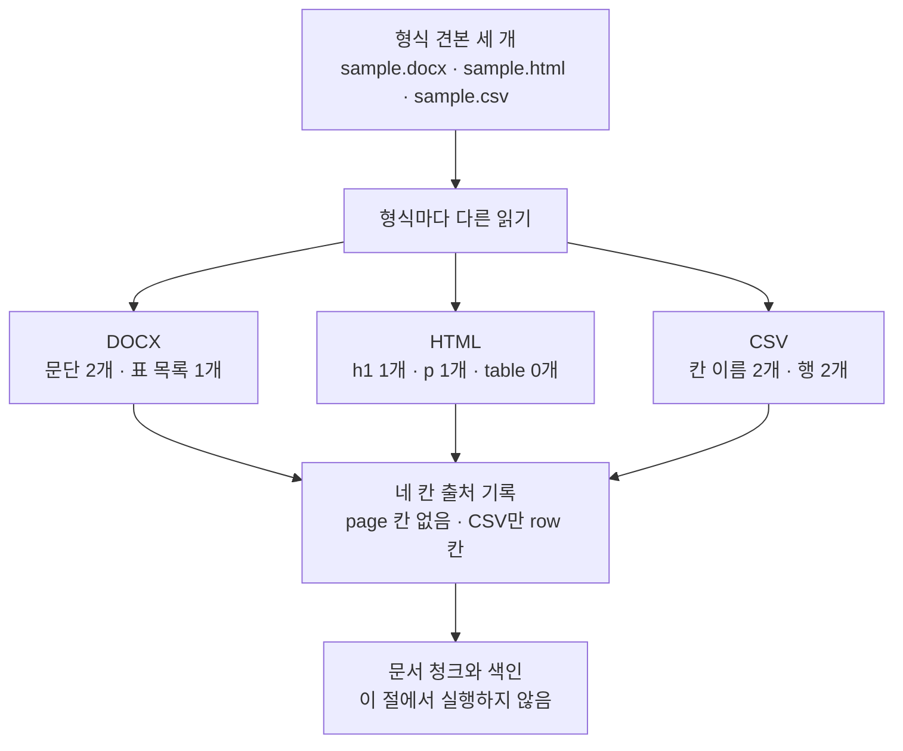
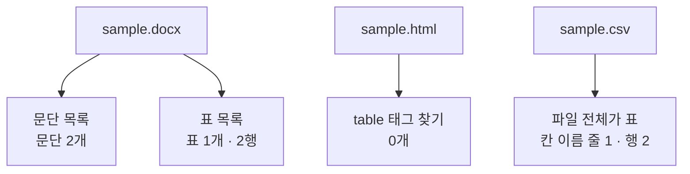
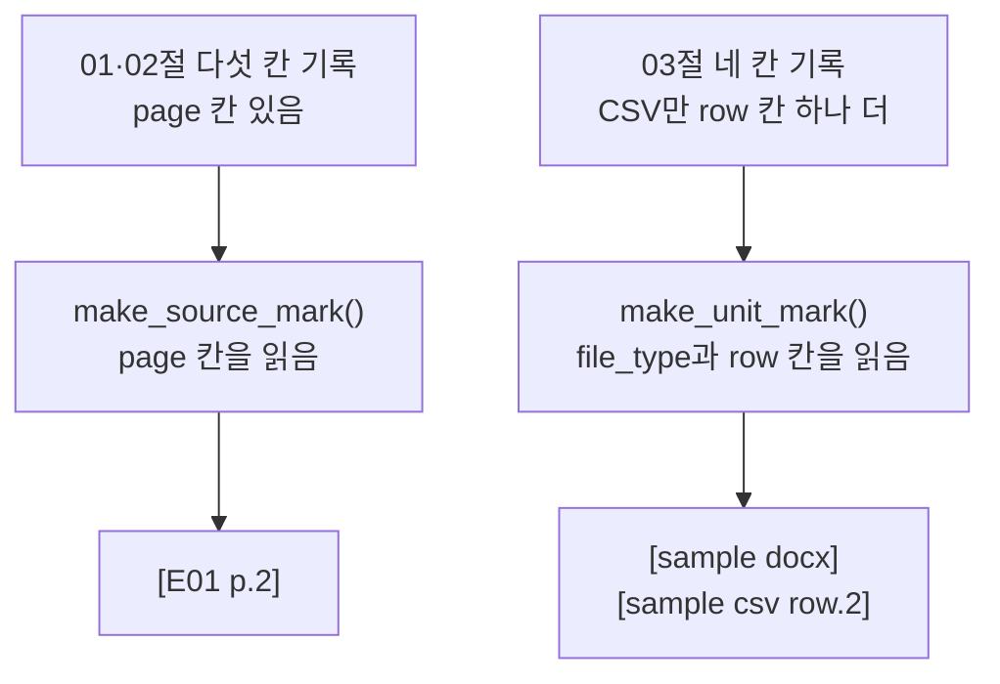
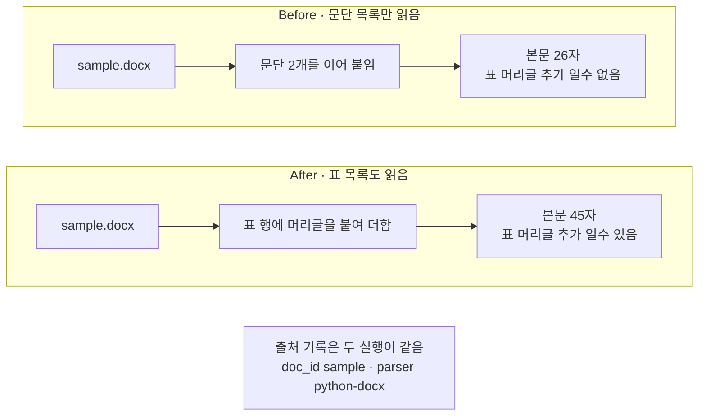

# 03-DOCX-HTML-CSV

## _src 본문 (HTML 원본)

```html
<!--meta: 강의 1h | 실습 2h | 코드 03-DOCX-HTML-CSV.ipynb | 새 용어 4 -->

<h2 id="b1"><span class="no">1</span>학습 목표</h2>
<div class="goal"><ul>
<li>이 절을 마치면 형식 견본 세 개를 열어 형식마다 남는 구조 정보를 말할 수 있습니다.</li>
<li>이 절을 마치면 표가 형식마다 어디에 들어 있는지 찾아 한 행을 한 줄 글로 만들 수 있습니다.</li>
<li>이 절을 마치면 쪽 번호가 없는 형식의 출처 기록을 네 칸으로 적고 출처 표시를 만들 수 있습니다.</li>
</ul></div>

<h2 id="b2"><span class="no">2</span>이 내용을 배우는 이유</h2>
<p>01·02절이 읽은 파일은 모두 PDF였습니다. PDF에는 글자와 그 자리만 남아 있습니다. 그래서 어디가 제목이고 어디가 표인지 도구가 추정해야 했습니다.</p>
<p>이 절의 세 형식은 다릅니다. 작성 도구가 구조를 이름으로 적어 둡니다. 어느 문단이 제목인지, 어느 글이 본문인지, 어느 값이 무슨 칸의 값인지가 파일 안에 있습니다. 그 이름을 버리고 글만 이어 붙이면 도구가 준 정보를 스스로 버리는 셈입니다.</p>
<p>그런데 이름이 붙은 자리가 형식마다 다릅니다. 표가 들어 있는 자리도 다릅니다. 그래서 같은 방법으로 셋을 다 읽을 수는 없습니다.</p>
<p>세 형식에는 쪽이라는 것도 없습니다. 출처 표시 <code>[E01 p.2]</code>를 만들 수 없다는 뜻입니다. 이 절은 쪽이 없는 형식의 기록 칸을 정합니다.</p>
<p>이 절이 읽는 파일은 견본 세 개입니다. 폴더 <code>labs/part3/ch10-document-processing/fixtures/</code>의 <code>sample.docx</code>·<code>sample.html</code>·<code>sample.csv</code>입니다. 01절 2절에서 확장자만 세어 보았던 파일입니다.</p>

<h2 id="b3"><span class="no">3</span>앞에서 배운 내용</h2>
<ul>
<li><strong>다섯 칸 출처 기록</strong> — 01절에서 정했습니다. 칸은 <code>doc_id</code>·<code>source</code>·<code>file_type</code>·<code>parser</code>·<code>page</code> 다섯 개입니다.</li>
<li><strong>출처 표시</strong> — 01·02절 <code>make_source_mark()</code>는 기록의 <code>doc_id</code>와 <code>page</code> 두 칸을 읽어 <code>[E01 p.2]</code>를 만듭니다.</li>
<li><strong>머리글 붙이기</strong> — 02절 <code>make_row_text()</code>는 머리글 행과 값 행을 받습니다. 칸마다 머리글을 붙여 한 줄 글로 만듭니다.</li>
<li><strong>값이 없는 칸</strong> — 02절에서 갈라 둔 말입니다. 표에서 값이 없는 칸을 가리키고, 코드가 넣는 자리 표시 글은 <code>(값 없음)</code>입니다. 글자 사이의 공백은 「빈칸」입니다.</li>
<li><strong>HTML 읽기</strong> — Ch 4 05절에서 같은 라이브러리로 웹 문서를 읽었습니다. 그때는 태그 하나를 골라 글을 꺼냈습니다.</li>
<li><strong>파일 열기</strong> — Ch 2 05절에서 <code>with open(..., encoding="utf-8")</code>을 배웠습니다.</li>
</ul>
<p>노트북은 02절 <code>make_row_text()</code>를 도구 파일 <code>rag_tools.py</code>에서 가져옵니다.</p>

<h2 id="b4"><span class="no">4</span>핵심 개념</h2>
<h3>비유 — 공책과 이름표 상자와 장부</h3>
<p>같은 안내문을 세 가지에 옮겨 적었다고 생각해 보세요. 하나는 스프링 공책이고, 하나는 이름표가 달린 상자이며, 하나는 줄이 그어진 장부입니다.</p>
<p>공책에서는 제목 줄만 굵은 띠로 칠해 두어 눈에 띕니다. 상자에서는 안쪽 작은 상자마다 이름표가 달려 있습니다. 장부에서는 맨 윗줄에 칸 이름이 인쇄되어 있습니다.</p>
<p>세 가지 모두 「이 글이 무엇인가」를 알려 주는 표시가 있습니다. 다만 그 표시가 붙은 자리가 서로 다릅니다. 게다가 공책에는 격자 종이 한 장이 따로 끼워져 있어서 공책만 넘기면 지나칩니다.</p>
{{img:03-5-공책과-장부|평면 그림으로 왼쪽에 펼친 스프링 공책이 있고 위쪽에 굵은 가로 띠 하나와 그 아래 얇은 가로줄 몇 개가 있으며 공책 뒤쪽에서 격자가 그려진 종이 한 장이 반쯤 빠져나와 있고 가운데에 큰 열린 상자 안에 작은 상자 두 개가 들어 있으며 작은 상자마다 빈 이름표가 달려 있고 오른쪽에 가로 세로 줄이 그어진 장부 한 장이 있으며 맨 윗줄만 진하게 칠해져 있고 세 가지 아래에 크기와 모양이 똑같은 흰 봉투 세 개가 하나씩 놓여 있음|표시가 붙은 자리는 셋이 다르지만 다음 자리로 넘기는 봉투는 모두 같은 모양입니다}}
<p><strong>그림 읽기</strong> — 위쪽 세 가지를 왼쪽에서 오른쪽으로 보고, 그다음 아래 봉투를 봅니다. 왼쪽 공책은 굵은 띠로 제목 줄을 알리고, 뒤쪽에서 격자 종이가 반쯤 빠져나와 있습니다. 가운데 상자는 작은 상자마다 이름표가 달려 있습니다. 오른쪽 장부는 맨 윗줄만 진하게 칠해져 있습니다. 아래 봉투 세 개는 크기와 모양이 같고, 01절에서 정한 출처 기록입니다.</p>

<h3>이 절에서 쓰는 말</h3>
<table><thead><tr><th>용어</th><th>뜻과 일상 예</th><th>이 절에서 보이는 모습</th></tr></thead><tbody>
<tr><td>문단(paragraph)</td><td>DOCX에서 글을 담는 기본 단위. 공책에서 줄바꿈으로 나뉘는 한 덩이와 같음</td><td>노트북 3절 <code>문단 수: 2</code>와 <code>문단 글:</code> 줄</td></tr>
<tr><td>꾸밈 이름(style name)</td><td>문단이 제목인지 본문인지 알려 주려고 작성 도구가 붙여 둔 이름. 공책 제목 줄에 칠한 굵은 띠와 같음</td><td>노트북 3절 <code>문단 꾸밈 이름: ['Heading 1', 'Normal']</code></td></tr>
<tr><td>태그(tag)</td><td>HTML에서 글을 감싸 그 글의 종류를 알려 주는 이름. 상자에 달아 둔 이름표와 같음</td><td>노트북 5절 <code>h1 태그 수: 1</code>과 <code>첫 글의 태그 이름: h1</code></td></tr>
<tr><td>자리 칸</td><td>쪽이 없는 형식에서 본문이 파일의 어디에서 왔는지 적는 칸. 장부의 몇째 줄인지 적어 두는 것과 같음</td><td>노트북 8절 CSV 기록의 <code>'row': 2</code></td></tr>
</tbody></table>
<p>파서·파일 형식·출처 기록·출처 계보는 01절과 같은 뜻입니다. 글자 층·표 읽기는 02절과 같은 뜻입니다. 문서 청크·메타데이터·출처 표시도 Ch 9에서 정한 뜻 그대로입니다.</p>

<h3>도식 — 형식은 셋이지만 기록의 칸 이름은 하나입니다</h3>
{{mermaid:03-1-형식별-구조|초록 상자 형식 견본 세 개에서 파란 상자 형식마다 다른 읽기로 내려온 뒤 노란 상자 세 개 DOCX 문단 2개와 표 목록 1개 HTML h1 1개와 p 1개와 table 0개 CSV 칸 이름 2개와 행 2개로 갈라지고 다시 초록 상자 네 칸 출처 기록 page 칸 없음 CSV만 row 칸으로 모인 뒤 회색 상자 문서 청크와 색인으로 이어지는 흐름도|형식마다 남는 구조 정보가 다르지만 기록의 칸 이름은 세 형식이 모두 같습니다}}
<p><strong>도식 읽기</strong> — 위에서 아래로 봅니다. 맨 위 초록 상자가 이 절이 읽는 견본 세 개입니다. 그 아래 파란 상자가 형식마다 다르게 하는 읽기입니다.</p>
<p>거기서 길이 세 갈래로 갈라집니다. 노란 상자 세 개가 노트북 3~6절 출력입니다. 형식 DOCX에서는 <code>문단 수: 2</code>와 <code>표 목록의 표 수: 1</code>을 얻고, 형식 HTML에서는 <code>h1 태그 수: 1</code>·<code>p 태그 수: 1</code>·<code>table 태그 수: 0</code>을 얻습니다. 형식 CSV에서는 <code>칸 이름: ['상품', '보관']</code>과 <code>행 수: 2</code>를 얻습니다.</p>
<p>세 갈래가 다시 한 초록 상자로 모입니다. 칸 이름은 세 형식이 모두 같습니다. 다만 <code>page</code> 칸이 없고 CSV에만 <code>row</code> 칸이 하나 더 붙습니다. 맨 아래 회색 상자는 05~08절에서 할 일이고 이 절에서는 실행하지 않습니다.</p>

<h3>형식마다 무엇이 남는가</h3>
<p>아래 표는 노트북 3~8절 출력을 형식별로 모은 것입니다. 둘째 열이 글에 붙어 있는 구조 정보이고, 셋째 열이 표가 들어 있는 자리입니다.</p>
<table>
<tr><th>형식</th><th>글에 붙은 구조 정보</th><th>표가 들어 있는 자리</th><th><code>parser</code> 칸에 적는 이름</th></tr>
<tr><td>DOCX</td><td>문단마다 꾸밈 이름(<code>Heading 1</code>·<code>Normal</code>)</td><td>문단 목록과 따로 있는 표 목록(<code>표 목록의 표 수: 1</code>)</td><td><code>python-docx</code></td></tr>
<tr><td>HTML</td><td>글마다 태그 이름(<code>h1</code>·<code>p</code>)</td><td><code>table</code> 태그로 찾음(이 견본은 <code>0개</code>)</td><td><code>beautifulsoup</code></td></tr>
<tr><td>CSV</td><td>첫 줄이 칸 이름(<code>['상품', '보관']</code>)</td><td>파일 전체가 표 하나</td><td><code>csv.DictReader</code></td></tr>
</table>
<p>세 형식의 구조 정보는 모두 사람이 문서를 만들 때 정한 것입니다. 도구가 글자 자리를 보고 추정한 값이 아닙니다. 그래서 제목을 기준으로 글을 나누거나 값 앞에 칸 이름을 붙이는 일을 바로 할 수 있습니다.</p>
<p>다만 세 형식 가운데 어느 쪽이 읽기 쉽다고 정하지는 않습니다. 이번에 읽은 것은 문단 두 개와 두 행짜리 표가 든 아주 작은 견본 세 건입니다. 표가 여러 개인 DOCX나 메뉴가 많은 HTML에서는 이번과 같은 결과가 나오는지 실행하지 않았습니다.</p>

<h2 id="b5"><span class="no">5</span>실행 예제</h2>
<p>내려받은 실습 폴더에서 노트북을 열고 위에서 아래로 실행합니다. API 키는 필요하지 않고 모델과 임베딩에는 요청을 한 번도 보내지 않습니다. 첫 셀의 패키지 설치만 인터넷을 씁니다. 먼저 견본 세 개를 찾고, 형식마다 구조 정보를 출력합니다.</p>
<p>이 페이지의 출력은 2026-09-21에 실행한 결과입니다. 모델을 부르지 않으므로 같은 판에서 다시 실행해도 같은 값이 나왔습니다. 새 커널로 두 번 실행해 스물한 개 코드 셀의 출력이 모두 같은 것을 확인했습니다.</p>
<p>강의 시간에는 노트북 2~7절을 설명합니다. 견본 세 개 찾기, DOCX 문단과 표 목록, HTML 태그 고르기, CSV 칸 이름, 머리글 붙이기입니다. 8~9절 출처 기록과 값 바꿔 보기, 10~11절 Before·After는 함께 실행하고 실습 시간에 다시 읽습니다.</p>
{{mermaid:03-2-표가-있는-자리|초록 상자 sample.docx에서 파란 상자 문단 목록 문단 2개와 파란 상자 표 목록 표 1개 2행 둘로 갈라지고 그 옆에 초록 상자 sample.html에서 파란 상자 table 태그 찾기 0개가 이어지며 다시 그 옆에 초록 상자 sample.csv에서 파란 상자 파일 전체가 표 칸 이름 줄 1 행 2가 이어지는 흐름도|DOCX는 표 목록에, HTML은 table 태그에, CSV는 파일 전체에 표가 들어 있습니다}}
<p><strong>도식 읽기</strong> — 묶음 세 개를 왼쪽에서 오른쪽으로 봅니다. 초록 상자 세 개가 견본 파일이고, 그 아래 파란 상자가 표를 찾는 자리입니다.</p>
<p>왼쪽 묶음만 파일 하나에서 목록 두 개로 갈라집니다. 노트북 3절이 문단 목록을, 4절이 표 목록을 엽니다. 두 목록은 겹치지 않습니다. 노트북 3절 출력 <code>문단 글:</code> 줄에는 표에만 있는 말 <code>추가 일수</code>가 없습니다.</p>
<p>가운데 묶음의 파란 상자는 <code>table 태그 수: 0</code>입니다. 표를 찾는 이름은 있는데 이 견본에는 그 태그가 없습니다. 오른쪽 묶음은 파일 전체가 표여서 따로 찾을 것이 없습니다.</p>
{{mermaid:03-3-쪽-없는-기록|왼쪽 줄기에 초록 상자 01과 02절 다섯 칸 기록 page 칸 있음에서 파란 상자 make_source_mark 함수 page 칸을 읽음을 거쳐 노란 상자 대괄호 E01 p.2로 아래로 이어지고 오른쪽 줄기에 초록 상자 03절 네 칸 기록 CSV만 row 칸 하나 더에서 파란 상자 make_unit_mark 함수 file_type과 row 칸을 읽음을 거쳐 노란 상자 대괄호 sample docx와 대괄호 sample csv row.2로 아래로 이어지는 흐름도|기록의 마지막 칸이 page인지 row인지에 따라 출처 표시의 모양이 달라집니다}}
<p><strong>도식 읽기</strong> — 줄기 두 개를 왼쪽에서 오른쪽으로 봅니다. 줄기마다 위에서 아래로 읽습니다. 왼쪽 줄기가 01·02절 기록이고 오른쪽 줄기가 이 절 기록입니다.</p>
<p>왼쪽 줄기의 파란 상자는 기록의 <code>page</code> 칸을 읽습니다. 그래서 노란 상자에 쪽 번호가 든 표시가 나옵니다. 오른쪽 줄기의 기록에는 그 칸이 없습니다. 노트북 8절 출력 <code>DOCX 기록에 page 칸이 있는가: False</code>가 그것입니다.</p>
<p>오른쪽 줄기의 파란 상자는 <code>file_type</code> 칸과 <code>row</code> 칸을 읽습니다. 쪽 번호 자리에 파일 형식이 들어가서 노란 상자가 <code>[sample docx]</code> 모양이 됩니다. CSV 기록에는 <code>row</code> 칸이 있어서 <code>첫 행의 출처 표시: [sample csv row.2]</code>까지 나옵니다.</p>
{{notebook:03-DOCX-HTML-CSV|example}}

<h2 id="b6"><span class="no">6</span>일부러 실패해 보기</h2>
<p>DOCX 견본을 <code>Document</code> 하나로 담아 봅니다. 문단 목록만 읽어도 오류는 나지 않습니다. 문단 목록만으로도 글이 만들어지기 때문입니다.</p>
<p>Before 셀은 문단 목록만 이어 붙입니다. After 셀은 표 목록의 행에 머리글을 붙여 함께 담습니다.</p>
{{mermaid:03-4-빠진-표|위 칸 Before에 초록 상자 sample.docx와 파란 상자 문단 2개를 이어 붙임과 빨간 상자 본문 26자 표 머리글 추가 일수 없음이 왼쪽에서 오른쪽으로 있고 아래 칸 After에 같은 초록 상자와 파란 상자 표 행에 머리글을 붙여 더함과 노란 상자 본문 45자 표 머리글 추가 일수 있음이 같은 방향으로 있으며 맨 아래에 회색 상자 출처 기록은 두 실행이 같음 doc_id sample parser python-docx가 있는 비교 흐름도|같은 파일에서 Before는 26자를 얻고 After는 표 행을 더해 45자를 얻습니다}}
<p><strong>도식 읽기</strong> — 위 칸이 Before, 아래 칸이 After이고 칸마다 왼쪽에서 오른쪽으로 봅니다. 두 칸의 초록 상자는 같은 파일입니다. 파란 상자에서 갈라집니다.</p>
<p>위 칸의 빨간 상자가 Before 결과입니다. 출력 <code>본문 글자 수: 26</code>과 <code>출처 표시: [sample docx]</code>는 모양이 갖춰져 있습니다. 그런데 <code>표 머리글이 본문에 있는가: False</code>입니다. 노트북 4절에서 본 <code>['지역', '추가 일수']</code>와 <code>['제주', '2일']</code>이 모두 빠졌습니다.</p>
<p>아래 칸의 노란 상자가 After 결과입니다. 출력 <code>본문 글자 수: 45</code>로 늘고 <code>표 머리글이 본문에 있는가: True</code>로 바뀌었습니다. 늘어난 줄은 <code>지역: 제주 / 추가 일수: 2일</code> 한 줄입니다.</p>
<p>맨 아래 회색 상자는 두 실행에 모두 해당합니다. 출처 기록은 Before와 After가 같습니다. 문단과 표를 한 <code>Document</code>에 담았기 때문에 자리 칸을 따로 적지 않았습니다.</p>
{{notebook:03-DOCX-HTML-CSV|failure}}

<h2 id="b7"><span class="no">7</span>주의할 점과 실무 메모</h2>
<ul>
<li><strong>쪽이 없는 형식에 <code>page</code> 칸을 지어 넣지 않습니다.</strong> 쪽 번호가 있는 형식과 한 색인에 섞이면 어느 값이 원본의 실제 쪽인지 알 수 없습니다. 이 절은 <code>page</code> 칸을 빼고 CSV에만 <code>row</code> 칸을 더했습니다. 출처 표시도 <code>[sample csv row.2]</code>처럼 쪽 번호 자리를 바꿔 적습니다.</li>
<li><strong>문서 이름이 겹치는지 봅니다.</strong> 노트북 8절 출력 <code>세 기록의 doc_id: sample sample sample</code>을 보세요. 세 파일의 이름 앞부분이 같아서 문서 이름이 하나로 겹쳤습니다. 실제 문서 모음에서는 폴더 이름이나 접두를 붙여 갈라 둡니다.</li>
<li><strong>표를 어떻게 담을지 미리 정합니다.</strong> 이 절은 두 행짜리 표를 문단 글과 한 <code>Document</code>에 함께 담았습니다. 02절에서는 일곱 행짜리 표를 행마다 따로 담았습니다. 표가 커지면 행 묶음으로 나누고 머리글을 묶음마다 다시 붙입니다.</li>
<li><strong>고를 태그 목록을 기록에 남깁니다.</strong> 노트북 9절에서 목록을 <code>['h1', 'p']</code>에서 <code>['p']</code>로 바꾸자 제목이 빠졌습니다. 어떤 태그를 골랐는지가 색인에 들어간 글의 범위를 정합니다. 견본에는 화면 표시를 정하는 <code>style</code> 태그도 하나 있었고, 고를 목록에 넣지 않아 그 글은 들어오지 않았습니다. 실습 폴더 모듈은 그 태그를 아예 지운 뒤 읽습니다.</li>
<li><strong>CSV 첫 줄과 글자 인코딩을 확인합니다.</strong> 이 노트북은 <code>encoding="utf-8"</code>로 읽었습니다. 파일 앞에 눈에 보이지 않는 표시가 붙어 있으면 첫 칸 이름에 그 표시가 섞입니다. 실습 폴더 모듈은 그 표시를 걸러내는 <code>encoding="utf-8-sig"</code>를 씁니다. 구분자가 쉼표가 아닌 파일은 이번에 읽지 않았습니다.</li>
<li><strong>검색에 쓰지 않을 칸은 빼 둡니다.</strong> 사람 이름·연락처 같은 칸이 있는 CSV는 그 칸을 로더에서 빼거나 권한이 있는 사람만 읽는 자리에 따로 둡니다. 이 견본에는 그런 칸이 없어서 모든 칸을 담았습니다.</li>
<li><strong>실습 폴더 모듈에 같은 일을 하는 함수가 있습니다.</strong> <code>labs/part3/ch10-document-processing/document_processing.py</code>의 <code>load_docx()</code>는 문단과 표를 문서 순서대로 한 <code>Document</code>에 담고, 표 앞에 <code>[표 1]</code>이라는 줄을 넣습니다. 같은 파일의 <code>load_html()</code>은 태그를 골라내지 않고 <code>script</code>·<code>style</code>을 지운 전체 글을 담습니다. 같은 파일의 <code>load_csv()</code>는 행마다 <code>Document</code>를 만들고 <code>row</code> 칸을 2부터 적습니다. 이번 노트북에서는 그 모듈을 부르지 않았습니다.</li>
</ul>

<h2 id="b8"><span class="no">8</span>정리와 다음 절</h2>
<ul>
<li>형식마다 남는 구조 정보가 다릅니다. 차례로 DOCX 문단의 꾸밈 이름, HTML 태그 이름, CSV 첫 줄의 칸 이름입니다.</li>
<li>표가 들어 있는 자리도 다릅니다. 차례로 DOCX 표 목록, HTML <code>table</code> 태그, CSV 파일 전체입니다.</li>
<li>02절 <code>make_row_text()</code>를 고치지 않고 DOCX 표의 행과 CSV의 행에 모두 썼습니다. 값 앞에 칸 이름이 붙은 한 줄 글을 세 개 얻었습니다.</li>
<li>쪽이 없는 형식은 <code>page</code> 칸을 넣지 않고 네 칸만 적습니다. CSV만 <code>row</code> 칸을 하나 더하고, 출처 표시는 <code>[sample csv row.2]</code> 모양입니다.</li>
<li>문단 목록만 읽으면 표가 통째로 빠졌습니다. 표 목록의 행을 더해 본문이 26자에서 45자가 되었습니다.</li>
</ul>
<p><strong>다음 학습과 이어지는 지점</strong> — 04절에서는 HWP와 HWPX를 가릅니다. 이름이 비슷하지만 파일 안의 모양이 다릅니다. HWPX 견본을 열어 압축 파일 속 XML을 직접 보고, 그때도 같은 칸 이름에 담습니다.</p>
<p>05~08절은 이렇게 읽은 글을 문서 청크로 나누어 색인합니다. 이 절에서 정한 자리 칸은 그때도 함께 남습니다. 형식이 섞인 색인에서 검색 결과를 볼 때 그 칸이 있어야 원본을 되짚을 수 있습니다.</p>

<h2 id="b9"><span class="no">9</span>복습 문제</h2>
<details class="quiz" open><summary>문제 4개 · 해설 포함</summary>
<p class="quiz-q">1. [하] DOCX 문단 목록을 다 읽었는데도 표의 값이 없는 까닭은 무엇입니까?</p>
<p class="quiz-a">표가 문단 목록이 아니라 표 목록에 들어 있기 때문입니다. 노트북 3절 <code>문단 수: 2</code>와 4절 <code>표 목록의 표 수: 1</code>은 서로 다른 목록을 센 값입니다. 문단 목록만 읽은 10절 본문은 26자였고 표 머리글이 없었습니다.</p>
<p class="quiz-q">2. [중] 꾸밈 이름과 태그 이름은 무엇을 같게 해 줍니까?</p>
<p class="quiz-a">글을 이어 붙이기 전에 어느 글이 제목인지 알 수 있게 해 줍니다. 노트북 3절 <code>['Heading 1', 'Normal']</code>과 5절 <code>첫 글의 태그 이름: h1</code>이 그 정보입니다. PDF에서는 글자와 자리만 있어서 이런 이름을 얻지 못했습니다.</p>
<p class="quiz-q">3. [중] 02절 <code>make_row_text()</code>를 고치지 않고 CSV 행에도 쓸 수 있었던 까닭은 무엇입니까?</p>
<p class="quiz-a">그 함수가 머리글 행과 값 행을 목록으로 받기 때문입니다. CSV 행은 딕셔너리라서 칸 이름 목록으로 값을 순서대로 꺼내 넣었습니다. 노트북 7절 출력 <code>CSV 첫 행: 상품: 쿠키 / 보관: 실온</code>이 그 결과입니다.</p>
<p class="quiz-q">4. [상] 쪽이 없는 형식에 <code>page</code> 칸을 1로 적어 두면 어떤 문제가 생깁니까?</p>
<p class="quiz-a">쪽 번호가 있는 형식과 한 색인에 섞였을 때 값의 뜻이 달라집니다. 형식 PDF의 <code>page</code> 칸은 원본의 실제 쪽인데 DOCX의 1은 지어낸 값입니다. 출처 표시도 <code>[E01 p.2]</code>와 같은 모양이 되어 되짚을 때 가릴 수 없습니다.</p>
</details>

<h2 id="b10"><span class="no">10</span>참고 자료</h2>
<ul>
<li><div><a href="https://python-docx.readthedocs.io/en/latest/user/quickstart.html">python-docx 공식 문서 Quickstart</a></div>확인 2026-09-18 · 문단 목록과 표 목록이 따로 있는 구조 참고.</li>
<li><div><a href="https://python-docx.readthedocs.io/en/latest/api/text.html">python-docx 공식 문서 Text-related objects</a></div>확인 2026-09-18 · <code>paragraph.style</code>과 꾸밈 이름 참고.</li>
<li><div><a href="https://www.crummy.com/software/BeautifulSoup/bs4/doc/#find-all">Beautiful Soup 공식 문서 find_all()</a></div>확인 2026-09-18 · 태그 이름 목록으로 고르는 방법 참고.</li>
<li><div><a href="https://docs.python.org/3/library/csv.html#csv.DictReader">Python 공식 문서 csv.DictReader</a></div>확인 2026-09-18 · 첫 줄을 칸 이름으로 삼는 동작과 <code>newline=''</code> 참고.</li>
<li><div><a href="https://reference.langchain.com/python/langchain-core/documents">LangChain 공식 API Document</a></div>확인 2026-09-18 · <code>page_content</code>와 <code>metadata</code> 구조 참고.</li>
<li>기준 버전은 Python 3.12.13과 python-docx 1.2.0입니다. 함께 쓰는 판은 beautifulsoup4 4.15.0과 langchain-core 1.6.2입니다. 판을 고정한 기준은 실습 폴더의 잠금 파일입니다.</li>
</ul>
```

## 노트북 셀 (순서대로)

### [0] markdown {'html': 'skip'}

# DOCX·HTML·CSV

**이 노트북에서 할 일**

1. 형식 견본 세 개를 열어 형식마다 어떤 구조 정보가 남는지 봅니다.
2. 표가 형식마다 어디에 들어 있는지 찾고, 02절 함수로 한 행을 한 줄 글로 만듭니다.
3. 쪽 번호가 없는 형식의 출처 기록을 정하고 출처 표시를 만듭니다.

**준비물** — API 키가 필요 없습니다. 모델과 임베딩에는 요청을 한 번도 보내지 않습니다.
첫 셀의 패키지 설치만 인터넷을 씁니다.
그래서 예상 비용은 0달러입니다. 실행 시간은 패키지 설치를 빼면 10초 안팎입니다.

데이터는 견본 세 개입니다. 폴더 `labs/part3/ch10-document-processing/fixtures/`의
`sample.docx`·`sample.html`·`sample.csv`입니다. 01절 2절에서 확장자만 세어 보았던 파일들입니다.

**강의와 실습 범위** — 강의 시간에는 2~7절을 설명합니다.
견본 세 개 찾기, DOCX 문단과 표 목록, HTML 태그 고르기, CSV 칸 이름, 머리글 붙이기입니다.
8~9절 출처 기록과 값 바꿔 보기, 10~11절 Before·After는 함께 실행하고 실습 시간에 다시 읽습니다.

**기준 버전** — 실습 폴더에 고정한 패키지 판을 씁니다. python-docx 1.2.0, beautifulsoup4 4.15.0, langchain-core 1.6.2입니다.
교재 출력은 Linux의 Python 3.12.13으로 만들었습니다. 다른 버전과 Windows·macOS에서는 이번에 실행하지 않았습니다.

실습 폴더 `labs/part3/ch10-document-processing`에서 `uv sync --locked`를 실행합니다.
그다음 이 폴더의 `.venv` 커널을 고르고 첫 셀부터 순서대로 실행합니다.

### [1] markdown {'html': 'skip'}

## 오늘 볼 그림


위에서 아래로 봅니다. 견본 세 개를 형식마다 다른 방법으로 읽으면 남는 구조 정보가 다릅니다.
가운데 노란 상자 세 개가 이 절에서 출력으로 확인할 값입니다.
읽고 난 뒤에는 세 형식이 모두 같은 모양의 출처 기록으로 모입니다.
맨 아래 회색 상자는 05~08절에서 할 일이고 이 절에서는 실행하지 않습니다.

### [2] markdown {}

## 1. 준비

첫 셀은 패키지를 설치하고 설치된 버전을 출력합니다. 설치에는 몇십 초가 걸릴 수 있습니다.
01·02절에서 쓴 `Document`에 DOCX를 읽는 python-docx와 HTML을 읽는 beautifulsoup4를 더합니다.

### [3] code {'execution': {'iopub.execute_input': '2026-09-21T06:25:33.298717Z', 'iopub.status.busy': '2026-09-21T06:25:33.298553Z', 'iopub.status.idle': '2026-09-21T06:25:33.741646Z', 'shell.execute_reply': '2026-09-21T06:25:33.741099Z'}, 'lesson_role': 'setup'}

```python
# 이 절에서 쓰는 패키지를 설치하고 버전을 확인합니다
%pip install -q "python-docx==1.2.0" "beautifulsoup4==4.15.0" "langchain-core==1.6.2"
from importlib.metadata import version

print("python-docx:", version("python-docx"))
print("beautifulsoup4:", version("beautifulsoup4"))
print("langchain-core:", version("langchain-core"))
```

출력:
```
Note: you may need to restart the kernel to use updated packages.
python-docx: 1.2.0
beautifulsoup4: 4.15.0
langchain-core: 1.6.2

```

### [4] markdown {}

**결과 읽기** — 출력 줄은 `python-docx: 1.2.0`, `beautifulsoup4: 4.15.0`, `langchain-core: 1.6.2` 세 줄입니다.
준비물에 적은 기준 버전과 같습니다. CSV 읽기 도구는 Python에 들어 있어 따로 설치하지 않습니다.

다음 셀은 이 절에서 쓸 이름을 불러옵니다.
`from docx import Document as DocxDocument` 줄은 DOCX 파일을 여는 클래스에 다른 이름을 붙입니다.
python-docx에도 `Document`가 있어서 LangChain의 `Document`와 이름이 겹치기 때문입니다.
Ch 4 01절에서 쓴 `import pandas as pd`와 같은 표기입니다.

앞에서 배운 함수는 `rag_tools.py`에 모아 두었습니다. 파일을 열면 코드를 볼 수 있습니다. 노트북과 같은 폴더(`notebooks/`)에 있는 파일입니다.
이 노트북은 02절 `make_row_text()`를 가져옵니다.

### [5] code {'execution': {'iopub.execute_input': '2026-09-21T06:25:33.742603Z', 'iopub.status.busy': '2026-09-21T06:25:33.742510Z', 'iopub.status.idle': '2026-09-21T06:25:33.981363Z', 'shell.execute_reply': '2026-09-21T06:25:33.980924Z'}, 'lesson_role': 'setup'}

```python
# 파일 찾기·DOCX 읽기·HTML 읽기·CSV 읽기·문서 객체 만들기에 쓸 이름을 불러옵니다
import csv
import os
from pathlib import Path

from bs4 import BeautifulSoup
from docx import Document as DocxDocument
from langchain_core.documents import Document
# 02절 함수 하나를 도구 파일에서 가져옵니다
from rag_tools import make_row_text
```

출력:
```

```

### [6] markdown {}

## 2. 견본 세 개 찾기

01·02절과 같은 방법으로 프로젝트 맨 위 경로를 고릅니다.
후보 세 개를 차례로 확인하고, 있는 경로에서 멈춥니다.
이번에 찾는 폴더는 문서 모음이 아니라 이 챕터의 견본 폴더입니다.

실행 전에 예상합니다. 프로젝트 맨 위에서 열었다면 첫째 후보를 고를 것입니다.

### [7] code {'execution': {'iopub.execute_input': '2026-09-21T06:25:33.982176Z', 'iopub.status.busy': '2026-09-21T06:25:33.982092Z', 'iopub.status.idle': '2026-09-21T06:25:33.984157Z', 'shell.execute_reply': '2026-09-21T06:25:33.983791Z'}}

```python
# 작업 폴더에서 본 프로젝트 맨 위 경로를 후보 세 개 가운데에서 고릅니다
candidates = [".", "../../..", "../../../.."]
root_path = None
for candidate in candidates:
    if os.path.exists(candidate + "/labs/part3/ch10-document-processing/fixtures"):
        root_path = candidate
        break
print("고른 경로:", root_path)
assert root_path is not None, "notebooks 폴더나 실습 폴더 맨 위에서 노트북을 열어 주세요."
```

출력:
```
고른 경로: .

```

### [8] markdown {}

**결과 읽기** — 출력 줄은 `고른 경로: .`입니다. `assert`도 통과했습니다.
교재 출력은 프로젝트 맨 위를 작업 폴더로 삼아 실행해서 첫째 후보를 골랐습니다.

다음 셀은 읽을 견본 세 개의 경로를 만듭니다.
세 파일은 한 문단짜리 안내문과 작은 표를 담은 아주 작은 파일입니다.
형식마다 무엇이 남는지 보는 것이 목적이라 내용은 짧게 두었습니다.

### [9] code {'execution': {'iopub.execute_input': '2026-09-21T06:25:33.984697Z', 'iopub.status.busy': '2026-09-21T06:25:33.984649Z', 'iopub.status.idle': '2026-09-21T06:25:33.986720Z', 'shell.execute_reply': '2026-09-21T06:25:33.986402Z'}}

```python
# 읽을 견본 세 개의 경로를 만들고 파일이 있는지 확인합니다
fixtures_path = root_path + "/labs/part3/ch10-document-processing/fixtures"
docx_path = fixtures_path + "/sample.docx"
html_path = fixtures_path + "/sample.html"
csv_path = fixtures_path + "/sample.csv"
print("DOCX 견본이 있는가:", os.path.exists(docx_path))
print("HTML 견본이 있는가:", os.path.exists(html_path))
print("CSV 견본이 있는가:", os.path.exists(csv_path))
```

출력:
```
DOCX 견본이 있는가: True
HTML 견본이 있는가: True
CSV 견본이 있는가: True

```

### [10] markdown {}

**결과 읽기** — 출력 세 줄이 모두 `True`입니다.
이 견본들은 01절 2절에서 확장자 다섯 가지를 셀 때 이름만 보았던 파일입니다.
나머지 두 개는 `.hwp`와 `.hwpx`이고 04절에서 읽습니다.

### [11] markdown {}

## 3. DOCX 문단 목록과 꾸밈 이름

파일 sample.docx를 열면 문단 목록을 얻습니다.
문단은 DOCX에서 글을 담는 기본 단위입니다.
문단마다 꾸밈 이름이 붙어 있어서 제목 문단과 본문 문단을 가를 수 있습니다.

실행 전에 예상합니다. 문단 두 개가 나오고 꾸밈 이름은 서로 다를 것입니다.

### [12] code {'execution': {'iopub.execute_input': '2026-09-21T06:25:33.987413Z', 'iopub.status.busy': '2026-09-21T06:25:33.987364Z', 'iopub.status.idle': '2026-09-21T06:25:33.995544Z', 'shell.execute_reply': '2026-09-21T06:25:33.995183Z'}}

```python
# DOCX 견본을 열어 문단 목록의 글과 꾸밈 이름을 봅니다
docx_file = DocxDocument(docx_path)
paragraph_texts = []
paragraph_styles = []
for paragraph in docx_file.paragraphs:
    paragraph_texts.append(paragraph.text)
    paragraph_styles.append(paragraph.style.name)
print("객체 이름:", type(docx_file).__name__)
print("문단 수:", len(docx_file.paragraphs))
print("문단 글:", paragraph_texts)
print("문단 꾸밈 이름:", paragraph_styles)
```

출력:
```
객체 이름: Document
문단 수: 2
문단 글: ['배송 안내', '제주 배송에는 이틀이 더 필요합니다.']
문단 꾸밈 이름: ['Heading 1', 'Normal']

```

### [13] markdown {}

**결과 읽기** — 출력 줄은 `문단 수: 2`입니다.
다음 줄 `문단 글: ['배송 안내', '제주 배송에는 이틀이 더 필요합니다.']`이 두 문단의 글입니다.
마지막 줄 `문단 꾸밈 이름: ['Heading 1', 'Normal']`을 보세요.
앞 문단은 제목이고 뒤 문단은 본문이라는 뜻입니다.

PDF에서는 이런 이름을 얻지 못했습니다. 글자와 자리만 있었기 때문입니다.
작성 도구가 남긴 이름이 있으면 나중에 제목을 기준으로 글을 나눌 수 있습니다.

### [14] markdown {}

## 4. 표는 다른 목록에 들어 있습니다

파일 sample.docx에는 표도 하나 있습니다.
그런데 표의 글은 문단 목록에 들어오지 않습니다.
표는 `docx_file.tables`라는 다른 목록에 들어 있습니다.

먼저 표의 한 행에서 칸의 글을 모으는 함수를 정의합니다.

### [15] code {'execution': {'iopub.execute_input': '2026-09-21T06:25:33.996155Z', 'iopub.status.busy': '2026-09-21T06:25:33.996107Z', 'iopub.status.idle': '2026-09-21T06:25:33.997638Z', 'shell.execute_reply': '2026-09-21T06:25:33.997286Z'}}

```python
# 표의 한 행을 받아 칸의 글을 순서대로 모아 목록으로 반환합니다
def read_row_values(table_row):
    values = []
    for cell in table_row.cells:
        values.append(cell.text)
    return values
```

출력:
```

```

### [16] markdown {}

**결과 읽기** — 이 셀은 함수를 만들기만 하므로 출력이 없습니다.

한 행 안에서 칸은 `table_row.cells`로 얻고, 칸의 글은 `cell.text`로 읽습니다.
문단에서 글을 읽을 때 쓴 `paragraph.text`와 같은 표기입니다.

다음 셀은 표 목록을 열어 표의 수와 행·칸을 봅니다.

### [17] code {'execution': {'iopub.execute_input': '2026-09-21T06:25:33.998255Z', 'iopub.status.busy': '2026-09-21T06:25:33.998202Z', 'iopub.status.idle': '2026-09-21T06:25:34.000455Z', 'shell.execute_reply': '2026-09-21T06:25:34.000057Z'}}

```python
# 문단 목록과 따로 있는 표 목록을 열어 행과 칸을 봅니다
docx_tables = docx_file.tables
first_docx_table = docx_tables[0]
docx_header = read_row_values(first_docx_table.rows[0])
docx_first_row = read_row_values(first_docx_table.rows[1])
print("표 목록의 표 수:", len(docx_tables))
print("첫 표의 행 수:", len(first_docx_table.rows))
print("머리글 행:", docx_header)
print("첫 행:", docx_first_row)
```

출력:
```
표 목록의 표 수: 1
첫 표의 행 수: 2
머리글 행: ['지역', '추가 일수']
첫 행: ['제주', '2일']

```

### [18] markdown {}

**결과 읽기** — 출력 줄은 `표 목록의 표 수: 1`과 `첫 표의 행 수: 2`입니다.
머리글 한 행에 값 한 행을 더해 두 행입니다.
다음 줄 `머리글 행: ['지역', '추가 일수']`와 `첫 행: ['제주', '2일']`이 칸의 글입니다.

3절 출력의 `문단 글`을 다시 보세요. 표에만 있는 말 `추가 일수`가 거기에 없습니다.
문단 목록만 읽으면 표가 통째로 빠집니다. 10절에서 그 결과를 확인합니다.

### [19] markdown {}

## 5. HTML 태그 이름으로 고르기

파일 sample.html은 태그로 감싼 글입니다.
태그는 글을 감싸 그 글의 종류를 알려 주는 이름입니다.
제목은 `h1` 태그, 본문 문단은 `p` 태그로 감싸여 있습니다.

메서드 `find_all(태그 이름)`은 그 이름의 태그를 문서 순서대로 모아 목록으로 반환합니다.
Ch 4 05절에서 HTML을 읽을 때 쓴 것과 같은 라이브러리입니다.

### [20] code {'execution': {'iopub.execute_input': '2026-09-21T06:25:34.001039Z', 'iopub.status.busy': '2026-09-21T06:25:34.000982Z', 'iopub.status.idle': '2026-09-21T06:25:34.003465Z', 'shell.execute_reply': '2026-09-21T06:25:34.003087Z'}}

```python
# HTML 견본을 읽어 태그 나무를 만들고 태그 종류마다 개수를 셉니다
with open(html_path, encoding="utf-8") as html_file:
    html_source = html_file.read()
soup = BeautifulSoup(html_source, "html.parser")
title_tags = soup.find_all("h1")
body_tags = soup.find_all("p")
table_tags = soup.find_all("table")
style_tags = soup.find_all("style")
print("객체 이름:", type(soup).__name__)
print("h1 태그 수:", len(title_tags))
print("p 태그 수:", len(body_tags))
print("table 태그 수:", len(table_tags))
print("style 태그 수:", len(style_tags))
```

출력:
```
객체 이름: BeautifulSoup
h1 태그 수: 1
p 태그 수: 1
table 태그 수: 0
style 태그 수: 1

```

### [21] markdown {}

**결과 읽기** — 출력 줄은 `h1 태그 수: 1`과 `p 태그 수: 1`입니다.
다음 줄 `table 태그 수: 0`을 보세요. 이 견본에는 표가 없습니다.
마지막 줄 `style 태그 수: 1`은 화면 표시를 정하는 태그입니다.

형식마다 표가 들어 있는 자리가 다릅니다.
DOCX에서는 표 목록에 들어 있었고, HTML에서는 `table` 태그로 찾습니다.
같은 방법으로 셋을 다 찾을 수는 없습니다.

다음 셀은 고를 태그 이름 목록을 받아 그 태그의 글을 모으는 함수를 정의합니다.

### [22] code {'execution': {'iopub.execute_input': '2026-09-21T06:25:34.003985Z', 'iopub.status.busy': '2026-09-21T06:25:34.003925Z', 'iopub.status.idle': '2026-09-21T06:25:34.005352Z', 'shell.execute_reply': '2026-09-21T06:25:34.005054Z'}}

```python
# 태그 나무와 고를 태그 이름 목록을 받아 그 태그의 글을 모아 반환합니다
def pick_tag_texts(tag_tree, wanted_tags):
    picked = []
    for tag in tag_tree.find_all(wanted_tags):
        picked.append(tag.get_text(" ", strip=True))
    return picked
```

출력:
```

```

### [23] markdown {}

**결과 읽기** — 이 셀은 함수를 만들기만 하므로 출력이 없습니다.

메서드 `get_text(" ", strip=True)`는 태그 안의 글을 꺼냅니다.
첫 인자는 안쪽 태그가 여러 개일 때 사이에 넣을 글이고, `strip=True`는 앞뒤 빈칸을 없앱니다.

다음 셀은 제목과 본문을 함께 골라 태그 이름과 글을 봅니다.

### [24] code {'execution': {'iopub.execute_input': '2026-09-21T06:25:34.005863Z', 'iopub.status.busy': '2026-09-21T06:25:34.005818Z', 'iopub.status.idle': '2026-09-21T06:25:34.007554Z', 'shell.execute_reply': '2026-09-21T06:25:34.007371Z'}}

```python
# 제목 태그와 본문 태그를 함께 골라 글과 태그 이름을 봅니다
wanted_tags = ["h1", "p"]
picked_tags = soup.find_all(wanted_tags)
picked_texts = pick_tag_texts(soup, wanted_tags)
first_tag_name = picked_tags[0].name
second_tag_name = picked_tags[1].name
print("고를 태그 목록:", wanted_tags)
print("고른 글:", picked_texts)
print("첫 글의 태그 이름:", first_tag_name)
print("둘째 글의 태그 이름:", second_tag_name)
```

출력:
```
고를 태그 목록: ['h1', 'p']
고른 글: ['반품 안내', '수령 후 7일 이내 신청합니다.']
첫 글의 태그 이름: h1
둘째 글의 태그 이름: p

```

### [25] markdown {}

**결과 읽기** — 출력 줄 `고른 글: ['반품 안내', '수령 후 7일 이내 신청합니다.']`이 골라낸 두 글입니다.
다음 두 줄 `첫 글의 태그 이름: h1`과 `둘째 글의 태그 이름: p`가 그 글의 종류입니다.
`style` 태그도 하나 있었지만 고를 목록에 넣지 않아 그 글은 들어오지 않았습니다.

형식 DOCX의 꾸밈 이름과 같은 일을 태그 이름이 합니다.
글을 이어 붙이기 전에 어느 글이 제목인지 알 수 있습니다.

### [26] markdown {}

## 6. CSV는 첫 줄이 칸 이름입니다

파일 sample.csv는 파일 전체가 표 하나입니다.
첫 줄에 칸 이름이 있고 그 아래 줄마다 값이 있습니다.
클래스 `csv.DictReader`는 첫 줄을 칸 이름으로 삼아 아래 줄을 딕셔너리로 만듭니다.

인자 `newline=""`는 줄바꿈 처리를 `csv`에 맡기는 표시입니다.
CSV 설명서가 파일을 열 때 이렇게 쓰라고 적어 두었습니다.

### [27] code {'execution': {'iopub.execute_input': '2026-09-21T06:25:34.008110Z', 'iopub.status.busy': '2026-09-21T06:25:34.008063Z', 'iopub.status.idle': '2026-09-21T06:25:34.010200Z', 'shell.execute_reply': '2026-09-21T06:25:34.009844Z'}}

```python
# CSV 견본을 열어 첫 줄의 칸 이름과 그 아래 행을 읽습니다
with open(csv_path, encoding="utf-8", newline="") as csv_file:
    reader = csv.DictReader(csv_file)
    csv_header = reader.fieldnames
    csv_rows = []
    for row in reader:
        csv_rows.append(row)
print("칸 이름:", csv_header)
print("행 수:", len(csv_rows))
print("첫 행:", csv_rows[0])
print("첫 행의 자료형:", type(csv_rows[0]).__name__)
```

출력:
```
칸 이름: ['상품', '보관']
행 수: 2
첫 행: {'상품': '쿠키', '보관': '실온'}
첫 행의 자료형: dict

```

### [28] markdown {}

**결과 읽기** — 출력 줄은 `칸 이름: ['상품', '보관']`과 `행 수: 2`입니다.
칸 이름 줄은 행으로 세지 않습니다.
다음 줄 `첫 행: {'상품': '쿠키', '보관': '실온'}`을 보세요.
마지막 줄 `첫 행의 자료형: dict`가 그 모양입니다.

02절에서는 표의 한 행이 칸의 글만 담은 목록이었습니다.
그때는 칸 번호로 머리글의 짝을 찾아야 했습니다.
클래스 `csv.DictReader`는 그 짝을 미리 지어 줍니다. 형식이 칸 이름을 첫 줄에 담고 있기 때문입니다.

### [29] markdown {}

## 7. 한 행을 한 줄 글로 만들기

준비 셀에서 가져온 02절 `make_row_text()`를 씁니다.
이 함수는 머리글 행과 값 행을 목록으로 받아, 칸마다 머리글을 붙인 한 줄 글을 만듭니다.
함수 안에서는 02절 `make_cell_text()`가 머리글 하나와 칸 하나를 짝짓습니다.

값이 없는 칸은 `(값 없음)`으로 바꿔 적습니다. 02절에서 정한 대로입니다.
이 절의 견본 세 개에는 값이 없는 칸이 없어서 그 글은 나오지 않습니다.
함수가 목록을 받으므로 DOCX 표의 행에도 쓸 수 있습니다.
CSV 행의 값을 목록으로 꺼내면 거기에도 쓸 수 있습니다.

다음 셀은 두 형식의 행을 같은 함수에 넣습니다.

### [30] code {'execution': {'iopub.execute_input': '2026-09-21T06:25:34.010653Z', 'iopub.status.busy': '2026-09-21T06:25:34.010609Z', 'iopub.status.idle': '2026-09-21T06:25:34.012349Z', 'shell.execute_reply': '2026-09-21T06:25:34.012114Z'}}

```python
# 같은 함수로 DOCX 표의 한 행과 CSV의 두 행을 한 줄 글로 만듭니다
docx_row_text = make_row_text(docx_header, docx_first_row)
csv_row_texts = []
for row in csv_rows:
    values = []
    for column in csv_header:
        values.append(row[column])
    row_text = make_row_text(csv_header, values)
    csv_row_texts.append(row_text)
print("DOCX 표의 한 행:", docx_row_text)
print("CSV 첫 행:", csv_row_texts[0])
print("CSV 둘째 행:", csv_row_texts[1])
```

출력:
```
DOCX 표의 한 행: 지역: 제주 / 추가 일수: 2일
CSV 첫 행: 상품: 쿠키 / 보관: 실온
CSV 둘째 행: 상품: 케이크 / 보관: 냉장

```

### [31] markdown {}

**결과 읽기** — 출력 줄 `DOCX 표의 한 행: 지역: 제주 / 추가 일수: 2일`이 첫 결과입니다.
다음 두 줄 `CSV 첫 행: 상품: 쿠키 / 보관: 실온`과 `CSV 둘째 행: 상품: 케이크 / 보관: 냉장`이 CSV 결과입니다.

세 줄 모두 값 앞에 칸 이름이 붙어 있습니다.
검색된 글만 보고도 그 값이 무엇의 값인지 읽을 수 있는 모양입니다.

### [32] markdown {}

## 8. 쪽 번호가 없는 형식의 출처 기록

01절 `make_source_record()`는 쪽 번호를 반드시 받았습니다.
이 절의 세 형식에는 쪽이라는 것이 없습니다. 세 파일 모두 한 쪽이라고 말할 수도 없습니다.
그래서 `page` 칸을 넣지 않고 네 칸만 적습니다.

다음 셀은 01절 함수에서 쪽 번호 칸만 뺀 함수를 정의합니다.

### [33] code {'execution': {'iopub.execute_input': '2026-09-21T06:25:34.012826Z', 'iopub.status.busy': '2026-09-21T06:25:34.012784Z', 'iopub.status.idle': '2026-09-21T06:25:34.014344Z', 'shell.execute_reply': '2026-09-21T06:25:34.014105Z'}}

```python
# 파일 경로와 읽은 방법 이름을 받아 쪽 번호가 없는 네 칸 출처 기록을 만들어 반환합니다
def make_unit_record(file_path, parser):
    path_object = Path(file_path)
    suffix = path_object.suffix
    file_type = suffix.replace(".", "").lower()
    record = {"doc_id": path_object.stem, "source": path_object.name,
              "file_type": file_type, "parser": parser}
    return record
```

출력:
```

```

### [34] markdown {}

**결과 읽기** — 이 셀은 함수를 만들기만 하므로 출력이 없습니다.

네 칸 이름은 01·02절과 같습니다. `doc_id`·`source`·`file_type`·`parser`입니다.
`parser` 칸에 적을 이름이 이 절에서 세 개 늘어납니다.
실습 폴더 모듈이 쓰는 이름과 같은 글로 적습니다.

다음 셀은 형식마다 기록을 만들고 CSV 기록에만 칸 하나를 더합니다.
형식 CSV는 행마다 따로 담을 수 있어서 파일 안의 자리를 적을 수 있습니다.

### [35] code {'execution': {'iopub.execute_input': '2026-09-21T06:25:34.014799Z', 'iopub.status.busy': '2026-09-21T06:25:34.014753Z', 'iopub.status.idle': '2026-09-21T06:25:34.016406Z', 'shell.execute_reply': '2026-09-21T06:25:34.016191Z'}}

```python
# 형식마다 네 칸 기록을 만들고 CSV 기록에만 행 번호 칸을 더합니다
docx_record = make_unit_record(docx_path, "python-docx")
html_record = make_unit_record(html_path, "beautifulsoup")
csv_record = make_unit_record(csv_path, "csv.DictReader")
csv_record["row"] = 2
print("DOCX 기록:", docx_record)
print("HTML 기록:", html_record)
print("CSV 기록:", csv_record)
print("DOCX 기록에 page 칸이 있는가:", "page" in docx_record)
print("세 기록의 doc_id:", docx_record["doc_id"], html_record["doc_id"], csv_record["doc_id"])
```

출력:
```
DOCX 기록: {'doc_id': 'sample', 'source': 'sample.docx', 'file_type': 'docx', 'parser': 'python-docx'}
HTML 기록: {'doc_id': 'sample', 'source': 'sample.html', 'file_type': 'html', 'parser': 'beautifulsoup'}
CSV 기록: {'doc_id': 'sample', 'source': 'sample.csv', 'file_type': 'csv', 'parser': 'csv.DictReader', 'row': 2}
DOCX 기록에 page 칸이 있는가: False
세 기록의 doc_id: sample sample sample

```

### [36] markdown {}

**결과 읽기** — 출력 줄 `DOCX 기록:` 뒤에 `{'doc_id': 'sample', 'source': 'sample.docx', 'file_type': 'docx', 'parser': 'python-docx'}`가 보입니다.
`HTML 기록:` 줄과 `CSV 기록:` 줄에서는 `file_type`과 `parser` 값이 형식마다 다릅니다.
CSV 기록에는 `'row': 2`가 하나 더 있습니다. 파일의 둘째 줄에서 온 값이라는 뜻입니다.

다음 줄 `DOCX 기록에 page 칸이 있는가: False`를 보세요.
01·02절 `make_source_mark()`는 기록의 `page` 칸을 읽어 `[E01 p.2]`를 만들었습니다.
이 절 기록에는 그 칸이 없어서 그 함수를 쓰지 않습니다.

마지막 줄 `세 기록의 doc_id: sample sample sample`도 보세요.
세 파일의 이름 앞부분이 모두 `sample`이라서 문서 이름이 같습니다.
형식이 다른데 문서 이름이 같으면 검색 결과에서 가를 수 없습니다.

다음 셀은 이 절 기록을 읽는 출처 표시 함수를 정의합니다.

### [37] code {'execution': {'iopub.execute_input': '2026-09-21T06:25:34.016860Z', 'iopub.status.busy': '2026-09-21T06:25:34.016819Z', 'iopub.status.idle': '2026-09-21T06:25:34.018251Z', 'shell.execute_reply': '2026-09-21T06:25:34.018058Z'}}

```python
# 문서 청크 하나를 받아 파일 형식과 자리 칸을 넣은 출처 표시를 만들어 반환합니다
def make_unit_mark(chunk):
    doc_id = chunk.metadata["doc_id"]
    file_type = chunk.metadata["file_type"]
    unit_mark = f"[{doc_id} {file_type}]"
    if "row" in chunk.metadata:
        row_number = chunk.metadata["row"]
        unit_mark = f"[{doc_id} {file_type} row.{row_number}]"
    return unit_mark
```

출력:
```

```

### [38] markdown {}

**결과 읽기** — 이 셀은 함수를 만들기만 하므로 출력이 없습니다.

기록에 `row` 칸이 있으면 그 번호까지 붙입니다. 없으면 파일 형식까지만 붙입니다.
쪽 번호 자리에 형식 이름을 넣어 PDF의 `[E01 p.2]`와 헷갈리지 않게 합니다.

다음 셀은 CSV 행마다 `Document` 하나를 만듭니다.

### [39] code {'execution': {'iopub.execute_input': '2026-09-21T06:25:34.018755Z', 'iopub.status.busy': '2026-09-21T06:25:34.018713Z', 'iopub.status.idle': '2026-09-21T06:25:34.021330Z', 'shell.execute_reply': '2026-09-21T06:25:34.021054Z'}}

```python
# CSV 행마다 Document 하나를 만들고 행 번호가 붙은 출처 표시를 봅니다
row_documents = []
row_number = 2
for row_text in csv_row_texts:
    row_record = make_unit_record(csv_path, "csv.DictReader")
    row_record["row"] = row_number
    row_document = Document(page_content=row_text, metadata=row_record)
    row_documents.append(row_document)
    row_number = row_number + 1
print("행 Document 수:", len(row_documents))
print("첫 행의 출처 표시:", make_unit_mark(row_documents[0]))
print("둘째 행의 출처 표시:", make_unit_mark(row_documents[1]))
print("둘째 행의 기록:", row_documents[1].metadata)
```

출력:
```
행 Document 수: 2
첫 행의 출처 표시: [sample csv row.2]
둘째 행의 출처 표시: [sample csv row.3]
둘째 행의 기록: {'doc_id': 'sample', 'source': 'sample.csv', 'file_type': 'csv', 'parser': 'csv.DictReader', 'row': 3}

```

### [40] markdown {}

**결과 읽기** — 출력 줄은 `행 Document 수: 2`입니다. 칸 이름 줄은 담지 않았습니다.
다음 두 줄 `첫 행의 출처 표시: [sample csv row.2]`와 `둘째 행의 출처 표시: [sample csv row.3]`이 표시입니다.
행 번호를 2부터 센 까닭은 파일의 첫 줄이 칸 이름 줄이기 때문입니다.
실습 폴더 모듈도 같은 번호를 씁니다.

마지막 줄 `둘째 행의 기록:` 뒤에 `{'doc_id': 'sample', 'source': 'sample.csv', 'file_type': 'csv', 'parser': 'csv.DictReader', 'row': 3}`가 보입니다.
칸이 다섯 개인데 마지막 칸 이름이 `page`가 아니라 `row`입니다.

### [41] markdown {}

## 9. 값 하나만 바꿔 보기

바꾸는 값은 고를 태그 목록 하나입니다. `["h1", "p"]`에서 `["p"]`로 바꿉니다.
함수는 고치지 않고 인자만 바꿉니다.

실행 전에 예상합니다. 제목 글이 빠지고 본문 글 하나만 남을 것입니다.

### [42] code {'execution': {'iopub.execute_input': '2026-09-21T06:25:34.021807Z', 'iopub.status.busy': '2026-09-21T06:25:34.021768Z', 'iopub.status.idle': '2026-09-21T06:25:34.023386Z', 'shell.execute_reply': '2026-09-21T06:25:34.023104Z'}}

```python
# 고를 태그 목록에서 h1을 빼고 같은 함수를 다시 부릅니다
changed_tags = ["p"]
changed_texts = pick_tag_texts(soup, changed_tags)
print("바꾼 태그 목록:", changed_tags)
print("고른 글 수:", len(changed_texts))
print("고른 글:", changed_texts)
```

출력:
```
바꾼 태그 목록: ['p']
고른 글 수: 1
고른 글: ['수령 후 7일 이내 신청합니다.']

```

### [43] markdown {}

**결과 읽기** — 출력 줄은 `고른 글 수: 1`입니다. 5절에서는 두 개였습니다.
다음 줄 `고른 글: ['수령 후 7일 이내 신청합니다.']`에서 제목 `반품 안내`가 빠졌습니다.

고를 태그 목록이 검색에 들어갈 글의 범위를 정합니다.
목록을 좁히면 메뉴나 바닥글을 덜 담지만 제목도 함께 빠질 수 있습니다.
어느 목록이 늘 낫다고 정하지는 않습니다. 이번에 읽은 견본은 태그 세 종류짜리 한 건입니다.

### [44] markdown {'lesson_part': 'before'}

## 10. 일부러 실패해 보기

이제 DOCX 견본을 하나의 `Document`로 담습니다.
Before 셀은 문단 목록만 이어 붙입니다. 표 목록은 읽지 않습니다.
오류는 나지 않습니다. 문단 목록만으로도 글이 만들어지기 때문입니다.

### [45] code {'execution': {'iopub.execute_input': '2026-09-21T06:25:34.023874Z', 'iopub.status.busy': '2026-09-21T06:25:34.023829Z', 'iopub.status.idle': '2026-09-21T06:25:34.025385Z', 'shell.execute_reply': '2026-09-21T06:25:34.025058Z'}, 'lesson_part': 'before'}

```python
# DOCX 문단 목록만 줄바꿈으로 이어 붙여 본문 글 하나를 만듭니다
before_text = ""
for paragraph_text in paragraph_texts:
    if before_text != "":
        before_text = before_text + "\n"
    before_text = before_text + paragraph_text
print("이어 붙인 글자 수:", len(before_text))
```

출력:
```
이어 붙인 글자 수: 26

```

### [46] markdown {'lesson_part': 'before'}

**결과 읽기** — 출력 줄은 `이어 붙인 글자 수: 26`입니다.
문단 두 개의 글자 수에 줄바꿈 하나를 더한 수입니다.

다음 셀은 이 글로 `Document`를 만들고 표의 값이 들어 있는지 봅니다.
찾는 말은 4절에서 본 표 머리글 `추가 일수`입니다.

### [47] code {'execution': {'iopub.execute_input': '2026-09-21T06:25:34.025971Z', 'iopub.status.busy': '2026-09-21T06:25:34.025910Z', 'iopub.status.idle': '2026-09-21T06:25:34.027625Z', 'shell.execute_reply': '2026-09-21T06:25:34.027284Z'}, 'lesson_part': 'before'}

```python
# 이어 붙인 글로 Document를 만들고 표의 값이 들어 있는지 봅니다
before_record = make_unit_record(docx_path, "python-docx")
before_document = Document(page_content=before_text, metadata=before_record)
table_word = "추가 일수"
print("본문 글자 수:", len(before_document.page_content))
print("출처 표시:", make_unit_mark(before_document))
print("표 머리글이 본문에 있는가:", table_word in before_document.page_content)
print("본문:")
print(before_document.page_content)
```

출력:
```
본문 글자 수: 26
출처 표시: [sample docx]
표 머리글이 본문에 있는가: False
본문:
배송 안내
제주 배송에는 이틀이 더 필요합니다.

```

### [48] markdown {'lesson_part': 'before'}

**결과 읽기** — 출력 줄은 `본문 글자 수: 26`입니다.
다음 줄 `출처 표시: [sample docx]`도 만들어졌습니다.
기록도 본문도 모양이 갖춰져 있어서 겉으로는 다 읽은 것처럼 보입니다.

그런데 다음 줄은 `표 머리글이 본문에 있는가: False`입니다.
`본문:` 라벨 줄 아래 두 줄을 보세요. 문단 두 개만 있고 표의 값이 없습니다.
4절에서 본 `['지역', '추가 일수']`와 `['제주', '2일']`이 모두 빠졌습니다.

### [49] markdown {'lesson_part': 'after'}

## 11. 고쳐서 다시 실행하기

표 목록의 행도 한 줄 글로 만들어 본문에 더합니다.
7절 함수를 그대로 쓰고, 머리글 행은 담지 않습니다.
칸 이름은 이미 값 앞에 붙기 때문입니다.

### [50] code {'execution': {'iopub.execute_input': '2026-09-21T06:25:34.028157Z', 'iopub.status.busy': '2026-09-21T06:25:34.028118Z', 'iopub.status.idle': '2026-09-21T06:25:34.030058Z', 'shell.execute_reply': '2026-09-21T06:25:34.029686Z'}, 'lesson_part': 'after'}

```python
# 표 목록의 행에 머리글을 붙여 문단 글 뒤에 더합니다
after_text = before_text
row_number = 1
for table_row in first_docx_table.rows:
    if row_number > 1:
        row_values = read_row_values(table_row)
        row_text = make_row_text(docx_header, row_values)
        after_text = after_text + "\n" + row_text
    row_number = row_number + 1
print("더한 뒤 글자 수:", len(after_text))
```

출력:
```
더한 뒤 글자 수: 45

```

### [51] markdown {'lesson_part': 'after'}

**결과 읽기** — 출력 줄은 `더한 뒤 글자 수: 45`입니다. 10절의 26자보다 늘었습니다.
변수 `row_number`가 1인 첫 행은 머리글 행이라 건너뛰었습니다.
그래서 늘어난 줄은 값 한 행에서 온 한 줄입니다.

다음 셀은 표까지 담은 글로 `Document`를 다시 만듭니다.

### [52] code {'execution': {'iopub.execute_input': '2026-09-21T06:25:34.030620Z', 'iopub.status.busy': '2026-09-21T06:25:34.030581Z', 'iopub.status.idle': '2026-09-21T06:25:34.032447Z', 'shell.execute_reply': '2026-09-21T06:25:34.032095Z'}, 'lesson_part': 'after'}

```python
# 표까지 담은 글로 Document를 만들고 표의 값이 들어 있는지 다시 봅니다
after_record = make_unit_record(docx_path, "python-docx")
after_document = Document(page_content=after_text, metadata=after_record)
print("본문 글자 수:", len(after_document.page_content))
print("표 머리글이 본문에 있는가:", table_word in after_document.page_content)
print("본문:")
print(after_document.page_content)
assert table_word in after_document.page_content
```

출력:
```
본문 글자 수: 45
표 머리글이 본문에 있는가: True
본문:
배송 안내
제주 배송에는 이틀이 더 필요합니다.
지역: 제주 / 추가 일수: 2일

```

### [53] markdown {'lesson_part': 'after'}

**결과 읽기** — 출력 줄 `표 머리글이 본문에 있는가: True`로 바뀌었습니다. `assert`도 통과했습니다.

`본문:` 라벨 줄 아래 세 줄을 보세요.
마지막 줄 `지역: 제주 / 추가 일수: 2일`이 표에서 온 글입니다.
출처 기록은 두 실행이 같습니다. 문단과 표를 한 `Document`에 담았기 때문입니다.

표를 행마다 따로 담을지 한 `Document`에 함께 담을지는 정해져 있지 않습니다.
이번에는 견본이 두 행짜리 표 하나여서 함께 담았습니다.

### [54] markdown {'lesson_part': 'after'}

## 12. 정리

1. 형식마다 남는 구조 정보가 다릅니다. 차례로 DOCX 문단의 꾸밈 이름, HTML 태그 이름, CSV 첫 줄의 칸 이름입니다.
2. 표가 들어 있는 자리도 형식마다 다릅니다. 차례로 DOCX 표 목록, HTML `table` 태그, CSV 파일 전체입니다.
3. 쪽이 없는 형식은 `page` 칸을 넣지 않고 네 칸만 적습니다. CSV만 `row` 칸을 하나 더합니다.
4. 문단 목록만 읽으면 표가 통째로 빠졌습니다. 표 목록의 행을 더해 26자에서 45자가 되었습니다.

다음 04절에서는 HWP와 HWPX를 가릅니다. 이름이 비슷하지만 파일 안의 모양이 다릅니다.
HWPX 견본을 열어 압축 파일 속 XML을 직접 보고, 그때도 같은 칸 이름에 담습니다.

## 그림

### 03-1-형식별-구조.mmd



- 설명 대상 문장: 형식이 달라도 읽고 난 뒤에는 같은 모양의 출처 기록으로 모입니다.
- 캡션: 형식마다 남는 구조 정보가 다르지만 기록의 칸 이름은 세 형식이 모두 같습니다
- 읽는 법: 위에서 아래로 봅니다. 가운데 노란 상자 세 개가 형식마다 다른 출력 값이고, 그 아래 초록 상자가 세 형식이 함께 쓰는 네 칸 기록입니다.
- alt: 초록 상자 형식 견본 세 개에서 파란 상자 형식마다 다른 읽기로 내려온 뒤 노란 상자 세 개 DOCX 문단 2개와 표 목록 1개 HTML h1 1개와 p 1개와 table 0개 CSV 칸 이름 2개와 행 2개로 갈라지고 다시 초록 상자 네 칸 출처 기록 page 칸 없음 CSV만 row 칸으로 모인 뒤 회색 상자 문서 청크와 색인으로 이어지는 흐름도

### 03-2-표가-있는-자리.mmd



- 설명 대상 문장: 표가 들어 있는 자리가 형식마다 다릅니다.
- 캡션: DOCX는 표 목록에, HTML은 table 태그에, CSV는 파일 전체에 표가 들어 있습니다
- 읽는 법: 세 묶음을 왼쪽에서 오른쪽으로 봅니다. 왼쪽 묶음만 파일 하나에서 목록 두 개로 갈라지고, 가운데 묶음의 table 태그 수는 0개입니다.
- alt: 초록 상자 sample.docx에서 파란 상자 문단 목록 문단 2개와 파란 상자 표 목록 표 1개 2행 둘로 갈라지고 그 옆에 초록 상자 sample.html에서 파란 상자 table 태그 찾기 0개가 이어지며 다시 그 옆에 초록 상자 sample.csv에서 파란 상자 파일 전체가 표 칸 이름 줄 1 행 2가 이어지는 흐름도

### 03-3-쪽-없는-기록.mmd



- 설명 대상 문장: 쪽이 없는 형식은 page 칸을 넣지 않고 네 칸만 적습니다.
- 캡션: 기록의 마지막 칸이 page인지 row인지에 따라 출처 표시의 모양이 달라집니다
- 읽는 법: 줄기 두 개를 왼쪽에서 오른쪽으로 보고, 줄기마다 위에서 아래로 읽습니다. 왼쪽 줄기가 01·02절 기록이고 오른쪽 줄기가 이 절 기록입니다. 오른쪽 줄기의 출처 표시에는 쪽 번호 자리에 파일 형식이 들어가 있습니다.
- alt: 왼쪽 줄기에 초록 상자 01과 02절 다섯 칸 기록 page 칸 있음에서 파란 상자 make_source_mark 함수 page 칸을 읽음을 거쳐 노란 상자 대괄호 E01 p.2로 아래로 이어지고 오른쪽 줄기에 초록 상자 03절 네 칸 기록 CSV만 row 칸 하나 더에서 파란 상자 make_unit_mark 함수 file_type과 row 칸을 읽음을 거쳐 노란 상자 대괄호 sample docx와 대괄호 sample csv row.2로 아래로 이어지는 흐름도

### 03-4-빠진-표.mmd



- 설명 대상 문장: 문단 목록만 읽으면 표가 통째로 빠집니다.
- 캡션: 같은 파일에서 Before는 26자를 얻고 After는 표 행을 더해 45자를 얻습니다
- 읽는 법: 위 칸이 Before, 아래 칸이 After이고 칸마다 왼쪽에서 오른쪽으로 봅니다. 맨 아래 회색 상자는 두 실행에 모두 해당하는 값입니다.
- alt: 위 칸 Before에 초록 상자 sample.docx와 파란 상자 문단 2개를 이어 붙임과 빨간 상자 본문 26자 표 머리글 추가 일수 없음이 왼쪽에서 오른쪽으로 있고 아래 칸 After에 같은 초록 상자와 파란 상자 표 행에 머리글을 붙여 더함과 노란 상자 본문 45자 표 머리글 추가 일수 있음이 같은 방향으로 있으며 맨 아래에 회색 상자 출처 기록은 두 실행이 같음 doc_id sample parser python-docx가 있는 비교 흐름도

### 03-5-공책과-장부.prompt.md

# 03-5 공책과 장부 (비유 삽화)

**상태** — 2026-09-18 채택. 모델 `nano_banana_pro`(응답 모델 이름 `nano_banana_2`), 16:9, 2k, `use_unlim: false`.
1차 job `eca83a35-7b22-41cb-bae6-c04e29bacea4`(2크레딧, 채택, 재생성 없음). 생성 뒤 잔액 2804.
채택본은 폭 1100px로 줄여 `03-5-공책과-장부.png`로 저장했고, 저장 PNG와 채택 job 결과(같은 폭으로 줄임)의 픽셀 차이가 없음을 확인했습니다(규격 §5-4). 원본 2752×1536은 저장하지 않았습니다.
채택본 원본 SHA-256 `1144ea50eec849359d613cf25f5468986135db5991defc6465599916e0417d68`.
01-5·02-5에서 배운 것을 미리 적었습니다: 「위에서 내려다본 배치, 한 줄에 세 묶음, 크기 같음, 책상 없음, 포함 관계는 보이는 모양으로」.

**설명 대상 문장** — 세 가지 모두 「이 글이 무엇인가」를 알려 주는 표시가 있습니다. 다만 그 표시가 붙은 자리가 서로 다릅니다.

**구성 요소와 배치** — 한 줄에 세 묶음. 왼쪽은 펼친 스프링 공책(굵은 가로 띠 = 꾸밈 이름, 얇은 가로줄 = 본문 문단)과 그 뒤에서 반쯤 빠져나온 격자 종이 한 장(따로 있는 표 목록). 가운데는 큰 열린 상자 안의 작은 상자 두 개와 상자마다 달린 빈 이름표(태그). 오른쪽은 가로 세로 줄이 그어진 장부 한 장에 맨 윗줄만 진하게 칠한 것(첫 줄이 칸 이름). 세 묶음 아래에 크기와 모양이 똑같은 흰 봉투 세 개(01절 다섯 칸 출처 기록의 봉투 비유를 이어 씀).

**시선 순서** — 왼쪽 공책 → 가운데 상자 → 오른쪽 장부 → 아래 봉투 세 개.

**검수(그림만 보고 관계가 읽히는가)** — 읽힙니다. 세 묶음이 한 줄에 같은 크기로 놓여 같은 자리에서 견주는 것임이 보이고, 표시가 붙은 자리가 묶음마다 다릅니다. 왼쪽은 종이 면 위의 띠, 가운데는 상자에 달린 이름표, 오른쪽은 표의 첫 줄입니다. 격자 종이가 공책 뒤에서 반쯤 빠져나와 있어 「공책만 넘기면 지나친다」가 보입니다. 아래 봉투 세 개는 크기·모양·줄 자리가 같아 형식이 달라도 넘기는 모양은 같다는 뜻이 보입니다. 저장한 파일을 열어 보고 적었습니다.

**남은 점** — 공책의 제목 띠가 초록으로, 오른쪽 장부의 첫 줄이 남색으로 그려졌습니다. 도식의 의미 색(초록 = 자료·파일)과는 관계가 없습니다. 가운데 상자는 나무색이고 안쪽 작은 상자는 두 개만 있어 태그 계층이 한 겹으로 보입니다. HTML 태그가 여러 겹으로 겹치는 모양은 이 절에서 실행하지 않아 그림에도 넣지 않았습니다.

**프롬프트**

```text
Simple flat educational illustration, white background, limited soft palette, clean outlines, plain everyday objects, no text, no letters, no numbers, no logos.

A flat lay seen from directly above on a plain white background, arranged as one row of three groups of equal width, evenly spaced. Left group: an open spiral notebook lying flat, and on its visible page one thick solid horizontal bar near the top with three thin horizontal lines below it; one separate sheet of paper printed with an empty ruled grid of two columns and two rows is clearly sticking halfway out from behind the notebook pages. Middle group: one large shallow open rectangular box holding exactly two smaller open boxes side by side, and one small blank rectangular tag hangs from the rim of each smaller box. Right group: one flat ledger sheet ruled into a grid of two columns and three rows, with only the top row filled in a solid darker tone. Directly below each of the three groups lies one shallow white envelope, all three envelopes exactly the same size and shape, each with four short blank horizontal lines printed in the same place on its front. No arrows, no desk, no table, no monitors, no screens, no computers, no people, no hands, no printed words.
```

