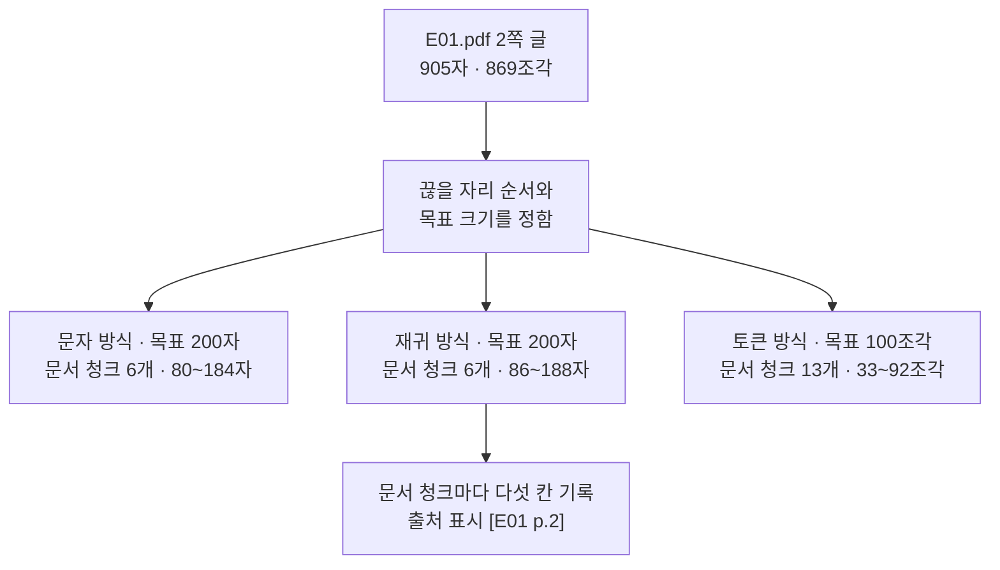
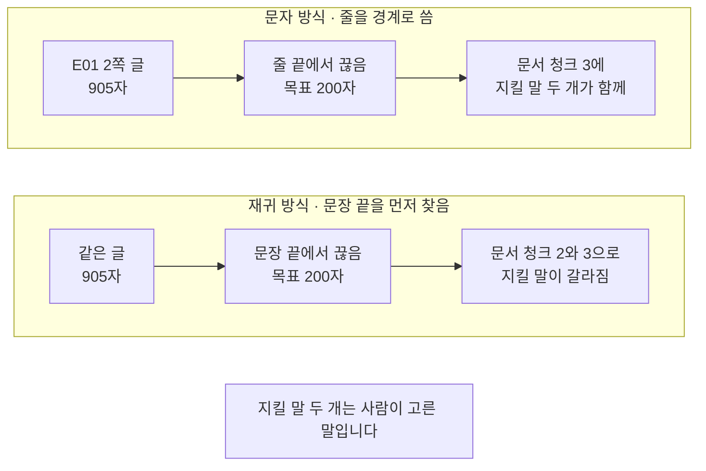
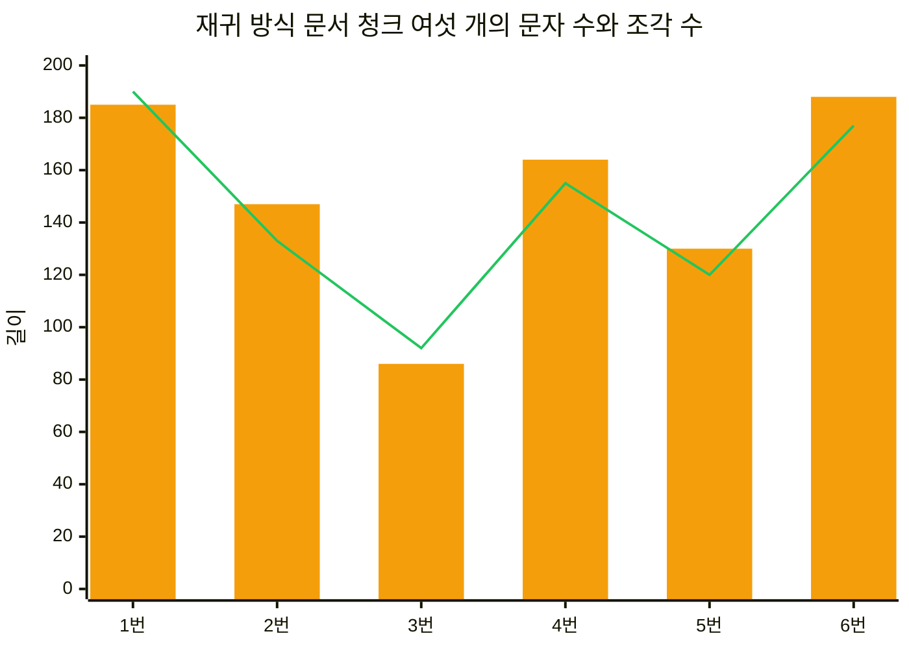
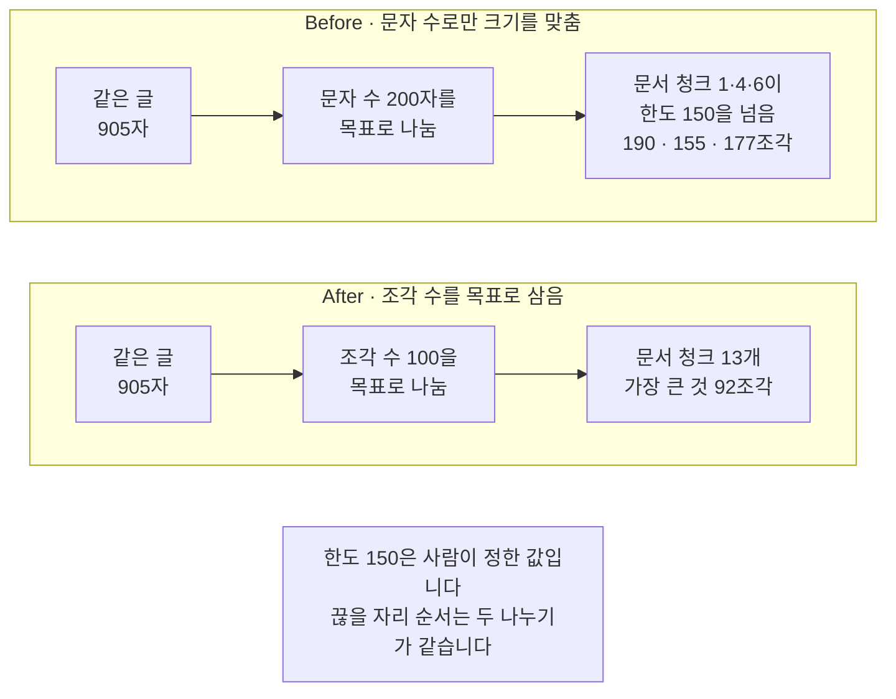

# 05-문자-재귀-토큰-청킹

## _src 본문 (HTML 원본)

```html
<!--meta: 강의 1h | 실습 2h | 코드 05-문자-재귀-토큰-청킹.ipynb | 새 용어 4 -->

<h2 id="b1"><span class="no">1</span>학습 목표</h2>
<div class="goal"><ul>
<li>이 절을 마치면 같은 글을 문자 방식과 재귀 방식으로 나누고 끊은 자리를 견줄 수 있습니다.</li>
<li>이 절을 마치면 끊을 자리 순서만 바꿔 문서 청크가 달라지는 것을 확인할 수 있습니다.</li>
<li>이 절을 마치면 <code>split_documents()</code>로 문서 청크마다 다섯 칸 출처 기록이 따라가게 만들 수 있습니다.</li>
<li>이 절을 마치면 문서 청크의 조각 수를 세어 정한 한도와 견주고 토큰 방식으로 다시 나눌 수 있습니다.</li>
</ul></div>

<h2 id="b2"><span class="no">2</span>이 내용을 배우는 이유</h2>
<p>01~04절에서 형식 다섯 가지를 읽었습니다. 읽어 낸 결과는 쪽 하나나 파일 하나만큼 깁니다. 검색은 이렇게 긴 글을 그대로 쓰지 않습니다.</p>
<p>그래서 글을 작은 문서 청크로 나눕니다. Ch 9 02절에서 한 번 해 보았습니다. 그때는 크기와 겹침을 정해 넘겼습니다.</p>
<p>이 절은 한 걸음 앞을 봅니다. 무엇을 길이로 세는지, 어디에서 끊을지 정한 순서가 무엇인지를 봅니다. 같은 글이라도 이 두 가지를 바꾸면 문서 청크의 수와 길이가 달라집니다.</p>
<p>나눈 자리는 검색과 답에 그대로 남습니다. 함께 읽어야 할 두 문장이 다른 문서 청크로 갈라지면 한쪽만 검색될 수 있습니다. 반대로 문서 청크가 너무 크면 모델에 넣을 자리를 많이 차지합니다.</p>
<p>이 절은 어느 방식이 낫다고 정하지 않습니다. 같은 글 한 쪽을 세 기준으로 나누고 무엇이 달라지는지 출력으로 확인합니다. 읽는 파일은 01·02절과 같은 <code>E01.pdf</code> 2쪽입니다.</p>

<h2 id="b3"><span class="no">3</span>앞에서 배운 내용</h2>
<ul>
<li><strong>조각</strong> — Ch 5에서 배운 말입니다. 모델이 글을 세는 단위이고 글자 수와 같지 않습니다.</li>
<li><strong>입력 가용분</strong> — Ch 8 01절에서 입력 예산을 조각 수로 나눠 두었습니다. 근거로 넣을 자리도 조각 수로 셉니다.</li>
<li><strong>문서 청크와 크기·겹침·끊을 자리 순서</strong> — Ch 9 02절 말입니다. 그 절에서 <code>RecursiveCharacterTextSplitter</code>에 크기 500과 겹침 50을 주고 <code>split_documents()</code>를 불렀습니다.</li>
<li><strong>조각 세기</strong> — Ch 9 02절에서 임베딩 모델 이름으로 규칙 이름 <code>cl100k_base</code>를 얻고, Ch 8 01절 <code>count_tokens()</code>로 조각 수를 셌습니다.</li>
<li><strong>지킬 말</strong> — Ch 8 03절에서 정한 말입니다. 사람이 원문에서 고른 꼭 남길 말입니다.</li>
<li><strong>다섯 칸 출처 기록과 출처 표시</strong> — 01절에서 정했습니다. 함수 <code>make_source_record()</code>가 기록을 만들고 <code>make_source_mark()</code>가 <code>[E01 p.2]</code>를 만듭니다.</li>
<li><strong>E01.pdf 2쪽 글</strong> — 01절에서 pypdf 기본 읽기로 얻은 905자입니다. 낱말 사이에 빈칸이 끼어든 자리가 있습니다.</li>
</ul>
<p>노트북은 Ch 8 01·03절 <code>count_tokens()</code>·<code>find_missing_words()</code>와 Ch 9 02·03절 <code>load_pdf_pages()</code>·<code>make_source_mark()</code>를 도구 파일 <code>rag_tools.py</code>에서 가져옵니다. 01절 <code>make_source_record()</code>도 가져옵니다. 함수 <code>count_tokens()</code>는 조각 세는 규칙 객체를 첫 인자로 받습니다.</p>

<h2 id="b4"><span class="no">4</span>핵심 개념</h2>
<h3>비유 — 같은 띠를 세 가지로 자르기</h3>
<p>긴 종이 띠 한 장에 안내문을 적어 두었다고 생각해 보세요. 이 띠를 카드 크기로 잘라 보관하려고 합니다.</p>
<p>첫 번째 사람은 접힌 줄마다 가위를 넣습니다. 그러면 도막 폭이 서로 비슷해집니다. 두 번째 사람은 문장이 끝나는 자리를 찾아 자릅니다. 문장 길이가 다르니 도막 폭이 들쭉날쭉해집니다.</p>
<p>세 번째 사람은 길이를 글자로 세지 않습니다. 모델이 쓰는 단위로 세어 그 수가 차면 자릅니다. 같은 띠인데 도막이 더 많아집니다.</p>
{{img:05-5-세-줄로-자른-띠|평면 그림으로 맨 위에 자르지 않은 긴 크림색 종이 띠 한 장이 있고 그 아래 세 줄에 같은 띠를 자른 도막이 놓여 있으며 첫 줄은 폭이 거의 같은 도막 다섯 개이고 가운데 줄은 폭이 뚜렷하게 다른 도막 다섯 개로 도막마다 작은 회색 점이 하나 있으며 아래 줄은 폭이 좁은 도막이 가장 많고 왼쪽에는 벌어진 가위 하나가 놓여 있음|같은 띠인데 첫 줄은 폭이 고르고 가운데 줄은 들쭉날쭉하며 아래 줄은 도막이 가장 많습니다}}
<p><strong>그림 읽기</strong> — 맨 위 자르지 않은 띠부터 보고 아래로 내려옵니다. 첫 줄 도막 다섯 개는 폭이 거의 같습니다. 가운데 줄 도막 다섯 개는 폭이 뚜렷하게 다르고 도막마다 작은 회색 점이 하나 있습니다. 점은 문장이 끝난 자리를 뜻합니다. 왼쪽 가위로 세 줄을 모두 잘랐고 아래 줄은 도막이 가장 많습니다.</p>
<p>도막 수는 여섯·여섯·열셋이라는 실제 결과와 맞추지 않았습니다. 폭이 고른지와 몇 갈래로 갈리는지만 보세요.</p>

<h3>이 절에서 쓰는 말</h3>
<table><thead><tr><th>용어</th><th>뜻과 일상 예</th><th>이 절에서 보이는 모습</th></tr></thead><tbody>
<tr><td>문자 방식(character splitter)</td><td>경계 하나만 쓰고 길이를 문자 수로 세는 나누기. 접힌 줄마다 자르는 것과 같음</td><td>노트북 3절 <code>문자 방식 문서 청크 수: 6</code></td></tr>
<tr><td>재귀 방식(recursive splitter)</td><td>끊을 자리 후보를 여러 개 두고 앞에서부터 차례로 시도하는 나누기. 문단이 안 되면 문장, 문장이 안 되면 낱말로 내려감</td><td>노트북 4절 <code>끊을 자리 순서:</code> 줄과 문서 청크 여섯 개</td></tr>
<tr><td>토큰 방식(token splitter)</td><td>목표 크기를 문자 수가 아니라 조각 수로 재는 나누기. 모델이 세는 단위로 자를 자리를 정함</td><td>노트북 10절 <code>토큰 방식 문서 청크 수: 13</code></td></tr>
<tr><td>조각 수 한도</td><td>문서 청크 하나에 허용하는 조각 수의 상한. 사람이 예산을 나눠 정한 값</td><td>노트북 9절 <code>문서 청크 하나의 조각 수 한도: 150</code></td></tr>
</tbody></table>
<p>파서·파일 형식·출처 기록·출처 계보는 01절과 같은 뜻입니다. 글자 층·표 읽기는 02절, 문단·태그·자리 칸은 03절, 형식 표시·압축 묶음은 04절과 같은 뜻입니다. 문서 청크·크기·겹침·끊을 자리 순서는 Ch 9에서 정한 뜻 그대로입니다. 메타데이터·출처 표시도 같습니다. 「조각」은 Ch 5 토큰 뜻입니다.</p>

<h3>도식 — 같은 글을 세 기준으로 나눕니다</h3>
{{mermaid:05-1-세-기준|초록 상자 E01.pdf 2쪽 글 905자 869조각에서 파란 상자 끊을 자리 순서와 목표 크기를 정함으로 내려온 뒤 노란 상자 세 개 문자 방식 목표 200자 문서 청크 6개 80에서 184자와 재귀 방식 목표 200자 문서 청크 6개 86에서 188자와 토큰 방식 목표 100조각 문서 청크 13개 33에서 92조각으로 갈라지고 가운데 노란 상자 아래에 초록 상자 문서 청크마다 다섯 칸 기록 출처 표시 대괄호 E01 p.2가 이어지는 흐름도|같은 글 한 쪽을 세 기준으로 나누면 문서 청크 수가 6개·6개·13개로 달라집니다}}
<p><strong>도식 읽기</strong> — 위에서 아래로 봅니다. 맨 위 초록 상자가 이 절이 나눌 글입니다. 01절에서 읽은 905자이고 조각으로 세면 869입니다.</p>
<p>그 아래 파란 상자가 사람이 설정을 정하는 단계입니다. 거기서 길이 세 갈래로 갈라집니다. 노란 상자 세 개가 노트북 3·4·10절 출력으로 확인한 결과입니다.</p>
<p>가운데 갈래 아래 초록 상자만 기록을 붙인 자리입니다. 노트북 6절에서 재귀 방식 결과에 다섯 칸 기록을 붙였습니다. 나머지 두 갈래에는 이번에 기록을 붙이지 않았습니다.</p>

<h3>세 기준이 무엇을 세는가</h3>
<p>아래 표는 노트북 3·4·10절 출력을 방식별로 모은 것입니다. 셋째 열이 사람이 정한 목표 크기입니다.</p>
<table>
<tr><th>방식</th><th>길이로 세는 것</th><th>목표 크기</th><th>문서 청크 수</th><th>가장 긴 문서 청크</th></tr>
<tr><td>문자 방식</td><td>문자 수</td><td>200자</td><td>6개</td><td>184자</td></tr>
<tr><td>재귀 방식</td><td>문자 수</td><td>200자</td><td>6개</td><td>188자</td></tr>
<tr><td>토큰 방식</td><td>조각 수</td><td>100조각</td><td>13개</td><td>92조각</td></tr>
</table>
<p>세 방식 모두 목표 크기를 사람이 정합니다. 목표 크기는 말 그대로 목표입니다. 스플리터가 끊어 낸 단위 하나가 목표보다 길면 문서 청크가 그 값을 넘습니다.</p>
<p>겹침은 세 방식 모두 0으로 두었습니다. Ch 9 02절에서는 겹침 50을 주었습니다. 이 절은 끊은 자리만 보려고 겹침을 빼 두었습니다.</p>

<h2 id="b5"><span class="no">5</span>실행 예제</h2>
<p>내려받은 실습 폴더에서 노트북을 열고 위에서 아래로 실행합니다. API 키는 필요하지 않고 모델과 임베딩에 요청을 한 번도 보내지 않습니다. 조각을 세는 규칙 파일만 처음 실행할 때 한 번 내려받습니다.</p>
<p>이 페이지의 출력은 2026-09-21에 실행한 결과입니다. 모델을 부르지 않으므로 같은 판에서 다시 실행해도 같은 값이 나왔습니다. 새 커널로 두 번 실행해 코드 셀 스무 개의 출력이 모두 같은 것을 확인했습니다.</p>
<p>강의 시간에는 노트북 2~5절을 설명합니다. 나눌 글 얻기, 문자 방식, 재귀 방식, 두 방식이 끊은 자리 견주기입니다. 6~8절 출처 기록·조각 수 세기·값 바꿔 보기, 9~10절 Before·After는 함께 실행하고 실습 시간에 다시 읽습니다.</p>
{{mermaid:05-2-끊는-자리|위 칸 문자 방식 줄을 경계로 씀에 초록 상자 E01 2쪽 글 905자와 파란 상자 줄 끝에서 끊음 목표 200자와 노란 상자 문서 청크 3에 지킬 말 두 개가 함께가 왼쪽에서 오른쪽으로 있고 아래 칸 재귀 방식 문장 끝을 먼저 찾음에 초록 상자 같은 글 905자와 파란 상자 문장 끝에서 끊음 목표 200자와 노란 상자 문서 청크 2와 3으로 지킬 말이 갈라짐이 같은 방향으로 있으며 맨 아래에 회색 상자 지킬 말 두 개는 사람이 고른 말입니다가 있는 비교 흐름도|줄을 경계로 쓴 쪽은 지킬 말 두 개가 한 문서 청크에 있고 문장 끝을 먼저 찾은 쪽은 갈라집니다}}
<p><strong>도식 읽기</strong> — 위 칸이 문자 방식, 아래 칸이 재귀 방식이고 칸마다 왼쪽에서 오른쪽으로 봅니다. 두 칸의 초록 상자는 같은 글입니다. 목표 크기도 200자로 같습니다.</p>
<p>칸마다 파란 상자가 다릅니다. 위 칸은 줄을 경계로 썼고 아래 칸은 문장 끝을 먼저 찾았습니다. 그 차이가 오른쪽 노란 상자로 나타납니다.</p>
<p>위 칸에서는 지킬 말 두 개가 셋째 문서 청크에 함께 있었습니다. 아래 칸에서는 둘째와 셋째 문서 청크로 갈라졌습니다. 맨 아래 회색 상자는 두 칸에 모두 해당합니다. 지킬 말은 사람이 고른 말이고 기계가 찾아 준 값이 아닙니다.</p>
<p>두 말은 Ch 9 05절 정답 출처와 같은 휴관 안내에서 골랐습니다. 다른 질문을 쓰면 지킬 말도 다시 고릅니다.</p>
{{mermaid:05-3-문자-수와-조각-수|문서 청크 1번부터 6번까지의 문자 수를 주황 막대로 185와 147과 86과 164와 130과 188로 그리고 같은 번호의 조각 수를 초록 선으로 190과 133과 92와 155와 120과 177로 겹쳐 그린 막대 차트|주황 막대는 문자 수, 초록 선은 조각 수입니다. 1번은 185자에 190조각이고 3번은 86자에 92조각입니다}}
<p><strong>도식 읽기</strong> — 왼쪽에서 오른쪽으로 문서 청크 번호 순서로 봅니다. 주황 막대가 문자 수이고 초록 선이 조각 수입니다. 두 값은 노트북 4·7절 출력에서 가져왔습니다.</p>
<p>1번을 보세요. 막대는 185인데 선은 그보다 위에 있습니다. 조각 수가 190이기 때문입니다. 3번도 막대 86에 선 92로 선이 더 높습니다.</p>
<p>번호마다 막대와 선이 어긋나는 폭이 다릅니다. 문자 수를 목표에 맞춰도 조각 수는 문서 청크마다 다르게 나온다는 뜻입니다. 두 값은 같은 단위가 아닙니다.</p>
{{notebook:05-문자-재귀-토큰-청킹|example}}

<h2 id="b6"><span class="no">6</span>일부러 실패해 보기</h2>
<p>검색한 문서 청크는 모델에 근거로 넣습니다. Ch 8에서 입력 예산을 조각 수로 나눈 것처럼 근거 자리도 조각 수로 셉니다. 이 절에서는 근거 세 개에 450조각을 주기로 정했습니다. Ch 8 01절 예산(가용분 440)과는 다른 값이고, 한도를 예산에서 나누는 방법만 같습니다. 그렇게 정하면 문서 청크 하나는 150조각까지입니다.</p>
<p>Before 셀은 「문자 수를 200자로 맞췄으니 조각 수도 한도 안일 것」이라고 보는 자리입니다. After 셀은 목표 크기를 조각 수로 재는 스플리터를 만들어 같은 글을 다시 나눕니다. 끊을 자리 순서는 두 나누기가 같습니다.</p>
{{mermaid:05-4-조각-수-한도|위 칸 Before 문자 수로만 크기를 맞춤에 초록 상자 같은 글 905자와 파란 상자 문자 수 200자를 목표로 나눔과 빨간 상자 문서 청크 1과 4와 6이 한도 150을 넘음 190과 155와 177조각이 왼쪽에서 오른쪽으로 있고 아래 칸 After 조각 수를 목표로 삼음에 초록 상자 같은 글 905자와 파란 상자 조각 수 100을 목표로 나눔과 노란 상자 문서 청크 13개 가장 큰 것 92조각이 같은 방향으로 있으며 맨 아래에 회색 상자 한도 150은 사람이 정한 값입니다 끊을 자리 순서는 두 나누기가 같습니다가 있는 비교 흐름도|Before는 문서 청크 세 개가 한도 150을 넘고 After는 가장 큰 것이 92조각입니다}}
<p><strong>도식 읽기</strong> — 위 칸이 Before, 아래 칸이 After이고 칸마다 왼쪽에서 오른쪽으로 봅니다. 위 칸의 빨간 상자가 Before 결과입니다. 노트북 9절 출력 <code>한도를 넘은 문서 청크 번호: [1, 4, 6]</code>이 그것입니다.</p>
<p>아래 칸의 노란 상자가 After 결과입니다. 문서 청크가 열세 개로 늘고 가장 큰 것이 92조각이었습니다. 한도를 넘은 번호는 빈 목록이었습니다.</p>
<p>맨 아래 회색 상자는 두 나누기에 모두 해당합니다. 한도 150은 사람이 정한 값이고 재어 얻은 값이 아닙니다. 끊을 자리 순서도 두 나누기가 같아서 달라진 것은 길이를 세는 기준 하나입니다.</p>
{{notebook:05-문자-재귀-토큰-청킹|failure}}

<h2 id="b7"><span class="no">7</span>주의할 점과 실무 메모</h2>
<ul>
<li><strong>조각 수 한도 150은 사람이 정한 값입니다.</strong> 탐색 실행에서 문서 청크의 조각 수가 92에서 190 사이로 나오는 것을 먼저 보았습니다. 그 사이의 값이면서 근거 세 개에 450조각을 주는 계산과 맞는 150을 골랐습니다. 그 450은 Ch 8 01절 가용분 440과 다른 값입니다. 이 절의 흐름을 보여 주려고 정한 예이므로 실제 설정에서는 예산과 근거 개수를 먼저 정하고 그 값에서 한도를 나눠 적습니다.</li>
<li><strong>목표 크기는 목표일 뿐입니다.</strong> 설치판 소스에서 확인한 동작은 이렇습니다. 스플리터가 끊어 낸 단위 하나가 목표보다 길면 경고를 적고 그 단위를 그대로 문서 청크로 둡니다. 이번 실행에서는 그런 단위가 없어 경고가 나오지 않았습니다. 그래서 실제 길이를 늘 출력해 확인합니다.</li>
<li><strong>끊을 자리 순서는 문서마다 다시 봅니다.</strong> 이 글에는 빈 줄이 없어서 첫 후보가 쓰이지 않았습니다. 실습 폴더 모듈은 그 순서에 한국어 종결 어미 표시를 하나 더 넣어 두었습니다. 우리말 문장이 「다」로 끝나는 일이 많기 때문입니다. 노트북 순서와 달라서 결과도 다를 수 있습니다.</li>
<li><strong>같은 이름이 다른 모양일 수 있습니다.</strong> 실습 폴더 <code>document_processing.py</code>의 <code>split_char()</code>는 구분자를 쓰지 않고 문자 수로 글을 그대로 자릅니다. 노트북이 쓴 <code>CharacterTextSplitter</code>는 경계 하나로 나눈 뒤 목표 크기까지 합칩니다. 이름은 비슷하지만 끊는 자리가 다릅니다. 같은 파일의 <code>split_recursive()</code>·<code>split_token()</code>은 노트북과 같은 클래스를 씁니다.</li>
<li><strong>문서 청크에 이름을 붙이는 일은 이 절에서 하지 않았습니다.</strong> 노트북 6절에서 여섯 문서 청크의 출처 표시가 모두 <code>[E01 p.2]</code>였습니다. 쪽 안에서 몇 번째인지는 그 기록에 없습니다. 실습 폴더 모듈은 문서 청크마다 <code>chunk_id</code> 칸을 붙이고 값은 <code>E01:page2:recursive:0</code> 모양입니다. 08절도 같은 칸 이름을 쓰지만 값은 <code>ch10:recursive:0000</code>처럼 절 안에서 직접 만듭니다.</li>
<li><strong>조각을 센 규칙 이름을 설정에 적어 둡니다.</strong> 이 절은 <code>cl100k_base</code>로 셌습니다. Ch 8에서는 생성 모델 쪽 규칙 이름이 <code>o200k_base</code>였습니다. 규칙이 다르면 같은 글의 조각 수도 달라집니다. 어느 모델의 한도를 지키려는 것인지와 함께 적습니다.</li>
<li><strong>표가 든 쪽은 표 읽기 결과로 나누는 길이 따로 있습니다.</strong> 이 절은 pypdf 기본 읽기 글 하나를 나눴습니다. 그 글에는 02절에서 표 읽기로 얻은 행 단위 구분이 없습니다. 02절 <code>make_row_text()</code>로 만든 행 글을 문서 청크로 그대로 쓰는 길은 이번에 실행하지 않았습니다.</li>
<li><strong>이번에 실행하지 않은 것을 적어 둡니다.</strong> 겹침을 준 나누기, 여러 쪽과 여러 문서를 한 번에 나누기, 나눈 결과로 검색해 견주기입니다. 어느 기준이 검색에 더 나은지는 재지 않았습니다. 그 비교는 색인을 만든 뒤에 할 수 있습니다.</li>
</ul>

<h2 id="b8"><span class="no">8</span>정리와 다음 절</h2>
<ul>
<li>문자 방식과 재귀 방식은 길이를 문자 수로 세고 토큰 방식은 조각 수로 셉니다.</li>
<li>같은 글 905자를 목표 200자로 나누니 두 방식 모두 문서 청크가 여섯 개였고 길이는 <code>[156, 156, 184, 172, 152, 80]</code>과 <code>[185, 147, 86, 164, 130, 188]</code>이었습니다.</li>
<li>지킬 말 두 개가 함께 든 문서 청크는 문자 방식에 하나 있었고 재귀 방식에는 없었습니다. 문장 끝을 먼저 찾아도 이어 읽을 두 문장이 갈라질 수 있습니다.</li>
<li>끊을 자리 순서만 줄 우선으로 바꾸자 재귀 방식 결과가 문자 방식 결과와 같았습니다. 이 글에 빈 줄이 없었기 때문입니다.</li>
<li>메서드 <code>split_documents()</code>로 나누면 다섯 칸 출처 기록이 문서 청크마다 따라왔고 표시는 모두 <code>[E01 p.2]</code>였습니다.</li>
<li>재귀 방식 문서 청크의 조각 수는 <code>[190, 133, 92, 155, 120, 177]</code>이라 한도 150을 셋이 넘었습니다. 토큰 방식으로 다시 나누니 열세 개 모두 한도 안이었습니다.</li>
</ul>
<p><strong>다음 학습과 이어지는 지점</strong> — 06절에서는 길이가 아니라 글의 구조와 뜻으로 끊는 자리를 정합니다. 제목 표시가 바뀌는 자리에서 나누고, 문장 사이의 거리로 나누는 방법을 견줍니다. 그때도 이 절에서 본 대로 나눈 결과의 수와 길이를 함께 확인합니다.</p>
<p>06절부터 임베딩을 부릅니다. 07·08절은 나눈 문서 청크를 임베딩해 색인하고 검색 결과를 견줍니다. 그 자리에서 이 절의 목표 크기와 끊을 자리 순서가 실험 설정으로 다시 나옵니다. 조각 수는 임베딩 비용과 모델에 넣을 자리를 함께 정하는 값입니다.</p>

<h2 id="b9"><span class="no">9</span>복습 문제</h2>
<details class="quiz" open><summary>문제 4개 · 해설 포함</summary>
<p class="quiz-q">1. [하] 문자 방식과 토큰 방식은 각각 무엇을 길이로 세나요?</p>
<p class="quiz-a">문자 방식은 문자 수를 세고 토큰 방식은 조각 수를 셉니다. 노트북 3절에서는 목표 200자로 나눠 <code>문서 청크별 문자 수: [156, 156, 184, 172, 152, 80]</code>을 얻었고, 10절에서는 목표 100조각으로 나눠 문서 청크 열세 개를 얻었습니다.</p>
<p class="quiz-q">2. [중] 끊을 자리 순서만 바꿨는데 재귀 방식 결과가 문자 방식 결과와 같았습니다. 까닭은 무엇입니까?</p>
<p class="quiz-a">이 글에 빈 줄이 없고 줄을 문장 끝보다 앞에 두었기 때문입니다. 첫 후보인 빈 줄은 쓰이지 않고 줄이 첫 경계가 되어 문자 방식과 같은 자리에서 끊었습니다. 다른 글에서도 두 방식이 늘 같은지는 이번에 실행하지 않았습니다.</p>
<p class="quiz-q">3. [중] 문자 수를 목표 200자 안으로 맞췄는데 조각 수 한도 150을 넘은 문서 청크가 있었습니다. 어떻게 된 일입니까?</p>
<p class="quiz-a">문자 수와 조각 수는 같은 단위가 아닙니다. 노트북 7절 출력에서 첫 문서 청크는 185자인데 조각 수가 190이었습니다. 모델 한도를 지켜야 하면 문자 수가 아니라 조각 수를 세어 확인합니다.</p>
<p class="quiz-q">4. [상] 지킬 말 두 개가 재귀 방식에서 갈라졌습니다. 이 결과로 「문자 방식이 더 좋다」고 적어도 됩니까?</p>
<p class="quiz-a">적을 수 없습니다. 글 한 쪽, 목표 크기 하나, 지킬 말 두 개로 한 번 본 결과입니다. 문서와 질문을 여럿 두고 검색까지 돌려 견줘야 방식을 고를 수 있습니다. 이 절에서는 검색을 돌리지 않았습니다.</p>
</details>

<h2 id="b10"><span class="no">10</span>참고 자료</h2>
<ul>
<li><div><a href="https://docs.langchain.com/oss/python/integrations/splitters/recursive_text_splitter">LangChain 공식 문서 Splitting recursively</a></div>확인 2026-09-18 · 끊을 자리 순서 기본값 <code>["\n\n", "\n", " ", ""]</code>과 크기·겹침 인자 참고.</li>
<li><div><a href="https://reference.langchain.com/python/langchain_text_splitters/">LangChain 공식 API langchain-text-splitters</a></div>확인 2026-09-18 · <code>CharacterTextSplitter</code>와 <code>RecursiveCharacterTextSplitter</code> 클래스 목록 참고.</li>
<li><div><a href="https://github.com/openai/tiktoken">tiktoken 저장소 README</a></div>확인 2026-09-18 · <code>get_encoding("cl100k_base")</code>와 규칙 이름 <code>o200k_base</code> 참고.</li>
<li><div><a href="https://reference.langchain.com/python/langchain-core/documents">LangChain 공식 API Document</a></div>확인 2026-09-18 · <code>page_content</code>와 <code>metadata</code> 구조 참고.</li>
<li>기준 버전은 Python 3.12.13과 pypdf 6.18.0, langchain-core 1.6.2입니다. 나누는 도구는 langchain-text-splitters 1.1.2, 조각을 세는 도구는 tiktoken 0.14.0입니다. 나누기 동작은 이 판의 소스에서 확인했습니다.</li>
</ul>
```

## 노트북 셀 (순서대로)

### [0] markdown {'html': 'skip'}

# 문자, 재귀, 토큰 청킹

**이 노트북에서 할 일**

1. 01절에서 읽은 E01.pdf 2쪽 글을 문자 방식과 재귀 방식으로 나눕니다.
2. 두 방식이 끊은 자리를 견주고 문서 청크마다 출처 기록을 붙입니다.
3. 문서 청크의 조각 수를 세어 정한 한도와 견주고 토큰 방식으로 다시 나눕니다.

**준비물** — API 키가 필요 없습니다. 모델과 임베딩에는 요청을 한 번도 보내지 않습니다.
그래서 예상 비용은 0달러입니다.
조각을 세는 규칙 파일은 처음 실행할 때 한 번 내려받고 그다음부터 저장된 파일을 씁니다.
실행 시간은 패키지 설치를 빼면 10초 안팎입니다.

데이터는 01·02절과 같은 파일 하나입니다.
폴더 `labs/data/rag-corpus/pdf/easy/`의 `E01.pdf` 2쪽입니다.
Ch 9와 이 챕터 01·02절이 읽은 미르시립도서관 이용 안내 문서입니다.

**강의와 실습 범위** — 강의 시간에는 2~5절을 설명합니다.
나눌 글 얻기, 문자 방식, 재귀 방식, 두 방식이 끊은 자리 견주기입니다.
6~8절 출처 기록·조각 수 세기·값 바꿔 보기, 9~10절 Before·After는 함께 실행하고 실습 시간에 다시 읽습니다.

**기준 버전** — 실습 폴더에 고정한 패키지 판을 씁니다.
pypdf 6.18.0과 langchain-core 1.6.2를 씁니다.
나누는 도구는 langchain-text-splitters 1.1.2이고 조각을 세는 도구는 tiktoken 0.14.0입니다.
교재 출력은 Linux의 Python 3.12.13으로 만들었습니다.
다른 버전과 Windows·macOS에서는 이번에 실행하지 않았습니다.

실습 폴더 `labs/part3/ch10-document-processing`에서 `uv sync --locked`를 실행합니다.
그다음 이 폴더의 `.venv` 커널을 고르고 첫 셀부터 순서대로 실행합니다.

### [1] markdown {'html': 'skip'}

## 오늘 볼 그림


위에서 아래로 봅니다. 파란 상자에서 길이 세 갈래로 갈라집니다.
갈래마다 노란 상자에 문서 청크 수와 길이가 적혀 있습니다.
가운데 갈래 아래 초록 상자는 문서 청크마다 출처 기록을 붙인 자리입니다.

### [2] markdown {}

## 1. 준비

첫 셀은 패키지를 설치하고 설치된 버전을 출력합니다. 설치에는 몇십 초가 걸릴 수 있습니다.
이 절에서는 PDF를 읽는 도구와 나누는 도구, 조각을 세는 도구를 함께 설치합니다.

### [3] code {'execution': {'iopub.execute_input': '2026-09-21T06:25:37.241167Z', 'iopub.status.busy': '2026-09-21T06:25:37.241016Z', 'iopub.status.idle': '2026-09-21T06:25:37.696844Z', 'shell.execute_reply': '2026-09-21T06:25:37.696415Z'}, 'lesson_role': 'setup'}

```python
# 이 절에서 쓰는 패키지를 설치하고 버전을 확인합니다
%pip install -q "pypdf==6.18.0" "langchain-core==1.6.2" "langchain-text-splitters==1.1.2" "tiktoken==0.14.0"
from importlib.metadata import version

print("pypdf:", version("pypdf"))
print("langchain-core:", version("langchain-core"))
print("langchain-text-splitters:", version("langchain-text-splitters"))
print("tiktoken:", version("tiktoken"))
```

출력:
```
Note: you may need to restart the kernel to use updated packages.
pypdf: 6.18.0
langchain-core: 1.6.2
langchain-text-splitters: 1.1.2
tiktoken: 0.14.0

```

### [4] markdown {}

**결과 읽기** — 출력 네 줄은 `pypdf: 6.18.0`, `langchain-core: 1.6.2`,
`langchain-text-splitters: 1.1.2`, `tiktoken: 0.14.0`입니다.
준비물에 적은 기준 버전과 같습니다.

다음 셀은 이 절에서 쓸 이름을 불러옵니다.
이름 `CharacterTextSplitter`와 `RecursiveCharacterTextSplitter`가 글을 나누는 도구입니다.
이름 `tiktoken`은 Ch 5에서 배운 조각을 세는 도구입니다.

앞에서 배운 함수는 `rag_tools.py`에 모아 두었습니다. 파일을 열면 코드를 볼 수 있습니다. 노트북과 같은 폴더(`notebooks/`)에 있는 파일입니다.
이 노트북은 Ch 8 01·03절 `count_tokens()`·`find_missing_words()`와 Ch 9 02·03절 `load_pdf_pages()`·`make_source_mark()`를 가져옵니다.
01절 `make_source_record()`도 가져옵니다.

함수 `count_tokens()`는 Ch 9 도구 파일 판처럼 조각 세는 규칙 객체를 첫 인자로 받습니다.

### [5] code {'execution': {'iopub.execute_input': '2026-09-21T06:25:37.698060Z', 'iopub.status.busy': '2026-09-21T06:25:37.697963Z', 'iopub.status.idle': '2026-09-21T06:25:37.999760Z', 'shell.execute_reply': '2026-09-21T06:25:37.999432Z'}, 'lesson_role': 'setup'}

```python
# 문서 객체·나누기 도구·조각 세기에 쓸 이름을 불러옵니다
import os

from langchain_core.documents import Document
from langchain_text_splitters import CharacterTextSplitter
from langchain_text_splitters import RecursiveCharacterTextSplitter
import tiktoken
# Ch 8 01·03절, Ch 9 02·03절, 01절 함수 다섯 개를 도구 파일에서 가져옵니다
from rag_tools import count_tokens, find_missing_words, load_pdf_pages
from rag_tools import make_source_mark, make_source_record
```

출력:
```

```

### [6] markdown {}

## 2. 나눌 글 얻기

01~04절과 같은 방법으로 프로젝트 맨 위 경로를 고릅니다.
후보 세 개를 차례로 확인하고, 있는 경로에서 멈춥니다.
찾는 폴더는 01·02절과 같은 문서 모음 폴더입니다.

실행 전에 예상합니다. 프로젝트 맨 위에서 열었다면 첫째 후보를 고를 것입니다.

### [7] code {'execution': {'iopub.execute_input': '2026-09-21T06:25:38.000698Z', 'iopub.status.busy': '2026-09-21T06:25:38.000594Z', 'iopub.status.idle': '2026-09-21T06:25:38.002779Z', 'shell.execute_reply': '2026-09-21T06:25:38.002398Z'}}

```python
# 작업 폴더에서 본 프로젝트 맨 위 경로를 후보 세 개 가운데에서 고릅니다
candidates = [".", "../../..", "../../../.."]
root_path = None
for candidate in candidates:
    if os.path.exists(candidate + "/labs/data/rag-corpus"):
        root_path = candidate
        break
print("고른 경로:", root_path)
assert root_path is not None, "notebooks 폴더나 실습 폴더 맨 위에서 노트북을 열어 주세요."
```

출력:
```
고른 경로: .

```

### [8] markdown {}

**결과 읽기** — 출력 줄은 `고른 경로: .`입니다. `assert`도 통과했습니다.
교재 출력은 프로젝트 맨 위를 작업 폴더로 삼아 실행해서 첫째 후보를 골랐습니다.

준비 셀에서 가져온 Ch 9 02절 로더 함수 `load_pdf_pages()`는 PDF 경로와 문서 이름을 받아 쪽마다 `Document` 하나를 만듭니다.

다음 셀은 이 함수로 E01.pdf를 읽고 2쪽 본문을 나눌 글로 삼습니다.
목록 `pages`의 자리 1이 2쪽인 까닭은 로더가 쪽 번호를 1부터 세어 적기 때문입니다.
표시 `"\n"`은 줄바꿈 한 개를 뜻하는 글입니다. 메서드 `split("\n")`은 그 표시마다 글을 잘라 목록으로 만듭니다.

### [9] code {'execution': {'iopub.execute_input': '2026-09-21T06:25:38.003357Z', 'iopub.status.busy': '2026-09-21T06:25:38.003308Z', 'iopub.status.idle': '2026-09-21T06:25:38.034617Z', 'shell.execute_reply': '2026-09-21T06:25:38.034312Z'}}

```python
# E01.pdf를 쪽마다 읽고 2쪽 본문을 이 절에서 나눌 글로 삼습니다
corpus_path = root_path + "/labs/data/rag-corpus"
pdf_path = corpus_path + "/pdf/easy/E01.pdf"
pages = load_pdf_pages(pdf_path, "E01")
plain_text = pages[1].page_content
text_lines = plain_text.split("\n")
print("나눌 글의 글자 수:", len(plain_text))
print("나눌 글의 줄 수:", len(text_lines))
print("빈 줄이 있는가:", "\n\n" in plain_text)
```

출력:
```
나눌 글의 글자 수: 905
나눌 글의 줄 수: 26
빈 줄이 있는가: False

```

### [10] markdown {}

**결과 읽기** — 출력 첫 줄은 `나눌 글의 글자 수: 905`입니다.
다음 줄은 `나눌 글의 줄 수: 26`이고 01절에서 본 값과 같습니다.
마지막 줄 `빈 줄이 있는가: False`를 보세요. 이 글에는 빈 줄이 하나도 없습니다.

빈 줄은 문단이 바뀌는 자리에 흔히 놓입니다.
그런데 pypdf 기본 읽기는 빈 줄을 남기지 않았습니다.
4절에서 끊을 자리 순서를 정할 때 이 사실이 결과를 바꿉니다.

### [11] markdown {}

## 3. 문자 방식으로 나누기

**문자 방식**은 경계 하나만 쓰고 길이를 문자 수로 세는 나누기입니다.
클래스 `CharacterTextSplitter`가 그 방식을 맡습니다.
인자 `separator`에 경계 하나를 주고 `chunk_size`에 목표 크기를 줍니다.

메서드 `split_text(글)`을 부를 때 실제로 나뉩니다.
Ch 9 02절에서 쓴 `split_documents()`는 `Document` 목록을 받았고,
이 메서드는 글 하나를 받아 글 목록을 반환합니다.

겹침은 0으로 둡니다. 겹침은 Ch 9 02절에서 배웠고 이 절은 끊는 자리만 보기 때문입니다.
먼저 문서 청크의 길이를 모으는 함수를 만듭니다.

### [12] code {'execution': {'iopub.execute_input': '2026-09-21T06:25:38.035207Z', 'iopub.status.busy': '2026-09-21T06:25:38.035154Z', 'iopub.status.idle': '2026-09-21T06:25:38.036692Z', 'shell.execute_reply': '2026-09-21T06:25:38.036348Z'}}

```python
# 문서 청크 목록을 받아 문자 수를 순서대로 모아 반환합니다
def make_length_list(chunk_texts):
    lengths = []
    for chunk_text in chunk_texts:
        lengths.append(len(chunk_text))
    return lengths
```

출력:
```

```

### [13] markdown {}

**결과 읽기** — 이 셀은 함수를 만들기만 하므로 출력이 없습니다.

다음 셀은 줄바꿈 하나를 경계로 주어 목표 200자로 나눕니다.
줄 경계를 고른 까닭은 이 글에 빈 줄이 없기 때문입니다.

### [14] code {'execution': {'iopub.execute_input': '2026-09-21T06:25:38.037212Z', 'iopub.status.busy': '2026-09-21T06:25:38.037162Z', 'iopub.status.idle': '2026-09-21T06:25:38.039075Z', 'shell.execute_reply': '2026-09-21T06:25:38.038705Z'}}

```python
# 줄바꿈 하나를 경계로 삼아 목표 200자로 나누고 문서 청크의 문자 수를 봅니다
character_splitter = CharacterTextSplitter(
    separator="\n",
    chunk_size=200,
    chunk_overlap=0,
)
character_texts = character_splitter.split_text(plain_text)
character_lengths = make_length_list(character_texts)
print("문자 방식 문서 청크 수:", len(character_texts))
print("문서 청크별 문자 수:", character_lengths)
```

출력:
```
문자 방식 문서 청크 수: 6
문서 청크별 문자 수: [156, 156, 184, 172, 152, 80]

```

### [15] markdown {}

**결과 읽기** — 출력 첫 줄은 `문자 방식 문서 청크 수: 6`입니다.
다음 줄 `문서 청크별 문자 수: [156, 156, 184, 172, 152, 80]`이 길이입니다.
여섯 값 모두 목표 크기 안에 들어왔습니다.

마지막 값이 작은 까닭은 남은 글을 마지막 문서 청크에 담기 때문입니다.
목표 크기는 목표일 뿐입니다. 경계로 더 나눌 수 없는 줄이 목표보다 길면 문서 청크가 그 값을 넘습니다.
이번 글에는 그런 줄이 없었습니다.

### [16] code {'execution': {'iopub.execute_input': '2026-09-21T06:25:38.039621Z', 'iopub.status.busy': '2026-09-21T06:25:38.039576Z', 'iopub.status.idle': '2026-09-21T06:25:38.041236Z', 'shell.execute_reply': '2026-09-21T06:25:38.040936Z'}}

```python
# 셋째 문서 청크의 본문을 그대로 봅니다
print("문자 방식 셋째 문서 청크의 문자 수:", len(character_texts[2]))
print("문자 방식 셋째 문서 청크:")
print(character_texts[2])
```

출력:
```
문자 방식 셋째 문서 청크의 문자 수: 184
문자 방식 셋째 문서 청크:
매주 월요일은 정기 휴관일 입니다. 법정 공휴일에도 휴관하며, 공휴일이 월요일과 겹치면 그 다음 날인
화요일에도 휴관합니다.
어린이자료실(1층)은 요일과 관계없이 오후 6시에 문을 닫습니다. 디지털자료실(2층)은 오후 9시까지
이용할 수 있습니다.
구역 평일 주말 비고
종합자료실(2층) 09:00~22:00 09:00~18:00

```

### [17] markdown {}

**결과 읽기** — 출력 첫 줄은 `문자 방식 셋째 문서 청크의 문자 수: 184`입니다.
`문자 방식 셋째 문서 청크:` 라벨 줄 아래 여섯 줄이 그 본문입니다.
휴관 안내 두 문장이 함께 있고 그 뒤에 표 머리글과 첫 행이 이어집니다.

마지막 줄은 문장 가운데가 아니라 표의 한 행에서 끝났습니다.
줄을 경계로 썼으니 끊는 자리도 줄 끝 가운데 하나입니다.
01절에서 본 것처럼 기본 읽기는 낱말 사이에 빈칸을 끼워 넣기도 합니다.

### [18] markdown {}

## 4. 재귀 방식으로 나누기

**재귀 방식**은 끊을 자리 후보를 여러 개 두고 앞에서부터 차례로 시도하는 나누기입니다.
Ch 9 02절에서 배운 끊을 자리 순서가 그 후보 목록입니다.
큰 경계로 나눈 조각이 목표보다 길면 다음 후보로 내려갑니다.

이번에는 순서를 이름 `separator_order`에 담고 문장 끝을 줄보다 앞에 둡니다.
인자 `keep_separator`에 `"end"`를 주면 경계로 쓴 글이 앞 조각 끝에 남습니다.
값을 주지 않으면 뒤 조각 앞에 붙습니다.

### [19] code {'execution': {'iopub.execute_input': '2026-09-21T06:25:38.041760Z', 'iopub.status.busy': '2026-09-21T06:25:38.041718Z', 'iopub.status.idle': '2026-09-21T06:25:38.043572Z', 'shell.execute_reply': '2026-09-21T06:25:38.043274Z'}}

```python
# 문장 끝을 줄보다 앞에 둔 순서로 목표 200자로 나눕니다
separator_order = ["\n\n", ". ", "\n", " ", ""]
recursive_splitter = RecursiveCharacterTextSplitter(
    separators=separator_order,
    chunk_size=200,
    chunk_overlap=0,
    keep_separator="end",
)
recursive_texts = recursive_splitter.split_text(plain_text)
recursive_lengths = make_length_list(recursive_texts)
print("끊을 자리 순서:", separator_order)
print("재귀 방식 문서 청크 수:", len(recursive_texts))
print("문서 청크별 문자 수:", recursive_lengths)
```

출력:
```
끊을 자리 순서: ['\n\n', '. ', '\n', ' ', '']
재귀 방식 문서 청크 수: 6
문서 청크별 문자 수: [185, 147, 86, 164, 130, 188]

```

### [20] markdown {}

**결과 읽기** — 출력 첫 줄 `끊을 자리 순서:` 뒤에 후보 다섯 개가 보입니다.
다음 줄은 `재귀 방식 문서 청크 수: 6`이고 그다음 줄이 `문서 청크별 문자 수: [185, 147, 86, 164, 130, 188]`입니다.
문서 청크 수는 문자 방식과 같은데 길이는 고르지 않습니다.

셋째 값 `86`은 목표 크기의 절반도 되지 않습니다.
문장을 경계로 쓰면 조각 길이가 문장 길이에 따라 들쭉날쭉해집니다.
첫 후보인 빈 줄은 이 글에 없어서 쓰이지 않았습니다.

### [21] code {'execution': {'iopub.execute_input': '2026-09-21T06:25:38.044075Z', 'iopub.status.busy': '2026-09-21T06:25:38.044033Z', 'iopub.status.idle': '2026-09-21T06:25:38.045443Z', 'shell.execute_reply': '2026-09-21T06:25:38.045207Z'}}

```python
# 재귀 방식 둘째와 셋째 문서 청크의 본문을 이어서 봅니다
print("재귀 방식 둘째 문서 청크:")
print(recursive_texts[1])
print("재귀 방식 셋째 문서 청크:")
print(recursive_texts[2])
```

출력:
```
재귀 방식 둘째 문서 청크:
시민 모두가 자료를 자유롭게 이용하고 배울 수 있도
록 돕는 것을 최우선으로 합니다.
2. 이용 시간
평일(화~금) 이용 시간은 오전 9시부터 오후 10시까지입니다. 토요일과 일요일은 오전 9시부터 오후 6
시까지 문을 엽니다.
매주 월요일은 정기 휴관일 입니다.
재귀 방식 셋째 문서 청크:
법정 공휴일에도 휴관하며, 공휴일이 월요일과 겹치면 그 다음 날인
화요일에도 휴관합니다.
어린이자료실(1층)은 요일과 관계없이 오후 6시에 문을 닫습니다.

```

### [22] markdown {}

**결과 읽기** — `재귀 방식 둘째 문서 청크:` 라벨 줄 아래 여섯 줄이 첫 본문입니다.
그 마지막 줄은 `매주 월요일은 정기 휴관일 입니다.`입니다.
`재귀 방식 셋째 문서 청크:` 라벨 줄 아래 첫 줄은 `법정 공휴일에도 휴관하며, 공휴일이 월요일과 겹치면 그 다음 날인`입니다.

휴관 안내 두 문장이 서로 다른 문서 청크로 갈라졌습니다.
문자 방식 셋째 문서 청크에서는 두 문장이 함께 있었습니다.
문장 끝을 먼저 찾았는데 오히려 이어 읽어야 할 두 문장이 갈라진 것입니다.

### [23] markdown {}

## 5. 두 방식이 끊은 자리 견주기

갈라졌는지를 눈으로만 보지 않고 검사로 확인합니다.
Ch 8 03절에서 정한 **지킬 말**을 씁니다. 사람이 원문에서 고른 꼭 남길 말입니다.
이번에는 휴관 안내에서 `정기 휴관일`과 `화요일에도 휴관` 두 개를 골랐습니다.

검사에는 준비 셀에서 가져온 Ch 8 03절 `find_missing_words()`를 씁니다.
이 함수는 빠진 말 목록을 반환합니다. 빈 목록이면 말이 다 들어 있다는 뜻입니다.
다음 셀은 이 함수를 문서 청크마다 불러 번호를 모읍니다.

### [24] code {'execution': {'iopub.execute_input': '2026-09-21T06:25:38.046053Z', 'iopub.status.busy': '2026-09-21T06:25:38.046012Z', 'iopub.status.idle': '2026-09-21T06:25:38.047529Z', 'shell.execute_reply': '2026-09-21T06:25:38.047225Z'}}

```python
# 문서 청크 목록에서 지킬 말이 모두 든 문서 청크의 번호를 모아 반환합니다
def find_chunks_with_words(chunk_texts, words):
    found_numbers = []
    number = 1
    for chunk_text in chunk_texts:
        missing = find_missing_words(chunk_text, words)
        if missing == []:
            found_numbers.append(number)
        number = number + 1
    return found_numbers
```

출력:
```

```

### [25] markdown {}

**결과 읽기** — 이 셀은 함수를 만들기만 하므로 출력이 없습니다.

번호는 1부터 셉니다. 사람이 목록을 읽을 때 쓰는 번호와 맞추기 위해서입니다.
02절 로더에서 쪽 번호를 1부터 센 것과 같은 까닭입니다.

### [26] code {'execution': {'iopub.execute_input': '2026-09-21T06:25:38.048076Z', 'iopub.status.busy': '2026-09-21T06:25:38.048030Z', 'iopub.status.idle': '2026-09-21T06:25:38.049842Z', 'shell.execute_reply': '2026-09-21T06:25:38.049515Z'}}

```python
# 지킬 말 두 개가 한 문서 청크에 함께 있는 자리를 두 방식에서 찾습니다
closure_words = ["정기 휴관일", "화요일에도 휴관"]
character_found = find_chunks_with_words(character_texts, closure_words)
recursive_found = find_chunks_with_words(recursive_texts, closure_words)
missing_in_second = find_missing_words(recursive_texts[1], closure_words)
print("지킬 말 두 개:", closure_words)
print("문자 방식에서 둘 다 든 문서 청크 번호:", character_found)
print("재귀 방식에서 둘 다 든 문서 청크 번호:", recursive_found)
print("재귀 방식 둘째에서 빠진 말:", missing_in_second)
```

출력:
```
지킬 말 두 개: ['정기 휴관일', '화요일에도 휴관']
문자 방식에서 둘 다 든 문서 청크 번호: [3]
재귀 방식에서 둘 다 든 문서 청크 번호: []
재귀 방식 둘째에서 빠진 말: ['화요일에도 휴관']

```

### [27] markdown {}

**결과 읽기** — 출력 둘째 줄은 `문자 방식에서 둘 다 든 문서 청크 번호: [3]`입니다.
셋째 줄 `재귀 방식에서 둘 다 든 문서 청크 번호: []`를 보세요. 그런 문서 청크가 없습니다.
마지막 줄은 `재귀 방식 둘째에서 빠진 말: ['화요일에도 휴관']`입니다.

이번 실행에서는 줄을 경계로 쓴 쪽이 두 말을 한 문서 청크에 담았습니다.
그렇다고 문자 방식이 늘 낫다고 적을 수는 없습니다.
글 하나와 목표 크기 하나, 지킬 말 두 개로 한 번 본 결과입니다.

### [28] markdown {}

## 6. 문서 청크마다 출처 기록 붙이기

메서드 `split_text()`는 글 목록만 반환합니다.
그래서 이대로는 문서 청크가 어느 파일 어느 쪽에서 왔는지 알 수 없습니다.
01절에서 만든 다섯 칸 출처 기록을 문서 청크마다 따라가게 만듭니다.

같은 스플리터에 `Document`를 넘기면 됩니다.
Ch 9 02절에서 쓴 `split_documents()`가 메타데이터를 문서 청크마다 옮겨 적습니다.
기록은 준비 셀에서 가져온 01절 `make_source_record()`로 만듭니다.

칸은 `doc_id`·`source`·`file_type`·`parser`·`page` 다섯 개입니다.
이번에도 pypdf 기본 읽기로 얻은 글이라 `parser` 칸에 `pypdf-plain`을 적습니다.

출처 표시는 준비 셀에서 가져온 Ch 9 03절 `make_source_mark()`로 만듭니다. 기록의 `doc_id`와 `page` 두 칸만 읽습니다.
03절 `make_unit_mark()`와 04절 `make_section_mark()`는 쪽이 없는 형식에 쓰는 함수입니다.
이 절의 글은 PDF 한 쪽에서 왔으므로 쪽을 읽는 함수를 씁니다.

### [29] code {'execution': {'iopub.execute_input': '2026-09-21T06:25:38.050331Z', 'iopub.status.busy': '2026-09-21T06:25:38.050286Z', 'iopub.status.idle': '2026-09-21T06:25:38.052376Z', 'shell.execute_reply': '2026-09-21T06:25:38.052037Z'}}

```python
# 2쪽 Document를 만들어 같은 재귀 스플리터로 나누고 기록이 따라가는지 봅니다
page_two_record = make_source_record(pdf_path, 2, "pypdf-plain")
page_two_document = Document(page_content=plain_text, metadata=page_two_record)
chunk_documents = recursive_splitter.split_documents([page_two_document])
first_chunk = chunk_documents[0]
last_chunk = chunk_documents[5]
print("문서 청크 Document 수:", len(chunk_documents))
print("첫 문서 청크의 메타데이터 칸 수:", len(first_chunk.metadata))
print("첫 문서 청크의 출처 표시:", make_source_mark(first_chunk))
print("마지막 문서 청크의 출처 표시:", make_source_mark(last_chunk))
print("첫 문서 청크 본문이 앞의 결과와 같은가:", first_chunk.page_content == recursive_texts[0])
```

출력:
```
문서 청크 Document 수: 6
첫 문서 청크의 메타데이터 칸 수: 5
첫 문서 청크의 출처 표시: [E01 p.2]
마지막 문서 청크의 출처 표시: [E01 p.2]
첫 문서 청크 본문이 앞의 결과와 같은가: True

```

### [30] markdown {}

**결과 읽기** — 출력 첫 줄은 `문서 청크 Document 수: 6`입니다.
다음 줄 `첫 문서 청크의 메타데이터 칸 수: 5`를 보세요. 다섯 칸이 그대로 따라왔습니다.
셋째·넷째 줄은 `첫 문서 청크의 출처 표시: [E01 p.2]`와 `마지막 문서 청크의 출처 표시: [E01 p.2]`입니다.
마지막 줄은 `첫 문서 청크 본문이 앞의 결과와 같은가: True`입니다.

여섯 문서 청크의 출처 표시가 모두 같습니다.
쪽 안에서 몇 번째 문서 청크인지는 이 기록에 없습니다.
문서 청크마다 이름을 하나 더 붙이는 일은 이 절에서 하지 않았습니다.

### [31] markdown {}

## 7. 조각 수 세기

Ch 5에서 배운 **조각**은 모델이 글을 세는 단위입니다.
Ch 8에서는 입력 예산을 조각 수로 나눠 두었습니다.
그래서 근거로 넣을 문서 청크도 문자 수가 아니라 조각 수로 세어 봐야 합니다.

Ch 9 02절에서 임베딩 모델 이름으로 얻은 규칙 이름이 `cl100k_base`였습니다.
함수 `tiktoken.get_encoding()`에 그 이름을 바로 주면 같은 규칙을 얻습니다.

### [32] code {'execution': {'iopub.execute_input': '2026-09-21T06:25:38.052863Z', 'iopub.status.busy': '2026-09-21T06:25:38.052820Z', 'iopub.status.idle': '2026-09-21T06:25:38.105972Z', 'shell.execute_reply': '2026-09-21T06:25:38.105539Z'}}

```python
# 조각을 세는 규칙을 이름에 담습니다. 조각 수는 준비 셀에서 가져온 count_tokens()로 셉니다
encoding = tiktoken.get_encoding("cl100k_base")
print("조각 세는 규칙 이름:", encoding.name)
```

출력:
```
조각 세는 규칙 이름: cl100k_base

```

### [33] markdown {}

**결과 읽기** — 출력 줄은 `조각 세는 규칙 이름: cl100k_base`입니다. Ch 9 02절에서 얻은 규칙과 같은 이름입니다.

준비 셀에서 가져온 Ch 8 01절 `count_tokens()`는 이 규칙 객체와 글을 받아 조각 수를 반환합니다.
함수 안에서 메서드 `encode()`가 글을 조각 목록으로 바꾸고, 그 길이가 조각 수입니다.
다음 셀은 문서 청크 목록의 조각 수를 모으는 함수를 만듭니다.

### [34] code {'execution': {'iopub.execute_input': '2026-09-21T06:25:38.106605Z', 'iopub.status.busy': '2026-09-21T06:25:38.106549Z', 'iopub.status.idle': '2026-09-21T06:25:38.108223Z', 'shell.execute_reply': '2026-09-21T06:25:38.107889Z'}}

```python
# 문서 청크 목록을 받아 조각 수를 순서대로 모아 반환합니다
def make_token_list(chunk_texts):
    token_counts = []
    for chunk_text in chunk_texts:
        token_counts.append(count_tokens(encoding, chunk_text))
    return token_counts
```

출력:
```

```

### [35] markdown {}

**결과 읽기** — 이 셀은 함수를 만들기만 하므로 출력이 없습니다.

함수가 함수를 부르는 모양입니다. 02·04절에서도 같은 모양을 썼습니다.
조각 세는 규칙 `encoding`은 함수 밖에서 읽습니다. Ch 5에서 배운 모양입니다.
다음 셀은 나눌 글 전체와 재귀 방식 문서 청크의 조각 수를 셉니다.

### [36] code {'execution': {'iopub.execute_input': '2026-09-21T06:25:38.108849Z', 'iopub.status.busy': '2026-09-21T06:25:38.108803Z', 'iopub.status.idle': '2026-09-21T06:25:38.117374Z', 'shell.execute_reply': '2026-09-21T06:25:38.117070Z'}}

```python
# 나눌 글 전체와 재귀 방식 문서 청크의 조각 수를 셉니다
whole_tokens = count_tokens(encoding, plain_text)
recursive_tokens = make_token_list(recursive_texts)
print("나눌 글 전체의 조각 수:", whole_tokens)
print("재귀 방식 문서 청크의 조각 수:", recursive_tokens)
print("재귀 방식 문서 청크의 문자 수:", recursive_lengths)
```

출력:
```
나눌 글 전체의 조각 수: 869
재귀 방식 문서 청크의 조각 수: [190, 133, 92, 155, 120, 177]
재귀 방식 문서 청크의 문자 수: [185, 147, 86, 164, 130, 188]

```

### [37] markdown {}

**결과 읽기** — 출력 첫 줄은 `나눌 글 전체의 조각 수: 869`입니다.
다음 줄 `재귀 방식 문서 청크의 조각 수: [190, 133, 92, 155, 120, 177]`을 보세요.
마지막 줄 `재귀 방식 문서 청크의 문자 수: [185, 147, 86, 164, 130, 188]`과 번호별로 견줍니다.

첫 문서 청크는 185자인데 조각 수가 190입니다.
셋째 문서 청크는 86자인데 조각 수가 92입니다.
이 글에서는 조각 수가 문자 수보다 큰 자리가 있었습니다. 두 값은 같은 단위가 아닙니다.

### [38] markdown {}

## 8. 값 하나만 바꿔 보기

바꾸는 값은 끊을 자리 순서 하나입니다. 문장 끝을 줄 뒤로 옮깁니다.
목표 크기와 겹침은 4절과 같게 둡니다.

실행 전에 예상합니다. 끊는 자리가 문장 끝에서 줄 끝으로 옮겨질 것입니다.

### [39] code {'execution': {'iopub.execute_input': '2026-09-21T06:25:38.117995Z', 'iopub.status.busy': '2026-09-21T06:25:38.117940Z', 'iopub.status.idle': '2026-09-21T06:25:38.119707Z', 'shell.execute_reply': '2026-09-21T06:25:38.119380Z'}}

```python
# 끊을 자리 순서만 바꿔 같은 목표 크기로 다시 나눕니다
changed_order = ["\n\n", "\n", ". ", " ", ""]
changed_splitter = RecursiveCharacterTextSplitter(
    separators=changed_order,
    chunk_size=200,
    chunk_overlap=0,
    keep_separator="end",
)
changed_texts = changed_splitter.split_text(plain_text)
print("바꾼 끊을 자리 순서:", changed_order)
print("문서 청크별 문자 수:", make_length_list(changed_texts))
print("문자 방식 결과와 같은가:", changed_texts == character_texts)
```

출력:
```
바꾼 끊을 자리 순서: ['\n\n', '\n', '. ', ' ', '']
문서 청크별 문자 수: [156, 156, 184, 172, 152, 80]
문자 방식 결과와 같은가: True

```

### [40] markdown {}

**결과 읽기** — 출력 둘째 줄은 `문서 청크별 문자 수: [156, 156, 184, 172, 152, 80]`입니다.
3절 문자 방식의 길이와 같은 값입니다.
마지막 줄 `문자 방식 결과와 같은가: True`를 보세요. 본문까지 모두 같았습니다.

이 글에는 빈 줄이 없어서 줄이 첫 경계로 쓰였습니다.
그래서 재귀 방식이 문자 방식과 같은 자리에서 끊었습니다.
다른 글에서도 두 방식이 늘 같은지는 이번에 실행하지 않았습니다.

### [41] markdown {'lesson_part': 'before'}

## 9. 일부러 실패해 보기

검색한 문서 청크는 모델에 근거로 넣습니다.
Ch 8에서 입력 예산을 조각 수로 나눈 것처럼 근거 자리도 조각 수로 셉니다.
이 절에서는 근거 세 개에 450조각을 주기로 정했습니다. Ch 8 01절 예산(가용분 440)과는 다른 값이고, 한도를 예산에서 나누는 방법만 같습니다. 그렇게 정하면 문서 청크 하나는 150조각까지입니다.

Before 셀은 「문자 수를 200자로 맞췄으니 조각 수도 한도 안일 것」이라고 보는 자리입니다.
7절에서 센 조각 수를 그 한도와 견줘 봅니다.

### [42] code {'execution': {'iopub.execute_input': '2026-09-21T06:25:38.120342Z', 'iopub.status.busy': '2026-09-21T06:25:38.120292Z', 'iopub.status.idle': '2026-09-21T06:25:38.122036Z', 'shell.execute_reply': '2026-09-21T06:25:38.121696Z'}, 'lesson_part': 'before'}

```python
# 조각 수 목록에서 한도를 넘은 자리의 번호를 모아 반환합니다
def find_over_limit(token_counts, limit):
    over_numbers = []
    number = 1
    for token_count in token_counts:
        if token_count > limit:
            over_numbers.append(number)
        number = number + 1
    return over_numbers
```

출력:
```

```

### [43] markdown {'lesson_part': 'before'}

**결과 읽기** — 이 셀은 함수를 만들기만 하므로 출력이 없습니다.

비교는 「넘으면」이라 한도와 같은 값은 넘은 것으로 세지 않습니다.
다음 셀은 재귀 방식 문서 청크의 조각 수를 한도와 견줍니다.

### [44] code {'execution': {'iopub.execute_input': '2026-09-21T06:25:38.122629Z', 'iopub.status.busy': '2026-09-21T06:25:38.122579Z', 'iopub.status.idle': '2026-09-21T06:25:38.124388Z', 'shell.execute_reply': '2026-09-21T06:25:38.124018Z'}, 'lesson_part': 'before'}

```python
# 재귀 방식 문서 청크의 조각 수를 정한 한도와 견줍니다
token_limit = 150
recursive_over = find_over_limit(recursive_tokens, token_limit)
print("문서 청크 하나의 조각 수 한도:", token_limit)
print("재귀 방식 문서 청크의 조각 수:", recursive_tokens)
print("한도를 넘은 문서 청크 번호:", recursive_over)
```

출력:
```
문서 청크 하나의 조각 수 한도: 150
재귀 방식 문서 청크의 조각 수: [190, 133, 92, 155, 120, 177]
한도를 넘은 문서 청크 번호: [1, 4, 6]

```

### [45] markdown {'lesson_part': 'before'}

**결과 읽기** — 출력 첫 줄은 `문서 청크 하나의 조각 수 한도: 150`입니다.
다음 줄은 `재귀 방식 문서 청크의 조각 수: [190, 133, 92, 155, 120, 177]`입니다.
마지막 줄 `한도를 넘은 문서 청크 번호: [1, 4, 6]`을 보세요. 여섯 개 가운데 세 개가 넘었습니다.

문자 수는 여섯 개 모두 목표 200자 안이었습니다.
그런데 조각 수로 보면 한도를 넘는 문서 청크가 생겼습니다.
문자 수를 맞춘 것으로 조각 수 한도를 지켰다고 볼 수 없습니다.

### [46] markdown {'lesson_part': 'after'}

## 10. 고쳐서 다시 실행하기

**토큰 방식**은 목표 크기를 조각 수로 재는 나누기입니다.
클래스 이름에 점을 붙여 부르는 `from_tiktoken_encoder()`가 그런 스플리터를 만듭니다.
인자 `encoding_name`에 규칙 이름을 주고 `chunk_size`에 조각 수를 줍니다.

끊을 자리 순서는 4절과 같게 둡니다. 바뀌는 것은 길이를 세는 기준 하나입니다.

### [47] code {'execution': {'iopub.execute_input': '2026-09-21T06:25:38.125006Z', 'iopub.status.busy': '2026-09-21T06:25:38.124956Z', 'iopub.status.idle': '2026-09-21T06:25:38.127391Z', 'shell.execute_reply': '2026-09-21T06:25:38.126969Z'}, 'lesson_part': 'after'}

```python
# 목표 크기를 조각 수로 재는 스플리터를 만들어 같은 글을 다시 나눕니다
token_splitter = RecursiveCharacterTextSplitter.from_tiktoken_encoder(
    encoding_name="cl100k_base",
    separators=separator_order,
    chunk_size=100,
    chunk_overlap=0,
    keep_separator="end",
)
token_texts = token_splitter.split_text(plain_text)
print("토큰 방식 문서 청크 수:", len(token_texts))
print("문서 청크별 문자 수:", make_length_list(token_texts))
```

출력:
```
토큰 방식 문서 청크 수: 13
문서 청크별 문자 수: [52, 49, 82, 92, 54, 86, 77, 86, 85, 44, 62, 88, 36]

```

### [48] markdown {'lesson_part': 'after'}

**결과 읽기** — 출력 첫 줄은 `토큰 방식 문서 청크 수: 13`입니다.
다음 줄 `문서 청크별 문자 수: [52, 49, 82, 92, 54, 86, 77, 86, 85, 44, 62, 88, 36]`이 길이입니다.
목표 크기를 조각 수 100으로 주었더니 문서 청크가 여섯 개에서 열세 개로 늘었습니다.

다음 셀은 이 문서 청크의 조각 수를 같은 한도와 견줍니다.

### [49] code {'execution': {'iopub.execute_input': '2026-09-21T06:25:38.127894Z', 'iopub.status.busy': '2026-09-21T06:25:38.127850Z', 'iopub.status.idle': '2026-09-21T06:25:38.129766Z', 'shell.execute_reply': '2026-09-21T06:25:38.129450Z'}, 'lesson_part': 'after'}

```python
# 토큰 방식 문서 청크의 조각 수를 같은 한도와 견줍니다
token_counts = make_token_list(token_texts)
token_over = find_over_limit(token_counts, token_limit)
print("문서 청크 하나의 조각 수 한도:", token_limit)
print("문서 청크별 조각 수:", token_counts)
print("한도를 넘은 문서 청크 번호:", token_over)
assert token_over == []
```

출력:
```
문서 청크 하나의 조각 수 한도: 150
문서 청크별 조각 수: [54, 52, 83, 81, 52, 92, 75, 79, 76, 43, 59, 85, 33]
한도를 넘은 문서 청크 번호: []

```

### [50] markdown {'lesson_part': 'after'}

**결과 읽기** — 출력 둘째 줄은 `문서 청크별 조각 수: [54, 52, 83, 81, 52, 92, 75, 79, 76, 43, 59, 85, 33]`입니다.
목록에서 가장 큰 값은 `92`이고 가장 작은 값은 `33`입니다.
마지막 줄 `한도를 넘은 문서 청크 번호: []`를 보세요. 넘은 문서 청크가 없습니다. `assert`도 통과했습니다.

목표를 조각 수로 주었으니 조각 수 한도는 지켜집니다.
대신 문서 청크가 많아지고 하나에 담기는 글이 짧아졌습니다.
어느 기준이 검색에 더 나은지는 이 절에서 재지 않았습니다.

### [51] markdown {'lesson_part': 'after'}

## 11. 정리

1. 같은 글 905자를 문자 방식과 재귀 방식으로 나누니 문서 청크가 각각 여섯 개였습니다. 길이는 `[156, 156, 184, 172, 152, 80]`과 `[185, 147, 86, 164, 130, 188]`이었습니다.
2. 지킬 말 두 개가 함께 든 문서 청크는 문자 방식에 하나 있었고 재귀 방식에는 없었습니다.
3. `split_documents()`로 나누면 다섯 칸 출처 기록이 문서 청크마다 따라왔고 표시는 모두 `[E01 p.2]`였습니다.
4. 재귀 방식 문서 청크의 조각 수는 `[190, 133, 92, 155, 120, 177]`이라 한도 150을 셋이 넘었습니다.
5. 목표를 조각 수 100으로 준 토큰 방식은 문서 청크 열세 개가 되고 가장 큰 것이 92조각이었습니다.

다음 06절에서는 길이가 아니라 글의 구조와 뜻으로 끊는 자리를 정합니다.
제목 표시가 바뀌는 자리에서 나누고, 문장 사이의 거리로 나누는 방법을 견줍니다.
그때도 이 절에서 본 대로 나눈 결과의 수와 길이를 함께 확인합니다.

## 그림

### 05-1-세-기준.mmd



- 설명 대상 문장: 같은 글이라도 무엇을 길이로 세는지에 따라 문서 청크의 수와 길이가 달라집니다.
- 캡션: 같은 글 한 쪽을 세 기준으로 나누면 문서 청크 수가 6개·6개·13개로 달라집니다
- 읽는 법: 위에서 아래로 봅니다. 파란 상자에서 길이 세 갈래로 갈라지고 갈래마다 노란 상자에 결과가 있습니다. 가운데 갈래 아래 초록 상자만 기록을 붙인 자리입니다.
- alt: 초록 상자 E01.pdf 2쪽 글 905자 869조각에서 파란 상자 끊을 자리 순서와 목표 크기를 정함으로 내려온 뒤 노란 상자 세 개 문자 방식 목표 200자 문서 청크 6개 80에서 184자와 재귀 방식 목표 200자 문서 청크 6개 86에서 188자와 토큰 방식 목표 100조각 문서 청크 13개 33에서 92조각으로 갈라지고 가운데 노란 상자 아래에 초록 상자 문서 청크마다 다섯 칸 기록 출처 표시 대괄호 E01 p.2가 이어지는 흐름도

### 05-2-끊는-자리.mmd



- 설명 대상 문장: 끊을 자리 순서를 바꾸면 같은 목표 크기에서도 끊는 자리가 달라집니다.
- 캡션: 줄을 경계로 쓴 쪽은 지킬 말 두 개가 한 문서 청크에 있고 문장 끝을 먼저 찾은 쪽은 갈라집니다
- 읽는 법: 위 칸이 문자 방식, 아래 칸이 재귀 방식이고 칸마다 왼쪽에서 오른쪽으로 봅니다. 맨 아래 회색 상자는 두 칸에 모두 해당합니다.
- alt: 위 칸 문자 방식 줄을 경계로 씀에 초록 상자 E01 2쪽 글 905자와 파란 상자 줄 끝에서 끊음 목표 200자와 노란 상자 문서 청크 3에 지킬 말 두 개가 함께가 왼쪽에서 오른쪽으로 있고 아래 칸 재귀 방식 문장 끝을 먼저 찾음에 초록 상자 같은 글 905자와 파란 상자 문장 끝에서 끊음 목표 200자와 노란 상자 문서 청크 2와 3으로 지킬 말이 갈라짐이 같은 방향으로 있으며 맨 아래에 회색 상자 지킬 말 두 개는 사람이 고른 말입니다가 있는 비교 흐름도

### 05-3-문자-수와-조각-수.mmd



- 설명 대상 문장: 문자 수를 목표에 맞춰도 조각 수는 문서 청크마다 다르게 나왔습니다.
- 캡션: 주황 막대는 문자 수, 초록 선은 조각 수입니다. 1번은 185자에 190조각이고 3번은 86자에 92조각입니다
- 읽는 법: 왼쪽에서 오른쪽으로 문서 청크 번호 순서로 봅니다. 막대와 선의 높이가 번호마다 다르게 어긋납니다.
- alt: 문서 청크 1번부터 6번까지의 문자 수를 주황 막대로 185와 147과 86과 164와 130과 188로 그리고 같은 번호의 조각 수를 초록 선으로 190과 133과 92와 155와 120과 177로 겹쳐 그린 막대 차트

### 05-4-조각-수-한도.mmd



- 설명 대상 문장: 문자 수로 크기를 맞춘 문서 청크는 조각 수 한도를 넘을 수 있습니다.
- 캡션: Before는 문서 청크 세 개가 한도 150을 넘고 After는 가장 큰 것이 92조각입니다
- 읽는 법: 위 칸이 Before, 아래 칸이 After이고 칸마다 왼쪽에서 오른쪽으로 봅니다. 맨 아래 회색 상자는 두 나누기에 모두 해당합니다.
- alt: 위 칸 Before 문자 수로만 크기를 맞춤에 초록 상자 같은 글 905자와 파란 상자 문자 수 200자를 목표로 나눔과 빨간 상자 문서 청크 1과 4와 6이 한도 150을 넘음 190과 155와 177조각이 왼쪽에서 오른쪽으로 있고 아래 칸 After 조각 수를 목표로 삼음에 초록 상자 같은 글 905자와 파란 상자 조각 수 100을 목표로 나눔과 노란 상자 문서 청크 13개 가장 큰 것 92조각이 같은 방향으로 있으며 맨 아래에 회색 상자 한도 150은 사람이 정한 값입니다 끊을 자리 순서는 두 나누기가 같습니다가 있는 비교 흐름도

### 05-5-세-줄로-자른-띠.prompt.md

# 05-5 세 줄로 자른 띠 (핵심 개념 비유 삽화)

- 상태: 채택 2026-09-18 · `nano_banana_pro`(응답 모델 이름 `nano_banana_2`) · 16:9 · 2k · `use_unlim: false`
  - 1차 job `c6660167-0e47-4c6e-8197-515f57b24eda`(2크레딧) — 탈락. 조각마다 색이 달라 색에 뜻이 있는 것처럼 보였고, 가운데 줄의 폭 차이가 뚜렷하지 않았습니다.
  - 2차 job `25a3ed40-a596-425d-acb0-074efc24285b`(2크레딧) — **채택**. 모든 조각이 같은 크림색이고 가운데 줄의 폭 차이가 뚜렷합니다.
  - 쓴 크레딧 4, 생성 뒤 잔액 2798. 저장 파일은 폭 1100px(원본 2752px은 저장하지 않음), 채택 job 결과와 픽셀 차이 없음(`ImageChops.difference(...).getbbox() is None`).
- 설명 대상 문장: 같은 띠를 세 가지로 자르면 도막의 수와 길이가 달라집니다.
- 구성 요소와 배치: 맨 위에 자르지 않은 긴 크림색 종이 띠 한 장. 그 아래 세 줄에 같은 띠를 자른 조각. 첫 줄은 폭이 거의 같은 조각 다섯 개, 가운데 줄은 폭이 뚜렷하게 다른 조각 다섯 개(조각마다 작은 회색 점 하나), 아래 줄은 폭이 좁은 조각 여러 개. 왼쪽에 벌어진 가위 하나.
- 시선 순서: 맨 위 자르지 않은 띠 → 첫 줄 → 가운데 줄 → 아래 줄.
- 검수 기준(그림만 보고 관계가 읽히는가): 같은 띠를 세 방식으로 잘랐고 줄마다 조각 수와 폭이 다르다는 것이 읽힙니다.

## 2차 프롬프트 (채택)

```text
Simple flat educational illustration, white background, limited soft palette,
clean outlines, plain everyday objects, no text, no letters, no numbers, no logos.
Every paper piece in the picture is the same plain cream color with a thin dark outline.
One long uncut cream paper strip lies horizontally across the top. Below it three separate
horizontal rows show the same strip cut apart, with small gaps between the pieces.
Top row: five pieces, all of nearly the same width. Middle row: five pieces of very clearly
different widths, one piece twice as wide as another, and each of these pieces has one small
grey round dot near its right edge. Bottom row: eleven narrow pieces of similar small width.
All rows are the same total length and left aligned under the uncut strip. A pair of open plain
metal scissors rests at the left side. Seen from directly above on a plain white surface.
No colored papers, no stickers, no monitors, no screens, no rulers, no printed characters,
no handwriting, no people.
```

