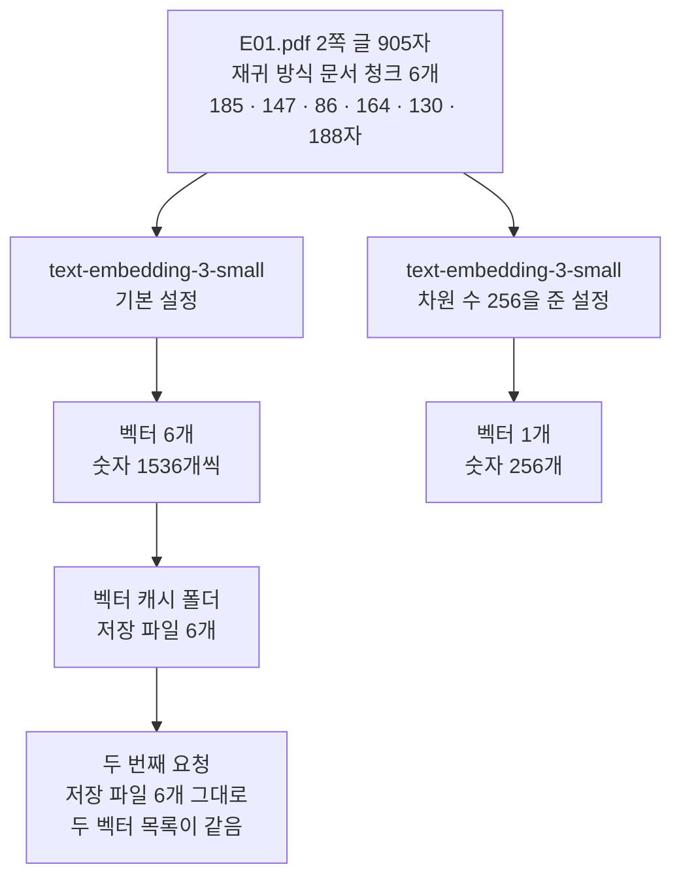
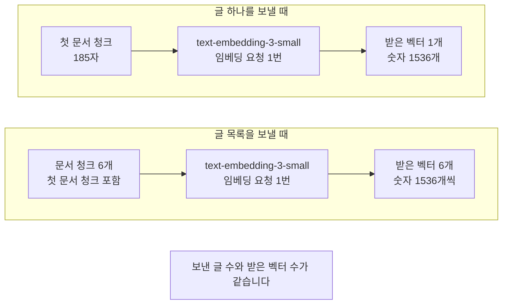
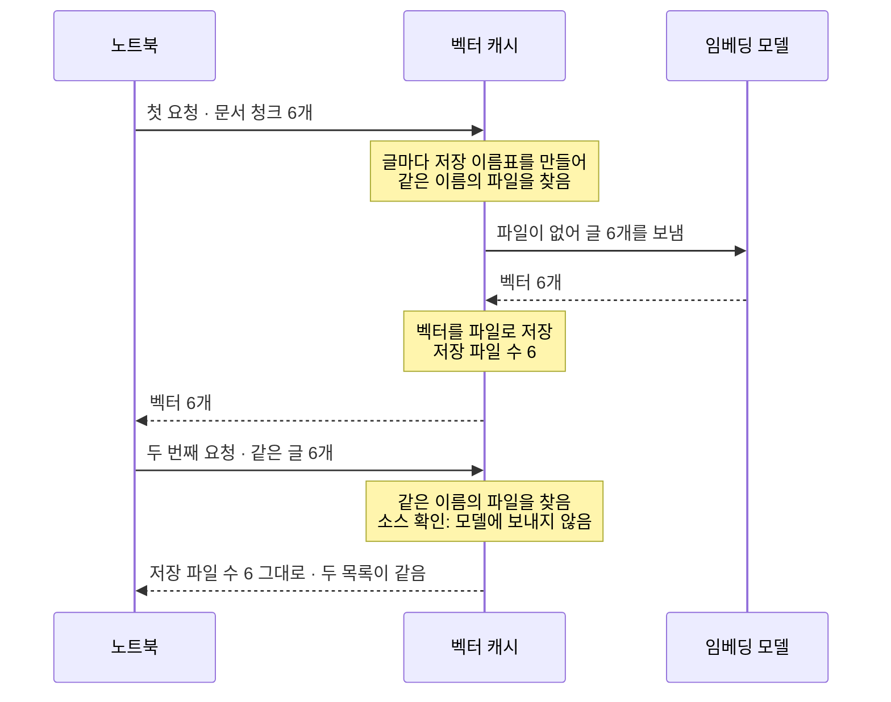
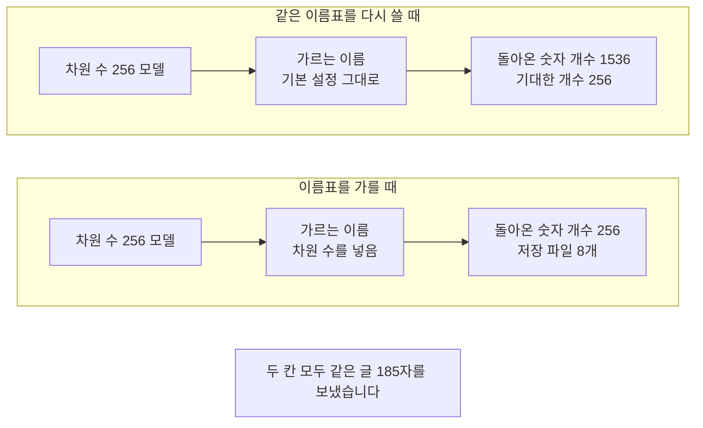

# 07-한국어-임베딩과-캐시

## _src 본문 (HTML 원본)

```html
<!--meta: 강의 1h | 실습 2h | 코드 07-한국어-임베딩과-캐시.ipynb | 새 용어 4 -->

<h2 id="b1"><span class="no">1</span>학습 목표</h2>
<div class="goal"><ul>
<li>이 절을 마치면 문서 청크를 임베딩해 벡터에 든 숫자 개수를 확인할 수 있습니다.</li>
<li>이 절을 마치면 글 하나와 글 목록을 보낼 때 받은 벡터 수가 어떻게 달라지는지 말할 수 있습니다.</li>
<li>이 절을 마치면 인자 <code>dimensions</code>로 숫자 개수를 줄이고 기본값과 견줄 수 있습니다.</li>
<li>이 절을 마치면 벡터를 파일에 저장해 두고 가르는 이름으로 설정을 갈라 둘 수 있습니다.</li>
</ul></div>

<h2 id="b2"><span class="no">2</span>이 내용을 배우는 이유</h2>
<p>05·06절에서 끊는 자리를 다섯 가지 방식으로 정했습니다. 그 결과물이 문서 청크입니다. 다음 단계는 문서 청크를 벡터로 바꾸는 일입니다.</p>
<p>검색은 글자를 맞춰 보지 않습니다. 문서 청크와 질문을 같은 방법으로 숫자 목록으로 바꾼 뒤 그 숫자로 견줍니다. 그래서 문서와 질문의 임베딩 설정이 같아야 합니다.</p>
<p>Ch 9 03절에서 이 단계를 이미 한 번 지났습니다. 그때는 벡터스토어가 임베딩을 안에서 불러 색인까지 한 번에 만들었습니다. 벡터 자체를 들여다볼 자리가 없었습니다.</p>
<p>이 절은 그 단계를 따로 떼어 봅니다. 벡터에 숫자가 몇 개 들어 있는지 보고, 그 개수를 줄이는 인자를 씁니다. 같은 글을 두 번 보낼 때 값을 저장해 두는 방법도 봅니다.</p>
<p>읽는 파일은 01·02·05·06절과 같은 <code>E01.pdf</code> 2쪽입니다. 05절 4절과 같은 설정으로 나눈 문서 청크 여섯 개를 그대로 씁니다. 06절이 예고한 「그 문서 청크를 벡터로 바꾸는 단계」를 이어 보는 것입니다. 한국어 문서에 맞는 임베딩 모델을 고르는 일은 이 절에서 정하지 않습니다. 검색 지표를 잰 뒤 Ch 11에서 판단합니다.</p>

<h2 id="b3"><span class="no">3</span>앞에서 배운 내용</h2>
<ul>
<li><strong>문서 청크 여섯 개</strong> — 05절 4절 재귀 방식 결과입니다. 목표 200자로 나눈 문자 수가 <code>[185, 147, 86, 164, 130, 188]</code>이었습니다.</li>
<li><strong>임베딩과 색인</strong> — Ch 9 03절에서 <code>OpenAIEmbeddings</code>로 임베딩 객체를 만들고 문서 청크를 벡터스토어에 넣었습니다. 모델 이름은 <code>text-embedding-3-small</code>입니다.</li>
<li><strong>벡터</strong> — Ch 5 02절에서 로컬 모델로 글을 숫자 384개로 바꾸고 코사인 유사도를 직접 계산했습니다.</li>
<li><strong>조각 세기</strong> — Ch 9 02절과 05절에서 규칙 <code>cl100k_base</code>와 <code>count_tokens()</code>로 조각 수를 셌습니다. 「조각」은 Ch 5에서 정한 토큰입니다.</li>
<li><strong>파일 지문</strong> — Ch 7 08절에서 <code>hashlib.sha256</code>으로 파일 내용을 16진수 64자로 줄였습니다.</li>
<li><strong>비용 어림</strong> — Ch 9 03절과 06절에서 임베딩 요금을 100만 조각당 0.02달러로 잡아 요청 전에 어림했습니다.</li>
<li><strong>임시 폴더</strong> — Ch 1·2 준비 셀에서 <code>tempfile</code>로 연습 폴더를 만들었습니다. 이 절은 벡터를 저장할 빈 폴더를 그 방법으로 만듭니다.</li>
</ul>
<p>노트북은 Ch 9 02절 <code>load_pdf_pages()</code>, 05절 <code>make_length_list()</code>, Ch 8 01절 <code>count_tokens()</code>를 도구 파일 <code>rag_tools.py</code>에서 가져옵니다.</p>

<h2 id="b4"><span class="no">4</span>핵심 개념</h2>
<h3>비유 — 서랍마다 다른 표찰을 붙입니다</h3>
<p>카드 보관함 하나를 생각해 보세요. 위 칸에는 긴 카드가, 아래 칸에는 짧은 카드가 들어갑니다. 카드 길이가 다르면 한 칸에 섞어 둘 수 없습니다.</p>
<p>그래서 칸마다 앞면에 표찰을 다르게 붙입니다. 카드를 꺼낼 사람은 표찰을 보고 어느 칸을 열지 정합니다. 표찰이 같으면 길이가 다른 카드를 잘못 꺼냅니다.</p>
<p>벡터를 저장해 둘 때도 같습니다. 숫자 개수가 다른 벡터는 서로 견줄 수 없습니다. 저장한 벡터에 어느 설정으로 만든 것인지 적어 두어야 합니다.</p>
{{img:07-5-서랍과-표찰|평면 그림으로 서랍 두 칸짜리 나무 카드 보관함이 가운데에 있고 두 칸이 반쯤 열려 있으며 위 칸에는 같은 길이의 긴 크림색 카드 다섯 장이 서서 반쯤 밖으로 나와 있고 아래 칸에는 그보다 훨씬 짧은 크림색 카드 두 장이 같은 모양으로 나와 있으며 위 칸 앞면에는 둥근 파란 표찰이 아래 칸 앞면에는 네모난 초록 표찰이 걸려 있고 오른쪽에서 손 하나가 짧은 카드 한 장을 아래 칸에 넣고 있음|위 칸에는 긴 카드, 아래 칸에는 짧은 카드가 담기고 칸마다 표찰 모양이 다릅니다}}
<p><strong>그림 읽기</strong> — 위 칸부터 봅니다. 긴 카드 다섯 장이 같은 길이로 서 있습니다. 아래 칸의 카드 두 장은 그보다 훨씬 짧습니다. 칸 앞면의 표찰은 위가 둥글고 아래가 네모라 모양이 다릅니다. 오른쪽 손이 든 카드는 짧은 카드이고 아래 칸으로 들어갑니다.</p>

<h3>이 절에서 쓰는 말</h3>
<table><thead><tr><th>용어</th><th>뜻과 일상 예</th><th>이 절에서 보이는 모습</th></tr></thead><tbody>
<tr><td>차원 수(dimensions)</td><td>벡터에 든 숫자의 개수. 한 사람을 두 값으로 적을 수도 있고 열 값으로 자세히 적을 수도 있는 것과 같음</td><td>노트북 4절 <code>벡터의 숫자 개수: 1536</code></td></tr>
<tr><td>벡터 캐시(vector cache)</td><td>한 번 만든 벡터를 파일에 저장해 두고 같은 글이 다시 오면 그 파일을 읽는 저장소. 계산해 둔 답을 공책에 적어 두는 것과 같음</td><td>노트북 7절 <code>벡터 캐시의 자료형: CacheBackedEmbeddings</code></td></tr>
<tr><td>가르는 이름(namespace)</td><td>저장한 벡터를 설정마다 갈라 두려고 파일 이름 앞에 붙이는 글. 서랍마다 다른 표찰을 붙이는 것과 같음</td><td>노트북 7절 <code>가르는 이름: text-embedding-3-small-1536-</code></td></tr>
<tr><td>저장 이름표(cache key)</td><td>가르는 이름과 글로 만든 파일 이름. 책 뒤에 붙이는 분류 번호와 같음</td><td>노트북 7절 <code>첫 파일 이름의 글자 수: 92</code></td></tr>
</tbody></table>
<p>파서·파일 형식·출처 기록·출처 계보는 01절과 같은 뜻입니다. 글자 층·표 읽기는 02절, 문단·태그·자리 칸은 03절, 형식 표시·압축 묶음은 04절과 같습니다. 문자 방식·재귀 방식·토큰 방식·조각 수 한도는 05절과 같은 뜻입니다. 구조 방식·시맨틱 방식·제목 표시·끊는 기준값은 06절과 같습니다. 문서 청크·색인·벡터스토어·검색 점수는 Ch 9에서 정한 뜻 그대로이고, 「조각」은 Ch 5 토큰 뜻입니다.</p>

<h3>차원 수를 주지 않으면 그 모델의 기본값입니다</h3>
<p>임베딩 객체를 만들 때 인자 <code>dimensions</code>에 숫자를 줄 수 있습니다. 주면 그 개수만큼만 담은 벡터가 돌아옵니다. 주지 않으면 그 모델의 기본값으로 만듭니다.</p>
<p>이 절의 모델은 기본값이 숫자 1536개입니다. Ch 9 03절과 06절도 이 인자를 주지 않았으니 같은 1536개였습니다. 그래서 이 절의 기본 설정 벡터는 Ch 9 색인과 같은 설정입니다.</p>
<p>숫자 개수를 줄이면 저장 자리와 견주는 셈이 줄어듭니다. 그 대신 개수가 다른 벡터끼리는 견줄 수 없습니다. 같은 자리의 값끼리 짝이 맞지 않기 때문입니다. 어느 개수가 검색에 더 나은지는 이 절에서 재지 않았습니다.</p>

<h3>도식 — 문서 청크가 벡터가 되고 파일로 남습니다</h3>
{{mermaid:07-1-벡터와-캐시|위에서 아래로 내려가는 흐름도로 맨 위 초록 상자 E01.pdf 2쪽 글 905자 재귀 방식 문서 청크 6개 185와 147과 86과 164와 130과 188자에서 두 갈래로 갈라져 왼쪽은 보라 상자 text-embedding-3-small 기본 설정과 노란 상자 벡터 6개 숫자 1536개씩으로 내려간 뒤 초록 상자 벡터 캐시 폴더 저장 파일 6개와 노란 상자 두 번째 요청 저장 파일 6개 그대로 두 벡터 목록이 같음으로 이어지고 오른쪽은 보라 상자 text-embedding-3-small 차원 수 256을 준 설정과 노란 상자 벡터 1개 숫자 256개로 끝남|같은 글을 기본 설정으로 보내면 숫자 1536개, 차원 수 256을 주면 숫자 256개가 돌아옵니다}}
<p><strong>도식 읽기</strong> — 위에서 아래로 보고 가운데에서 두 갈래로 갈라집니다. 맨 위 초록 상자가 05절과 같은 설정으로 나눈 문서 청크 여섯 개입니다. 문자 수도 05절에서 본 값과 같습니다.</p>
<p>왼쪽 갈래의 보라 상자가 기본 설정 모델이고 오른쪽 갈래가 차원 수 256을 준 설정입니다. 두 갈래의 모델 이름은 같습니다. 노란 상자에 적힌 숫자 개수만 1536개와 256개로 다릅니다.</p>
<p>왼쪽 갈래만 아래로 더 내려갑니다. 초록 상자가 벡터를 저장한 캐시 폴더이고 파일이 여섯 개 생겼습니다. 맨 아래 노란 상자는 같은 글을 두 번째로 요청한 결과입니다. 파일 수가 그대로이고 두 벡터 목록이 같았습니다.</p>

<h3>벡터 캐시와 벡터스토어는 하는 일이 다릅니다</h3>
<p>두 이름이 비슷해 보이지만 맡은 일이 다릅니다. 아래 표로 갈라 두었습니다.</p>
<table>
<tr><th>견줄 점</th><th>벡터 캐시(이 절)</th><th>벡터스토어(Ch 9 03절)</th></tr>
<tr><td>무엇을 위해 담는가</td><td>같은 글을 다시 임베딩하지 않으려고</td><td>질문과 가까운 문서 청크를 찾으려고</td></tr>
<tr><td>무엇으로 찾는가</td><td>글로 만든 저장 이름표</td><td>질문 벡터와의 검색 점수</td></tr>
<tr><td>본문과 메타데이터</td><td>담지 않음. 벡터만 파일에 저장</td><td>함께 담음. 검색 결과로 <code>Document</code>를 반환</td></tr>
<tr><td>이 절에서 쓴 이름</td><td><code>CacheBackedEmbeddings</code>와 <code>LocalFileStore</code></td><td><code>InMemoryVectorStore</code>(이 절에서는 부르지 않음)</td></tr>
</table>
<p>저장 이름표는 가르는 이름과 글의 지문을 이어 만듭니다. 이 절 출력에서 파일 이름이 92자였고 가르는 이름이 28자였습니다. 남은 64자가 글로 만든 지문입니다.</p>
<p>가르는 이름에 무엇을 넣을지는 사람이 정합니다. 라이브러리가 모델 설정을 보고 알아서 가르지는 않습니다. 이 절은 모델 이름과 차원 수를 넣었습니다.</p>

<h2 id="b5"><span class="no">5</span>실행 예제</h2>
<p>내려받은 실습 폴더에서 노트북을 열고 위에서 아래로 실행합니다. 프로젝트 맨 위 폴더의 <code>.env</code> 파일에 <code>OPENAI_API_KEY</code>가 있어야 합니다. 임베딩 요청은 모두 여섯 번이고 답을 쓰는 모델은 부르지 않습니다.</p>
<p>보낼 조각 수는 2498개 어림이고 예상 비용은 여섯 번을 합쳐 0.001달러 미만입니다. 요금은 OpenAI 모델 안내(2026-09-17 확인)에 적힌 100만 토큰당 0.02달러로 잡았습니다. 코드로 센 어림이고 청구 금액이 아닙니다.</p>
<p>이 페이지의 출력은 2026-09-21에 실행한 결과입니다. 새 커널로 두 번 이어 실행해 코드 셀 스물한 개의 값이 같은 것을 확인했습니다. 임베딩 값은 실행마다 소수 아래 자리가 달라질 수 있어 이 노트북은 숫자 값 자체를 출력하지 않고 개수와 자료형만 봅니다.</p>
<p>강의 시간에는 노트북 4~6절을 설명합니다. 글 하나 임베딩하기, 글 목록 임베딩하기, 차원 수 줄이기입니다. 7절 벡터 캐시와 8절 값 바꿔 보기, 9·10절 Before·After는 함께 실행하고 실습 시간에 다시 읽습니다. 2절은 01·05절과 같은 코드라 강의에서 빠르게 확인합니다.</p>
{{mermaid:07-2-하나와-목록|위 칸 글 하나를 보낼 때에 초록 상자 첫 문서 청크 185자와 보라 상자 text-embedding-3-small 임베딩 요청 1번과 노란 상자 받은 벡터 1개 숫자 1536개가 왼쪽에서 오른쪽으로 있고 아래 칸 글 목록을 보낼 때에 초록 상자 문서 청크 6개 첫 문서 청크 포함과 보라 상자 text-embedding-3-small 임베딩 요청 1번과 노란 상자 받은 벡터 6개 숫자 1536개씩이 같은 방향으로 있으며 맨 아래에 회색 상자 보낸 글 수와 받은 벡터 수가 같습니다가 있는 비교 흐름도|글 하나를 보내면 벡터 1개, 글 여섯 개를 보내면 벡터 6개가 돌아오고 숫자 개수는 둘 다 1536개입니다}}
<p><strong>도식 읽기</strong> — 위 칸이 글 하나를 보낼 때, 아래 칸이 글 목록을 보낼 때이고 칸마다 왼쪽에서 오른쪽으로 봅니다. 두 칸의 보라 상자는 같은 모델이고 요청 수도 각각 한 번입니다.</p>
<p>오른쪽 노란 상자가 받은 값입니다. 위 칸은 벡터 1개, 아래 칸은 벡터 6개입니다. 벡터에 든 숫자 개수는 두 칸 모두 1536개입니다.</p>
<p>맨 아래 회색 상자는 두 칸에 모두 해당합니다. 보낸 글 수와 받은 벡터 수가 같고 순서도 같습니다. 그래서 글 목록으로 모아 보내면 요청 수가 적어집니다.</p>
{{mermaid:07-3-저장과-읽기|노트북과 벡터 캐시와 임베딩 모델 세 세로줄 사이에서 첫 요청 문서 청크 6개를 실선으로 보내고 노란 메모 글마다 저장 이름표를 만들어 같은 이름의 파일을 찾음이 붙은 다음 실선으로 파일이 없어 글 6개를 보냄을 거쳐 점선으로 벡터 6개를 받고 노란 메모 벡터를 파일로 저장 저장 파일 수 6이 이어지며 점선으로 벡터 6개를 노트북이 받은 뒤 두 번째 요청 같은 글 6개를 실선으로 보내고 노란 메모 같은 이름의 파일을 찾음 소스 확인 모델에 보내지 않음이 붙은 다음 점선으로 저장 파일 수 6 그대로 두 목록이 같음을 받는 순서도|첫 요청에서 저장 파일 6개가 생기고, 두 번째 요청은 파일 수가 그대로이며 같은 벡터가 돌아옵니다}}
<p><strong>도식 읽기</strong> — 위에서 아래로 시간 순서입니다. 세로줄 셋은 노트북, 벡터 캐시, 임베딩 모델입니다. 실선이 보내는 쪽이고 점선이 받는 쪽입니다.</p>
<p>노트북은 벡터 캐시에만 글을 넘깁니다. 캐시가 글마다 저장 이름표를 만들어 같은 이름의 파일을 찾습니다. 파일이 없으면 모델에 글을 보냅니다. 노란 메모는 캐시가 그 시점에 하는 일입니다.</p>
<p>아래쪽 두 번째 요청을 보세요. 같은 글을 다시 넘겼는데 모델 쪽 세로줄로 가는 실선이 없습니다. 이미 저장한 파일을 읽었기 때문입니다. 「모델에 보내지 않음」은 출력으로 센 값이 아니라 설치판 소스에서 확인한 동작입니다. 저장 파일 수도 6개 그대로였습니다.</p>
{{notebook:07-한국어-임베딩과-캐시|example}}

<h2 id="b6"><span class="no">6</span>일부러 실패해 보기</h2>
<p>색인을 만들다가 차원 수를 줄이기로 마음을 바꿨다고 생각해 보세요. 모델 객체만 바꾸고 가르는 이름은 앞에서 쓴 것을 그대로 둘 수 있습니다. 벡터 캐시가 설정을 보고 알아서 갈라 주기를 기대하는 자리입니다.</p>
<p>Before 셀은 차원 수 256 모델에 기본 설정의 가르는 이름을 그대로 붙여 같은 글을 요청합니다. After 셀은 가르는 이름에 차원 수를 넣어 앞 설정과 갈라 둡니다. 바뀌는 것은 가르는 이름 하나이고 모델과 글은 두 셀이 같습니다.</p>
{{mermaid:07-4-이름표-가르기|위 칸 같은 이름표를 다시 쓸 때에 보라 상자 차원 수 256 모델과 파란 상자 가르는 이름 기본 설정 그대로와 빨간 상자 돌아온 숫자 개수 1536 기대한 개수 256이 왼쪽에서 오른쪽으로 있고 아래 칸 이름표를 가를 때에 보라 상자 차원 수 256 모델과 파란 상자 가르는 이름 차원 수를 넣음과 노란 상자 돌아온 숫자 개수 256 저장 파일 8개가 같은 방향으로 있으며 맨 아래에 회색 상자 두 칸 모두 같은 글 185자를 보냈습니다가 있는 비교 흐름도|같은 모델과 같은 글인데 가르는 이름만 달라 돌아온 숫자 개수가 1536개와 256개로 갈렸습니다}}
<p><strong>도식 읽기</strong> — 위 칸이 Before, 아래 칸이 After이고 칸마다 왼쪽에서 오른쪽으로 봅니다. 두 칸의 보라 상자는 같은 차원 수 256 모델입니다. 가운데 파란 상자만 다릅니다.</p>
<p>위 칸의 빨간 상자가 Before 결과입니다. 기대한 개수는 256인데 돌아온 개수가 1536이었습니다. 아래 칸의 노란 상자가 After 결과이고 개수가 256으로 맞았습니다. 저장 파일도 하나 늘어 여덟 개가 되었습니다.</p>
<p>맨 아래 회색 상자는 두 칸에 모두 해당합니다. 보낸 글은 같은 첫 문서 청크 185자입니다. 달라진 것은 가르는 이름 하나뿐입니다.</p>
{{notebook:07-한국어-임베딩과-캐시|failure}}

<h2 id="b7"><span class="no">7</span>주의할 점과 실무 메모</h2>
<ul>
<li><strong>차원 수 256은 이 절에서 보여 주려고 고른 값입니다.</strong> 기본값 1536과 눈에 띄게 다르고 저장 이름표에 적기도 쉬워 골랐습니다. 탐색 실행에서 128로도 같은 결과를 보았고 그 실행은 노트북에 담지 않았습니다. 어느 개수가 검색에 더 나은지는 질문 여러 개로 검색까지 돌려 봐야 아는 값입니다.</li>
<li><strong>색인에 넣을 벡터는 기본 설정으로 만듭니다.</strong> Ch 9 03절과 06절 색인이 차원 수를 주지 않은 기본값이므로 그 설정으로 이어 씁니다. 이 절에서 만든 256개짜리 벡터는 개수를 견주려고 만든 것이고 08절 색인에는 넣지 않습니다. 개수가 다른 벡터를 한 색인에 섞으면 검색 점수를 계산할 수 없습니다.</li>
<li><strong>가르는 이름은 사람이 적습니다.</strong> 이 절은 모델 이름과 차원 수를 넣었습니다. 글을 정리하는 방법을 더하거나 문서와 질문에 앞머리 글을 붙이면 그 조건도 이름에 넣어야 합니다. 모델마다 문서와 질문에 다른 앞머리 글을 요구하는 경우가 있는데, 이 절에서는 실행하지 않았습니다.</li>
<li><strong>벡터 캐시는 글이 글자까지 같을 때만 읽습니다.</strong> 노트북 8절에서 글 끝에 빈칸 하나를 더하니 파일이 하나 늘었습니다. 저장 이름표가 글의 지문으로 만들어지기 때문입니다. 읽어 온 글의 빈칸이나 줄바꿈을 라이브러리가 알아서 정리해 주지는 않습니다.</li>
<li><strong>파일 수는 요청 수가 아닙니다.</strong> 노트북 7절 출력은 저장 파일 수와 두 목록이 같다는 것까지만 보여 줍니다. 요청을 몇 번 보냈는지 그 셀에서 직접 세지는 않았습니다. 설치판 소스에서는 저장값이 없는 글만 모아 임베딩을 한 번 부르고, 모두 저장되어 있으면 요청을 보내지 않습니다.</li>
<li><strong>저장 자리의 권한과 보존 기간을 따로 정합니다.</strong> 이 절은 실행할 때마다 지워지는 임시 폴더를 썼습니다. 실제 설정에서는 벡터 파일이 남습니다. 파일에 본문을 담지는 않지만 저장 이름표가 원문의 지문이라, 민감한 문서라면 폴더 권한과 지우는 시점을 함께 정합니다.</li>
<li><strong>모델을 고르는 자리는 이 절이 아닙니다.</strong> 이 과정은 Ch 9부터 <code>text-embedding-3-small</code>로 색인을 만들었습니다. 다른 모델로 바꿀지는 Ch 11에서 한국어 질문과 정답 문서로 검색 지표를 잰 뒤에 정합니다. 영어 문서로 매긴 종합 순위는 우리 문서의 검색 결과를 보장하지 않습니다.</li>
<li><strong>이번에 실행하지 않은 것을 적어 둡니다.</strong> 다른 임베딩 모델 부르기, 질문 쪽 벡터도 저장해 두기, 문서와 질문에 앞머리 글 붙이기입니다. 벡터로 검색해 점수를 재는 일도 하지 않았습니다. 그 비교는 색인을 여러 벌 만든 뒤 08절에서 합니다.</li>
</ul>

<h2 id="b8"><span class="no">8</span>정리와 다음 절</h2>
<ul>
<li>메서드 <code>embed_documents()</code>는 글 목록을 받아 같은 순서의 벡터 목록을 반환합니다. 글 하나를 보내면 벡터 1개, 글 여섯 개를 보내면 벡터 6개였습니다.</li>
<li>기본 설정 벡터에는 숫자가 1536개 들어 있었습니다. Ch 9 03절과 06절 색인도 이 인자를 주지 않아 같은 개수입니다.</li>
<li>인자 <code>dimensions</code>에 256을 주니 같은 글의 벡터가 숫자 256개로 줄었습니다. 개수가 다른 벡터끼리는 견줄 수 없습니다.</li>
<li>같은 문서 청크 목록을 두 번 요청하니 저장 파일 수가 6개 그대로였고 두 벡터 목록이 같았습니다.</li>
<li>글 끝에 빈칸 하나를 더하니 다른 글이 되어 저장 파일이 7개로 늘었습니다. 벡터 캐시는 글이 글자까지 같을 때만 저장한 값을 읽습니다.</li>
<li>가르는 이름을 그대로 두고 모델만 바꾸면 앞 설정의 벡터가 돌아왔습니다. 이름에 차원 수를 넣어 가르니 기대한 256개가 돌아왔습니다.</li>
</ul>
<p><strong>다음 학습과 이어지는 지점</strong> — 08절에서는 나누기와 임베딩 설정을 하나씩 바꿔 색인을 여러 벌 만듭니다. 설정마다 검색 결과가 어떻게 달라지는지 기록으로 남겨 견줍니다. 그때 이 절의 모델 이름과 차원 수가 실험 설정의 한 칸으로 다시 나옵니다.</p>
<p>Ch 11에서는 그 기록에 정답 문서를 붙여 검색 지표를 계산합니다. 이 절은 벡터의 개수와 저장 방법까지만 보았고 어느 설정이 나은지는 정하지 않았습니다. 판단에 쓸 지표는 Ch 11에서 배웁니다.</p>

<h2 id="b9"><span class="no">9</span>복습 문제</h2>
<details class="quiz" open><summary>문제 4개 · 해설 포함</summary>
<p class="quiz-q">1. [하] 문서 청크 여섯 개를 한 번에 임베딩하면 벡터는 몇 개이고 각 벡터의 숫자 개수는 몇 개입니까?</p>
<p class="quiz-a">벡터는 여섯 개이고 각각 숫자 1536개를 담습니다. 노트북 5절 출력이 <code>받은 벡터 수: 6</code>과 <code>벡터마다 숫자 개수: [1536, 1536, 1536, 1536, 1536, 1536]</code>였습니다. 보낸 글 수와 벡터 수는 같고, 벡터의 숫자 개수는 그와 다른 값입니다.</p>
<p class="quiz-q">2. [중] 벡터를 저장해 둘 폴더로 빈 임시 폴더를 쓰는 까닭은 무엇입니까?</p>
<p class="quiz-a">앞 실습에서 저장한 파일이 남아 있으면 첫 요청부터 그 파일을 읽습니다. 그러면 저장 전과 저장 뒤의 차이를 볼 수 없습니다. 노트북 7절은 <code>폴더 안의 파일 수: 0</code>에서 시작해 첫 요청 뒤 6개가 되는 것을 보였습니다.</p>
<p class="quiz-q">3. [중] 모델 이름은 그대로 두고 차원 수만 바꿨습니다. 가르는 이름도 바꿔야 하는 까닭은 무엇입니까?</p>
<p class="quiz-a">숫자 개수가 다른 벡터를 갈라 두어야 하기 때문입니다. 이름이 같으면 저장 이름표도 같아져 앞 설정의 벡터를 읽습니다. 노트북 9절에서 차원 수 256 모델에 기본 설정의 이름을 붙이니 <code>돌아온 벡터의 숫자 개수: 1536</code>이 나왔습니다.</p>
<p class="quiz-q">4. [상] 노트북 7절에서 두 번째 요청 뒤에도 저장 파일 수가 6개였습니다. 이 출력으로 「두 번째 요청은 임베딩을 한 번도 부르지 않았다」고 적어도 됩니까?</p>
<p class="quiz-a">그 셀의 출력만으로는 적을 수 없습니다. 파일 수와 두 목록이 같다는 것까지만 보였고 요청 수를 직접 세지 않았습니다. 설치판 소스를 읽으면 저장값이 없는 글만 모아 부르는 것을 확인할 수 있는데, 그것은 출력이 아니라 소스에서 얻은 근거입니다.</p>
</details>

<h2 id="b10"><span class="no">10</span>참고 자료</h2>
<ul>
<li><div><a href="https://reference.langchain.com/python/langchain-classic/embeddings/cache/CacheBackedEmbeddings">LangChain 공식 API CacheBackedEmbeddings</a></div>확인 2026-09-18 · <code>from_bytes_store()</code>의 <code>namespace</code>와 <code>key_encoder</code> 참고.</li>
<li><div><a href="https://reference.langchain.com/python/langchain-classic/storage/file_system/LocalFileStore">LangChain 공식 API LocalFileStore</a></div>확인 2026-09-18 · 저장 이름표를 파일 이름으로 쓰는 방식 참고.</li>
<li><div><a href="https://docs.langchain.com/oss/python/integrations/embeddings/openai">LangChain 공식 문서 OpenAI embeddings</a></div>확인 2026-09-18 · <code>embed_documents()</code>와 <code>dimensions</code> 인자 참고.</li>
<li><div><a href="https://developers.openai.com/api/docs/guides/embeddings">OpenAI 공식 문서 Embeddings guide</a></div>확인 2026-09-18 · 기본 차원 수와 차원 수를 줄이는 설정 참고.</li>
<li><div><a href="https://platform.openai.com/docs/pricing">OpenAI 요금 안내</a></div>확인 2026-09-17 · 임베딩 <code>text-embedding-3-small</code> 100만 토큰당 0.02달러 참고.</li>
<li><div><a href="https://docs.mteb.org/overview/">MTEB 공식 문서 Overview</a></div>확인 2026-09-18 · 언어와 과제별로 평가를 나눠 보는 까닭 참고.</li>
<li>기준 버전은 Python 3.12.13과 pypdf 6.18.0, langchain-core 1.6.2입니다. 나누기 도구는 langchain-text-splitters 1.1.2입니다. 임베딩은 langchain-openai 1.6.0으로 부릅니다. 벡터 캐시는 langchain-classic 1.0.8이고 조각은 tiktoken 0.14.0으로 셉니다. 저장 이름표와 요청을 모으는 동작은 이 판의 소스에서 확인했습니다.</li>
</ul>
```

## 노트북 셀 (순서대로)

### [0] markdown {'html': 'skip'}

# 한국어 임베딩과 캐시

**이 노트북에서 할 일**

1. 05절과 같은 설정으로 E01.pdf 2쪽 글을 문서 청크 여섯 개로 나눕니다.
2. 글 하나와 글 목록을 임베딩해 받은 벡터의 숫자 개수를 봅니다.
3. 벡터를 파일에 저장해 두고 같은 글을 두 번 요청해 견줍니다.

**준비물** — 프로젝트 맨 위 폴더의 `.env` 파일에 `OPENAI_API_KEY`가 있어야 합니다.
임베딩 요청은 모두 여섯 번이고, 답을 쓰는 모델은 부르지 않습니다.
보낼 조각 수는 2498개 어림입니다.

예상 비용은 여섯 번을 합쳐 0.001달러 미만입니다.
임베딩 요금은 OpenAI 모델 안내(2026-09-17 확인)에 적힌 100만 토큰당 0.02달러입니다.
실행 시간은 패키지 설치를 빼면 20초 안팎입니다.

데이터는 01·02·05·06절과 같은 파일 하나입니다.
폴더 `labs/data/rag-corpus/pdf/easy/`의 `E01.pdf` 2쪽입니다.
벡터를 저장할 폴더는 실행할 때마다 새로 만드는 빈 임시 폴더입니다.

**강의와 실습 범위** — 강의 시간에는 4~6절을 설명합니다.
글 하나 임베딩하기, 글 목록 임베딩하기, 차원 수 줄이기입니다.
7절 벡터 캐시와 8절 값 바꿔 보기, 9·10절 실패와 수정은 함께 실행하고 실습 시간에 다시 읽습니다.
2절은 01·05절과 같은 코드라 강의에서 빠르게 확인합니다.

**기준 버전** — 실습 폴더에 고정한 패키지 판을 씁니다.
pypdf 6.18.0과 langchain-core 1.6.2를 씁니다.
나누기 도구는 langchain-text-splitters 1.1.2입니다.
임베딩은 langchain-openai 1.6.0으로 부릅니다.
벡터 캐시는 langchain-classic 1.0.8이고 조각은 tiktoken 0.14.0으로 셉니다.

교재 출력은 Linux의 Python 3.12.13으로 만들었습니다.
다른 버전과 Windows·macOS에서는 이번에 실행하지 않았습니다.

실습 폴더 `labs/part3/ch10-document-processing`에서 `uv sync --locked`를 실행합니다.
그다음 이 폴더의 `.venv` 커널을 고르고 첫 셀부터 순서대로 실행합니다.

### [1] markdown {'html': 'skip'}

## 오늘 볼 그림


위에서 아래로 보고 가운데에서 두 갈래로 갈라집니다.
맨 위 초록 상자가 05절과 같은 설정으로 나눈 문서 청크이고, 보라 상자가 이번에 요청을 보낸 임베딩 모델입니다.
왼쪽 갈래는 기본 설정이고 오른쪽 갈래는 차원 수 256을 준 설정입니다.
왼쪽 갈래의 벡터만 캐시 폴더에 저장했습니다.

### [2] markdown {}

## 1. 준비

첫 셀은 패키지를 설치하고 설치된 버전을 출력합니다. 설치에는 몇십 초가 걸릴 수 있습니다.
05·06절에서 쓴 도구에, 벡터를 파일에 저장하는 도구를 더해 설치합니다.

### [3] code {'execution': {'iopub.execute_input': '2026-09-21T06:25:43.314563Z', 'iopub.status.busy': '2026-09-21T06:25:43.314375Z', 'iopub.status.idle': '2026-09-21T06:25:43.778771Z', 'shell.execute_reply': '2026-09-21T06:25:43.778238Z'}, 'lesson_role': 'setup'}

```python
# 이 절에서 쓰는 패키지를 설치하고 버전을 확인합니다
%pip install -q "pypdf==6.18.0" "langchain-core==1.6.2" "langchain-text-splitters==1.1.2" "langchain-openai==1.6.0" "langchain-classic==1.0.8" "tiktoken==0.14.0" "python-dotenv==1.2.3"
from importlib.metadata import version

print("pypdf:", version("pypdf"))
print("langchain-core:", version("langchain-core"))
print("langchain-text-splitters:", version("langchain-text-splitters"))
print("langchain-openai:", version("langchain-openai"))
print("langchain-classic:", version("langchain-classic"))
print("tiktoken:", version("tiktoken"))
print("python-dotenv:", version("python-dotenv"))
```

출력:
```
Note: you may need to restart the kernel to use updated packages.
pypdf: 6.18.0
langchain-core: 1.6.2
langchain-text-splitters: 1.1.2
langchain-openai: 1.6.0
langchain-classic: 1.0.8
tiktoken: 0.14.0
python-dotenv: 1.2.3

```

### [4] markdown {}

**결과 읽기** — 출력 일곱 줄 가운데 첫 줄은 `pypdf: 6.18.0`입니다.
넷째 줄 `langchain-openai: 1.6.0`과 다섯째 줄 `langchain-classic: 1.0.8`도 보세요.
준비물에 적은 기준 버전과 같습니다.

다음 셀은 이 절에서 쓸 이름을 불러옵니다.
클래스 `OpenAIEmbeddings`가 임베딩을 부르는 객체를 만듭니다.
클래스 `CacheBackedEmbeddings`와 `LocalFileStore`가 벡터를 파일에 저장하는 도구입니다.

앞에서 배운 함수는 `rag_tools.py`에 모아 두었습니다. 파일을 열면 코드를 볼 수 있습니다. 노트북과 같은 폴더(`notebooks/`)에 있는 파일입니다.
이 노트북은 Ch 9 02절 `load_pdf_pages()`, 05절 `make_length_list()`, Ch 8 01절 `count_tokens()`를 가져옵니다.

### [5] code {'execution': {'iopub.execute_input': '2026-09-21T06:25:43.779837Z', 'iopub.status.busy': '2026-09-21T06:25:43.779756Z', 'iopub.status.idle': '2026-09-21T06:25:44.802403Z', 'shell.execute_reply': '2026-09-21T06:25:44.801947Z'}, 'lesson_role': 'setup'}

```python
# 나누기·임베딩·벡터 저장·조각 세기에 쓸 이름을 불러옵니다
import os
import tempfile

from langchain_classic.embeddings import CacheBackedEmbeddings
from langchain_classic.storage import LocalFileStore
from langchain_openai import OpenAIEmbeddings
from langchain_text_splitters import RecursiveCharacterTextSplitter
import tiktoken
# Ch 9 02절, 05절, Ch 8 01절 함수 세 개를 도구 파일에서 가져옵니다
from rag_tools import count_tokens, load_pdf_pages, make_length_list
```

출력:
```

```

### [6] markdown {}

**결과 읽기** — 이 셀은 이름을 불러오기만 하므로 출력이 없습니다.

모듈 `tempfile`은 Python에 들어 있는 기능 묶음입니다.
이 절에서는 벡터를 저장할 빈 임시 폴더를 만드는 데 씁니다.
Ch 1·2 준비 셀에서 연습 폴더를 만들 때 쓴 것과 같은 모듈입니다.

다음 셀은 키가 있는지 확인합니다. 키 값은 출력하지 않고 있는지만 봅니다.

### [7] code {'execution': {'iopub.execute_input': '2026-09-21T06:25:44.803270Z', 'iopub.status.busy': '2026-09-21T06:25:44.803176Z', 'iopub.status.idle': '2026-09-21T06:25:44.806686Z', 'shell.execute_reply': '2026-09-21T06:25:44.806343Z'}, 'lesson_role': 'setup'}

```python
# .env 파일에서 OpenAI API 키를 읽습니다(키 값은 출력하지 않습니다)
import os
from dotenv import find_dotenv, load_dotenv

env_path = find_dotenv(usecwd=True)
load_dotenv(env_path)
has_key = os.getenv("OPENAI_API_KEY") is not None
print("OPENAI_API_KEY 설정 여부:", has_key)
assert has_key, "프로젝트 폴더의 .env 파일에 OPENAI_API_KEY를 적어 주세요."
```

출력:
```
OPENAI_API_KEY 설정 여부: True

```

### [8] markdown {}

**결과 읽기** — 출력 줄은 `OPENAI_API_KEY 설정 여부: True`입니다.

## 2. 벡터로 바꿀 재료 얻기

01~06절과 같은 방법으로 프로젝트 맨 위 경로를 고릅니다.
후보 세 개를 차례로 확인하고, 있는 경로에서 멈춥니다.

실행 전에 예상합니다. 프로젝트 맨 위에서 열었다면 첫째 후보를 고를 것입니다.

### [9] code {'execution': {'iopub.execute_input': '2026-09-21T06:25:44.807244Z', 'iopub.status.busy': '2026-09-21T06:25:44.807199Z', 'iopub.status.idle': '2026-09-21T06:25:44.809238Z', 'shell.execute_reply': '2026-09-21T06:25:44.808863Z'}}

```python
# 작업 폴더에서 본 프로젝트 맨 위 경로를 후보 세 개 가운데에서 고릅니다
candidates = [".", "../../..", "../../../.."]
root_path = None
for candidate in candidates:
    if os.path.exists(candidate + "/labs/data/rag-corpus"):
        root_path = candidate
        break
print("고른 경로:", root_path)
assert root_path is not None, "notebooks 폴더나 실습 폴더 맨 위에서 노트북을 열어 주세요."
```

출력:
```
고른 경로: .

```

### [10] markdown {}

**결과 읽기** — 출력 줄은 `고른 경로: .`입니다. `assert`도 통과했습니다.
교재 출력은 프로젝트 맨 위를 작업 폴더로 삼아 실행해서 첫째 후보를 골랐습니다.

준비 셀에서 가져온 Ch 9 02절 로더 함수 `load_pdf_pages()`는 PDF 경로와 문서 이름을 받아 쪽마다 `Document` 하나를 만듭니다.

다음 셀은 이 함수로 E01.pdf를 읽고 2쪽 본문을 이 절의 재료로 삼습니다.
05·06절과 같은 글이고 같은 이름 `plain_text`에 담습니다.

### [11] code {'execution': {'iopub.execute_input': '2026-09-21T06:25:44.809842Z', 'iopub.status.busy': '2026-09-21T06:25:44.809792Z', 'iopub.status.idle': '2026-09-21T06:25:44.840772Z', 'shell.execute_reply': '2026-09-21T06:25:44.840391Z'}}

```python
# E01.pdf를 쪽마다 읽고 2쪽 본문을 이 절에서 벡터로 바꿀 재료로 삼습니다
corpus_path = root_path + "/labs/data/rag-corpus"
pdf_path = corpus_path + "/pdf/easy/E01.pdf"
pages = load_pdf_pages(pdf_path, "E01")
plain_text = pages[1].page_content
print("Document 수:", len(pages))
print("나눌 글의 글자 수:", len(plain_text))
```

출력:
```
Document 수: 5
나눌 글의 글자 수: 905

```

### [12] markdown {}

**결과 읽기** — 출력 첫 줄은 `Document 수: 5`이고 다음 줄은 `나눌 글의 글자 수: 905`입니다.
05·06절에서 본 값과 같은 글입니다.

문서 청크 길이는 준비 셀에서 가져온 05절 `make_length_list()`로 셉니다.

다음 셀은 05절 4절과 같은 설정으로 이 글을 나눕니다.
끊을 자리 순서와 목표 크기 200자, 겹침 0을 그대로 씁니다.
같은 설정을 쓰는 까닭은 06절이 예고한 대로 「그 문서 청크를 벡터로 바꾸는 단계」를 보는 것이기 때문입니다.

### [13] code {'execution': {'iopub.execute_input': '2026-09-21T06:25:44.841384Z', 'iopub.status.busy': '2026-09-21T06:25:44.841328Z', 'iopub.status.idle': '2026-09-21T06:25:44.843431Z', 'shell.execute_reply': '2026-09-21T06:25:44.843014Z'}}

```python
# 05절 4절과 같은 설정으로 2쪽 글을 문서 청크 여섯 개로 나눕니다
separator_order = ["\n\n", ". ", "\n", " ", ""]
recursive_splitter = RecursiveCharacterTextSplitter(
    separators=separator_order,
    chunk_size=200,
    chunk_overlap=0,
    keep_separator="end",
)
chunk_texts = recursive_splitter.split_text(plain_text)
print("문서 청크 수:", len(chunk_texts))
print("문서 청크별 문자 수:", make_length_list(chunk_texts))
```

출력:
```
문서 청크 수: 6
문서 청크별 문자 수: [185, 147, 86, 164, 130, 188]

```

### [14] markdown {}

**결과 읽기** — 출력 첫 줄은 `문서 청크 수: 6`입니다.
다음 줄은 `문서 청크별 문자 수: [185, 147, 86, 164, 130, 188]`입니다.
05절 4절 재귀 방식 결과와 같은 값입니다.

## 3. 요청 수와 비용 어림하기

요청을 보내기 전에 얼마를 보내는지 셉니다. Ch 9 03절과 06절에서 한 방법과 같습니다.
먼저 05·06절과 같은 조각 세는 규칙을 준비합니다. 조각 수는 준비 셀에서 가져온 `count_tokens()`로 셉니다.

### [15] code {'execution': {'iopub.execute_input': '2026-09-21T06:25:44.843959Z', 'iopub.status.busy': '2026-09-21T06:25:44.843896Z', 'iopub.status.idle': '2026-09-21T06:25:44.896681Z', 'shell.execute_reply': '2026-09-21T06:25:44.896341Z'}}

```python
# 05·06절과 같은 조각 세는 규칙을 준비합니다
encoding = tiktoken.get_encoding("cl100k_base")
print("조각 세는 규칙 이름:", encoding.name)
```

출력:
```
조각 세는 규칙 이름: cl100k_base

```

### [16] markdown {}

**결과 읽기** — 출력 줄은 `조각 세는 규칙 이름: cl100k_base`입니다.
Ch 9 02절에서 이 임베딩 모델의 조각 세는 규칙으로 확인한 이름과 같습니다.

다음 셀은 이 절이 보낼 조각 수를 어림합니다.
글 목록을 보내는 요청이 두 번이고, 글 하나를 보내는 요청이 네 번입니다.
글 목록 요청은 글 전체를 보내는 것과 거의 같으니 글 전체의 조각 수로 셉니다.

### [17] code {'execution': {'iopub.execute_input': '2026-09-21T06:25:44.897373Z', 'iopub.status.busy': '2026-09-21T06:25:44.897317Z', 'iopub.status.idle': '2026-09-21T06:25:44.905369Z', 'shell.execute_reply': '2026-09-21T06:25:44.905047Z'}}

```python
# 이 절이 보낼 조각 수를 요청 전에 어림합니다
one_text = chunk_texts[0]
whole_tokens = count_tokens(encoding, plain_text)
one_tokens = count_tokens(encoding, one_text)
list_requests = 2
one_requests = 4
sent_tokens = whole_tokens * list_requests + one_tokens * one_requests
print("글 전체의 조각 수:", whole_tokens)
print("첫 문서 청크의 조각 수:", one_tokens)
print("이 절이 보낼 조각 수 어림:", sent_tokens)
```

출력:
```
글 전체의 조각 수: 869
첫 문서 청크의 조각 수: 190
이 절이 보낼 조각 수 어림: 2498

```

### [18] markdown {}

**결과 읽기** — 출력 첫 줄은 `글 전체의 조각 수: 869`이고 05절에서 센 값과 같습니다.
다음 줄은 `첫 문서 청크의 조각 수: 190`입니다.
마지막 줄은 `이 절이 보낼 조각 수 어림: 2498`입니다.

다음 셀은 그 조각 수로 비용을 어림합니다. 요금은 100만 조각당 0.02달러입니다.
아주 작은 값이라 `round()`로 소수 일곱째 자리까지 줄입니다.

### [19] code {'execution': {'iopub.execute_input': '2026-09-21T06:25:44.905946Z', 'iopub.status.busy': '2026-09-21T06:25:44.905882Z', 'iopub.status.idle': '2026-09-21T06:25:44.907549Z', 'shell.execute_reply': '2026-09-21T06:25:44.907235Z'}}

```python
# 보낼 조각 수로 이 절의 임베딩 비용을 요청 전에 어림합니다
embedding_rate = 0.02
tokens_per_million = 1000000
raw_cost = sent_tokens * embedding_rate / tokens_per_million
total_cost = round(raw_cost, 7)
print("100만 조각당 요금(달러):", embedding_rate)
print("이 절 전체의 비용 어림(달러):", total_cost)
```

출력:
```
100만 조각당 요금(달러): 0.02
이 절 전체의 비용 어림(달러): 5e-05

```

### [20] markdown {}

**결과 읽기** — 출력 마지막 줄은 `이 절 전체의 비용 어림(달러): 5e-05`입니다.
표기 `e-05`는 06절에서 본 것과 같습니다. 곧 0.00005달러입니다.
코드로 센 어림이고 청구 금액이 아닙니다.

## 4. 글 하나를 벡터로 바꾸기

Ch 9 03절과 같은 이름으로 임베딩 객체를 만듭니다.
모델 이름도 Ch 9·06절과 같은 `text-embedding-3-small`입니다.
차원 수는 따로 주지 않습니다. Ch 9가 만든 색인과 같은 설정으로 이어 쓰려는 것입니다.

### [21] code {'execution': {'iopub.execute_input': '2026-09-21T06:25:44.908110Z', 'iopub.status.busy': '2026-09-21T06:25:44.908064Z', 'iopub.status.idle': '2026-09-21T06:25:45.313368Z', 'shell.execute_reply': '2026-09-21T06:25:45.312945Z'}}

```python
# Ch 9 03절과 같은 이름으로 임베딩 객체를 만듭니다(요청은 보내지 않습니다)
embedding_model_name = "text-embedding-3-small"
embedding_model = OpenAIEmbeddings(model=embedding_model_name)
print("임베딩 모델 이름:", embedding_model.model)
print("차원 수를 주었는가:", embedding_model.dimensions is not None)
```

출력:
```
임베딩 모델 이름: text-embedding-3-small
차원 수를 주었는가: False

```

### [22] markdown {}

**결과 읽기** — 출력 두 줄은 `임베딩 모델 이름: text-embedding-3-small`과 `차원 수를 주었는가: False`입니다.
차원 수를 주지 않았으니 이 모델의 기본값으로 만듭니다.

이 노트북의 임베딩 출력은 2026-09-21에 이 모델로 실행한 결과입니다.
같은 글을 다시 보내면 벡터의 소수 아래 자리가 조금 달라질 수 있습니다.
그래서 이 노트북은 숫자 값 자체를 출력하지 않고 개수와 자료형만 봅니다.

다음 셀은 첫 문서 청크 하나만 임베딩합니다.
메서드 `embed_documents()`는 글 목록을 받아 같은 순서의 벡터 목록을 반환합니다.
대괄호 `[0]`은 그 목록에서 첫 벡터를 고르는 표기입니다.

### [23] code {'execution': {'iopub.execute_input': '2026-09-21T06:25:45.314192Z', 'iopub.status.busy': '2026-09-21T06:25:45.314128Z', 'iopub.status.idle': '2026-09-21T06:25:45.582613Z', 'shell.execute_reply': '2026-09-21T06:25:45.582428Z'}}

```python
# 첫 문서 청크 하나만 임베딩해 받은 벡터의 숫자 개수를 봅니다(임베딩 요청 1번)
one_vectors = embedding_model.embed_documents([one_text])
single_vector = one_vectors[0]
print("보낸 글의 글자 수:", len(one_text))
print("받은 벡터 수:", len(one_vectors))
print("벡터의 숫자 개수:", len(single_vector))
print("첫 숫자의 자료형:", type(single_vector[0]).__name__)
```

출력:
```
보낸 글의 글자 수: 185
받은 벡터 수: 1
벡터의 숫자 개수: 1536
첫 숫자의 자료형: float

```

### [24] markdown {}

**결과 읽기** — 출력 첫 줄은 `보낸 글의 글자 수: 185`이고 다음 줄은 `받은 벡터 수: 1`입니다.
셋째 줄은 `벡터의 숫자 개수: 1536`이고 마지막 줄은 `첫 숫자의 자료형: float`입니다.

글 185자가 소수 1536개로 바뀌었습니다. 이 개수가 이 모델의 기본 **차원 수**입니다.
Ch 9 03절과 06절 색인도 차원 수를 주지 않았으니 같은 1536개입니다.
Ch 5 02절 로컬 모델은 384개였습니다. 모델이 다르면 개수도 다릅니다.

## 5. 글 목록을 한 번에 바꾸기

메서드 `embed_documents()`에 글 목록을 주면 벡터 목록이 돌아옵니다.
먼저 벡터마다 숫자 개수를 모으는 함수를 만듭니다.

### [25] code {'execution': {'iopub.execute_input': '2026-09-21T06:25:45.584903Z', 'iopub.status.busy': '2026-09-21T06:25:45.584774Z', 'iopub.status.idle': '2026-09-21T06:25:45.586511Z', 'shell.execute_reply': '2026-09-21T06:25:45.586349Z'}}

```python
# 벡터 목록을 받아 벡터마다 숫자 개수를 순서대로 모아 반환합니다
def make_size_list(vectors):
    sizes = []
    for vector in vectors:
        sizes.append(len(vector))
    return sizes
```

출력:
```

```

### [26] markdown {}

**결과 읽기** — 이 셀은 함수를 만들기만 하므로 출력이 없습니다.

05절 `make_length_list()`는 글의 문자 수를 셌고 이 함수는 벡터의 숫자 개수를 셉니다.
모양은 같고 세는 대상만 다릅니다.
다음 셀은 문서 청크 여섯 개를 한 번에 임베딩합니다.

### [27] code {'execution': {'iopub.execute_input': '2026-09-21T06:25:45.588471Z', 'iopub.status.busy': '2026-09-21T06:25:45.588420Z', 'iopub.status.idle': '2026-09-21T06:25:45.750365Z', 'shell.execute_reply': '2026-09-21T06:25:45.749720Z'}}

```python
# 문서 청크 여섯 개를 한 번에 임베딩해 보낸 글 수와 받은 벡터 수를 견줍니다(임베딩 요청 1번)
all_vectors = embedding_model.embed_documents(chunk_texts)
print("보낸 글 수:", len(chunk_texts))
print("받은 벡터 수:", len(all_vectors))
print("벡터마다 숫자 개수:", make_size_list(all_vectors))
print("첫 벡터가 앞의 결과와 같은 개수인가:", len(all_vectors[0]) == len(single_vector))
```

출력:
```
보낸 글 수: 6
받은 벡터 수: 6
벡터마다 숫자 개수: [1536, 1536, 1536, 1536, 1536, 1536]
첫 벡터가 앞의 결과와 같은 개수인가: True

```

### [28] markdown {}

**결과 읽기** — 출력 첫 줄과 둘째 줄은 `보낸 글 수: 6`과 `받은 벡터 수: 6`입니다.
셋째 줄은 `벡터마다 숫자 개수: [1536, 1536, 1536, 1536, 1536, 1536]`입니다.
마지막 줄은 `첫 벡터가 앞의 결과와 같은 개수인가: True`입니다.

보낸 글 수와 받은 벡터 수가 같고 순서도 같습니다.
요청은 한 번입니다. 이 라이브러리는 글을 1000개씩 묶어 한 요청에 보냅니다.
글마다 요청을 따로 보내지 않으므로 목록으로 모아 보내는 쪽이 요청 수가 적습니다.

## 6. 벡터의 숫자 개수 줄이기

**차원 수**는 벡터에 든 숫자의 개수입니다.
한 사람을 키와 몸무게 두 값으로 적을 수도 있고 열 값으로 자세히 적을 수도 있습니다.
인자 `dimensions`에 숫자를 주면 그 개수만큼만 담은 벡터가 돌아옵니다.

Ch 9 03절과 06절 색인은 이 인자를 주지 않아 기본값 1536개였습니다.
이 절에서만 256을 주어 개수가 어떻게 달라지는지 봅니다.

실행 전에 예상합니다. 같은 글이지만 숫자 개수가 256개로 줄 것입니다.

### [29] code {'execution': {'iopub.execute_input': '2026-09-21T06:25:45.751590Z', 'iopub.status.busy': '2026-09-21T06:25:45.751480Z', 'iopub.status.idle': '2026-09-21T06:25:45.999030Z', 'shell.execute_reply': '2026-09-21T06:25:45.998017Z'}}

```python
# 같은 모델에 차원 수 256을 주고 같은 글을 임베딩합니다(임베딩 요청 1번)
short_dimensions = 256
short_model = OpenAIEmbeddings(model=embedding_model_name, dimensions=short_dimensions)
short_vectors = short_model.embed_documents([one_text])
print("준 차원 수:", short_dimensions)
print("기본 설정 벡터의 숫자 개수:", len(single_vector))
print("차원 수를 준 벡터의 숫자 개수:", len(short_vectors[0]))
```

출력:
```
준 차원 수: 256
기본 설정 벡터의 숫자 개수: 1536
차원 수를 준 벡터의 숫자 개수: 256

```

### [30] markdown {}

**결과 읽기** — 출력 첫 줄은 `준 차원 수: 256`입니다.
다음 두 줄은 `기본 설정 벡터의 숫자 개수: 1536`과 `차원 수를 준 벡터의 숫자 개수: 256`입니다.

같은 모델과 같은 글인데 숫자 개수가 1536개에서 256개로 줄었습니다.
숫자가 적으면 저장 자리와 견주는 셈이 줄어듭니다.
그 대신 두 벡터는 서로 견줄 수 없습니다. 숫자 개수가 다르면 같은 자리의 값끼리 짝이 맞지 않습니다.

어느 차원 수가 검색에 더 나은지는 이 절에서 재지 않았습니다.
그것은 질문 여러 개로 검색까지 돌려 봐야 아는 값입니다.

## 7. 벡터를 파일에 저장해 두고 다시 읽기

**벡터 캐시**는 한 번 만든 벡터를 파일에 저장해 두고 같은 글이 다시 오면 그 파일을 읽는 저장소입니다.
Ch 9 벡터스토어는 검색을 위해 벡터를 담는 곳이라 하는 일이 다릅니다.
먼저 이번 실행에서만 쓸 빈 폴더를 만듭니다.

### [31] code {'execution': {'iopub.execute_input': '2026-09-21T06:25:46.001276Z', 'iopub.status.busy': '2026-09-21T06:25:46.001085Z', 'iopub.status.idle': '2026-09-21T06:25:46.005405Z', 'shell.execute_reply': '2026-09-21T06:25:46.004645Z'}}

```python
# 이번 실행에서만 쓸 빈 임시 폴더를 만들어 벡터를 저장할 자리로 삼습니다
cache_folder = tempfile.mkdtemp(prefix="ch10-07-")
folder_names = os.listdir(cache_folder)
print("폴더 안의 파일 수:", len(folder_names))
print("빈 폴더인가:", folder_names == [])
```

출력:
```
폴더 안의 파일 수: 0
빈 폴더인가: True

```

### [32] markdown {}

**결과 읽기** — 출력 두 줄은 `폴더 안의 파일 수: 0`과 `빈 폴더인가: True`입니다.

함수 `mkdtemp()`는 빈 폴더를 새로 만들어 그 경로를 글로 반환합니다.
폴더 경로는 실행할 때마다 달라지므로 출력하지 않았습니다.
빈 폴더에서 시작해야 저장 전과 저장 뒤의 차이를 볼 수 있습니다.

다음 셀은 임베딩 모델과 파일 저장소를 이어 벡터 캐시를 만듭니다.
**가르는 이름**은 저장한 벡터를 설정마다 갈라 두려고 파일 이름 앞에 붙이는 글입니다.
인자 `key_encoder`에 준 `sha256`은 Ch 7 08절에서 파일 지문을 만든 그 방법입니다.

### [33] code {'execution': {'iopub.execute_input': '2026-09-21T06:25:46.007351Z', 'iopub.status.busy': '2026-09-21T06:25:46.007136Z', 'iopub.status.idle': '2026-09-21T06:25:46.011653Z', 'shell.execute_reply': '2026-09-21T06:25:46.010794Z'}}

```python
# 임베딩 모델과 파일 저장소를 이어 벡터 캐시를 만듭니다(요청은 보내지 않습니다)
cache_name = "text-embedding-3-small-1536-"
byte_store = LocalFileStore(cache_folder)
cached_embeddings = CacheBackedEmbeddings.from_bytes_store(
    embedding_model, byte_store, namespace=cache_name, key_encoder="sha256",
)
print("가르는 이름:", cache_name)
print("벡터 캐시의 자료형:", type(cached_embeddings).__name__)
```

출력:
```
가르는 이름: text-embedding-3-small-1536-
벡터 캐시의 자료형: CacheBackedEmbeddings

```

### [34] markdown {}

**결과 읽기** — 출력 첫 줄은 `가르는 이름: text-embedding-3-small-1536-`입니다.
다음 줄은 `벡터 캐시의 자료형: CacheBackedEmbeddings`입니다.

가르는 이름에 모델 이름과 차원 수를 함께 적었습니다. 두 값이 벡터를 가르는 설정이기 때문입니다.
이 이름은 사람이 정하는 글입니다. 라이브러리가 모델 설정을 보고 알아서 가르지는 않습니다.

다음 셀은 같은 문서 청크 목록을 두 번 요청합니다.
실행 전에 예상합니다. 첫 요청에서 파일이 여섯 개 생기고 두 번째 요청에서는 늘지 않을 것입니다.

### [35] code {'execution': {'iopub.execute_input': '2026-09-21T06:25:46.013142Z', 'iopub.status.busy': '2026-09-21T06:25:46.012995Z', 'iopub.status.idle': '2026-09-21T06:25:46.178548Z', 'shell.execute_reply': '2026-09-21T06:25:46.177676Z'}}

```python
# 같은 문서 청크 목록을 두 번 요청하고 저장 파일 수와 두 결과를 견줍니다(임베딩 요청 1번)
first_vectors = cached_embeddings.embed_documents(chunk_texts)
first_names = os.listdir(cache_folder)
second_vectors = cached_embeddings.embed_documents(chunk_texts)
second_names = os.listdir(cache_folder)
print("첫 요청 뒤 저장 파일 수:", len(first_names))
print("두 번째 요청 뒤 저장 파일 수:", len(second_names))
print("두 벡터 목록이 같은가:", first_vectors == second_vectors)
```

출력:
```
첫 요청 뒤 저장 파일 수: 6
두 번째 요청 뒤 저장 파일 수: 6
두 벡터 목록이 같은가: True

```

### [36] markdown {}

**결과 읽기** — 출력 첫 줄은 `첫 요청 뒤 저장 파일 수: 6`입니다.
다음 줄은 `두 번째 요청 뒤 저장 파일 수: 6`이고 마지막 줄은 `두 벡터 목록이 같은가: True`입니다.

문서 청크마다 파일 하나가 생겼습니다. 두 번째 요청에서는 파일이 늘지 않았습니다.
설치판 소스에서는 저장값이 없는 글만 모아 임베딩을 부릅니다.
모두 저장되어 있으면 요청을 한 번도 보내지 않습니다.

이 출력은 파일 수와 두 목록이 같다는 것까지만 보여 줍니다.
요청을 몇 번 보냈는지 이 셀에서 직접 세지는 않았습니다.

다음 셀은 저장 파일의 이름을 봅니다.
**저장 이름표**는 가르는 이름과 글로 만든 파일 이름입니다.

### [37] code {'execution': {'iopub.execute_input': '2026-09-21T06:25:46.180107Z', 'iopub.status.busy': '2026-09-21T06:25:46.179999Z', 'iopub.status.idle': '2026-09-21T06:25:46.182880Z', 'shell.execute_reply': '2026-09-21T06:25:46.182332Z'}}

```python
# 저장 파일 이름이 가르는 이름으로 시작하는지와 이름 길이를 봅니다
first_name = second_names[0]
starts_with_cache_name = first_name.startswith(cache_name)
print("첫 파일 이름이 가르는 이름으로 시작하는가:", starts_with_cache_name)
print("첫 파일 이름의 글자 수:", len(first_name))
print("가르는 이름의 글자 수:", len(cache_name))
```

출력:
```
첫 파일 이름이 가르는 이름으로 시작하는가: True
첫 파일 이름의 글자 수: 92
가르는 이름의 글자 수: 28

```

### [38] markdown {}

**결과 읽기** — 출력 첫 줄은 `첫 파일 이름이 가르는 이름으로 시작하는가: True`입니다.
다음 두 줄은 `첫 파일 이름의 글자 수: 92`와 `가르는 이름의 글자 수: 28`입니다.

92자에서 28자를 빼면 64자가 남습니다. 그 64자가 글로 만든 지문입니다.
Ch 7 08절에서 본 `sha256` 지문도 16진수 64자였습니다.
파일 이름 자체는 실행마다 같지만 지문이라 뜻을 읽을 수 없어 출력하지 않았습니다.

## 8. 값 하나만 바꿔 보기

바꾸는 값은 보낼 글 하나입니다. 첫 문서 청크 끝에 빈칸 하나만 더합니다.
가르는 이름과 모델은 그대로 둡니다.

실행 전에 예상합니다. 글이 달라졌으니 저장 이름표도 달라져 파일이 하나 늘 것입니다.

### [39] code {'execution': {'iopub.execute_input': '2026-09-21T06:25:46.184036Z', 'iopub.status.busy': '2026-09-21T06:25:46.183926Z', 'iopub.status.idle': '2026-09-21T06:25:46.362993Z', 'shell.execute_reply': '2026-09-21T06:25:46.361543Z'}}

```python
# 첫 문서 청크 끝에 빈칸 하나만 더해 같은 캐시에 요청합니다(임베딩 요청 1번)
changed_text = one_text + " "
changed_vectors = cached_embeddings.embed_documents([changed_text])
changed_names = os.listdir(cache_folder)
print("바꾼 글의 글자 수:", len(changed_text))
print("앞의 글과 글자까지 같은가:", changed_text == one_text)
print("저장 파일 수:", len(changed_names))
print("받은 벡터의 숫자 개수:", len(changed_vectors[0]))
```

출력:
```
바꾼 글의 글자 수: 186
앞의 글과 글자까지 같은가: False
저장 파일 수: 7
받은 벡터의 숫자 개수: 1536

```

### [40] markdown {}

**결과 읽기** — 출력 첫 줄은 `바꾼 글의 글자 수: 186`입니다.
다음 두 줄은 `앞의 글과 글자까지 같은가: False`와 `저장 파일 수: 7`입니다.
마지막 줄은 `받은 벡터의 숫자 개수: 1536`입니다.

빈칸 하나 때문에 다른 글이 되었고 파일이 하나 늘었습니다.
벡터 캐시는 글이 글자까지 같을 때만 저장한 값을 읽습니다.
글의 빈칸이나 줄바꿈을 알아서 정리해 주지는 않습니다.

읽어 온 글의 빈칸을 고치는 단계를 넣는다면 그 방법도 가르는 이름에 적어야 합니다.
같은 문서를 다르게 정리한 두 벡터가 한 이름 아래 섞이기 때문입니다.

### [41] markdown {'lesson_part': 'before'}

## 9. 일부러 실패해 보기

색인을 만들다가 차원 수를 줄이기로 마음을 바꿨다고 생각해 보세요.
모델 객체만 바꾸고 가르는 이름은 앞에서 쓴 것을 그대로 둘 수 있습니다.

Before 셀은 「모델을 바꿨으니 돌아오는 벡터도 바뀔 것」이라고 보는 자리입니다.
차원 수 256 모델에 기본 설정의 가르는 이름을 그대로 붙여 같은 글을 요청합니다.

### [42] code {'execution': {'iopub.execute_input': '2026-09-21T06:25:46.365000Z', 'iopub.status.busy': '2026-09-21T06:25:46.364803Z', 'iopub.status.idle': '2026-09-21T06:25:46.369821Z', 'shell.execute_reply': '2026-09-21T06:25:46.369107Z'}, 'lesson_part': 'before'}

```python
# 차원 수를 줄인 모델에 기본 설정의 가르는 이름을 그대로 붙여 같은 글을 요청합니다
wrong_cache = CacheBackedEmbeddings.from_bytes_store(
    short_model, byte_store, namespace=cache_name, key_encoder="sha256",
)
wrong_vectors = wrong_cache.embed_documents([one_text])
wrong_size = len(wrong_vectors[0])
wrong_names = os.listdir(cache_folder)
print("기대한 숫자 개수:", short_dimensions)
print("돌아온 벡터의 숫자 개수:", wrong_size)
print("두 값이 같은가:", wrong_size == short_dimensions)
print("저장 파일 수:", len(wrong_names))
```

출력:
```
기대한 숫자 개수: 256
돌아온 벡터의 숫자 개수: 1536
두 값이 같은가: False
저장 파일 수: 7

```

### [43] markdown {'lesson_part': 'before'}

**결과 읽기** — 출력 첫 줄은 `기대한 숫자 개수: 256`입니다.
다음 줄 `돌아온 벡터의 숫자 개수: 1536`을 보세요. 기대한 개수가 아닙니다.
셋째 줄은 `두 값이 같은가: False`이고 마지막 줄은 `저장 파일 수: 7`입니다.

파일도 늘지 않았습니다. 같은 이름표의 파일이 이미 있어 저장한 값을 읽었기 때문입니다.
모델 객체는 바꿨지만 가르는 이름이 같아 4절에서 만든 1536개짜리 벡터가 돌아왔습니다.

이 벡터를 색인에 넣으면 차원 수가 섞입니다.
글은 맞고 개수만 틀리므로 오류 없이 지나갈 수 있습니다.

### [44] markdown {'lesson_part': 'after'}

## 10. 고쳐서 다시 실행하기

가르는 이름에 차원 수를 넣어 앞 설정과 갈라 둡니다.
새 이름에는 저장한 파일이 없으니 모델이 벡터를 새로 만듭니다.

바뀌는 것은 가르는 이름 하나입니다. 모델과 글은 9절과 같습니다.

### [45] code {'execution': {'iopub.execute_input': '2026-09-21T06:25:46.371122Z', 'iopub.status.busy': '2026-09-21T06:25:46.371004Z', 'iopub.status.idle': '2026-09-21T06:25:46.529896Z', 'shell.execute_reply': '2026-09-21T06:25:46.528925Z'}, 'lesson_part': 'after'}

```python
# 가르는 이름에 차원 수를 넣어 앞 설정의 벡터와 갈라 둡니다(임베딩 요청 1번)
short_cache_name = "text-embedding-3-small-256-"
short_cache = CacheBackedEmbeddings.from_bytes_store(
    short_model, byte_store, namespace=short_cache_name, key_encoder="sha256",
)
right_vectors = short_cache.embed_documents([one_text])
right_size = len(right_vectors[0])
right_names = os.listdir(cache_folder)
print("가르는 이름:", short_cache_name)
print("돌아온 벡터의 숫자 개수:", right_size)
print("두 값이 같은가:", right_size == short_dimensions)
print("저장 파일 수:", len(right_names))
```

출력:
```
가르는 이름: text-embedding-3-small-256-
돌아온 벡터의 숫자 개수: 256
두 값이 같은가: True
저장 파일 수: 8

```

### [46] markdown {'lesson_part': 'after'}

**결과 읽기** — 출력 첫 줄은 `가르는 이름: text-embedding-3-small-256-`입니다.
다음 두 줄은 `돌아온 벡터의 숫자 개수: 256`과 `두 값이 같은가: True`입니다.
마지막 줄은 `저장 파일 수: 8`입니다.

기대한 개수가 돌아왔고 파일이 하나 늘었습니다. 새 이름 아래에 새 파일이 생긴 것입니다.
같은 글의 벡터 두 개가 폴더 안에 이름을 달리해 함께 있습니다.

가르는 이름에 넣을 값은 벡터를 가르는 설정입니다.
이 절에서는 모델 이름과 차원 수를 넣었습니다.
글을 정리하는 방법이나 문서와 질문에 붙이는 앞머리 글을 쓴다면 그것도 넣어야 합니다.

### [47] markdown {'lesson_part': 'after'}

## 11. 정리

1. 05절과 같은 설정으로 나눈 문서 청크 여섯 개를 벡터로 바꿨습니다. 문자 수는 `[185, 147, 86, 164, 130, 188]`이었습니다.
2. 글 하나를 보내면 벡터 1개, 글 여섯 개를 보내면 벡터 6개가 돌아오고 순서도 같았습니다.
3. 기본 설정 벡터의 숫자 개수는 1536개이고, 차원 수 256을 주면 256개였습니다.
4. 같은 글을 두 번 요청하니 저장 파일 수가 6개 그대로였고 두 벡터 목록이 같았습니다.
5. 글 끝에 빈칸 하나를 더하니 다른 글이 되어 파일이 7개로 늘었습니다.
6. 같은 가르는 이름을 다시 쓰면 차원 수 256 모델에서도 1536개짜리 벡터가 돌아왔습니다.

다음 08절에서는 나누기와 임베딩 설정을 하나씩 바꿔 색인을 여러 벌 만듭니다.
설정마다 검색 결과가 어떻게 달라지는지 기록으로 남겨 견줍니다.
그때 이 절의 모델 이름과 차원 수가 실험 설정의 한 칸으로 다시 나옵니다.

## 그림

### 07-1-벡터와-캐시.mmd



- 설명 대상 문장: 문서 청크를 벡터로 바꾸고, 그 벡터를 파일로 저장해 두면 같은 글을 다시 보낼 때 파일에서 읽습니다.
- 캡션: 같은 글을 기본 설정으로 보내면 숫자 1536개, 차원 수 256을 주면 숫자 256개가 돌아옵니다
- 읽는 법: 위에서 아래로 보고 가운데에서 두 갈래로 갈라집니다. 왼쪽 갈래가 기본 설정이고 오른쪽 갈래가 차원 수 256을 준 설정입니다. 왼쪽 갈래의 벡터만 캐시 폴더에 저장했습니다.
- alt: 위에서 아래로 내려가는 흐름도로 맨 위 초록 상자 E01.pdf 2쪽 글 905자 재귀 방식 문서 청크 6개 185와 147과 86과 164와 130과 188자에서 두 갈래로 갈라져 왼쪽은 보라 상자 text-embedding-3-small 기본 설정과 노란 상자 벡터 6개 숫자 1536개씩으로 내려간 뒤 초록 상자 벡터 캐시 폴더 저장 파일 6개와 노란 상자 두 번째 요청 저장 파일 6개 그대로 두 벡터 목록이 같음으로 이어지고 오른쪽은 보라 상자 text-embedding-3-small 차원 수 256을 준 설정과 노란 상자 벡터 1개 숫자 256개로 끝남

### 07-2-하나와-목록.mmd



- 설명 대상 문장: 메서드 `embed_documents()`는 글 목록을 받아 같은 순서의 벡터 목록을 반환합니다.
- 캡션: 글 하나를 보내면 벡터 1개, 글 여섯 개를 보내면 벡터 6개가 돌아오고 숫자 개수는 둘 다 1536개입니다
- 읽는 법: 위 칸이 글 하나를 보낼 때, 아래 칸이 글 목록을 보낼 때이고 칸마다 왼쪽에서 오른쪽으로 봅니다. 두 칸의 보라 상자가 같은 모델이고 요청 수도 각각 한 번입니다.
- alt: 위 칸 글 하나를 보낼 때에 초록 상자 첫 문서 청크 185자와 보라 상자 text-embedding-3-small 임베딩 요청 1번과 노란 상자 받은 벡터 1개 숫자 1536개가 왼쪽에서 오른쪽으로 있고 아래 칸 글 목록을 보낼 때에 초록 상자 문서 청크 6개 첫 문서 청크 포함과 보라 상자 text-embedding-3-small 임베딩 요청 1번과 노란 상자 받은 벡터 6개 숫자 1536개씩이 같은 방향으로 있으며 맨 아래에 회색 상자 보낸 글 수와 받은 벡터 수가 같습니다가 있는 비교 흐름도

### 07-3-저장과-읽기.mmd



- 설명 대상 문장: 첫 요청은 벡터를 파일로 저장하고, 두 번째 요청은 그 파일을 읽습니다.
- 캡션: 첫 요청에서 저장 파일 6개가 생기고, 두 번째 요청은 파일 수가 그대로이며 같은 벡터가 돌아옵니다
- 읽는 법: 위에서 아래로 시간 순서입니다. 실선이 보내는 쪽, 점선이 받는 쪽이고 노란 메모는 벡터 캐시가 그 시점에 하는 일입니다. 「소스 확인」이 붙은 줄은 출력이 아니라 설치판 소스로 확인한 동작입니다.
- alt: 노트북과 벡터 캐시와 임베딩 모델 세 세로줄 사이에서 첫 요청 문서 청크 6개를 실선으로 보내고 노란 메모 글마다 저장 이름표를 만들어 같은 이름의 파일을 찾음이 붙은 다음 실선으로 파일이 없어 글 6개를 보냄을 거쳐 점선으로 벡터 6개를 받고 노란 메모 벡터를 파일로 저장 저장 파일 수 6이 이어지며 점선으로 벡터 6개를 노트북이 받은 뒤 두 번째 요청 같은 글 6개를 실선으로 보내고 노란 메모 같은 이름의 파일을 찾음 소스 확인 모델에 보내지 않음이 붙은 다음 점선으로 저장 파일 수 6 그대로 두 목록이 같음을 받는 순서도

### 07-4-이름표-가르기.mmd



- 설명 대상 문장: 차원 수를 바꾸고 가르는 이름을 그대로 두면 앞 설정의 벡터가 돌아옵니다.
- 캡션: 같은 모델과 같은 글인데 가르는 이름만 달라 돌아온 숫자 개수가 1536개와 256개로 갈렸습니다
- 읽는 법: 위 칸이 이름표를 그대로 쓴 Before, 아래 칸이 이름표를 가른 After이고 칸마다 왼쪽에서 오른쪽으로 봅니다. 빨간 상자가 Before에서 돌아온 결과입니다.
- alt: 위 칸 같은 이름표를 다시 쓸 때에 보라 상자 차원 수 256 모델과 파란 상자 가르는 이름 기본 설정 그대로과 빨간 상자 돌아온 숫자 개수 1536 기대한 개수 256이 왼쪽에서 오른쪽으로 있고 아래 칸 이름표를 가를 때에 보라 상자 차원 수 256 모델과 파란 상자 가르는 이름 차원 수를 넣음과 노란 상자 돌아온 숫자 개수 256 저장 파일 8개가 같은 방향으로 있으며 맨 아래에 회색 상자 두 칸 모두 같은 글 185자를 보냈습니다가 있는 비교 흐름도

### 07-5-서랍과-표찰.prompt.md

# 07-5 삽화 — 서랍과 표찰

- 상태: 2026-09-18 채택(1차). 모델 `nano_banana_pro`(서버 표기 `nano_banana_2`), 16:9, 2k, job `a401f432-0738-4ee7-896e-35655b840a02`, 2크레딧(잔액 2796 → 2794). 탈락 없음.
- 저장: 원본 2752×1536을 폭 1100px로 줄여 `figures/07-5-서랍과-표찰.png`(1100×614). 저장 PNG를 채택 job 결과와 같은 폭으로 줄여 픽셀 대조했고 차이가 없습니다(`ImageChops.difference(...).getbbox() is None`). 원본 해시 `d3bda21f7e552bedbe5fb7c262bc90792e8a6c2a87ae30f87e7657fd1ac00c2c`.
- 설명 대상 문장(본문 b4 비유 단락): 길이가 다른 카드를 한 서랍에 섞지 않으려면 서랍마다 다른 표찰을 붙입니다.
- 구성 요소와 배치: 가운데에 서랍 두 칸짜리 나무 카드 보관함, 두 칸 모두 반쯤 열려 있음. 위 칸에는 같은 길이의 긴 카드 다섯 장이 서서 반쯤 밖으로 나와 있고, 아래 칸에는 위 카드의 삼분의 일 길이인 짧은 카드 두 장이 같은 모양으로 나와 있음. 위 칸 앞면에 둥근 표찰, 아래 칸 앞면에 네모난 표찰이 걸려 있고 두 표찰의 모양과 색이 다름. 오른쪽에서 손 하나가 짧은 카드 한 장을 아래 칸에 넣는 중.
- 시선 순서: 위 칸의 긴 카드 → 아래 칸의 짧은 카드 → 두 표찰의 모양 차이 → 손이 넣는 짧은 카드.
- 검수(그림만 보고 관계가 읽히는가): 카드 길이가 칸마다 다르고 표찰 모양도 칸마다 달라서 「길이가 다른 카드는 표찰이 다른 칸에 담긴다」가 읽힙니다. 손이 든 카드가 짧은 카드이고 아래 칸으로 들어가 「같은 길이끼리 넣는다」도 보입니다. 글자·숫자·화면 요소 없음.
- 프롬프트(영어, 규격 §5-4 공통 스타일 문구 포함)

```text
Simple flat educational illustration, white background, limited soft palette,
clean outlines, plain everyday objects, no text, no letters, no numbers, no logos.
A small wooden card-file cabinet with exactly two drawers, seen straight from the
front, both drawers pulled halfway open. The upper drawer holds five tall
cream-colored index cards standing upright, all the same tall height, clearly
sticking halfway out of the drawer. The lower drawer holds two short cream-colored
index cards standing upright, both the same short height, about one third as tall as
the upper cards, clearly sticking halfway out of the drawer. A small round paper tag
hangs from the front panel of the upper drawer and a small square paper tag hangs
from the front panel of the lower drawer, the two tags clearly different shapes and
different colors. A hand holding one more short card is placing that short card into
the lower drawer. No monitors, no screens, no computers, no books, no drawing or
writing on the cards.
```

