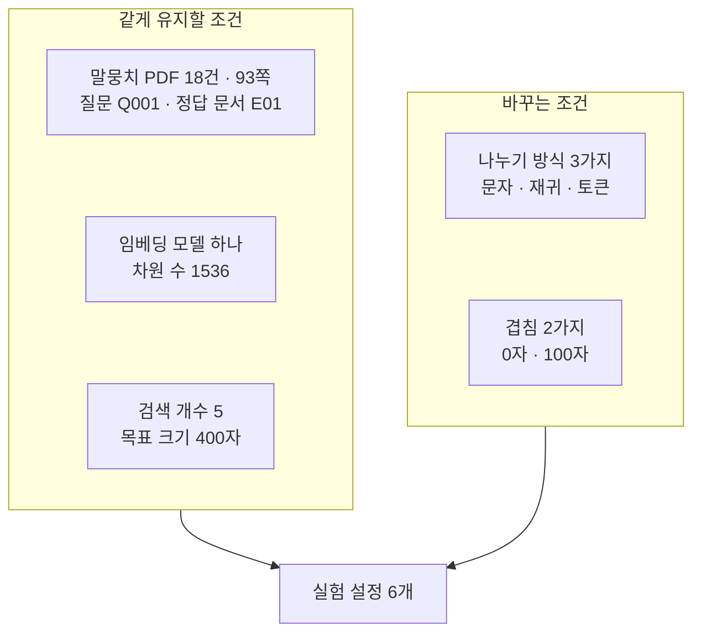
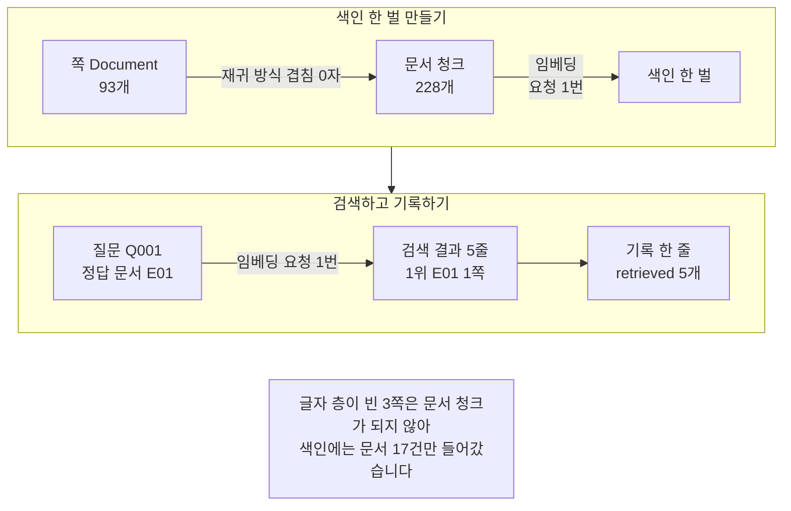
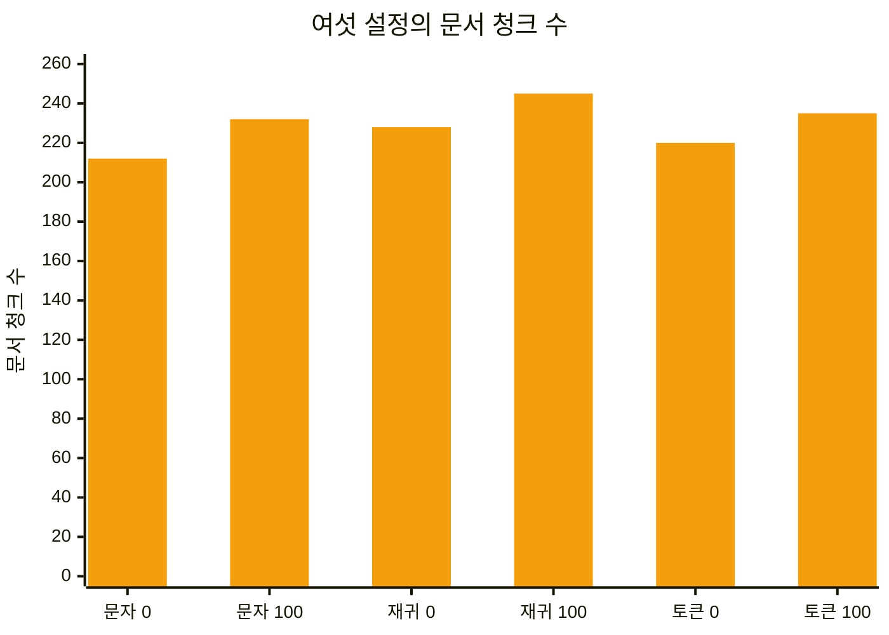
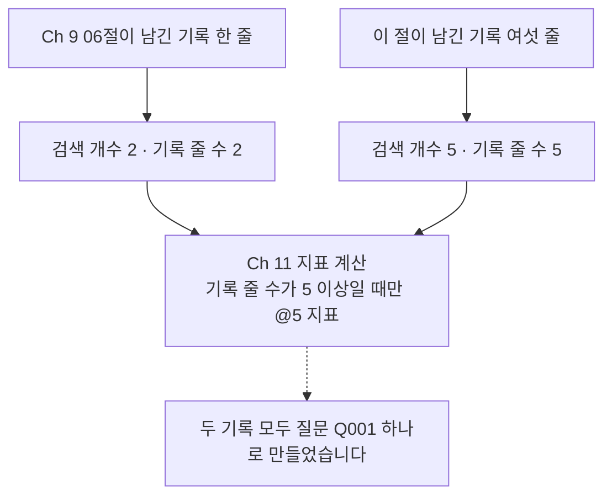

# 08-인덱싱-비교-실험

## _src 본문 (HTML 원본)

```html
<!--meta: 강의 1h | 실습 2h | 코드 08-인덱싱-비교-실험.ipynb | 새 용어 4 -->

<h2 id="b1"><span class="no">1</span>학습 목표</h2>
<div class="goal"><ul>
<li>이 절을 마치면 나누기 설정을 바꿔 색인을 여러 벌 만들 수 있습니다.</li>
<li>이 절을 마치면 조건 하나만 바꾸고 나머지를 같게 두는 표를 만들 수 있습니다.</li>
<li>이 절을 마치면 같은 질문의 검색 결과를 같은 모양의 기록으로 남길 수 있습니다.</li>
<li>이 절을 마치면 기록에 남길 줄 수가 뒤 챕터의 지표 계산을 정하는 까닭을 말할 수 있습니다.</li>
</ul></div>

<h2 id="b2"><span class="no">2</span>이 내용을 배우는 이유</h2>
<p>01~04절에서 여러 형식의 문서를 읽었습니다. 05·06절에서 끊는 자리를 정했습니다. 07절에서 문서 청크를 벡터로 바꿨습니다. 이제 그 벡터를 색인에 넣고 질문으로 찾는 단계가 남았습니다.</p>
<p>Ch 9 03절에서 색인을 한 벌 만들어 보았습니다. 그때는 설정이 하나여서 견줄 상대가 없었습니다. 설정을 바꾸면 검색 결과가 달라지는지 알 수 없었습니다.</p>
<p>이 절은 색인을 여섯 벌 만듭니다. 나누기 방식과 겹침만 바꾸고 나머지는 모두 같게 둡니다. 같은 질문으로 검색해 결과를 같은 모양으로 적어 놓고 견줍니다.</p>
<p>읽는 문서도 늘어납니다. 01~07절은 <code>E01.pdf</code> 하나만 읽었습니다. 이 절은 Ch 9 06절과 같은 디지털 PDF 18건을 읽습니다.</p>
<p>남긴 기록은 Ch 11이 읽는 입력입니다. 그래서 칸 이름과 줄 수를 마음대로 바꾸지 않습니다. 이 절 마지막 단계가 그 기록을 만드는 자리입니다.</p>

<h2 id="b3"><span class="no">3</span>앞에서 배운 내용</h2>
<ul>
<li><strong>문서 읽기</strong> — 01절에서 <code>load_pdf_pages()</code>로 쪽마다 <code>Document</code>를 만들었습니다. 다섯 칸 기록의 이름도 그때 정했습니다.</li>
<li><strong>글자 층</strong> — 02절에서 스캔본의 글자 층이 비는 것을 확인했습니다. 이 절에서도 글이 나오지 않는 쪽이 나옵니다.</li>
<li><strong>세 나누기 방식</strong> — 05절에서 문자 방식과 재귀 방식, 토큰 방식을 견줬습니다. 끊을 자리 순서도 그때 정했습니다.</li>
<li><strong>겹침</strong> — Ch 9 02절에서 이웃한 문서 청크가 글을 나눠 갖는 설정을 배웠습니다. 05절에서는 겹침을 0자로 두었습니다.</li>
<li><strong>임베딩과 차원 수</strong> — 07절에서 기본 설정 벡터에 숫자가 1536개 들어 있는 것을 확인했습니다.</li>
<li><strong>색인과 검색</strong> — Ch 9 03절에서 <code>InMemoryVectorStore</code>에 문서 청크를 넣고 <code>similarity_search_with_score()</code>로 찾았습니다.</li>
<li><strong>실행 기록 한 줄</strong> — Ch 9 06절에서 설정과 검색 결과를 한 줄 기록으로 남겼습니다. 질문과 정답 문서 ID는 평가셋 파일에서 읽었습니다.</li>
<li><strong>파일 지문</strong> — Ch 7 08절에서 <code>hashlib.sha256</code>으로 파일 내용을 16진수 64자로 줄였습니다.</li>
</ul>
<p>노트북은 Ch 9 02절 <code>load_pdf_pages()</code>와 Ch 8 01절 <code>count_tokens()</code>를 도구 파일 <code>rag_tools.py</code>에서 가져옵니다.</p>

<h2 id="b4"><span class="no">4</span>핵심 개념</h2>
<h3>비유 — 카드 폭만 다른 상자 셋</h3>
<p>같은 공지문을 카드에 옮겨 적어 상자에 담는다고 생각해 보세요. 한 상자에는 좁은 카드에 적고 다른 상자에는 넓은 카드에 적습니다. 담은 내용은 같지만 카드 한 장에 들어간 양이 다릅니다.</p>
<p>이제 같은 질문을 적은 쪽지를 상자마다 하나씩 놓습니다. 상자마다 맨 앞으로 올라오는 카드를 꺼냅니다. 꺼낸 카드를 같은 기록 용지의 줄에 놓으면 상자끼리 견줄 수 있습니다.</p>
<p>색인을 여러 벌 만들어 견주는 일도 같습니다. 나누는 방법만 바꾸고 질문은 같게 둡니다. 결과를 같은 칸 모양으로 적어야 나중에 다시 읽을 수 있습니다.</p>
{{img:08-5-상자-세-개와-기록-용지|평면 그림으로 책상 위에 같은 크기의 열린 카드 상자 세 개가 나란히 놓여 있고 왼쪽 상자에는 좁은 크림색 카드가 가운데 상자에는 중간 폭 카드가 오른쪽 상자에는 넓은 카드가 서서 반쯤 밖으로 나와 있으며 상자마다 앞에 크기와 모양과 색이 같은 노란 쪽지가 한 장씩 놓여 있고 오른쪽에는 줄이 그어진 기록 용지 한 장에 상자마다 꺼낸 카드가 줄마다 한 장씩 놓여 있어 줄마다 카드 폭이 다름|상자마다 카드 폭이 다르지만 앞에 놓인 쪽지는 셋이 같고 꺼낸 카드는 같은 기록 용지의 줄에 놓입니다}}
<p><strong>그림 읽기</strong> — 왼쪽 상자부터 봅니다. 담긴 카드가 왼쪽에서 오른쪽으로 갈수록 넓어집니다. 상자 세 개의 크기와 모양은 같습니다. 상자 앞에 놓인 노란 쪽지는 셋이 같은 모양입니다. 오른쪽 기록 용지의 세 줄에는 상자마다 꺼낸 카드가 한 장씩 놓여 있습니다.</p>

<h3>이 절에서 쓰는 말</h3>
<table><thead><tr><th>용어</th><th>뜻과 일상 예</th><th>이 절에서 보이는 모습</th></tr></thead><tbody>
<tr><td>실험 격자(experiment grid)</td><td>바꿀 조건을 곱해 만든 설정 표. 재료를 바꾸는 칸과 온도를 바꾸는 칸을 곱해 만든 조리 표와 같음</td><td>노트북 4절 <code>설정 수: 6</code></td></tr>
<tr><td>같게 유지할 조건(controlled condition)</td><td>차이를 읽으려고 설정마다 바꾸지 않는 값. 두 세제를 견주려고 같은 세탁기와 같은 물 온도를 쓰는 것과 같음</td><td>노트북 6절 <code>검색 개수: 5</code></td></tr>
<tr><td>기록 줄 수(logged candidates)</td><td>한 실행에서 기록에 남긴 검색 결과 줄 수. 시험지에서 몇 번째 답까지 적어 두는지와 같음</td><td>노트북 9절 <code>첫 줄의 검색 항목 수: 5</code></td></tr>
<tr><td>결과를 확인한 자료 범위(evaluation scope)</td><td>결론을 내릴 때 실제로 쓴 문서 수와 질문 수. 설문 결과를 읽을 때 응답자 수를 함께 보는 것과 같음</td><td>노트북 2절 <code>글이 있는 문서 수: 17</code></td></tr>
</tbody></table>
<p>파서·파일 형식·출처 기록·출처 계보는 01절과 같은 뜻입니다. 글자 층·표 읽기는 02절, 문단·태그·자리 칸은 03절과 같습니다. 형식 표시·압축 묶음은 04절과 같습니다. 문자 방식·재귀 방식·토큰 방식·조각 수 한도는 05절과 같습니다. 구조 방식·시맨틱 방식·제목 표시·끊는 기준값은 06절과 같습니다.</p>
<p>차원 수·벡터 캐시·가르는 이름·저장 이름표는 07절과 같습니다. 문서 청크·색인·벡터스토어·검색 점수는 Ch 9에서 정한 뜻 그대로입니다. 색인 이름표·실행 설정·실행 기록 한 줄·정답 문서 ID도 Ch 9 06절 뜻입니다. 「조각」은 Ch 5에서 정한 토큰 뜻입니다.</p>

<h3>여섯 설정은 이렇게 만듭니다</h3>
<table><thead><tr><th>나누기 방식</th><th>겹침 0자</th><th>겹침 100자</th><th>이번 설정</th></tr></thead><tbody>
<tr><td>문자 방식</td><td>실행</td><td>실행</td><td>경계 하나, 목표 400자</td></tr>
<tr><td>재귀 방식</td><td>실행</td><td>실행</td><td>끊을 자리 순서 다섯 개, 목표 400자</td></tr>
<tr><td>토큰 방식</td><td>실행</td><td>실행</td><td>규칙 <code>cl100k_base</code>, 목표 400조각</td></tr>
</tbody></table>
<p>여섯 실행에서 말뭉치와 질문, 임베딩 모델, 검색 개수를 같게 둡니다. 나누기 방식을 견줄 때는 같은 열의 세 행을 봅니다. 겹침을 견줄 때는 같은 행의 두 열을 봅니다.</p>
<p>목표 크기는 여섯 설정 모두 400으로 둡니다. 크기까지 함께 바꾸면 어느 조건이 결과를 바꿨는지 가를 수 없습니다.</p>

<h3>도식 — 같게 둘 것과 바꿀 것</h3>
{{mermaid:08-1-실험-격자|위에서 아래로 내려가는 흐름도로 왼쪽 칸 같게 유지할 조건에 초록 상자 말뭉치 PDF 18건 93쪽 질문 Q001 정답 문서 E01과 보라 상자 임베딩 모델 하나 차원 수 1536과 파란 상자 검색 개수 5 목표 크기 400자가 세로로 있고 오른쪽 칸 바꾸는 조건에 파란 상자 나누기 방식 3가지 문자 재귀 토큰과 파란 상자 겹침 2가지 0자 100자가 세로로 있으며 두 칸의 화살표가 맨 아래 노란 상자 실험 설정 6개로 모이는 그림|말뭉치와 질문과 임베딩 모델과 검색 개수를 같게 두고 나누기 방식과 겹침만 바꿔 설정 여섯 개를 만듭니다}}
<p><strong>도식 읽기</strong> — 왼쪽 칸과 오른쪽 칸을 견주고 아래로 내려갑니다. 왼쪽 칸이 여섯 설정에서 모두 같은 조건입니다. 초록 상자에 말뭉치와 질문이 있고, 보라 상자에 임베딩 모델이 있습니다. 파란 상자의 검색 개수와 목표 크기도 바꾸지 않습니다.</p>
<p>오른쪽 칸이 하나씩 바꾸는 조건입니다. 파란 상자 두 개에 나누기 방식 세 가지와 겹침 두 가지가 적혀 있습니다. 두 칸의 화살표가 맨 아래 노란 상자로 모입니다. 세 가지와 두 가지를 곱해 설정 여섯 개가 나옵니다.</p>

<h3>임베딩 설정은 07절을 그대로 이어 씁니다</h3>
<p>색인에 넣는 벡터는 07절 기본 설정으로 만듭니다. 모델 이름은 <code>text-embedding-3-small</code>이고 차원 수는 주지 않습니다. 07절에서 만든 숫자 256개짜리 벡터는 이 절에 쓰지 않습니다.</p>
<p>숫자 개수가 다른 벡터를 한 색인에 섞으면 검색 점수를 계산할 수 없습니다. Ch 9 03절과 06절 색인도 차원 수를 주지 않은 기본값입니다. 그래서 이 절 여섯 설정의 벡터는 모두 숫자 1536개입니다.</p>
<p>검색 점수는 Ch 9 03절에서 본 코사인 유사도입니다. 이 절도 같은 <code>InMemoryVectorStore</code>를 쓰므로 점수가 크면 가깝다는 뜻입니다. 다른 벡터스토어를 쓰면 점수의 뜻이 달라질 수 있어 이 말을 그대로 옮기지 않습니다.</p>

<h2 id="b5"><span class="no">5</span>실행 예제</h2>
<p>내려받은 실습 폴더에서 노트북을 열고 위에서 아래로 실행합니다. 프로젝트 맨 위 폴더의 <code>.env</code> 파일에 <code>OPENAI_API_KEY</code>가 있어야 합니다. 임베딩 요청은 모두 열세 번이고 답을 쓰는 모델은 부르지 않습니다.</p>
<p>보낼 조각 수는 390970개 어림이고 예상 비용은 0.01달러 미만입니다. 요금은 OpenAI 모델 안내(2026-09-17 확인)에 적힌 100만 토큰당 0.02달러로 잡았습니다. 코드로 센 어림이고 청구 금액이 아닙니다.</p>
<p>이 페이지의 출력은 2026-09-21에 실행한 결과입니다. 새 커널로 두 번 이어 실행해 문서 청크 수와 1위·2위 결과가 같은 것을 확인했습니다. 3위부터 5위는 점수 차가 작아 순서가 바뀔 수 있습니다. 이 페이지 출력 바로 앞의 새 커널 실행에서는 <code>recursive | 100</code> 줄의 3위와 4위가 서로 바뀌었습니다.</p>
<p>강의 시간에는 노트북 4~7절을 설명합니다. 실험 격자 만들기, 조각 수 어림하기, 색인 만들고 검색하기, 여섯 결과 읽기입니다. 8절 값 바꿔 보기와 9절 기록 남기기는 함께 실행하고 실습 시간에 다시 읽습니다. 2절은 01·05절과 같은 코드라 강의에서 빠르게 확인합니다.</p>
{{mermaid:08-2-한-설정의-흐름|위 칸 색인 한 벌 만들기에 초록 상자 쪽 Document 93개와 초록 상자 문서 청크 228개와 초록 상자 색인 한 벌이 왼쪽에서 오른쪽으로 있고 첫 화살표에 재귀 방식 겹침 0자 라벨과 둘째 화살표에 임베딩 요청 1번 라벨이 붙어 있으며 아래 칸 검색하고 기록하기에 초록 상자 질문 Q001 정답 문서 E01과 노란 상자 검색 결과 5줄 1위 E01 1쪽과 초록 상자 기록 한 줄 retrieved 5개가 같은 방향으로 있고 맨 아래 회색 상자에 글자 층이 빈 3쪽은 문서 청크가 되지 않아 색인에는 문서 17건만 들어갔습니다가 적힌 흐름도|쪽 Document 93개가 문서 청크 228개가 되고 색인 한 벌이 되며 검색 결과 다섯 줄이 기록 한 줄로 남습니다}}
<p><strong>도식 읽기</strong> — 위 칸이 색인을 만드는 순서입니다. 칸 안에서는 왼쪽에서 오른쪽으로 봅니다. 초록 상자 쪽 Document가 초록 상자 문서 청크가 되고 초록 상자 색인이 됩니다. 첫 화살표의 라벨이 그 설정의 나누기 방식과 겹침이고, 둘째 화살표의 라벨이 색인을 만들 때 보내는 임베딩 요청 한 번입니다.</p>
<p>아래 칸이 검색하고 기록하는 순서입니다. 초록 상자 질문에서 노란 상자 검색 결과로 갑니다. 화살표 라벨의 임베딩 요청 한 번이 질문을 벡터로 바꾸는 요청입니다. 노란 상자의 다섯 줄이 마지막 초록 상자의 기록 한 줄에 들어갑니다.</p>
<p>맨 아래 회색 상자는 두 칸 모두에 해당하는 설명입니다. 글자 층이 빈 세 쪽에서는 문서 청크가 만들어지지 않습니다. 그래서 여섯 설정의 색인에 문서 17건만 들어갔습니다.</p>
{{notebook:08-인덱싱-비교-실험}}
<p class="look"><b>확인할 점</b> — 여섯 설정의 문서 청크 수는 <code>[212, 232, 228, 245, 220, 235]</code>였습니다. 같은 방식끼리 견주면 겹침 100자 쪽이 더 많습니다. 여섯 설정 모두 정답 문서 E01이 1위와 2위였고 1위 쪽은 모두 1쪽이었습니다. 3위부터는 설정마다 <code>'M04'</code>와 <code>'H03'</code>이 섞여 나왔습니다. 이 결과는 질문 하나에서 본 것이라 설정의 우열이 아닙니다.</p>

<p>1위 문서 청크는 E01 1쪽 표지 글입니다. 질문의 답인 휴관 안내는 2쪽에 있습니다. 정답을 문서 단위로 보기 때문에 1위가 표지 쪽이어도 정답 문서입니다. Ch 9 05절은 쪽 단위 정답 출처를 가르쳤고 06절은 문서 단위 정답 문서 ID를 가르쳤습니다.</p>
<h2 id="b6"><span class="no">6</span>실험 결과 해석</h2>
{{mermaid:08-3-설정별-문서-청크-수|가로축에 문자 0과 문자 100과 재귀 0과 재귀 100과 토큰 0과 토큰 100 여섯 설정이 있고 가로축 숫자는 겹침 자 수이며 세로축이 문서 청크 수 0에서 260까지인 주황 막대 그림으로 막대 높이가 차례로 212와 232와 228과 245와 220과 235|가로축 숫자는 겹침 자 수이고 여섯 설정의 문서 청크 수는 212개에서 245개 사이입니다}}
<p><strong>도식 읽기</strong> — 왼쪽부터 두 막대씩 같은 방식입니다. 가로축 숫자는 겹침 자 수이고 두 막대 가운데 오른쪽이 겹침 100자입니다. 세 방식 모두 오른쪽 막대가 왼쪽보다 높습니다. 겹치는 글이 새 문서 청크에 다시 담기기 때문입니다.</p>
<p>여섯 막대의 높이 차이는 크지 않습니다. 가장 적은 설정이 212개이고 가장 많은 설정이 245개입니다. 목표 크기를 같게 두었으니 방식이 달라도 개수가 비슷하게 나옵니다.</p>
<p>문서 청크가 늘면 보낼 조각 수도 늘어납니다. 색인을 만드는 비용이 그만큼 커집니다. 그런데 이 질문의 1위와 2위 결과는 여섯 설정에서 모두 같았습니다.</p>
<p>그래서 이번 실행에서는 겹침을 준 효과를 검색 결과에서 보지 못했습니다. 겹침이 쓸모없다는 뜻은 아닙니다. 질문 하나로는 겹침이 필요한 자리가 나오지 않았다고만 적을 수 있습니다.</p>
{{mermaid:08-4-기록-줄-수|위에서 아래로 내려가는 흐름도로 위쪽에 초록 상자 Ch 9 06절이 남긴 기록 한 줄과 초록 상자 이 절이 남긴 기록 여섯 줄이 나란히 있고 그 아래 노란 상자 검색 개수 2 기록 줄 수 2와 노란 상자 검색 개수 5 기록 줄 수 5가 각각 이어지며 두 화살표가 회색 상자 Ch 11 지표 계산 기록 줄 수가 5 이상일 때만 @5 지표로 모이고 점선 화살표로 회색 상자 두 기록 모두 질문 Q001 하나로 만들었습니다가 붙어 있는 그림|Ch 9 기록은 두 줄이고 이 절 기록은 다섯 줄이라 상위 다섯 줄 기준 지표는 이 절 기록에서만 계산됩니다}}
<p><strong>도식 읽기</strong> — 위에서 아래로 보고 왼쪽 갈래와 오른쪽 갈래를 견줍니다. 위쪽 초록 상자 두 개가 두 챕터의 기록 파일입니다. 그 아래 노란 상자에 검색 개수와 기록 줄 수가 적혀 있습니다. 두 값은 한 실행에서 같은 값입니다.</p>
<p>두 화살표가 가운데 회색 상자로 모입니다. 회색 상자가 Ch 11이 지표를 계산하는 자리입니다. 기록 줄 수가 5 이상일 때만 상위 다섯 줄 기준 지표를 계산합니다. 그래서 Ch 9 기록에서는 그 지표가 빈 값으로 남습니다.</p>
<p>맨 아래 회색 상자는 두 갈래 모두에 해당합니다. 두 기록은 같은 질문 하나로 만들었습니다. 그래서 지표를 계산해도 질문 하나의 값입니다.</p>
<p>검색 개수를 2로 바꿔 본 실행에서는 앞 두 줄이 그대로였습니다. 검색 개수는 색인을 바꾸지 않고 몇 줄을 받을지만 정합니다. 기록에 남길 줄 수를 정하는 일은 뒤 챕터가 쓸 수 있는 지표를 정하는 일입니다.</p>

<h2 id="b7"><span class="no">7</span>주의할 점과 실무 메모</h2>
<ul>
<li><strong>목표 크기 400은 흐름을 보여 주려고 고른 값입니다.</strong> 탐색 실행에서 800을 주니 문서 청크 수가 여섯 설정에서 136개에서 137개 사이로 거의 같았습니다. 이 말뭉치의 쪽 평균 글자 수가 약 672자라 목표 크기가 쪽보다 커지기 때문입니다. 400에서 212개에서 245개로 갈려 설정 사이의 차이가 보입니다. 업무 문서에서는 쪽 길이를 먼저 재고 목표 크기를 정합니다.</li>
<li><strong>1위와 2위까지만 결론에 씁니다.</strong> 3위부터 5위는 점수 차가 작은 자리입니다. Ch 9 03절에서 본 대로 검색 점수는 실행마다 소수 아래 자리가 달라질 수 있습니다. 그 자리의 순서는 설정의 효과가 아니라 점수가 붙어 있어 생긴 차이일 수 있습니다.</li>
<li><strong>질문 하나는 전체 평가를 대신하지 않습니다.</strong> 이 절이 결과를 확인한 자료 범위는 문서 17건과 질문 하나입니다. 같은 1위가 나왔다고 여섯 설정이 같다고 적지 않습니다. 다른 결과가 나왔다고 한 설정이 낫다고도 적지 않습니다.</li>
<li><strong>글자 층이 빈 쪽은 색인에서 사라집니다.</strong> 이 말뭉치의 <code>H05</code>는 세 쪽 모두 글자 층이 비어 있습니다. 나눌 글이 없어 문서 청크가 만들어지지 않고 색인에도 들어가지 않습니다. 02절에서 본 글자 인식을 먼저 걸어야 이 문서가 검색 대상이 됩니다. 문서 수를 세어 색인에 든 문서와 대조하면 이런 누락을 찾을 수 있습니다.</li>
<li><strong>토큰 방식의 400은 조각 수입니다.</strong> 문자 방식과 재귀 방식의 400은 문자 수입니다. 05절에서 본 대로 이 말뭉치는 문자 수와 조각 수가 비슷해 결과 크기도 비슷했습니다. 다른 언어나 숫자가 많은 글에서는 두 단위가 크게 벌어질 수 있습니다.</li>
<li><strong>기록 파일은 뒤 챕터가 읽는 계약입니다.</strong> 파일 <code>runs/continuity-ch10-indexing.jsonl</code>은 여섯 줄이고 최상위 칸이 일곱 개입니다. 검색 항목의 칸 이름은 Ch 9 06절 기록과 같고, 답 글을 담는 칸만 없습니다. 문서 청크 이름은 <code>ch10:char:0000</code> 모양이라 Ch 9 기록의 <code>ch09:6f9f83db90:0</code>과 가운데와 번호 모양이 다릅니다. 읽는 쪽은 이 칸이 빈 값인지만 보므로 모양이 달라도 됩니다.</li>
<li><strong>실행별 사본은 지우지 않습니다.</strong> 노트북은 폴더 <code>runs/continuity/</code>에 실행 이름으로 사본을 남깁니다. 과정 전체를 검사하는 스크립트가 옛 사본을 그 이름으로 찾습니다. 노트북을 다시 실행하면 사본이 쌓이고 최신 기록 파일만 새 값으로 바뀝니다.</li>
<li><strong>실습 폴더 모듈과 설계가 다릅니다.</strong> 파일 <code>experiment.py</code>는 임베딩 모델 두 개와 구조 방식을 쓰고 결과를 <code>runs/examples/</code>에 남깁니다. 이번 노트북은 그 모듈을 부르지 않고 임베딩 모델 하나와 세 나누기 방식만 씁니다. 모듈 판을 쓸 때는 설정 칸과 기록 위치가 다른 것을 확인하세요.</li>
<li><strong>비용은 색인 수만큼 늘어납니다.</strong> 색인 한 벌마다 말뭉치 전체를 한 번 보냅니다. 설정을 열두 개로 늘리면 보낼 조각 수도 두 배가 됩니다. 07절에서 본 벡터 캐시를 쓰면 같은 글의 벡터를 다시 만들지 않는데, 이 절에서는 실행하지 않았습니다.</li>
<li><strong>이번에 실행하지 않은 것을 적어 둡니다.</strong> 다른 임베딩 모델로 견주기, 여러 질문을 돌려 평균 내기, 점수 기준값으로 거르기입니다. 색인을 파일로 저장해 다시 불러오는 일도 하지 않았습니다. 검색 지표 계산은 Ch 11에서 배웁니다.</li>
</ul>

<h2 id="b8"><span class="no">8</span>정리와 다음 절</h2>
<ul>
<li>말뭉치 PDF 18건에서 쪽 Document 93개를 읽었고 글자 층이 빈 쪽이 3개였습니다.</li>
<li>나누기 방식 세 가지와 겹침 두 값을 곱해 실험 설정 여섯 개를 만들었습니다.</li>
<li>여섯 설정의 문서 청크 수는 <code>[212, 232, 228, 245, 220, 235]</code>였고 같은 방식에서 겹침을 주면 늘었습니다.</li>
<li>여섯 설정 모두 정답 문서 E01이 1위와 2위였고 3위부터 문서가 갈렸습니다.</li>
<li>색인을 그대로 두고 검색 개수만 2로 바꾸니 앞 두 줄이 그대로였습니다.</li>
<li>기록 여섯 줄을 최신 파일과 실행별 사본으로 남겼고 한 줄의 검색 항목은 다섯 개입니다.</li>
</ul>
<p><strong>다음 학습과 이어지는 지점</strong> — 09절은 이 챕터의 실습입니다. 형식이 다른 문서 세 개를 한 색인에 모아 같은 질문으로 찾습니다. 01·03·04절 읽기와 기록, 05절 나누기, 이 절의 색인과 검색을 조립 함수 하나로 잇습니다.</p>
<p>이 절은 설정을 바꿔 기록을 남기는 데까지 왔습니다. 어느 설정이 나은지는 정하지 않았습니다. 남긴 기록 여섯 줄을 읽어 검색 지표를 계산하는 일은 Ch 11에서 하고, 09절 뒤에 이어집니다.</p>

<h2 id="b9"><span class="no">9</span>복습 문제</h2>
<details class="quiz" open><summary>문제 4개 · 해설 포함</summary>
<p class="quiz-q">1. [하] 실험 설정 여섯 개는 어떻게 만들어집니까?</p>
<p class="quiz-a">나누기 방식 세 가지와 겹침 두 값을 곱해 만듭니다. 방식은 문자 방식과 재귀 방식, 토큰 방식입니다. 겹침은 0자와 100자입니다. 나머지 조건은 여섯 설정에서 모두 같습니다.</p>
<p class="quiz-q">2. [중] 문서 청크 이름 <code>ch10:char:0000</code>과 <code>ch10:token:0000</code>은 같은 글입니까?</p>
<p class="quiz-a">번호만으로는 알 수 없습니다. 나누기 방식이 다르면 끊는 자리도 달라집니다. 이름의 번호는 그 설정 안에서 몇 번째 문서 청크인지만 뜻합니다.</p>
<p class="quiz-q">3. [중] 검색 개수를 5로 둔 까닭은 무엇입니까?</p>
<p class="quiz-a">기록에 남길 줄 수를 정하는 값이기 때문입니다. Ch 11은 기록 줄 수가 5 이상일 때만 상위 다섯 줄 기준 지표를 계산합니다. 노트북 8절에서 2로 바꿔 보니 앞 두 줄만 남았습니다.</p>
<p class="quiz-q">4. [상] 여섯 설정에서 1위 문서가 모두 E01이었습니다. 「여섯 설정의 검색 품질이 같다」고 적어도 됩니까?</p>
<p class="quiz-a">적을 수 없습니다. 이 절이 확인한 자료 범위는 문서 17건과 질문 하나입니다. 질문 하나에서 1위가 같았다는 것까지만 말할 수 있습니다. 여러 질문으로 지표를 재는 방법은 Ch 11에서 배웁니다.</p>
</details>

<h2 id="b10"><span class="no">10</span>참고 자료</h2>
<ul>
<li><div><a href="https://docs.langchain.com/oss/python/integrations/splitters/recursive_text_splitter">LangChain 공식 문서 Recursive text splitter</a></div>확인 2026-09-18 · <code>chunk_size</code>와 <code>chunk_overlap</code> 인자 참고.</li>
<li><div><a href="https://reference.langchain.com/python/langchain-text-splitters/character/CharacterTextSplitter">LangChain 공식 API CharacterTextSplitter</a></div>확인 2026-09-18 · 경계 하나로 나누는 방식과 <code>from_tiktoken_encoder</code> 참고.</li>
<li><div><a href="https://reference.langchain.com/python/langchain-core/vectorstores/in_memory/InMemoryVectorStore">LangChain 공식 API InMemoryVectorStore</a></div>확인 2026-09-18 · <code>add_documents()</code>와 <code>similarity_search_with_score()</code> 참고.</li>
<li><div><a href="https://docs.langchain.com/oss/python/integrations/embeddings/openai">LangChain 공식 문서 OpenAI embeddings</a></div>확인 2026-09-18 · 한 요청에 담는 글 수 기본값 참고.</li>
<li><div><a href="https://platform.openai.com/docs/pricing">OpenAI 요금 안내</a></div>확인 2026-09-17 · 임베딩 <code>text-embedding-3-small</code> 100만 토큰당 0.02달러 참고.</li>
<li>Ch 9 06절 실험 하네스 — 설정과 검색 결과를 한 줄 기록으로 남기는 방법. 지표 계산은 Ch 11에서 이어집니다.</li>
<li>기준 버전은 Python 3.12.13과 pypdf 6.18.0, langchain-core 1.6.2입니다. 나누기 도구는 langchain-text-splitters 1.1.2입니다. 임베딩은 langchain-openai 1.6.0으로 부릅니다. 조각은 tiktoken 0.14.0으로 셉니다. 빈 글에서 문서 청크가 만들어지지 않는 동작은 이 판의 소스에서 확인했습니다.</li>
</ul>
```

## 노트북 셀 (순서대로)

### [0] markdown {'html': 'skip'}

# 인덱싱 비교 실험

**이 노트북에서 할 일**

1. 말뭉치 PDF 18건을 읽어 쪽마다 Document를 만듭니다.
2. 나누기 설정을 하나씩 바꿔 색인을 여섯 벌 만듭니다.
3. 같은 질문으로 검색해 결과를 여섯 줄 기록으로 남깁니다.

**준비물** — 프로젝트 맨 위 폴더의 `.env` 파일에 `OPENAI_API_KEY`가 있어야 합니다.
임베딩 요청은 모두 열세 번이고, 답을 쓰는 모델은 부르지 않습니다.
보낼 조각 수는 390970개 어림입니다.

예상 비용은 열세 번을 합쳐 0.01달러 미만입니다.
임베딩 요금은 OpenAI 모델 안내(2026-09-17 확인)에 적힌 100만 토큰당 0.02달러입니다.
실행 시간은 패키지 설치를 빼면 2분 안팎입니다.

데이터는 두 갈래입니다.
폴더 `labs/data/rag-corpus/pdf/`의 디지털 PDF 18건을 읽습니다.
질문과 정답 문서 ID는 폴더 `labs/part3/ch11-evaluation/data/`의 평가셋에서 읽습니다.

기록은 폴더 `labs/part3/ch10-document-processing/runs/`에 씁니다.
최신 기록 파일 한 개와 실행별 사본 여섯 개가 생깁니다.
이 파일은 Ch 11이 읽는 입력이라 칸 이름과 줄 수를 바꾸지 않습니다.

**강의와 실습 범위** — 강의 시간에는 4~7절을 설명합니다.
실험 격자 만들기, 조각 수 어림하기, 색인 만들고 검색하기, 여섯 결과 읽기입니다.
8절 값 바꿔 보기와 9절 기록 남기기는 함께 실행하고 실습 시간에 다시 읽습니다.
2절은 01·05절과 같은 코드라 강의에서 빠르게 확인합니다.

**기준 버전** — 실습 폴더에 고정한 패키지 판을 씁니다.
pypdf 6.18.0과 langchain-core 1.6.2를 씁니다.
나누기 도구는 langchain-text-splitters 1.1.2입니다.
임베딩은 langchain-openai 1.6.0으로 부릅니다.
조각은 tiktoken 0.14.0으로 셉니다.

교재 출력은 Linux의 Python 3.12.13으로 만들었습니다.
다른 버전과 Windows·macOS에서는 이번에 실행하지 않았습니다.

실습 폴더 `labs/part3/ch10-document-processing`에서 `uv sync --locked`를 실행합니다.
그다음 이 폴더의 `.venv` 커널을 고르고 첫 셀부터 순서대로 실행합니다.

### [1] markdown {'html': 'skip'}

## 오늘 볼 그림


왼쪽 칸과 오른쪽 칸을 견주고 아래로 내려갑니다.
왼쪽 칸은 여섯 설정에서 모두 같게 두는 조건입니다.
오른쪽 칸은 하나씩 바꾸는 조건입니다.
두 칸을 곱해 실험 설정 여섯 개가 나옵니다.

### [2] markdown {}

## 1. 준비

첫 셀은 패키지를 설치하고 설치된 버전을 출력합니다. 설치에는 몇십 초가 걸릴 수 있습니다.
01·05·07절에서 쓴 도구를 그대로 씁니다.

### [3] code {'execution': {'iopub.execute_input': '2026-09-21T06:25:53.044776Z', 'iopub.status.busy': '2026-09-21T06:25:53.044624Z', 'iopub.status.idle': '2026-09-21T06:25:53.506645Z', 'shell.execute_reply': '2026-09-21T06:25:53.506128Z'}, 'lesson_role': 'setup'}

```python
# 이 절에서 쓰는 패키지를 설치하고 버전을 확인합니다
%pip install -q "pypdf==6.18.0" "langchain-core==1.6.2" "langchain-text-splitters==1.1.2" "langchain-openai==1.6.0" "tiktoken==0.14.0" "python-dotenv==1.2.3"
from importlib.metadata import version

print("pypdf:", version("pypdf"))
print("langchain-core:", version("langchain-core"))
print("langchain-text-splitters:", version("langchain-text-splitters"))
print("langchain-openai:", version("langchain-openai"))
print("tiktoken:", version("tiktoken"))
print("python-dotenv:", version("python-dotenv"))
```

출력:
```
Note: you may need to restart the kernel to use updated packages.
pypdf: 6.18.0
langchain-core: 1.6.2
langchain-text-splitters: 1.1.2
langchain-openai: 1.6.0
tiktoken: 0.14.0
python-dotenv: 1.2.3

```

### [4] markdown {}

**결과 읽기** — 출력 여섯 줄 가운데 첫 줄은 `pypdf: 6.18.0`입니다.
셋째 줄 `langchain-text-splitters: 1.1.2`와 넷째 줄 `langchain-openai: 1.6.0`도 보세요.
준비물에 적은 기준 버전과 같습니다.

다음 셀은 이 절에서 쓸 이름을 불러옵니다.
클래스 `CharacterTextSplitter`와 `RecursiveCharacterTextSplitter`가 05절에서 쓴 나누기 도구입니다.
클래스 `InMemoryVectorStore`가 Ch 9 03절에서 쓴 색인이고 `OpenAIEmbeddings`가 임베딩을 부릅니다.

앞에서 배운 함수는 `rag_tools.py`에 모아 두었습니다. 파일을 열면 코드를 볼 수 있습니다. 노트북과 같은 폴더(`notebooks/`)에 있는 파일입니다.
이 노트북은 Ch 9 02절 `load_pdf_pages()`와 Ch 8 01절 `count_tokens()`를 가져옵니다.

### [5] code {'execution': {'iopub.execute_input': '2026-09-21T06:25:53.507947Z', 'iopub.status.busy': '2026-09-21T06:25:53.507839Z', 'iopub.status.idle': '2026-09-21T06:25:54.669570Z', 'shell.execute_reply': '2026-09-21T06:25:54.669188Z'}, 'lesson_role': 'setup'}

```python
# 나누기·임베딩·색인·조각 세기·기록 저장에 쓸 이름을 불러옵니다
import hashlib
import json
import os
import time

from langchain_core.vectorstores import InMemoryVectorStore
from langchain_openai import OpenAIEmbeddings
from langchain_text_splitters import CharacterTextSplitter
from langchain_text_splitters import RecursiveCharacterTextSplitter
import tiktoken
# Ch 9 02절과 Ch 8 01절 함수 두 개를 도구 파일에서 가져옵니다
from rag_tools import count_tokens, load_pdf_pages
```

출력:
```

```

### [6] markdown {}

**결과 읽기** — 이 셀은 이름을 불러오기만 하므로 출력이 없습니다.

모듈 `time`은 Python에 들어 있는 기능 묶음입니다.
이 절에서는 실행 이름에 넣을 날짜와 시각을 만드는 데 씁니다.
Ch 9 06절에서 실행 이름을 만들 때 쓴 것과 같은 모듈입니다.

다음 셀은 키가 있는지 확인합니다. 키 값은 출력하지 않고 있는지만 봅니다.

### [7] code {'execution': {'iopub.execute_input': '2026-09-21T06:25:54.670478Z', 'iopub.status.busy': '2026-09-21T06:25:54.670376Z', 'iopub.status.idle': '2026-09-21T06:25:54.673759Z', 'shell.execute_reply': '2026-09-21T06:25:54.673402Z'}, 'lesson_role': 'setup'}

```python
# .env 파일에서 OpenAI API 키를 읽습니다(키 값은 출력하지 않습니다)
import os
from dotenv import find_dotenv, load_dotenv

env_path = find_dotenv(usecwd=True)
load_dotenv(env_path)
has_key = os.getenv("OPENAI_API_KEY") is not None
print("OPENAI_API_KEY 설정 여부:", has_key)
assert has_key, "프로젝트 폴더의 .env 파일에 OPENAI_API_KEY를 적어 주세요."
```

출력:
```
OPENAI_API_KEY 설정 여부: True

```

### [8] markdown {}

**결과 읽기** — 출력 줄은 `OPENAI_API_KEY 설정 여부: True`입니다.

## 2. 말뭉치 18건 읽기

01~07절과 같은 방법으로 프로젝트 맨 위 경로를 고릅니다.
후보 세 개를 차례로 확인하고, 있는 경로에서 멈춥니다.

실행 전에 예상합니다. 프로젝트 맨 위에서 열었다면 첫째 후보를 고를 것입니다.

### [9] code {'execution': {'iopub.execute_input': '2026-09-21T06:25:54.674449Z', 'iopub.status.busy': '2026-09-21T06:25:54.674401Z', 'iopub.status.idle': '2026-09-21T06:25:54.676411Z', 'shell.execute_reply': '2026-09-21T06:25:54.676095Z'}}

```python
# 작업 폴더에서 본 프로젝트 맨 위 경로를 후보 세 개 가운데에서 고릅니다
candidates = [".", "../../..", "../../../.."]
root_path = None
for candidate in candidates:
    if os.path.exists(candidate + "/labs/data/rag-corpus"):
        root_path = candidate
        break
print("고른 경로:", root_path)
assert root_path is not None, "notebooks 폴더나 실습 폴더 맨 위에서 노트북을 열어 주세요."
```

출력:
```
고른 경로: .

```

### [10] markdown {}

**결과 읽기** — 출력 줄은 `고른 경로: .`입니다. `assert`도 통과했습니다.
교재 출력은 프로젝트 맨 위를 작업 폴더로 삼아 실행해서 첫째 후보를 골랐습니다.

다음 셀은 말뭉치 목록 파일을 읽어 디지털 PDF만 골라 둡니다.
01절에서 본 네 갈래 가운데 `scanned`는 글자 층이 없는 스캔 변형이라 뺍니다.
Ch 9 06절 색인과 같은 18건을 쓰려는 것입니다.

### [11] code {'execution': {'iopub.execute_input': '2026-09-21T06:25:54.677042Z', 'iopub.status.busy': '2026-09-21T06:25:54.676993Z', 'iopub.status.idle': '2026-09-21T06:25:54.679516Z', 'shell.execute_reply': '2026-09-21T06:25:54.679057Z'}}

```python
# 말뭉치 목록에서 스캔 변형을 빼고 디지털 PDF 18건만 골라 둡니다
corpus_path = root_path + "/labs/data/rag-corpus"
manifest_path = corpus_path + "/manifest.json"
with open(manifest_path, encoding="utf-8") as manifest_file:
    manifest_rows = json.loads(manifest_file.read())
digital_rows = []
for row in manifest_rows:
    if row["tier"] != "scanned":
        digital_rows.append(row)
print("목록의 전체 행 수:", len(manifest_rows))
print("디지털 PDF 수:", len(digital_rows))
print("첫 문서의 이름과 쪽 수:", digital_rows[0]["doc_id"], digital_rows[0]["pages"])
```

출력:
```
목록의 전체 행 수: 21
디지털 PDF 수: 18
첫 문서의 이름과 쪽 수: E01 5

```

### [12] markdown {}

**결과 읽기** — 출력 첫 줄은 `목록의 전체 행 수: 21`입니다.
다음 줄 `디지털 PDF 수: 18`이 이 절이 색인에 넣을 문서 수입니다.
셋째 줄은 `첫 문서의 이름과 쪽 수: E01 5`이고 01~07절에서 읽은 그 문서입니다.

목록에서 뺀 세 건은 스캔 변형입니다. 02절에서 글자 층이 비는 것을 확인한 파일입니다.

준비 셀에서 가져온 Ch 9 02절 로더 함수 `load_pdf_pages()`로 문서를 읽습니다.

다음 셀은 이 함수로 18건을 차례로 읽어 쪽 Document를 한 목록에 모읍니다.
01~07절은 문서 하나만 읽었습니다. 여러 문서를 한 번에 읽는 것은 이 절이 처음입니다.

### [13] code {'execution': {'iopub.execute_input': '2026-09-21T06:25:54.680512Z', 'iopub.status.busy': '2026-09-21T06:25:54.680446Z', 'iopub.status.idle': '2026-09-21T06:25:55.391330Z', 'shell.execute_reply': '2026-09-21T06:25:55.390894Z'}}

```python
# 디지털 PDF 18건을 차례로 읽어 쪽 Document를 한 목록에 모읍니다
corpus_pages = []
for row in digital_rows:
    file_path = corpus_path + "/" + row["file"]
    row_pages = load_pdf_pages(file_path, row["doc_id"])
    for page_document in row_pages:
        corpus_pages.append(page_document)
print("읽은 문서 수:", len(digital_rows))
print("읽은 쪽 수:", len(corpus_pages))
print("첫 쪽의 메타데이터:", corpus_pages[0].metadata)
```

출력:
```
읽은 문서 수: 18
읽은 쪽 수: 93
첫 쪽의 메타데이터: {'doc_id': 'E01', 'page': 1, 'source': 'E01.pdf'}

```

### [14] markdown {}

**결과 읽기** — 출력 첫 줄은 `읽은 문서 수: 18`이고 다음 줄은 `읽은 쪽 수: 93`입니다.
셋째 줄 `첫 쪽의 메타데이터: {'doc_id': 'E01', 'page': 1, 'source': 'E01.pdf'}`를 보세요.
01절에서 정한 칸 이름을 그대로 씁니다.

Ch 9 06절도 같은 18건에서 93쪽을 읽었습니다. 같은 파일을 같은 파서로 읽었기 때문입니다.

다음 셀은 본문 글자 수가 0인 쪽을 세고, 글이 있는 문서가 몇 건인지 셉니다.

### [15] code {'execution': {'iopub.execute_input': '2026-09-21T06:25:55.392123Z', 'iopub.status.busy': '2026-09-21T06:25:55.392067Z', 'iopub.status.idle': '2026-09-21T06:25:55.394132Z', 'shell.execute_reply': '2026-09-21T06:25:55.393779Z'}}

```python
# 본문 글자 수가 0인 쪽을 모으고 글이 있는 문서 이름을 따로 셉니다(02절 글자 층)
empty_page_docs = []
text_doc_ids = []
for page_document in corpus_pages:
    if len(page_document.page_content) == 0:
        empty_page_docs.append(page_document.metadata["doc_id"])
    elif page_document.metadata["doc_id"] not in text_doc_ids:
        text_doc_ids.append(page_document.metadata["doc_id"])
print("글자 층이 빈 쪽 수:", len(empty_page_docs))
print("그 쪽의 문서 이름:", empty_page_docs)
print("글이 있는 문서 수:", len(text_doc_ids))
```

출력:
```
글자 층이 빈 쪽 수: 3
그 쪽의 문서 이름: ['H05', 'H05', 'H05']
글이 있는 문서 수: 17

```

### [16] markdown {}

**결과 읽기** — 출력 첫 줄은 `글자 층이 빈 쪽 수: 3`입니다.
다음 줄 `그 쪽의 문서 이름: ['H05', 'H05', 'H05']`를 보세요. 한 문서의 세 쪽입니다.
셋째 줄은 `글이 있는 문서 수: 17`입니다.

말뭉치 목록은 이 문서를 「텍스트 레이어가 없는 스캔 이미지」라고 적어 두었습니다.
그 목록이 쓴 「텍스트 레이어」가 02절에서 정한 글자 층입니다.
`scanned` 갈래가 아니라 `hard` 갈래에 들어 있어 앞의 18건에 함께 딸려 왔습니다.
나눌 글이 없는 쪽은 문서 청크가 되지 않아 색인에는 문서 17건만 들어갑니다.

## 3. 질문과 정답 문서 가져오기

Ch 9 06절과 같은 방법으로 Ch 11 평가셋에서 질문을 읽습니다.
질문 글과 정답 문서 ID를 노트북에 적지 않고 파일에서 읽는 까닭이 있습니다.
기록을 읽는 쪽이 두 값을 평가셋과 글자까지 대조하기 때문입니다.

### [17] code {'execution': {'iopub.execute_input': '2026-09-21T06:25:55.394732Z', 'iopub.status.busy': '2026-09-21T06:25:55.394681Z', 'iopub.status.idle': '2026-09-21T06:25:55.397123Z', 'shell.execute_reply': '2026-09-21T06:25:55.396800Z'}}

```python
# Ch 11 평가셋 파일을 줄 단위로 읽습니다
query_path = root_path + "/labs/part3/ch11-evaluation/data/evaluation-queries.jsonl"
with open(query_path, encoding="utf-8") as query_file:
    query_lines = query_file.read().splitlines()
print("평가셋의 줄 수:", len(query_lines))
```

출력:
```
평가셋의 줄 수: 30

```

### [18] markdown {}

**결과 읽기** — 출력 줄은 `평가셋의 줄 수: 30`입니다.
한 줄이 질문 하나입니다. 이 절은 그 가운데 하나만 씁니다.

다음 셀은 질문 번호 `Q001`인 줄을 찾아 질문 글과 정답 문서 ID를 꺼냅니다.

### [19] code {'execution': {'iopub.execute_input': '2026-09-21T06:25:55.397792Z', 'iopub.status.busy': '2026-09-21T06:25:55.397743Z', 'iopub.status.idle': '2026-09-21T06:25:55.399431Z', 'shell.execute_reply': '2026-09-21T06:25:55.399117Z'}}

```python
# 질문 번호 Q001인 줄을 찾아 질문 글과 정답 문서 ID를 꺼냅니다
query_row = None
for line in query_lines:
    row = json.loads(line)
    if row["qid"] == "Q001":
        query_row = row
        break
question_text = query_row["question"]
gold_doc_ids = query_row["gold_doc_ids"]
print("질문 번호:", query_row["qid"])
print("질문:", question_text)
print("정답 문서 ID:", gold_doc_ids)
```

출력:
```
질문 번호: Q001
질문: 미르시립도서관의 정기 휴관일은 언제인가요?
정답 문서 ID: ['E01']

```

### [20] markdown {}

**결과 읽기** — 출력 첫 줄은 `질문 번호: Q001`입니다.
다음 줄은 `질문: 미르시립도서관의 정기 휴관일은 언제인가요?`입니다.
셋째 줄 `정답 문서 ID: ['E01']`이 이 질문의 정답 문서입니다.

Ch 9 06절이 쓴 질문과 같은 글입니다. 05·06·07절이 읽은 `E01.pdf`가 그 정답 문서입니다.
정답은 문서 단위입니다. 몇 쪽인지는 이 파일에 없습니다.

### [21] markdown {}

## 4. 실험 격자 만들기

이제 바꿀 조건을 정합니다. 05절에서 배운 세 나누기 방식과 겹침 두 값입니다.
세 방식을 두 겹침과 짝지으면 설정 여섯 개가 나옵니다.

목표 크기는 여섯 설정 모두 400자로 둡니다.
크기까지 함께 바꾸면 어느 조건이 결과를 바꿨는지 가를 수 없습니다.

첫 셀은 문자 방식 설정 두 개를 만듭니다.
설정마다 나누기 값 딕셔너리와 스플리터를 함께 담습니다.

### [22] code {'execution': {'iopub.execute_input': '2026-09-21T06:25:55.400036Z', 'iopub.status.busy': '2026-09-21T06:25:55.399986Z', 'iopub.status.idle': '2026-09-21T06:25:55.401910Z', 'shell.execute_reply': '2026-09-21T06:25:55.401557Z'}}

```python
# 문자 방식 설정 두 개를 만듭니다(겹침 0자와 100자)
chunk_target = 400
overlap_values = [0, 100]
separator_order = ["\n\n", ". ", "\n", " ", ""]
settings = []
for chunk_overlap in overlap_values:
    char_config = {"separator": "\n", "chunk_size": chunk_target, "chunk_overlap": chunk_overlap}
    char_splitter = CharacterTextSplitter(
        separator="\n", chunk_size=chunk_target, chunk_overlap=chunk_overlap,
    )
    settings.append({"chunk_method": "char", "split_config": char_config, "splitter": char_splitter})
print("설정 수:", len(settings))
print("문자 방식 첫 설정:", settings[0]["split_config"])
```

출력:
```
설정 수: 2
문자 방식 첫 설정: {'separator': '\n', 'chunk_size': 400, 'chunk_overlap': 0}

```

### [23] markdown {}

**결과 읽기** — 출력 첫 줄은 `설정 수: 2`입니다.
다음 줄 `문자 방식 첫 설정: {'separator': '\n', 'chunk_size': 400, 'chunk_overlap': 0}`을 보세요.
05절 3절과 같은 경계 한 개를 쓰고 목표 크기만 400자로 바꿨습니다.

칸 `splitter`에는 나누는 도구가 들어 있어 출력에 적지 않았습니다.
기록 파일에는 이 칸을 넣지 않고 `split_config`만 넣습니다.

다음 셀은 재귀 방식 설정 두 개를 더합니다.

### [24] code {'execution': {'iopub.execute_input': '2026-09-21T06:25:55.402475Z', 'iopub.status.busy': '2026-09-21T06:25:55.402429Z', 'iopub.status.idle': '2026-09-21T06:25:55.404229Z', 'shell.execute_reply': '2026-09-21T06:25:55.403890Z'}}

```python
# 재귀 방식 설정 두 개를 더합니다(05절 4절과 같은 끊을 자리 순서)
for chunk_overlap in overlap_values:
    recursive_config = {"separators": separator_order, "chunk_size": chunk_target,
                        "chunk_overlap": chunk_overlap}
    recursive_splitter = RecursiveCharacterTextSplitter(
        separators=separator_order, chunk_size=chunk_target,
        chunk_overlap=chunk_overlap, keep_separator="end",
    )
    settings.append({"chunk_method": "recursive", "split_config": recursive_config,
                     "splitter": recursive_splitter})
print("설정 수:", len(settings))
print("재귀 방식의 끊을 자리 순서:", settings[2]["split_config"]["separators"])
```

출력:
```
설정 수: 4
재귀 방식의 끊을 자리 순서: ['\n\n', '. ', '\n', ' ', '']

```

### [25] markdown {}

**결과 읽기** — 출력 첫 줄은 `설정 수: 4`입니다.
다음 줄 `재귀 방식의 끊을 자리 순서: ['\n\n', '. ', '\n', ' ', '']`을 보세요.
05절 4절에서 쓴 순서 그대로입니다.

다음 셀은 토큰 방식 설정 두 개를 더해 여섯 개를 채웁니다.

### [26] code {'execution': {'iopub.execute_input': '2026-09-21T06:25:55.404741Z', 'iopub.status.busy': '2026-09-21T06:25:55.404697Z', 'iopub.status.idle': '2026-09-21T06:25:55.457219Z', 'shell.execute_reply': '2026-09-21T06:25:55.456799Z'}}

```python
# 토큰 방식 설정 두 개를 더합니다(05절 10절과 같은 조각 세는 규칙)
encoding_name = "cl100k_base"
for chunk_overlap in overlap_values:
    token_config = {"encoding_name": encoding_name, "separators": separator_order,
                    "chunk_size": chunk_target, "chunk_overlap": chunk_overlap}
    token_splitter = RecursiveCharacterTextSplitter.from_tiktoken_encoder(
        encoding_name=encoding_name, separators=separator_order,
        chunk_size=chunk_target, chunk_overlap=chunk_overlap, keep_separator="end",
    )
    settings.append({"chunk_method": "token", "split_config": token_config,
                     "splitter": token_splitter})
print("설정 수:", len(settings))
print("토큰 방식 둘째 설정의 겹침:", settings[5]["split_config"]["chunk_overlap"])
```

출력:
```
설정 수: 6
토큰 방식 둘째 설정의 겹침: 100

```

### [27] markdown {}

**결과 읽기** — 출력 첫 줄은 `설정 수: 6`입니다.
다음 줄은 `토큰 방식 둘째 설정의 겹침: 100`입니다. 여섯 설정이 모두 만들어졌습니다.

목록 순서는 문자 0자, 문자 100자, 재귀 0자, 재귀 100자, 토큰 0자, 토큰 100자입니다.
토큰 방식의 400과 100은 문자 수가 아니라 조각 수입니다.
05절에서 본 대로 이 말뭉치는 문자 수와 조각 수가 비슷해 크기도 비슷하게 나옵니다.

## 5. 보낼 조각 수와 비용 어림하기

요청을 보내기 전에 몇 조각을 보낼지 어림합니다.
06·07절과 같은 방식입니다. 색인 여섯 벌이니 말뭉치 전체를 여섯 번 보냅니다.

겹침을 준 설정은 같은 글이 두 번 담기는 자리가 있어 조각이 조금 늘어납니다.
그 몫을 1.1배로 잡습니다.

첫 셀은 조각 세는 규칙을 준비합니다. 조각 수는 준비 셀에서 가져온 `count_tokens()`로 셉니다.

### [28] code {'execution': {'iopub.execute_input': '2026-09-21T06:25:55.457833Z', 'iopub.status.busy': '2026-09-21T06:25:55.457781Z', 'iopub.status.idle': '2026-09-21T06:25:55.459366Z', 'shell.execute_reply': '2026-09-21T06:25:55.459070Z'}}

```python
# 4절에서 정한 이름으로 조각 세는 규칙을 불러옵니다
encoding = tiktoken.get_encoding(encoding_name)
print("조각 세는 규칙 이름:", encoding.name)
```

출력:
```
조각 세는 규칙 이름: cl100k_base

```

### [29] markdown {}

**결과 읽기** — 출력 줄은 `조각 세는 규칙 이름: cl100k_base`입니다.
4절에서 정한 이름이고, 토큰 방식 스플리터도 같은 규칙으로 글을 셉니다.

다음 셀은 말뭉치 전체의 조각 수를 세고 비용을 어림합니다.

### [30] code {'execution': {'iopub.execute_input': '2026-09-21T06:25:55.459864Z', 'iopub.status.busy': '2026-09-21T06:25:55.459819Z', 'iopub.status.idle': '2026-09-21T06:25:55.475644Z', 'shell.execute_reply': '2026-09-21T06:25:55.475284Z'}}

```python
# 말뭉치 전체의 조각 수를 세고 여섯 설정이 보낼 조각 수와 비용을 어림합니다
corpus_tokens = 0
for page_document in corpus_pages:
    corpus_tokens = corpus_tokens + count_tokens(encoding, page_document.page_content)
overlap_times = 1.1
sent_tokens = int(corpus_tokens * len(settings) * overlap_times)
embedding_rate = 0.02
tokens_per_million = 1000000
total_cost = round(sent_tokens / tokens_per_million * embedding_rate, 7)
print("말뭉치 전체의 조각 수:", corpus_tokens)
print("여섯 설정이 보낼 조각 수 어림:", sent_tokens)
print("이 절 전체의 비용 어림(달러):", total_cost)
```

출력:
```
말뭉치 전체의 조각 수: 59238
여섯 설정이 보낼 조각 수 어림: 390970
이 절 전체의 비용 어림(달러): 0.0078194

```

### [31] markdown {}

**결과 읽기** — 출력 첫 줄은 `말뭉치 전체의 조각 수: 59238`입니다.
다음 줄 `여섯 설정이 보낼 조각 수 어림: 390970`이 색인 여섯 벌의 어림입니다.
셋째 줄은 `이 절 전체의 비용 어림(달러): 0.0078194`입니다.

요금은 100만 조각당 0.02달러로 잡았습니다. 코드로 센 어림이고 청구 금액이 아닙니다.
질문을 보내는 요청은 조각 수가 적어 어림에서 뺐습니다.

## 6. 색인 만들고 검색하기

임베딩 모델은 Ch 9 03절·06절·07절과 같은 이름으로 하나만 씁니다.
차원 수는 주지 않아 그 모델의 기본값입니다. 07절에서 본 대로 숫자 1536개입니다.

검색 개수는 5로 둡니다. 기록에 남길 줄 수도 그 값입니다.
Ch 9 06절은 2를 썼습니다. 둘을 다르게 둔 까닭은 9절에서 봅니다.

### [32] code {'execution': {'iopub.execute_input': '2026-09-21T06:25:55.476295Z', 'iopub.status.busy': '2026-09-21T06:25:55.476248Z', 'iopub.status.idle': '2026-09-21T06:25:55.838670Z', 'shell.execute_reply': '2026-09-21T06:25:55.838297Z'}}

```python
# Ch 9·06·07절과 같은 임베딩 모델을 기본 설정으로 준비합니다(이 셀은 요청을 보내지 않습니다)
embedding_model_name = "text-embedding-3-small"
embedding_model = OpenAIEmbeddings(model=embedding_model_name)
search_count = 5
print("임베딩 모델 이름:", embedding_model_name)
print("차원 수를 주었는가:", embedding_model.dimensions is not None)
print("검색 개수:", search_count)
```

출력:
```
임베딩 모델 이름: text-embedding-3-small
차원 수를 주었는가: False
검색 개수: 5

```

### [33] markdown {}

**결과 읽기** — 출력 첫 줄은 `임베딩 모델 이름: text-embedding-3-small`입니다.
다음 줄 `차원 수를 주었는가: False`는 인자 `dimensions`를 주지 않았다는 뜻입니다.
셋째 줄은 `검색 개수: 5`입니다.

07절에서 만든 숫자 256개짜리 벡터는 여기에 쓰지 않습니다.
숫자 개수가 다른 벡터를 한 색인에 섞으면 검색 점수를 계산할 수 없습니다.

다음 셀은 문서 청크마다 이름을 붙이는 함수를 만듭니다.
메서드 `zfill()`은 글 앞에 0을 채워 글자 수를 맞춥니다.

### [34] code {'execution': {'iopub.execute_input': '2026-09-21T06:25:55.839432Z', 'iopub.status.busy': '2026-09-21T06:25:55.839374Z', 'iopub.status.idle': '2026-09-21T06:25:55.841227Z', 'shell.execute_reply': '2026-09-21T06:25:55.840841Z'}}

```python
# 문서 청크마다 이름을 붙입니다(ch10 · 방식 이름 · 네 자리 번호)
def name_chunks(chunk_documents, method):
    number = 0
    for chunk in chunk_documents:
        chunk.metadata["chunk_id"] = "ch10:" + method + ":" + str(number).zfill(4)
        number = number + 1
    return chunk_documents
```

출력:
```

```

### [35] markdown {}

**결과 읽기** — 이 셀은 함수를 만들기만 하므로 값을 출력하지 않습니다.

이름은 `ch10:recursive:0000` 모양입니다. 설정 안에서 몇 번째 문서 청크인지 적습니다.
Ch 9 06절 기록의 이름은 `ch09:6f9f83db90:0` 모양이라 가운데와 번호 모양이 다릅니다.
기록을 읽는 쪽은 이 칸이 빈 값인지만 보므로 모양이 달라도 됩니다.

다음 셀은 설정 하나를 받아 색인을 만들고 검색까지 하는 함수를 만듭니다.

### [36] code {'execution': {'iopub.execute_input': '2026-09-21T06:25:55.841774Z', 'iopub.status.busy': '2026-09-21T06:25:55.841726Z', 'iopub.status.idle': '2026-09-21T06:25:55.843548Z', 'shell.execute_reply': '2026-09-21T06:25:55.843192Z'}}

```python
# 설정 하나로 색인을 만들고 질문으로 검색해 결과를 모아 반환합니다(임베딩 요청 2번)
def run_setting(setting):
    chunk_documents = setting["splitter"].split_documents(corpus_pages)
    name_chunks(chunk_documents, setting["chunk_method"])
    store = InMemoryVectorStore(embedding=embedding_model)
    store.add_documents(chunk_documents)
    hits = store.similarity_search_with_score(question_text, k=search_count)
    top_document = hits[0][0]
    vector_size = len(store.store[top_document.id]["vector"])
    return {"chunk_count": len(chunk_documents), "hits": hits,
            "vector_size": vector_size, "store": store}
```

출력:
```

```

### [37] markdown {}

**결과 읽기** — 이 셀도 함수를 만들기만 하므로 출력이 없습니다.

함수 안에서 하는 일은 네 가지입니다.
말뭉치를 그 설정으로 나누고, 문서 청크에 이름을 붙이고, 색인에 넣고, 질문으로 검색합니다.
벡터의 숫자 개수는 색인에 든 저장 항목에서 직접 셉니다. Ch 9 03절에서 쓴 모양입니다.

다음 셀이 이 절에서 요청을 보내는 자리입니다.
여섯 설정을 차례로 실행하므로 임베딩 요청이 열두 번 생깁니다. 2분 안팎 걸립니다.

### [38] code {'execution': {'iopub.execute_input': '2026-09-21T06:25:55.844088Z', 'iopub.status.busy': '2026-09-21T06:25:55.844040Z', 'iopub.status.idle': '2026-09-21T06:26:00.763738Z', 'shell.execute_reply': '2026-09-21T06:26:00.762826Z'}}

```python
# 여섯 설정을 차례로 실행합니다(색인 6번 + 검색 6번 = 임베딩 요청 12번)
results = []
chunk_counts = []
for setting in settings:
    result = run_setting(setting)
    results.append(result)
    chunk_counts.append(result["chunk_count"])
vector_size = results[0]["vector_size"]
print("실행 수:", len(results))
print("설정별 문서 청크 수:", chunk_counts)
print("벡터의 숫자 개수:", vector_size)
assert len(results) == len(settings), "설정마다 결과가 하나씩 있어야 합니다."
```

출력:
```
실행 수: 6
설정별 문서 청크 수: [212, 232, 228, 245, 220, 235]
벡터의 숫자 개수: 1536

```

### [39] markdown {}

**결과 읽기** — 출력 첫 줄은 `실행 수: 6`입니다.
다음 줄 `설정별 문서 청크 수: [212, 232, 228, 245, 220, 235]`이 4절 목록 순서와 같습니다.
셋째 줄은 `벡터의 숫자 개수: 1536`입니다. 07절에서 본 기본값과 같습니다.

겹침 0자와 100자를 견주면 같은 방식에서 문서 청크가 늘었습니다.
문자 방식은 212개에서 232개로, 재귀 방식은 228개에서 245개로 늘었습니다.
겹치는 글이 새 문서 청크에 다시 담기기 때문입니다.

### [40] markdown {}

## 7. 여섯 결과를 나란히 읽기

숫자만 보면 설정 사이의 차이를 읽기 어렵습니다.
검색 결과의 문서 이름을 순서대로 늘어놓고 같은 줄 모양으로 견줍니다.

첫 셀은 검색 결과에서 문서 이름만 모으는 함수를 만듭니다.

### [41] code {'execution': {'iopub.execute_input': '2026-09-21T06:26:00.765391Z', 'iopub.status.busy': '2026-09-21T06:26:00.765242Z', 'iopub.status.idle': '2026-09-21T06:26:00.767986Z', 'shell.execute_reply': '2026-09-21T06:26:00.767457Z'}}

```python
# 검색 결과에서 문서 이름만 순서대로 모아 반환합니다
def make_doc_id_list(hits):
    doc_ids = []
    for hit, score in hits:
        doc_ids.append(hit.metadata["doc_id"])
    return doc_ids
```

출력:
```

```

### [42] markdown {}

**결과 읽기** — 이 셀은 함수를 만들기만 하므로 출력이 없습니다.

검색 결과는 문서와 점수가 짝지어진 목록입니다.
Ch 9 03절에서 본 대로 `for hit, score in hits`로 짝을 풀어 담습니다.

다음 셀은 설정과 결과를 한 줄씩 나란히 출력하는 함수를 만듭니다.

### [43] code {'execution': {'iopub.execute_input': '2026-09-21T06:26:00.768962Z', 'iopub.status.busy': '2026-09-21T06:26:00.768862Z', 'iopub.status.idle': '2026-09-21T06:26:00.771411Z', 'shell.execute_reply': '2026-09-21T06:26:00.770894Z'}}

```python
# 설정과 결과를 한 줄씩 나란히 출력합니다(방식 · 겹침 · 문서 청크 수 · 1위 쪽 · 상위 다섯 문서)
def print_result_rows(experiment_settings, experiment_results):
    for index in range(len(experiment_settings)):
        setting = experiment_settings[index]
        result = experiment_results[index]
        top_document = result["hits"][0][0]
        print(setting["chunk_method"], "|", setting["split_config"]["chunk_overlap"],
              "|", result["chunk_count"], "|", top_document.metadata["page"],
              "|", make_doc_id_list(result["hits"]))
```

출력:
```

```

### [44] markdown {}

**결과 읽기** — 이 셀도 함수를 만들기만 하므로 출력이 없습니다.

다음 셀은 라벨 줄을 먼저 출력하고 그 아래에 여섯 줄을 출력합니다.

### [45] code {'execution': {'iopub.execute_input': '2026-09-21T06:26:00.772401Z', 'iopub.status.busy': '2026-09-21T06:26:00.772286Z', 'iopub.status.idle': '2026-09-21T06:26:00.774509Z', 'shell.execute_reply': '2026-09-21T06:26:00.774082Z'}}

```python
# 라벨 줄을 먼저 출력하고 그 아래에 여섯 설정의 결과를 출력합니다
print("방식 | 겹침 | 문서 청크 수 | 1위 쪽 | 상위 다섯 줄의 문서")
print_result_rows(settings, results)
```

출력:
```
방식 | 겹침 | 문서 청크 수 | 1위 쪽 | 상위 다섯 줄의 문서
char | 0 | 212 | 1 | ['E01', 'E01', 'M04', 'M04', 'M04']
char | 100 | 232 | 1 | ['E01', 'E01', 'M04', 'M04', 'H03']
recursive | 0 | 228 | 1 | ['E01', 'E01', 'H03', 'M04', 'H03']
recursive | 100 | 245 | 1 | ['E01', 'E01', 'H03', 'M04', 'H03']
token | 0 | 220 | 1 | ['E01', 'E01', 'M04', 'H03', 'H03']
token | 100 | 235 | 1 | ['E01', 'E01', 'M04', 'H03', 'H03']

```

### [46] markdown {}

**결과 읽기** — 라벨 줄 아래 첫 줄은 `char | 0 | 212 | 1 | ['E01', 'E01', 'M04', 'M04', 'M04']`입니다.
여섯 줄의 넷째 칸이 모두 `1`이고 다섯째 칸의 첫 두 값이 모두 `'E01'`입니다.
정답 문서가 여섯 설정에서 모두 1위와 2위였습니다.

1위 문서 청크는 E01 1쪽 표지 글입니다. 질문의 답인 휴관 안내는 2쪽에 있습니다.
정답을 문서 단위로 보기 때문에 1위가 표지 쪽이어도 정답 문서입니다.
Ch 9 05절은 쪽 단위 정답 출처를 가르쳤고 06절은 문서 단위 정답 문서 ID를 가르쳤습니다.

세 번째 값부터는 설정마다 달랐습니다. 여섯 줄에 `'M04'`와 `'H03'`이 섞여 나옵니다.
설정마다 문서 청크 경계가 달라 그 자리의 문서가 갈렸습니다.

3위부터 5위는 점수 차가 작은 자리입니다.
Ch 9 03절에서 본 대로 검색 점수는 실행마다 소수 아래 자리가 달라질 수 있습니다.
그래서 이 절은 1위와 2위까지만 결론에 씁니다.

어느 설정이 더 나은지는 이 출력으로 정하지 않습니다. 질문이 하나이기 때문입니다.

## 8. 값 바꿔 보기 — 검색 개수를 2로

지금까지는 검색 개수를 5로 두었습니다. 그 값만 2로 바꿔 봅니다.
색인은 새로 만들지 않고 재귀 방식 겹침 0자 색인을 그대로 씁니다.

실행 전에 예상합니다.
같은 색인에 같은 질문이니 상위 두 줄이 앞 실행의 앞 두 줄과 같을 것입니다.

### [47] code {'execution': {'iopub.execute_input': '2026-09-21T06:26:00.775448Z', 'iopub.status.busy': '2026-09-21T06:26:00.775362Z', 'iopub.status.idle': '2026-09-21T06:26:00.934987Z', 'shell.execute_reply': '2026-09-21T06:26:00.934539Z'}}

```python
# 재귀 방식 겹침 0자 색인에서 검색 개수만 2로 바꿔 다시 검색합니다(임베딩 요청 1번)
changed_count = 2
chosen_store = results[2]["store"]
changed_hits = chosen_store.similarity_search_with_score(question_text, k=changed_count)
changed_doc_ids = make_doc_id_list(changed_hits)
first_doc_ids = make_doc_id_list(results[2]["hits"])
print("바꾼 검색 개수:", changed_count)
print("바꾼 뒤 받은 줄 수:", len(changed_hits))
print("상위 두 줄의 문서:", changed_doc_ids)
print("앞 실행의 앞 두 줄:", first_doc_ids[:2])
print("두 목록이 같은가:", changed_doc_ids == first_doc_ids[:2])
```

출력:
```
바꾼 검색 개수: 2
바꾼 뒤 받은 줄 수: 2
상위 두 줄의 문서: ['E01', 'E01']
앞 실행의 앞 두 줄: ['E01', 'E01']
두 목록이 같은가: True

```

### [48] markdown {}

**결과 읽기** — 출력 첫 줄은 `바꾼 검색 개수: 2`이고 다음 줄은 `바꾼 뒤 받은 줄 수: 2`입니다.
셋째 줄과 넷째 줄이 모두 `['E01', 'E01']`이고 마지막 줄은 `두 목록이 같은가: True`입니다.
예상과 같았습니다.

검색 개수는 색인을 바꾸지 않습니다. 이미 만든 색인에서 몇 줄을 받을지만 정합니다.
그래서 값을 줄이면 앞쪽 줄이 그대로 남습니다.

이 값이 기록에 남는 줄 수를 정합니다. 다음 절에서 그 뜻을 봅니다.

## 9. 기록 파일로 남기기

여섯 실행을 Ch 11이 읽을 수 있는 모양으로 남깁니다.
한 줄이 실행 하나이고 최상위 칸이 일곱 개입니다.

첫 셀은 읽은 입력 파일의 지문을 만듭니다.
같은 기록을 나중에 다시 볼 때 같은 파일로 만든 것인지 가릴 수 있습니다.

### [49] code {'execution': {'iopub.execute_input': '2026-09-21T06:26:00.935853Z', 'iopub.status.busy': '2026-09-21T06:26:00.935778Z', 'iopub.status.idle': '2026-09-21T06:26:00.941484Z', 'shell.execute_reply': '2026-09-21T06:26:00.941018Z'}}

```python
# 말뭉치 목록 파일과 평가셋 파일의 지문을 만듭니다(Ch 7 08절과 같은 방법)
with open(manifest_path, "rb") as manifest_bytes_file:
    manifest_bytes = manifest_bytes_file.read()
manifest_digest = hashlib.sha256(manifest_bytes).hexdigest()
with open(query_path, "rb") as query_bytes_file:
    query_bytes = query_bytes_file.read()
queries_digest = hashlib.sha256(query_bytes).hexdigest()
print("말뭉치 목록 지문의 글자 수:", len(manifest_digest))
print("평가셋 지문의 글자 수:", len(queries_digest))
print("두 지문이 다른가:", manifest_digest != queries_digest)
```

출력:
```
말뭉치 목록 지문의 글자 수: 64
평가셋 지문의 글자 수: 64
두 지문이 다른가: True

```

### [50] markdown {}

**결과 읽기** — 출력 첫 줄과 둘째 줄이 모두 `글자 수: 64`로 끝납니다.
셋째 줄은 `두 지문이 다른가: True`입니다. 내용이 다른 파일이니 지문도 다릅니다.

지문 값 자체는 출력하지 않았습니다. 16진수 64자라 읽어도 뜻을 알 수 없습니다.
파일을 여는 방법은 `"rb"`입니다. 글자로 읽지 않고 바이트로 읽는 모드입니다.

다음 셀은 검색 결과를 기록 모양으로 바꾸는 함수를 만듭니다.

### [51] code {'execution': {'iopub.execute_input': '2026-09-21T06:26:00.942753Z', 'iopub.status.busy': '2026-09-21T06:26:00.942678Z', 'iopub.status.idle': '2026-09-21T06:26:00.944689Z', 'shell.execute_reply': '2026-09-21T06:26:00.944347Z'}}

```python
# 검색 결과를 기록 모양(다섯 칸)으로 바꾸고 순위를 1부터 붙입니다
def make_retrieved_list(hits):
    retrieved = []
    rank = 1
    for hit, score in hits:
        item = {"doc_id": hit.metadata["doc_id"], "chunk_id": hit.metadata["chunk_id"],
                "page": hit.metadata["page"], "rank": rank, "score": round(score, 6)}
        retrieved.append(item)
        rank = rank + 1
    return retrieved
```

출력:
```

```

### [52] markdown {}

**결과 읽기** — 이 셀은 함수를 만들기만 하므로 출력이 없습니다.

다섯 칸은 문서 이름, 문서 청크 이름, 쪽, 순위, 점수입니다.
Ch 9 06절 기록의 검색 항목과 같은 칸 이름입니다.
점수는 소수 여섯째 자리까지 남깁니다. 값은 실행마다 아래 자리가 달라질 수 있습니다.

다음 셀은 실행 하나를 기록 한 줄로 만드는 함수를 만듭니다.

### [53] code {'execution': {'iopub.execute_input': '2026-09-21T06:26:00.945457Z', 'iopub.status.busy': '2026-09-21T06:26:00.945399Z', 'iopub.status.idle': '2026-09-21T06:26:00.947430Z', 'shell.execute_reply': '2026-09-21T06:26:00.947065Z'}}

```python
# 실행 하나를 Ch 11이 읽는 기록 한 줄로 만듭니다(최상위 칸 7개)
def make_record(setting, result, source_run_id):
    inputs = {"corpus_scope": corpus_scope, "corpus_manifest_sha256": manifest_digest,
              "evaluation_dataset_sha256": queries_digest}
    config = {"chunk_method": setting["chunk_method"], "split_config": setting["split_config"],
              "embedding": embedding_model_name, "dimensions": vector_size,
              "k": search_count, "inputs": inputs}
    return {"qid": query_row["qid"], "question": question_text,
            "gold_doc_ids": gold_doc_ids, "source_chapter": "ch10",
            "source_run_id": source_run_id, "config": config,
            "retrieved": make_retrieved_list(result["hits"])}
```

출력:
```

```

### [54] markdown {}

**결과 읽기** — 이 셀도 함수를 만들기만 하므로 출력이 없습니다.

칸 `config`에 설정을 모아 담고 질문과 정답은 그 밖에 둡니다.
기록을 읽는 쪽이 설정 칸에 정답이 섞여 있으면 검사를 멈추기 때문입니다.
Ch 9 06절 기록에는 답 글을 담은 칸이 하나 더 있었습니다. 이 절은 답을 쓰지 않아 그 칸이 없습니다.

다음 셀은 실행마다 이름을 만들어 기록 여섯 줄을 모읍니다.
이름 `corpus_scope`는 그 셀 첫 줄에서 정합니다. 함수는 부를 때 그 이름을 찾으므로 정의 셀에서 먼저 보입니다.

### [55] code {'execution': {'iopub.execute_input': '2026-09-21T06:26:00.948406Z', 'iopub.status.busy': '2026-09-21T06:26:00.948277Z', 'iopub.status.idle': '2026-09-21T06:26:00.951215Z', 'shell.execute_reply': '2026-09-21T06:26:00.950824Z'}}

```python
# 실행마다 이름을 만들어 기록 여섯 줄을 모읍니다
corpus_scope = "디지털 PDF 18건"
base_run_id = time.strftime("%Y%m%dT%H%M%S") + "-ch10"
records = []
for index in range(len(settings)):
    run_number = index + 1
    source_run_id = base_run_id + "-" + str(run_number).zfill(2)
    record = make_record(settings[index], results[index], source_run_id)
    records.append(record)
print("기록 줄 수:", len(records))
print("첫 줄의 최상위 칸:", records[0].keys())
print("첫 줄의 config 칸:", records[0]["config"].keys())
```

출력:
```
기록 줄 수: 6
첫 줄의 최상위 칸: dict_keys(['qid', 'question', 'gold_doc_ids', 'source_chapter', 'source_run_id', 'config', 'retrieved'])
첫 줄의 config 칸: dict_keys(['chunk_method', 'split_config', 'embedding', 'dimensions', 'k', 'inputs'])

```

### [56] markdown {}

**결과 읽기** — 출력 첫 줄은 `기록 줄 수: 6`입니다.
둘째 줄에 최상위 칸 일곱 개가 `qid`부터 `retrieved`까지 보입니다.
셋째 줄에 `config` 칸 여섯 개가 `chunk_method`부터 `inputs`까지 보입니다.

실행 이름은 날짜와 시각에 번호를 붙여 만들었습니다.
여섯 줄이 같은 시각에서 시작해 번호만 01부터 06까지 다릅니다.

다음 셀은 실행마다 사본 파일을 남기고 여섯 줄을 한 글로 잇습니다.

### [57] code {'execution': {'iopub.execute_input': '2026-09-21T06:26:00.951852Z', 'iopub.status.busy': '2026-09-21T06:26:00.951796Z', 'iopub.status.idle': '2026-09-21T06:26:00.959377Z', 'shell.execute_reply': '2026-09-21T06:26:00.958994Z'}}

```python
# 기록 여섯 줄을 한 글로 잇고 실행마다 사본 파일도 남깁니다
runs_path = root_path + "/labs/part3/ch10-document-processing/runs"
archive_path = runs_path + "/continuity"
os.makedirs(archive_path, exist_ok=True)
saved_text = ""
for record in records:
    line = json.dumps(record, ensure_ascii=False) + "\n"
    saved_text = saved_text + line
    copy_path = archive_path + "/" + record["source_run_id"] + ".jsonl"
    with open(copy_path, "w", encoding="utf-8") as copy_file:
        copy_file.write(line)
saved_lines = saved_text.splitlines()
print("사본을 남긴 실행 수:", len(records))
print("이어 붙인 글의 줄 수:", len(saved_lines))
```

출력:
```
사본을 남긴 실행 수: 6
이어 붙인 글의 줄 수: 6

```

### [58] markdown {}

**결과 읽기** — 출력 첫 줄은 `사본을 남긴 실행 수: 6`이고 다음 줄은 `이어 붙인 글의 줄 수: 6`입니다.

사본은 폴더 `runs/continuity/`에 실행 이름으로 하나씩 들어갑니다.
앞 실행의 사본은 지우지 않습니다. 과정 전체를 검사하는 스크립트가 옛 사본을 이름으로 찾습니다.

다음 셀은 최신 기록 파일에 여섯 줄을 한꺼번에 씁니다.

### [59] code {'execution': {'iopub.execute_input': '2026-09-21T06:26:00.960022Z', 'iopub.status.busy': '2026-09-21T06:26:00.959968Z', 'iopub.status.idle': '2026-09-21T06:26:00.963685Z', 'shell.execute_reply': '2026-09-21T06:26:00.963389Z'}}

```python
# 최신 기록 파일에 여섯 줄을 한꺼번에 씁니다(Ch 11이 읽는 파일)
pointer_path = runs_path + "/continuity-ch10-indexing.jsonl"
with open(pointer_path, "w", encoding="utf-8") as pointer_file:
    pointer_file.write(saved_text)
with open(pointer_path, encoding="utf-8") as check_file:
    check_lines = check_file.read().splitlines()
first_saved = json.loads(check_lines[0])
print("파일의 줄 수:", len(check_lines))
print("첫 줄의 검색 항목 수:", len(first_saved["retrieved"]))
print("첫 줄 1위의 문서 이름:", first_saved["retrieved"][0]["doc_id"])
print("첫 줄 1위의 문서 청크 이름:", first_saved["retrieved"][0]["chunk_id"])
assert len(check_lines) == len(settings), "기록 줄 수가 설정 수와 같아야 합니다."
```

출력:
```
파일의 줄 수: 6
첫 줄의 검색 항목 수: 5
첫 줄 1위의 문서 이름: E01
첫 줄 1위의 문서 청크 이름: ch10:char:0000

```

### [60] markdown {}

**결과 읽기** — 출력 첫 줄은 `파일의 줄 수: 6`이고 다음 줄은 `첫 줄의 검색 항목 수: 5`입니다.
셋째 줄은 `첫 줄 1위의 문서 이름: E01`이고 넷째 줄은 `첫 줄 1위의 문서 청크 이름: ch10:char:0000`입니다.

검색 항목 수가 5인 것은 6절에서 정한 검색 개수 때문입니다.
Ch 11은 기록 줄 수가 5 이상일 때만 상위 다섯 줄 기준 지표를 계산합니다.
Ch 9 06절 기록은 2줄이라 그 지표가 빈 값으로 남습니다.

이 절은 지표를 계산하지 않았습니다. 정답 문서가 몇 번째에 있었는지만 눈으로 읽었습니다.

## 10. 정리

1. 말뭉치 PDF 18건에서 쪽 Document 93개를 읽었고 글자 층이 빈 쪽이 3개였습니다.
2. 나누기 방식 세 가지와 겹침 두 값을 곱해 실험 설정 여섯 개를 만들었습니다.
3. 여섯 설정의 문서 청크 수는 `[212, 232, 228, 245, 220, 235]`였고 같은 방식에서 겹침을 주면 늘었습니다.
4. 여섯 설정 모두 정답 문서 E01이 1위와 2위였고 3위부터 문서가 갈렸습니다.
5. 색인을 그대로 두고 검색 개수만 2로 바꾸니 앞 두 줄이 그대로였습니다.
6. 기록 여섯 줄을 최신 파일과 실행별 사본으로 남겼습니다.

다음 09절은 이 챕터의 실습입니다. 형식이 다른 문서 세 개를 한 색인에 모아 같은 질문으로 찾습니다.
이 절은 설정마다 결과가 달라지는 것을 기록으로 남기는 데까지 왔습니다.
남긴 기록으로 검색 지표를 계산하는 일은 Ch 11에서 합니다.

## 그림

### 08-1-실험-격자.mmd



- 설명 대상 문장: 여러 조건 가운데 하나만 바꾸고 나머지를 같게 두어야 차이를 읽을 수 있습니다.
- 캡션: 말뭉치·질문·임베딩 모델·검색 개수를 같게 두고 나누기 방식과 겹침만 바꿔 설정 여섯 개를 만듭니다
- 읽는 법: 왼쪽 칸과 오른쪽 칸을 견주고 아래로 내려갑니다. 왼쪽 칸이 여섯 설정에서 모두 같은 조건이고 오른쪽 칸이 하나씩 바꾸는 조건입니다.
- alt: 위에서 아래로 내려가는 흐름도로 왼쪽 칸 같게 유지할 조건에 초록 상자 말뭉치 PDF 18건 93쪽 질문 Q001 정답 문서 E01과 보라 상자 임베딩 모델 하나 차원 수 1536과 파란 상자 검색 개수 5 목표 크기 400자가 세로로 있고 오른쪽 칸 바꾸는 조건에 파란 상자 나누기 방식 3가지 문자 재귀 토큰과 파란 상자 겹침 2가지 0자 100자가 세로로 있으며 두 칸의 화살표가 맨 아래 노란 상자 실험 설정 6개로 모이는 그림

### 08-2-한-설정의-흐름.mmd



- 설명 대상 문장: 설정 하나는 색인 한 벌을 만들고 같은 질문으로 검색해 기록 한 줄을 남깁니다.
- 캡션: 쪽 Document 93개가 문서 청크 228개가 되고 색인 한 벌이 되며 검색 결과 다섯 줄이 기록 한 줄로 남습니다
- 읽는 법: 위 칸이 색인을 만드는 순서, 아래 칸이 검색하고 기록하는 순서이고 칸마다 왼쪽에서 오른쪽으로 봅니다. 임베딩 요청은 색인에 한 번, 검색에 한 번이고 둘 다 화살표 라벨에 있습니다.
- alt: 위 칸 색인 한 벌 만들기에 초록 상자 쪽 Document 93개와 초록 상자 문서 청크 228개와 초록 상자 색인 한 벌이 왼쪽에서 오른쪽으로 있고 첫 화살표에 재귀 방식 겹침 0자 라벨과 둘째 화살표에 임베딩 요청 1번 라벨이 붙어 있으며 아래 칸 검색하고 기록하기에 초록 상자 질문 Q001 정답 문서 E01과 노란 상자 검색 결과 5줄 1위 E01 1쪽과 초록 상자 기록 한 줄 retrieved 5개가 같은 방향으로 있고 맨 아래 회색 상자에 글자 층이 빈 3쪽은 문서 청크가 되지 않아 색인에는 문서 17건만 들어갔습니다가 적힌 흐름도

### 08-3-설정별-문서-청크-수.mmd



- 설명 대상 문장: 같은 방식에서 겹침을 주면 문서 청크 수가 늘어납니다.
- 캡션: 가로축 숫자는 겹침 자 수이고 여섯 설정의 문서 청크 수는 212개에서 245개 사이입니다
- 읽는 법: 왼쪽부터 두 막대씩 같은 방식입니다. 두 막대 가운데 오른쪽이 겹침 100자이고 여섯 막대의 높이 차이는 크지 않습니다.
- alt: 가로축에 문자 0과 문자 100과 재귀 0과 재귀 100과 토큰 0과 토큰 100 여섯 설정이 있고 가로축 숫자는 겹침 자 수이며 세로축이 문서 청크 수 0에서 260까지인 주황 막대 그림으로 막대 높이가 차례로 212와 232와 228과 245와 220과 235

### 08-4-기록-줄-수.mmd



- 설명 대상 문장: 기록에 남긴 줄 수가 뒤 챕터의 지표 계산을 정합니다.
- 캡션: Ch 9 기록은 두 줄이고 이 절 기록은 다섯 줄이라 상위 다섯 줄 기준 지표는 이 절 기록에서만 계산됩니다
- 읽는 법: 위에서 아래로 보고 왼쪽 갈래와 오른쪽 갈래를 견줍니다. 두 갈래가 같은 회색 상자로 모이고 계산되는 지표가 줄 수에 따라 갈립니다.
- alt: 위에서 아래로 내려가는 흐름도로 위쪽에 초록 상자 Ch 9 06절이 남긴 기록 한 줄과 초록 상자 이 절이 남긴 기록 여섯 줄이 나란히 있고 그 아래 노란 상자 검색 개수 2 기록 줄 수 2와 노란 상자 검색 개수 5 기록 줄 수 5가 각각 이어지며 두 화살표가 회색 상자 Ch 11 지표 계산 기록 줄 수가 5 이상일 때만 @5 지표로 모이고 점선 화살표로 회색 상자 두 기록 모두 질문 Q001 하나로 만들었습니다가 붙어 있는 그림

### 08-5-상자-세-개와-기록-용지.prompt.md

# 08-5 삽화 — 상자 세 개와 기록 용지

- 상태: 2026-09-18 채택(1차). 모델 `nano_banana_pro`(서버 표기 `nano_banana_2`), 16:9, 2k, job `590109ab-84de-4856-b272-87a7414c01f3`, 2크레딧(잔액 2794 → 2792). 탈락 없음.
- 저장: 원본 2752×1536을 폭 1100px로 줄여 `figures/08-5-상자-세-개와-기록-용지.png`(1100×614). 저장 PNG를 채택 job 결과와 같은 폭으로 줄여 픽셀 대조했고 차이가 없습니다(`ImageChops.difference(...).getbbox() is None`). 원본 해시 `4f72a7548ba051a642a7aac0c7b7bfd5a482537c227a4fd97635c93e059e3891`.
- 설명 대상 문장(본문 b4 비유 단락): 같은 질문을 카드 폭이 다른 상자 셋에 넣고 꺼낸 카드를 같은 기록 용지에 적습니다.
- 구성 요소와 배치: 책상 위에 같은 크기의 열린 카드 상자 세 개가 나란히 있음. 상자마다 담긴 카드의 폭이 다름(왼쪽 좁음, 가운데 중간, 오른쪽 넓음). 상자마다 앞에 노란 쪽지가 한 장씩 놓여 있고 세 쪽지의 크기·모양·색이 같음. 오른쪽에는 줄이 그어진 기록 용지 한 장이 있고 세 줄에 상자마다 꺼낸 카드가 한 장씩 놓여 있어 줄마다 카드 폭이 다름.
- 시선 순서: 왼쪽 상자의 좁은 카드 → 가운데·오른쪽 상자의 넓어지는 카드 → 상자 앞의 같은 노란 쪽지 셋 → 오른쪽 기록 용지의 세 줄.
- 검수(그림만 보고 관계가 읽히는가): 상자 세 개가 같은 크기인데 담긴 카드 폭만 달라 「같은 자료를 다르게 나눈 색인 세 벌」이 읽힙니다. 상자 앞 노란 쪽지가 셋 다 같아 「같은 질문」이 보이고, 오른쪽 기록 용지의 세 줄에 폭이 다른 카드가 한 장씩 놓여 「결과를 같은 모양으로 적는다」가 보입니다. 글자·숫자·화면 요소 없음.
- 프롬프트(영어, 규격 §5-4 공통 스타일 문구 포함)

```text
Simple flat educational illustration, white background, limited soft palette,
clean outlines, plain everyday objects, no text, no letters, no numbers, no logos.
Three open card boxes stand side by side in a row on a plain table, all three boxes
the same size and shape. Each box is packed with upright cream-colored cards of a
different width: narrow cards in the left box, medium-width cards in the middle box,
wide cards in the right box, the cards clearly sticking halfway out of each box. In
front of each box lies one small yellow note, and all three yellow notes are exactly
the same size, same shape and same color. On the right side of the table lies one
lined ledger sheet with three empty rows drawn on it, and one cream-colored card
taken from each box rests on its own row of that sheet, so each row holds a card of a
different width. No monitors, no screens, no computers, no people, no hands, no
drawing or writing on the cards.
```

