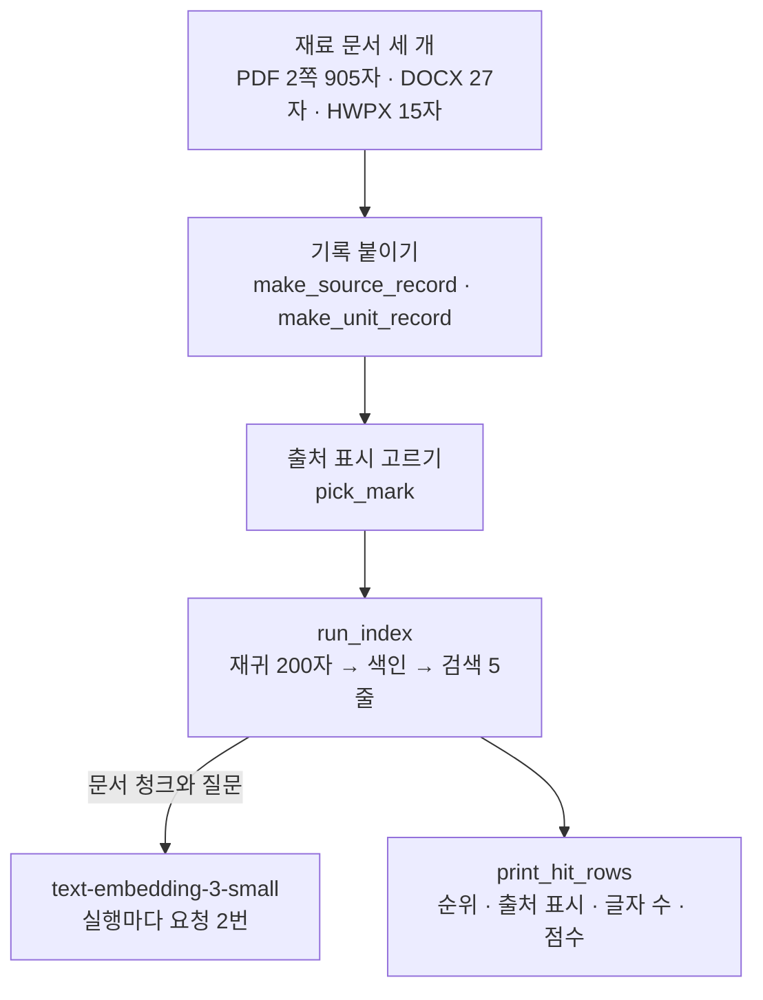
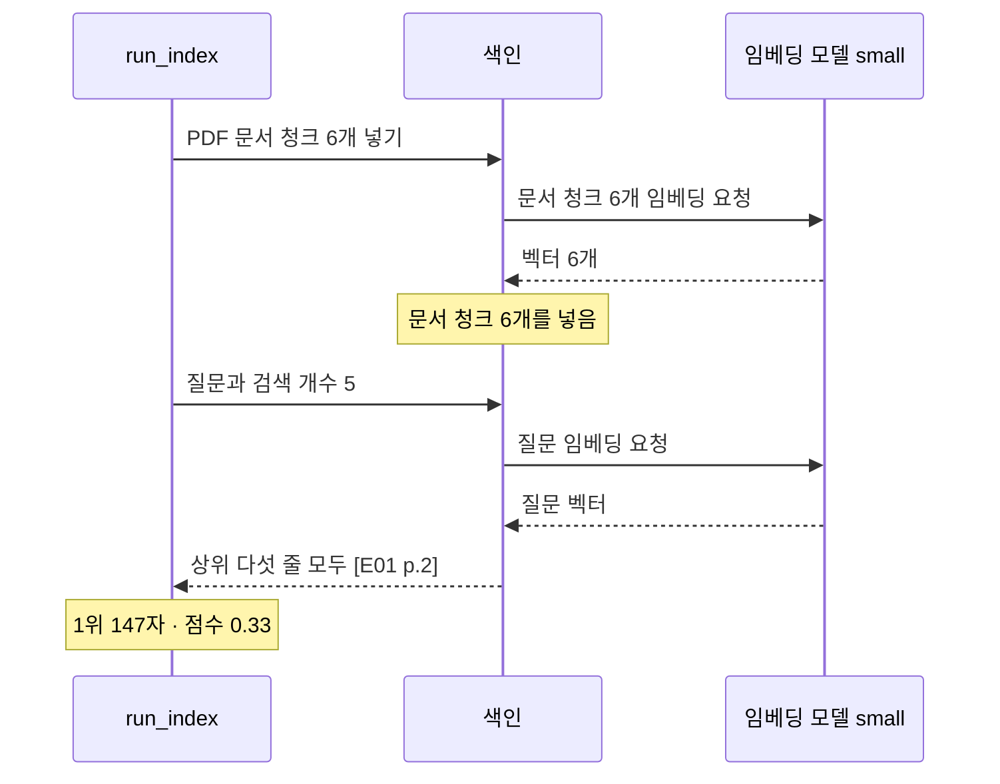
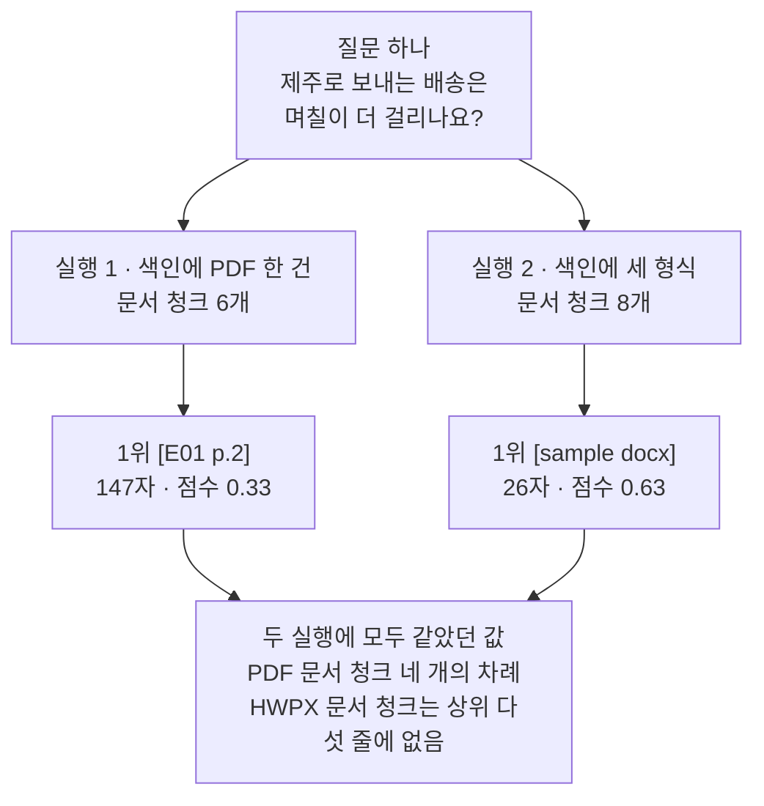

# 09-문서-처리-실습

## _src 본문 (HTML 원본)

```html
<!--meta: 실습 30분 | 코드 09-문서-처리-실습.ipynb | 새 용어 0 -->

<h2 id="b1"><span class="no">1</span>학습 목표</h2>
<div class="goal"><ul>
<li>이 절을 마치면 형식이 다른 문서 세 개를 읽어 같은 모양의 출처 기록을 붙일 수 있습니다.</li>
<li>이 절을 마치면 기록에 있는 칸을 보고 출처 표시 함수를 골라 부를 수 있습니다.</li>
<li>이 절을 마치면 나누기와 색인, 검색을 조립 함수 하나로 이을 수 있습니다.</li>
<li>이 절을 마치면 색인에 넣은 문서 묶음만 바꾼 두 실행의 검색 결과를 견줄 수 있습니다.</li>
</ul></div>

<h2 id="b2"><span class="no">2</span>이 내용을 배우는 이유</h2>
<p>01절부터 08절까지는 문서 처리의 단계를 하나씩 따로 익혔습니다. 형식마다 다른 방법으로 글을 꺼내고, 출처를 기록하고, 문서 청크로 나누고, 색인에 넣어 찾았습니다.</p>
<p>실제 창구의 자료는 한 형식이 아닙니다. 안내문은 PDF이고, 사내 문서는 DOCX이고, 공문은 HWPX일 수 있습니다. 이 실습의 자료는 01~04절에서 읽은 견본 세 개입니다. 형식이 섞인 자료를 한 색인에 모으는 흐름만 보려고 그대로 씁니다.</p>
<p>모아 넣으면 새 문제가 하나 생깁니다. 검색 결과로 올라온 문서 청크가 어느 파일의 어디에서 왔는지 알아야 합니다. 쪽이 있는 형식과 없는 형식은 그 자리를 적는 칸이 다릅니다.</p>
<p>이번 절은 이 챕터의 실습입니다. 01~08절에서 쓴 이름과 문법만 쓰고, 따로 내는 과제는 없습니다. 강사와 함께 노트북 셀을 차례로 실행합니다.</p>
<p><strong>이 절의 질문</strong> — 형식이 다른 문서를 한 색인에 모으면, 검색 결과가 어느 파일에서 왔는지 무엇을 보고 가릴까요?</p>

<h2 id="b3"><span class="no">3</span>앞에서 배운 내용</h2>
<p>이번 실습은 아래 절에서 배운 것을 그대로 가져옵니다.</p>
<table><thead><tr><th>절</th><th>배운 것</th><th>실습에서 쓰는 곳</th></tr></thead><tbody>
<tr><td>01절</td><td><code>load_pdf_pages()</code>, 다섯 칸 기록 <code>make_source_record()</code>, 출처 표시 <code>make_source_mark()</code></td><td>3절 PDF 2쪽 읽기, 4절 PDF 기록, 5절 표시 함수</td></tr>
<tr><td>03절</td><td>DOCX 문단 목록 읽기, 네 칸 기록 <code>make_unit_record()</code>, <code>make_unit_mark()</code></td><td>3절 DOCX 읽기, 4절 DOCX 기록, 5절 표시 함수</td></tr>
<tr><td>04절</td><td>압축 묶음 속 본문 XML 읽기, 자리 칸 <code>section</code>, <code>make_section_mark()</code></td><td>3절 HWPX 읽기, 4절 HWPX 기록, 5절 표시 함수</td></tr>
<tr><td>05절</td><td>재귀 방식 나누기, 끊을 자리 순서, 목표 크기 200자와 겹침 0자 설정</td><td>6절 나누기 도구, 7·8절 문서 청크 수</td></tr>
<tr><td>07절</td><td><code>OpenAIEmbeddings(model=)</code>와 기본 설정 차원 수</td><td>6절 임베딩 모델 준비</td></tr>
<tr><td>08절</td><td><code>InMemoryVectorStore</code>에 넣고 <code>similarity_search_with_score()</code>로 찾기, 조각 수와 비용 어림</td><td>6절 조립 함수, 7·8절 검색</td></tr>
<tr><td>Ch 9 05절</td><td>검색 누락과 답이 없는 질문</td><td>7절 결과 읽기</td></tr>
</tbody></table>
<p>표의 함수는 노트북이 다시 적지 않고 도구 파일 <code>rag_tools.py</code>에서 가져옵니다. 파일을 열면 코드를 볼 수 있습니다.</p>
<p>읽는 파일도 앞 절과 같습니다. 파일 <code>E01.pdf</code>는 01·02·05~08절에서 읽었고, 견본 두 개는 03·04절에서 읽었습니다. 이번 실습에서 새로 만든 데이터는 없습니다.</p>
<p>새로 정의하는 함수는 세 개입니다. 표시 함수를 고르는 <code>pick_mark()</code>, 나누기와 색인과 검색을 잇는 <code>run_index()</code>, 결과를 표로 적는 <code>print_hit_rows()</code>입니다.</p>
<p>08절이 쓴 기록 파일과 실습 폴더 모듈, Ch 11 평가셋은 이번 실습에서 쓰지 않습니다. 이 노트북은 파일을 만들거나 고치지 않습니다.</p>

<h2 id="b4"><span class="no">4</span>핵심 개념</h2>
<h3>비유로 시작하기</h3>
<p>책상 왼쪽에 자료 묶음 세 개가 나란히 놓여 있습니다. 하나는 낱장 종이 묶음이고, 하나는 묶여 있는 공책이고, 하나는 끈을 묶은 주머니입니다. 묶음마다 모양이 다른 꼬리표가 하나씩 달려 있습니다.</p>
<p>세 묶음에서 옮겨 적은 흰 카드는 가운데 한 상자에 함께 꽂혀 있습니다. 카드 위쪽에는 그 카드가 나온 묶음과 같은 모양의 꼬리표가 붙어 있습니다.</p>
{{img:09-4-세-묶음과-한-상자|책상 왼쪽에 종이 묶음과 공책과 주머니가 나란히 있고 각각 네모 꼬리표와 타원 꼬리표와 세모 꼬리표가 달려 있으며 가운데 긴 나무 카드 상자에 흰 카드가 한 줄로 꽂혀 있고 카드 위쪽 꼬리표는 네모 여럿과 타원 둘과 세모 하나이며 타원 꼬리표가 붙은 카드 한 장만 상자에서 반쯤 위로 올라와 있고 상자 앞 책상에 노란 쪽지 한 장이 놓인 삽화|형식이 다른 세 묶음에서 온 카드가 한 상자에 함께 꽂혀 있고, 위로 올라온 카드의 꼬리표는 공책 모양입니다}}
<p><strong>그림 읽기</strong> — 먼저 왼쪽 세 묶음의 꼬리표 모양을 봅니다. 종이 묶음은 네모, 공책은 타원, 주머니는 세모입니다.</p>
<p>다음으로 가운데 상자 안 카드의 꼬리표를 봅니다. 네모가 여럿이고 타원이 둘, 세모가 하나입니다. 카드 수는 노트북 8절 문서 청크 수와 맞춘 것이 아닙니다.</p>
<p>마지막으로 상자에서 반쯤 올라온 카드 한 장을 봅니다. 그 카드의 꼬리표는 타원이라 공책에서 온 카드입니다. 상자 앞에 놓인 노란 쪽지는 상자에 보낸 질문입니다.</p>
<p>긴 카드 상자는 Ch 9 01·03절 그림과 같은 색인입니다. 흰 카드는 문서 청크이고, 꼬리표 모양은 출처 표시입니다. 꼬리표가 같은 모양이면 같은 묶음에서 온 카드입니다.</p>

<h3>실습 조립의 구성</h3>
{{mermaid:09-1-조립도|위에서 아래로 내려가는 흐름도로 초록 상자 재료 문서 세 개 PDF 2쪽 905자 DOCX 27자 HWPX 15자에서 파란 상자 기록 붙이기 make_source_record make_unit_record로 내려가고 파란 상자 출처 표시 고르기 pick_mark를 지나 파란 상자 run_index 재귀 200자 색인 검색 5줄로 이어진 뒤 문서 청크와 질문 화살표로 보라 상자 text-embedding-3-small 실행마다 요청 2번과 노란 상자 print_hit_rows 순위 출처 표시 글자 수 점수로 갈라지는 그림|실습 조립 순서. 형식이 다른 문서 세 개가 한 색인으로 모이고 검색 결과는 점검표 한 줄씩으로 남습니다}}
<p><strong>도식 읽기</strong> — 위에서 아래로 읽습니다. 맨 위 초록 상자는 노트북 3절에서 만드는 재료입니다. 글자 수 905·27·15는 형식마다 다른 방법으로 읽은 결과입니다.</p>
<p>파란 상자 세 개는 노트북이 부르는 함수입니다. 기록을 붙이는 함수 두 개는 01·03절에서 배워 도구 파일에서 가져옵니다. 표시를 고르는 함수와 조립 함수는 이 절에서 새로 만듭니다.</p>
<p>보라 상자는 요청을 받는 임베딩 모델입니다. 조립 함수가 문서 청크와 질문을 보내므로 실행마다 요청이 두 번입니다. 맨 아래 노란 상자가 검색 결과를 점검표로 적습니다.</p>
<table><thead><tr><th>함수</th><th>하는 일</th><th>가져온 곳</th></tr></thead><tbody>
<tr><td><code>load_pdf_pages(pdf_path, doc_id)</code></td><td>PDF를 쪽마다 <code>Document</code>로 읽음</td><td>Ch 9 02절(도구 파일)</td></tr>
<tr><td><code>make_source_record(file_path, page, parser)</code></td><td>쪽이 있는 형식의 다섯 칸 기록을 만듦</td><td>01절(도구 파일)</td></tr>
<tr><td><code>make_unit_record(file_path, parser)</code></td><td>쪽이 없는 형식의 네 칸 기록을 만듦</td><td>03절(도구 파일)</td></tr>
<tr><td><code>read_body_text(xml_root, wanted_name)</code></td><td>본문 XML에서 찾는 요소의 글만 모음</td><td>04절(도구 파일, 안에서 <code>make_local_name()</code>을 부름)</td></tr>
<tr><td><code>pick_mark(chunk)</code></td><td>기록에 있는 칸을 보고 표시 함수 세 개 가운데 하나를 부름</td><td>01·03·04절 표시 함수(새로 정의)</td></tr>
<tr><td><code>run_index(index_documents, index_splitter)</code></td><td>나누기 → 색인에 넣기 → 질문으로 검색을 차례로 함</td><td>05·08절(새로 정의)</td></tr>
<tr><td><code>print_hit_rows(hits)</code></td><td>검색 결과를 순위·출처 표시·글자 수·점수 순서로 한 줄씩 적음</td><td>08절 결과 읽기 표(새로 정의)</td></tr>
</tbody></table>

<h3>출처 표시를 고르는 순서</h3>
<p>이 챕터에는 출처 표시를 만드는 함수가 세 개 있습니다. Ch 9 03절 함수는 <code>page</code> 칸을 읽고, 03절 함수는 <code>row</code> 칸을, 04절 함수는 <code>section</code> 칸을 읽습니다.</p>
<p>형식이 섞인 색인에서는 문서 청크마다 어느 함수를 쓸지 골라야 합니다. 함수 <code>pick_mark()</code>가 기록을 보고 <code>page</code>·<code>section</code>·<code>row</code> 순서로 칸을 확인합니다.</p>
<p>이 순서는 실습 폴더 모듈이 문서 청크 이름을 만들 때 쓰는 순서와 같습니다. 세 함수는 고치지 않았고, 부르는 함수를 하나 더 만들었습니다.</p>
<table><thead><tr><th>형식</th><th>기록에 있는 칸</th><th>이번 실행에서 받은 표시</th></tr></thead><tbody>
<tr><td>PDF</td><td>다섯 칸(<code>page</code> 있음)</td><td><code>[E01 p.2]</code></td></tr>
<tr><td>DOCX</td><td>네 칸(자리 칸 없음)</td><td><code>[sample docx]</code></td></tr>
<tr><td>HWPX</td><td>다섯 칸(<code>section</code> 있음)</td><td><code>[minimal-marker hwpx section.1]</code></td></tr>
</tbody></table>

<h3>두 번의 실행</h3>
<p>실행 1은 앞 절과 같이 PDF 2쪽 글만 색인에 넣습니다. 실행 2는 같은 색인 설정에 DOCX와 HWPX를 더해 넣습니다.</p>
<p>질문과 검색 개수 5, 목표 크기 200자, 겹침 0자, 끊을 자리 순서, 임베딩 모델은 두 실행이 같게 둔 조건입니다. 바뀐 값은 색인에 넣는 문서 묶음 하나입니다.</p>
<p>질문은 DOCX 견본에만 답이 있는 내용입니다. 05~08절에서 쓴 휴관일 질문은 PDF에만 답이 있어 이 비교에 쓰지 않았습니다.</p>

<h2 id="b5"><span class="no">5</span>실행 예제</h2>
<p>노트북은 먼저 세 파일을 형식마다 다른 방법으로 읽습니다. 그다음 기록을 붙여 <code>Document</code>를 만들고, 표시 함수와 조립 함수를 준비합니다. 마지막으로 실행 1, 실행 2, 두 실행 비교를 차례로 합니다.</p>
<p>함수를 만드는 셀은 세 개입니다. 앞 절에서 배운 함수 일곱 개는 준비 셀에서 도구 파일로부터 가져옵니다. 3절의 읽기 결과와 5절의 출처 표시, 7~9절의 점검표를 강사와 함께 읽습니다.</p>
<p>실제 OpenAI 임베딩 모델을 부릅니다. 이 페이지의 출력은 2026-09-21에 실행한 결과입니다. 인터넷 서비스 요청은 모두 네 번이고 색인 두 벌에 두 번, 검색 두 번에 두 번입니다. 예상 비용은 0.01달러 미만이고, 점수의 소수 아래 자리는 실행마다 달라질 수 있습니다.</p>
{{notebook:09-문서-처리-실습}}
<p class="look"><b>확인할 점</b> — 5절 출력에서 세 표시 <code>[E01 p.2]</code>·<code>[sample docx]</code>·<code>[minimal-marker hwpx section.1]</code>을 봅니다. 8절 출력에서 문서 청크 여덟 개의 표시 목록을 봅니다. 9절 두 표에서 1위 줄과 나머지 네 줄을 견줍니다.</p>

<h3>실행 1의 실제 순서</h3>
{{mermaid:09-2-실행1-순서|위에서 아래로 시간이 흐르는 순서도로 세로줄은 왼쪽부터 run_index 색인 임베딩 모델 small이고 run_index가 PDF 문서 청크 6개 넣기를 색인에 보내면 색인이 문서 청크 6개 임베딩 요청을 모델에 보내 벡터 6개를 점선으로 받고 문서 청크 6개를 넣음 노란 메모가 붙은 다음 run_index가 질문과 검색 개수 5를 보내 색인이 질문 임베딩 요청으로 질문 벡터를 점선으로 받은 뒤 상위 다섯 줄 모두 E01 p.2를 점선으로 내놓고 1위 147자 점수 0.33 노란 메모가 붙는 그림|실행 1에서 조립 함수와 색인과 임베딩 모델이 주고받은 차례. 요청은 문서 청크 쪽과 질문 쪽에서 한 번씩입니다}}
<p><strong>도식 읽기</strong> — 위에서 아래로 시간이 흐릅니다. 세로줄은 왼쪽부터 조립 함수 <code>run_index()</code>, 색인, 임베딩 모델입니다. 실선은 보낸 것이고 점선은 받은 것입니다.</p>
<p>조립 함수는 먼저 문서 청크 여섯 개를 색인에 넣습니다. 색인이 그 글을 모델에 보내 벡터를 받습니다. 첫 노란 메모는 색인에 넣은 문서 청크 수입니다.</p>
<p>그다음 조립 함수가 질문과 검색 개수를 보냅니다. 색인이 질문도 모델에 보내 벡터를 받고 상위 다섯 줄을 고릅니다. 마지막 노란 메모는 점검표에 적힌 1위 값입니다.</p>

<h2 id="b6"><span class="no">6</span>실험 결과 해석</h2>
<p>실행 1의 점검표에서는 다섯 줄의 출처 표시가 모두 <code>[E01 p.2]</code>였습니다. 색인에 그 쪽 문서 청크만 있었기 때문입니다. 1위는 도서관 운영 목표를 적은 147자 문서 청크였고 점수는 <code>0.33</code>이었습니다.</p>
<p>실행 2의 점검표에서는 1위가 <code>[sample docx]</code>였습니다. 글자 수는 26자이고 점수는 <code>0.63</code>이었습니다. DOCX 견본에만 제주 배송 이야기가 있었기 때문입니다.</p>
{{mermaid:09-3-두-실행-비교|위에서 아래로 두 갈래로 갈라지는 흐름도로 초록 상자 질문 하나 제주로 보내는 배송은 며칠이 더 걸리나요에서 왼쪽 파란 상자 실행 1 색인에 PDF 한 건 문서 청크 6개와 오른쪽 파란 상자 실행 2 색인에 세 형식 문서 청크 8개로 갈라지고 각각 노란 상자 1위 E01 p.2 147자 점수 0.33과 노란 상자 1위 sample docx 26자 점수 0.63으로 내려간 뒤 두 화살표가 맨 아래 회색 상자 두 실행에 모두 같았던 값 PDF 문서 청크 네 개의 차례 HWPX 문서 청크는 상위 다섯 줄에 없음으로 모이는 비교 그림|색인에 넣은 문서 묶음만 바꾼 두 실행. 1위가 달라졌고 PDF 문서 청크 네 개의 차례는 그대로였습니다}}
<p><strong>도식 읽기</strong> — 맨 위 초록 상자에서 두 갈래로 내려갑니다. 왼쪽이 실행 1이고 오른쪽이 실행 2입니다. 파란 상자에는 색인에 넣은 문서와 문서 청크 수를 적었습니다.</p>
<p>노란 상자 두 개는 노트북 9절 두 표의 1위 줄입니다. 왼쪽은 <code>147</code>자에 점수 <code>0.33</code>이고 오른쪽은 <code>26</code>자에 점수 <code>0.63</code>입니다.</p>
<p>맨 아래 회색 상자는 두 실행에 모두 같았던 값입니다. 한 조건의 결과가 아니라서 어느 갈래에도 넣지 않았습니다.</p>
<p>실행 1에서 위에 있던 PDF 문서 청크 네 개는 실행 2에서 한 칸씩 내려갔습니다. 글자 수 <code>147</code>·<code>86</code>·<code>164</code>·<code>130</code>이 두 표에 모두 있습니다. 순서도 그대로여서 문서를 더 넣은 것이 앞 문서 청크의 차례를 뒤집지는 않았습니다.</p>
<p>점수 칸은 86자 문서 청크에서 <code>0.31</code>과 <code>0.3</code>으로 갈렸습니다. 소수 둘째 자리에서 반올림한 값이라 이 문서 청크의 점수가 경계에 있습니다. 나머지 세 문서 청크의 점수는 두 표에서 같습니다.</p>
<p>실행 1의 다섯째 줄 188자 문서 청크는 실행 2의 표에 없습니다. 다섯 줄만 받기 때문에 한 자리가 밀려났습니다. 색인에 그 문서 청크가 없어진 것은 아닙니다.</p>
<p>HWPX 문서 청크는 두 실행 모두 상위 다섯 줄에 오지 않았습니다. 색인에 넣었다고 해서 검색 결과에 오는 것은 아닙니다. 몇 위였는지는 이번에 확인하지 않았습니다.</p>
<p>출처 표시가 있어서 1위가 어느 파일에서 왔는지 바로 읽었습니다. 표시를 만드는 함수는 형식마다 다르고, 조립 함수가 기록을 보고 골랐습니다. 쪽이 있는 형식은 쪽 번호까지, 자리 칸이 있는 형식은 그 번호까지 표시에 남습니다.</p>
<p>결론은 이렇습니다. 형식이 다른 문서를 한 색인에 모으면 같은 질문의 1위가 바뀔 수 있고, 어느 파일에서 왔는지는 출처 표시로 가립니다. 이 결과는 질문 하나·색인 두 벌·색인마다 한 번 검색한 범위입니다.</p>

<h2 id="b7"><span class="no">7</span>주의할 점과 실무 메모</h2>
<ul>
<li><strong>질문은 교재를 만들 때 두 가지로 먼저 검색해 보고 골랐습니다.</strong> 05~08절 휴관일 질문은 PDF에만 답이 있어 문서를 더해도 상위 다섯 줄이 바뀌지 않았습니다. 그래서 견본 DOCX에만 있는 내용을 묻는 질문을 골랐습니다. 흐름을 보여 주려고 정한 예입니다.</li>
<li><strong>형식을 섞는 것이 검색에 늘 좋다고 말할 수 없습니다.</strong> 이번에는 질문 하나에서 1위가 바뀐 것까지만 보았습니다. 질문을 늘려 지표로 재는 방법은 Ch 11에서 배웁니다.</li>
<li><strong>점수는 소수 둘째 자리까지만 적었습니다.</strong> 같은 색인에 같은 질문을 보내도 아래 자리는 실행마다 달라질 수 있습니다. 이번 출력에서도 86자 문서 청크의 점수가 <code>0.31</code>과 <code>0.3</code>으로 갈렸습니다. 그래서 순위와 출처 표시를 먼저 읽습니다.</li>
<li><strong>표시 함수 세 개를 하나로 합치지 않았습니다.</strong> 01·03·04절 코드를 그대로 두고 부르는 함수만 새로 만들었습니다. 세 함수를 합치면 앞 절 노트북의 출력 모양이 바뀝니다.</li>
<li><strong>DOCX 표시에는 자리 번호가 없습니다.</strong> 문단 목록을 한 글로 이어 붙였으니 몇 번째 문단인지 적을 칸을 두지 않았습니다. 자리 칸을 두려면 03절 CSV처럼 칸 이름을 정하고 번호를 대입합니다.</li>
<li><strong>DOCX 표와 HTML 견본은 이번에 읽지 않았습니다.</strong> 03절에서 본 대로 표는 문단 목록과 다른 목록에 들어 있습니다. 표 글을 문서 청크로 쓰는 일은 이 챕터에서 실행하지 않았습니다.</li>
<li><strong>견본 세 개의 <code>doc_id</code>가 겹칠 수 있습니다.</strong> 이번 세 파일은 <code>E01</code>·<code>sample</code>·<code>minimal-marker</code>로 갈라졌습니다. 같은 폴더의 견본 다섯 개 가운데 셋은 이름 앞부분이 모두 <code>sample</code>이라 03절 b7에 갈라 두는 방법을 적어 두었습니다.</li>
<li><strong>실습 폴더 모듈은 부르지 않았습니다.</strong> 파일 <code>document_processing.py</code>에는 이름이 비슷하고 모양이 다른 함수가 있습니다. 노트북은 01~08절과 같이 셀에서 정의한 함수만 씁니다.</li>
<li><strong>이 실습은 파일을 쓰지 않습니다.</strong> 08절이 남긴 <code>runs/continuity-ch10-indexing.jsonl</code>과 사본 폴더는 읽지도 고치지도 않았습니다. Ch 11이 읽는 입력이라 그대로 두어야 합니다.</li>
<li><strong>교재 출력은 Linux의 Python 3.12.13으로 만들었습니다.</strong> 패키지는 pypdf 6.18.0, python-docx 1.2.0, langchain-core 1.6.2입니다. 나누기 도구는 langchain-text-splitters 1.1.2입니다. 임베딩은 langchain-openai 1.6.0이고 조각은 tiktoken 0.14.0으로 셉니다. 다른 버전과 Windows·macOS에서는 이번에 실행하지 않았습니다.</li>
</ul>

<h2 id="b8"><span class="no">8</span>정리와 다음 절</h2>
<ul>
<li>01·03·04절 읽기와 기록, 05절 나누기, 08절 색인·검색을 조립 함수 <code>run_index()</code> 하나로 이었습니다.</li>
<li>표시 함수 세 개를 고르는 <code>pick_mark()</code>로 <code>[E01 p.2]</code>·<code>[sample docx]</code>·<code>[minimal-marker hwpx section.1]</code>을 한 셀에서 얻었습니다.</li>
<li>색인에 PDF 한 건만 넣은 실행 1은 상위 다섯 줄이 모두 <code>[E01 p.2]</code>였고 1위 점수가 <code>0.33</code>이었습니다.</li>
<li>세 형식을 함께 넣은 실행 2는 1위가 <code>[sample docx]</code>로 바뀌었고 점수는 <code>0.63</code>이었습니다.</li>
<li>두 실행에서 PDF 문서 청크 네 개의 차례는 그대로였고 HWPX 문서 청크는 상위 다섯 줄에 오지 않았습니다.</li>
</ul>
<p><strong>다음 학습과 이어지는 지점</strong> — 이 절로 Ch 10이 끝납니다. Ch 11은 08절이 남긴 기록 여섯 줄을 읽습니다. 설정마다 정답 문서 ID와 검색 결과를 견주어 검색 지표를 계산합니다. 질문 하나의 결과는 연결이 되는지 보는 범위입니다.</p>
<p>Ch 12에서는 말뭉치와 질문, 평가 단위를 같게 둔 결과끼리 검색 설정을 여러 번 견줍니다. 이 실습에서 사람이 눈으로 읽은 점검표를 Ch 11에서는 지표로 잽니다. 어느 설정이나 어느 형식 묶음이 나은지는 이 챕터에서 정하지 않았습니다.</p>

<h2 id="b9"><span class="no">9</span>복습 문제</h2>
<details class="quiz" open><summary>문제 5개 · 해설 포함</summary>
<p class="quiz-q">1. [하] 두 실행에서 바꾼 값은 무엇입니까?</p>
<p class="quiz-a">색인에 넣는 문서 묶음입니다. 실행 1은 PDF 한 건이고 실행 2는 PDF·DOCX·HWPX 세 건입니다. 질문과 검색 개수 5, 목표 크기 200자, 겹침 0자, 임베딩 모델은 같게 두었습니다.</p>
<p class="quiz-q">2. [중] 문서 청크 수가 6개에서 8개로 늘어난 까닭은 무엇입니까?</p>
<p class="quiz-a">짧은 글 두 개가 한 문서 청크씩 되었기 때문입니다. DOCX 글은 27자이고 HWPX 글은 15자라 목표 크기 200자보다 짧습니다. 목표보다 짧은 글은 더 나뉘지 않습니다.</p>
<p class="quiz-q">3. [중] 함수 <code>pick_mark()</code>는 어떤 순서로 칸을 확인합니까?</p>
<p class="quiz-a">칸 <code>page</code>를 먼저 보고 <code>section</code>과 <code>row</code>를 차례로 봅니다. 먼저 맞는 조건에서 표시를 만들고 함수가 끝납니다. 세 칸이 모두 없으면 문서 이름과 형식까지만 적은 표시가 나옵니다.</p>
<p class="quiz-q">4. [중] 실행 1의 1위 점수가 <code>0.33</code>이었습니다. 이 값을 「검색이 잘 되었다」는 근거로 쓸 수 있습니까?</p>
<p class="quiz-a">쓸 수 없습니다. 색인에 질문과 맞는 글이 없어도 검색은 다섯 줄을 채워 내놓습니다. 실행 1의 1위는 도서관 운영 목표를 적은 글이었고 배송과 관계가 없었습니다.</p>
<p class="quiz-q">5. [상] 동료가 「HWPX 문서 청크가 검색에 잡히지 않으니 색인에서 빼자」고 합니다. 이 절 출력으로 무엇이라고 답하나요?</p>
<p class="quiz-a">질문 하나로는 정할 수 없다고 답합니다. 이번 질문은 배송 내용이라 한글 문서 표식 글과 뜻이 멀었습니다. 그 글이 몇 위였는지도 확인하지 않았습니다. 다섯 줄만 받았기 때문입니다.</p>
</details>

<h2 id="b10"><span class="no">10</span>참고 자료</h2>
<ul>
<li><div><a href="https://python-docx.readthedocs.io/en/latest/user/quickstart.html">python-docx 공식 문서 Quickstart</a></div>확인 2026-09-18 · 문단 목록 읽기 참고, 03절과 같은 자료.</li>
<li><div><a href="https://docs.python.org/3/library/zipfile.html">Python 공식 문서 zipfile</a></div>확인 2026-09-18 · 압축 묶음 열기와 항목 읽기 참고, 04절과 같은 자료.</li>
<li><div><a href="https://docs.langchain.com/oss/python/integrations/splitters/recursive_text_splitter">LangChain 공식 문서 Recursive text splitter</a></div>확인 2026-09-18 · 목표 크기와 겹침 인자 참고, 05절과 같은 자료.</li>
<li><div><a href="https://reference.langchain.com/python/langchain-core/vectorstores/in_memory/InMemoryVectorStore">LangChain 공식 API InMemoryVectorStore</a></div>확인 2026-09-18 · <code>add_documents()</code>와 <code>similarity_search_with_score()</code> 참고.</li>
<li><div><a href="https://developers.openai.com/api/docs/models/text-embedding-3-small">OpenAI text-embedding-3-small 모델 안내</a></div>확인 2026-09-17 · 100만 토큰당 0.02달러 참고.</li>
<li>Ch 9 05절 검색 누락과 답이 없는 질문 — 색인에 없는 내용을 물었을 때 무엇을 보는지 참고.</li>
<li>기준 버전은 Python 3.12.13과 01~08절에 고정한 패키지 판입니다. 형식마다 다른 읽기 결과와 나누기 결과는 그 판에서 확인한 값입니다.</li>
</ul>
```

## 노트북 셀 (순서대로)

### [0] markdown {'html': 'skip'}

# 문서 처리 실습: 형식이 다른 문서를 한 색인에 모아 찾기

**이 노트북에서 할 일**

1. PDF·DOCX·HWPX 견본 세 개를 형식마다 다른 방법으로 읽어 출처 기록을 붙입니다.
2. 기록을 보고 표시 함수를 골라 주는 함수 하나로 세 형식의 출처 표시를 만듭니다.
3. PDF 한 건만 넣은 색인과 세 형식을 함께 넣은 색인에서 같은 질문을 검색해 견줍니다.

**준비물** — 프로젝트 맨 위 폴더의 `.env` 파일에 `OPENAI_API_KEY`가 있어야 합니다.
임베딩 요청은 모두 네 번입니다. 색인 두 벌에 두 번, 검색 두 번에 두 번입니다.
답을 쓰는 모델은 이 절에서도 부르지 않습니다.

예상 비용은 네 번을 합쳐 0.01달러 미만입니다.
임베딩 요금은 OpenAI 모델 안내(2026-09-17 확인)에 적힌 100만 토큰당 0.02달러입니다.
실행 시간은 패키지 설치를 빼면 1분 안팎입니다.

데이터는 세 개입니다.
파일 `labs/data/rag-corpus/pdf/easy/E01.pdf`의 2쪽을 읽습니다.
실습 폴더 `fixtures/`의 `sample.docx`와 `minimal-marker.hwpx`도 함께 읽습니다.

이 노트북은 파일을 만들거나 고치지 않습니다.
08절이 쓴 `runs` 폴더의 기록 파일은 읽지도 건드리지도 않습니다.

**강의와 실습 범위** — 강사와 함께 첫 셀부터 차례로 실행합니다. 따로 내는 과제는 없습니다.
함수를 만드는 셀은 세 개입니다. 앞 절에서 배운 함수 일곱 개는 도구 파일에서 가져옵니다.
3절의 읽기 결과와 5절의 출처 표시, 7~9절의 점검표를 함께 읽습니다.

**기준 버전** — 실습 폴더에 고정한 패키지 판을 씁니다.
pypdf 6.18.0과 python-docx 1.2.0, langchain-core 1.6.2를 씁니다.
나누기 도구는 langchain-text-splitters 1.1.2입니다. 임베딩은 langchain-openai 1.6.0으로 부릅니다.
조각은 tiktoken 0.14.0으로 셉니다.

교재 출력은 Linux의 Python 3.12.13으로 만들었습니다.
다른 버전과 Windows·macOS에서는 이번에 실행하지 않았습니다.

실습 폴더 `labs/part3/ch10-document-processing`에서 `uv sync --locked`를 실행합니다.
그다음 이 폴더의 `.venv` 커널을 고르고 첫 셀부터 순서대로 실행합니다.

### [1] markdown {'html': 'skip'}

## 오늘 볼 그림


위에서 아래로 읽습니다. 맨 위 초록 상자는 노트북 3절에서 만드는 재료입니다.
파란 상자 세 개는 노트북에서 정의하는 함수이고, 보라 상자는 요청을 받는 임베딩 모델입니다.

맨 아래 노란 상자가 검색 결과를 점검표로 출력합니다. 두 실행은 색인에 넣는 문서 묶음 하나만 다릅니다.

### [2] markdown {}

## 1. 준비

첫 셀은 패키지를 설치하고 설치된 버전을 출력합니다. 설치에는 몇십 초가 걸릴 수 있습니다.
01·03·04·05·07절에서 쓴 도구를 함께 씁니다.

### [3] code {'execution': {'iopub.execute_input': '2026-09-21T06:26:02.240554Z', 'iopub.status.busy': '2026-09-21T06:26:02.240371Z', 'iopub.status.idle': '2026-09-21T06:26:02.702488Z', 'shell.execute_reply': '2026-09-21T06:26:02.701958Z'}, 'lesson_role': 'setup'}

```python
# 이 절에서 쓰는 패키지를 설치하고 버전을 확인합니다
%pip install -q "pypdf==6.18.0" "python-docx==1.2.0" "langchain-core==1.6.2" "langchain-text-splitters==1.1.2" "langchain-openai==1.6.0" "tiktoken==0.14.0" "python-dotenv==1.2.3"
from importlib.metadata import version

print("pypdf:", version("pypdf"))
print("python-docx:", version("python-docx"))
print("langchain-core:", version("langchain-core"))
print("langchain-text-splitters:", version("langchain-text-splitters"))
print("langchain-openai:", version("langchain-openai"))
print("tiktoken:", version("tiktoken"))
print("python-dotenv:", version("python-dotenv"))
```

출력:
```
Note: you may need to restart the kernel to use updated packages.
pypdf: 6.18.0
python-docx: 1.2.0
langchain-core: 1.6.2
langchain-text-splitters: 1.1.2
langchain-openai: 1.6.0
tiktoken: 0.14.0
python-dotenv: 1.2.3

```

### [4] markdown {}

**결과 읽기** — 출력 일곱 줄 가운데 첫 줄은 `pypdf: 6.18.0`입니다.
둘째 줄 `python-docx: 1.2.0`과 다섯째 줄 `langchain-openai: 1.6.0`도 보세요.
준비물에 적은 기준 버전과 같습니다.

다음 셀은 이 절에서 쓸 이름을 불러옵니다.
클래스 `DocxDocument`는 03절에서 다른 이름을 붙여 부른 python-docx의 문서 객체입니다.
모듈 `zipfile`과 `ElementTree`는 04절에서 HWPX를 열 때 쓴 이름입니다.

앞에서 배운 함수는 `rag_tools.py`에 모아 두었습니다. 파일을 열면 코드를 볼 수 있습니다. 노트북과 같은 폴더(`notebooks/`)에 있는 파일입니다.
이 노트북은 Ch 9 02·03절 `load_pdf_pages()`·`make_source_mark()`와 01절 `make_source_record()`를 가져옵니다.
03절 `make_unit_record()`·`make_unit_mark()`와 04절 `read_body_text()`·`make_section_mark()`도 가져옵니다.

### [5] code {'execution': {'iopub.execute_input': '2026-09-21T06:26:02.703593Z', 'iopub.status.busy': '2026-09-21T06:26:02.703506Z', 'iopub.status.idle': '2026-09-21T06:26:03.841629Z', 'shell.execute_reply': '2026-09-21T06:26:03.841153Z'}, 'lesson_role': 'setup'}

```python
# 세 형식 읽기·기록·나누기·임베딩·색인·조각 세기에 쓸 이름을 불러옵니다
import os
import zipfile
from xml.etree import ElementTree

from docx import Document as DocxDocument
from langchain_core.documents import Document
from langchain_core.vectorstores import InMemoryVectorStore
from langchain_openai import OpenAIEmbeddings
from langchain_text_splitters import RecursiveCharacterTextSplitter
import tiktoken
# 01·03·04절과 Ch 9 02·03절 함수 일곱 개를 도구 파일에서 가져옵니다
from rag_tools import load_pdf_pages, make_section_mark, make_source_mark, make_source_record
from rag_tools import make_unit_mark, make_unit_record, read_body_text
```

출력:
```

```

### [6] markdown {}

**결과 읽기** — 이 셀은 이름을 불러오기만 하므로 출력이 없습니다.

다음 셀은 키가 있는지 확인합니다. 키 값은 출력하지 않고 있는지만 봅니다.

### [7] code {'execution': {'iopub.execute_input': '2026-09-21T06:26:03.842466Z', 'iopub.status.busy': '2026-09-21T06:26:03.842365Z', 'iopub.status.idle': '2026-09-21T06:26:03.846082Z', 'shell.execute_reply': '2026-09-21T06:26:03.845594Z'}, 'lesson_role': 'setup'}

```python
# .env 파일에서 OpenAI API 키를 읽습니다(키 값은 출력하지 않습니다)
from dotenv import find_dotenv, load_dotenv

env_path = find_dotenv(usecwd=True)
load_dotenv(env_path)
has_key = os.getenv("OPENAI_API_KEY") is not None
print("OPENAI_API_KEY 설정 여부:", has_key)
assert has_key, "프로젝트 폴더의 .env 파일에 OPENAI_API_KEY를 적어 주세요."
```

출력:
```
OPENAI_API_KEY 설정 여부: True

```

### [8] markdown {}

**결과 읽기** — 출력 줄은 `OPENAI_API_KEY 설정 여부: True`입니다.
이 노트북의 출력은 2026-09-21에 `text-embedding-3-small` 모델로 실행한 결과입니다.

## 2. 실습 주제 — 형식이 다른 문서를 한 색인에 모아 찾기

작은 안내 창구를 하나 맡았다고 봅니다.
그 창구가 가진 자료는 형식이 다릅니다. 도서관 안내는 PDF이고, 배송 안내는 DOCX이고, 한글 문서 표식은 HWPX입니다.
01~04절에서는 이 형식을 하나씩 따로 읽었고, 05~08절에서는 PDF 하나만 나누고 색인에 넣었습니다.

이번 실습은 세 형식을 한 색인에 함께 넣어 봅니다.
질문은 하나이고, 두 번 실행하며 바꾸는 값도 하나입니다. 색인에 넣는 문서 묶음입니다.

실행 1은 앞 절과 같이 PDF 한 건만 넣습니다.
실행 2는 같은 색인 설정에 DOCX와 HWPX를 더해 넣습니다.
나누기 설정과 질문, 검색 개수, 임베딩 모델은 두 실행에서 같게 둡니다.

### [9] markdown {}

## 3. 재료 만들기 — 형식이 다른 문서 세 개 읽기

먼저 프로젝트 맨 위 경로를 고릅니다. 01~08절과 같은 코드입니다.

실행 전에 예상합니다. 프로젝트 맨 위에서 열었다면 첫째 후보를 고를 것입니다.

### [10] code {'execution': {'iopub.execute_input': '2026-09-21T06:26:03.846713Z', 'iopub.status.busy': '2026-09-21T06:26:03.846661Z', 'iopub.status.idle': '2026-09-21T06:26:03.848561Z', 'shell.execute_reply': '2026-09-21T06:26:03.848295Z'}}

```python
# 작업 폴더에서 본 프로젝트 맨 위 경로를 후보 세 개 가운데에서 고릅니다
candidates = [".", "../../..", "../../../.."]
root_path = None
for candidate in candidates:
    if os.path.exists(candidate + "/labs/data/rag-corpus"):
        root_path = candidate
        break
print("고른 경로:", root_path)
assert root_path is not None, "notebooks 폴더나 실습 폴더 맨 위에서 노트북을 열어 주세요."
```

출력:
```
고른 경로: .

```

### [11] markdown {}

**결과 읽기** — 출력 줄은 `고른 경로: .`입니다.
교재 출력은 프로젝트 맨 위를 작업 폴더로 삼아 실행해서 첫째 후보를 골랐습니다.

다음 셀은 읽을 파일 세 개의 경로를 만들고 파일이 있는지 봅니다.
이름 `corpus_path`와 `fixtures_path`는 01절에서 정한 이름입니다.

### [12] code {'execution': {'iopub.execute_input': '2026-09-21T06:26:03.849154Z', 'iopub.status.busy': '2026-09-21T06:26:03.849109Z', 'iopub.status.idle': '2026-09-21T06:26:03.851372Z', 'shell.execute_reply': '2026-09-21T06:26:03.851128Z'}}

```python
# 읽을 파일 세 개의 경로를 만들고 파일이 있는지 확인합니다
corpus_path = root_path + "/labs/data/rag-corpus"
fixtures_path = root_path + "/labs/part3/ch10-document-processing/fixtures"
pdf_path = corpus_path + "/pdf/easy/E01.pdf"
docx_path = fixtures_path + "/sample.docx"
hwpx_path = fixtures_path + "/minimal-marker.hwpx"
print("PDF가 있는가:", os.path.exists(pdf_path))
print("DOCX 견본이 있는가:", os.path.exists(docx_path))
print("HWPX 견본이 있는가:", os.path.exists(hwpx_path))
```

출력:
```
PDF가 있는가: True
DOCX 견본이 있는가: True
HWPX 견본이 있는가: True

```

### [13] markdown {}

**결과 읽기** — 출력 세 줄이 모두 `True`입니다.
이 PDF는 01·02절과 05~08절에서 읽은 그 문서입니다.
견본 두 개는 03·04절에서 읽은 그 파일입니다.

문서 E01은 준비 셀에서 가져온 Ch 9 02절 로더 함수 `load_pdf_pages()`로 읽습니다.

다음 셀은 그 함수로 다섯 쪽을 읽고 2쪽 본문만 골라 둡니다.
05·06·07절이 나눈 그 글입니다. 쪽이 있는 형식이라 쪽 번호를 그대로 쓸 수 있습니다.

### [14] code {'execution': {'iopub.execute_input': '2026-09-21T06:26:03.852019Z', 'iopub.status.busy': '2026-09-21T06:26:03.851966Z', 'iopub.status.idle': '2026-09-21T06:26:03.883176Z', 'shell.execute_reply': '2026-09-21T06:26:03.882803Z'}}

```python
# E01.pdf 다섯 쪽을 읽고 2쪽 본문만 골라 둡니다
pages = load_pdf_pages(pdf_path, "E01")
plain_text = pages[1].page_content
print("Document 수:", len(pages))
print("2쪽 글자 수:", len(plain_text))
print("2쪽 메타데이터:", pages[1].metadata)
```

출력:
```
Document 수: 5
2쪽 글자 수: 905
2쪽 메타데이터: {'doc_id': 'E01', 'page': 2, 'source': 'E01.pdf'}

```

### [15] markdown {}

**결과 읽기** — 출력 첫 줄은 `Document 수: 5`이고 다음 줄은 `2쪽 글자 수: 905`입니다.
셋째 줄 `2쪽 메타데이터: {'doc_id': 'E01', 'page': 2, 'source': 'E01.pdf'}`를 보세요.
05·06·07절에서 읽은 값과 같습니다.

다음 셀은 03절 방법으로 DOCX 견본의 문단 글을 이어 붙입니다.
문단마다 줄바꿈을 넣어 한 글로 만듭니다. 표는 다른 목록에 있어 이번에는 읽지 않습니다.

### [16] code {'execution': {'iopub.execute_input': '2026-09-21T06:26:03.883801Z', 'iopub.status.busy': '2026-09-21T06:26:03.883748Z', 'iopub.status.idle': '2026-09-21T06:26:03.892558Z', 'shell.execute_reply': '2026-09-21T06:26:03.892169Z'}}

```python
# DOCX 견본의 문단 글을 줄바꿈으로 이어 붙여 한 글로 만듭니다(03절 3절과 같은 읽기)
docx_file = DocxDocument(docx_path)
docx_text = ""
for paragraph in docx_file.paragraphs:
    docx_text = docx_text + paragraph.text + "\n"
print("문단 수:", len(docx_file.paragraphs))
print("이어 붙인 글자 수:", len(docx_text))
print("DOCX 본문:")
print(docx_text)
```

출력:
```
문단 수: 2
이어 붙인 글자 수: 27
DOCX 본문:
배송 안내
제주 배송에는 이틀이 더 필요합니다.


```

### [17] markdown {}

**결과 읽기** — 출력 첫 줄은 `문단 수: 2`이고 다음 줄은 `이어 붙인 글자 수: 27`입니다.
라벨 줄 `DOCX 본문:` 아래에 `배송 안내`와 `제주 배송에는 이틀이 더 필요합니다.` 두 줄이 보입니다.
03절에서 본 두 문단입니다. 이 글에는 쪽 번호가 없습니다.

HWPX 본문 글은 준비 셀에서 가져온 04절 `read_body_text()`로 모읍니다.
이 함수는 요소 나무를 돌며 찾는 이름의 요소에서 글만 모읍니다.
함수 안에서는 04절 `make_local_name()`이 태그 이름의 이름 공간을 뗍니다.

다음 셀은 HWPX 견본을 압축 묶음으로 열어 본문 XML을 꺼내고 글을 모읍니다.
항목 이름 `Contents/section0.xml`은 04절 6절에서 확인한 이름입니다.

### [18] code {'execution': {'iopub.execute_input': '2026-09-21T06:26:03.893233Z', 'iopub.status.busy': '2026-09-21T06:26:03.893156Z', 'iopub.status.idle': '2026-09-21T06:26:03.895305Z', 'shell.execute_reply': '2026-09-21T06:26:03.895066Z'}}

```python
# HWPX 견본의 본문 XML을 꺼내 t 요소의 글만 모읍니다(04절 6~8절과 같은 방법)
wanted_name = "t"
with zipfile.ZipFile(hwpx_path) as archive:
    xml_bytes = archive.read("Contents/section0.xml")
xml_root = ElementTree.fromstring(xml_bytes)
hwpx_text = read_body_text(xml_root, wanted_name)
print("꺼낸 바이트 수:", len(xml_bytes))
print("HWPX 본문 글자 수:", len(hwpx_text))
print("HWPX 본문:", hwpx_text)
```

출력:
```
꺼낸 바이트 수: 204
HWPX 본문 글자 수: 15
HWPX 본문: 한글 문서 처리 실습입니다.

```

### [19] markdown {}

**결과 읽기** — 출력 첫 줄은 `꺼낸 바이트 수: 204`이고 다음 줄은 `HWPX 본문 글자 수: 15`입니다.
셋째 줄은 `HWPX 본문: 한글 문서 처리 실습입니다.`입니다. 04절에서 읽은 글과 같습니다.

이 글에도 쪽 번호가 없습니다. 대신 본문 XML이 몇 번째 자리인지 적을 수 있습니다.

## 4. 출처 기록 붙이기

이제 세 글에 기록을 붙입니다. 쪽이 있는 형식과 없는 형식이 기록 모양이 다릅니다.
01절 함수는 다섯 칸을 만들고, 03·04절 함수는 네 칸을 만듭니다.

두 함수는 준비 셀에서 가져온 01절 `make_source_record()`와 03절 `make_unit_record()`입니다.

다음 셀은 세 기록을 만듭니다.
HWPX 기록에는 04절에서 정한 자리 칸 `section`을 하나 더 대입합니다.

### [20] code {'execution': {'iopub.execute_input': '2026-09-21T06:26:03.895946Z', 'iopub.status.busy': '2026-09-21T06:26:03.895883Z', 'iopub.status.idle': '2026-09-21T06:26:03.897615Z', 'shell.execute_reply': '2026-09-21T06:26:03.897297Z'}}

```python
# 세 글의 출처 기록을 만들고 HWPX 기록에는 자리 칸을 하나 더합니다
pdf_record = make_source_record(pdf_path, 2, "pypdf-plain")
docx_record = make_unit_record(docx_path, "python-docx")
hwpx_record = make_unit_record(hwpx_path, "zip-xml")
hwpx_record["section"] = 1
print("PDF 기록:", pdf_record)
print("DOCX 기록:", docx_record)
print("HWPX 기록:", hwpx_record)
```

출력:
```
PDF 기록: {'doc_id': 'E01', 'source': 'E01.pdf', 'file_type': 'pdf', 'parser': 'pypdf-plain', 'page': 2}
DOCX 기록: {'doc_id': 'sample', 'source': 'sample.docx', 'file_type': 'docx', 'parser': 'python-docx'}
HWPX 기록: {'doc_id': 'minimal-marker', 'source': 'minimal-marker.hwpx', 'file_type': 'hwpx', 'parser': 'zip-xml', 'section': 1}

```

### [21] markdown {}

**결과 읽기** — 출력 첫 줄에 `'page': 2`가 있고 둘째 줄에는 그 칸이 없습니다.
둘째 줄은 `DOCX 기록: {'doc_id': 'sample', 'source': 'sample.docx', 'file_type': 'docx', 'parser': 'python-docx'}`입니다.
셋째 줄 끝에 `'section': 1`이 붙어 있습니다.

칸 `doc_id`는 파일 이름 앞부분입니다. 세 값이 `E01`·`sample`·`minimal-marker`로 서로 다릅니다.
같은 폴더의 견본 세 개는 `doc_id`가 모두 `sample`이라 03절 b7에 갈라 두는 방법을 적어 두었습니다.

다음 셀은 기록을 메타데이터로 삼아 `Document` 세 개를 만듭니다.

### [22] code {'execution': {'iopub.execute_input': '2026-09-21T06:26:03.898226Z', 'iopub.status.busy': '2026-09-21T06:26:03.898172Z', 'iopub.status.idle': '2026-09-21T06:26:03.900201Z', 'shell.execute_reply': '2026-09-21T06:26:03.899805Z'}}

```python
# 세 글과 세 기록으로 Document를 만들어 한 목록에 모읍니다
pdf_document = Document(page_content=plain_text, metadata=pdf_record)
docx_document = Document(page_content=docx_text, metadata=docx_record)
hwpx_document = Document(page_content=hwpx_text, metadata=hwpx_record)
mixed_documents = [pdf_document, docx_document, hwpx_document]
print("모은 Document 수:", len(mixed_documents))
print("PDF 기록의 칸 수:", len(pdf_document.metadata))
print("DOCX 기록의 칸 수:", len(docx_document.metadata))
print("HWPX 기록의 칸 수:", len(hwpx_document.metadata))
```

출력:
```
모은 Document 수: 3
PDF 기록의 칸 수: 5
DOCX 기록의 칸 수: 4
HWPX 기록의 칸 수: 5

```

### [23] markdown {}

**결과 읽기** — 출력 첫 줄은 `모은 Document 수: 3`입니다.
다음 세 줄은 칸 수 `5`·`4`·`5`입니다. DOCX 기록만 한 칸 적습니다.
그 형식에는 자리를 적을 칸을 두지 않았기 때문입니다.

## 5. 출처 표시를 고르는 함수

이 챕터에는 출처 표시를 만드는 함수가 세 개 있습니다.
Ch 9 03절 함수는 `page` 칸을 읽고, 03절 함수는 `row` 칸을, 04절 함수는 `section` 칸을 읽습니다.
형식이 섞인 색인에서는 문서 청크마다 어느 함수를 쓸지 골라야 합니다.

세 함수는 준비 셀에서 가져왔습니다. 03·04절 함수는 자리 칸이 없으면 파일 형식까지만 표시에 붙입니다.

다음 셀이 이 실습의 첫 조립입니다.
기록에 어떤 칸이 있는지 보고 세 함수 가운데 하나를 골라 부릅니다.
칸을 보는 순서는 `page`·`section`·`row`입니다. 실습 폴더 모듈이 문서 청크 이름을 만들 때 쓰는 순서와 같습니다.

### [24] code {'execution': {'iopub.execute_input': '2026-09-21T06:26:03.900819Z', 'iopub.status.busy': '2026-09-21T06:26:03.900771Z', 'iopub.status.idle': '2026-09-21T06:26:03.902392Z', 'shell.execute_reply': '2026-09-21T06:26:03.902122Z'}}

```python
# 기록에 있는 칸을 보고 01·04·03절 표시 함수 가운데 하나를 골라 부릅니다
def pick_mark(chunk):
    if "page" in chunk.metadata:
        return make_source_mark(chunk)
    if "section" in chunk.metadata:
        return make_section_mark(chunk)
    return make_unit_mark(chunk)
```

출력:
```

```

### [25] markdown {}

**결과 읽기** — 이 셀은 함수를 만들기만 하므로 출력이 없습니다.

문장 `return`이 셋 있습니다. 앞의 조건이 맞으면 그 자리에서 값을 내보내고 함수가 끝납니다.
그래서 `page` 칸이 있는 기록은 뒤의 두 조건을 보지 않습니다.

다음 셀은 세 `Document`를 이 함수에 넘겨 표시를 받습니다.

실행 전에 예상합니다. 세 표시가 서로 다른 모양으로 나올 것입니다.

### [26] code {'execution': {'iopub.execute_input': '2026-09-21T06:26:03.902959Z', 'iopub.status.busy': '2026-09-21T06:26:03.902904Z', 'iopub.status.idle': '2026-09-21T06:26:03.904521Z', 'shell.execute_reply': '2026-09-21T06:26:03.904178Z'}}

```python
# 세 Document의 출처 표시를 한 번에 만들어 봅니다
pdf_mark = pick_mark(pdf_document)
docx_mark = pick_mark(docx_document)
hwpx_mark = pick_mark(hwpx_document)
print("PDF 표시:", pdf_mark)
print("DOCX 표시:", docx_mark)
print("HWPX 표시:", hwpx_mark)
```

출력:
```
PDF 표시: [E01 p.2]
DOCX 표시: [sample docx]
HWPX 표시: [minimal-marker hwpx section.1]

```

### [27] markdown {}

**결과 읽기** — 출력 첫 줄은 `PDF 표시: [E01 p.2]`입니다.
다음 줄은 `DOCX 표시: [sample docx]`이고 셋째 줄은 `HWPX 표시: [minimal-marker hwpx section.1]`입니다.
01·03·04절에서 각각 본 세 모양이 한 셀에서 함께 나왔습니다.

표시 모양이 형식마다 다릅니다. 쪽이 있으면 쪽 번호가, 자리 칸이 있으면 그 번호가 붙습니다.
DOCX 표시에는 자리 번호가 없어 문서와 형식까지만 알려 줍니다.

## 6. 조립 — 나누고 색인에 넣고 검색하기

요청을 보내기 전에 몇 조각을 보낼지 어림합니다. 06·07·08절과 같은 방식입니다.
색인을 두 벌 만드니 글을 두 번 보냅니다.

### [28] code {'execution': {'iopub.execute_input': '2026-09-21T06:26:03.905143Z', 'iopub.status.busy': '2026-09-21T06:26:03.905089Z', 'iopub.status.idle': '2026-09-21T06:26:03.964824Z', 'shell.execute_reply': '2026-09-21T06:26:03.964368Z'}}

```python
# 세 글의 조각 수를 세고 색인 두 벌이 보낼 조각 수와 비용을 어림합니다
encoding = tiktoken.get_encoding("cl100k_base")
all_text = plain_text + docx_text + hwpx_text
all_tokens = encoding.encode(all_text)
index_times = 2
sent_tokens = len(all_tokens) * index_times
embedding_rate = 0.02
tokens_per_million = 1000000
total_cost = round(sent_tokens / tokens_per_million * embedding_rate, 7)
print("세 글을 이은 글자 수:", len(all_text))
print("세 글의 조각 수:", len(all_tokens))
print("색인 두 벌이 보낼 조각 수 어림:", sent_tokens)
print("이 절 전체의 비용 어림(달러):", total_cost)
```

출력:
```
세 글을 이은 글자 수: 947
세 글의 조각 수: 905
색인 두 벌이 보낼 조각 수 어림: 1810
이 절 전체의 비용 어림(달러): 3.62e-05

```

### [29] markdown {}

**결과 읽기** — 출력 첫 줄은 `세 글을 이은 글자 수: 947`이고 다음 줄은 `세 글의 조각 수: 905`입니다.
셋째 줄 `색인 두 벌이 보낼 조각 수 어림: 1810`이 색인 쪽 어림입니다.
넷째 줄은 `이 절 전체의 비용 어림(달러): 3.62e-05`입니다.

요금은 100만 조각당 0.02달러로 잡았습니다. 코드로 센 어림이고 청구 금액이 아닙니다.
질문을 보내는 요청은 조각 수가 적어 어림에서 뺐습니다.

다음 셀은 질문과 검색 설정을 정합니다. 두 실행에서 같게 둘 값입니다.

### [30] code {'execution': {'iopub.execute_input': '2026-09-21T06:26:03.965562Z', 'iopub.status.busy': '2026-09-21T06:26:03.965501Z', 'iopub.status.idle': '2026-09-21T06:26:03.967423Z', 'shell.execute_reply': '2026-09-21T06:26:03.967051Z'}}

```python
# 질문과 검색 개수, 나누기 설정을 정합니다(두 실행에서 같게 둡니다)
question_text = "제주로 보내는 배송은 며칠이 더 걸리나요?"
search_count = 5
chunk_target = 200
chunk_overlap = 0
print("질문:", question_text)
print("검색 개수:", search_count)
print("목표 크기와 겹침:", chunk_target, chunk_overlap)
```

출력:
```
질문: 제주로 보내는 배송은 며칠이 더 걸리나요?
검색 개수: 5
목표 크기와 겹침: 200 0

```

### [31] markdown {}

**결과 읽기** — 출력 첫 줄은 `질문: 제주로 보내는 배송은 며칠이 더 걸리나요?`입니다.
다음 줄은 `검색 개수: 5`이고 셋째 줄은 `목표 크기와 겹침: 200 0`입니다.

질문은 DOCX 견본에만 답이 있는 내용입니다. 05~08절에서 쓴 휴관일 질문과 다릅니다.
고른 까닭은 본문 「주의할 점과 실무 메모」에 적었습니다.

다음 셀은 임베딩 모델과 나누기 도구를 준비합니다.
모델 이름과 끊을 자리 순서는 앞 절에서 정한 값을 그대로 씁니다.

### [32] code {'execution': {'iopub.execute_input': '2026-09-21T06:26:03.967966Z', 'iopub.status.busy': '2026-09-21T06:26:03.967906Z', 'iopub.status.idle': '2026-09-21T06:26:04.348499Z', 'shell.execute_reply': '2026-09-21T06:26:04.348052Z'}}

```python
# 임베딩 모델과 재귀 방식 나누기 도구를 준비합니다(이 셀은 요청을 보내지 않습니다)
embedding_model_name = "text-embedding-3-small"
embedding_model = OpenAIEmbeddings(model=embedding_model_name)
separator_order = ["\n\n", ". ", "\n", " ", ""]
splitter = RecursiveCharacterTextSplitter(
    separators=separator_order, chunk_size=chunk_target,
    chunk_overlap=chunk_overlap, keep_separator="end",
)
print("임베딩 모델 이름:", embedding_model_name)
print("차원 수를 주었는가:", embedding_model.dimensions is not None)
print("끊을 자리 순서:", separator_order)
```

출력:
```
임베딩 모델 이름: text-embedding-3-small
차원 수를 주었는가: False
끊을 자리 순서: ['\n\n', '. ', '\n', ' ', '']

```

### [33] markdown {}

**결과 읽기** — 출력 첫 줄은 `임베딩 모델 이름: text-embedding-3-small`입니다.
다음 줄 `차원 수를 주었는가: False`는 인자 `dimensions`를 주지 않았다는 뜻입니다.
셋째 줄 `끊을 자리 순서: ['\n\n', '. ', '\n', ' ', '']`은 05·07절에서 쓴 순서입니다.

07절에서 만든 숫자 256개짜리 벡터는 여기에 쓰지 않습니다. 08절 색인과 같은 기본 설정입니다.

다음 셀이 이 실습의 두 번째 조립입니다.
문서 목록과 나누기 도구를 받아 나누고, 색인에 넣고, 질문으로 검색합니다.

### [34] code {'execution': {'iopub.execute_input': '2026-09-21T06:26:04.349271Z', 'iopub.status.busy': '2026-09-21T06:26:04.349212Z', 'iopub.status.idle': '2026-09-21T06:26:04.351159Z', 'shell.execute_reply': '2026-09-21T06:26:04.350783Z'}}

```python
# 문서 목록을 나눠 색인에 넣고 질문으로 검색해 결과를 모아 반환합니다(임베딩 요청 2번)
def run_index(index_documents, index_splitter):
    chunk_documents = index_splitter.split_documents(index_documents)
    store = InMemoryVectorStore(embedding=embedding_model)
    store.add_documents(chunk_documents)
    hits = store.similarity_search_with_score(question_text, k=search_count)
    return {"chunk_count": len(chunk_documents), "chunks": chunk_documents, "hits": hits}
```

출력:
```

```

### [35] markdown {}

**결과 읽기** — 이 셀은 함수를 만들기만 하므로 출력이 없습니다.

함수 안에서 하는 일은 네 가지입니다.
문서를 나누고, 빈 색인을 만들고, 문서 청크를 넣고, 질문으로 상위 다섯 줄을 받습니다.
넣을 때 요청이 한 번, 검색할 때 또 한 번 생깁니다. 08절 6절에서 확인한 자리입니다.

다음 셀은 검색 결과를 점검표 한 줄씩으로 출력하는 함수를 만듭니다.

### [36] code {'execution': {'iopub.execute_input': '2026-09-21T06:26:04.351677Z', 'iopub.status.busy': '2026-09-21T06:26:04.351624Z', 'iopub.status.idle': '2026-09-21T06:26:04.353387Z', 'shell.execute_reply': '2026-09-21T06:26:04.353075Z'}}

```python
# 검색 결과를 순위·출처 표시·글자 수·점수·첫 열두 글자 순서로 한 줄씩 출력합니다
def print_hit_rows(hits):
    rank = 1
    for hit, score in hits:
        head = hit.page_content[:12].replace("\n", " ")
        source_mark = pick_mark(hit)
        print(rank, "|", source_mark, "|", len(hit.page_content), "|", round(score, 2), "|", head)
        rank = rank + 1
```

출력:
```

```

### [37] markdown {}

**결과 읽기** — 이 셀도 함수를 만들기만 하므로 출력이 없습니다.

첫 열두 글자는 줄바꿈을 빈칸으로 바꿔 한 줄에 담았습니다.
점수는 소수 둘째 자리까지만 남깁니다. 아래 자리는 실행마다 달라질 수 있습니다.

## 7. 실행 1 — 색인에 PDF 한 건

첫 실행은 앞 절과 같습니다. PDF 2쪽 글만 나눠 색인에 넣습니다.

실행 전에 예상합니다. 05절에서 본 대로 문서 청크가 6개일 것입니다.

### [38] code {'execution': {'iopub.execute_input': '2026-09-21T06:26:04.353975Z', 'iopub.status.busy': '2026-09-21T06:26:04.353905Z', 'iopub.status.idle': '2026-09-21T06:26:04.703455Z', 'shell.execute_reply': '2026-09-21T06:26:04.702625Z'}}

```python
# 실행 1: PDF 한 건만 색인에 넣고 질문으로 검색합니다(임베딩 요청 2번)
pdf_documents = [pdf_document]
run1 = run_index(pdf_documents, splitter)
first_lengths = []
for chunk in run1["chunks"]:
    first_lengths.append(len(chunk.page_content))
print("색인에 넣은 문서 수:", len(pdf_documents))
print("문서 청크 수:", run1["chunk_count"])
print("문서 청크별 문자 수:", first_lengths)
```

출력:
```
색인에 넣은 문서 수: 1
문서 청크 수: 6
문서 청크별 문자 수: [185, 147, 86, 164, 130, 188]

```

### [39] markdown {}

**결과 읽기** — 출력 첫 줄은 `색인에 넣은 문서 수: 1`이고 다음 줄은 `문서 청크 수: 6`입니다.
셋째 줄 `문서 청크별 문자 수: [185, 147, 86, 164, 130, 188]`은 05·07절에서 본 값과 같습니다.
같은 글을 같은 설정으로 나누었기 때문입니다.

다음 셀은 검색 결과를 점검표로 출력합니다.

실행 전에 예상합니다. 색인에 PDF만 있으니 다섯 줄의 출처 표시가 모두 같을 것입니다.

### [40] code {'execution': {'iopub.execute_input': '2026-09-21T06:26:04.705009Z', 'iopub.status.busy': '2026-09-21T06:26:04.704874Z', 'iopub.status.idle': '2026-09-21T06:26:04.707712Z', 'shell.execute_reply': '2026-09-21T06:26:04.707267Z'}}

```python
# 실행 1의 상위 다섯 줄을 점검표로 출력합니다
print("순위 | 출처 표시 | 글자 수 | 점수 | 첫 열두 글자")
print_hit_rows(run1["hits"])
```

출력:
```
순위 | 출처 표시 | 글자 수 | 점수 | 첫 열두 글자
1 | [E01 p.2] | 147 | 0.33 | 시민 모두가 자료를 자
2 | [E01 p.2] | 86 | 0.31 | 법정 공휴일에도 휴관하
3 | [E01 p.2] | 164 | 0.27 | 디지털자료실(2층)은 
4 | [E01 p.2] | 130 | 0.24 | 조용한 열람실(3층) 
5 | [E01 p.2] | 188 | 0.17 | 회원 가입 미르시에 주

```

### [41] markdown {}

**결과 읽기** — 라벨 줄 아래 첫 줄은 `1 | [E01 p.2] | 147 | 0.33 | 시민 모두가 자료를 자`입니다.
다섯 줄의 둘째 칸이 모두 `[E01 p.2]`입니다. 색인에 그 쪽 문서 청크만 있기 때문입니다.
마지막 칸 `시민 모두가 자료를 자`는 도서관 운영 목표이고 배송과 관계가 없습니다.

점수도 낮습니다. 1위가 `0.33`이고 다섯째 줄은 그보다 더 낮습니다.
질문에 맞는 글이 색인에 없어도 검색은 다섯 줄을 채워 내놓습니다.
Ch 9 05절에서 본 「답이 없는 질문」과 같은 자리입니다.

## 8. 실행 2 — 색인에 세 형식 함께

이제 값 하나를 바꿉니다. 색인에 넣는 문서 묶음을 세 형식으로 바꿉니다.
나누기 설정과 질문, 검색 개수, 임베딩 모델은 실행 1과 같습니다.

실행 전에 예상합니다. 짧은 두 글은 한 문서 청크씩 되어 모두 8개가 될 것입니다.

### [42] code {'execution': {'iopub.execute_input': '2026-09-21T06:26:04.709139Z', 'iopub.status.busy': '2026-09-21T06:26:04.709039Z', 'iopub.status.idle': '2026-09-21T06:26:05.046721Z', 'shell.execute_reply': '2026-09-21T06:26:05.046149Z'}}

```python
# 실행 2: 세 형식을 함께 색인에 넣고 같은 질문으로 검색합니다(임베딩 요청 2번)
run2 = run_index(mixed_documents, splitter)
second_marks = []
for chunk in run2["chunks"]:
    second_marks.append(pick_mark(chunk))
print("색인에 넣은 문서 수:", len(mixed_documents))
print("문서 청크 수:", run2["chunk_count"])
print("문서 청크의 출처 표시:", second_marks)
```

출력:
```
색인에 넣은 문서 수: 3
문서 청크 수: 8
문서 청크의 출처 표시: ['[E01 p.2]', '[E01 p.2]', '[E01 p.2]', '[E01 p.2]', '[E01 p.2]', '[E01 p.2]', '[sample docx]', '[minimal-marker hwpx section.1]']

```

### [43] markdown {}

**결과 읽기** — 출력 첫 줄은 `색인에 넣은 문서 수: 3`이고 다음 줄은 `문서 청크 수: 8`입니다.
셋째 줄 목록의 앞 여섯 개가 `'[E01 p.2]'`이고 일곱째가 `'[sample docx]'`입니다.
마지막은 `'[minimal-marker hwpx section.1]'`입니다.

짧은 두 글은 목표 크기 200자보다 짧아 그대로 한 문서 청크가 되었습니다.
DOCX 재료는 27자였는데 문서 청크는 26자입니다. 끝 줄바꿈이 빠졌기 때문입니다.
문서 청크마다 어느 파일에서 왔는지 표시가 붙어 있습니다.

다음 셀은 같은 질문의 검색 결과를 점검표로 출력합니다.

실행 전에 예상합니다. 배송 내용이 있는 DOCX 문서 청크가 1위가 될 것입니다.

### [44] code {'execution': {'iopub.execute_input': '2026-09-21T06:26:05.048407Z', 'iopub.status.busy': '2026-09-21T06:26:05.048283Z', 'iopub.status.idle': '2026-09-21T06:26:05.050905Z', 'shell.execute_reply': '2026-09-21T06:26:05.050501Z'}}

```python
# 실행 2의 상위 다섯 줄을 점검표로 출력합니다
print("순위 | 출처 표시 | 글자 수 | 점수 | 첫 열두 글자")
print_hit_rows(run2["hits"])
```

출력:
```
순위 | 출처 표시 | 글자 수 | 점수 | 첫 열두 글자
1 | [sample docx] | 26 | 0.63 | 배송 안내 제주 배송에
2 | [E01 p.2] | 147 | 0.33 | 시민 모두가 자료를 자
3 | [E01 p.2] | 86 | 0.3 | 법정 공휴일에도 휴관하
4 | [E01 p.2] | 164 | 0.27 | 디지털자료실(2층)은 
5 | [E01 p.2] | 130 | 0.24 | 조용한 열람실(3층) 

```

### [45] markdown {}

**결과 읽기** — 라벨 줄 아래 첫 줄은 `1 | [sample docx] | 26 | 0.63 | 배송 안내 제주 배송에`입니다.
예상대로 DOCX 문서 청크가 1위입니다. 점수 `0.63`은 실행 1의 1위 `0.33`보다 큽니다.
둘째 줄부터 다섯째 줄까지는 `[E01 p.2]`입니다.

HWPX 문서 청크는 상위 다섯 줄에 없습니다. 색인에 여덟 개가 있고 다섯 줄만 받았습니다.
그 글은 한글 문서 표식이라 배송 질문과 뜻이 멉니다.

## 9. 두 실행 비교

두 점검표를 한 번에 출력해 달라진 칸을 봅니다. 위가 실행 1이고 아래가 실행 2입니다.

실행 전에 예상합니다. 1위가 다르고, 실행 1의 다섯 줄은 실행 2에서 한 칸씩 내려갔을 것입니다.

### [46] code {'execution': {'iopub.execute_input': '2026-09-21T06:26:05.052624Z', 'iopub.status.busy': '2026-09-21T06:26:05.052478Z', 'iopub.status.idle': '2026-09-21T06:26:05.055578Z', 'shell.execute_reply': '2026-09-21T06:26:05.055064Z'}}

```python
# 두 실행의 점검표를 한 번에 출력합니다
print("실행 1 · 색인에 PDF 한 건 — 순위 | 출처 표시 | 글자 수 | 점수 | 첫 열두 글자")
print_hit_rows(run1["hits"])
print("실행 2 · 색인에 세 형식 — 순위 | 출처 표시 | 글자 수 | 점수 | 첫 열두 글자")
print_hit_rows(run2["hits"])
```

출력:
```
실행 1 · 색인에 PDF 한 건 — 순위 | 출처 표시 | 글자 수 | 점수 | 첫 열두 글자
1 | [E01 p.2] | 147 | 0.33 | 시민 모두가 자료를 자
2 | [E01 p.2] | 86 | 0.31 | 법정 공휴일에도 휴관하
3 | [E01 p.2] | 164 | 0.27 | 디지털자료실(2층)은 
4 | [E01 p.2] | 130 | 0.24 | 조용한 열람실(3층) 
5 | [E01 p.2] | 188 | 0.17 | 회원 가입 미르시에 주
실행 2 · 색인에 세 형식 — 순위 | 출처 표시 | 글자 수 | 점수 | 첫 열두 글자
1 | [sample docx] | 26 | 0.63 | 배송 안내 제주 배송에
2 | [E01 p.2] | 147 | 0.33 | 시민 모두가 자료를 자
3 | [E01 p.2] | 86 | 0.3 | 법정 공휴일에도 휴관하
4 | [E01 p.2] | 164 | 0.27 | 디지털자료실(2층)은 
5 | [E01 p.2] | 130 | 0.24 | 조용한 열람실(3층) 

```

### [47] markdown {}

**결과 읽기** — 위 표 첫 줄은 `1 | [E01 p.2] | 147 | 0.33`으로 시작하고 아래 표 첫 줄은 `1 | [sample docx] | 26 | 0.63`으로 시작합니다.
위 표의 1위부터 4위가 아래 표의 2위부터 5위와 같은 문서 청크입니다.
글자 수 `147`·`86`·`164`·`130`이 두 표에 모두 있습니다.

위 표 다섯째 줄 `188`자 문서 청크는 아래 표에 없습니다. 다섯 줄만 받기 때문입니다.
아래 표에도 HWPX 문서 청크는 없습니다.

셋째 줄 86자 문서 청크의 점수만 `0.31`과 `0.3`으로 갈렸습니다.
같은 글도 요청마다 소수 아래 자리가 달라질 수 있어 순위와 출처 표시를 먼저 읽습니다.

## 10. 실험 결과 해석

두 실행은 색인에 넣은 문서 묶음 하나만 달랐습니다.
실행 1은 PDF 한 건이라 문서 청크가 6개였고, 실행 2는 세 형식이라 8개였습니다.

실행 1에서는 상위 다섯 줄이 모두 `[E01 p.2]`였습니다.
질문에 맞는 글이 색인에 없어도 검색은 다섯 줄을 채워 내놓습니다.
점수를 보면 1위가 `0.33`이라 실행 2의 1위보다 낮습니다.

실행 2에서는 `[sample docx]` 문서 청크가 1위였습니다.
DOCX 견본에만 제주 배송 이야기가 있었기 때문입니다.
실행 1에서 위에 있던 PDF 문서 청크 네 개는 한 칸씩 내려갔습니다.

출처 표시가 있어서 1위가 어느 파일에서 왔는지 바로 읽었습니다.
표시를 만드는 함수는 형식마다 다르고, 조립 함수 `pick_mark()`가 기록을 보고 골랐습니다.
쪽이 있는 형식은 쪽 번호까지, 자리 칸이 있는 형식은 그 번호까지 표시에 남습니다.

HWPX 문서 청크는 두 실행 모두 상위 다섯 줄에 오지 않았습니다.
색인에 넣었다고 해서 검색 결과에 오는 것은 아닙니다.
몇 위였는지는 이번에 확인하지 않았습니다. 다섯 줄만 받았기 때문입니다.

이 결론은 질문 하나·색인 두 벌·색인마다 한 번 검색한 범위입니다.
형식을 섞는 것이 검색에 늘 좋다고 말할 수 없습니다. 질문을 늘려 지표로 재는 일은 Ch 11에서 합니다.

## 11. 정리

- 01·03·04절 읽기와 기록, 05절 나누기, 08절 색인·검색을 조립 함수 `run_index()` 하나로 이었습니다.
- 표시 함수 세 개를 고르는 `pick_mark()`로 `[E01 p.2]`·`[sample docx]`·`[minimal-marker hwpx section.1]`을 한 셀에서 얻었습니다.
- 색인에 넣는 문서 묶음만 바꾸자 같은 질문의 1위가 `[E01 p.2]`에서 `[sample docx]`로 바뀌었습니다.

이 절로 Ch 10이 끝납니다. Ch 11에서는 08절이 남긴 기록에 정답 문서를 붙여 검색 지표를 계산합니다.

## 그림

### 09-1-조립도.mmd



- 설명 대상 문장: 앞 절에서 따로 배운 읽기·기록·출처 표시·색인·검색을 한 노트북에서 차례로 잇습니다.
- 캡션: 실습 조립 순서. 형식이 다른 문서 세 개가 한 색인으로 모이고 검색 결과는 점검표 한 줄씩으로 남습니다
- 읽는 법: 위에서 아래로 읽습니다. 맨 위 초록 상자가 재료이고 파란 상자 세 개가 노트북이 부르는 함수입니다(기록 붙이기는 도구 파일에서 가져옴). 보라 상자는 요청을 받는 임베딩 모델이고 맨 아래 노란 상자가 출력입니다.
- alt: 위에서 아래로 내려가는 흐름도로 초록 상자 재료 문서 세 개 PDF 2쪽 905자 DOCX 27자 HWPX 15자에서 파란 상자 기록 붙이기 make_source_record make_unit_record로 내려가고 파란 상자 출처 표시 고르기 pick_mark를 지나 파란 상자 run_index 재귀 200자 색인 검색 5줄로 이어진 뒤 문서 청크와 질문 화살표로 보라 상자 text-embedding-3-small 실행마다 요청 2번과 노란 상자 print_hit_rows 순위 출처 표시 글자 수 점수로 갈라지는 그림

### 09-2-실행1-순서.mmd



- 설명 대상 문장: 조립 함수는 색인을 먼저 만들고 그다음 질문을 보내므로 임베딩 요청이 실행마다 두 번입니다.
- 캡션: 실행 1에서 조립 함수와 색인과 임베딩 모델이 주고받은 차례. 요청은 문서 청크 쪽과 질문 쪽에서 한 번씩입니다
- 읽는 법: 위에서 아래로 시간이 흐릅니다. 실선은 보낸 것이고 점선은 받은 것입니다. 노란 메모는 그 기록이 남는 시점에 두었습니다.
- alt: 위에서 아래로 시간이 흐르는 순서도로 세로줄은 왼쪽부터 run_index 색인 임베딩 모델 small이고 run_index가 PDF 문서 청크 6개 넣기를 색인에 보내면 색인이 문서 청크 6개 임베딩 요청을 모델에 보내 벡터 6개를 점선으로 받고 문서 청크 6개를 넣음 노란 메모가 붙은 다음 run_index가 질문과 검색 개수 5를 보내 색인이 질문 임베딩 요청으로 질문 벡터를 점선으로 받은 뒤 상위 다섯 줄 모두 E01 p.2를 점선으로 돌려주고 1위 147자 점수 0.33 노란 메모가 붙는 그림

### 09-3-두-실행-비교.mmd



- 설명 대상 문장: 색인에 넣는 문서 묶음만 바꾸자 같은 질문의 1위가 다른 형식 문서로 바뀌었습니다.
- 캡션: 색인에 넣은 문서 묶음만 바꾼 두 실행. 1위가 달라졌고 PDF 문서 청크 네 개의 차례는 그대로였습니다
- 읽는 법: 맨 위 초록 상자에서 두 갈래로 내려갑니다. 왼쪽이 실행 1이고 오른쪽이 실행 2입니다. 맨 아래 회색 상자는 두 실행에 모두 같았던 값이라 어느 갈래에도 넣지 않았습니다.
- alt: 위에서 아래로 두 갈래로 갈라지는 흐름도로 초록 상자 질문 하나 제주로 보내는 배송은 며칠이 더 걸리나요에서 왼쪽 파란 상자 실행 1 색인에 PDF 한 건 문서 청크 6개와 오른쪽 파란 상자 실행 2 색인에 세 형식 문서 청크 8개로 갈라지고 각각 노란 상자 1위 E01 p.2 147자 점수 0.33과 노란 상자 1위 sample docx 26자 점수 0.63으로 내려간 뒤 두 화살표가 맨 아래 회색 상자 두 실행에 모두 같았던 값 PDF 문서 청크 네 개의 차례 HWPX 문서 청크는 상위 다섯 줄에 없음으로 모이는 비교 그림

### 09-4-세-묶음과-한-상자.prompt.md

# 09-4 세 묶음과 한 상자 (비유 삽화)

- 위치: 본문 4 핵심 개념 「비유로 시작하기」
- 설명 대상 문장: 형식이 다른 세 묶음에서 나온 카드가 한 상자에 함께 꽂히고, 꼬리표 모양으로 어느 묶음에서 왔는지 가립니다.
- 구성 요소와 배치: 왼쪽에 출처 세 개(종이 묶음·공책·주머니), 가운데에 흰 카드 여덟 장이 꽂힌 긴 카드 상자, 상자 앞에 노란 쪽지 한 장.
- 시선 순서: 왼쪽 세 묶음의 꼬리표 모양 → 상자 안 카드의 꼬리표 모양 → 위로 올라온 카드 한 장 → 상자 앞 노란 쪽지.
- 이어지는 비유: Ch 9 카드 상자(= 색인)·흰 카드(= 문서 청크)·노란 쪽지(= 질문), Ch 10 01-5 서류 묶음·03-5 공책·04-5 주머니.
- 상태: 2026-09-18 `nano_banana_pro`(응답 모델 이름 `nano_banana_2`) 16:9 2k, 1차 채택. job `4060bc9e-739a-4f7e-aa6f-36ee6f72c539`, 2크레딧. 저장 PNG는 채택 job 결과를 폭 1100px로 줄인 것과 픽셀 차이 없음(`ImageChops.difference(...).getbbox() is None`).
- 2차(탈락): job `d2620fb0-3d83-450f-afbd-d4e30b8fa14c`, 2크레딧. 카드 꼬리표 수를 정확히 맞추려고 프롬프트에 「exactly eight」·「only one oval」을 넣었는데, 꼬리표가 파랑·노랑·초록·분홍 색 조각으로 바뀌어 모양으로 출처를 가리는 관계가 사라졌습니다. 올라온 카드도 상자에서 떨어진 것처럼 떠 보였습니다. 그래서 1차를 채택했습니다.
- 채택본에서 실제로 보이는 것(그림 읽기·캡션은 이 파일을 보고 썼습니다): 왼쪽 세 묶음의 꼬리표는 네모·타원·세모. 상자 안 카드 꼬리표는 네모 여럿·타원 둘·세모 하나이고, 타원 꼬리표 카드 한 장만 반쯤 올라와 있습니다. 카드 수는 노트북 문서 청크 수 8과 맞추지 않았습니다.

## 프롬프트

```text
Simple flat educational illustration, white background, limited soft palette,
clean outlines, plain everyday objects, no text, no letters, no numbers, no logos.

A wooden desk seen from the front. On the left side three separate source objects stand in a row:
a loose stack of printed sheets, a closed bound notebook, and a small drawstring cloth pouch.
One paper tag of a distinct shape is tied to each source: a rectangular tag on the sheet stack,
an oval tag on the notebook, a triangular tag on the pouch.
In the middle of the desk one long low wooden card box holds eight white cards standing in a single row.
Each white card has a small paper tag at its top edge and the tag shapes match the sources:
six cards with rectangular tags, one card with an oval tag, one card with a triangular tag.
The card with the oval tag is clearly sticking halfway out of the box and lifted above the other cards.
In front of the box lies one small yellow sticky note.
No monitors, no screens, no people, no arrows, no charts.
```

