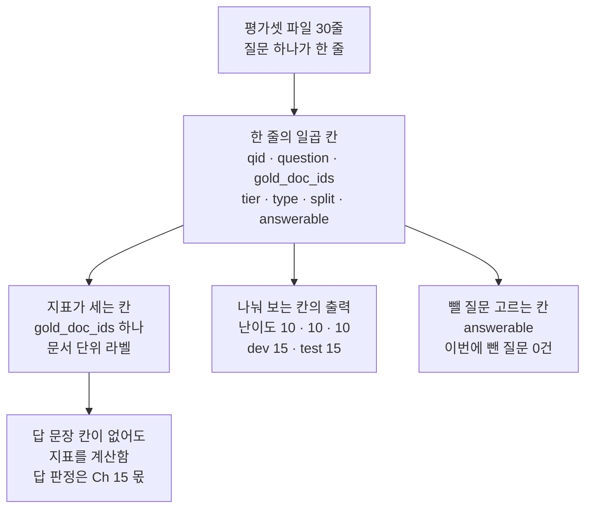
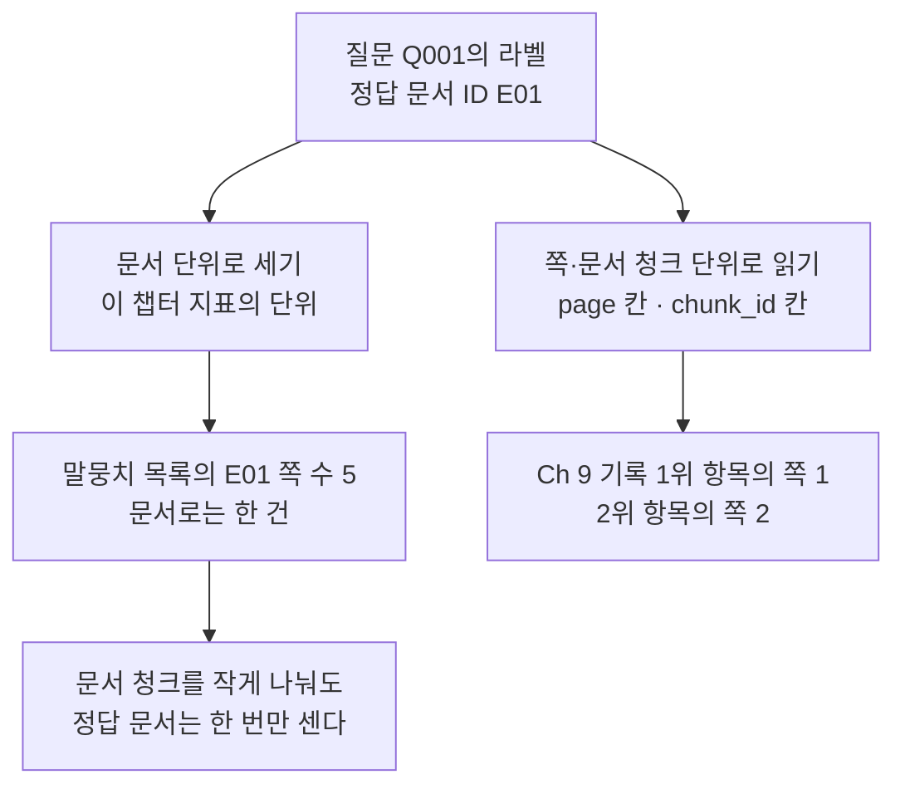
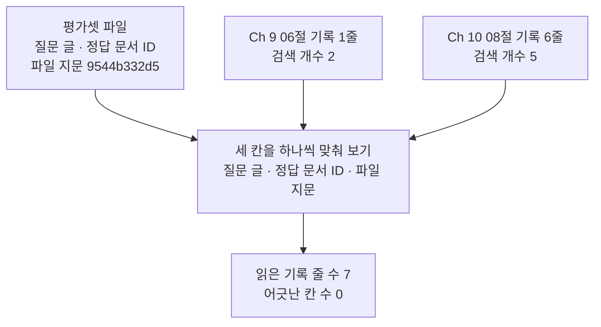
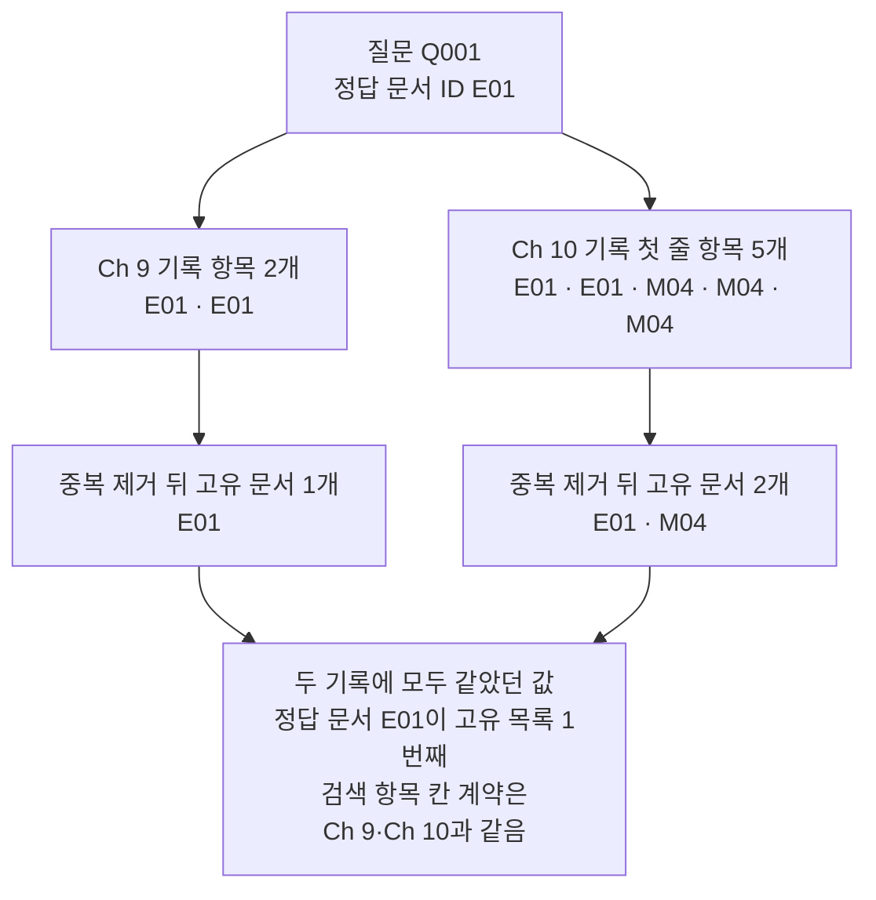
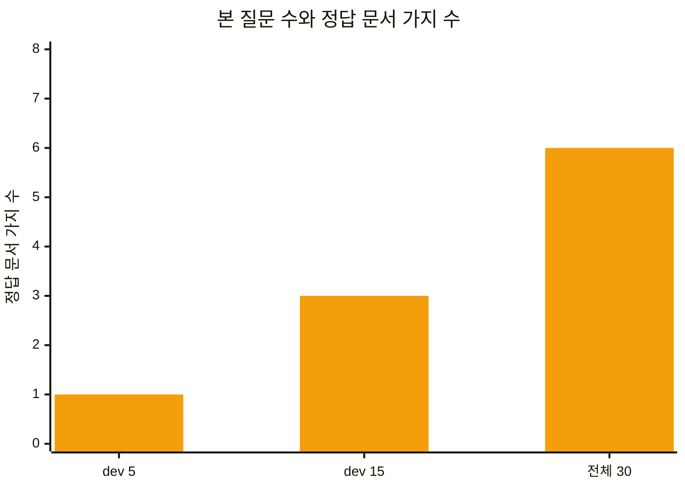

# 01-질의셋과-정답-문서-ID

## _src 본문 (HTML 원본)

```html
<!--meta: 강의 1h | 실습 2h | 코드 notebooks/01-질의셋과-정답-문서-ID.ipynb | 새 용어 6 -->

<h2 id="b1"><span class="no">1</span>학습 목표</h2>
<div class="goal"><ul>
<li>이 절을 마치면 질문 하나를 평가셋 한 줄로 적고 일곱 칸의 쓰임을 말할 수 있습니다.</li>
<li>이 절을 마치면 정답 문서 ID가 문서 단위 라벨인 까닭을 설명할 수 있습니다.</li>
<li>이 절을 마치면 검색 항목에서 문서 ID 중복을 빼 고유 문서를 셀 수 있습니다.</li>
<li>이 절을 마치면 앞 챕터 기록의 라벨이 평가셋과 같은지 확인할 수 있습니다.</li>
</ul></div>

<h2 id="b2"><span class="no">2</span>이 내용을 배우는 이유</h2>
<p>검색 설정을 바꾼 뒤 결과 몇 줄만 읽으면 좋아 보이는 사례를 고르기 쉽습니다. Ch 9와 Ch 10에서는 검색 결과를 눈으로 읽었습니다. 정답 문서가 몇 번째에 있었는지까지만 확인했습니다. 이 챕터는 같은 결과를 숫자 하나로 잽니다.</p>
<p>숫자를 재기 전에 먼저 정할 것이 있습니다. 어떤 질문으로 잴지와 무엇을 정답으로 볼지입니다. 이 두 가지는 설정보다 먼저 적어 둡니다. 설정 결과를 본 뒤에 정답을 고치면 점수를 믿을 수 없습니다.</p>
<p>이 챕터가 재는 것은 검색 단계입니다. 답 문장이 사실에 맞는지는 Ch 15에서 다룹니다. 그래서 평가셋 파일에는 질문과 정답 문서 ID만 넣습니다. 답 문장은 넣지 않습니다.</p>
<p>이 절은 파일을 두 갈래로 읽습니다. 하나는 질문 30개가 든 평가셋 파일입니다. 다른 하나는 Ch 9 06절과 Ch 10 08절이 남긴 실행 기록입니다. 두 갈래의 라벨이 같은지 확인하는 데까지 갑니다.</p>

<h2 id="b3"><span class="no">3</span>앞에서 배운 내용</h2>
<ul>
<li><strong>쪽 단위 출처 표시</strong> — Ch 9 03절에서 근거 쪽을 <code>[E01 p.2]</code> 모양으로 적었습니다. Ch 9 05절에서는 정답 출처를 쪽 단위로 적어 검색 누락을 찾았습니다.</li>
<li><strong>문서 단위 정답 문서 ID</strong> — Ch 9 06절에서 평가셋 파일의 <code>gold_doc_ids</code>를 읽어 기록에 남겼습니다. 쪽 번호가 없는 라벨입니다.</li>
<li><strong>기록의 검색 항목 다섯 칸</strong> — Ch 9 06절 기록의 검색 항목에는 칸이 다섯 개 있습니다. 이름은 <code>doc_id</code>·<code>chunk_id</code>·<code>page</code>·<code>rank</code>·<code>score</code>입니다.</li>
<li><strong>형식마다 다른 자리 칸</strong> — Ch 10 03·04·06절에서 쪽이 없는 형식의 자리 칸을 정했습니다. 형식 CSV는 <code>row</code>, HWPX는 <code>section</code>, 제목으로 나눈 문서 청크는 <code>heading</code>을 씁니다.</li>
<li><strong>실험 설정 여섯 개</strong> — Ch 10 08절은 디지털 PDF 18건과 질문 Q001에 설정 여섯 개를 적용했습니다. 나누기 방식 세 가지와 겹침 두 값을 곱한 설정이고, 임베딩 모델은 <code>text-embedding-3-small</code> 하나만 썼습니다.</li>
<li><strong>파일 지문</strong> — Ch 7 08절에서 <code>hashlib.sha256</code>으로 파일 내용을 16진수 64자로 줄였습니다.</li>
<li><strong>JSONL</strong> — Ch 9 06절에서 한 줄에 기록 하나를 적는 파일 형식을 배웠습니다. 평가셋 파일도 같은 형식입니다.</li>
</ul>

<h2 id="b4"><span class="no">4</span>핵심 개념</h2>
<h3>비유 — 질문 쪽지와 책 한 권</h3>
<p>질문을 적은 쪽지가 여섯 장 있다고 생각해 보세요. 쪽지마다 답이 든 책 한 권을 골라 실로 이어 둡니다. 실을 먼저 이어 두면 찾는 방법을 바꿔도 기준이 그대로입니다.</p>
<p>실 세 줄이 같은 책으로 모일 수 있습니다. 그래도 그 책은 한 권입니다. 책을 펼치면 속장이 여러 장 나오지만 책 수는 늘지 않습니다.</p>
<p>검색 평가도 같습니다. 질문마다 정답 문서를 미리 이어 둡니다. 같은 문서에서 여러 항목이 올라와도 문서는 한 번만 셉니다.</p>
{{img:01-6-쪽지와-책|평면 그림으로 왼쪽에 노란 정사각 쪽지 여섯 장이 두 장씩 세 줄로 놓여 있고 오른쪽에는 세워 둔 책 세 권이 나란히 있으며 책등마다 글자가 없는 흰 이름표가 붙어 있고 쪽지마다 가는 회색 실 한 줄이 나와 여러 줄이 왼쪽 파란 책의 이름표로 모이고 두 줄은 가운데 초록 책과 오른쪽 회색 책의 이름표로 이어지며 왼쪽 파란 책은 반쯤 열려 흰 속장 몇 장이 위로 반쯤 나와 있음|질문 쪽지마다 실 한 줄이 책 한 권으로 이어지고 여러 쪽지가 같은 책으로 모입니다}}
<p><strong>그림 읽기</strong> — 왼쪽 노란 쪽지부터 실을 따라갑니다. 쪽지 여섯 장에 실이 하나씩 있습니다. 실 여러 줄이 왼쪽 파란 책의 흰 이름표로 모이고, 두 줄만 가운데와 오른쪽 책으로 갑니다. 왼쪽 파란 책은 반쯤 열려 흰 속장이 위로 나와 있습니다. 책 한 권 안에 종이가 여러 장 든 모습입니다.</p>

<h3>이 절에서 쓰는 말</h3>
<table><thead><tr><th>용어</th><th>뜻과 일상 예</th><th>이 절에서 보이는 모습</th></tr></thead><tbody>
<tr><td>질의셋(query set)</td><td>평가에 되풀이해 쓰는 질문 모음. 해마다 같은 문제로 치르는 모의고사 문제집과 같음</td><td>노트북 2절 <code>평가셋 줄 수: 30</code></td></tr>
<tr><td>정답 문서 ID(gold document ID)</td><td>답의 근거가 든 문서라고 사람이 확인해 적어 둔 문서 이름. 책등에 붙인 이름표와 같음</td><td>노트북 4절 <code>정답 문서 ID: ['E01']</code></td></tr>
<tr><td>관련도 판정(relevance judgment)</td><td>문서가 질문에 관련되는지 정한 라벨. 이 챕터는 관련 1과 관련 없음 0 두 값만 씀</td><td>노트북 7절 <code>정답 문서별 질문 수</code> 줄</td></tr>
<tr><td>개발 분할(dev split)</td><td>설정을 고르며 되풀이해 보는 질문 묶음. 시험 전에 푸는 연습 문제와 같음</td><td>노트북 5절 <code>분할별 질문 수: {'dev': 15, 'test': 15}</code></td></tr>
<tr><td>시험 분할(test split)</td><td>고르기를 끝낸 설정을 마지막에 한 번 확인하는 질문 묶음. 연습에 쓰지 않은 실전 문제와 같음</td><td>같은 줄의 <code>'test': 15</code></td></tr>
<tr><td>고유 문서(unique document)</td><td>검색 항목에서 문서 ID 중복을 뺀 목록. 손든 사람 수가 아니라 몇 집에서 왔는지 세는 것과 같음</td><td>노트북 12절 <code>Ch 10 검색 항목 수: 5 고유 문서: ['E01', 'M04']</code></td></tr>
</tbody></table>
<p>문서 청크·색인·벡터스토어·검색 점수는 Ch 9에서 정한 뜻 그대로입니다. 실행 설정·실행 기록 한 줄·정답 문서 ID도 Ch 9 06절 뜻입니다. 기록 줄 수는 Ch 10 08절 뜻이고, 겹침은 Ch 9 02절 뜻입니다. 「조각」은 Ch 5에서 정한 토큰 뜻이라 문서를 나눈 단위에는 쓰지 않습니다.</p>

<h3>도식 — 평가셋 한 줄의 일곱 칸</h3>
{{mermaid:01-1-평가셋-한-줄|위에서 아래로 내려가는 흐름도로 맨 위 초록 상자 평가셋 파일 30줄에서 초록 상자 한 줄의 일곱 칸으로 내려가고 그 아래로 파란 상자 지표가 세는 칸 gold doc ids 하나와 노란 상자 나눠 보는 칸의 출력 난이도 10 10 10 dev 15 test 15와 노란 상자 뺄 질문 고르는 칸 answerable 이번에 뺀 질문 0건 셋으로 갈라지며 파란 상자 아래에 회색 상자 답 문장 칸이 없어도 지표를 계산함 답 판정은 Ch 15 몫이 붙어 있음|평가셋 한 줄의 일곱 칸 가운데 지표가 세는 칸은 gold doc ids 하나입니다}}
<p><strong>도식 읽기</strong> — 맨 위 초록 상자부터 아래로 봅니다. 평가셋 파일은 30줄이고 질문 하나가 한 줄입니다. 둘째 초록 상자에 한 줄의 일곱 칸 이름이 모두 적혀 있습니다. 그 아래에서 칸의 쓰임이 셋으로 갈립니다.</p>
<p>왼쪽 파란 상자가 지표 계산에 쓰는 칸입니다. 칸 <code>gold_doc_ids</code> 하나만 씁니다. 가운데와 오른쪽 노란 상자는 노트북 출력으로 확인한 값입니다. 난이도별 10개씩과 개발 분할 15개, 시험 분할 15개입니다. 오른쪽 상자의 뺀 질문 수는 이번 평가셋에서 0건이었습니다.</p>
<p>맨 아래 회색 상자는 왼쪽 파란 상자에만 이어집니다. 답 문장 칸이 없어도 정답 문서 ID만으로 지표를 계산합니다. 답 문장이 사실에 맞는지 가리는 일은 Ch 15에서 합니다.</p>

<h3>문서 단위로 세는 까닭</h3>
<p>정답 문서 ID는 쪽 번호가 없는 문서 이름입니다. 같은 문서에서 쪽이나 문서 청크가 여러 개 검색되어도 문서 하나로 한 번만 셉니다. 문서 청크를 작게 나눈 설정이 같은 정답 문서로 상위 자리를 차지해 유리해지는 것을 막으려는 것입니다.</p>
<p>중복을 빼는 순서도 정해 둡니다. 문서 ID 중복을 먼저 빼고 그다음에 앞에서 몇 개까지 볼지 자릅니다. 순서를 뒤집으면 문서 청크가 많은 문서가 앞자리를 메울 수 있습니다.</p>
<p>쪽 번호와 문서 청크 이름은 지표에 쓰지 않습니다. 대신 왜 틀렸는지 읽을 때 씁니다. Ch 9 05절이 쪽 단위 정답 출처로 검색 누락을 찾은 방법이 그 자리입니다.</p>
{{mermaid:01-2-세는-단위|위에서 아래로 내려가는 흐름도로 맨 위 초록 상자 질문 Q001의 라벨 정답 문서 ID E01에서 왼쪽 파란 상자 문서 단위로 세기와 오른쪽 파란 상자 쪽과 문서 청크 단위로 읽기 두 갈래로 갈라지고 왼쪽 아래 노란 상자 말뭉치 목록의 E01 쪽 수 5 문서로는 한 건과 오른쪽 아래 노란 상자 Ch 9 기록 1위 항목의 쪽 1 2위 항목의 쪽 2가 각각 이어지며 왼쪽 맨 아래에 파란 상자 문서 청크를 작게 나눠도 정답 문서는 한 번만 센다가 붙어 있음|같은 정답 문서 E01이 왼쪽에서는 문서 한 건으로 오른쪽에서는 1쪽과 2쪽 두 항목으로 보입니다}}
<p><strong>도식 읽기</strong> — 맨 위 초록 상자에서 두 갈래로 내려갑니다. 왼쪽 갈래가 이 챕터 지표의 단위입니다. 아래 노란 상자를 보면 문서 <code>E01</code>의 쪽 수는 5인데 문서로는 한 건입니다.</p>
<p>오른쪽 갈래가 원인을 읽을 때 쓰는 단위입니다. 노란 상자의 두 줄이 Ch 9 기록의 1위와 2위 항목입니다. 두 항목의 쪽은 1과 2로 다르지만 문서 ID는 둘 다 <code>E01</code>입니다. 왼쪽 맨 아래 파란 상자가 그래서 정한 규칙입니다.</p>

<h3>평가에서 빼는 질문</h3>
<p>칸 <code>answerable</code>이 <code>false</code>이거나 정답 문서 ID가 빈 줄은 지표 평균에서 뺍니다. 정답이 없는 질문에 0점을 주면 두 가지가 섞입니다. 검색기가 놓친 질문과 애초에 찾을 정답이 없는 질문입니다. 뺀 질문 수는 따로 세어 적어 둡니다.</p>
<p>이번 평가셋 30줄에는 뺄 질문이 없었습니다. 모든 줄의 <code>answerable</code>이 <code>true</code>이고 정답 문서 ID가 한 개씩 있습니다. 그래서 이 규칙이 실제로 질문을 빼는 장면은 이번에 실행하지 않았습니다.</p>
<p>정답 문서가 여러 개인 질문도 이번 평가셋에는 없습니다. 그런 질문은 한 문서만 찾으면 되는지 모두 찾아야 하는지 먼저 정해야 합니다. 라벨을 적는 지침에 그 규칙을 함께 적어 둡니다.</p>

<h2 id="b5"><span class="no">5</span>실행 예제</h2>
<p>내려받은 실습 폴더에서 노트북을 열고 위에서 아래로 실행합니다. 이 절은 모델도 임베딩도 부르지 않습니다. API 키가 없어도 실행되고 예상 비용은 0달러입니다. 실행 시간은 5초 안팎입니다.</p>
<p>읽는 파일은 네 개입니다. 평가셋 파일과 말뭉치 목록, Ch 9 기록과 Ch 10 기록입니다. 네 파일 모두 실습 묶음에 들어 있습니다.</p>
<p>이 페이지의 출력은 2026-09-18에 실행한 결과입니다. 새 커널로 두 번 이어 실행해 값이 같은 것을 확인했습니다. 이 절은 파일만 읽으므로 실행할 때마다 값이 같습니다.</p>
<p>강의 시간에는 노트북 2~8절을 설명합니다. 평가셋 읽기, 한 줄 펼쳐 보기, 난이도와 분할 세기, 뺄 질문 고르기, 정답 문서 모으기, 말뭉치 목록과 맞추기입니다. 9~14절은 함께 실행하고 실습 시간에 다시 읽습니다.</p>
{{mermaid:01-3-라벨-맞추기|위에서 아래로 내려가는 흐름도로 위쪽에 초록 상자 평가셋 파일 질문 글 정답 문서 ID 파일 지문 9544b332d5와 초록 상자 Ch 9 06절 기록 1줄 검색 개수 2와 초록 상자 Ch 10 08절 기록 6줄 검색 개수 5 셋이 나란히 있고 세 화살표가 가운데 파란 상자 세 칸을 하나씩 맞춰 보기 질문 글 정답 문서 ID 파일 지문으로 모이며 그 아래 노란 상자 읽은 기록 줄 수 7 어긋난 칸 수 0으로 이어짐|앞 챕터 기록 7줄을 평가셋과 맞춰 보면 어긋난 칸이 0개입니다}}
<p><strong>도식 읽기</strong> — 위쪽 초록 상자 세 개부터 봅니다. 왼쪽이 평가셋 파일이고 오른쪽 둘이 앞 챕터가 남긴 기록입니다. 기록 줄 수는 Ch 9가 1줄, Ch 10이 6줄입니다. 검색 개수도 2와 5로 다릅니다.</p>
<p>세 화살표가 가운데 파란 상자로 모입니다. 맞춰 보는 칸은 질문 글과 정답 문서 ID, 평가셋 파일 지문 셋입니다. 아래 노란 상자가 그 결과입니다. 기록 7줄에서 어긋난 칸이 0개였습니다.</p>
{{notebook:01-질의셋과-정답-문서-ID}}
<p class="look"><b>확인할 점</b> — 평가셋은 30줄이고 한 줄의 칸 수는 <code>7</code>입니다. 답 문장 칸은 없습니다. 난이도는 <code>{'easy': 10, 'medium': 10, 'hard': 10}</code>이고 분할은 <code>{'dev': 15, 'test': 15}</code>입니다. 정답 문서는 여섯 가지이고 질문마다 한 개씩 적혀 있습니다. 앞 챕터 기록 7줄에서 어긋난 칸은 <code>0</code>이었습니다.</p>
<p>기록 한 줄의 설정 칸 이름은 두 챕터에서 다릅니다. Ch 9 기록은 검색 개수를 <code>config</code> 안 <code>retrieval</code> 밑에 적었고 Ch 10 기록은 <code>config</code> 바로 밑에 적었습니다. 지표가 읽는 칸은 <code>retrieved</code> 하나라 설정 칸 이름이 달라도 계산은 같습니다.</p>
{{mermaid:01-4-고유-문서-세기|위에서 아래로 내려가는 흐름도로 맨 위 초록 상자 질문 Q001 정답 문서 ID E01에서 왼쪽 초록 상자 Ch 9 기록 항목 2개 E01 E01과 오른쪽 초록 상자 Ch 10 기록 첫 줄 항목 5개 E01 E01 M04 M04 M04로 갈라지고 각각 아래 노란 상자 중복 제거 뒤 고유 문서 1개 E01과 노란 상자 중복 제거 뒤 고유 문서 2개 E01 M04로 이어지며 두 화살표가 맨 아래 회색 상자 두 기록에 모두 같았던 값 정답 문서 E01이 고유 목록 1번째 검색 항목 칸 계약은 Ch 9 Ch 10과 같음으로 모임|Ch 10 기록의 검색 항목 5개는 문서 ID 중복을 빼면 고유 문서 2개로 줄어듭니다}}
<p><strong>도식 읽기</strong> — 맨 위 초록 상자에서 두 갈래로 내려가며 왼쪽과 오른쪽을 견줍니다. 왼쪽 갈래가 Ch 9 기록이고 검색 항목이 2개입니다. 두 항목의 문서 ID가 모두 <code>E01</code>이라 노란 상자의 고유 문서는 1개입니다.</p>
<p>오른쪽 갈래가 Ch 10 기록의 첫 줄이고 검색 항목이 5개입니다. 문서 ID는 <code>E01</code> 두 개와 <code>M04</code> 세 개라 고유 문서가 2개로 줄어듭니다. 항목 수와 고유 문서 수가 다른 자리입니다.</p>
<p>맨 아래 회색 상자는 두 갈래 모두에 해당합니다. 두 기록 모두 정답 문서 <code>E01</code>이 고유 목록의 1번째였습니다. 검색 항목의 칸 계약은 Ch 9 06절에서 정한 다섯 칸 그대로입니다. 이 절에서는 그 칸 이름을 세지 않았습니다.</p>

<h2 id="b6"><span class="no">6</span>실험 결과 해석</h2>
{{mermaid:01-5-질문-수와-정답-분포|가로축에 dev 5와 dev 15와 전체 30 세 칸이 있고 세로축이 정답 문서 가지 수 0에서 8까지인 주황 막대 그림으로 막대 높이가 차례로 1과 3과 6|개발 분할 앞 5문항만 보면 정답 문서가 한 가지지만 평가셋 30문항에서는 여섯 가지입니다}}
<p><strong>도식 읽기</strong> — 왼쪽 막대부터 오른쪽으로 봅니다. 왼쪽 주황 막대는 개발 분할 앞 5문항이고 정답 문서가 한 가지입니다. 가운데 막대는 개발 분할 15문항 전체이고 세 가지로 늘어납니다. 오른쪽 막대는 평가셋 30문항 전체이고 여섯 가지입니다.</p>
<p>질문을 적게 보면 정답 문서 갈래가 좁아집니다. 앞 5문항은 모두 문서 <code>E01</code>이 정답이었습니다. 도서관 안내문 하나만 보고 설정을 고르면 계약서나 회의록에서 생기는 문제를 놓칩니다.</p>
<p>개발 분할 15문항의 정답 문서는 <code>E01</code>과 <code>M01</code>, <code>H01</code> 세 가지이고 5문항씩입니다. 세 문서는 말뭉치 목록에서 난이도가 쉬움과 보통, 어려움으로 갈립니다. Ch 10 01절에서 본 난이도 갈래입니다. 그래서 설정을 고를 때는 앞부터 몇 개만 자르지 않고 분할 전체를 씁니다.</p>
<p>평가셋 30문항도 운영 질문 전체를 대신하지 못합니다. 정답 문서는 여섯 가지이고 말뭉치 문서는 21건입니다. 이 결과는 이 말뭉치와 이 질문 묶음에서 본 것입니다.</p>
<p>이 절은 지표를 아직 계산하지 않았습니다. 앞 챕터 기록에서 정답 문서가 고유 목록의 1번째였다는 것까지 확인했습니다. 그 자리를 숫자로 바꾸는 일은 02절부터 합니다.</p>

<h2 id="b7"><span class="no">7</span>주의할 점과 실무 메모</h2>
<ul>
<li><strong>정답 문서 ID는 원문을 읽고 적습니다.</strong> 검색 결과를 그대로 정답으로 옮기면 그 검색기의 치우침이 라벨에 들어갑니다. 그러면 그 검색기가 높은 점수를 받기 쉽습니다.</li>
<li><strong>시험 분할 결과를 보고 설정을 다시 고르지 않습니다.</strong> 한 번이라도 보고 고치면 그 질문은 사실상 개발 분할이 됩니다. 마지막 확인은 고르기에 쓰지 않은 질문으로 합니다.</li>
<li><strong>중복 제거는 자르기보다 먼저 합니다.</strong> 순서를 뒤집으면 문서 청크가 많은 문서가 앞자리를 메웁니다. 노트북 12절 Ch 10 기록에서 항목 5개가 고유 문서 2개였던 것이 그 예입니다.</li>
<li><strong>문서 청크 이름은 지표에 쓰지 않습니다.</strong> 이번 출력에서 Ch 9 기록은 <code>ch09:6f9f83db90:0</code>이고 Ch 10 기록은 <code>ch10:char:0000</code>이라 번호를 채우는 방식이 다릅니다. 이 글자는 앞 챕터가 기록을 다시 쓸 때 바뀔 수 있습니다. 두 기록을 나란히 볼 때 모양이 섞여 보이지만 지표 계산에는 영향이 없습니다.</li>
<li><strong>이 기록의 검색 항목에는 <code>page</code> 칸만 있습니다.</strong> Ch 10에서 정한 <code>row</code>·<code>section</code>·<code>heading</code> 자리 칸은 이 기록에 나오지 않습니다. 두 챕터 모두 PDF만 색인에 넣었기 때문입니다. 쪽이 없는 형식을 섞으면 그 칸을 어떻게 기록할지 먼저 정해야 합니다.</li>
<li><strong>평가셋 파일에는 정답 라벨이 보입니다.</strong> 파일 <code>evaluation-queries.jsonl</code>은 실습 묶음에 들어 있어 학생도 열어 볼 수 있습니다. 답을 먼저 읽지 말고 노트북을 실행한 뒤에 확인하세요. 라벨을 먼저 외우면 검색 결과를 보는 눈이 흐려집니다.</li>
<li><strong>파일 지문으로 같은 평가셋인지 확인합니다.</strong> 기록의 <code>config</code> 안에 평가셋 파일 지문이 들어 있습니다. 평가셋을 한 글자라도 고치면 지문이 달라져 옛 기록과 맞지 않습니다. 그래서 이 파일은 고치지 않고 그대로 씁니다.</li>
<li><strong>이번에 실행하지 않은 것을 적어 둡니다.</strong> 지표 계산, 정답 문서가 여러 개인 질문, 제외 규칙이 질문을 실제로 빼는 장면, 질문을 새로 만들어 라벨 붙이기입니다. 답 문장 판정은 Ch 15에서 배웁니다.</li>
</ul>

<h2 id="b8"><span class="no">8</span>정리와 다음 절</h2>
<ul>
<li>평가셋 파일은 30줄이고 한 줄에 칸이 일곱 개이며 답 문장 칸은 없습니다.</li>
<li>난이도는 쉬움과 보통, 어려움이 10개씩이고 개발 분할과 시험 분할이 15개씩입니다.</li>
<li>정답 문서 ID는 문서 단위 라벨이고 이번 평가셋에서는 여섯 가지 문서가 쓰였습니다.</li>
<li>Ch 9 기록 1줄과 Ch 10 기록 6줄을 읽어 라벨을 맞춰 보니 어긋난 칸이 0개였습니다.</li>
<li>Ch 10 기록 첫 줄의 검색 항목 5개는 문서 ID 중복을 빼면 고유 문서 2개였습니다.</li>
<li>개발 분할 앞 5문항만 보면 정답 문서가 한 가지로 좁아졌습니다.</li>
</ul>
<p><strong>다음 학습과 이어지는 지점</strong> — 02절에서는 고유 문서 목록의 앞 50개에 정답 문서가 들어왔는지 Recall@50으로 잽니다. 이 절에서 만든 중복 제거 목록이 그 계산의 입력입니다.</p>
<p>이 절은 질문과 정답을 어떤 모양으로 적어 두는지까지 왔습니다. 정답 문서가 몇 번째였는지는 눈으로만 읽었습니다. 그 자리를 하나의 숫자로 바꾸는 일은 02절부터 04절까지 나눠 배웁니다.</p>

<h2 id="b9"><span class="no">9</span>복습 문제</h2>
<details class="quiz" open><summary>문제 4개 · 해설 포함</summary>
<p class="quiz-q">1. [하] 답 문장이 없어도 검색 지표를 계산할 수 있는 까닭은 무엇입니까?</p>
<p class="quiz-a">검색 결과의 문서 ID와 정답 문서 ID를 맞춰 보기 때문입니다. 지표는 문서를 찾았는지만 셉니다. 답 문장이 사실에 맞는지 가리는 일은 Ch 15에서 합니다.</p>
<p class="quiz-q">2. [중] 같은 문서의 문서 청크 세 개가 검색되면 정답 세 개로 셉니까?</p>
<p class="quiz-a">아닙니다. 문서 ID 중복을 먼저 빼고 고유 문서로 셉니다. 노트북 12절에서 Ch 10 기록의 항목 5개가 고유 문서 2개로 줄어들었습니다.</p>
<p class="quiz-q">3. [중] 정답 문서 ID가 빈 질문에 0점을 주면 어떤 두 상황이 섞입니까?</p>
<p class="quiz-a">검색기가 정답 문서를 놓친 상황과 애초에 찾을 정답 문서가 없는 상황이 섞입니다. 그래서 그런 질문은 평균에서 빼고 뺀 수를 따로 적습니다. 이번 평가셋에는 그런 줄이 없었습니다.</p>
<p class="quiz-q">4. [상] Ch 9 기록과 Ch 10 기록의 문서 청크 이름 모양이 다릅니다. 지표 계산을 고쳐야 합니까?</p>
<p class="quiz-a">고치지 않아도 됩니다. 지표는 검색 항목의 <code>doc_id</code>만 씁니다. 문서 청크 이름과 쪽 번호는 왜 틀렸는지 읽을 때 쓰는 값입니다.</p>
</details>

<h2 id="b10"><span class="no">10</span>참고 자료</h2>
<ul>
<li><div><a href="https://trec.nist.gov/pubs/trec30/papers/Overview-2021.pdf">TREC 2021 Overview</a></div>확인 2026-09-18 · 질문 묶음과 관련도 판정을 따로 두는 방식 참고.</li>
<li><div><a href="https://ir-datasets.com/cranfield.html">ir_datasets Cranfield 안내</a></div>확인 2026-09-18 · 질문과 관련도 라벨을 다른 파일에 두는 구조 참고.</li>
<li>Ch 9 06절 실험 하네스 — 평가셋 파일에서 질문과 정답 문서 ID를 읽어 기록에 남기는 방법.</li>
<li>Ch 10 08절 인덱싱 비교 실험 — 설정 여섯 개의 검색 결과를 같은 칸 모양으로 남기는 방법.</li>
<li>기준 버전은 Python 3.12.13입니다. 이 절은 Python에 들어 있는 기능만 써서 따로 설치하는 패키지가 없습니다. 실습 폴더에 고정한 pypdf 6.1.1은 02절부터 씁니다. 다른 버전과 Windows·macOS에서는 이번에 실행하지 않았습니다.</li>
</ul>
```

## 노트북 셀 (순서대로)

### [0] markdown {'html': 'skip'}

# 질의셋과 정답 문서 ID

**이 노트북에서 할 일**

1. 평가셋 파일 30줄을 읽고 한 줄의 일곱 칸이 무엇을 담는지 확인합니다.
2. 정답 문서 ID를 모아 난이도·분할별로 세고, 평가에서 뺄 질문이 있는지 봅니다.
3. Ch 9 06절과 Ch 10 08절이 남긴 실행 기록의 라벨을 평가셋과 맞춰 봅니다.
4. 검색 항목에서 문서 ID 중복을 빼 고유 문서를 세고 정답 문서의 자리를 찾습니다.

**준비물** — API 키가 필요 없습니다. 모델과 임베딩에는 요청을 한 번도 보내지 않습니다.
그래서 예상 비용은 0달러입니다. 실행 시간은 5초 안팎입니다.

**데이터** — 읽는 파일은 네 개이고 모두 실습 묶음에 들어 있습니다.

- 평가셋 `labs/part3/ch11-evaluation/data/evaluation-queries.jsonl`
- 말뭉치 목록 `labs/data/rag-corpus/manifest.json`
- Ch 9 06절 기록 `labs/part3/ch09-rag-first-run/runs/continuity-ch09-search.jsonl`
- Ch 10 08절 기록 `labs/part3/ch10-document-processing/runs/continuity-ch10-indexing.jsonl`

**강의와 실습 범위** — 강의 시간에는 2~8절을 설명합니다.
평가셋 읽기, 한 줄 펼쳐 보기, 난이도와 분할 세기, 뺄 질문 고르기, 정답 문서 모으기, 말뭉치 목록과 맞추기입니다.
9~14절은 함께 실행하고 실습 시간에 다시 읽습니다.

**기준 버전** — 이 절은 Python에 들어 있는 기능만 쓰므로 따로 설치하는 패키지가 없습니다.
실습 폴더에 고정한 pypdf 6.1.1은 02절부터 씁니다.
교재 출력은 Linux의 Python 3.12.13으로 만들었습니다. 다른 버전과 Windows·macOS에서는 이번에 실행하지 않았습니다.

실습 폴더 `labs/part3/ch11-evaluation`에서 `uv sync --locked`를 실행합니다.
그다음 이 폴더의 `.venv` 커널을 고르고 첫 셀부터 순서대로 실행합니다.

### [1] markdown {'html': 'skip'}

## 오늘 볼 그림


평가셋 한 줄에는 칸이 일곱 개 있습니다. 그 가운데 지표가 세는 칸은 `gold_doc_ids` 하나입니다.
나머지 칸은 결과를 난이도·분할로 나눠 보거나 평가에서 뺄 질문을 고를 때 씁니다.
답 문장을 담는 칸은 없습니다. 이 노트북은 파란 상자 왼쪽 갈래까지 준비하는 자리입니다.

### [2] markdown {}

## 1. 준비

이 절은 파일만 읽습니다. 그래서 패키지 설치 셀과 API 키 확인 셀이 없습니다.
첫 셀은 표준 라이브러리 세 개를 불러옵니다.
파일 지문은 `hashlib`으로 만들고, JSONL 한 줄은 `json`으로 딕셔너리로 바꿉니다.

### [3] code {'execution': {'iopub.execute_input': '2026-09-18T08:54:19.259390Z', 'iopub.status.busy': '2026-09-18T08:54:19.259020Z', 'iopub.status.idle': '2026-09-18T08:54:19.265555Z', 'shell.execute_reply': '2026-09-18T08:54:19.264764Z'}, 'lesson_role': 'setup'}

```python
# 평가셋 파일과 실행 기록을 읽고 파일 지문을 만들 이름을 불러옵니다
import hashlib
import json
import os

print("불러온 이름:", "hashlib", "json", "os")
```

출력:
```
불러온 이름: hashlib json os

```

### [4] markdown {}

**결과 읽기** — 출력 줄은 `불러온 이름: hashlib json os` 하나입니다.
세 이름이 모두 Python에 들어 있어 설치가 필요 없습니다.

다음 셀은 프로젝트 맨 위 폴더를 찾습니다.
Ch 10 01절과 같은 코드입니다. 후보 경로를 차례로 보고 자료 폴더가 있는 곳에서 멈춥니다.

### [5] code {'execution': {'iopub.execute_input': '2026-09-18T08:54:19.267259Z', 'iopub.status.busy': '2026-09-18T08:54:19.267115Z', 'iopub.status.idle': '2026-09-18T08:54:19.270760Z', 'shell.execute_reply': '2026-09-18T08:54:19.270086Z'}, 'lesson_role': 'setup'}

```python
# 노트북을 어느 폴더에서 열어도 프로젝트 맨 위를 찾게 후보 세 개를 차례로 봅니다
candidates = [".", "../../..", "../../../.."]
root_path = None
for candidate in candidates:
    if os.path.exists(candidate + "/labs/data/rag-corpus"):
        root_path = candidate
        break
print("고른 경로:", root_path)
assert root_path is not None, "notebooks 폴더나 실습 폴더 맨 위에서 노트북을 열어 주세요."
```

출력:
```
고른 경로: .

```

### [6] markdown {}

**결과 읽기** — 출력 줄은 `고른 경로: .`입니다. `assert`도 통과했습니다.
교재 출력은 프로젝트 맨 위를 작업 폴더로 삼아 실행해서 첫째 후보를 골랐습니다.
`notebooks` 폴더에서 열면 셋째 후보, 실습 폴더 맨 위에서 열면 둘째 후보가 나옵니다.

다음 셀은 고른 경로에 파일 이름을 이어 붙여 네 경로를 만듭니다.
그리고 네 파일이 모두 있는지 확인합니다.

### [7] code {'execution': {'iopub.execute_input': '2026-09-18T08:54:19.272113Z', 'iopub.status.busy': '2026-09-18T08:54:19.271991Z', 'iopub.status.idle': '2026-09-18T08:54:19.277119Z', 'shell.execute_reply': '2026-09-18T08:54:19.276529Z'}, 'lesson_role': 'setup'}

```python
# 이 절에서 읽을 파일 네 개의 경로를 만듭니다
dataset_path = root_path + "/labs/part3/ch11-evaluation/data/evaluation-queries.jsonl"
manifest_path = root_path + "/labs/data/rag-corpus/manifest.json"
ch09_log_path = root_path + "/labs/part3/ch09-rag-first-run/runs/continuity-ch09-search.jsonl"
ch10_log_path = root_path + "/labs/part3/ch10-document-processing/runs/continuity-ch10-indexing.jsonl"
print("평가셋 파일이 있는가:", os.path.exists(dataset_path))
print("말뭉치 목록이 있는가:", os.path.exists(manifest_path))
print("Ch 9 기록이 있는가:", os.path.exists(ch09_log_path))
print("Ch 10 기록이 있는가:", os.path.exists(ch10_log_path))
```

출력:
```
평가셋 파일이 있는가: True
말뭉치 목록이 있는가: True
Ch 9 기록이 있는가: True
Ch 10 기록이 있는가: True

```

### [8] markdown {}

**결과 읽기** — 네 줄 모두 `True`입니다.
앞 두 파일은 이 챕터와 말뭉치의 자료이고, 뒤 두 파일은 앞 챕터가 남긴 실행 기록입니다.
기록 파일이 없으면 실습 묶음을 다시 내려받으세요.

## 2. 평가셋 파일 읽기

평가셋 파일은 JSONL 형식입니다. 한 줄에 질문 하나가 들어 있습니다.
Ch 9 06절에서 실행 기록을 적을 때 쓴 것과 같은 형식입니다.
함수 `json.loads()`는 글 한 줄을 받아 딕셔너리를 반환합니다.

### [9] code {'execution': {'iopub.execute_input': '2026-09-18T08:54:19.278284Z', 'iopub.status.busy': '2026-09-18T08:54:19.278171Z', 'iopub.status.idle': '2026-09-18T08:54:19.281955Z', 'shell.execute_reply': '2026-09-18T08:54:19.281391Z'}}

```python
# 평가셋 파일을 한 줄씩 읽어 질문 기록 목록으로 만듭니다
with open(dataset_path, encoding="utf-8") as dataset_file:
    dataset_lines = dataset_file.read().splitlines()

queries = []
for line in dataset_lines:
    queries.append(json.loads(line))
print("평가셋 줄 수:", len(queries))
```

출력:
```
평가셋 줄 수: 30

```

### [10] markdown {}

**결과 읽기** — 출력 줄은 `평가셋 줄 수: 30`입니다.
질문 30개가 목록 `queries`에 담겼습니다.

## 3. 한 줄의 칸 확인

질문 한 줄에 어떤 칸이 있는지 먼저 봅니다.
메서드 `keys()`는 딕셔너리의 칸 이름을 모아 보여 줍니다.
답 문장을 담는 `answer` 칸이 없는 것도 함께 확인합니다.

### [11] code {'execution': {'iopub.execute_input': '2026-09-18T08:54:19.283228Z', 'iopub.status.busy': '2026-09-18T08:54:19.283117Z', 'iopub.status.idle': '2026-09-18T08:54:19.286005Z', 'shell.execute_reply': '2026-09-18T08:54:19.285324Z'}}

```python
# 첫 줄의 칸 이름을 보고 답 문장 칸이 없는지 확인합니다
first_query = queries[0]
print("칸 이름:", first_query.keys())
print("칸 수:", len(first_query))
print("답 문장 칸이 있는가:", "answer" in first_query)
```

출력:
```
칸 이름: dict_keys(['qid', 'tier', 'question', 'type', 'gold_doc_ids', 'answerable', 'split'])
칸 수: 7
답 문장 칸이 있는가: False

```

### [12] markdown {}

**결과 읽기** — 둘째 줄은 `칸 수: 7`이고 셋째 줄은 `답 문장 칸이 있는가: False`입니다.
첫 줄에 일곱 칸 이름이 모두 나옵니다.
칸 `qid`는 질문 번호, `question`은 질문 글, `gold_doc_ids`는 정답 문서 ID 목록입니다.
칸 `tier`는 난이도, `type`은 질문 갈래, `split`은 개발·시험 분할, `answerable`은 답할 수 있는 질문인지입니다.

다음 셀은 30줄 모두 일곱 칸을 그대로 가졌는지 셉니다.
한 줄이라도 칸이 빠지면 지표를 계산할 때 멈추기 때문입니다.

### [13] code {'execution': {'iopub.execute_input': '2026-09-18T08:54:19.287167Z', 'iopub.status.busy': '2026-09-18T08:54:19.287047Z', 'iopub.status.idle': '2026-09-18T08:54:19.290308Z', 'shell.execute_reply': '2026-09-18T08:54:19.289740Z'}}

```python
# 모든 줄이 일곱 칸을 그대로 가졌는지 세어 봅니다
required_names = ["qid", "tier", "question", "type", "gold_doc_ids", "answerable", "split"]
missing_count = 0
for query in queries:
    for name in required_names:
        if name not in query:
            missing_count = missing_count + 1
print("확인한 줄 수:", len(queries))
print("빠진 칸 수:", missing_count)
assert missing_count == 0
```

출력:
```
확인한 줄 수: 30
빠진 칸 수: 0

```

### [14] markdown {}

**결과 읽기** — 출력 줄은 `확인한 줄 수: 30`과 `빠진 칸 수: 0`입니다.
`assert`도 통과했습니다. 30줄이 모두 같은 칸을 가졌습니다.

## 4. 질문 한 줄 펼쳐 보기

이제 첫 질문 한 줄의 값을 칸마다 출력합니다.
Ch 9 06절과 Ch 10 08절이 쓴 질문 Q001이 이 줄입니다.
정답 문서 ID가 쪽 번호 없는 목록인 것을 눈으로 확인합니다.

### [15] code {'execution': {'iopub.execute_input': '2026-09-18T08:54:19.291444Z', 'iopub.status.busy': '2026-09-18T08:54:19.291338Z', 'iopub.status.idle': '2026-09-18T08:54:19.294297Z', 'shell.execute_reply': '2026-09-18T08:54:19.293767Z'}}

```python
# 첫 질문 한 줄의 칸 값을 하나씩 출력합니다
print("질문 번호:", first_query["qid"])
print("난이도:", first_query["tier"])
print("질문 갈래:", first_query["type"])
print("분할:", first_query["split"])
print("답할 수 있는 질문인가:", first_query["answerable"])
print("정답 문서 ID:", first_query["gold_doc_ids"])
print("질문 글:", first_query["question"])
```

출력:
```
질문 번호: Q001
난이도: easy
질문 갈래: single
분할: dev
답할 수 있는 질문인가: True
정답 문서 ID: ['E01']
질문 글: 미르시립도서관의 정기 휴관일은 언제인가요?

```

### [16] markdown {}

**결과 읽기** — 여섯째 줄은 `정답 문서 ID: ['E01']`입니다.
쪽 번호가 없고 문서 이름만 있습니다.
셋째 줄 `질문 갈래: single`은 근거가 한 문서에 있는 질문이라는 표시입니다.

Ch 9 05절에서는 정답 출처를 쪽까지 적었습니다. 이 챕터의 정답 문서 ID에는 쪽이 없습니다.
마지막 줄의 질문 글은 Ch 9 06절과 Ch 10 08절 기록에 적힌 글과 같아야 합니다. 10절에서 맞춰 봅니다.

## 5. 난이도와 분할 세기

질문이 난이도와 분할에 고르게 퍼져 있는지 셉니다.
빈 딕셔너리를 만들고 `get(키, 기본값)`으로 하나씩 더합니다.
Ch 8 02절에서 쓴 세기 방법과 같습니다.

### [17] code {'execution': {'iopub.execute_input': '2026-09-18T08:54:19.295434Z', 'iopub.status.busy': '2026-09-18T08:54:19.295328Z', 'iopub.status.idle': '2026-09-18T08:54:19.298105Z', 'shell.execute_reply': '2026-09-18T08:54:19.297580Z'}}

```python
# 난이도별·분할별 질문 수를 세어 고르게 퍼져 있는지 봅니다
tier_counts = {}
split_counts = {}
for query in queries:
    tier_name = query["tier"]
    split_name = query["split"]
    tier_counts[tier_name] = tier_counts.get(tier_name, 0) + 1
    split_counts[split_name] = split_counts.get(split_name, 0) + 1
print("난이도별 질문 수:", tier_counts)
print("분할별 질문 수:", split_counts)
```

출력:
```
난이도별 질문 수: {'easy': 10, 'medium': 10, 'hard': 10}
분할별 질문 수: {'dev': 15, 'test': 15}

```

### [18] markdown {}

**결과 읽기** — 첫 줄은 `난이도별 질문 수: {'easy': 10, 'medium': 10, 'hard': 10}`입니다.
쉬움과 보통, 어려움이 10개씩입니다.
둘째 줄은 `분할별 질문 수: {'dev': 15, 'test': 15}`입니다.
개발 분할로 설정을 고르고 시험 분할은 마지막에 한 번만 봅니다.

## 6. 평가에서 뺄 질문 고르기

답할 수 없다고 적힌 질문과 정답 문서 ID가 빈 질문은 평균에서 뺍니다.
그런 질문에 0점을 주면 검색기가 놓친 질문과 섞입니다.
뺀 질문 수는 따로 세어 남겨 둡니다.

### [19] code {'execution': {'iopub.execute_input': '2026-09-18T08:54:19.299103Z', 'iopub.status.busy': '2026-09-18T08:54:19.298995Z', 'iopub.status.idle': '2026-09-18T08:54:19.302028Z', 'shell.execute_reply': '2026-09-18T08:54:19.301485Z'}}

```python
# 답할 수 없다고 적혔거나 정답 문서 ID가 빈 줄을 평가에서 뺍니다
excluded_qids = []
included_qids = []
for query in queries:
    if query["answerable"] and len(query["gold_doc_ids"]) > 0:
        included_qids.append(query["qid"])
    else:
        excluded_qids.append(query["qid"])
print("평가 대상 질문 수:", len(included_qids))
print("뺀 질문 수:", len(excluded_qids))
print("뺀 질문 번호:", excluded_qids)
```

출력:
```
평가 대상 질문 수: 30
뺀 질문 수: 0
뺀 질문 번호: []

```

### [20] markdown {}

**결과 읽기** — 출력 줄은 `평가 대상 질문 수: 30`과 `뺀 질문 수: 0`입니다.
마지막 줄 `뺀 질문 번호: []`는 빈 목록입니다.
이번 평가셋 30줄에는 뺄 질문이 없었습니다. 그래서 이 규칙이 질문을 실제로 빼는 장면은 이번에 실행하지 않았습니다.

## 7. 정답 문서 ID 모으기

정답 문서 ID를 모아 어떤 문서가 몇 번 쓰였는지 셉니다.
칸 `gold_doc_ids`가 목록이라 안쪽 반복문이 하나 더 필요합니다.
정답 문서 ID가 한 개인 질문 수도 함께 셉니다.

### [21] code {'execution': {'iopub.execute_input': '2026-09-18T08:54:19.302989Z', 'iopub.status.busy': '2026-09-18T08:54:19.302900Z', 'iopub.status.idle': '2026-09-18T08:54:19.305407Z', 'shell.execute_reply': '2026-09-18T08:54:19.304945Z'}}

```python
# 질문마다 적힌 정답 문서 ID를 모아 문서별 질문 수와 가지 수를 셉니다
gold_counts = {}
single_gold_count = 0
for query in queries:
    if len(query["gold_doc_ids"]) == 1:
        single_gold_count = single_gold_count + 1
    for doc_id in query["gold_doc_ids"]:
        gold_counts[doc_id] = gold_counts.get(doc_id, 0) + 1
print("정답 문서별 질문 수:", gold_counts)
print("정답 문서 가지 수:", len(gold_counts))
print("정답 문서 ID가 한 개인 질문 수:", single_gold_count)
```

출력:
```
정답 문서별 질문 수: {'E01': 6, 'E02': 4, 'M01': 8, 'M02': 2, 'H01': 8, 'H02': 2}
정답 문서 가지 수: 6
정답 문서 ID가 한 개인 질문 수: 30

```

### [22] markdown {}

**결과 읽기** — 첫 줄에 `{'E01': 6, 'E02': 4, 'M01': 8, 'M02': 2, 'H01': 8, 'H02': 2}`가 나옵니다.
둘째 줄은 `정답 문서 가지 수: 6`입니다. 질문 30개가 문서 여섯 가지에 걸쳐 있습니다.
셋째 줄은 `정답 문서 ID가 한 개인 질문 수: 30`입니다.
정답 문서가 여러 개인 질문은 이번 평가셋에 없습니다.

## 8. 말뭉치 목록과 맞추기

정답 문서 ID가 실제 문서를 가리키는지 말뭉치 목록으로 확인합니다.
목록 파일에는 문서마다 이름과 파일 경로, 쪽 수가 적혀 있습니다.
정답 문서 하나가 쪽 여러 개로 되어 있는 것도 여기서 봅니다.

### [23] code {'execution': {'iopub.execute_input': '2026-09-18T08:54:19.306350Z', 'iopub.status.busy': '2026-09-18T08:54:19.306263Z', 'iopub.status.idle': '2026-09-18T08:54:19.309682Z', 'shell.execute_reply': '2026-09-18T08:54:19.309266Z'}}

```python
# 말뭉치 목록과 정답 문서 ID를 맞춰 보고 정답 문서의 쪽 수를 읽습니다
with open(manifest_path, encoding="utf-8") as manifest_file:
    manifest_rows = json.loads(manifest_file.read())

corpus_pages = {}
for item in manifest_rows:
    corpus_pages[item["doc_id"]] = item["pages"]

missing_docs = []
for doc_id in gold_counts:
    if doc_id not in corpus_pages:
        missing_docs.append(doc_id)
print("말뭉치 목록의 문서 수:", len(manifest_rows))
print("목록에 없는 정답 문서 ID:", missing_docs)
print("정답 문서 E01의 쪽 수:", corpus_pages["E01"])
```

출력:
```
말뭉치 목록의 문서 수: 21
목록에 없는 정답 문서 ID: []
정답 문서 E01의 쪽 수: 5

```

### [24] markdown {}

**결과 읽기** — 첫 줄은 `말뭉치 목록의 문서 수: 21`입니다.
둘째 줄 `목록에 없는 정답 문서 ID: []`는 빈 목록이라 여섯 가지 정답 문서가 모두 목록에 있습니다.
셋째 줄은 `정답 문서 E01의 쪽 수: 5`입니다.
문서 하나가 쪽 다섯 개로 되어 있어도 정답 문서로는 한 건입니다.

## 9. 평가셋 파일 지문 만들기

평가셋을 고치면 옛 기록과 더는 맞지 않습니다.
그래서 앞 챕터 기록에는 평가셋 파일의 지문이 함께 적혀 있습니다.
Ch 7 08절에서 쓴 `hashlib.sha256`으로 같은 지문을 만들어 봅니다.

### [25] code {'execution': {'iopub.execute_input': '2026-09-18T08:54:19.310648Z', 'iopub.status.busy': '2026-09-18T08:54:19.310548Z', 'iopub.status.idle': '2026-09-18T08:54:19.313493Z', 'shell.execute_reply': '2026-09-18T08:54:19.312970Z'}}

```python
# 평가셋 파일의 바이트로 지문을 만들어 기록과 맞출 준비를 합니다
with open(dataset_path, "rb") as dataset_bytes_file:
    dataset_bytes = dataset_bytes_file.read()

dataset_fingerprint = hashlib.sha256(dataset_bytes).hexdigest()
print("평가셋 파일 크기(바이트):", len(dataset_bytes))
print("평가셋 파일 지문 앞 10자:", dataset_fingerprint[:10])
```

출력:
```
평가셋 파일 크기(바이트): 5484
평가셋 파일 지문 앞 10자: 9544b332d5

```

### [26] markdown {}

**결과 읽기** — 출력 줄은 `평가셋 파일 크기(바이트): 5484`와 `평가셋 파일 지문 앞 10자: 9544b332d5`입니다.
지문은 16진수 64자인데 화면에는 앞 10자만 적었습니다.
파일에서 한 글자만 바뀌어도 이 값이 달라집니다.

## 10. 앞 챕터 기록 읽고 라벨 맞추기

Ch 9 06절과 Ch 10 08절은 같은 질문 Q001로 검색해 기록을 남겼습니다.
두 파일을 한 목록으로 읽습니다. 기록마다 어느 챕터에서 왔는지 적힌 칸이 있습니다.

### [27] code {'execution': {'iopub.execute_input': '2026-09-18T08:54:19.314451Z', 'iopub.status.busy': '2026-09-18T08:54:19.314361Z', 'iopub.status.idle': '2026-09-18T08:54:19.317991Z', 'shell.execute_reply': '2026-09-18T08:54:19.317585Z'}}

```python
# Ch 9와 Ch 10이 남긴 실행 기록을 한 목록으로 읽습니다
log_paths = [ch09_log_path, ch10_log_path]
records = []
for log_path in log_paths:
    with open(log_path, encoding="utf-8") as log_file:
        log_lines = log_file.read().splitlines()
    for line in log_lines:
        records.append(json.loads(line))
print("읽은 기록 줄 수:", len(records))
print("첫 줄이 온 챕터:", records[0]["source_chapter"])
print("마지막 줄이 온 챕터:", records[-1]["source_chapter"])
```

출력:
```
읽은 기록 줄 수: 7
첫 줄이 온 챕터: ch09
마지막 줄이 온 챕터: ch10

```

### [28] markdown {}

**결과 읽기** — 첫 줄은 `읽은 기록 줄 수: 7`입니다.
Ch 9 기록 1줄과 Ch 10 기록 6줄을 합한 수입니다.
둘째 줄과 셋째 줄은 `ch09`와 `ch10`으로 나옵니다.

다음 셀은 질문 번호로 평가셋 줄을 찾을 수 있게 딕셔너리를 하나 더 만듭니다.
그리고 기록에 나온 질문 번호를 모아 봅니다.

### [29] code {'execution': {'iopub.execute_input': '2026-09-18T08:54:19.319094Z', 'iopub.status.busy': '2026-09-18T08:54:19.319001Z', 'iopub.status.idle': '2026-09-18T08:54:19.321277Z', 'shell.execute_reply': '2026-09-18T08:54:19.320930Z'}}

```python
# 질문 번호로 평가셋 줄을 찾을 수 있게 딕셔너리로 다시 담습니다
query_by_id = {}
for query in queries:
    query_by_id[query["qid"]] = query

record_qids = []
for record in records:
    record_qids.append(record["qid"])
print("평가셋 딕셔너리의 질문 수:", len(query_by_id))
print("기록에 나온 질문 번호:", record_qids)
```

출력:
```
평가셋 딕셔너리의 질문 수: 30
기록에 나온 질문 번호: ['Q001', 'Q001', 'Q001', 'Q001', 'Q001', 'Q001', 'Q001']

```

### [30] markdown {}

**결과 읽기** — 첫 줄은 `평가셋 딕셔너리의 질문 수: 30`입니다.
둘째 줄의 목록은 `'Q001'`이 일곱 번 이어집니다.
두 챕터가 같은 질문 하나로 실험했기 때문입니다.

다음 셀은 기록의 라벨을 평가셋과 맞춰 봅니다.
맞춰 보는 칸은 질문 글과 정답 문서 ID, 평가셋 파일 지문 셋입니다.

### [31] code {'execution': {'iopub.execute_input': '2026-09-18T08:54:19.322130Z', 'iopub.status.busy': '2026-09-18T08:54:19.322053Z', 'iopub.status.idle': '2026-09-18T08:54:19.324415Z', 'shell.execute_reply': '2026-09-18T08:54:19.323957Z'}}

```python
# 기록의 질문 글·정답 문서 ID·평가셋 지문을 평가셋과 하나씩 맞춰 봅니다
mismatch_count = 0
for record in records:
    label = query_by_id[record["qid"]]
    record_fingerprint = record["config"]["inputs"]["evaluation_dataset_sha256"]
    if record["question"] != label["question"]:
        mismatch_count = mismatch_count + 1
    if record["gold_doc_ids"] != label["gold_doc_ids"]:
        mismatch_count = mismatch_count + 1
    if record_fingerprint != dataset_fingerprint:
        mismatch_count = mismatch_count + 1
print("어긋난 칸 수:", mismatch_count)
assert mismatch_count == 0
```

출력:
```
어긋난 칸 수: 0

```

### [32] markdown {}

**결과 읽기** — 출력 줄은 `어긋난 칸 수: 0`입니다. `assert`도 통과했습니다.
기록 7줄의 질문 글과 정답 문서 ID가 평가셋과 글자까지 같았습니다.
세 기록의 평가셋 지문도 9절에서 만든 값과 같았습니다.
그래서 두 챕터 기록을 같은 라벨로 견줄 수 있습니다.

## 11. 기록의 검색 항목 보기

기록 한 줄에는 검색 결과가 항목 목록으로 들어 있습니다.
항목마다 칸이 다섯 개입니다. Ch 9 06절에서 정한 이름 그대로입니다.
먼저 Ch 9 기록의 항목을 순위 차례로 출력합니다.

### [33] code {'execution': {'iopub.execute_input': '2026-09-18T08:54:19.325300Z', 'iopub.status.busy': '2026-09-18T08:54:19.325217Z', 'iopub.status.idle': '2026-09-18T08:54:19.327729Z', 'shell.execute_reply': '2026-09-18T08:54:19.327326Z'}}

```python
# Ch 9 기록 한 줄의 검색 항목을 순위 차례로 출력합니다
ch09_record = records[0]
print("Ch 9 검색 개수 설정:", ch09_record["config"]["retrieval"]["k"])
print("Ch 9 검색 항목 수:", len(ch09_record["retrieved"]))
print("순위 | 문서 ID | 쪽 | 문서 청크 이름")
for hit in ch09_record["retrieved"]:
    print(hit["rank"], "|", hit["doc_id"], "|", hit["page"], "|", hit["chunk_id"])
```

출력:
```
Ch 9 검색 개수 설정: 2
Ch 9 검색 항목 수: 2
순위 | 문서 ID | 쪽 | 문서 청크 이름
1 | E01 | 1 | ch09:6f9f83db90:0
2 | E01 | 2 | ch09:6f9f83db90:1

```

### [34] markdown {}

**결과 읽기** — 라벨 줄 `순위 | 문서 ID | 쪽 | 문서 청크 이름` 아래에 두 줄이 있습니다.
첫 줄은 `1 | E01 | 1 | ch09:6f9f83db90:0`이고 둘째 줄은 `2 | E01 | 2 | ch09:6f9f83db90:1`입니다.
두 항목의 문서 ID가 모두 `E01`이고 쪽만 1과 2로 다릅니다.
1위 항목의 쪽은 표지 쪽인데도 문서 단위로는 정답 문서입니다.

다음 셀은 Ch 10 기록의 첫 줄을 같은 모양으로 출력합니다.
검색 개수가 5라서 항목이 더 많습니다.

### [35] code {'execution': {'iopub.execute_input': '2026-09-18T08:54:19.328611Z', 'iopub.status.busy': '2026-09-18T08:54:19.328519Z', 'iopub.status.idle': '2026-09-18T08:54:19.330991Z', 'shell.execute_reply': '2026-09-18T08:54:19.330649Z'}}

```python
# Ch 10 기록 첫 줄의 검색 항목을 같은 모양으로 출력합니다
ch10_record = records[1]
print("Ch 10 나누기 방식:", ch10_record["config"]["chunk_method"])
print("Ch 10 검색 개수 설정:", ch10_record["config"]["k"])
print("순위 | 문서 ID | 쪽 | 문서 청크 이름")
for hit in ch10_record["retrieved"]:
    print(hit["rank"], "|", hit["doc_id"], "|", hit["page"], "|", hit["chunk_id"])
```

출력:
```
Ch 10 나누기 방식: char
Ch 10 검색 개수 설정: 5
순위 | 문서 ID | 쪽 | 문서 청크 이름
1 | E01 | 1 | ch10:char:0000
2 | E01 | 2 | ch10:char:0001
3 | M04 | 3 | ch10:char:0181
4 | M04 | 2 | ch10:char:0178
5 | M04 | 3 | ch10:char:0182

```

### [36] markdown {}

**결과 읽기** — 첫 줄은 `Ch 10 나누기 방식: char`이고 둘째 줄은 `Ch 10 검색 개수 설정: 5`입니다.
라벨 줄 아래 다섯 줄의 문서 ID는 `E01` 두 개와 `M04` 세 개입니다.
문서 청크 이름은 `ch10:char:0000` 모양입니다.

앞 셀 출력의 Ch 9 문서 청크 이름과 견주면 번호를 채우는 방식이 다릅니다.
설정 칸 이름도 다릅니다. Ch 9 기록은 검색 개수를 `retrieval` 밑에 적었고 Ch 10 기록은 `config` 바로 밑에 적었습니다.

## 12. 문서 ID 중복 빼고 고유 문서 세기

지표는 문서 단위로 셉니다. 그래서 문서 ID 중복을 먼저 뺍니다.
처음 나온 문서 ID만 순서대로 남기는 함수를 하나 만듭니다.

### [37] code {'execution': {'iopub.execute_input': '2026-09-18T08:54:19.331892Z', 'iopub.status.busy': '2026-09-18T08:54:19.331815Z', 'iopub.status.idle': '2026-09-18T08:54:19.334019Z', 'shell.execute_reply': '2026-09-18T08:54:19.333543Z'}}

```python
# 검색 항목에서 문서 ID를 순서대로 모으고 처음 나온 것만 남깁니다
def unique_doc_ids(hit_list):
    doc_ids = []
    for hit in hit_list:
        if hit["doc_id"] not in doc_ids:
            doc_ids.append(hit["doc_id"])
    return doc_ids
```

출력:
```

```

### [38] markdown {}

**결과 읽기** — 이 셀은 함수만 정의하므로 출력이 없습니다.
반복문 안의 `not in`이 이미 담은 문서 ID를 건너뛰게 합니다.
순서는 검색 순위 그대로 남습니다.

다음 셀에서 두 기록에 같은 함수를 적용합니다.

### [39] code {'execution': {'iopub.execute_input': '2026-09-18T08:54:19.334836Z', 'iopub.status.busy': '2026-09-18T08:54:19.334758Z', 'iopub.status.idle': '2026-09-18T08:54:19.337178Z', 'shell.execute_reply': '2026-09-18T08:54:19.336682Z'}}

```python
# 두 기록의 검색 항목 수와 고유 문서 수를 나란히 셉니다
ch09_unique = unique_doc_ids(ch09_record["retrieved"])
ch10_unique = unique_doc_ids(ch10_record["retrieved"])
print("Ch 9 검색 항목 수:", len(ch09_record["retrieved"]), "고유 문서:", ch09_unique)
print("Ch 10 검색 항목 수:", len(ch10_record["retrieved"]), "고유 문서:", ch10_unique)
```

출력:
```
Ch 9 검색 항목 수: 2 고유 문서: ['E01']
Ch 10 검색 항목 수: 5 고유 문서: ['E01', 'M04']

```

### [40] markdown {}

**결과 읽기** — 첫 줄은 `Ch 9 검색 항목 수: 2 고유 문서: ['E01']`입니다.
둘째 줄은 `Ch 10 검색 항목 수: 5 고유 문서: ['E01', 'M04']`입니다.
Ch 10 기록에서는 항목 다섯 개가 고유 문서 두 개로 줄었습니다.
같은 문서에서 올라온 문서 청크가 여럿이었기 때문입니다.

## 13. 정답 문서가 몇 번째였는지 보기

고유 문서 목록에서 정답 문서가 몇 번째 자리인지 찾습니다.
이 자리가 02절부터 계산할 지표의 바탕입니다.
찾으면 멈추게 `break`를 씁니다.

### [41] code {'execution': {'iopub.execute_input': '2026-09-18T08:54:19.338051Z', 'iopub.status.busy': '2026-09-18T08:54:19.337975Z', 'iopub.status.idle': '2026-09-18T08:54:19.340217Z', 'shell.execute_reply': '2026-09-18T08:54:19.339740Z'}}

```python
# 고유 문서 목록에서 정답 문서 ID가 몇 번째 자리인지 찾습니다
def find_gold_rank(doc_ids, gold_doc_ids):
    gold_rank = 0
    for position in range(len(doc_ids)):
        if doc_ids[position] in gold_doc_ids:
            gold_rank = position + 1
            break
    return gold_rank
```

출력:
```

```

### [42] markdown {}

**결과 읽기** — 이 셀도 함수만 정의하므로 출력이 없습니다.
찾지 못하면 `0`을 반환합니다. 자리 번호는 1부터 세도록 `position`에 1을 더합니다.

다음 셀에서 두 기록의 정답 문서 자리를 출력합니다.

### [43] code {'execution': {'iopub.execute_input': '2026-09-18T08:54:19.341121Z', 'iopub.status.busy': '2026-09-18T08:54:19.341039Z', 'iopub.status.idle': '2026-09-18T08:54:19.343277Z', 'shell.execute_reply': '2026-09-18T08:54:19.342841Z'}}

```python
# 두 기록에서 정답 문서가 고유 문서 목록의 몇 번째였는지 출력합니다
gold_doc_ids = first_query["gold_doc_ids"]
ch09_gold_rank = find_gold_rank(ch09_unique, gold_doc_ids)
ch10_gold_rank = find_gold_rank(ch10_unique, gold_doc_ids)
print("정답 문서 ID:", gold_doc_ids)
print("Ch 9 기록에서 정답 문서 순위:", ch09_gold_rank)
print("Ch 10 기록에서 정답 문서 순위:", ch10_gold_rank)
print("Ch 9 1위 항목의 쪽:", ch09_record["retrieved"][0]["page"])
```

출력:
```
정답 문서 ID: ['E01']
Ch 9 기록에서 정답 문서 순위: 1
Ch 10 기록에서 정답 문서 순위: 1
Ch 9 1위 항목의 쪽: 1

```

### [44] markdown {}

**결과 읽기** — 둘째 줄과 셋째 줄은 `Ch 9 기록에서 정답 문서 순위: 1`과 `Ch 10 기록에서 정답 문서 순위: 1`입니다.
두 기록 모두 정답 문서가 고유 목록의 첫 자리였습니다.
마지막 줄 `Ch 9 1위 항목의 쪽: 1`은 그 항목이 문서의 1쪽에서 왔다는 뜻입니다.
쪽 단위로 보면 답이 있는 쪽이 아니지만 문서 단위로는 정답 문서입니다.

## 14. 값 바꿔 보기 — 개발 분할을 앞에서 자르면

개발 분할 15문항 가운데 앞 5문항만 보고 설정을 고른다고 생각해 보세요.
실행 전에 예상해 봅니다. 앞 5문항은 모두 쉬움 난이도라 정답 문서 갈래가 좁을 것입니다.
정답 문서별 질문 수를 세는 함수를 먼저 정의합니다.

### [45] code {'execution': {'iopub.execute_input': '2026-09-18T08:54:19.344078Z', 'iopub.status.busy': '2026-09-18T08:54:19.344002Z', 'iopub.status.idle': '2026-09-18T08:54:19.346116Z', 'shell.execute_reply': '2026-09-18T08:54:19.345691Z'}}

```python
# 질문 목록에서 정답 문서별 질문 수를 세는 함수를 정의합니다
def count_gold_docs(query_list):
    counts = {}
    for query in query_list:
        for doc_id in query["gold_doc_ids"]:
            counts[doc_id] = counts.get(doc_id, 0) + 1
    return counts
```

출력:
```

```

### [46] markdown {}

**결과 읽기** — 이 셀도 함수만 정의하므로 출력이 없습니다.
7절에서 쓴 세기 방법과 같고, 세는 대상 목록만 인자로 받습니다.

다음 셀에서 개발 분할 질문을 골라 앞 5문항과 15문항 전체를 견줍니다.

### [47] code {'execution': {'iopub.execute_input': '2026-09-18T08:54:19.346869Z', 'iopub.status.busy': '2026-09-18T08:54:19.346789Z', 'iopub.status.idle': '2026-09-18T08:54:19.349056Z', 'shell.execute_reply': '2026-09-18T08:54:19.348708Z'}}

```python
# 개발 분할에서 앞 5문항만 볼 때와 15문항을 볼 때의 정답 문서 분포를 견줍니다
dev_queries = []
for query in queries:
    if query["split"] == "dev":
        dev_queries.append(query)

small_counts = count_gold_docs(dev_queries[:5])
full_counts = count_gold_docs(dev_queries)
print("개발 분할 질문 수:", len(dev_queries))
print("앞 5문항의 정답 문서 분포:", small_counts)
print("앞 5문항의 정답 문서 가지 수:", len(small_counts))
print("15문항 전체의 정답 문서 분포:", full_counts)
print("15문항 전체의 정답 문서 가지 수:", len(full_counts))
```

출력:
```
개발 분할 질문 수: 15
앞 5문항의 정답 문서 분포: {'E01': 5}
앞 5문항의 정답 문서 가지 수: 1
15문항 전체의 정답 문서 분포: {'E01': 5, 'M01': 5, 'H01': 5}
15문항 전체의 정답 문서 가지 수: 3

```

### [48] markdown {}

**결과 읽기** — 둘째 줄은 `앞 5문항의 정답 문서 분포: {'E01': 5}`이고 가지 수는 `1`입니다.
예상대로 문서 한 가지에 몰렸습니다.
넷째 줄은 `15문항 전체의 정답 문서 분포: {'E01': 5, 'M01': 5, 'H01': 5}`이고 가지 수는 `3`입니다.

7절에서 본 평가셋 30문항 전체의 가지 수는 여섯이었습니다.
볼 질문을 줄일수록 정답 문서 갈래가 좁아집니다.

## 15. 정리

1. 평가셋 파일은 30줄이고 한 줄에 칸이 일곱 개이며 답 문장 칸은 없습니다.
2. 난이도는 10개씩, 개발 분할과 시험 분할은 15개씩이고 이번에 뺄 질문은 0건이었습니다.
3. 앞 챕터 기록 7줄의 라벨은 평가셋과 어긋난 칸이 0개였고, 검색 항목 5개는 고유 문서 2개로 줄었습니다.

다음 02절에서는 고유 문서 목록의 앞 50개에 정답 문서가 들어왔는지 Recall@50으로 잽니다.

## 그림

### 01-1-평가셋-한-줄.mmd



평가셋 한 줄의 일곱 칸 가운데 지표가 세는 칸은 `gold_doc_ids` 하나이고, 나머지는 나눠 보기와 제외 판단에 씁니다.

### 01-2-세는-단위.mmd



같은 정답 문서 E01이 왼쪽에서는 문서 한 건으로, 오른쪽에서는 1쪽과 2쪽 두 항목으로 보입니다.

### 01-3-라벨-맞추기.mmd



앞 챕터 기록 7줄을 평가셋과 맞춰 보면 어긋난 칸이 0개라서 같은 라벨을 쓴 기록임을 확인합니다.

### 01-4-고유-문서-세기.mmd



Ch 10 기록의 검색 항목 5개는 문서 ID를 중복 제거하면 고유 문서 2개로 줄어듭니다.

### 01-5-질문-수와-정답-분포.mmd



개발 분할 앞 5문항만 보면 정답 문서가 한 가지지만 평가셋 30문항에서는 여섯 가지입니다.

### 01-6-쪽지와-책.prompt.md

# 01-6-쪽지와-책 (Higgsfield 삽화)

설명 대상 문장(본문 b4 비유 단락): 질문 쪽지마다 답이 든 책 한 권을 미리 실로 이어 둡니다. 여러 쪽지가 같은 책으로 모이면 그 책은 한 번만 셉니다.

구성 요소와 배치: 왼쪽에 노란 정사각 쪽지 여섯 장(= 질문), 오른쪽에 세워 둔 책 세 권(= 문서)과 책등의 빈 흰 이름표(= 문서 ID). 쪽지마다 가는 회색 실 한 줄이 책등 이름표로 이어지고, 여러 실이 같은 책 한 권으로 모입니다. 가운데 책은 반쯤 열려 흰 속장 몇 장이 책 밖으로 반쯤 나와 있습니다(= 한 문서 안의 쪽과 문서 청크).

시선 순서: 노란 쪽지 → 실 → 책등 이름표 → 반쯤 열린 책의 속장.

검수 기준: 그림만 보고 「쪽지 여러 장이 책 한 권으로 모인다」와 「책 한 권 안에 종이가 여럿이다」가 읽히는가.

Ch 9·Ch 10 비유 계열과의 관계: 노란 쪽지 = 질문(Ch 9 03-5·07-4), 흰 종이 = 문서 청크(Ch 9 01-5 흰 카드), 책등 이름표 = 문서 식별(Ch 9 일상 예 「책등 분류 번호」). 봉투(Ch 10 01-5 출처 기록)·서랍(Ch 10 07-5 벡터 캐시)·카드 상자(Ch 9 색인)는 뜻이 정해져 있어 쓰지 않았습니다.

## 프롬프트

```text
Simple flat educational illustration, white background, limited soft palette,
clean outlines, plain everyday objects, no text, no letters, no numbers, no logos.

On the left, six small yellow square sticky notes lie in two columns on a plain
light table. On the right, three upright books stand side by side, each with a
small blank white label on its spine. Thin grey threads run from the sticky notes
to the book spine labels, and several threads gather onto the same single book.
The book in the middle is half open and a few white sheets fan out of it, clearly
sticking halfway out of the book. No screens, no monitors, no people, no hands,
no arrows.
```

## 상태

- 2026-09-18 · `nano_banana_pro`(응답 모델 이름 `nano_banana_2`) · 16:9 · 2k · `use_unlim: false` · 장당 2크레딧 · 2회 생성 4크레딧 · 잔액 2788에서 시작.
- 1차 job `663fb0ce-b2db-419a-acfd-3de010cdf9c8` **탈락**: 쪽지 여섯 장 가운데 왼쪽 아래 한 장에 실이 없어 「정답 문서가 없는 질문」으로 읽힐 수 있었습니다. 실 다섯 줄이 모두 한 책으로만 갔습니다.
- 2차 job `8c82a14c-4eab-4bcb-9b04-375a86f82b71` **채택**: 쪽지 여섯 장에 실이 하나씩 있고, 여러 실이 왼쪽 책 이름표로 모이며 두 줄은 가운데와 오른쪽 책으로 갑니다. 왼쪽 책이 반쯤 열려 흰 속장이 위로 나와 있습니다.
- 2차 프롬프트는 위 프롬프트에 「실은 쪽지마다 정확히 한 줄」과 「세 줄은 왼쪽 책, 두 줄은 가운데 책, 한 줄은 오른쪽 책 이름표로」와 「반쯤 열리는 책은 왼쪽 책」을 더한 판입니다.
- 저장: 폭 1100px로 줄여 `figures/01-6-쪽지와-책.png`(1100 × 613). 원본 2752px는 저장하지 않았습니다. 저장 PNG를 채택 job 결과에서 같은 폭으로 줄인 그림과 픽셀 단위로 대조해 같음을 확인했고, 탈락본과는 다름을 확인했습니다(규격 §5-4).

