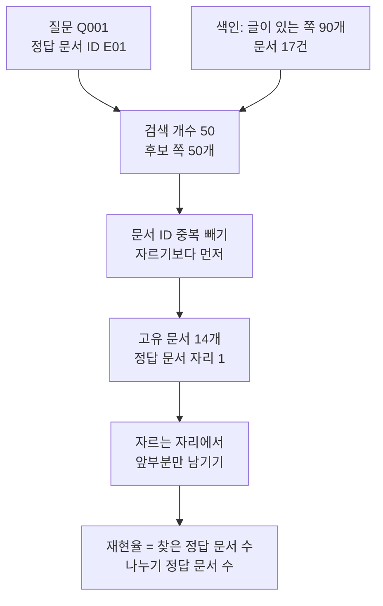
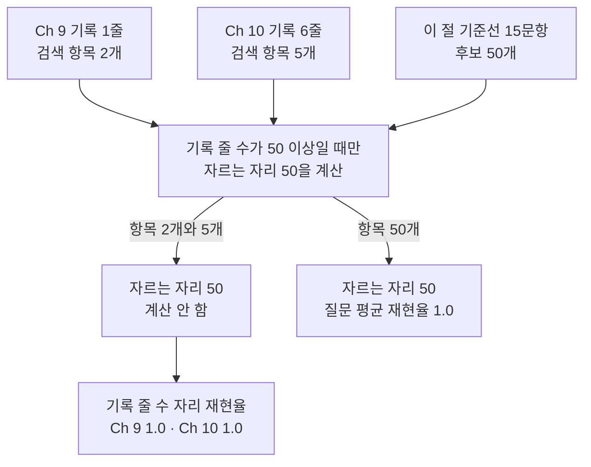
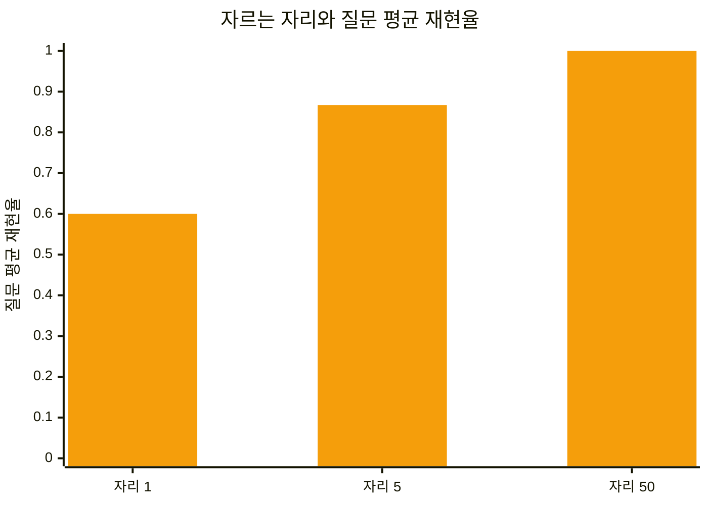
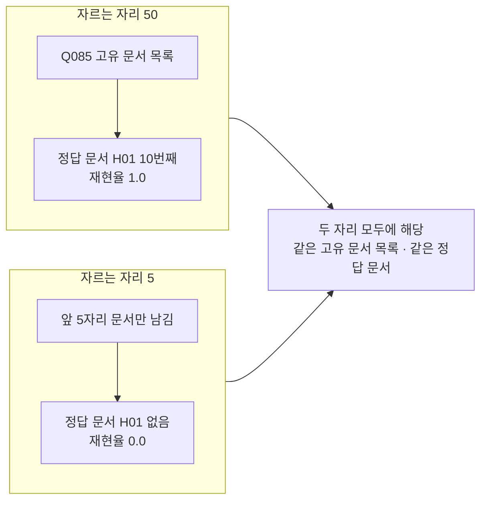

# 02-Recall-at-50

## _src 본문 (HTML 원본)

```html
<!--meta: 강의 1h | 실습 2h | 코드 notebooks/02-Recall-at-50.ipynb | 새 용어 4 -->

<h2 id="b1"><span class="no">1</span>학습 목표</h2>
<div class="goal"><ul>
<li>이 절을 마치면 찾은 정답 문서 수와 정답 문서 수로 재현율을 계산할 수 있습니다.</li>
<li>이 절을 마치면 문서 ID 중복을 먼저 빼고 자르는 까닭을 설명할 수 있습니다.</li>
<li>이 절을 마치면 자르는 자리를 바꿀 때 값이 어떻게 달라지는지 견줄 수 있습니다.</li>
<li>이 절을 마치면 지표 값 1.0이 자료 크기 때문일 수 있다고 말할 수 있습니다.</li>
</ul></div>

<h2 id="b2"><span class="no">2</span>이 내용을 배우는 이유</h2>
<p>검색 뒤에는 근거를 읽고 답을 쓰는 단계가 옵니다. 그 단계는 후보 목록에 들어온 문서만 볼 수 있습니다. 후보에 정답 문서가 없으면 뒤 단계를 고쳐도 되살릴 수 없습니다.</p>
<p>그래서 가장 먼저 재는 것은 후보를 만드는 단계입니다. 이 절의 질문은 하나입니다. 후보 목록 안에 정답 문서가 들어왔는가입니다.</p>
<p>01절은 검색 결과를 숫자로 바꾸지 않았습니다. 정답 문서가 몇 번째였는지 눈으로만 읽었습니다. 이 절에서 그 자리를 하나의 숫자로 바꿉니다.</p>
<p>Ch 12에서는 후보 목록의 순서를 다시 매기는 방법을 배웁니다. 그 전에 후보 단계가 정답 문서를 담았는지 확인합니다. 담지 못한 문서는 순서를 바꿔도 올라오지 않습니다.</p>

<h2 id="b3"><span class="no">3</span>앞에서 배운 내용</h2>
<ul>
<li><strong>고유 문서 세기</strong> — 01절 12절에서 검색 항목의 문서 ID 중복을 빼 고유 문서를 셌습니다. 함수 이름은 <code>unique_doc_ids()</code>입니다.</li>
<li><strong>중복 제거 순서</strong> — 01절에서 문서 ID 중복 제거를 앞에서 자르기보다 먼저 하기로 정했습니다. 이 절 계산도 그 순서를 지킵니다.</li>
<li><strong>정답 문서 자리 찾기</strong> — 01절 13절 <code>find_gold_rank()</code>로 고유 문서 목록에서 정답 문서 자리를 찾았습니다.</li>
<li><strong>개발 분할과 시험 분할</strong> — 01절에서 개발 분할 15문항으로 설정을 고르기로 정했습니다. 시험 분할은 마지막에 한 번만 봅니다.</li>
<li><strong>기록에 남은 검색 항목</strong> — Ch 9 06절 기록은 검색 개수 2로, Ch 10 08절 기록은 5로 실행한 결과입니다. 한 줄에 남은 항목 수가 다릅니다.</li>
<li><strong>쪽 단위 색인</strong> — Ch 9 01절과 Ch 10 08절에서 PDF를 쪽마다 Document로 읽어 벡터스토어에 넣었습니다.</li>
<li><strong>top-k 검색</strong> — Ch 9 01절에서 <code>similarity_search(k=)</code>로 상위 몇 개를 받았습니다. 이 절은 그 수를 50으로 올립니다.</li>
<li><strong>글자 층</strong> — Ch 10 02절에서 스캔 이미지만 있는 쪽은 글자 층이 비는 것을 확인했습니다.</li>
</ul>
<p>노트북은 01절 <code>unique_doc_ids()</code>·<code>find_gold_rank()</code>와 Ch 9 02절 <code>load_pdf_pages()</code>를 도구 파일 <code>rag_tools.py</code>에서 가져옵니다.</p>

<h2 id="b4"><span class="no">4</span>핵심 개념</h2>
<h3>비유 — 좁은 문을 지난 카드만 남습니다</h3>
<p>카드가 줄지어 선 넓은 쟁반이 있다고 생각해 보세요. 가운데에 좁은 문이 하나 있습니다. 앞부분 카드만 그 문을 지나 오른쪽 작은 쟁반으로 갑니다.</p>
<p>문 뒤에 남은 카드는 오른쪽 쟁반에서 찾을 수 없습니다. 오른쪽 쟁반만 보고 순서를 바꿔도 남은 카드는 올라오지 않습니다.</p>
<p>검색 평가에서 그 문이 자르는 자리입니다. 정답 카드가 문 뒤에 남으면 재현율이 내려갑니다. 그래서 문을 얼마나 넓게 열었는지 함께 적어 둡니다.</p>
{{img:02-5-좁은-문과-카드|평면 그림으로 왼쪽에 넓은 나무 쟁반이 놓여 있고 그 안에 흰 카드가 줄지어 서 있으며 줄 오른쪽 끝에 파란 카드 한 장이 있고 가운데에는 넓은 쟁반보다 훨씬 좁은 나무 문틀이 서 있으며 오른쪽에는 작은 나무 쟁반과 그 안에 선 흰 카드 몇 장만 있음|넓은 쟁반의 카드 가운데 좁은 문을 지난 앞부분만 오른쪽 작은 쟁반에 있고 파란 카드는 왼쪽에 남습니다}}
<p><strong>그림 읽기</strong> — 왼쪽 넓은 쟁반부터 봅니다. 흰 카드가 줄지어 서 있고 줄 오른쪽 끝에 파란 카드 한 장이 있습니다. 파란 카드가 정답 문서입니다.</p>
<p>가운데 나무 문틀이 넓은 쟁반보다 훨씬 좁습니다. 오른쪽 작은 쟁반에는 흰 카드 몇 장만 서 있고 파란 카드는 없습니다. 파란 카드는 왼쪽 쟁반에 그대로 남아 있습니다.</p>
<p>오른쪽 쟁반의 카드 수는 노트북의 자르는 자리와 맞춘 것이 아닙니다. 앞부분만 넘어갔다는 뜻으로만 읽어 주세요.</p>

<h3>이 절에서 쓰는 말</h3>
<table><thead><tr><th>용어</th><th>뜻과 일상 예</th><th>이 절에서 보이는 모습</th></tr></thead><tbody>
<tr><td>후보 목록(candidate list)</td><td>자르기 전에 검색이 내놓은 결과 줄. 결승에 올릴지 정하기 전의 예선 통과 명단과 같음</td><td>노트북 6절 <code>후보 수: 50</code></td></tr>
<tr><td>자르는 자리(cutoff k)</td><td>순위 목록의 앞에서 몇 개까지 볼지 정한 수. 「앞 50개만 본다」의 50</td><td>노트북 10절 <code>자르는 자리 | 질문 평균 재현율</code> 표</td></tr>
<tr><td>재현율(recall)</td><td>정답 문서 가운데 자른 목록에 들어온 비율. 시험 범위 열 곳 가운데 몇 곳을 훑었는지 세는 것과 같음</td><td>노트북 7절 <code>자르는 자리 50의 질문 평균 재현율: 1.0</code></td></tr>
<tr><td>질문 평균(macro mean)</td><td>질문마다 점수를 따로 내고 그 점수들을 같은 무게로 평균한 값. 학생마다 점수를 낸 뒤 반 평균을 내는 것과 같음</td><td>노트북 8절 <code>자르는 자리 5의 질문 평균 재현율: 0.867</code></td></tr>
</tbody></table>
<p>문서 청크·색인·벡터스토어·검색 점수·정답 문서 ID는 Ch 9에서 정한 뜻 그대로입니다. 기록 줄 수는 Ch 10 08절 뜻이고, 고유 문서와 질의셋은 01절 뜻입니다. 지표 이름 <code>recall_at_5</code>·<code>recall_at_50</code>·<code>recall_at_logged_candidates</code>는 실습 폴더 <code>evaluate.py</code>가 쓰는 이름을 그대로 씁니다.</p>

<h3>도식 — 후보에서 재현율까지</h3>
{{mermaid:02-1-후보에서-재현율까지|위에서 아래로 내려가는 흐름도로 맨 위에 초록 상자 질문 Q001 정답 문서 ID E01과 초록 상자 색인 글이 있는 쪽 90개 문서 17건이 나란히 있고 두 화살표가 파란 상자 검색 개수 50 후보 쪽 50개로 모이며 그 아래로 파란 상자 문서 ID 중복 빼기 자르기보다 먼저와 노란 상자 고유 문서 14개 정답 문서 자리 1과 파란 상자 자르는 자리에서 앞부분만 남기기와 파란 상자 재현율은 찾은 정답 문서 수 나누기 정답 문서 수가 차례로 이어짐|질문 Q001의 후보 쪽 50개는 문서 ID 중복을 빼면 고유 문서 14개가 됩니다}}
<p><strong>도식 읽기</strong> — 맨 위 초록 상자 두 개부터 아래로 봅니다. 왼쪽은 질문 하나와 그 질문의 정답 문서 ID입니다. 오른쪽은 이 절이 만든 색인이고 글이 있는 쪽 90개가 들어 있습니다.</p>
<p>두 화살표가 파란 상자로 모입니다. 검색 개수를 50으로 두어 후보를 쪽 단위로 50개 받습니다. 다음 파란 상자에서 문서 ID 중복을 뺍니다.</p>
<p>노란 상자가 그 결과입니다. 쪽 50개가 고유 문서 14개로 줄고 정답 문서가 첫 자리에 있었습니다. 마지막 두 파란 상자가 이 절이 새로 배우는 계산입니다.</p>

<h3>자르는 자리를 함께 적어 두는 까닭</h3>
<p>재현율은 자르는 자리를 정해야 값이 나옵니다. 같은 검색 결과라도 자리를 50으로 두면 높고 5로 두면 낮습니다. 그래서 값만 적으면 무엇을 잰 값인지 알 수 없습니다.</p>
<p>후보를 세는 단위도 함께 적습니다. 이 절은 쪽 단위로 후보 50개를 받고 문서 단위로 자릅니다. 같은 문서의 쪽이 여러 개 올라오면 고유 문서는 50보다 적어집니다.</p>
<p>실습 폴더 <code>evaluate.py</code>는 기록 한 줄에 남은 검색 항목이 50개 이상일 때만 자르는 자리 50의 값을 냅니다. 항목이 그보다 적으면 그 칸을 <code>None</code>으로 둡니다. 대신 기록 줄 수 자리의 재현율을 냅니다.</p>

<h3>지표 값이 천장에 닿을 때</h3>
<p>이 말뭉치에서 글을 얻은 문서는 17건입니다. 그래서 고유 문서 목록은 아무리 길어도 17개입니다. 자르는 자리 50은 그 목록을 자르지 못합니다.</p>
<p>정답 문서가 목록 안에 있으면 자리 50의 값은 1.0이 됩니다. 이 값은 검색기가 어려운 질문까지 잘 찾았다는 증거가 아닙니다. 자료가 작아 지표가 천장에 닿은 결과입니다.</p>
<p>천장에 닿은 지표는 설정을 고르는 데 쓸 수 없습니다. 값이 모두 1.0이면 어느 설정이 나은지 갈리지 않습니다. 그럴 때는 자르는 자리를 줄이거나 말뭉치를 키웁니다.</p>

<h2 id="b5"><span class="no">5</span>실행 예제</h2>
<p>내려받은 실습 폴더에서 노트북을 열고 위에서 아래로 실행합니다. 01절 뒤에 패키지가 늘었으므로 <code>uv sync --locked</code>를 다시 실행합니다. 임베딩 요청은 색인 한 번과 질문 검색 열여섯 번을 합쳐 열일곱 번입니다.</p>
<p>보낼 조각 수는 색인이 59190개 어림입니다. 예상 비용은 열일곱 번을 합쳐 0.01달러 미만입니다. 답을 쓰는 모델은 이 절에서 부르지 않습니다. 실행 시간은 패키지 설치를 빼면 1분 안팎입니다.</p>
<p>읽는 파일은 네 갈래입니다. 말뭉치 PDF 18건과 말뭉치 목록, 평가셋 파일, Ch 9와 Ch 10 기록입니다. 이 절은 파일을 쓰지 않습니다.</p>
<p>이 페이지의 출력은 2026-09-21에 실행한 결과입니다. 새 커널로 두 번 이어 실행해 출력할 값이 같은 것을 확인했습니다. 임베딩 점수는 소수 아래 자리가 실행마다 달라질 수 있어 이 절에서는 출력하지 않습니다.</p>
<p>강의 시간에는 노트북 2~7절을 설명합니다. 개발 분할 고르기, 재현율 함수 만들기, 앞 챕터 기록으로 잴 수 있는 자리, 기준선 색인 만들기입니다. 8~11절은 함께 실행하고 실습 시간에 다시 읽습니다.</p>
{{mermaid:02-2-기록-줄-수와-자를-수-있는-자리|위에서 아래로 내려가는 흐름도로 맨 위에 초록 상자 Ch 9 기록 1줄 검색 항목 2개와 초록 상자 Ch 10 기록 6줄 검색 항목 5개와 초록 상자 이 절 기준선 15문항 후보 50개 셋이 나란히 있고 세 화살표가 파란 상자 기록 줄 수가 50 이상일 때만 자르는 자리 50을 계산으로 모이며 항목 2개와 5개라고 적힌 화살표는 회색 상자 자르는 자리 50 계산 안 함으로 항목 50개라고 적힌 화살표는 노란 상자 자르는 자리 50 질문 평균 재현율 1.0으로 가고 회색 상자 아래에 노란 상자 기록 줄 수 자리 재현율 Ch 9 1.0 Ch 10 1.0이 붙어 있음|앞 챕터 기록은 한 줄에 남은 항목이 2개와 5개라서 자르는 자리 50을 계산하지 않습니다}}
<p><strong>도식 읽기</strong> — 맨 위 초록 상자 세 개부터 아래로 봅니다. 왼쪽 둘이 01절에서 읽은 앞 챕터 기록입니다. 오른쪽이 이 절에서 만드는 기준선입니다.</p>
<p>세 화살표가 가운데 파란 상자로 모입니다. 파란 상자에 적힌 규칙이 <code>evaluate.py</code>가 쓰는 기준입니다. 화살표 라벨을 보면 어느 입력이 어느 갈래로 가는지 갈립니다.</p>
<p>왼쪽 아래 회색 상자는 항목 2개와 5개 갈래에만 해당합니다. 그 갈래는 자르는 자리 50을 계산하지 않고 아래 노란 상자의 값만 냅니다. 오른쪽 노란 상자가 항목 50개 갈래의 결과입니다.</p>
{{notebook:02-Recall-at-50}}
<p class="look"><b>확인할 점</b> — 개발 분할은 <code>15</code>문항이고 후보는 질문마다 쪽 <code>50</code>개입니다. 이번 실행에서 고유 문서 수는 <code>13</code>에서 <code>16</code> 사이였습니다. 자르는 자리 50의 질문 평균 재현율은 <code>1.0</code>이고 자리 5에서는 <code>0.867</code>입니다. 자리 5에서 빠진 질문은 <code>['Q085', 'Q086']</code> 두 개입니다. 두 질문의 줄은 <code>Q085 | ['H01'] | 10 | 1.0 | 0.0</code> 모양이고 정답 문서가 <code>10</code>번째였습니다.</p>

<h2 id="b6"><span class="no">6</span>실험 결과 해석</h2>
{{mermaid:02-3-자르는-자리-비교|가로축에 자리 1과 자리 5와 자리 50 세 칸이 있고 세로축이 질문 평균 재현율 0에서 1까지인 주황 막대 그림으로 막대 높이가 차례로 0.6과 0.867과 1.0|같은 후보 목록에서 자르는 자리를 줄이면 질문 평균 재현율이 1.0에서 0.6까지 내려갑니다}}
<p><strong>도식 읽기</strong> — 왼쪽 막대부터 오른쪽으로 봅니다. 왼쪽 주황 막대는 자르는 자리 1이고 값은 0.6입니다. 1위 문서만 보면 15문항 가운데 아홉 문항에서 정답 문서가 맞았습니다.</p>
<p>가운데 막대는 자리 5이고 값은 0.867입니다. 오른쪽 막대는 자리 50이고 값은 1.0입니다. 세 막대의 검색 결과는 모두 같고 자르는 자리만 다릅니다.</p>
<p>자리를 넓히면 값이 올라갑니다. 그래서 자리가 다른 값을 서로 견주면 안 됩니다. 설정을 고를 때는 자르는 자리를 먼저 정하고 그 자리에서만 견줍니다.</p>
<p>자리 50에서 값이 모두 1.0이었다는 것은 후보 단계가 정답 문서를 놓치지 않았다는 뜻입니다. 다만 앞에서 적은 천장을 함께 읽어야 합니다. 글이 있는 문서가 17건이라 고유 문서 목록은 17개를 넘지 못합니다. 그래서 자리 50은 그 목록을 자르지 못했습니다.</p>
{{mermaid:02-4-놓친-두-질문|왼쪽에 자르는 자리 50이라는 칸과 자르는 자리 5라는 칸이 위아래로 있고 위 칸에는 노란 상자 Q085 고유 문서 목록에서 노란 상자 정답 문서 H01 10번째 재현율 1.0으로 내려가는 화살표가 있으며 아래 칸에는 노란 상자 앞 5자리 문서만 남김에서 노란 상자 정답 문서 H01 없음 재현율 0.0으로 내려가는 화살표가 있고 두 칸에서 오른쪽 회색 상자 두 자리 모두에 해당 같은 고유 문서 목록 같은 정답 문서로 화살표가 모임|질문 Q085의 정답 문서는 고유 목록 10번째라서 자리 50에서는 들어오고 자리 5에서는 빠집니다}}
<p><strong>도식 읽기</strong> — 위 칸이 자르는 자리 50이고 아래 칸이 자리 5입니다. 두 칸 모두 질문 Q085 하나를 봅니다. 위 칸에서는 고유 문서 목록의 10번째에 정답 문서가 있어 값이 1.0입니다.</p>
<p>아래 칸은 앞 5자리만 남깁니다. 10번째 자리가 잘려 정답 문서가 목록에 없고 값이 0.0이 됩니다. 질문 Q086도 같은 자리였습니다.</p>
<p>오른쪽 회색 상자는 두 칸 모두에 해당합니다. 두 칸의 고유 문서 목록과 정답 문서는 같습니다. 달라진 것은 자르는 자리 하나뿐입니다.</p>
<p>어려움 난이도 질문 두 개에서 정답 문서가 뒤로 밀렸습니다. 두 질문의 정답 문서는 계약서 <code>H01</code>입니다. 이번 실행에서는 그 문서의 쪽이 앞 5자리에 올라오지 않았습니다.</p>
<p>왜 밀렸는지는 이 절에서 확인하지 않았습니다. 질문 글과 쪽 글을 견주는 일은 Ch 12에서 다룹니다. 이 절은 몇 번째였는지까지만 적습니다.</p>
<p>이 결과는 이 말뭉치와 개발 분할 15문항에서 한 번 본 것입니다. 질문 묶음이나 말뭉치가 달라지면 값도 달라집니다. 어느 검색 방법이 더 낫다는 판단은 하지 않았습니다.</p>

<h2 id="b7"><span class="no">7</span>주의할 점과 실무 메모</h2>
<ul>
<li><strong>자르는 자리가 다른 값을 서로 견주지 않습니다.</strong> 자리 1의 0.6과 자리 50의 1.0은 같은 검색 결과에서 나온 값입니다. 두 값의 차이는 검색 품질 차이가 아니라 자르는 자리 차이입니다.</li>
<li><strong>후보를 세는 단위를 적어 둡니다.</strong> 이 절은 쪽 단위로 후보 50개를 받고 문서 단위로 잘랐습니다. 노트북 6절에서 쪽 50개가 고유 문서 14개로 줄었습니다.</li>
<li><strong>자르는 자리 값은 흐름을 보여 주려고 정한 예입니다.</strong> 자리 50은 절 주제이고, 자리 5는 03절 Precision@5와 자리를 맞춘 값입니다. 자리 1은 1위만 볼 때를 보려고 더했습니다.</li>
<li><strong>후보 개수 50은 계산 규칙에 맞춘 값입니다.</strong> 기록 한 줄에 항목이 50개 있어야 <code>evaluate.py</code>가 자르는 자리 50의 값을 냅니다. Ch 9 기록은 2개, Ch 10 기록은 5개라 그 칸이 <code>None</code>으로 남습니다.</li>
<li><strong>두 기준선의 숫자를 나란히 놓지 않습니다.</strong> 실습 폴더 <code>evaluate.py</code>의 기준선은 낱말과 두 글자 조각의 겹침으로 점수를 냅니다. 이 절 기준선은 임베딩으로 점수를 냅니다. 후보 단위와 중복 제거 순서는 같지만 점수 매기는 방법이 달라 값을 직접 견주지 않습니다.</li>
<li><strong>받은 개수는 실행마다 조금 움직입니다.</strong> 후보 50개의 뒤쪽 순서가 실행마다 달라져 고유 문서 수가 한두 개 바뀝니다. 이 절 표의 둘째 칸은 이번 실행에서 본 값입니다.</li>
<li><strong>검색 점수는 라벨과 결론에 넣지 않습니다.</strong> 임베딩 점수는 실행마다 소수 아래 자리가 달라집니다. 이 절은 점수를 출력하지 않고 순위와 문서 ID만 씁니다.</li>
<li><strong>시험 분할은 이 절에서 쓰지 않았습니다.</strong> 개발 분할 15문항만 검색했습니다. 시험 분할 15문항은 설정을 다 고른 뒤 한 번만 봅니다.</li>
<li><strong>이번에 실행하지 않은 것을 적어 둡니다.</strong> 정답 문서가 여러 개인 질문의 재현율, 답할 수 없는 질문을 실제로 빼는 장면, 후보 목록이 빈 질문입니다. 상위 자리의 정확성은 03절에서, 순위 차이를 값에 넣는 계산은 04절에서 배웁니다.</li>
<li><strong>통제 목록은 계산의 경계를 보는 자료입니다.</strong> 노트북 3절의 문서 ID 51개는 손으로 만든 목록입니다. 검색 품질이 아니라 자르는 자리 50이 50번째까지 넣고 51번째를 빼는지만 확인합니다.</li>
</ul>

<h2 id="b8"><span class="no">8</span>정리와 다음 절</h2>
<ul>
<li>재현율은 정답 문서 가운데 자른 목록에 들어온 비율이고 자르는 자리를 정해야 값이 나옵니다.</li>
<li>문서 ID 중복을 먼저 빼고 그다음에 앞에서 자릅니다. 순서를 뒤집으면 쪽이 많은 문서가 앞자리를 메웁니다.</li>
<li>개발 분할 15문항의 후보 쪽 50개는 문서 ID 중복을 빼면 고유 문서 목록이 됩니다.</li>
<li>자르는 자리 50의 질문 평균 재현율은 1.0이고 자리 5에서는 0.867이었습니다.</li>
<li>자리 5에서 빠진 두 질문은 정답 문서가 고유 목록의 10번째였습니다.</li>
<li>글이 있는 문서가 17건뿐이라 자리 50의 1.0은 천장에 닿은 값입니다.</li>
</ul>
<p><strong>다음 학습과 이어지는 지점</strong> — 03절에서는 앞 다섯 자리에 정답 문서가 얼마나 들어 있는지 Precision@5로 잽니다. 이 절에서 만든 기준선과 고유 문서 목록이 그 계산의 입력입니다.</p>
<p>이 절은 후보 목록에 정답 문서가 들어왔는지까지 왔습니다. 들어온 뒤 어느 자리에 있었는지는 값에 넣지 않았습니다. 자리를 값에 넣는 계산은 04절에서 배웁니다.</p>

<h2 id="b9"><span class="no">9</span>복습 문제</h2>
<details class="quiz" open><summary>문제 4개 · 해설 포함</summary>
<p class="quiz-q">1. [하] 정답 문서가 두 개인데 한 개만 자른 목록에 있으면 재현율은 얼마입니까?</p>
<p class="quiz-a">0.5입니다. 찾은 정답 문서 수 1을 정답 문서 수 2로 나눈 값입니다. 이 평가셋에는 정답 문서가 여러 개인 질문이 없어 이번에 실행하지 않았습니다.</p>
<p class="quiz-q">2. [중] 같은 문서의 쪽이 여덟 개 올라왔습니다. 자르기 전에 무엇을 먼저 합니까?</p>
<p class="quiz-a">문서 ID 중복을 먼저 뺍니다. 순서를 뒤집으면 쪽이 많은 문서가 앞자리를 메웁니다. 노트북 6절에서 쪽 50개가 고유 문서 14개로 줄었습니다.</p>
<p class="quiz-q">3. [중] 자르는 자리 50의 값이 1.0인데 자리 5의 값은 0.867입니다. 어떤 뜻입니까?</p>
<p class="quiz-a">후보 목록에는 정답 문서가 모두 들어왔지만 앞 다섯 자리에는 두 질문의 정답 문서가 없었다는 뜻입니다. 두 질문의 정답 문서는 고유 목록의 10번째였습니다.</p>
<p class="quiz-q">4. [상] 글이 있는 문서가 17건인 말뭉치에서 자리 50의 값 1.0을 검색 품질 근거로 쓸 수 없는 까닭은 무엇입니까?</p>
<p class="quiz-a">고유 문서 목록이 17개를 넘지 않아 자리 50이 목록을 자르지 못하기 때문입니다. 정답 문서가 목록 안에 있으면 값이 1.0이 됩니다. 지표가 천장에 닿아 설정을 갈라 주지 못합니다.</p>
</details>

<h2 id="b10"><span class="no">10</span>참고 자료</h2>
<ul>
<li><div><a href="https://nlp.stanford.edu/IR-book/html/htmledition/evaluation-in-information-retrieval-1.html">Introduction to Information Retrieval, Chapter 8 Evaluation in information retrieval</a></div>확인 2026-09-18 · 재현율 정의와 자르는 자리 표기 참고.</li>
<li><div><a href="https://trec.nist.gov/pubs/trec30/papers/Overview-2021.pdf">TREC 2021 Overview</a></div>확인 2026-09-18 · 후보 목록 깊이를 실험 설명에 함께 적는 방식 참고.</li>
<li>01절 질의셋과 정답 문서 ID — 고유 문서 세기와 중복 제거 순서, 개발 분할 고르기.</li>
<li>Ch 9 01절 RAG 지도와 Ch 10 08절 인덱싱 비교 실험 — 쪽 단위 색인과 top-k 검색 코드.</li>
<li>기준 버전은 pypdf 6.1.1과 langchain-core 1.6.2, langchain-openai 1.6.0입니다. 패키지 numpy는 2.5.3이고 python-dotenv는 1.2.3입니다. 교재 출력은 Linux의 Python 3.12.13으로 만들었습니다. 다른 버전과 Windows·macOS에서는 이번에 실행하지 않았습니다.</li>
</ul>
```

## 노트북 셀 (순서대로)

### [0] markdown {'html': 'skip'}

# Recall at 50

**이 노트북에서 할 일**

1. 말뭉치 PDF 18건을 쪽마다 색인에 넣어 기준선 검색기를 만듭니다.
2. 개발 분할 15문항을 검색해 후보 목록에서 고유 문서를 세고 재현율을 계산합니다.
3. 자르는 자리를 50에서 5로 바꿔 질문 평균 재현율을 견줍니다.

**준비물** — 프로젝트 맨 위 폴더의 `.env` 파일에 `OPENAI_API_KEY`가 있어야 합니다.
임베딩 요청은 모두 열일곱 번입니다. 색인 한 벌에 한 번, 질문 검색에 열여섯 번입니다.
답을 쓰는 모델은 이 절에서 부르지 않습니다.

보낼 조각 수는 색인이 59190개 어림이고 질문은 한 번에 스무 개 안팎입니다.
예상 비용은 열일곱 번을 합쳐 0.01달러 미만입니다.
임베딩 요금은 OpenAI 모델 안내(2026-09-17 확인)의 100만 토큰당 0.02달러입니다.
실행 시간은 패키지 설치를 빼면 1분 안팎입니다.

**데이터** — 읽는 파일은 네 갈래이고 모두 실습 묶음에 들어 있습니다.

- 말뭉치 `labs/data/rag-corpus/pdf/`의 디지털 PDF 18건과 `labs/data/rag-corpus/manifest.json`
- 평가셋 `labs/part3/ch11-evaluation/data/evaluation-queries.jsonl`
- Ch 9 06절 기록 `labs/part3/ch09-rag-first-run/runs/continuity-ch09-search.jsonl`
- Ch 10 08절 기록 `labs/part3/ch10-document-processing/runs/continuity-ch10-indexing.jsonl`

이 절은 파일을 쓰지 않습니다.

**강의와 실습 범위** — 강의 시간에는 2~7절을 설명합니다.
평가셋에서 개발 분할 고르기, 재현율 함수 만들기, 앞 챕터 기록으로 잴 수 있는 자리, 기준선 색인 만들기입니다.
8~11절은 함께 실행하고 실습 시간에 다시 읽습니다.

**기준 버전** — 고정한 패키지는 다섯 개입니다.

- 쪽 읽기: pypdf 6.1.1
- 색인과 임베딩: langchain-core 1.6.2 · langchain-openai 1.6.0
- 코사인 유사도 계산: numpy 2.5.3
- 키 읽기: python-dotenv 1.2.3

교재 출력은 Linux의 Python 3.12.13으로 만들었습니다.
다른 버전과 Windows·macOS에서는 이번에 실행하지 않았습니다.

실습 폴더 `labs/part3/ch11-evaluation`에서 `uv sync --locked`를 실행합니다.
01절 뒤에 패키지가 늘었으므로 이 명령을 다시 실행해야 합니다.
그다음 이 폴더의 `.venv` 커널을 고르고 첫 셀부터 순서대로 실행합니다.

### [1] markdown {'html': 'skip'}

## 오늘 볼 그림


맨 위 초록 상자 두 개가 이 절의 입력입니다. 질문 하나와 쪽 90개를 담은 색인입니다.
가운데 파란 상자에서 후보 쪽 50개를 받아 문서 ID 중복을 먼저 빼고, 노란 상자에서 고유 문서를 셉니다.
맨 아래 두 파란 상자가 이 절이 새로 배우는 계산입니다. 앞부분만 남기고 정답 문서 비율을 냅니다.

### [2] markdown {}

## 1. 준비

첫 셀은 패키지를 설치하고 설치된 버전을 출력합니다. 설치에는 몇십 초가 걸릴 수 있습니다.
01절은 Python에 들어 있는 기능만 썼습니다. 이 절은 검색을 직접 하므로 패키지 다섯 개가 필요합니다.

### [3] code {'execution': {'iopub.execute_input': '2026-09-21T07:03:57.216564Z', 'iopub.status.busy': '2026-09-21T07:03:57.216413Z', 'iopub.status.idle': '2026-09-21T07:03:57.714463Z', 'shell.execute_reply': '2026-09-21T07:03:57.713821Z'}, 'lesson_role': 'setup'}

```python
# 이 절에서 쓰는 패키지를 설치하고 버전을 확인합니다
%pip install -q "pypdf==6.1.1" "langchain-core==1.6.2" "langchain-openai==1.6.0" "numpy==2.5.3" "python-dotenv==1.2.3"
from importlib.metadata import version

print("pypdf:", version("pypdf"))
print("langchain-core:", version("langchain-core"))
print("langchain-openai:", version("langchain-openai"))
print("numpy:", version("numpy"))
print("python-dotenv:", version("python-dotenv"))
```

출력:
```
Note: you may need to restart the kernel to use updated packages.
pypdf: 6.1.1
langchain-core: 1.6.2
langchain-openai: 1.6.0
numpy: 2.5.3
python-dotenv: 1.2.3

```

### [4] markdown {}

**결과 읽기** — 출력 다섯 줄 가운데 첫 줄은 `pypdf: 6.1.1`입니다.
둘째 줄 `langchain-core: 1.6.2`와 셋째 줄 `langchain-openai: 1.6.0`도 보세요.
넷째 줄 `numpy: 2.5.3`은 색인이 코사인 유사도를 계산할 때 쓰는 패키지입니다.
준비물에 적은 기준 버전과 같습니다.

다음 셀은 이 절에서 쓸 이름을 불러옵니다.
클래스 `InMemoryVectorStore`가 Ch 9 03절에서 쓴 색인이고 `OpenAIEmbeddings`가 임베딩을 부릅니다.

앞에서 배운 함수는 `rag_tools.py`에 모아 두었습니다. 파일을 열면 코드를 볼 수 있습니다. 노트북과 같은 폴더(`notebooks/`)에 있는 파일입니다.
이 노트북은 01절 `unique_doc_ids()`·`find_gold_rank()`와 Ch 9 02절 `load_pdf_pages()`를 가져옵니다.

### [5] code {'execution': {'iopub.execute_input': '2026-09-21T07:03:57.715733Z', 'iopub.status.busy': '2026-09-21T07:03:57.715636Z', 'iopub.status.idle': '2026-09-21T07:03:58.941645Z', 'shell.execute_reply': '2026-09-21T07:03:58.941333Z'}, 'lesson_role': 'setup'}

```python
# 평가셋과 실행 기록 읽기·임베딩·색인에 쓸 이름을 불러옵니다
import json

from langchain_core.vectorstores import InMemoryVectorStore
from langchain_openai import OpenAIEmbeddings
# 01절과 Ch 9 02절 함수 세 개를 도구 파일에서 가져옵니다
from rag_tools import find_gold_rank, load_pdf_pages, unique_doc_ids
```

출력:
```

```

### [6] markdown {}

**결과 읽기** — 이 셀은 이름을 불러오기만 하므로 출력이 없습니다.

다음 셀은 키가 있는지 확인합니다. 키 값은 출력하지 않고 있는지만 봅니다.

### [7] code {'execution': {'iopub.execute_input': '2026-09-21T07:03:58.942739Z', 'iopub.status.busy': '2026-09-21T07:03:58.942634Z', 'iopub.status.idle': '2026-09-21T07:03:58.946443Z', 'shell.execute_reply': '2026-09-21T07:03:58.946056Z'}, 'lesson_role': 'setup'}

```python
# .env 파일에서 OpenAI API 키를 읽습니다(키 값은 출력하지 않습니다)
import os
from dotenv import find_dotenv, load_dotenv

env_path = find_dotenv(usecwd=True)
load_dotenv(env_path)
has_key = os.getenv("OPENAI_API_KEY") is not None
print("OPENAI_API_KEY 설정 여부:", has_key)
assert has_key, "프로젝트 폴더의 .env 파일에 OPENAI_API_KEY를 적어 주세요."
```

출력:
```
OPENAI_API_KEY 설정 여부: True

```

### [8] markdown {}

**결과 읽기** — 출력 줄은 `OPENAI_API_KEY 설정 여부: True`입니다.
이 셀은 모듈 `os`도 함께 불러옵니다. 다음 셀에서 파일이 있는지 확인할 때 씁니다.

다음 셀은 프로젝트 맨 위 폴더를 찾습니다. 01절과 같은 코드입니다.

### [9] code {'execution': {'iopub.execute_input': '2026-09-21T07:03:58.947014Z', 'iopub.status.busy': '2026-09-21T07:03:58.946959Z', 'iopub.status.idle': '2026-09-21T07:03:58.949203Z', 'shell.execute_reply': '2026-09-21T07:03:58.948879Z'}, 'lesson_role': 'setup'}

```python
# 노트북을 어느 폴더에서 열어도 프로젝트 맨 위를 찾게 후보 세 개를 차례로 봅니다
candidates = [".", "../../..", "../../../.."]
root_path = None
for candidate in candidates:
    if os.path.exists(candidate + "/labs/data/rag-corpus"):
        root_path = candidate
        break
print("고른 경로:", root_path)
assert root_path is not None, "notebooks 폴더나 실습 폴더 맨 위에서 노트북을 열어 주세요."
```

출력:
```
고른 경로: .

```

### [10] markdown {}

**결과 읽기** — 출력 줄은 `고른 경로: .`입니다. `assert`도 통과했습니다.
교재 출력은 프로젝트 맨 위를 작업 폴더로 삼아 실행해서 첫째 후보를 골랐습니다.

다음 셀은 고른 경로에 파일 이름을 이어 붙여 네 갈래 경로를 만듭니다.

### [11] code {'execution': {'iopub.execute_input': '2026-09-21T07:03:58.949741Z', 'iopub.status.busy': '2026-09-21T07:03:58.949689Z', 'iopub.status.idle': '2026-09-21T07:03:58.952384Z', 'shell.execute_reply': '2026-09-21T07:03:58.952072Z'}, 'lesson_role': 'setup'}

```python
# 이 절에서 읽을 파일 네 갈래의 경로를 만듭니다
corpus_path = root_path + "/labs/data/rag-corpus"
manifest_path = corpus_path + "/manifest.json"
dataset_path = root_path + "/labs/part3/ch11-evaluation/data/evaluation-queries.jsonl"
ch09_log_path = root_path + "/labs/part3/ch09-rag-first-run/runs/continuity-ch09-search.jsonl"
ch10_log_path = root_path + "/labs/part3/ch10-document-processing/runs/continuity-ch10-indexing.jsonl"
print("평가셋 파일이 있는가:", os.path.exists(dataset_path))
print("말뭉치 목록이 있는가:", os.path.exists(manifest_path))
print("Ch 9 기록이 있는가:", os.path.exists(ch09_log_path))
print("Ch 10 기록이 있는가:", os.path.exists(ch10_log_path))
```

출력:
```
평가셋 파일이 있는가: True
말뭉치 목록이 있는가: True
Ch 9 기록이 있는가: True
Ch 10 기록이 있는가: True

```

### [12] markdown {}

**결과 읽기** — 네 줄 모두 `True`입니다.
01절이 읽은 네 파일과 같고, 말뭉치 PDF 폴더가 하나 늘었습니다.

## 2. 평가셋에서 개발 분할 고르기

평가셋 30줄을 01절과 같은 방법으로 읽습니다.
그다음 칸 `split`이 `dev`인 줄만 남깁니다.
01절 b7에서 시험 분할 결과를 보고 설정을 다시 고르지 않기로 정했기 때문입니다.

### [13] code {'execution': {'iopub.execute_input': '2026-09-21T07:03:58.953031Z', 'iopub.status.busy': '2026-09-21T07:03:58.952972Z', 'iopub.status.idle': '2026-09-21T07:03:58.955559Z', 'shell.execute_reply': '2026-09-21T07:03:58.955292Z'}}

```python
# 평가셋 30줄을 읽고 설정을 고를 때 쓰는 개발 분할만 남깁니다
with open(dataset_path, encoding="utf-8") as dataset_file:
    dataset_lines = dataset_file.read().splitlines()

queries = []
for line in dataset_lines:
    queries.append(json.loads(line))

dev_queries = []
for query in queries:
    if query["split"] == "dev":
        dev_queries.append(query)
print("평가셋 줄 수:", len(queries))
print("개발 분할 질문 수:", len(dev_queries))
print("첫 질문 번호:", dev_queries[0]["qid"])
```

출력:
```
평가셋 줄 수: 30
개발 분할 질문 수: 15
첫 질문 번호: Q001

```

### [14] markdown {}

**결과 읽기** — 출력 줄은 `평가셋 줄 수: 30`과 `개발 분할 질문 수: 15`입니다.
셋째 줄 `첫 질문 번호: Q001`은 Ch 9 06절과 Ch 10 08절이 쓴 그 질문입니다.
01절 14절에서 본 것처럼 개발 분할은 앞부터 자르지 않고 15문항을 모두 씁니다.

## 3. 고유 문서 목록과 재현율 함수

고유 문서 목록은 준비 셀에서 가져온 01절 함수 `unique_doc_ids()`로 만듭니다.
검색 항목에서 처음 나온 문서 ID만 순서대로 남기는 함수입니다.

다음 셀이 이 절의 새 계산입니다.
고유 문서 목록을 자르는 자리에서 자르고, 정답 문서가 몇 개 들어왔는지 세어 비율을 냅니다.
정답 문서가 두 개인데 하나만 들어오면 값은 0.5가 됩니다.

### [15] code {'execution': {'iopub.execute_input': '2026-09-21T07:03:58.956128Z', 'iopub.status.busy': '2026-09-21T07:03:58.956074Z', 'iopub.status.idle': '2026-09-21T07:03:58.957598Z', 'shell.execute_reply': '2026-09-21T07:03:58.957354Z'}}

```python
# 고유 문서 목록을 자르는 자리에서 자르고 정답 문서가 들어온 비율을 냅니다
def recall_at(doc_ids, gold_doc_ids, cutoff):
    top_ids = doc_ids[:cutoff]
    found_count = 0
    for gold_id in gold_doc_ids:
        if gold_id in top_ids:
            found_count = found_count + 1
    return found_count / len(gold_doc_ids)
```

출력:
```

```

### [16] markdown {}

**결과 읽기** — 이 셀은 함수만 정의하므로 출력이 없습니다.
인자 `cutoff`가 자르는 자리입니다. 목록 슬라이싱 `[:cutoff]`가 앞부분만 남깁니다.

다음 셀은 이 함수가 자르는 자리를 제대로 지키는지 통제 목록으로 확인합니다.
통제 목록은 검색 결과가 아니라 손으로 만든 문서 ID 51개입니다.
검색 품질이 아니라 계산의 경계를 보는 자리입니다.

### [17] code {'execution': {'iopub.execute_input': '2026-09-21T07:03:58.958153Z', 'iopub.status.busy': '2026-09-21T07:03:58.958102Z', 'iopub.status.idle': '2026-09-21T07:03:58.960164Z', 'shell.execute_reply': '2026-09-21T07:03:58.959810Z'}}

```python
# 손으로 만든 문서 ID 51개로 자르는 자리의 경계를 확인합니다
control_doc_ids = []
for number in range(1, 52):
    control_doc_ids.append("D" + str(number).zfill(2))

inside_score = recall_at(control_doc_ids, ["D50"], 50)
outside_score = recall_at(control_doc_ids, ["D51"], 50)
print("통제 목록의 문서 수:", len(control_doc_ids))
print("정답이 50번째일 때 재현율:", inside_score)
print("정답이 51번째일 때 재현율:", outside_score)
assert inside_score == 1.0
assert outside_score == 0.0
```

출력:
```
통제 목록의 문서 수: 51
정답이 50번째일 때 재현율: 1.0
정답이 51번째일 때 재현율: 0.0

```

### [18] markdown {}

**결과 읽기** — 출력 줄은 `통제 목록의 문서 수: 51`입니다.
둘째 줄 `정답이 50번째일 때 재현율: 1.0`과 셋째 줄 `정답이 51번째일 때 재현율: 0.0`이 경계입니다.
두 `assert`도 통과했습니다. 자르는 자리 50은 50번째까지 넣고 51번째는 뺍니다.

다음 셀은 질문마다 낸 점수를 하나의 값으로 모으는 함수입니다.
질문마다 같은 무게를 주어 평균합니다.

### [19] code {'execution': {'iopub.execute_input': '2026-09-21T07:03:58.960665Z', 'iopub.status.busy': '2026-09-21T07:03:58.960618Z', 'iopub.status.idle': '2026-09-21T07:03:58.962345Z', 'shell.execute_reply': '2026-09-21T07:03:58.961976Z'}}

```python
# 질문마다 낸 점수를 같은 무게로 평균해 소수 셋째 자리까지 남깁니다
def mean_score(score_list):
    total = 0
    for score in score_list:
        total = total + score
    return round(total / len(score_list), 3)
```

출력:
```

```

### [20] markdown {}

**결과 읽기** — 이 셀도 함수만 정의하므로 출력이 없습니다.
질문 수가 다른 묶음을 견줄 때도 이 방식이면 질문 하나의 무게가 같습니다.

## 4. 앞 챕터 기록으로 잴 수 있는 자리

01절은 Ch 9 06절 기록 1줄과 Ch 10 08절 기록 6줄을 읽었습니다.
같은 기록을 다시 읽어 줄마다 검색 항목이 몇 개 남았는지 셉니다.
이 수가 이 기록으로 자를 수 있는 가장 뒤 자리입니다.

### [21] code {'execution': {'iopub.execute_input': '2026-09-21T07:03:58.963077Z', 'iopub.status.busy': '2026-09-21T07:03:58.963018Z', 'iopub.status.idle': '2026-09-21T07:03:58.966393Z', 'shell.execute_reply': '2026-09-21T07:03:58.966081Z'}}

```python
# 01절에서 읽은 두 기록을 다시 읽어 줄마다 남은 검색 항목 수를 셉니다
log_paths = [ch09_log_path, ch10_log_path]
records = []
for log_path in log_paths:
    with open(log_path, encoding="utf-8") as log_file:
        log_lines = log_file.read().splitlines()
    for line in log_lines:
        records.append(json.loads(line))

logged_counts = []
for record in records:
    logged_counts.append(len(record["retrieved"]))
print("읽은 기록 줄 수:", len(records))
print("기록마다 남은 검색 항목 수:", logged_counts)
```

출력:
```
읽은 기록 줄 수: 7
기록마다 남은 검색 항목 수: [2, 5, 5, 5, 5, 5, 5]

```

### [22] markdown {}

**결과 읽기** — 첫 줄은 `읽은 기록 줄 수: 7`입니다.
둘째 줄은 `기록마다 남은 검색 항목 수: [2, 5, 5, 5, 5, 5, 5]`입니다.
Ch 9 기록은 검색 개수 2로, Ch 10 기록은 5로 실행한 결과입니다.
어느 줄도 항목이 50개에 이르지 않습니다.

다음 셀은 그 기록으로 낼 수 있는 값을 냅니다.
기록에 남은 항목 수만큼만 자른 재현율입니다.

### [23] code {'execution': {'iopub.execute_input': '2026-09-21T07:03:58.967026Z', 'iopub.status.busy': '2026-09-21T07:03:58.966969Z', 'iopub.status.idle': '2026-09-21T07:03:58.969179Z', 'shell.execute_reply': '2026-09-21T07:03:58.968788Z'}}

```python
# 앞 챕터 기록에서 기록 줄 수만큼만 자른 재현율을 냅니다
ch09_record = records[0]
ch10_record = records[1]
ch09_logged_k = len(ch09_record["retrieved"])
ch10_logged_k = len(ch10_record["retrieved"])
ch09_unique = unique_doc_ids(ch09_record["retrieved"])
ch10_unique = unique_doc_ids(ch10_record["retrieved"])
ch09_logged = recall_at(ch09_unique, ch09_record["gold_doc_ids"], ch09_logged_k)
ch10_logged = recall_at(ch10_unique, ch10_record["gold_doc_ids"], ch10_logged_k)
print("Ch 9 고유 문서:", ch09_unique)
print("Ch 9 기록 줄 수 자리의 재현율:", ch09_logged)
print("Ch 10 첫 줄 고유 문서:", ch10_unique)
print("Ch 10 첫 줄 기록 줄 수 자리의 재현율:", ch10_logged)
```

출력:
```
Ch 9 고유 문서: ['E01']
Ch 9 기록 줄 수 자리의 재현율: 1.0
Ch 10 첫 줄 고유 문서: ['E01', 'M04']
Ch 10 첫 줄 기록 줄 수 자리의 재현율: 1.0

```

### [24] markdown {}

**결과 읽기** — 첫 줄은 `Ch 9 고유 문서: ['E01']`이고 둘째 줄은 `Ch 9 기록 줄 수 자리의 재현율: 1.0`입니다.
넷째 줄 `Ch 10 첫 줄 기록 줄 수 자리의 재현율: 1.0`도 같은 값입니다.
두 기록 모두 정답 문서 `E01`이 고유 목록에 있었습니다.

실습 폴더 `evaluate.py`는 기록 줄 수가 50 이상일 때만 자르는 자리 50의 값을 냅니다.
그래서 이 두 기록의 그 칸은 `None`으로 남습니다.
질문도 Q001 하나뿐이라 질문 평균을 낼 수 없습니다.
그래서 다음 절부터 질문 15개에 후보 50개를 받는 기준선을 직접 만듭니다.

## 5. 기준선 색인 만들기

Ch 10 08절과 같은 방법으로 말뭉치 목록을 읽습니다.
네 갈래 가운데 `scanned`는 글자 층이 없는 스캔 변형이라 뺍니다.

### [25] code {'execution': {'iopub.execute_input': '2026-09-21T07:03:58.969960Z', 'iopub.status.busy': '2026-09-21T07:03:58.969869Z', 'iopub.status.idle': '2026-09-21T07:03:58.972431Z', 'shell.execute_reply': '2026-09-21T07:03:58.972124Z'}}

```python
# 말뭉치 목록에서 스캔 변형을 빼고 디지털 PDF 18건만 골라 둡니다(Ch 10 08절과 같은 코드)
with open(manifest_path, encoding="utf-8") as manifest_file:
    manifest_rows = json.loads(manifest_file.read())

digital_rows = []
for row in manifest_rows:
    if row["tier"] != "scanned":
        digital_rows.append(row)
print("목록의 전체 행 수:", len(manifest_rows))
print("디지털 PDF 수:", len(digital_rows))
```

출력:
```
목록의 전체 행 수: 21
디지털 PDF 수: 18

```

### [26] markdown {}

**결과 읽기** — 출력 줄은 `목록의 전체 행 수: 21`과 `디지털 PDF 수: 18`입니다.
01절 8절에서 말뭉치 목록의 문서 수 21을 이미 보았습니다.
Ch 9 06절과 Ch 10 08절 색인도 같은 18건을 썼습니다.

다음 셀은 18건을 차례로 읽어 쪽 Document를 한 목록에 모읍니다.
읽기는 준비 셀에서 가져온 Ch 9 02절 로더 함수 `load_pdf_pages()`가 맡습니다.
메타데이터 칸 이름은 Ch 10 01절에서 정한 `doc_id`·`page`·`source`입니다.

### [27] code {'execution': {'iopub.execute_input': '2026-09-21T07:03:58.972947Z', 'iopub.status.busy': '2026-09-21T07:03:58.972887Z', 'iopub.status.idle': '2026-09-21T07:03:59.617793Z', 'shell.execute_reply': '2026-09-21T07:03:59.617403Z'}}

```python
# 디지털 PDF 18건을 차례로 읽어 쪽 Document를 한 목록에 모읍니다
corpus_pages = []
for row in digital_rows:
    file_path = corpus_path + "/" + row["file"]
    row_pages = load_pdf_pages(file_path, row["doc_id"])
    for page_document in row_pages:
        corpus_pages.append(page_document)
print("읽은 문서 수:", len(digital_rows))
print("읽은 쪽 수:", len(corpus_pages))
print("첫 쪽의 메타데이터:", corpus_pages[0].metadata)
```

출력:
```
읽은 문서 수: 18
읽은 쪽 수: 93
첫 쪽의 메타데이터: {'doc_id': 'E01', 'page': 1, 'source': 'E01.pdf'}

```

### [28] markdown {}

**결과 읽기** — 출력 첫 줄은 `읽은 문서 수: 18`이고 둘째 줄은 `읽은 쪽 수: 93`입니다.
셋째 줄 `첫 쪽의 메타데이터: {'doc_id': 'E01', 'page': 1, 'source': 'E01.pdf'}`를 보세요.
Ch 9 06절과 Ch 10 08절도 같은 18건에서 93쪽을 읽었습니다.

다음 셀은 글자 층이 빈 쪽을 빼고 색인 재료를 고릅니다.
Ch 10 02절에서 스캔 이미지만 있는 쪽은 글자 층이 비는 것을 확인했습니다.

### [29] code {'execution': {'iopub.execute_input': '2026-09-21T07:03:59.618436Z', 'iopub.status.busy': '2026-09-21T07:03:59.618381Z', 'iopub.status.idle': '2026-09-21T07:03:59.620460Z', 'shell.execute_reply': '2026-09-21T07:03:59.620095Z'}}

```python
# 글자 층이 빈 쪽을 빼고 색인 재료를 고른 뒤 글이 있는 문서 수를 셉니다
index_pages = []
text_doc_ids = []
for page_document in corpus_pages:
    if len(page_document.page_content) > 0:
        index_pages.append(page_document)
        if page_document.metadata["doc_id"] not in text_doc_ids:
            text_doc_ids.append(page_document.metadata["doc_id"])
print("색인에 넣을 쪽 수:", len(index_pages))
print("글이 있는 문서 수:", len(text_doc_ids))
```

출력:
```
색인에 넣을 쪽 수: 90
글이 있는 문서 수: 17

```

### [30] markdown {}

**결과 읽기** — 출력 줄은 `색인에 넣을 쪽 수: 90`과 `글이 있는 문서 수: 17`입니다.
읽은 쪽 93개에서 세 쪽이 빠졌습니다.
문서로는 18건 가운데 17건만 색인에 들어갑니다. 이 수가 뒤에서 천장을 만듭니다.

빠진 세 쪽은 Ch 10 08절에서 글자 층이 비는 것을 확인한 `H05`의 쪽입니다.
스캔 이미지만 있어 쪽에서 글을 얻지 못했습니다.

다음 셀은 임베딩 모델을 준비하고 쪽 90개로 색인 한 벌을 만듭니다.
여기서 임베딩 요청 한 번이 나갑니다.

### [31] code {'execution': {'iopub.execute_input': '2026-09-21T07:03:59.621075Z', 'iopub.status.busy': '2026-09-21T07:03:59.621021Z', 'iopub.status.idle': '2026-09-21T07:04:00.573141Z', 'shell.execute_reply': '2026-09-21T07:04:00.572653Z'}}

```python
# 임베딩 모델을 준비하고 쪽 Document 90개로 색인 한 벌을 만듭니다
embedding_model_name = "text-embedding-3-small"
embedding_model = OpenAIEmbeddings(model=embedding_model_name)
store = InMemoryVectorStore(embedding=embedding_model)
store.add_documents(index_pages)
print("임베딩 모델 이름:", embedding_model_name)
print("차원 수를 주었는가:", embedding_model.dimensions is not None)
print("색인에 들어간 항목 수:", len(store.store))
```

출력:
```
임베딩 모델 이름: text-embedding-3-small
차원 수를 주었는가: False
색인에 들어간 항목 수: 90

```

### [32] markdown {}

**결과 읽기** — 출력 첫 줄은 `임베딩 모델 이름: text-embedding-3-small`입니다.
둘째 줄 `차원 수를 주었는가: False`는 Ch 10 07절에서 정한 기본 설정으로 벡터를 만들었다는 뜻입니다.
셋째 줄 `색인에 들어간 항목 수: 90`은 앞 셀에서 고른 쪽 수와 같습니다.
이 노트북의 출력은 2026-09-21에 이 임베딩 모델로 실행한 결과입니다.

## 6. 후보 목록 받기

검색 결과를 순위·문서 ID·쪽 세 칸의 후보 목록으로 바꿉니다.
Ch 9 06절 기록의 검색 항목에서 문서 청크 이름과 점수를 뺀 모양입니다.
이 절 지표는 순위와 문서 ID만 쓰므로 점수를 받지 않습니다.

### [33] code {'execution': {'iopub.execute_input': '2026-09-21T07:04:00.574172Z', 'iopub.status.busy': '2026-09-21T07:04:00.574097Z', 'iopub.status.idle': '2026-09-21T07:04:00.576087Z', 'shell.execute_reply': '2026-09-21T07:04:00.575772Z'}}

```python
# 검색 결과를 순위·문서 ID·쪽 세 칸의 후보 목록으로 바꿉니다
def make_candidate_list(hit_documents):
    candidates = []
    rank_number = 1
    for hit in hit_documents:
        candidates.append({"doc_id": hit.metadata["doc_id"], "page": hit.metadata["page"], "rank": rank_number})
        rank_number = rank_number + 1
    return candidates
```

출력:
```

```

### [34] markdown {}

**결과 읽기** — 이 셀은 함수만 정의하므로 출력이 없습니다.
순위는 1부터 차례로 붙입니다. Ch 9 06절 기록의 `rank` 칸과 같은 약속입니다.

다음 셀은 첫 질문 하나로 후보 목록의 모양을 봅니다.
실행 전에 예상해 봅니다. 후보는 쪽 단위라 50개가 오고, 문서 ID 중복을 빼면 그보다 적어질 것입니다.

### [35] code {'execution': {'iopub.execute_input': '2026-09-21T07:04:00.576950Z', 'iopub.status.busy': '2026-09-21T07:04:00.576873Z', 'iopub.status.idle': '2026-09-21T07:04:00.739489Z', 'shell.execute_reply': '2026-09-21T07:04:00.739059Z'}}

```python
# 첫 질문으로 후보 쪽 50개를 받아 고유 문서 목록과 정답 문서 자리를 봅니다
candidate_count = 50
first_query = dev_queries[0]
hit_documents = store.similarity_search(first_query["question"], k=candidate_count)
first_candidates = make_candidate_list(hit_documents)
first_unique = unique_doc_ids(first_candidates)
print("질문 번호:", first_query["qid"])
print("후보 수:", len(first_candidates))
print("고유 문서 수:", len(first_unique))
print("고유 문서 앞 다섯 개:", first_unique[:5])
print("정답 문서 ID:", first_query["gold_doc_ids"])
```

출력:
```
질문 번호: Q001
후보 수: 50
고유 문서 수: 14
고유 문서 앞 다섯 개: ['E01', 'M04', 'H03', 'M05', 'E04']
정답 문서 ID: ['E01']

```

### [36] markdown {}

**결과 읽기** — 둘째 줄은 `후보 수: 50`이고 셋째 줄은 `고유 문서 수: 14`입니다.
쪽 50개가 문서 14가지에서 왔다는 뜻입니다. 같은 문서의 쪽이 여러 개 올라왔습니다.
넷째 줄은 `고유 문서 앞 다섯 개: ['E01', 'M04', 'H03', 'M05', 'E04']`입니다.
목록 첫 자리가 마지막 줄 `정답 문서 ID: ['E01']`과 같습니다.

## 7. 실행 1 — 자르는 자리 50

개발 분할 15문항을 차례로 검색합니다. 질문 하나에 임베딩 요청 한 번이 나갑니다.
반복문 안에서는 목록만 모으고 끝난 뒤에 한꺼번에 출력합니다.
실행 전에 예상합니다. 색인에 든 문서가 17건이라 고유 문서 수는 모두 50보다 작을 것입니다.

### [37] code {'execution': {'iopub.execute_input': '2026-09-21T07:04:00.740464Z', 'iopub.status.busy': '2026-09-21T07:04:00.740390Z', 'iopub.status.idle': '2026-09-21T07:04:03.169834Z', 'shell.execute_reply': '2026-09-21T07:04:03.168753Z'}}

```python
# 개발 분할 15문항을 차례로 검색해 질문마다 고유 문서 목록을 모읍니다
unique_by_qid = {}
for query in dev_queries:
    query_hits = store.similarity_search(query["question"], k=candidate_count)
    query_candidates = make_candidate_list(query_hits)
    unique_by_qid[query["qid"]] = unique_doc_ids(query_candidates)
print("검색한 질문 수:", len(unique_by_qid))
print("질문 Q001의 고유 문서 수:", len(unique_by_qid["Q001"]))
print("질문 Q085의 고유 문서 수:", len(unique_by_qid["Q085"]))
```

출력:
```
검색한 질문 수: 15
질문 Q001의 고유 문서 수: 14
질문 Q085의 고유 문서 수: 15

```

### [38] markdown {}

**결과 읽기** — 첫 줄은 `검색한 질문 수: 15`입니다.
둘째 줄 `질문 Q001의 고유 문서 수: 14`는 6절에서 본 값과 같습니다.
셋째 줄은 `질문 Q085의 고유 문서 수: 15`입니다.
예상대로 두 값 모두 50보다 작습니다.

다음 셀은 질문마다 자르는 자리 50에서 재현율을 내고 질문 평균을 냅니다.

### [39] code {'execution': {'iopub.execute_input': '2026-09-21T07:04:03.171716Z', 'iopub.status.busy': '2026-09-21T07:04:03.171569Z', 'iopub.status.idle': '2026-09-21T07:04:03.174756Z', 'shell.execute_reply': '2026-09-21T07:04:03.174185Z'}}

```python
# 자르는 자리 50에서 질문마다 재현율을 내고 질문 평균을 냅니다
cutoff_wide = 50
wide_scores = []
print("질문 번호 | 고유 문서 수 | 재현율")
for query in dev_queries:
    doc_ids = unique_by_qid[query["qid"]]
    score = recall_at(doc_ids, query["gold_doc_ids"], cutoff_wide)
    wide_scores.append(score)
    print(query["qid"], "|", len(doc_ids), "|", score)
wide_mean = mean_score(wide_scores)
print("자르는 자리 50의 질문 평균 재현율:", wide_mean)
```

출력:
```
질문 번호 | 고유 문서 수 | 재현율
Q001 | 14 | 1.0
Q002 | 15 | 1.0
Q003 | 15 | 1.0
Q004 | 15 | 1.0
Q005 | 16 | 1.0
Q037 | 16 | 1.0
Q038 | 15 | 1.0
Q039 | 14 | 1.0
Q040 | 15 | 1.0
Q041 | 15 | 1.0
Q085 | 15 | 1.0
Q086 | 15 | 1.0
Q087 | 16 | 1.0
Q088 | 13 | 1.0
Q089 | 15 | 1.0
자르는 자리 50의 질문 평균 재현율: 1.0

```

### [40] markdown {}

**결과 읽기** — 라벨 줄 `질문 번호 | 고유 문서 수 | 재현율` 아래에 15줄이 있습니다.
첫 줄은 `Q001 | 14 | 1.0`이고 모든 줄의 재현율이 `1.0`입니다.
마지막 줄은 `자르는 자리 50의 질문 평균 재현율: 1.0`입니다.
정답 문서를 후보에서 놓친 질문이 이번 실행에는 없었습니다.

## 8. 실행 2 — 자르는 자리만 5로 바꾸기

같은 고유 문서 목록을 그대로 쓰고 자르는 자리만 5로 바꿉니다. 검색은 다시 하지 않습니다.
실행 전에 예상합니다. 정답 문서가 앞 5자리보다 뒤에 있던 질문은 0이 될 것입니다.

### [41] code {'execution': {'iopub.execute_input': '2026-09-21T07:04:03.175654Z', 'iopub.status.busy': '2026-09-21T07:04:03.175575Z', 'iopub.status.idle': '2026-09-21T07:04:03.177728Z', 'shell.execute_reply': '2026-09-21T07:04:03.177449Z'}}

```python
# 같은 고유 문서 목록에서 자르는 자리만 5로 바꿔 재현율을 다시 냅니다
cutoff_narrow = 5
narrow_scores = []
missed_qids = []
for query in dev_queries:
    doc_ids = unique_by_qid[query["qid"]]
    score = recall_at(doc_ids, query["gold_doc_ids"], cutoff_narrow)
    narrow_scores.append(score)
    if score < 1:
        missed_qids.append(query["qid"])
narrow_mean = mean_score(narrow_scores)
print("자르는 자리 5의 질문 평균 재현율:", narrow_mean)
print("정답 문서를 앞 5자리에서 놓친 질문:", missed_qids)
```

출력:
```
자르는 자리 5의 질문 평균 재현율: 0.867
정답 문서를 앞 5자리에서 놓친 질문: ['Q085', 'Q086']

```

### [42] markdown {}

**결과 읽기** — 첫 줄은 `자르는 자리 5의 질문 평균 재현율: 0.867`입니다.
둘째 줄은 `정답 문서를 앞 5자리에서 놓친 질문: ['Q085', 'Q086']`입니다.
15문항 가운데 두 문항에서 정답 문서가 앞 5자리 밖에 있었습니다.

앞 절에서 본 자리 50의 값 1.0보다 낮습니다.
후보 목록은 그대로이고 자르는 자리만 바뀌었습니다.

## 9. 놓친 질문의 정답 문서 자리

정답 문서가 몇 번째였는지 보면 왜 빠졌는지 읽을 수 있습니다.
자리는 준비 셀에서 가져온 01절 함수 `find_gold_rank()`로 찾습니다. 찾지 못하면 `0`을 반환합니다.

다음 셀은 앞 5자리에서 놓친 두 질문의 정답 문서 자리와 두 자리의 재현율을 출력합니다.

### [43] code {'execution': {'iopub.execute_input': '2026-09-21T07:04:03.178456Z', 'iopub.status.busy': '2026-09-21T07:04:03.178401Z', 'iopub.status.idle': '2026-09-21T07:04:03.180424Z', 'shell.execute_reply': '2026-09-21T07:04:03.180079Z'}}

```python
# 앞 5자리에서 놓친 질문의 정답 문서 자리와 두 자리의 재현율을 함께 봅니다
print("질문 번호 | 정답 문서 ID | 정답 문서 자리 | 자리 50 | 자리 5")
for query in dev_queries:
    if query["qid"] in missed_qids:
        doc_ids = unique_by_qid[query["qid"]]
        gold_rank = find_gold_rank(doc_ids, query["gold_doc_ids"])
        wide_score = recall_at(doc_ids, query["gold_doc_ids"], cutoff_wide)
        narrow_score = recall_at(doc_ids, query["gold_doc_ids"], cutoff_narrow)
        print(query["qid"], "|", query["gold_doc_ids"], "|", gold_rank, "|", wide_score, "|", narrow_score)
```

출력:
```
질문 번호 | 정답 문서 ID | 정답 문서 자리 | 자리 50 | 자리 5
Q085 | ['H01'] | 10 | 1.0 | 0.0
Q086 | ['H01'] | 10 | 1.0 | 0.0

```

### [44] markdown {}

**결과 읽기** — 라벨 줄 아래 두 줄이 있습니다.
첫 줄은 `Q085 | ['H01'] | 10 | 1.0 | 0.0`이고 둘째 줄은 `Q086 | ['H01'] | 10 | 1.0 | 0.0`입니다.
두 질문 모두 정답 문서 `H01`이 고유 문서 목록의 10번째였습니다.
자리 50에서는 들어와 값이 1.0이고 자리 5에서는 빠져 0.0이 됩니다.

## 10. 자르는 자리 세 개 견주기

자르는 자리를 1과 5와 50으로 바꿔 질문 평균을 한 표로 봅니다.
검색은 다시 하지 않고 같은 고유 문서 목록을 씁니다.

### [45] code {'execution': {'iopub.execute_input': '2026-09-21T07:04:03.181059Z', 'iopub.status.busy': '2026-09-21T07:04:03.180998Z', 'iopub.status.idle': '2026-09-21T07:04:03.183027Z', 'shell.execute_reply': '2026-09-21T07:04:03.182700Z'}}

```python
# 자르는 자리를 1·5·50으로 바꿔 질문 평균을 한 번에 견줍니다
cutoff_values = [1, 5, 50]
print("자르는 자리 | 질문 평균 재현율")
for cutoff in cutoff_values:
    cutoff_scores = []
    for query in dev_queries:
        doc_ids = unique_by_qid[query["qid"]]
        cutoff_scores.append(recall_at(doc_ids, query["gold_doc_ids"], cutoff))
    print(cutoff, "|", mean_score(cutoff_scores))
```

출력:
```
자르는 자리 | 질문 평균 재현율
1 | 0.6
5 | 0.867
50 | 1.0

```

### [46] markdown {}

**결과 읽기** — 라벨 줄 아래 세 줄이 있습니다.
첫 줄은 `1 | 0.6`이고 둘째 줄은 `5 | 0.867`이며 셋째 줄은 `50 | 1.0`입니다.
자르는 자리를 줄이면 같은 검색 결과에서도 값이 내려갑니다.
자리 1은 1위 문서만 보는 값이라 15문항 가운데 아홉 문항에서만 정답 문서가 맞았습니다.

## 11. 정리

1. 후보 쪽 50개는 문서 ID 중복을 빼면 고유 문서 13~16개가 되었습니다.
2. 자르는 자리 50의 질문 평균 재현율은 1.0이고 자리 5에서는 0.867이었습니다.
3. 자리 5에서 빠진 Q085·Q086은 정답 문서가 고유 목록의 10번째였습니다.
4. 색인에 글이 있는 문서가 17건뿐이라 고유 문서 자리는 50을 채울 수 없습니다.
5. 자리 50의 값은 이 자료 크기에서 천장에 닿은 값입니다.

다음 03절에서는 앞 다섯 자리에 정답 문서가 얼마나 들어 있는지 Precision@5로 잽니다.

## 그림

### 02-1-후보에서-재현율까지.mmd



질문 Q001의 후보 쪽 50개는 문서 ID 중복을 빼면 고유 문서 14개가 되고 정답 문서 E01이 첫 자리에 있습니다.

### 02-2-기록-줄-수와-자를-수-있는-자리.mmd



앞 챕터 기록은 한 줄에 남은 검색 항목이 2개와 5개라서 자르는 자리 50을 계산하지 않고 기록 줄 수 자리의 재현율만 냅니다.

### 02-3-자르는-자리-비교.mmd



같은 후보 목록에서 자르는 자리를 1과 5와 50으로 바꾸면 질문 평균 재현율이 0.6에서 0.867과 1.0으로 올라갑니다.

### 02-4-놓친-두-질문.mmd



질문 Q085의 정답 문서는 고유 문서 목록의 10번째라서 자르는 자리 50에서는 들어오고 자리 5에서는 빠집니다.

### 02-5-좁은-문과-카드.prompt.md

# 02-5-좁은-문과-카드 (Higgsfield 삽화)

설명 대상 문장(본문 b4 비유 단락): 앞부분만 다음 자리로 넘어가고, 자르는 자리 뒤에 남은 카드는 다음 자리에서 되살릴 수 없습니다.

구성 요소와 배치: 왼쪽에 넓은 쟁반과 그 안에 줄지어 선 흰 카드(= 후보 목록 전체), 그 줄 오른쪽 끝에 파란 카드 한 장(= 정답 문서). 가운데에 넓은 쟁반보다 훨씬 좁은 나무 문틀(= 자르는 자리). 오른쪽에 작은 쟁반과 그 안의 흰 카드 몇 장(= 자른 뒤 남은 앞부분).

시선 순서: 왼쪽 넓은 쟁반의 카드 줄 → 줄 끝의 파란 카드 → 가운데 좁은 문틀 → 오른쪽 작은 쟁반의 카드 몇 장.

검수 기준: 그림만 보고 「좁은 문을 지난 카드만 오른쪽 작은 쟁반에 있다」와 「파란 카드는 왼쪽에 남아 문을 지나지 못했다」가 읽히는가.

Ch 9·Ch 10 비유 계열과의 관계: 흰 카드 = 후보 한 줄(Ch 9 01-5 흰 카드), 쟁반 = 담아 두는 자리(Ch 4·Ch 5 쟁반), 파란 카드 = 이 절에서 새로 쓰는 표시(정답 문서). 카드 상자(Ch 9 색인)·봉투(Ch 10 출처 기록)·서랍(Ch 10 벡터 캐시)은 뜻이 정해져 있어 쓰지 않았습니다. 01-6의 책·쪽지와도 겹치지 않습니다.

주의: 오른쪽 작은 쟁반의 카드 수는 자르는 자리 5와 맞춘 것이 아닙니다. 「그림 읽기」에 그 사실을 적었습니다.

## 프롬프트

```text
Simple flat educational illustration, white background, limited soft palette,
clean outlines, plain everyday objects, no text, no letters, no numbers, no logos.

On the left a wide shallow wooden tray lies on a plain light table and holds a
long row of plain white index cards standing upright; one single blue index card
stands upright among them near the right end of that row. In the middle a narrow
upright wooden gate frame stands on the table, much narrower than the wide tray.
On the right a small shallow wooden tray holds five plain white index cards
standing upright, and one more white card is passing through the narrow gate
toward the small tray. The blue card clearly stays inside the wide left tray and
is not in the small right tray. No screens, no monitors, no people, no hands,
no arrows, no text labels.
```

## 상태

- 2026-09-18 · `nano_banana_pro`(응답 모델 이름 `nano_banana_2`) · 16:9 · 2k · `use_unlim: false` · 장당 2크레딧 · 1회 생성 2크레딧 · 잔액 2784에서 시작.
- 1차 job `f10ede2a-7188-4f49-8572-91371a544fab` **채택**: 왼쪽 넓은 쟁반에 흰 카드가 줄지어 서 있고 줄 오른쪽 끝에 파란 카드 한 장이 있습니다. 가운데 좁은 나무 문틀이 서 있고 오른쪽 작은 쟁반에 흰 카드 몇 장만 있습니다. 파란 카드는 왼쪽 쟁반에 남아 있습니다.
- 반영되지 않은 지시 두 가지: 문틀을 지나는 카드 한 장이 그려지지 않았고, 오른쪽 쟁반의 카드가 다섯 장보다 한 장 많아 보입니다. 두 가지 모두 검수 기준에 들어가지 않는 항목이라 다시 만들지 않았습니다. 카드 수는 「그림 읽기」에서 자르는 자리와 맞춘 것이 아니라고 밝힙니다.
- 저장: 폭 1100px로 줄여 `figures/02-5-좁은-문과-카드.png`(1100 × 614). 원본 2752px(sha256 `468c8a24…`)는 저장하지 않았습니다. 저장 PNG를 채택 job 결과에서 같은 폭으로 줄인 그림과 픽셀 단위로 대조해 차이 영역이 `None`임을 확인했습니다(규격 §5-4).

