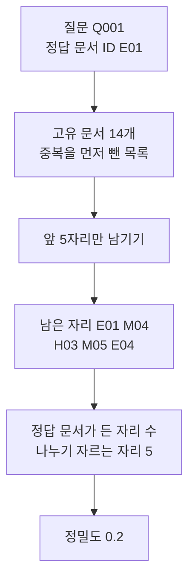
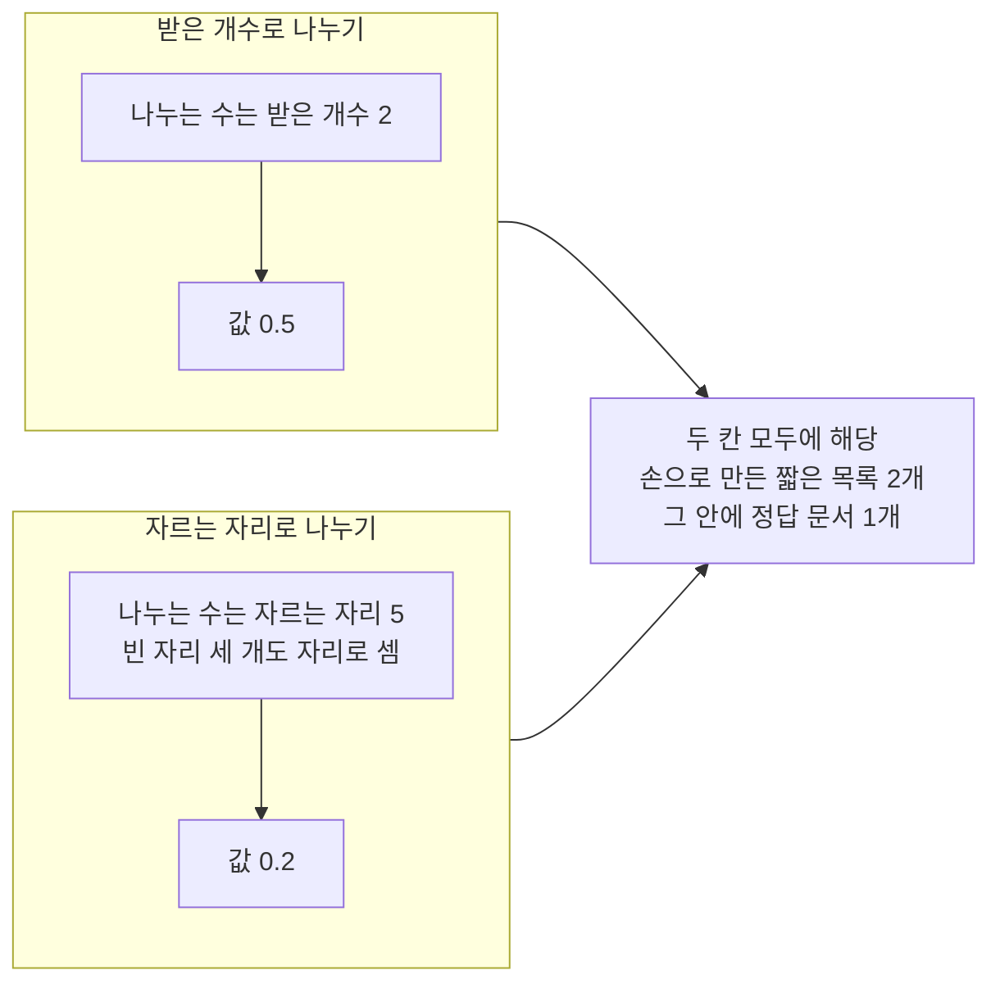
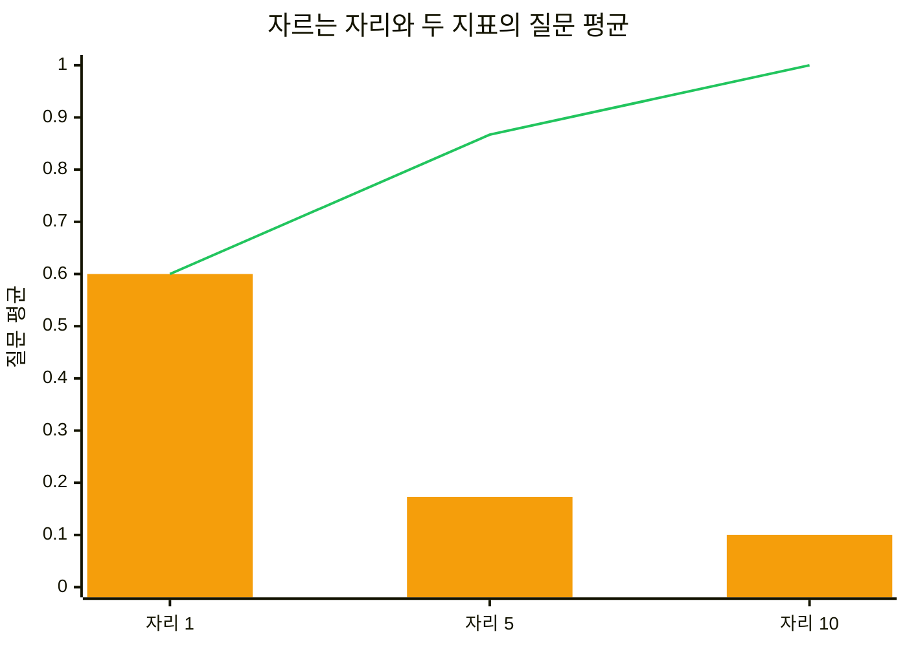
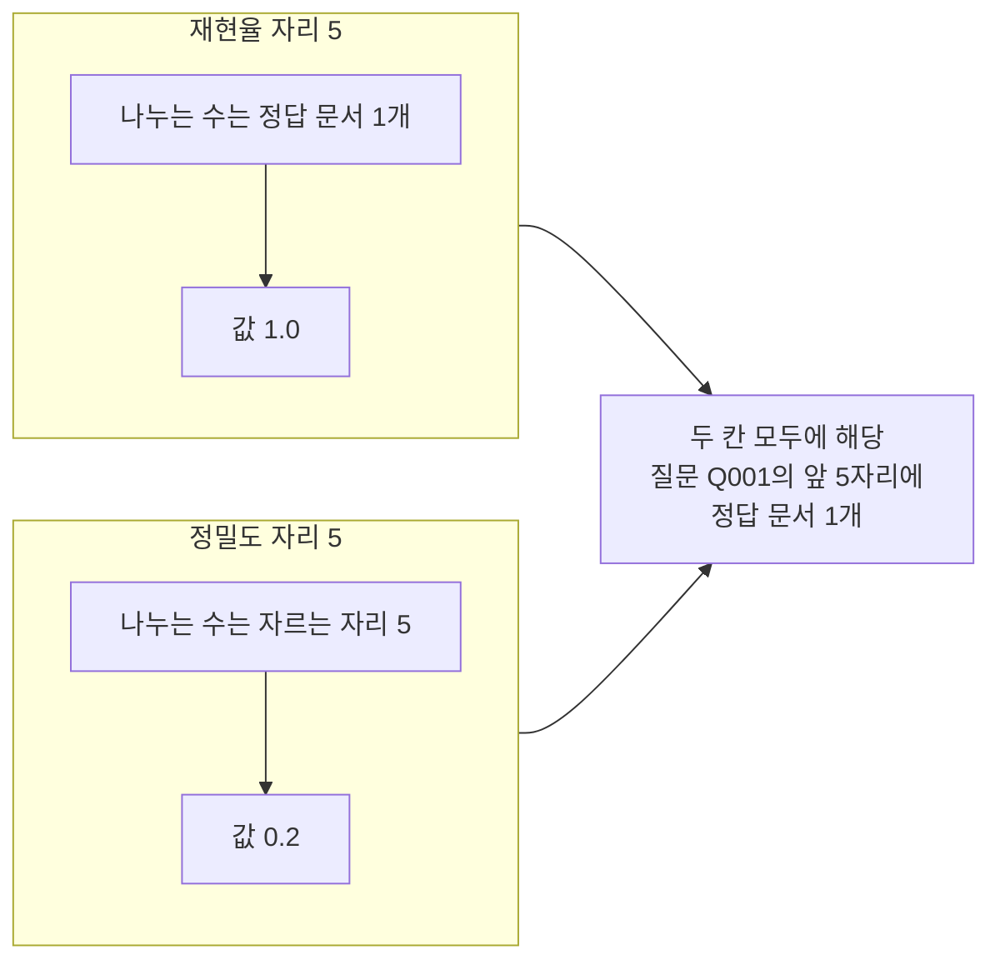

# 03-Precision-at-5

## _src 본문 (HTML 원본)

```html
<!--meta: 강의 1h | 실습 2h | 코드 notebooks/03-Precision-at-5.ipynb | 새 용어 4 -->

<h2 id="b1"><span class="no">1</span>학습 목표</h2>
<div class="goal"><ul>
<li>이 절을 마치면 앞 다섯 자리의 정답 문서 비율을 정밀도로 계산할 수 있습니다.</li>
<li>이 절을 마치면 받은 개수가 모자라도 나누는 수를 5로 두는 까닭을 설명할 수 있습니다.</li>
<li>이 절을 마치면 같은 자리에서 재현율과 정밀도가 무엇을 다르게 세는지 가를 수 있습니다.</li>
<li>이 절을 마치면 정답 문서가 한 개인 평가셋에서 0.2가 최댓값이라고 말할 수 있습니다.</li>
</ul></div>

<h2 id="b2"><span class="no">2</span>이 내용을 배우는 이유</h2>
<p>검색 화면과 근거 목록에는 자리가 정해져 있습니다. 사용자가 먼저 보는 자리는 앞의 몇 개뿐입니다. 그 자리에 관련 없는 문서가 차면 답을 쓰는 단계도 그 문서를 읽습니다.</p>
<p>02절은 후보 목록 안에 정답 문서가 들어왔는지만 보았습니다. 들어오기만 하면 값이 1.0이었습니다. 목록 뒤쪽에 있어도 같은 값이었습니다.</p>
<p>이 절의 질문은 하나입니다. 앞 다섯 자리 가운데 정답 문서가 몇 자리를 차지했는가입니다.</p>
<p>Ch 12에서는 같은 후보 목록의 순서를 다시 매깁니다. 순서를 바꿔도 목록 안에 있는지는 그대로입니다. 달라지는 것은 앞 자리에 무엇이 오는지입니다. 그래서 앞 자리를 세는 지표를 먼저 정해 둡니다.</p>

<h2 id="b3"><span class="no">3</span>앞에서 배운 내용</h2>
<ul>
<li><strong>고유 문서 목록</strong> — 01절 12절에서 검색 항목의 문서 ID 중복을 빼 고유 문서를 셌습니다. 함수 이름은 <code>unique_doc_ids()</code>입니다.</li>
<li><strong>중복 제거 순서</strong> — 01절에서 문서 ID 중복 제거를 앞에서 자르기보다 먼저 하기로 정했습니다. 이 절 계산도 그 순서를 지킵니다.</li>
<li><strong>자르는 자리</strong> — 02절에서 순위 목록의 앞에서 몇 개까지 볼지 정하는 수를 자르는 자리로 불렀습니다.</li>
<li><strong>재현율</strong> — 02절에서 정답 문서 가운데 자른 목록에 들어온 비율을 쟀습니다. 자르는 자리 5의 질문 평균은 0.867이었습니다.</li>
<li><strong>질문 평균</strong> — 02절에서 질문마다 점수를 따로 내고 같은 무게로 평균했습니다. 함수 이름은 <code>mean_score()</code>입니다.</li>
<li><strong>기록 줄 수</strong> — Ch 10 08절에서 기록 한 줄에 남은 검색 항목 수를 그렇게 불렀습니다. 02절 4절에서 두 기록의 값이 2와 5였습니다.</li>
<li><strong>정답 문서 ID</strong> — 01절 7절에서 30문항 모두 정답 문서 ID가 한 개인 것을 확인했습니다.</li>
<li><strong>쪽 단위 색인</strong> — Ch 9 01절과 Ch 10 08절에서 PDF를 쪽마다 Document로 읽어 벡터스토어에 넣었습니다.</li>
</ul>
<p>노트북은 01절 <code>unique_doc_ids()</code>와 02절 <code>recall_at()</code>·<code>mean_score()</code>·<code>make_candidate_list()</code>를 도구 파일 <code>rag_tools.py</code>에서 가져옵니다. Ch 9 02절 <code>load_pdf_pages()</code>도 가져옵니다.</p>

<h2 id="b4"><span class="no">4</span>핵심 개념</h2>
<h3>비유 — 칸이 다섯 개인 쟁반</h3>
<p>칸이 다섯 개로 나뉜 쟁반을 떠올려 보세요. 칸마다 카드를 한 장씩 세울 수 있습니다. 앞 다섯 자리를 이 쟁반 하나로 보면 됩니다.</p>
<p>카드가 두 장뿐이어도 칸은 다섯 개 그대로입니다. 빈 칸 세 개도 자리로 셉니다. 카드를 적게 받았다고 칸이 줄지는 않습니다.</p>
<p>검색 평가에서 그 칸 수가 나누는 수입니다. 받은 카드 수로 나누면 카드를 적게 내놓은 쪽이 더 높은 값을 받습니다. 그래서 칸 수를 고정해 둡니다.</p>
{{img:03-5-다섯-칸-쟁반|평면 그림으로 탁자 위에 긴 나무 쟁반이 놓여 있고 쟁반 안이 얇은 칸막이로 다섯 칸으로 나뉘어 있으며 왼쪽 첫 칸에 파란 카드 한 장과 둘째 칸에 흰 카드 한 장이 서 있고 오른쪽 세 칸은 비어 나무 바닥이 보이며 쟁반 바깥 오른쪽 탁자 위에는 흰 카드 여러 장이 흩어져 놓여 있음|카드가 두 장뿐이어도 쟁반의 칸 수는 다섯 그대로이고 빈 칸 세 개도 자리로 셉니다}}
<p><strong>그림 읽기</strong> — 가운데 긴 나무 쟁반부터 봅니다. 쟁반 안이 얇은 칸막이로 나뉘어 있고 칸마다 카드 한 장이 들어갈 크기입니다. 이 칸 수가 자르는 자리입니다.</p>
<p>왼쪽 첫 칸에 파란 카드가 서 있습니다. 파란 카드가 정답 문서입니다. 둘째 칸에는 흰 카드가 한 장 서 있고 오른쪽 칸들은 비어 나무 바닥이 보입니다.</p>
<p>쟁반 바깥 오른쪽에는 흰 카드가 흩어져 있습니다. 쟁반에 오르지 못한 카드입니다. 빈 칸이 있어도 바깥 카드를 끌어와 칸을 채우지 않습니다.</p>

<h3>이 절에서 쓰는 말</h3>
<table><thead><tr><th>용어</th><th>뜻과 일상 예</th><th>이 절에서 보이는 모습</th></tr></thead><tbody>
<tr><td>정밀도(precision)</td><td>자른 목록의 자리 가운데 정답 문서가 차지한 비율. 진열대 다섯 칸 가운데 찾던 물건이 몇 칸에 있는지 세는 것과 같음</td><td>노트북 7절 <code>자르는 자리 5의 질문 평균 정밀도: 0.173</code></td></tr>
<tr><td>고정 분모(fixed denominator)</td><td>받은 결과가 모자라도 약속한 자리 수를 그대로 나누는 수로 쓰는 규칙. 다섯 칸 쟁반의 빈 칸도 자리로 세는 것과 같음</td><td>노트북 3절 <code>고정 분모 5로 나눈 값: 0.2</code></td></tr>
<tr><td>받은 개수(returned count)</td><td>검색으로 실제 얻은 고유 문서 수. 자르는 자리보다 적을 수도 많을 수도 있음</td><td>노트북 6절 <code>질문 Q001의 받은 개수: 14</code></td></tr>
<tr><td>지표 천장(metric ceiling)</td><td>이 자료와 라벨에서 지표가 올라갈 수 있는 가장 높은 값. 20점 만점 시험에서 20점이 천장인 것과 같음</td><td>노트북 2절 <code>정답 문서가 한 개일 때 자리 5의 최댓값: 0.2</code></td></tr>
</tbody></table>
<p>문서 청크·색인·벡터스토어·검색 점수·정답 문서 ID는 Ch 9에서 정한 뜻 그대로입니다. 기록 줄 수는 Ch 10 08절 뜻이고 고유 문서는 01절 뜻입니다. 후보 목록·자르는 자리·재현율·질문 평균은 02절에서 정한 뜻 그대로 씁니다. 지표 이름 <code>precision_at_5</code>·<code>recall_at_5</code>는 실습 폴더 <code>evaluate.py</code>가 쓰는 이름을 그대로 씁니다.</p>

<h3>도식 — 다섯 자리를 세는 순서</h3>
{{mermaid:03-1-다섯-자리-세기|위에서 아래로 내려가는 흐름도로 맨 위에 초록 상자 질문 Q001 정답 문서 ID E01이 있고 그 아래로 노란 상자 고유 문서 14개 중복을 먼저 뺀 목록과 파란 상자 앞 5자리만 남기기와 노란 상자 남은 자리 E01 M04 H03 M05 E04와 파란 상자 정답 문서가 든 자리 수 나누기 자르는 자리 5와 노란 상자 정밀도 0.2가 차례로 이어짐|질문 Q001의 고유 문서 14개에서 앞 5자리만 남기면 정답 문서 E01이 한 자리를 차지합니다}}
<p><strong>도식 읽기</strong> — 맨 위 초록 상자부터 아래로 봅니다. 질문 하나와 그 질문의 정답 문서 ID입니다. 다음 노란 상자가 02절에서 만든 고유 문서 목록입니다.</p>
<p>파란 상자에서 앞 5자리만 남깁니다. 그 아래 노란 상자에 남은 다섯 자리의 문서 ID가 있습니다. 첫 자리가 정답 문서 E01입니다.</p>
<p>마지막 두 상자가 이 절의 계산입니다. 정답 문서가 든 자리 수는 하나이고 나누는 수는 다섯입니다. 그래서 값이 0.2가 됩니다.</p>

<h3>나누는 수를 자르는 자리로 고정합니다</h3>
<p>정밀도는 앞 몇 자리를 볼지 정해야 값이 나옵니다. 그 자리 수가 나누는 수도 됩니다. 재현율과 다른 점이 여기에 있습니다.</p>
<p>받은 개수가 자르는 자리보다 적을 때가 있습니다. 검색기가 결과를 두 개만 내놓는 경우입니다. 이때 받은 개수 2로 나누면 결과를 적게 내놓은 쪽이 더 높은 값을 받습니다.</p>
<p>그래서 약속한 자리 수를 그대로 나누는 수로 씁니다. 대신 받은 개수를 따로 적어 둡니다. 실습 폴더 <code>evaluate.py</code>도 <code>candidate_count</code>라는 칸에 그 수를 함께 남깁니다. 도구의 <code>returned_count</code>는 보고서에 남긴 항목 수이고 06절에서 그 칸을 다시 봅니다.</p>

<h3>정답 문서가 한 개면 최댓값이 0.2입니다</h3>
<p>이 평가셋은 질문마다 정답 문서 ID가 한 개입니다. 01절 7절에서 30문항 전체를 세어 확인했습니다. 그러면 앞 다섯 자리에서 정답으로 셀 수 있는 자리도 많아야 한 개입니다.</p>
<p>자리 다섯 개 가운데 한 개이므로 값은 0.2를 넘을 수 없습니다. 이 값은 검색기가 스무 해에 한 번 맞혔다는 뜻이 아닙니다. 라벨이 하나뿐이라 생긴 천장입니다.</p>
<p>정답 문서를 여러 개 붙인 평가셋에서는 천장이 달라집니다. 그래서 라벨 방식이 다른 평가셋의 값을 숫자만으로 견주지 않습니다. 이 절 값은 이 평가셋 안에서만 읽습니다.</p>

<h2 id="b5"><span class="no">5</span>실행 예제</h2>
<p>내려받은 실습 폴더에서 노트북을 열고 위에서 아래로 실행합니다. 02절과 같은 다섯 패키지를 씁니다. 임베딩 요청은 색인 한 번과 질문 검색 열다섯 번을 합쳐 열여섯 번입니다.</p>
<p>02절보다 요청이 한 번 적습니다. 첫 질문을 따로 검색하지 않고 반복 검색 결과에서 꺼내 쓰기 때문입니다. 보낼 조각 수는 색인이 59190개 어림이고 예상 비용은 0.01달러 미만입니다. 답을 쓰는 모델은 이 절에서 부르지 않습니다.</p>
<p>읽는 파일은 네 갈래입니다. 말뭉치 PDF 18건과 말뭉치 목록, 평가셋 파일, Ch 9와 Ch 10 기록입니다. 이 절은 파일을 쓰지 않습니다.</p>
<p>이 페이지의 출력은 2026-09-21에 실행한 결과입니다. 새 커널로 두 번 이어 실행해 출력할 값이 같은 것을 확인했습니다. 임베딩 점수는 이 절에서도 출력하지 않습니다. 실행 시간은 패키지 설치를 빼면 1분 안팎입니다.</p>
<p>강의 시간에는 노트북 2~5절을 설명합니다. 정답 문서 수로 최댓값 재기, 정밀도 함수 만들기, 고정 분모 확인, 앞 챕터 기록으로 잴 수 있는 자리입니다. 노트북 5절 색인 만들기는 02절과 같은 코드라 실행만 하고 넘어갑니다. 6~11절은 함께 실행하고 실습 시간에 다시 읽습니다.</p>
{{mermaid:03-2-고정-분모|왼쪽에 받은 개수로 나누기라는 칸과 자르는 자리로 나누기라는 칸이 위아래로 있고 위 칸에는 파란 상자 나누는 수는 받은 개수 2에서 노란 상자 값 0.5로 내려가는 화살표가 있으며 아래 칸에는 파란 상자 나누는 수는 자르는 자리 5 빈 자리 세 개도 자리로 셈에서 노란 상자 값 0.2로 내려가는 화살표가 있고 두 칸에서 오른쪽 회색 상자 두 칸 모두에 해당 손으로 만든 짧은 목록 2개 그 안에 정답 문서 1개로 화살표가 모임|같은 짧은 목록에서 나누는 수만 바꾸면 값이 0.5와 0.2로 갈립니다}}
<p><strong>도식 읽기</strong> — 위 칸이 받은 개수로 나누는 방법이고 아래 칸이 이 절에서 쓰는 방법입니다. 두 칸 모두 노트북 3절의 짧은 목록 하나를 봅니다.</p>
<p>위 칸의 파란 상자에 적힌 나누는 수는 2입니다. 받은 개수가 그대로 나누는 수가 되어 값이 0.5로 나옵니다. 아래 칸은 빈 자리 세 개까지 세어 나누는 수가 5이고 값이 0.2입니다.</p>
<p>오른쪽 회색 상자는 두 칸 모두에 해당합니다. 두 칸의 목록과 정답 문서는 같습니다. 달라진 것은 나누는 수 하나뿐입니다.</p>
{{notebook:03-Precision-at-5}}
<p class="look"><b>확인할 점</b> — 개발 분할 <code>15</code>문항은 모두 정답 문서 ID가 한 개이고 자리 5의 최댓값은 <code>0.2</code>입니다. 짧은 목록에서 <code>받은 개수로 나눈 값: 0.5</code>와 <code>고정 분모 5로 나눈 값: 0.2</code>가 갈립니다. 앞 챕터 기록 일곱 줄 가운데 <code>ch09 | 2 | False | None</code> 한 줄만 자리 5를 계산하지 못했습니다. 15문항의 <code>자르는 자리 5의 질문 평균 정밀도: 0.173</code>이고 <code>Q085 | 0 | 0.0</code>과 <code>Q086 | 0 | 0.0</code> 두 줄만 값이 0입니다.</p>

<h2 id="b6"><span class="no">6</span>실험 결과 해석</h2>
{{mermaid:03-3-자르는-자리와-두-지표|가로축에 자리 1과 자리 5와 자리 10 세 칸이 있고 세로축이 질문 평균 0에서 1까지인 그림으로 주황 막대 높이가 차례로 0.6과 0.173과 0.1이고 초록 선은 같은 세 자리에서 0.6과 0.867과 1.0으로 올라감|자르는 자리를 넓히면 주황 막대 정밀도는 내려가고 초록 선 재현율은 올라갑니다}}
<p><strong>도식 읽기</strong> — 왼쪽부터 오른쪽으로 봅니다. 주황 막대가 질문 평균 정밀도이고 초록 선이 질문 평균 재현율입니다. 가로축 세 칸은 자르는 자리 1과 5와 10입니다.</p>
<p>왼쪽 자리 1에서는 두 값이 0.6으로 같습니다. 정답 문서가 한 개이고 나누는 수도 1이라 두 계산이 같은 값을 냅니다. 오른쪽으로 갈수록 주황 막대는 0.173과 0.1로 내려갑니다.</p>
<p>초록 선은 반대로 0.867과 1.0으로 올라갑니다. 자리를 넓히면 정답 문서를 담을 기회는 늘고 빈 자리도 함께 늘기 때문입니다. 한 지표만 보고 설정을 고르면 반대쪽이 나빠지는 것을 놓칩니다.</p>
<p>자리 5의 질문 평균 정밀도는 0.173입니다. 앞에서 적은 천장 0.2보다 낮습니다. 15문항 가운데 열세 문항이 0.2였고 두 문항이 0.0이었기 때문입니다.</p>
<p>이 값을 보고 검색기가 열에 둘만 맞혔다고 읽으면 안 됩니다. 정답 문서가 한 개인 라벨에서는 0.2가 가장 높은 값입니다. 열세 문항은 그 가장 높은 값을 받았습니다.</p>
{{mermaid:03-4-같은-자리-다른-셈|왼쪽에 재현율 자리 5라는 칸과 정밀도 자리 5라는 칸이 위아래로 있고 위 칸에는 파란 상자 나누는 수는 정답 문서 1개에서 노란 상자 값 1.0으로 내려가는 화살표가 있으며 아래 칸에는 파란 상자 나누는 수는 자르는 자리 5에서 노란 상자 값 0.2로 내려가는 화살표가 있고 두 칸에서 오른쪽 회색 상자 두 칸 모두에 해당 질문 Q001의 앞 5자리에 정답 문서 1개로 화살표가 모임|같은 앞 5자리 목록에서 재현율은 1.0이 되고 정밀도는 0.2가 됩니다}}
<p><strong>도식 읽기</strong> — 위 칸이 재현율이고 아래 칸이 정밀도입니다. 두 칸 모두 질문 Q001의 같은 앞 5자리 목록을 봅니다.</p>
<p>위 칸의 나누는 수는 정답 문서 수 1이고 값은 1.0입니다. 아래 칸의 나누는 수는 자르는 자리 5이고 값은 0.2입니다. 세는 방법은 같고 나누는 수만 다릅니다.</p>
<p>오른쪽 회색 상자는 두 칸 모두에 해당합니다. 앞 5자리에 정답 문서가 한 개 들어 있다는 사실은 두 값의 공통 재료입니다. 노트북 9절이 두 값을 한 줄에 나란히 출력합니다.</p>
<p>재현율 1.0은 찾아야 할 정답 문서를 다 찾았다는 뜻입니다. 정밀도 0.2는 다섯 자리 가운데 한 자리가 정답 문서라는 뜻입니다. 같은 목록에서 두 값이 다른 것은 물음이 다르기 때문입니다.</p>
<p>자리 5에서 값이 0이었던 질문은 <code>Q085</code>와 <code>Q086</code>입니다. 02절에서 두 질문의 정답 문서가 고유 목록 10번째였던 것을 확인했습니다. 앞 5자리에 들어오지 못해 두 지표가 함께 0이 되었습니다.</p>
<p>이 결과는 이 말뭉치와 개발 분할 15문항에서 한 번 본 것입니다. 질문 묶음이나 말뭉치가 달라지면 값도 달라집니다. 어느 검색 방법이 더 낫다는 판단은 하지 않았습니다.</p>

<h2 id="b7"><span class="no">7</span>주의할 점과 실무 메모</h2>
<ul>
<li><strong>나누는 수는 받은 개수가 아니라 자르는 자리입니다.</strong> 결과를 다섯 개보다 적게 받아도 5로 나눕니다. 받은 개수는 따로 적어 결과가 모자랐다는 사실을 드러냅니다.</li>
<li><strong>이번 실행에서는 받은 개수가 모자란 질문이 없었습니다.</strong> 15문항의 받은 개수가 모두 자르는 자리 5보다 컸습니다. 고정 분모가 값을 바꾸는 장면은 노트북 3절의 짧은 목록에서만 보았습니다.</li>
<li><strong>받은 개수는 실행마다 조금 움직입니다.</strong> 후보 50개의 뒤쪽 순서가 실행마다 달라져 고유 문서 수가 한두 개 바뀝니다. 그래서 질문별 표와 결론에는 넣지 않았습니다.</li>
<li><strong>정답 문서가 한 개인 라벨에서 자리 5의 천장은 0.2입니다.</strong> 0.2를 20퍼센트만 맞혔다고 읽으면 틀립니다. 라벨 방식이 다른 평가셋의 값과 숫자만으로 견주지 않습니다.</li>
<li><strong>자르는 자리가 다른 값을 서로 견주지 않습니다.</strong> 자리 1의 0.6과 자리 5의 0.173은 같은 검색 결과에서 나온 값입니다. 두 값의 차이는 검색 품질 차이가 아닙니다.</li>
<li><strong>자르는 자리 1·5·10은 흐름을 보여 주려고 정한 예입니다.</strong> 자리 5는 절 주제이고 자리 1은 1위만 볼 때를 보려고 더했습니다. 자리 10은 자리를 넓힐 때 두 지표가 어느 쪽으로 가는지 보려고 더했습니다.</li>
<li><strong>두 기준선의 숫자를 나란히 놓지 않습니다.</strong> 실습 폴더 <code>evaluate.py</code>의 기준선은 낱말과 두 글자 조각의 겹침으로 점수를 냅니다. 이 절 기준선은 02절과 같은 임베딩 검색이라 점수 매기는 방법이 다릅니다.</li>
<li><strong>앞 다섯 자리에 정답 문서가 있어도 답이 맞다는 뜻은 아닙니다.</strong> 이 절은 검색 단계만 잽니다. 답 문장이 근거와 맞는지 판정하는 일은 Ch 15에서 다룹니다.</li>
<li><strong>이번에 실행하지 않은 것을 적어 둡니다.</strong> 정답 문서가 여러 개인 질문의 정밀도, 답할 수 없는 질문을 실제로 빼는 장면, 시험 분할 보기입니다. 순위 차이를 값에 넣는 계산은 04절에서 배웁니다.</li>
</ul>

<h2 id="b8"><span class="no">8</span>정리와 다음 절</h2>
<ul>
<li>정밀도는 앞 몇 자리 가운데 정답 문서가 든 자리의 비율입니다.</li>
<li>나누는 수는 받은 개수가 아니라 약속한 자르는 자리입니다.</li>
<li>정답 문서가 한 개인 이 평가셋에서 자리 5의 천장은 0.2입니다.</li>
<li>개발 분할 15문항의 자리 5 질문 평균 정밀도는 0.173이었습니다.</li>
<li>자리를 넓히면 재현율은 올라가고 정밀도는 내려갑니다.</li>
<li>같은 앞 5자리 목록에서 재현율 1.0과 정밀도 0.2가 함께 나옵니다.</li>
</ul>
<p><strong>다음 학습과 이어지는 지점</strong> — 04절에서는 정답 문서가 앞 다섯 자리의 몇 번째에 있었는지를 nDCG@5로 값에 넣습니다. 이 절에서 만든 앞 5자리 목록이 그 계산의 입력입니다.</p>
<p>이 절은 앞 5자리에 정답 문서가 몇 개인지까지 왔습니다. 1번째에 있든 5번째에 있든 값이 같았습니다. 자리 순서를 값에 넣는 계산이 04절 주제입니다.</p>

<h2 id="b9"><span class="no">9</span>복습 문제</h2>
<details class="quiz" open><summary>문제 4개 · 해설 포함</summary>
<p class="quiz-q">1. [하] 앞 5자리에 정답 문서가 두 개 있으면 정밀도는 얼마입니까?</p>
<p class="quiz-a">0.4입니다. 정답 문서가 든 자리 수 2를 자르는 자리 5로 나눈 값입니다. 이 평가셋에는 정답 문서가 여러 개인 질문이 없어 이번에 실행하지 않았습니다.</p>
<p class="quiz-q">2. [중] 검색 결과를 두 개만 받았습니다. 나누는 수는 무엇입니까?</p>
<p class="quiz-a">약속한 자르는 자리 5입니다. 받은 개수 2로 나누면 결과를 적게 내놓은 쪽이 더 높은 값을 받습니다. 받은 개수는 따로 적어 둡니다.</p>
<p class="quiz-q">3. [중] 같은 앞 5자리 목록에서 재현율은 1.0인데 정밀도는 0.2입니다. 어떤 뜻입니까?</p>
<p class="quiz-a">찾아야 할 정답 문서를 다 찾았고 다섯 자리 가운데 한 자리가 정답 문서라는 뜻입니다. 세는 방법은 같고 나누는 수만 다릅니다.</p>
<p class="quiz-q">4. [상] 자리 5의 질문 평균 정밀도 0.173을 검색 품질 점수로 그대로 쓸 수 없는 까닭은 무엇입니까?</p>
<p class="quiz-a">정답 문서가 한 개인 라벨에서 자리 5의 천장이 0.2이기 때문입니다. 0.173은 그 천장에 가까운 값입니다. 라벨 방식이 다른 평가셋과 숫자만으로 견주면 안 됩니다.</p>
</details>

<h2 id="b10"><span class="no">10</span>참고 자료</h2>
<ul>
<li><div><a href="https://nlp.stanford.edu/IR-book/html/htmledition/evaluation-of-ranked-retrieval-results-1.html">Introduction to Information Retrieval, Section 8.4 Evaluation of ranked retrieval results</a></div>확인 2026-09-18 · 순위 목록에서 정밀도를 정의하는 방식 참고.</li>
<li><div><a href="https://trec.nist.gov/pubs/trec30/papers/Overview-2021.pdf">TREC 2021 Overview</a></div>확인 2026-09-18 · 자르는 자리를 정해 두고 값을 함께 적는 방식 참고.</li>
<li>02절 Recall at 50 — 자르는 자리와 질문 평균, 같은 기준선 코드.</li>
<li>01절 질의셋과 정답 문서 ID — 고유 문서 세기와 정답 문서 ID가 한 개인 질문 수.</li>
<li>기준 버전은 pypdf 6.1.1과 langchain-core 1.6.2, langchain-openai 1.6.0입니다. 패키지 numpy는 2.5.3이고 python-dotenv는 1.2.3입니다. 교재 출력은 Linux의 Python 3.12.13으로 만들었습니다. 다른 버전과 Windows·macOS에서는 이번에 실행하지 않았습니다.</li>
</ul>
```

## 노트북 셀 (순서대로)

### [0] markdown {'html': 'skip'}

# Precision at 5

**이 노트북에서 할 일**

1. 앞 다섯 자리에 정답 문서가 든 비율을 정밀도로 계산합니다.
2. 받은 개수가 모자라도 나누는 수를 5로 고정하는 까닭을 확인합니다.
3. 자르는 자리를 바꿔 정밀도와 재현율이 어느 쪽으로 움직이는지 견줍니다.

**준비물** — 프로젝트 맨 위 폴더의 `.env` 파일에 `OPENAI_API_KEY`가 있어야 합니다.
임베딩 요청은 모두 열여섯 번입니다. 색인 한 벌에 한 번, 질문 검색에 열다섯 번입니다.

02절보다 한 번 적습니다. 첫 질문을 따로 검색하지 않고 반복 검색 결과에서 꺼내 쓰기 때문입니다.
답을 쓰는 모델은 이 절에서 부르지 않습니다.

보낼 조각 수는 색인이 59190개 어림이고 질문은 한 번에 스무 개 안팎입니다.
예상 비용은 열여섯 번을 합쳐 0.01달러 미만입니다.
임베딩 요금은 OpenAI 모델 안내(2026-09-17 확인)의 100만 토큰당 0.02달러입니다.
실행 시간은 패키지 설치를 빼면 1분 안팎입니다.

**데이터** — 읽는 파일은 네 갈래이고 모두 실습 묶음에 들어 있습니다.

- 말뭉치 `labs/data/rag-corpus/pdf/`의 디지털 PDF 18건과 `labs/data/rag-corpus/manifest.json`
- 평가셋 `labs/part3/ch11-evaluation/data/evaluation-queries.jsonl`
- Ch 9 06절 기록 `labs/part3/ch09-rag-first-run/runs/continuity-ch09-search.jsonl`
- Ch 10 08절 기록 `labs/part3/ch10-document-processing/runs/continuity-ch10-indexing.jsonl`

이 절은 파일을 쓰지 않습니다. 02절과 같은 기준선 색인을 다시 만듭니다.

**강의와 실습 범위** — 강의 시간에는 2~5절을 설명합니다.
정답 문서 수로 최댓값 재기, 정밀도 함수 만들기, 고정 분모 확인, 앞 챕터 기록으로 잴 수 있는 자리입니다.
6~11절은 함께 실행하고 실습 시간에 다시 읽습니다.
5절 색인 만들기는 02절과 같은 코드라 실행만 하고 빠르게 넘어갑니다.

**기준 버전** — 고정한 패키지는 다섯 개입니다.

- 쪽 읽기: pypdf 6.1.1
- 색인과 임베딩: langchain-core 1.6.2 · langchain-openai 1.6.0
- 코사인 유사도 계산: numpy 2.5.3
- 키 읽기: python-dotenv 1.2.3

교재 출력은 Linux의 Python 3.12.13으로 만들었습니다.
다른 버전과 Windows·macOS에서는 이번에 실행하지 않았습니다.

실습 폴더 `labs/part3/ch11-evaluation`에서 `uv sync --locked`를 실행합니다.
그다음 이 폴더의 `.venv` 커널을 고르고 첫 셀부터 순서대로 실행합니다.

### [1] markdown {'html': 'skip'}

## 오늘 볼 그림


맨 위 초록 상자가 이 절의 입력입니다. 질문 하나와 그 질문의 정답 문서 ID입니다.
그 아래 노란 상자가 02절에서 만든 고유 문서 목록이고, 파란 상자에서 앞 5자리만 남깁니다.
맨 아래 두 상자가 이 절의 계산입니다. 정답 문서가 든 자리 수를 자르는 자리 5로 나눕니다.

### [2] markdown {}

## 1. 준비

첫 셀은 패키지를 설치하고 설치된 버전을 출력합니다. 설치에는 몇십 초가 걸릴 수 있습니다.
02절에서 쓴 다섯 개와 같습니다. 이 절도 검색을 직접 하기 때문입니다.

### [3] code {'execution': {'iopub.execute_input': '2026-09-21T07:04:33.180523Z', 'iopub.status.busy': '2026-09-21T07:04:33.180459Z', 'iopub.status.idle': '2026-09-21T07:04:33.663689Z', 'shell.execute_reply': '2026-09-21T07:04:33.663094Z'}, 'lesson_role': 'setup'}

```python
# 이 절에서 쓰는 패키지를 설치하고 버전을 확인합니다
%pip install -q "pypdf==6.1.1" "langchain-core==1.6.2" "langchain-openai==1.6.0" "numpy==2.5.3" "python-dotenv==1.2.3"
from importlib.metadata import version

print("pypdf:", version("pypdf"))
print("langchain-core:", version("langchain-core"))
print("langchain-openai:", version("langchain-openai"))
print("numpy:", version("numpy"))
print("python-dotenv:", version("python-dotenv"))
```

출력:
```
Note: you may need to restart the kernel to use updated packages.
pypdf: 6.1.1
langchain-core: 1.6.2
langchain-openai: 1.6.0
numpy: 2.5.3
python-dotenv: 1.2.3

```

### [4] markdown {}

**결과 읽기** — 출력 다섯 줄 가운데 첫 줄은 `pypdf: 6.1.1`입니다.
둘째 줄 `langchain-core: 1.6.2`와 셋째 줄 `langchain-openai: 1.6.0`도 보세요.
넷째 줄 `numpy: 2.5.3`은 색인이 코사인 유사도를 계산할 때 쓰는 패키지입니다.
준비물에 적은 기준 버전과 같습니다.

다음 셀은 이 절에서 쓸 이름을 불러옵니다. 패키지 이름은 02절과 같습니다.

앞에서 배운 함수는 `rag_tools.py`에 모아 두었습니다. 파일을 열면 코드를 볼 수 있습니다. 노트북과 같은 폴더(`notebooks/`)에 있는 파일입니다.
이 노트북은 01절 `unique_doc_ids()`와 02절 `recall_at()`·`mean_score()`·`make_candidate_list()`를 가져옵니다.
Ch 9 02절 `load_pdf_pages()`도 가져옵니다.

### [5] code {'execution': {'iopub.execute_input': '2026-09-21T07:04:33.665025Z', 'iopub.status.busy': '2026-09-21T07:04:33.664914Z', 'iopub.status.idle': '2026-09-21T07:04:35.383506Z', 'shell.execute_reply': '2026-09-21T07:04:35.382796Z'}, 'lesson_role': 'setup'}

```python
# 평가셋과 실행 기록 읽기·임베딩·색인에 쓸 이름을 불러옵니다
import json

from langchain_core.vectorstores import InMemoryVectorStore
from langchain_openai import OpenAIEmbeddings
# 01·02절과 Ch 9 02절 함수 다섯 개를 도구 파일에서 가져옵니다
from rag_tools import load_pdf_pages, make_candidate_list, mean_score
from rag_tools import recall_at, unique_doc_ids
```

출력:
```

```

### [6] markdown {}

**결과 읽기** — 이 셀은 이름을 불러오기만 하므로 출력이 없습니다.

다음 셀은 키가 있는지 확인합니다. 키 값은 출력하지 않고 있는지만 봅니다.

### [7] code {'execution': {'iopub.execute_input': '2026-09-21T07:04:35.389364Z', 'iopub.status.busy': '2026-09-21T07:04:35.389140Z', 'iopub.status.idle': '2026-09-21T07:04:35.395679Z', 'shell.execute_reply': '2026-09-21T07:04:35.394997Z'}, 'lesson_role': 'setup'}

```python
# .env 파일에서 OpenAI API 키를 읽습니다(키 값은 출력하지 않습니다)
import os
from dotenv import find_dotenv, load_dotenv

env_path = find_dotenv(usecwd=True)
load_dotenv(env_path)
has_key = os.getenv("OPENAI_API_KEY") is not None
print("OPENAI_API_KEY 설정 여부:", has_key)
assert has_key, "프로젝트 폴더의 .env 파일에 OPENAI_API_KEY를 적어 주세요."
```

출력:
```
OPENAI_API_KEY 설정 여부: True

```

### [8] markdown {}

**결과 읽기** — 출력 줄은 `OPENAI_API_KEY 설정 여부: True`입니다.
이 셀은 모듈 `os`도 함께 불러옵니다. 다음 셀에서 파일이 있는지 확인할 때 씁니다.

다음 셀은 프로젝트 맨 위 폴더를 찾습니다. 01·02절과 같은 코드입니다.

### [9] code {'execution': {'iopub.execute_input': '2026-09-21T07:04:35.396819Z', 'iopub.status.busy': '2026-09-21T07:04:35.396733Z', 'iopub.status.idle': '2026-09-21T07:04:35.399259Z', 'shell.execute_reply': '2026-09-21T07:04:35.398868Z'}, 'lesson_role': 'setup'}

```python
# 노트북을 어느 폴더에서 열어도 프로젝트 맨 위를 찾게 후보 세 개를 차례로 봅니다
candidates = [".", "../../..", "../../../.."]
root_path = None
for candidate in candidates:
    if os.path.exists(candidate + "/labs/data/rag-corpus"):
        root_path = candidate
        break
print("고른 경로:", root_path)
assert root_path is not None, "notebooks 폴더나 실습 폴더 맨 위에서 노트북을 열어 주세요."
```

출력:
```
고른 경로: .

```

### [10] markdown {}

**결과 읽기** — 출력 줄은 `고른 경로: .`입니다. `assert`도 통과했습니다.
교재 출력은 프로젝트 맨 위를 작업 폴더로 삼아 실행해서 첫째 후보를 골랐습니다.

다음 셀은 고른 경로에 파일 이름을 이어 붙여 네 갈래 경로를 만듭니다.

### [11] code {'execution': {'iopub.execute_input': '2026-09-21T07:04:35.400192Z', 'iopub.status.busy': '2026-09-21T07:04:35.400104Z', 'iopub.status.idle': '2026-09-21T07:04:35.403530Z', 'shell.execute_reply': '2026-09-21T07:04:35.403036Z'}, 'lesson_role': 'setup'}

```python
# 이 절에서 읽을 파일 네 갈래의 경로를 만듭니다
corpus_path = root_path + "/labs/data/rag-corpus"
manifest_path = corpus_path + "/manifest.json"
dataset_path = root_path + "/labs/part3/ch11-evaluation/data/evaluation-queries.jsonl"
ch09_log_path = root_path + "/labs/part3/ch09-rag-first-run/runs/continuity-ch09-search.jsonl"
ch10_log_path = root_path + "/labs/part3/ch10-document-processing/runs/continuity-ch10-indexing.jsonl"
print("평가셋 파일이 있는가:", os.path.exists(dataset_path))
print("말뭉치 목록이 있는가:", os.path.exists(manifest_path))
print("Ch 9 기록이 있는가:", os.path.exists(ch09_log_path))
print("Ch 10 기록이 있는가:", os.path.exists(ch10_log_path))
```

출력:
```
평가셋 파일이 있는가: True
말뭉치 목록이 있는가: True
Ch 9 기록이 있는가: True
Ch 10 기록이 있는가: True

```

### [12] markdown {}

**결과 읽기** — 네 줄 모두 `True`입니다. 02절이 읽은 네 갈래와 같습니다.

## 2. 정답 문서 수로 최댓값 재기

평가셋 30줄을 읽고 개발 분할 15문항만 남깁니다. 02절과 같은 코드입니다.
시험 분할은 설정을 다 고른 뒤 한 번만 보기로 01절에서 정했습니다.

### [13] code {'execution': {'iopub.execute_input': '2026-09-21T07:04:35.404264Z', 'iopub.status.busy': '2026-09-21T07:04:35.404188Z', 'iopub.status.idle': '2026-09-21T07:04:35.407317Z', 'shell.execute_reply': '2026-09-21T07:04:35.406897Z'}}

```python
# 평가셋 30줄을 읽고 설정을 고를 때 쓰는 개발 분할만 남깁니다
with open(dataset_path, encoding="utf-8") as dataset_file:
    dataset_lines = dataset_file.read().splitlines()

queries = []
for line in dataset_lines:
    queries.append(json.loads(line))

dev_queries = []
for query in queries:
    if query["split"] == "dev":
        dev_queries.append(query)
print("평가셋 줄 수:", len(queries))
print("개발 분할 질문 수:", len(dev_queries))
print("첫 질문 번호:", dev_queries[0]["qid"])
```

출력:
```
평가셋 줄 수: 30
개발 분할 질문 수: 15
첫 질문 번호: Q001

```

### [14] markdown {}

**결과 읽기** — 출력 줄은 `평가셋 줄 수: 30`과 `개발 분할 질문 수: 15`입니다.
셋째 줄 `첫 질문 번호: Q001`은 02절에서 후보 목록을 처음 본 그 질문입니다.

다음 셀은 질문마다 정답 문서 ID가 몇 개인지 셉니다.
정답 문서가 한 개면 앞 5자리에서 셀 수 있는 정답 자리도 많아야 한 개입니다.
그래서 이 평가셋에서 자리 5의 값이 얼마까지 올라갈 수 있는지 미리 알 수 있습니다.

### [15] code {'execution': {'iopub.execute_input': '2026-09-21T07:04:35.408078Z', 'iopub.status.busy': '2026-09-21T07:04:35.408016Z', 'iopub.status.idle': '2026-09-21T07:04:35.410296Z', 'shell.execute_reply': '2026-09-21T07:04:35.409846Z'}}

```python
# 정답 문서 ID가 한 개인 질문을 세어 자르는 자리 5에서 나올 수 있는 최댓값을 봅니다
cutoff_narrow = 5
single_gold_count = 0
for query in dev_queries:
    if len(query["gold_doc_ids"]) == 1:
        single_gold_count = single_gold_count + 1

max_precision = 1 / cutoff_narrow
print("개발 분할 질문 수:", len(dev_queries))
print("정답 문서 ID가 한 개인 질문 수:", single_gold_count)
print("정답 문서가 한 개일 때 자리 5의 최댓값:", max_precision)
```

출력:
```
개발 분할 질문 수: 15
정답 문서 ID가 한 개인 질문 수: 15
정답 문서가 한 개일 때 자리 5의 최댓값: 0.2

```

### [16] markdown {}

**결과 읽기** — 둘째 줄은 `정답 문서 ID가 한 개인 질문 수: 15`입니다.
개발 분할 15문항이 모두 정답 문서 한 개짜리입니다.
셋째 줄 `정답 문서가 한 개일 때 자리 5의 최댓값: 0.2`가 이 절 값을 읽는 기준입니다.
01절 7절에서 30문항 전체가 정답 문서 한 개라는 것을 이미 보았습니다.

## 3. 정밀도 함수 만들기

다음 셀이 이 절의 새 계산입니다.
02절 재현율 함수와 세는 방법은 같고 마지막에 나누는 수만 다릅니다.
재현율은 정답 문서 수로 나누고, 정밀도는 자르는 자리로 나눕니다.

### [17] code {'execution': {'iopub.execute_input': '2026-09-21T07:04:35.411101Z', 'iopub.status.busy': '2026-09-21T07:04:35.411041Z', 'iopub.status.idle': '2026-09-21T07:04:35.413196Z', 'shell.execute_reply': '2026-09-21T07:04:35.412677Z'}}

```python
# 앞부분에 든 정답 문서 자리를 세고 자르는 자리로 나눕니다
def precision_at(doc_ids, gold_doc_ids, cutoff):
    top_ids = doc_ids[:cutoff]
    found_count = 0
    for gold_id in gold_doc_ids:
        if gold_id in top_ids:
            found_count = found_count + 1
    return found_count / cutoff
```

출력:
```

```

### [18] markdown {}

**결과 읽기** — 이 셀은 함수만 정의하므로 출력이 없습니다.
인자 `cutoff`가 나누는 수도 됩니다. 목록이 짧아도 이 수는 바뀌지 않습니다.

다음 셀은 그 규칙을 짧은 목록으로 확인합니다.
손으로 만든 문서 ID 두 개에 정답 문서 하나를 두고 두 가지 방법으로 나눠 봅니다.
검색 품질이 아니라 나누는 수를 보는 자리입니다.

### [19] code {'execution': {'iopub.execute_input': '2026-09-21T07:04:35.414092Z', 'iopub.status.busy': '2026-09-21T07:04:35.414015Z', 'iopub.status.idle': '2026-09-21T07:04:35.416304Z', 'shell.execute_reply': '2026-09-21T07:04:35.415990Z'}}

```python
# 받은 개수가 자르는 자리보다 적은 짧은 목록으로 나누는 수를 확인합니다
short_doc_ids = ["D01", "D02"]
short_gold = ["D01"]
found_count = 0
for gold_id in short_gold:
    if gold_id in short_doc_ids:
        found_count = found_count + 1

returned_score = found_count / len(short_doc_ids)
fixed_score = precision_at(short_doc_ids, short_gold, cutoff_narrow)
print("짧은 목록의 받은 개수:", len(short_doc_ids))
print("받은 개수로 나눈 값:", returned_score)
print("고정 분모 5로 나눈 값:", fixed_score)
assert fixed_score == 0.2
```

출력:
```
짧은 목록의 받은 개수: 2
받은 개수로 나눈 값: 0.5
고정 분모 5로 나눈 값: 0.2

```

### [20] markdown {}

**결과 읽기** — 첫 줄은 `짧은 목록의 받은 개수: 2`입니다.
둘째 줄 `받은 개수로 나눈 값: 0.5`와 셋째 줄 `고정 분모 5로 나눈 값: 0.2`가 다릅니다.
받은 개수로 나누면 결과를 적게 낸 쪽이 더 높은 값을 받습니다.
그래서 약속한 자리 수를 그대로 나누는 수로 씁니다. `assert`도 통과했습니다.

질문마다 낸 점수는 준비 셀에서 가져온 02절 함수 `mean_score()`로 모읍니다. 질문마다 같은 무게를 줍니다.

## 4. 앞 챕터 기록으로 잴 수 있는 자리

01절과 02절에서 읽은 두 기록을 다시 읽습니다.
줄마다 검색 항목이 몇 개 남았는지 세면 자를 수 있는 가장 뒤 자리를 알 수 있습니다.

### [21] code {'execution': {'iopub.execute_input': '2026-09-21T07:04:35.417028Z', 'iopub.status.busy': '2026-09-21T07:04:35.416970Z', 'iopub.status.idle': '2026-09-21T07:04:35.420545Z', 'shell.execute_reply': '2026-09-21T07:04:35.420017Z'}}

```python
# 01절에서 읽은 두 기록을 다시 읽어 줄마다 남은 검색 항목 수를 셉니다(02절 4절과 같은 코드)
log_paths = [ch09_log_path, ch10_log_path]
records = []
for log_path in log_paths:
    with open(log_path, encoding="utf-8") as log_file:
        log_lines = log_file.read().splitlines()
    for line in log_lines:
        records.append(json.loads(line))

logged_counts = []
for record in records:
    logged_counts.append(len(record["retrieved"]))
print("읽은 기록 줄 수:", len(records))
print("기록마다 남은 검색 항목 수:", logged_counts)
```

출력:
```
읽은 기록 줄 수: 7
기록마다 남은 검색 항목 수: [2, 5, 5, 5, 5, 5, 5]

```

### [22] markdown {}

**결과 읽기** — 첫 줄은 `읽은 기록 줄 수: 7`입니다.
둘째 줄은 `기록마다 남은 검색 항목 수: [2, 5, 5, 5, 5, 5, 5]`입니다.
Ch 9 기록은 검색 개수 2로, Ch 10 기록은 5로 실행한 결과입니다.

다음 셀은 줄마다 자리 5를 계산할 수 있는지 보고 계산할 수 있는 줄만 값을 냅니다.
실습 폴더 `evaluate.py`는 기록 줄 수가 5보다 적으면 그 칸을 `None`으로 둡니다.

### [23] code {'execution': {'iopub.execute_input': '2026-09-21T07:04:35.421496Z', 'iopub.status.busy': '2026-09-21T07:04:35.421419Z', 'iopub.status.idle': '2026-09-21T07:04:35.423841Z', 'shell.execute_reply': '2026-09-21T07:04:35.423503Z'}}

```python
# 기록 줄 수가 5 이상인 줄만 자르는 자리 5의 정밀도를 냅니다
print("온 챕터 | 기록 줄 수 | 자리 5를 계산할 수 있는가 | 정밀도")
for record in records:
    logged_k = len(record["retrieved"])
    can_measure = logged_k >= cutoff_narrow
    record_score = None
    if can_measure:
        record_unique = unique_doc_ids(record["retrieved"])
        record_score = precision_at(record_unique, record["gold_doc_ids"], cutoff_narrow)
    print(record["source_chapter"], "|", logged_k, "|", can_measure, "|", record_score)
```

출력:
```
온 챕터 | 기록 줄 수 | 자리 5를 계산할 수 있는가 | 정밀도
ch09 | 2 | False | None
ch10 | 5 | True | 0.2
ch10 | 5 | True | 0.2
ch10 | 5 | True | 0.2
ch10 | 5 | True | 0.2
ch10 | 5 | True | 0.2
ch10 | 5 | True | 0.2

```

### [24] markdown {}

**결과 읽기** — 라벨 줄 아래 일곱 줄이 있습니다.
첫 줄은 `ch09 | 2 | False | None`입니다. 항목이 두 개뿐이라 자리 5를 계산하지 못했습니다.
둘째 줄부터는 `ch10 | 5 | True | 0.2`가 여섯 번 이어집니다.

여섯 줄 모두 앞 5자리에 정답 문서가 한 개씩 들어 있었습니다.
정답 문서가 한 개인 질문이라 이 값이 2절에서 본 최댓값과 같습니다.

## 5. 기준선 색인 만들기

02절과 같은 다섯 셀입니다. 같은 색인을 다시 만들어야 03절 값이 02절 값과 이어집니다.
먼저 말뭉치 목록에서 스캔 변형을 뺍니다.

### [25] code {'execution': {'iopub.execute_input': '2026-09-21T07:04:35.424562Z', 'iopub.status.busy': '2026-09-21T07:04:35.424498Z', 'iopub.status.idle': '2026-09-21T07:04:35.427142Z', 'shell.execute_reply': '2026-09-21T07:04:35.426732Z'}}

```python
# 말뭉치 목록에서 스캔 변형을 빼고 디지털 PDF 18건만 골라 둡니다(02절 5절과 같은 코드)
with open(manifest_path, encoding="utf-8") as manifest_file:
    manifest_rows = json.loads(manifest_file.read())

digital_rows = []
for row in manifest_rows:
    if row["tier"] != "scanned":
        digital_rows.append(row)
print("목록의 전체 행 수:", len(manifest_rows))
print("디지털 PDF 수:", len(digital_rows))
```

출력:
```
목록의 전체 행 수: 21
디지털 PDF 수: 18

```

### [26] markdown {}

**결과 읽기** — 출력 줄은 `목록의 전체 행 수: 21`과 `디지털 PDF 수: 18`입니다.
02절에서 본 값과 같습니다.

다음 셀은 18건을 차례로 읽어 쪽 Document를 한 목록에 모읍니다.
읽기는 준비 셀에서 가져온 Ch 9 02절 로더 함수 `load_pdf_pages()`가 맡습니다.
메타데이터 칸 이름은 Ch 10 01절에서 정한 `doc_id`·`page`·`source`입니다.

### [27] code {'execution': {'iopub.execute_input': '2026-09-21T07:04:35.427913Z', 'iopub.status.busy': '2026-09-21T07:04:35.427844Z', 'iopub.status.idle': '2026-09-21T07:04:36.142717Z', 'shell.execute_reply': '2026-09-21T07:04:36.142242Z'}}

```python
# 디지털 PDF 18건을 차례로 읽어 쪽 Document를 한 목록에 모읍니다(02절 5절과 같은 코드)
corpus_pages = []
for row in digital_rows:
    file_path = corpus_path + "/" + row["file"]
    row_pages = load_pdf_pages(file_path, row["doc_id"])
    for page_document in row_pages:
        corpus_pages.append(page_document)
print("읽은 문서 수:", len(digital_rows))
print("읽은 쪽 수:", len(corpus_pages))
```

출력:
```
읽은 문서 수: 18
읽은 쪽 수: 93

```

### [28] markdown {}

**결과 읽기** — 출력 줄은 `읽은 문서 수: 18`과 `읽은 쪽 수: 93`입니다.
02절과 같은 값입니다.

다음 셀은 글자 층이 빈 쪽을 빼고 색인 재료를 고릅니다.
Ch 10 02절에서 스캔 이미지만 있는 쪽은 글자 층이 비는 것을 확인했습니다.

### [29] code {'execution': {'iopub.execute_input': '2026-09-21T07:04:36.143501Z', 'iopub.status.busy': '2026-09-21T07:04:36.143445Z', 'iopub.status.idle': '2026-09-21T07:04:36.145523Z', 'shell.execute_reply': '2026-09-21T07:04:36.145207Z'}}

```python
# 글자 층이 빈 쪽을 빼고 색인 재료를 고른 뒤 글이 있는 문서 수를 셉니다(02절 5절과 같은 코드)
index_pages = []
text_doc_ids = []
for page_document in corpus_pages:
    if len(page_document.page_content) > 0:
        index_pages.append(page_document)
        if page_document.metadata["doc_id"] not in text_doc_ids:
            text_doc_ids.append(page_document.metadata["doc_id"])
print("색인에 넣을 쪽 수:", len(index_pages))
print("글이 있는 문서 수:", len(text_doc_ids))
```

출력:
```
색인에 넣을 쪽 수: 90
글이 있는 문서 수: 17

```

### [30] markdown {}

**결과 읽기** — 출력 줄은 `색인에 넣을 쪽 수: 90`과 `글이 있는 문서 수: 17`입니다.
읽은 쪽 93개에서 세 쪽이 빠졌습니다. 문서로는 18건 가운데 17건만 색인에 들어갑니다.

빠진 세 쪽은 Ch 10 08절에서 글자 층이 비는 것을 확인한 `H05`의 쪽입니다.

다음 셀은 임베딩 모델을 준비하고 쪽 90개로 색인 한 벌을 만듭니다.
여기서 임베딩 요청 한 번이 나갑니다.

### [31] code {'execution': {'iopub.execute_input': '2026-09-21T07:04:36.146174Z', 'iopub.status.busy': '2026-09-21T07:04:36.146120Z', 'iopub.status.idle': '2026-09-21T07:04:37.034657Z', 'shell.execute_reply': '2026-09-21T07:04:37.034145Z'}}

```python
# 임베딩 모델을 준비하고 쪽 Document 90개로 색인 한 벌을 만듭니다(02절 5절과 같은 코드)
embedding_model_name = "text-embedding-3-small"
embedding_model = OpenAIEmbeddings(model=embedding_model_name)
store = InMemoryVectorStore(embedding=embedding_model)
store.add_documents(index_pages)
print("임베딩 모델 이름:", embedding_model_name)
print("차원 수를 주었는가:", embedding_model.dimensions is not None)
print("색인에 들어간 항목 수:", len(store.store))
```

출력:
```
임베딩 모델 이름: text-embedding-3-small
차원 수를 주었는가: False
색인에 들어간 항목 수: 90

```

### [32] markdown {}

**결과 읽기** — 출력 첫 줄은 `임베딩 모델 이름: text-embedding-3-small`입니다.
둘째 줄 `차원 수를 주었는가: False`는 Ch 10 07절에서 정한 기본 설정으로 벡터를 만들었다는 뜻입니다.
셋째 줄 `색인에 들어간 항목 수: 90`은 앞 셀에서 고른 쪽 수와 같습니다.
이 노트북의 출력은 2026-09-21에 이 임베딩 모델로 실행한 결과입니다.

## 6. 후보 목록 받기

검색 결과는 순위·문서 ID·쪽 세 칸의 후보 목록으로 바꿉니다.
그 일은 준비 셀에서 가져온 02절 함수 `make_candidate_list()`가 합니다.
이 절 지표도 순위와 문서 ID만 쓰므로 점수를 받지 않습니다.

다음 셀은 개발 분할 15문항을 차례로 검색합니다. 질문 하나에 임베딩 요청 한 번이 나갑니다.
반복문 안에서는 목록만 모으고 끝난 뒤에 한꺼번에 출력합니다.
실행 전에 예상합니다. 02절과 같은 색인이라 Q001의 받은 개수도 같을 것입니다.

### [33] code {'execution': {'iopub.execute_input': '2026-09-21T07:04:37.035847Z', 'iopub.status.busy': '2026-09-21T07:04:37.035754Z', 'iopub.status.idle': '2026-09-21T07:04:39.342227Z', 'shell.execute_reply': '2026-09-21T07:04:39.341472Z'}}

```python
# 개발 분할 15문항을 차례로 검색해 질문마다 고유 문서 목록을 모읍니다(02절 7절과 같은 코드)
candidate_count = 50
unique_by_qid = {}
for query in dev_queries:
    query_hits = store.similarity_search(query["question"], k=candidate_count)
    query_candidates = make_candidate_list(query_hits)
    unique_by_qid[query["qid"]] = unique_doc_ids(query_candidates)
print("검색한 질문 수:", len(unique_by_qid))
print("질문 Q001의 받은 개수:", len(unique_by_qid["Q001"]))
print("질문 Q001의 앞 5자리:", unique_by_qid["Q001"][:cutoff_narrow])
```

출력:
```
검색한 질문 수: 15
질문 Q001의 받은 개수: 14
질문 Q001의 앞 5자리: ['E01', 'M04', 'H03', 'M05', 'E04']

```

### [34] markdown {}

**결과 읽기** — 첫 줄은 `검색한 질문 수: 15`입니다.
둘째 줄 `질문 Q001의 받은 개수: 14`는 02절 6절에서 본 고유 문서 수와 같습니다.
셋째 줄은 `질문 Q001의 앞 5자리: ['E01', 'M04', 'H03', 'M05', 'E04']`입니다.
목록 첫 자리가 이 질문의 정답 문서 `E01`입니다.

받은 개수는 자르는 자리 5보다 큽니다. 뒤 자리가 남아도 나누는 수는 5로 둡니다.
후보 50개의 뒤쪽은 실행마다 한두 개 달라질 수 있어 받은 개수도 조금 움직입니다.

## 7. 실행 1 — 자르는 자리 5의 정밀도

질문마다 앞 5자리에서 정답 문서가 든 자리를 세고 5로 나눕니다.
받은 개수는 표에 넣지 않습니다. 후보 뒤쪽이 실행마다 달라져 값이 조금 움직이기 때문입니다.
실행 전에 예상합니다. 정답 문서가 한 개라 줄마다 값은 0.2 아니면 0.0일 것입니다.

### [35] code {'execution': {'iopub.execute_input': '2026-09-21T07:04:39.343420Z', 'iopub.status.busy': '2026-09-21T07:04:39.343313Z', 'iopub.status.idle': '2026-09-21T07:04:39.346611Z', 'shell.execute_reply': '2026-09-21T07:04:39.346017Z'}}

```python
# 자르는 자리 5에서 질문마다 정밀도를 내고 질문 평균을 냅니다
narrow_scores = []
print("질문 번호 | 앞 5자리의 정답 문서 수 | 정밀도")
for query in dev_queries:
    doc_ids = unique_by_qid[query["qid"]]
    score = precision_at(doc_ids, query["gold_doc_ids"], cutoff_narrow)
    hit_count = round(score * cutoff_narrow)
    narrow_scores.append(score)
    print(query["qid"], "|", hit_count, "|", score)
narrow_mean = mean_score(narrow_scores)
print("자르는 자리 5의 질문 평균 정밀도:", narrow_mean)
```

출력:
```
질문 번호 | 앞 5자리의 정답 문서 수 | 정밀도
Q001 | 1 | 0.2
Q002 | 1 | 0.2
Q003 | 1 | 0.2
Q004 | 1 | 0.2
Q005 | 1 | 0.2
Q037 | 1 | 0.2
Q038 | 1 | 0.2
Q039 | 1 | 0.2
Q040 | 1 | 0.2
Q041 | 1 | 0.2
Q085 | 0 | 0.0
Q086 | 0 | 0.0
Q087 | 1 | 0.2
Q088 | 1 | 0.2
Q089 | 1 | 0.2
자르는 자리 5의 질문 평균 정밀도: 0.173

```

### [36] markdown {}

**결과 읽기** — 라벨 줄 `질문 번호 | 앞 5자리의 정답 문서 수 | 정밀도` 아래에 15줄이 있습니다.
첫 줄은 `Q001 | 1 | 0.2`이고 열세 줄이 같은 값입니다.
마지막 줄은 `자르는 자리 5의 질문 평균 정밀도: 0.173`입니다.

값이 `0.0`인 줄은 `Q085 | 0 | 0.0`과 `Q086 | 0 | 0.0` 두 개입니다.
두 질문의 정답 문서가 앞 5자리에서 빠졌습니다.
2절에서 본 최댓값 0.2보다 질문 평균이 낮아진 까닭입니다.

## 8. 실행 2 — 자르는 자리만 1로 바꾸기

같은 고유 문서 목록을 그대로 쓰고 자르는 자리만 1로 바꿉니다. 검색은 다시 하지 않습니다.
실행 전에 예상합니다. 1위가 정답 문서가 아닌 질문은 값이 0이 될 것입니다.

### [37] code {'execution': {'iopub.execute_input': '2026-09-21T07:04:39.347973Z', 'iopub.status.busy': '2026-09-21T07:04:39.347843Z', 'iopub.status.idle': '2026-09-21T07:04:39.350604Z', 'shell.execute_reply': '2026-09-21T07:04:39.350061Z'}}

```python
# 같은 고유 문서 목록에서 자르는 자리만 1로 바꿔 정밀도를 다시 냅니다
cutoff_top = 1
top_scores = []
missed_qids = []
for query in dev_queries:
    doc_ids = unique_by_qid[query["qid"]]
    score = precision_at(doc_ids, query["gold_doc_ids"], cutoff_top)
    top_scores.append(score)
    if score == 0:
        missed_qids.append(query["qid"])
top_mean = mean_score(top_scores)
print("자르는 자리 1의 질문 평균 정밀도:", top_mean)
print("1위가 정답 문서가 아닌 질문:", missed_qids)
```

출력:
```
자르는 자리 1의 질문 평균 정밀도: 0.6
1위가 정답 문서가 아닌 질문: ['Q003', 'Q004', 'Q005', 'Q038', 'Q085', 'Q086']

```

### [38] markdown {}

**결과 읽기** — 첫 줄은 `자르는 자리 1의 질문 평균 정밀도: 0.6`입니다.
둘째 줄은 `1위가 정답 문서가 아닌 질문: ['Q003', 'Q004', 'Q005', 'Q038', 'Q085', 'Q086']`입니다.
15문항 가운데 여섯 문항에서 1위가 정답 문서가 아니었습니다.

자리 5의 값 0.173보다 높습니다. 자리를 좁히면 빈 자리가 줄어 값이 올라갑니다.
자리 1에서는 나누는 수가 1이라 질문마다 값이 1 아니면 0입니다.
정답 문서가 한 개인 이 평가셋에서도 자리 1의 최댓값은 1입니다.

## 9. 같은 자리에서 무엇을 세는지

재현율은 준비 셀에서 가져온 02절 함수 `recall_at()`으로 냅니다.
정밀도 함수와 세는 방법이 같고 마지막 줄의 나누는 수만 다릅니다.
재현율은 정답 문서 수로 나눕니다.

다음 셀은 같은 앞 5자리 목록에서 두 지표를 나란히 냅니다.

### [39] code {'execution': {'iopub.execute_input': '2026-09-21T07:04:39.351705Z', 'iopub.status.busy': '2026-09-21T07:04:39.351617Z', 'iopub.status.idle': '2026-09-21T07:04:39.354762Z', 'shell.execute_reply': '2026-09-21T07:04:39.354166Z'}}

```python
# 같은 앞 5자리 목록에서 재현율과 정밀도를 나란히 냅니다
recall_scores = []
print("질문 번호 | 재현율 자리 5 | 정밀도 자리 5")
for query in dev_queries:
    doc_ids = unique_by_qid[query["qid"]]
    recall_score = recall_at(doc_ids, query["gold_doc_ids"], cutoff_narrow)
    precision_score = precision_at(doc_ids, query["gold_doc_ids"], cutoff_narrow)
    recall_scores.append(recall_score)
    print(query["qid"], "|", recall_score, "|", precision_score)
print("자르는 자리 5의 질문 평균 재현율:", mean_score(recall_scores))
```

출력:
```
질문 번호 | 재현율 자리 5 | 정밀도 자리 5
Q001 | 1.0 | 0.2
Q002 | 1.0 | 0.2
Q003 | 1.0 | 0.2
Q004 | 1.0 | 0.2
Q005 | 1.0 | 0.2
Q037 | 1.0 | 0.2
Q038 | 1.0 | 0.2
Q039 | 1.0 | 0.2
Q040 | 1.0 | 0.2
Q041 | 1.0 | 0.2
Q085 | 0.0 | 0.0
Q086 | 0.0 | 0.0
Q087 | 1.0 | 0.2
Q088 | 1.0 | 0.2
Q089 | 1.0 | 0.2
자르는 자리 5의 질문 평균 재현율: 0.867

```

### [40] markdown {}

**결과 읽기** — 라벨 줄 아래 15줄이 있습니다.
첫 줄은 `Q001 | 1.0 | 0.2`입니다. 같은 목록에서 한 값은 `1.0`이고 다른 값은 `0.2`입니다.
재현율은 정답 문서 하나를 다 찾았다는 뜻이고 정밀도는 다섯 자리 가운데 한 자리라는 뜻입니다.
마지막 줄 `자르는 자리 5의 질문 평균 재현율: 0.867`은 02절에서 본 값과 같습니다.

## 10. 자르는 자리 세 개 견주기

자르는 자리를 1과 5와 10으로 바꿔 두 지표의 질문 평균을 한 표로 봅니다.
검색은 다시 하지 않고 같은 고유 문서 목록을 씁니다.

### [41] code {'execution': {'iopub.execute_input': '2026-09-21T07:04:39.356213Z', 'iopub.status.busy': '2026-09-21T07:04:39.356086Z', 'iopub.status.idle': '2026-09-21T07:04:39.358927Z', 'shell.execute_reply': '2026-09-21T07:04:39.358358Z'}}

```python
# 자르는 자리를 1·5·10으로 바꿔 두 지표의 질문 평균을 한 번에 견줍니다
cutoff_values = [1, 5, 10]
print("자르는 자리 | 질문 평균 재현율 | 질문 평균 정밀도")
for cutoff in cutoff_values:
    cutoff_recalls = []
    cutoff_precisions = []
    for query in dev_queries:
        doc_ids = unique_by_qid[query["qid"]]
        cutoff_recalls.append(recall_at(doc_ids, query["gold_doc_ids"], cutoff))
        cutoff_precisions.append(precision_at(doc_ids, query["gold_doc_ids"], cutoff))
    print(cutoff, "|", mean_score(cutoff_recalls), "|", mean_score(cutoff_precisions))
```

출력:
```
자르는 자리 | 질문 평균 재현율 | 질문 평균 정밀도
1 | 0.6 | 0.6
5 | 0.867 | 0.173
10 | 1.0 | 0.1

```

### [42] markdown {}

**결과 읽기** — 라벨 줄 아래 세 줄이 있습니다.
첫 줄은 `1 | 0.6 | 0.6`이고 둘째 줄은 `5 | 0.867 | 0.173`입니다.
셋째 줄은 `10 | 1.0 | 0.1`입니다.
자리를 넓히면 재현율은 올라가고 정밀도는 내려갑니다.
자리 1에서 두 값이 같은 것은 정답 문서가 한 개이고 나누는 수도 1이기 때문입니다.

## 11. 정리

1. 정밀도는 앞 몇 자리 가운데 정답 문서가 든 자리의 비율입니다.
2. 나누는 수는 받은 개수가 아니라 약속한 자르는 자리입니다.
3. 정답 문서가 한 개인 이 평가셋에서 자리 5의 최댓값은 0.2입니다.
4. 이번 실행의 자리 5 질문 평균 정밀도는 0.173이었습니다.
5. 자리를 넓히면 재현율은 올라가고 정밀도는 내려갑니다.

다음 04절에서는 정답 문서가 앞 다섯 자리의 어느 자리에 있었는지 nDCG@5로 값에 넣습니다.

## 그림

### 03-1-다섯-자리-세기.mmd



질문 Q001의 고유 문서 14개에서 앞 5자리만 남기면 정답 문서 E01이 한 자리를 차지해 정밀도가 0.2입니다.

### 03-2-고정-분모.mmd



받은 개수 2로 나누면 값이 0.5로 올라가고 자르는 자리 5로 나누면 0.2로 남습니다.

### 03-3-자르는-자리와-두-지표.mmd



자르는 자리를 넓히면 주황 막대 정밀도는 0.6에서 0.1로 내려가고 초록 선 재현율은 0.6에서 1.0으로 올라갑니다.

### 03-4-같은-자리-다른-셈.mmd



질문 Q001의 같은 앞 5자리 목록에서 재현율은 1.0이 되고 정밀도는 0.2가 됩니다.

### 03-5-다섯-칸-쟁반.prompt.md

# 03-5-다섯-칸-쟁반 (Higgsfield 삽화)

설명 대상 문장(본문 b4 비유 단락): 카드가 두 장뿐이어도 칸은 다섯 개 그대로이고 빈 칸 세 개도 자리로 셉니다.

구성 요소와 배치: 가운데에 얇은 칸막이로 다섯 칸으로 나뉜 긴 나무 쟁반(= 자르는 자리 5). 왼쪽 첫 칸에 파란 카드 한 장(= 정답 문서), 둘째 칸에 흰 카드 한 장(= 정답이 아닌 후보 한 줄), 오른쪽 세 칸은 비어 나무 바닥이 보임(= 빈 자리). 쟁반 바깥 오른쪽 탁자 위에 흰 카드 여러 장이 흩어져 있음(= 쟁반에 오르지 못한 후보).

시선 순서: 쟁반의 칸 수 → 첫 칸의 파란 카드 → 둘째 칸의 흰 카드 → 오른쪽 빈 칸 세 개 → 쟁반 바깥에 흩어진 카드.

검수 기준: 그림만 보고 「칸은 다섯인데 카드는 두 장뿐이다」와 「빈 칸이 있어도 바깥 카드가 칸을 채우지 않는다」가 읽히는가.

Ch 9·Ch 10·01·02절 비유 계열과의 관계: 흰 카드 = 후보 한 줄(Ch 9 01-5), 파란 카드 = 정답 문서(02-5에서 정한 표시), 쟁반 = 담아 두는 자리(Ch 4·Ch 5). 02-5의 넓은 쟁반·좁은 문·작은 쟁반 다음 장면으로, 작은 쟁반 안을 칸으로 나눈 모습입니다. 카드 상자(Ch 9 색인)·봉투(Ch 10 출처 기록)·서랍(Ch 10 벡터 캐시)은 뜻이 정해져 있어 쓰지 않았습니다.

주의: 쟁반 칸 수 다섯은 자르는 자리 5와 맞춘 것입니다. 카드 두 장은 노트북 3절 짧은 목록(받은 개수 2)과 맞춘 것이고, 15문항 실행의 받은 개수(02절이 출력한 고유 문서 수 13~16)와는 다릅니다. 「그림 읽기」와 b7 둘째 항목에 그 사실을 적었습니다.

## 프롬프트

```text
Simple flat educational illustration, white background, limited soft palette,
clean outlines, plain everyday objects, no text, no letters, no numbers, no logos.

A long shallow wooden tray lies flat on a plain light table, seen from slightly
above. Four thin wooden dividers are placed across the tray at equal distances,
so the inside of the tray is split into five equal compartments in one straight
row. Counting the compartments from the left: the first compartment holds one
blue index card standing upright, the second compartment holds one plain white
index card standing upright, and the third, fourth and fifth compartments are
completely empty and show the bare wooden bottom. Beside the tray, farther to the
right on the table, a loose untidy pile of plain white index cards lies flat
outside the tray. Plain soft daylight, simple shadow. No screens, no monitors,
no people, no hands, no arrows, no text labels.
```

## 상태

- 2026-09-18 · `nano_banana_pro`(응답 모델 이름 `nano_banana_2`) · 16:9 · 2k · `use_unlim: false` · 장당 2크레딧 · 2회 생성 4크레딧 · 잔액 2782에서 시작.
- 1차 job `fd8e4e4d-3ce7-43d5-9e21-afa23d0117c1` **탈락**: 쟁반이 네 칸으로만 나뉘어 「칸 다섯」이 읽히지 않았습니다. 프롬프트에서 칸막이 수를 넷으로 못 박고 칸을 왼쪽부터 세어 적는 문장으로 고쳤습니다.
- 2차 job `bf634378-9359-4b10-b505-ec85038a4824` **채택**: 칸막이 네 개로 칸이 다섯입니다. 첫 칸에 파란 카드, 둘째 칸에 흰 카드가 서 있고 오른쪽 세 칸은 비어 있습니다. 쟁반 바깥 오른쪽에 흰 카드 여러 장이 흩어져 있습니다.
- 저장: 폭 1100px로 줄여 `figures/03-5-다섯-칸-쟁반.png`(1100 × 614). 원본 2752px(sha256 `f0655445113b104f17a314b86ad650f29bee835d4728dd487eabad1636917bfc`)는 저장하지 않았습니다. 저장 PNG를 채택 job 결과에서 같은 폭으로 줄인 그림과 픽셀 단위로 대조해 차이 영역이 `None`임을 확인했습니다(규격 §5-4).

