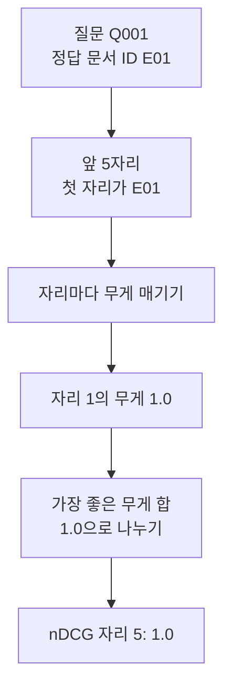
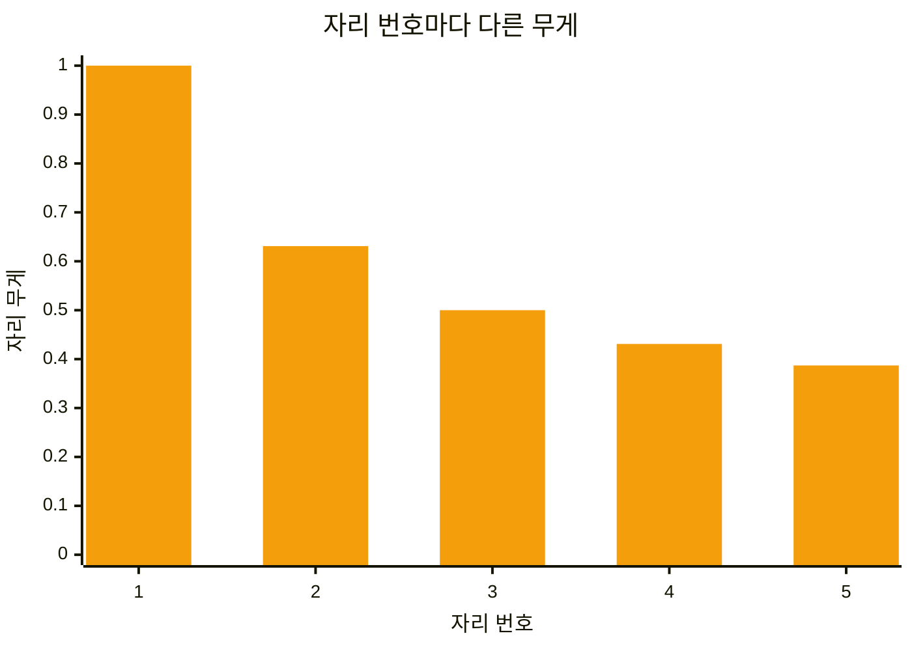
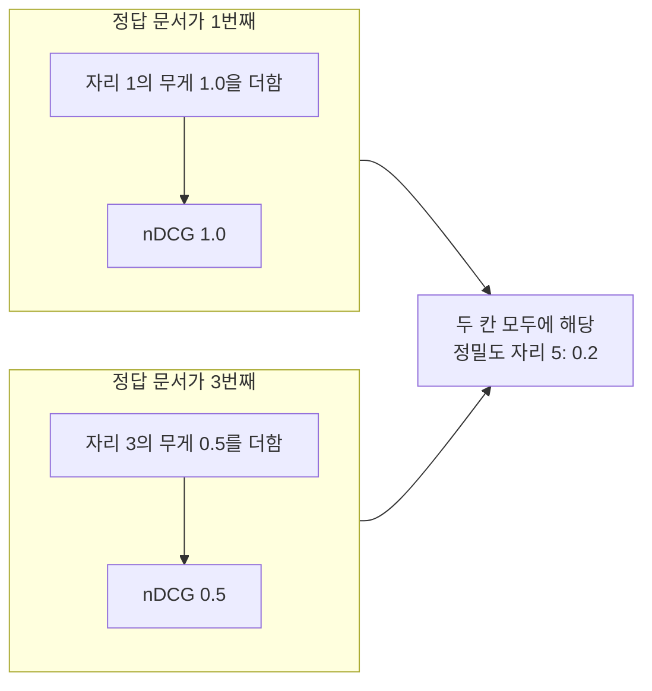
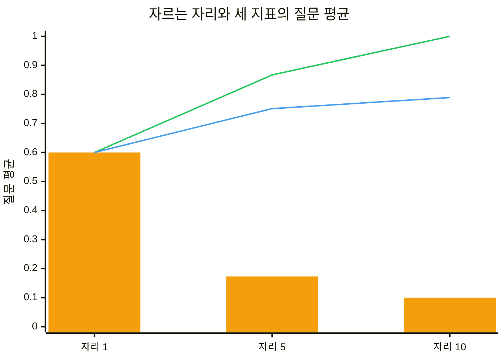

# 04-nDCG-at-5

## _src 본문 (HTML 원본)

```html
<!--meta: 강의 1h | 실습 2h | 코드 notebooks/04-nDCG-at-5.ipynb | 새 용어 4 -->

<h2 id="b1"><span class="no">1</span>학습 목표</h2>
<div class="goal"><ul>
<li>이 절을 마치면 자리 번호마다 다른 무게를 매기는 까닭을 설명할 수 있습니다.</li>
<li>이 절을 마치면 무게 합을 가장 좋은 무게 합으로 나눠 nDCG를 계산할 수 있습니다.</li>
<li>이 절을 마치면 정답 문서 자리만 옮겼을 때 어느 지표가 움직이는지 가를 수 있습니다.</li>
<li>이 절을 마치면 재현율·정밀도·nDCG 세 값을 한 자리에서 함께 읽을 수 있습니다.</li>
</ul></div>

<h2 id="b2"><span class="no">2</span>이 내용을 배우는 이유</h2>
<p>03절은 앞 다섯 자리에 정답 문서가 몇 개 있는지 셌습니다. 그 계산에서는 정답 문서가 1번째에 있든 5번째에 있든 값이 같았습니다. 자리 순서가 값에 들어가지 않았습니다.</p>
<p>사람은 목록을 위에서부터 읽습니다. 답을 쓰는 단계도 앞 자리 문서를 먼저 받습니다. 같은 문서라도 앞에 있을 때 쓰일 기회가 큽니다.</p>
<p>이 절의 질문은 하나입니다. 정답 문서가 앞 다섯 자리의 몇 번째에 있었는가입니다.</p>
<p>Ch 12에서는 같은 후보 목록의 순서를 다시 매깁니다. 목록에 무엇이 들어 있는지는 그대로이고 순서만 바뀝니다. 그 변화를 값으로 읽으려면 자리를 값에 넣는 지표가 있어야 합니다.</p>

<h2 id="b3"><span class="no">3</span>앞에서 배운 내용</h2>
<ul>
<li><strong>고유 문서 목록</strong> — 01절 12절에서 검색 항목의 문서 ID 중복을 빼 고유 문서를 셌습니다. 함수 이름은 <code>unique_doc_ids()</code>입니다.</li>
<li><strong>정답 문서 자리</strong> — 01절 13절에서 고유 문서 목록의 몇 번째가 정답 문서인지 찾았습니다. 함수 이름은 <code>find_gold_rank()</code>이고 자리는 1부터 셉니다.</li>
<li><strong>자르는 자리</strong> — 02절에서 순위 목록의 앞에서 몇 개까지 볼지 정하는 수를 자르는 자리로 불렀습니다.</li>
<li><strong>재현율</strong> — 02절에서 자른 목록에 정답 문서가 들어온 비율을 쟀습니다. 자리 5의 질문 평균은 0.867이었습니다.</li>
<li><strong>정밀도</strong> — 03절에서 앞 다섯 자리 가운데 정답 문서가 든 자리의 비율을 쟀습니다. 질문 평균은 0.173이었습니다.</li>
<li><strong>질문 평균</strong> — 02절에서 질문마다 점수를 따로 내고 같은 무게로 평균했습니다. 함수 이름은 <code>mean_score()</code>입니다.</li>
<li><strong>기록 줄 수</strong> — Ch 10 08절에서 기록 한 줄에 남은 검색 항목 수를 그렇게 불렀습니다. 두 기록의 값은 2와 5였습니다.</li>
<li><strong>모듈 <code>math</code></strong> — Ch 5 02절에서 <code>math.sqrt()</code>로 제곱근을 냈습니다. 이 절은 같은 모듈의 <code>log2</code> 함수를 씁니다.</li>
<li><strong>쪽 단위 색인</strong> — Ch 9 01절과 Ch 10 08절에서 PDF를 쪽마다 Document로 읽어 벡터스토어에 넣었습니다.</li>
</ul>
<p>노트북은 01절 <code>unique_doc_ids()</code>·<code>find_gold_rank()</code>와 02절 <code>recall_at()</code>·<code>mean_score()</code>·<code>make_candidate_list()</code>를 도구 파일 <code>rag_tools.py</code>에서 가져옵니다. 03절 <code>precision_at()</code>과 Ch 9 02절 <code>load_pdf_pages()</code>도 가져옵니다.</p>

<h2 id="b4"><span class="no">4</span>핵심 개념</h2>
<h3>비유 — 앞 칸일수록 받침이 높은 쟁반</h3>
<p>03절의 다섯 칸 쟁반을 다시 떠올려 보세요. 이번에는 칸마다 받침 높이가 다릅니다. 왼쪽 첫 칸의 받침이 가장 높고 오른쪽으로 갈수록 낮아집니다.</p>
<p>같은 카드라도 어느 칸에 서는지에 따라 높이가 달라집니다. 첫 칸에 서면 가장 높이 올라가고 다섯째 칸에 서면 가장 낮습니다. 카드 자체는 그대로인데 자리가 값을 바꿉니다.</p>
<p>03절 계산에서는 칸 높이가 모두 같았습니다. 그래서 카드가 어느 칸에 있어도 값이 같았습니다. 이 절은 칸 높이를 자리마다 다르게 둡니다.</p>
{{img:04-5-높이가-다른-쟁반|평면 그림으로 탁자 위에 긴 나무 쟁반이 놓여 있고 쟁반 안에 나무 받침 다섯 개가 한 줄로 서 있으며 왼쪽 첫 받침이 가장 높고 오른쪽으로 갈수록 한 단씩 낮아지는 계단 모양이고 가장 높은 첫 받침 위에 파란 카드 한 장이 서 있으며 나머지 네 받침 위에는 흰 카드가 한 장씩 서 있음|받침 높이가 왼쪽부터 한 단씩 낮아져 같은 카드라도 앞 칸에 설수록 높이 올라갑니다}}
<p><strong>그림 읽기</strong> — 가운데 긴 나무 쟁반부터 봅니다. 쟁반 안에 나무 받침 다섯 개가 한 줄로 서 있습니다. 이 받침 다섯 개가 앞 다섯 자리입니다.</p>
<p>받침 높이는 왼쪽부터 한 단씩 낮아집니다. 왼쪽 첫 받침이 가장 높고 오른쪽 끝 받침이 가장 낮습니다. 이 높이가 자리 무게입니다.</p>
<p>가장 높은 첫 받침 위에 파란 카드가 서 있습니다. 파란 카드가 정답 문서입니다. 파란 카드를 오른쪽 받침으로 옮기면 같은 카드가 더 낮은 자리에 서게 됩니다.</p>

<h3>이 절에서 쓰는 말</h3>
<table><thead><tr><th>용어</th><th>뜻과 일상 예</th><th>이 절에서 보이는 모습</th></tr></thead><tbody>
<tr><td>자리 무게(rank weight)</td><td>자리 번호마다 다르게 매기는 값. 달리기에서 1등에게 더 큰 점수를 주는 것과 같음</td><td>노트북 2절 <code>1 | 1.0</code>과 <code>5 | 0.387</code></td></tr>
<tr><td>자리 무게 합(DCG)</td><td>앞 자리부터 정답 문서를 만날 때마다 그 자리의 무게를 더한 값. 종목마다 다른 점수를 합산하는 것과 같음</td><td>노트북 4절 <code>3 | 0.5 | 0.2 | 0.5</code>의 둘째 칸</td></tr>
<tr><td>가장 좋은 무게 합(IDCG)</td><td>정답 문서를 앞자리부터 빈틈없이 놓았을 때의 무게 합. 시험에서 받을 수 있는 만점과 같음</td><td>노트북 3절 <code>정답 문서가 1개일 때 가장 좋은 무게 합: 1.0</code></td></tr>
<tr><td>0에서 1로 맞추기(정규화, normalization)</td><td>값을 만점으로 나눠 0에서 1 사이로 옮기는 일. 점수를 백분율로 바꾸는 것과 같음</td><td>노트북 8절 <code>자르는 자리 5의 질문 평균 nDCG: 0.751</code></td></tr>
</tbody></table>
<p>문서 청크·색인·벡터스토어·검색 점수·정답 문서 ID는 Ch 9에서 정한 뜻 그대로입니다. 기록 줄 수는 Ch 10 08절 뜻이고 고유 문서는 01절 뜻입니다. 후보 목록·자르는 자리·재현율·질문 평균은 02절 뜻이고 정밀도·고정 분모·받은 개수·지표 천장은 03절 뜻입니다. 지표 이름 <code>ndcg_at_5</code>는 실습 폴더 <code>evaluate.py</code>가 쓰는 이름을 그대로 씁니다.</p>

<h3>도식 — 자리 무게를 값에 넣는 순서</h3>
{{mermaid:04-1-자리마다-무게|위에서 아래로 내려가는 흐름도로 맨 위에 초록 상자 질문 Q001 정답 문서 ID E01이 있고 그 아래로 노란 상자 앞 5자리 첫 자리가 E01과 파란 상자 자리마다 무게 매기기와 노란 상자 자리 1의 무게 1.0과 파란 상자 가장 좋은 무게 합 1.0으로 나누기와 노란 상자 nDCG 자리 5는 1.0이 차례로 이어짐|질문 Q001은 정답 문서가 첫 자리라 자리 무게 1.0을 그대로 받습니다}}
<p><strong>도식 읽기</strong> — 맨 위 초록 상자부터 아래로 봅니다. 질문 하나와 그 질문의 정답 문서 ID입니다. 다음 노란 상자가 03절에서 만든 앞 5자리 목록입니다.</p>
<p>파란 상자에서 자리마다 무게를 매깁니다. 그 아래 노란 상자에 정답 문서가 선 자리의 무게가 있습니다. 첫 자리라 무게가 1.0입니다.</p>
<p>마지막 두 상자가 이 절의 나누기입니다. 가장 좋은 무게 합도 1.0이라 나눈 값이 1.0으로 남습니다. 정답 문서가 한 개인 질문이라 두 값이 같습니다.</p>

<h3>자리 무게는 로그2로 만듭니다</h3>
<p>자리 번호가 커질수록 작아지는 수가 필요합니다. 그냥 자리 번호로 나누면 뒤 자리가 너무 빨리 작아집니다. 5번째 자리의 무게가 첫 자리의 5분의 1이 되어 버립니다.</p>
<p>로그2는 2를 몇 번 곱해야 그 수가 되는지 알려 주는 계산입니다. 여덟 명이 둘씩 겨루면 우승자가 나오기까지 세 판이 걸립니다. 그 세 판이 8의 로그2 값입니다.</p>
<p>이 절은 <code>자리 + 1</code>의 로그2 값으로 1을 나눠 무게를 만듭니다. 그러면 첫 자리의 무게가 1.0이 되고 다섯째 자리도 0.387로 남습니다. 뒤 자리를 지우지 않고 천천히 깎는 방식입니다.</p>

<h3>가장 좋은 무게 합으로 나눕니다</h3>
<p>무게 합만으로는 질문끼리 견주기 어렵습니다. 정답 문서 수가 많은 질문은 더할 무게도 많기 때문입니다. 그래서 만점에 해당하는 값을 따로 계산해 나눕니다.</p>
<p>만점은 정답 문서를 앞자리부터 빈틈없이 놓았을 때의 무게 합입니다. 정답 문서가 한 개면 첫 자리 무게 하나뿐이라 1.0입니다. 이 평가셋 질문은 모두 정답 문서가 한 개입니다.</p>
<p>그래서 이 절의 nDCG 값은 정답 문서가 선 자리의 무게와 같습니다. 1번째면 1.0이고 3번째면 0.5입니다. 앞 5자리 밖이면 더할 무게가 없어 0.0입니다.</p>

<h2 id="b5"><span class="no">5</span>실행 예제</h2>
<p>내려받은 실습 폴더에서 노트북을 열고 위에서 아래로 실행합니다. 03절과 같은 다섯 패키지를 씁니다. 임베딩 요청은 색인 한 번과 질문 검색 열다섯 번을 합쳐 열여섯 번입니다.</p>
<p>03절과 같은 방식이라 요청 수도 같습니다. 첫 질문을 따로 검색하지 않고 반복 검색 결과에서 꺼내 씁니다. 보낼 조각 수는 색인이 59190개 어림이고 예상 비용은 0.01달러 미만입니다. 답을 쓰는 모델은 이 절에서 부르지 않습니다.</p>
<p>읽는 파일은 네 갈래입니다. 말뭉치 PDF 18건과 말뭉치 목록, 평가셋 파일, Ch 9와 Ch 10 기록입니다. 이 절은 파일을 쓰지 않습니다.</p>
<p>이 페이지의 출력은 2026-09-21에 실행한 결과입니다. 새 커널로 두 번 이어 실행해 출력할 값이 같은 것을 확인했습니다. 임베딩 점수는 이 절에서도 출력하지 않습니다. 실행 시간은 패키지 설치를 빼면 1분 안팎입니다.</p>
<p>강의 시간에는 노트북 2~5절을 설명합니다. 자리 무게 만들기, nDCG 함수 세 개, 자리만 옮겨 보기, 앞 챕터 기록으로 잴 수 있는 자리입니다. 노트북 6절 색인 만들기는 02·03절과 같은 코드라 실행만 하고 넘어갑니다. 7~11절은 함께 실행하고 실습 시간에 다시 읽습니다.</p>
{{mermaid:04-2-자리별-무게|가로축에 자리 번호 1부터 5까지 다섯 칸이 있고 세로축이 자리 무게 0에서 1까지인 막대 그림으로 주황 막대 높이가 왼쪽부터 1.0과 0.631과 0.5와 0.431과 0.387로 낮아짐|자리 1과 자리 2 사이의 차이가 자리 4와 자리 5 사이의 차이보다 큽니다}}
<p><strong>도식 읽기</strong> — 왼쪽부터 오른쪽으로 봅니다. 주황 막대 다섯 개가 자리 1부터 자리 5까지의 무게입니다. 노트북 2절이 출력한 표를 그대로 그렸습니다.</p>
<p>왼쪽 첫 막대가 1.0으로 가장 높습니다. 둘째 막대는 0.631이고 셋째 막대는 0.5입니다. 넷째와 다섯째는 0.431과 0.387입니다.</p>
<p>줄어드는 폭이 뒤로 갈수록 작아집니다. 첫 막대와 둘째 막대의 차이가 가장 큽니다. 1위를 2위로 미루는 일이 4위를 5위로 미루는 일보다 값을 많이 깎습니다.</p>
{{mermaid:04-3-자리를-옮기면|왼쪽에 정답 문서가 1번째라는 칸과 정답 문서가 3번째라는 칸이 위아래로 있고 위 칸에는 파란 상자 자리 1의 무게 1.0을 더함에서 노란 상자 nDCG 1.0으로 내려가는 화살표가 있으며 아래 칸에는 파란 상자 자리 3의 무게 0.5를 더함에서 노란 상자 nDCG 0.5로 내려가는 화살표가 있고 두 칸에서 오른쪽 회색 상자 두 칸 모두에 해당 정밀도 자리 5는 0.2로 화살표가 모임|손으로 만든 목록에서 자리만 옮기면 정밀도는 그대로이고 nDCG만 달라집니다}}
<p><strong>도식 읽기</strong> — 위 칸이 정답 문서가 1번째인 목록이고 아래 칸이 3번째인 목록입니다. 두 칸 모두 노트북 4절의 손으로 만든 목록을 봅니다.</p>
<p>위 칸의 파란 상자에 적힌 무게는 1.0입니다. 아래 칸의 파란 상자에 적힌 무게는 0.5입니다. 그래서 노란 상자의 값이 1.0과 0.5로 갈립니다.</p>
<p>오른쪽 회색 상자는 두 칸 모두에 해당합니다. 두 목록 모두 앞 5자리에 정답 문서가 한 개씩 들어 있습니다. 03절 계산으로는 두 목록의 값이 같습니다.</p>
{{notebook:04-nDCG-at-5}}
<p class="look"><b>확인할 점</b> — 자리 무게 표의 첫 줄은 <code>1 | 1.0</code>이고 마지막 줄은 <code>5 | 0.387</code>입니다. 손으로 만든 목록 세 개에서 정밀도는 모두 <code>0.2</code>인데 nDCG는 <code>1.0</code>과 <code>0.5</code>와 <code>0.387</code>로 갈립니다. 앞 챕터 기록 일곱 줄 가운데 <code>ch09 | 2 | False | None</code> 한 줄만 자리 5를 계산하지 못했고 나머지 여섯 줄은 <code>ch10 | 5 | True | 1.0</code>입니다. 개발 분할 15문항의 <code>자르는 자리 5의 질문 평균 nDCG: 0.751</code>입니다.</p>

<h2 id="b6"><span class="no">6</span>실험 결과 해석</h2>
<p>개발 분할 15문항 가운데 아홉 문항은 정답 문서가 1번째였습니다. 이 아홉 문항의 값은 1.0입니다. 03절에서 본 자리 1의 정밀도 0.6이 같은 사실을 가리킵니다.</p>
<p>나머지 여섯 문항이 이 절에서 갈라 볼 자리입니다. 두 문항은 2번째라 0.631이고 두 문항은 3번째라 0.5입니다. 나머지 두 문항은 정답 문서가 10번째라 앞 5자리 밖이고 값이 0.0입니다.</p>
<p>질문 평균은 0.751입니다. 03절의 정밀도 0.173과 견주면 훨씬 높습니다. 두 값은 나누는 수가 달라 크기를 그대로 견줄 수 없습니다.</p>
{{mermaid:04-4-세-지표-한-자리|가로축에 자리 1과 자리 5와 자리 10 세 칸이 있고 세로축이 질문 평균 0에서 1까지인 그림으로 주황 막대 높이가 차례로 0.6과 0.173과 0.1이고 초록 선은 0.6과 0.867과 1.0으로 올라가며 파란 선은 0.6과 0.751과 0.789로 올라감|자르는 자리를 넓히면 주황 막대 정밀도만 내려가고 초록 선 재현율과 파란 선 nDCG는 올라갑니다}}
<p><strong>도식 읽기</strong> — 왼쪽부터 오른쪽으로 봅니다. 주황 막대가 정밀도이고 초록 선이 재현율이며 파란 선이 nDCG입니다. 가로축 세 칸은 자르는 자리 1과 5와 10입니다.</p>
<p>왼쪽 자리 1에서는 세 값이 0.6으로 모두 같습니다. 자리가 하나뿐이라 세 계산이 같은 물음이 됩니다. 정답 문서가 1번째인 아홉 문항만 값을 받습니다.</p>
<p>오른쪽으로 갈수록 주황 막대는 0.173과 0.1로 내려갑니다. 초록 선은 0.867과 1.0으로 올라갑니다. 빈 자리가 늘어도 재현율은 손해를 보지 않기 때문입니다.</p>
<p>파란 선은 0.751과 0.789로 올라가다가 완만해집니다. 자리를 10까지 넓혀도 뒤에서 들어온 정답 문서는 작은 무게만 받습니다. 그래서 초록 선처럼 1.0까지 올라가지 않습니다.</p>
<p>세 값을 함께 보면 고칠 자리가 갈립니다. 재현율이 낮으면 후보에 정답 문서가 아예 들어오지 않은 것입니다. 재현율이 높은데 nDCG가 낮으면 후보에는 있지만 뒤에 밀린 것입니다.</p>
<p>이번 실행에서는 자르는 자리 10의 재현율이 1.0이었습니다. 정답 문서가 앞 열 자리 안에는 모두 들어왔다는 뜻입니다. 그런데 자리 5의 nDCG는 0.751이라 남은 문제는 순서 쪽입니다. 이 판단은 이 말뭉치와 개발 분할 15문항에서 한 번 본 결과입니다.</p>
<p>정답 문서가 10번째였던 두 문항은 자리 5에서도 자리 1에서도 0.0입니다. 02절에서 두 질문의 정답 문서가 고유 목록 10번째였던 것을 확인했습니다. 어느 검색 방법이 더 낫다는 판단은 하지 않았습니다.</p>

<h2 id="b7"><span class="no">7</span>주의할 점과 실무 메모</h2>
<ul>
<li><strong>자리는 1부터 세고 무게는 <code>자리 + 1</code>의 로그2 값으로 나눕니다.</strong> 자리를 0부터 세면 첫 자리에서 로그2 값이 0이 되어 나눌 수 없습니다. 실습 폴더 <code>evaluate.py</code>는 자리를 0부터 세고 <code>자리 + 2</code>로 나누는데 결과는 같습니다.</li>
<li><strong>만점은 검색 결과가 아니라 정답 라벨로 계산합니다.</strong> 찾아낸 정답 문서만으로 만점을 만들면 놓친 질문도 높은 값을 받습니다. 그래서 <code>ideal_dcg()</code>에 정답 문서 수를 넘깁니다.</li>
<li><strong>이 평가셋에서는 nDCG 값이 정답 문서 자리의 무게와 같습니다.</strong> 질문마다 정답 문서가 한 개라 만점이 1.0이기 때문입니다. 정답 문서가 여러 개인 평가셋에서는 두 값이 갈라집니다.</li>
<li><strong>정답 문서가 두 개일 때의 만점은 함수로만 확인했습니다.</strong> 노트북 3절에서 <code>ideal_dcg()</code>에 2를 넘겨 값을 보았습니다. 이 평가셋에는 정답 문서가 두 개인 질문이 없어 지표 평균은 내지 않았습니다.</li>
<li><strong>받은 개수는 실행마다 조금 움직입니다.</strong> 후보 50개의 뒤쪽 순서가 실행마다 달라져 고유 문서 수가 한두 개 바뀝니다. 그래서 질문별 표와 그림 라벨에는 정답 문서 자리만 넣었습니다.</li>
<li><strong>자르는 자리가 다른 값을 서로 견주지 않습니다.</strong> 자리 1의 0.6과 자리 5의 0.751은 같은 검색 결과에서 나온 값입니다. 두 값의 차이는 검색 품질 차이가 아닙니다.</li>
<li><strong>자르는 자리 1·5·10은 흐름을 보여 주려고 정한 예입니다.</strong> 자리 5는 절 주제이고 자리 1은 1위만 볼 때를 보려고 더했습니다. 자리 10은 자리를 넓힐 때 세 지표가 어느 쪽으로 가는지 보려고 더했습니다.</li>
<li><strong>두 기준선의 숫자를 나란히 놓지 않습니다.</strong> 실습 폴더 <code>evaluate.py</code>의 기준선은 낱말과 두 글자 조각의 겹침으로 점수를 냅니다. 이 절 기준선은 02·03절과 같은 임베딩 검색이라 점수 매기는 방법이 다릅니다.</li>
<li><strong>자리가 앞이어도 답이 맞다는 뜻은 아닙니다.</strong> 이 절은 검색 단계만 잽니다. 답 문장이 근거와 맞는지 판정하는 일은 Ch 15에서 다룹니다.</li>
<li><strong>이번에 실행하지 않은 것을 적어 둡니다.</strong> 정답 문서가 여러 개인 질문의 평균과 시험 분할 보기입니다. 관련도를 0과 1이 아닌 여러 단계로 매기는 방법도 이번에 쓰지 않았습니다. 로그2가 아닌 방법으로 무게를 줄이는 일도 하지 않았습니다. 조건별로 나눠 평균을 내는 일은 05절에서 배웁니다.</li>
</ul>

<h2 id="b8"><span class="no">8</span>정리와 다음 절</h2>
<ul>
<li>자리 무게는 <code>자리 + 1</code>의 로그2 값으로 1을 나눠 만듭니다.</li>
<li>무게 합은 앞 자리부터 정답 문서를 만날 때마다 그 자리의 무게를 더한 값입니다.</li>
<li>무게 합을 가장 좋은 무게 합으로 나누면 0에서 1 사이 값이 됩니다.</li>
<li>정답 문서가 한 개인 이 평가셋에서 만점은 1.0이고 값은 자리 무게와 같습니다.</li>
<li>개발 분할 15문항의 자리 5 질문 평균 nDCG는 0.751이었습니다.</li>
<li>자리만 옮기면 정밀도는 그대로이고 nDCG만 달라집니다.</li>
</ul>
<p><strong>다음 학습과 이어지는 지점</strong> — 05절에서는 이 세 지표의 평균을 난이도와 질문 갈래로 나눠 봅니다. 값이 낮은 질문에는 원인 이름을 붙입니다.</p>
<p>이 절까지 세 지표를 모두 만들었습니다. 다만 15문항을 한 덩어리로 평균했습니다. 어떤 질문에서 값이 낮은지 갈라 보는 일이 05절 주제입니다.</p>

<h2 id="b9"><span class="no">9</span>복습 문제</h2>
<details class="quiz" open><summary>문제 4개 · 해설 포함</summary>
<p class="quiz-q">1. [하] 정답 문서가 앞 다섯 자리 밖에 있으면 nDCG@5는 얼마입니까?</p>
<p class="quiz-a">0.0입니다. 앞 5자리 안에서 더할 무게가 없기 때문입니다. 이번 실행에서 그런 질문이 두 개 있었습니다.</p>
<p class="quiz-q">2. [중] 정답 문서 자리를 1번째에서 3번째로 옮기면 어느 값이 달라집니까?</p>
<p class="quiz-a">nDCG만 1.0에서 0.5로 내려갑니다. 정밀도는 0.2 그대로입니다. 정밀도는 자리 순서를 값에 넣지 않기 때문입니다.</p>
<p class="quiz-q">3. [중] 만점을 검색 결과에서 찾은 정답 문서 수로 계산하면 어떤 일이 생깁니까?</p>
<p class="quiz-a">정답 문서를 놓친 질문의 값이 부풀려집니다. 놓친 정답이 나누는 수에서도 빠지기 때문입니다. 그래서 정답 라벨의 수로 만점을 만듭니다.</p>
<p class="quiz-q">4. [상] 자리 5의 재현율이 0.867인데 nDCG가 0.751입니다. 어떤 뜻입니까?</p>
<p class="quiz-a">앞 5자리에 정답 문서가 들어온 질문은 많은데 그 가운데 일부가 첫 자리가 아니라는 뜻입니다. 들어왔는지만 보는 값과 몇 번째인지까지 보는 값의 차이입니다. 고칠 자리는 후보 모으기가 아니라 순서 매기기 쪽입니다.</p>
</details>

<h2 id="b10"><span class="no">10</span>참고 자료</h2>
<ul>
<li><div><a href="https://dl.acm.org/doi/10.1145/582415.582418">Cumulated gain-based evaluation of IR techniques</a></div>확인 2026-09-18 · 자리마다 무게를 줄여 순위를 값에 넣는 방식의 원문.</li>
<li><div><a href="https://scikit-learn.org/stable/modules/generated/sklearn.metrics.ndcg_score.html">scikit-learn ndcg_score</a></div>확인 2026-09-18 · 같은 계산을 라이브러리 함수로 쓰는 방식 참고.</li>
<li>03절 Precision at 5 — 앞 다섯 자리 세기와 고정 분모, 같은 기준선 코드.</li>
<li>02절 Recall at 50 — 자르는 자리와 질문 평균, 후보 목록 만들기.</li>
<li>기준 버전은 pypdf 6.1.1과 langchain-core 1.6.2, langchain-openai 1.6.0입니다. 패키지 numpy는 2.5.3이고 python-dotenv는 1.2.3입니다. 교재 출력은 Linux의 Python 3.12.13으로 만들었습니다. 다른 버전과 Windows·macOS에서는 이번에 실행하지 않았습니다.</li>
</ul>
```

## 노트북 셀 (순서대로)

### [0] markdown {'html': 'skip'}

# nDCG at 5

**이 노트북에서 할 일**

1. 자리 번호마다 다른 무게를 매겨 순위를 값에 넣습니다.
2. 정답 문서 자리만 옮겨 정밀도와 nDCG가 어떻게 갈리는지 봅니다.
3. 개발 분할 15문항의 nDCG@5를 내고 앞 절 두 지표와 나란히 읽습니다.

**준비물** — 프로젝트 맨 위 폴더의 `.env` 파일에 `OPENAI_API_KEY`가 있어야 합니다.
임베딩 요청은 모두 열여섯 번입니다. 색인 한 벌에 한 번, 질문 검색에 열다섯 번입니다.

03절과 같은 방식이라 요청 수도 같습니다.
첫 질문을 따로 검색하지 않고 반복 검색 결과에서 꺼내 씁니다.
답을 쓰는 모델은 이 절에서 부르지 않습니다.

보낼 조각 수는 색인이 59190개 어림이고 질문은 한 번에 스무 개 안팎입니다.
예상 비용은 열여섯 번을 합쳐 0.01달러 미만입니다.
임베딩 요금은 OpenAI 모델 안내(2026-09-17 확인)의 100만 토큰당 0.02달러입니다.
실행 시간은 패키지 설치를 빼면 1분 안팎입니다.

**데이터** — 읽는 파일은 네 갈래이고 모두 실습 묶음에 들어 있습니다.

- 말뭉치 `labs/data/rag-corpus/pdf/`의 디지털 PDF 18건과 `labs/data/rag-corpus/manifest.json`
- 평가셋 `labs/part3/ch11-evaluation/data/evaluation-queries.jsonl`
- Ch 9 06절 기록 `labs/part3/ch09-rag-first-run/runs/continuity-ch09-search.jsonl`
- Ch 10 08절 기록 `labs/part3/ch10-document-processing/runs/continuity-ch10-indexing.jsonl`

이 절은 파일을 쓰지 않습니다. 02·03절과 같은 기준선 색인을 다시 만듭니다.

**강의와 실습 범위** — 강의 시간에는 2~5절을 설명합니다.
자리 무게 만들기, nDCG 함수 세 개, 자리만 옮겨 보기, 앞 챕터 기록으로 잴 수 있는 자리입니다.
7~11절은 함께 실행하고 실습 시간에 다시 읽습니다.
6절 색인 만들기는 02·03절과 같은 코드라 실행만 하고 빠르게 넘어갑니다.

**기준 버전** — 고정한 패키지는 다섯 개입니다.

- 쪽 읽기: pypdf 6.1.1
- 색인과 임베딩: langchain-core 1.6.2 · langchain-openai 1.6.0
- 코사인 유사도 계산: numpy 2.5.3
- 키 읽기: python-dotenv 1.2.3

교재 출력은 Linux의 Python 3.12.13으로 만들었습니다.
다른 버전과 Windows·macOS에서는 이번에 실행하지 않았습니다.

실습 폴더 `labs/part3/ch11-evaluation`에서 `uv sync --locked`를 실행합니다.
그다음 이 폴더의 `.venv` 커널을 고르고 첫 셀부터 순서대로 실행합니다.

### [1] markdown {'html': 'skip'}

## 오늘 볼 그림


맨 위 초록 상자가 이 절의 입력입니다. 질문 하나와 그 질문의 정답 문서 ID입니다.
그 아래 노란 상자가 03절에서 만든 앞 5자리 목록이고, 파란 상자에서 자리마다 무게를 매깁니다.
맨 아래 두 상자가 이 절의 나누기입니다. 무게 합을 가장 좋은 무게 합으로 나눕니다.

### [2] markdown {}

## 1. 준비

첫 셀은 패키지를 설치하고 설치된 버전을 출력합니다. 설치에는 몇십 초가 걸릴 수 있습니다.
02·03절에서 쓴 다섯 개와 같습니다. 이 절도 검색을 직접 하기 때문입니다.

### [3] code {'execution': {'iopub.execute_input': '2026-09-21T07:04:55.517653Z', 'iopub.status.busy': '2026-09-21T07:04:55.517488Z', 'iopub.status.idle': '2026-09-21T07:04:55.991307Z', 'shell.execute_reply': '2026-09-21T07:04:55.990745Z'}, 'lesson_role': 'setup'}

```python
# 이 절에서 쓰는 패키지를 설치하고 버전을 확인합니다
%pip install -q "pypdf==6.1.1" "langchain-core==1.6.2" "langchain-openai==1.6.0" "numpy==2.5.3" "python-dotenv==1.2.3"
from importlib.metadata import version

print("pypdf:", version("pypdf"))
print("langchain-core:", version("langchain-core"))
print("langchain-openai:", version("langchain-openai"))
print("numpy:", version("numpy"))
print("python-dotenv:", version("python-dotenv"))
```

출력:
```
Note: you may need to restart the kernel to use updated packages.
pypdf: 6.1.1
langchain-core: 1.6.2
langchain-openai: 1.6.0
numpy: 2.5.3
python-dotenv: 1.2.3

```

### [4] markdown {}

**결과 읽기** — 출력 다섯 줄 가운데 첫 줄은 `pypdf: 6.1.1`입니다.
둘째 줄 `langchain-core: 1.6.2`와 셋째 줄 `langchain-openai: 1.6.0`도 보세요.
넷째 줄 `numpy: 2.5.3`은 색인이 코사인 유사도를 계산할 때 쓰는 패키지입니다.
준비물에 적은 기준 버전과 같습니다.

다음 셀은 이 절에서 쓸 이름을 불러옵니다. 03절과 같은 패키지 이름에 `math` 한 줄이 늘었습니다.

앞에서 배운 함수는 `rag_tools.py`에 모아 두었습니다. 파일을 열면 코드를 볼 수 있습니다. 노트북과 같은 폴더(`notebooks/`)에 있는 파일입니다.
이 노트북은 01절 `unique_doc_ids()`·`find_gold_rank()`와 02절 `recall_at()`·`mean_score()`·`make_candidate_list()`를 가져옵니다.
03절 `precision_at()`과 Ch 9 02절 `load_pdf_pages()`도 가져옵니다.

### [5] code {'execution': {'iopub.execute_input': '2026-09-21T07:04:55.992559Z', 'iopub.status.busy': '2026-09-21T07:04:55.992457Z', 'iopub.status.idle': '2026-09-21T07:04:57.195816Z', 'shell.execute_reply': '2026-09-21T07:04:57.195426Z'}, 'lesson_role': 'setup'}

```python
# 평가셋 읽기·로그 계산·임베딩·색인에 쓸 이름을 불러옵니다
import json
import math

from langchain_core.vectorstores import InMemoryVectorStore
from langchain_openai import OpenAIEmbeddings
# 01~03절과 Ch 9 02절 함수 일곱 개를 도구 파일에서 가져옵니다
from rag_tools import find_gold_rank, load_pdf_pages, make_candidate_list, mean_score
from rag_tools import precision_at, recall_at, unique_doc_ids
```

출력:
```

```

### [6] markdown {}

**결과 읽기** — 이 셀은 이름을 불러오기만 하므로 출력이 없습니다.
모듈 `math`는 Ch 5 02절에서 제곱근을 낼 때 쓴 그 모듈입니다.

다음 셀은 키가 있는지 확인합니다. 키 값은 출력하지 않고 있는지만 봅니다.

### [7] code {'execution': {'iopub.execute_input': '2026-09-21T07:04:57.196765Z', 'iopub.status.busy': '2026-09-21T07:04:57.196645Z', 'iopub.status.idle': '2026-09-21T07:04:57.200510Z', 'shell.execute_reply': '2026-09-21T07:04:57.200165Z'}, 'lesson_role': 'setup'}

```python
# .env 파일에서 OpenAI API 키를 읽습니다(키 값은 출력하지 않습니다)
import os
from dotenv import find_dotenv, load_dotenv

env_path = find_dotenv(usecwd=True)
load_dotenv(env_path)
has_key = os.getenv("OPENAI_API_KEY") is not None
print("OPENAI_API_KEY 설정 여부:", has_key)
assert has_key, "프로젝트 폴더의 .env 파일에 OPENAI_API_KEY를 적어 주세요."
```

출력:
```
OPENAI_API_KEY 설정 여부: True

```

### [8] markdown {}

**결과 읽기** — 출력 줄은 `OPENAI_API_KEY 설정 여부: True`입니다.
이 셀은 모듈 `os`도 함께 불러옵니다. 다음 셀에서 파일이 있는지 확인할 때 씁니다.

다음 셀은 프로젝트 맨 위 폴더를 찾습니다. 01~03절과 같은 코드입니다.

### [9] code {'execution': {'iopub.execute_input': '2026-09-21T07:04:57.201440Z', 'iopub.status.busy': '2026-09-21T07:04:57.201371Z', 'iopub.status.idle': '2026-09-21T07:04:57.203630Z', 'shell.execute_reply': '2026-09-21T07:04:57.203262Z'}, 'lesson_role': 'setup'}

```python
# 노트북을 어느 폴더에서 열어도 프로젝트 맨 위를 찾게 후보 세 개를 차례로 봅니다
candidates = [".", "../../..", "../../../.."]
root_path = None
for candidate in candidates:
    if os.path.exists(candidate + "/labs/data/rag-corpus"):
        root_path = candidate
        break
print("고른 경로:", root_path)
assert root_path is not None, "notebooks 폴더나 실습 폴더 맨 위에서 노트북을 열어 주세요."
```

출력:
```
고른 경로: .

```

### [10] markdown {}

**결과 읽기** — 출력 줄은 `고른 경로: .`입니다. `assert`도 통과했습니다.
교재 출력은 프로젝트 맨 위를 작업 폴더로 삼아 실행해서 첫째 후보를 골랐습니다.

다음 셀은 고른 경로에 파일 이름을 이어 붙여 네 갈래 경로를 만듭니다.

### [11] code {'execution': {'iopub.execute_input': '2026-09-21T07:04:57.204346Z', 'iopub.status.busy': '2026-09-21T07:04:57.204279Z', 'iopub.status.idle': '2026-09-21T07:04:57.207525Z', 'shell.execute_reply': '2026-09-21T07:04:57.206798Z'}, 'lesson_role': 'setup'}

```python
# 이 절에서 읽을 파일 네 갈래의 경로를 만듭니다
corpus_path = root_path + "/labs/data/rag-corpus"
manifest_path = corpus_path + "/manifest.json"
dataset_path = root_path + "/labs/part3/ch11-evaluation/data/evaluation-queries.jsonl"
ch09_log_path = root_path + "/labs/part3/ch09-rag-first-run/runs/continuity-ch09-search.jsonl"
ch10_log_path = root_path + "/labs/part3/ch10-document-processing/runs/continuity-ch10-indexing.jsonl"
print("평가셋 파일이 있는가:", os.path.exists(dataset_path))
print("말뭉치 목록이 있는가:", os.path.exists(manifest_path))
print("Ch 9 기록이 있는가:", os.path.exists(ch09_log_path))
print("Ch 10 기록이 있는가:", os.path.exists(ch10_log_path))
```

출력:
```
평가셋 파일이 있는가: True
말뭉치 목록이 있는가: True
Ch 9 기록이 있는가: True
Ch 10 기록이 있는가: True

```

### [12] markdown {}

**결과 읽기** — 네 줄 모두 `True`입니다. 02·03절이 읽은 네 갈래와 같습니다.

## 2. 자리마다 무게 주기

03절은 앞 다섯 자리에 정답 문서가 몇 개 있는지 셌습니다.
1번째에 있든 5번째에 있든 값은 같았습니다.
이 절은 자리마다 다른 무게를 매겨 그 차이를 값에 넣습니다.

먼저 평가셋 30줄을 읽고 개발 분할 15문항만 남깁니다. 02·03절과 같은 코드입니다.

### [13] code {'execution': {'iopub.execute_input': '2026-09-21T07:04:57.209653Z', 'iopub.status.busy': '2026-09-21T07:04:57.209548Z', 'iopub.status.idle': '2026-09-21T07:04:57.213488Z', 'shell.execute_reply': '2026-09-21T07:04:57.212698Z'}}

```python
# 평가셋 30줄을 읽고 설정을 고를 때 쓰는 개발 분할만 남깁니다(03절 2절과 같은 코드)
with open(dataset_path, encoding="utf-8") as dataset_file:
    dataset_lines = dataset_file.read().splitlines()

queries = []
for line in dataset_lines:
    queries.append(json.loads(line))

dev_queries = []
for query in queries:
    if query["split"] == "dev":
        dev_queries.append(query)
print("평가셋 줄 수:", len(queries))
print("개발 분할 질문 수:", len(dev_queries))
print("첫 질문 번호:", dev_queries[0]["qid"])
```

출력:
```
평가셋 줄 수: 30
개발 분할 질문 수: 15
첫 질문 번호: Q001

```

### [14] markdown {}

**결과 읽기** — 출력 줄은 `평가셋 줄 수: 30`과 `개발 분할 질문 수: 15`입니다.
셋째 줄 `첫 질문 번호: Q001`은 02·03절에서 후보 목록을 본 그 질문입니다.

무게를 매기려면 자리 번호가 커질수록 작아지는 수가 필요합니다.
그냥 자리 번호로 나누면 뒤 자리가 너무 빨리 작아집니다.
로그2 값은 천천히 커지는 수라 나누는 수로 쓰기에 알맞습니다.

로그2는 2를 몇 번 곱해야 그 수가 되는지 알려 주는 계산입니다.
여덟 명이 둘씩 겨루면 우승자가 나오기까지 세 판이 걸립니다.
그 세 판이 8의 로그2 값입니다.
Ch 5 02절에서 쓴 모듈 `math`에 `log2` 함수가 들어 있습니다.

다음 셀은 작은 수 세 개로 `math.log2`가 무엇을 내놓는지 확인합니다.

### [15] code {'execution': {'iopub.execute_input': '2026-09-21T07:04:57.214391Z', 'iopub.status.busy': '2026-09-21T07:04:57.214306Z', 'iopub.status.idle': '2026-09-21T07:04:57.216586Z', 'shell.execute_reply': '2026-09-21T07:04:57.216027Z'}}

```python
# math.log2에 작은 수 세 개를 넣어 어떤 값이 나오는지 봅니다
print("2의 로그2 값:", math.log2(2))
print("4의 로그2 값:", math.log2(4))
print("8의 로그2 값:", math.log2(8))
```

출력:
```
2의 로그2 값: 1.0
4의 로그2 값: 2.0
8의 로그2 값: 3.0

```

### [16] markdown {}

**결과 읽기** — 출력 줄은 `2의 로그2 값: 1.0`과 `4의 로그2 값: 2.0`과 `8의 로그2 값: 3.0`입니다.
2를 한 번 곱하면 2이고 두 번 곱하면 4이며 세 번 곱하면 8입니다.
수가 두 배로 커져야 로그2 값이 1만큼 늘어납니다.
그래서 자리 번호가 커져도 나누는 수는 천천히 커집니다.

다음 셀은 자리 번호를 받아 그 자리의 무게를 내는 함수입니다.
나누는 수를 `자리 + 1`의 로그2 값으로 두면 자리 1의 무게가 1.0이 됩니다.
자리 1에서 로그2 값이 1.0이기 때문입니다.

### [17] code {'execution': {'iopub.execute_input': '2026-09-21T07:04:57.218728Z', 'iopub.status.busy': '2026-09-21T07:04:57.218624Z', 'iopub.status.idle': '2026-09-21T07:04:57.220744Z', 'shell.execute_reply': '2026-09-21T07:04:57.220283Z'}}

```python
# 자리 번호를 받아 그 자리의 무게를 냅니다(자리 1이 가장 크고 뒤로 갈수록 작아집니다)
def rank_weight(rank):
    return 1 / math.log2(rank + 1)
```

출력:
```

```

### [18] markdown {}

**결과 읽기** — 이 셀은 함수만 정의하므로 출력이 없습니다.
인자 `rank`는 1부터 세는 자리 번호입니다. 01절 `find_gold_rank()`가 내는 자리와 같은 방식입니다.

다음 셀은 자르는 자리 5까지 무게가 얼마인지 표로 봅니다.

### [19] code {'execution': {'iopub.execute_input': '2026-09-21T07:04:57.221541Z', 'iopub.status.busy': '2026-09-21T07:04:57.221458Z', 'iopub.status.idle': '2026-09-21T07:04:57.223621Z', 'shell.execute_reply': '2026-09-21T07:04:57.223180Z'}}

```python
# 자르는 자리 5까지 자리마다 무게가 얼마인지 표로 봅니다
cutoff_narrow = 5
print("자리 번호 | 자리 무게")
for position in range(cutoff_narrow):
    rank = position + 1
    weight = round(rank_weight(rank), 3)
    print(rank, "|", weight)
```

출력:
```
자리 번호 | 자리 무게
1 | 1.0
2 | 0.631
3 | 0.5
4 | 0.431
5 | 0.387

```

### [20] markdown {}

**결과 읽기** — 라벨 줄 `자리 번호 | 자리 무게` 아래 다섯 줄이 있습니다.
첫 줄은 `1 | 1.0`이고 마지막 줄은 `5 | 0.387`입니다.
둘째 줄 `2 | 0.631`과 셋째 줄 `3 | 0.5`에서 무게가 줄어드는 모습을 봅니다.

줄어드는 폭은 뒤로 갈수록 작아집니다.
첫 줄과 둘째 줄의 차이가 넷째 줄과 다섯째 줄의 차이보다 큽니다.
1번째를 2번째로 미루는 일이 4번째를 5번째로 미루는 일보다 값을 많이 깎습니다.

## 3. nDCG 함수 만들기

다음 셀이 이 절의 첫 계산입니다.
앞 자리부터 차례로 보면서 정답 문서를 만날 때마다 그 자리의 무게를 더합니다.
02절 재현율·03절 정밀도와 인자 모양이 같습니다.

### [21] code {'execution': {'iopub.execute_input': '2026-09-21T07:04:57.224487Z', 'iopub.status.busy': '2026-09-21T07:04:57.224415Z', 'iopub.status.idle': '2026-09-21T07:04:57.226657Z', 'shell.execute_reply': '2026-09-21T07:04:57.226079Z'}}

```python
# 앞 자리부터 정답 문서를 만날 때마다 그 자리의 무게를 더해 무게 합을 냅니다
def dcg_at(doc_ids, gold_doc_ids, cutoff):
    top_ids = doc_ids[:cutoff]
    total = 0
    for position in range(len(top_ids)):
        if top_ids[position] in gold_doc_ids:
            total = total + rank_weight(position + 1)
    return total
```

출력:
```

```

### [22] markdown {}

**결과 읽기** — 이 셀은 함수만 정의하므로 출력이 없습니다.
반복 번호 `position`은 0부터 세므로 1을 더해 자리 번호로 바꿉니다.
정답 문서가 아닌 자리는 더하지 않습니다.

다음 셀은 만점에 해당하는 값을 내는 함수입니다.
정답 문서를 앞자리부터 빈틈없이 놓았을 때의 무게 합입니다.

### [23] code {'execution': {'iopub.execute_input': '2026-09-21T07:04:57.227536Z', 'iopub.status.busy': '2026-09-21T07:04:57.227459Z', 'iopub.status.idle': '2026-09-21T07:04:57.229372Z', 'shell.execute_reply': '2026-09-21T07:04:57.228942Z'}}

```python
# 정답 문서를 앞자리부터 빈틈없이 놓았을 때의 무게 합을 냅니다
def ideal_dcg(gold_count, cutoff):
    best_count = gold_count
    if best_count > cutoff:
        best_count = cutoff
    total = 0
    for position in range(best_count):
        total = total + rank_weight(position + 1)
    return total
```

출력:
```

```

### [24] markdown {}

**결과 읽기** — 이 셀도 함수만 정의하므로 출력이 없습니다.
정답 문서 수가 자르는 자리보다 많으면 자리 수만큼만 셉니다.
다 담을 수 없는 정답 문서까지 만점에 넣으면 아무도 만점을 받지 못하기 때문입니다.

다음 셀은 정답 문서 수를 바꿔 가며 만점이 얼마인지 확인합니다.

### [25] code {'execution': {'iopub.execute_input': '2026-09-21T07:04:57.230173Z', 'iopub.status.busy': '2026-09-21T07:04:57.230123Z', 'iopub.status.idle': '2026-09-21T07:04:57.231900Z', 'shell.execute_reply': '2026-09-21T07:04:57.231588Z'}}

```python
# 정답 문서 수에 따라 가장 좋은 무게 합이 얼마인지 확인합니다
best_for_one = round(ideal_dcg(1, cutoff_narrow), 3)
best_for_two = round(ideal_dcg(2, cutoff_narrow), 3)
print("정답 문서가 1개일 때 가장 좋은 무게 합:", best_for_one)
print("정답 문서가 2개일 때 가장 좋은 무게 합:", best_for_two)
```

출력:
```
정답 문서가 1개일 때 가장 좋은 무게 합: 1.0
정답 문서가 2개일 때 가장 좋은 무게 합: 1.631

```

### [26] markdown {}

**결과 읽기** — 첫 줄은 `정답 문서가 1개일 때 가장 좋은 무게 합: 1.0`입니다.
자리 1의 무게 하나뿐이라 1.0입니다.
둘째 줄 `정답 문서가 2개일 때 가장 좋은 무게 합: 1.631`은 자리 1과 자리 2의 무게를 더한 값입니다.

이 평가셋 30문항은 모두 정답 문서가 한 개입니다(01절 7절).
그래서 이 노트북의 지표 계산에서는 만점이 늘 1.0입니다.
정답 문서가 두 개인 값은 함수 동작을 보려고 한 번 확인했습니다.

다음 셀이 이 절의 지표입니다. 무게 합을 만점으로 나눕니다.

### [27] code {'execution': {'iopub.execute_input': '2026-09-21T07:04:57.232532Z', 'iopub.status.busy': '2026-09-21T07:04:57.232474Z', 'iopub.status.idle': '2026-09-21T07:04:57.234345Z', 'shell.execute_reply': '2026-09-21T07:04:57.233950Z'}}

```python
# 무게 합을 가장 좋은 무게 합으로 나눠 0에서 1 사이 값으로 맞춥니다
def ndcg_at(doc_ids, gold_doc_ids, cutoff):
    found_score = dcg_at(doc_ids, gold_doc_ids, cutoff)
    best_score = ideal_dcg(len(gold_doc_ids), cutoff)
    return found_score / best_score
```

출력:
```

```

### [28] markdown {}

**결과 읽기** — 이 셀도 함수만 정의하므로 출력이 없습니다.
인자 모양은 02절 `recall_at()`·03절 `precision_at()`과 같습니다.
중복 제거는 함수 밖에서 먼저 하고 자르기는 함수 안에서 합니다.

## 4. 자리만 옮겨 보기

손으로 만든 목록 세 개로 자리 차이가 어디에 드러나는지 봅니다.
검색 품질이 아니라 계산 방법을 보는 자리입니다.
정답 문서 자리는 01절 `find_gold_rank()`, 정밀도는 03절 `precision_at()`으로 냅니다.
두 함수는 준비 셀에서 가져왔습니다.

다음 셀은 문서 ID 다섯 개짜리 목록 세 개를 손으로 만듭니다.
세 목록의 다른 점은 정답 문서 `G01`이 선 자리뿐입니다.

### [29] code {'execution': {'iopub.execute_input': '2026-09-21T07:04:57.234965Z', 'iopub.status.busy': '2026-09-21T07:04:57.234894Z', 'iopub.status.idle': '2026-09-21T07:04:57.237241Z', 'shell.execute_reply': '2026-09-21T07:04:57.236747Z'}}

```python
# 정답 문서 자리만 다른 목록 세 개를 손으로 만듭니다
first_list = ["G01", "D02", "D03", "D04", "D05"]
third_list = ["D01", "D02", "G01", "D04", "D05"]
fifth_list = ["D01", "D02", "D03", "D04", "G01"]
short_lists = [first_list, third_list, fifth_list]
short_gold = ["G01"]
print("만든 목록 수:", len(short_lists))
print("첫 목록:", first_list)
print("정답 문서 ID:", short_gold)
```

출력:
```
만든 목록 수: 3
첫 목록: ['G01', 'D02', 'D03', 'D04', 'D05']
정답 문서 ID: ['G01']

```

### [30] markdown {}

**결과 읽기** — 첫 줄은 `만든 목록 수: 3`입니다.
둘째 줄 `첫 목록: ['G01', 'D02', 'D03', 'D04', 'D05']`에서 정답 문서가 맨 앞에 있습니다.
셋째 줄은 `정답 문서 ID: ['G01']`입니다.

다음 셀은 세 목록에서 무게 합과 두 지표를 나란히 냅니다.
실행 전에 예상합니다. 세 목록 모두 앞 5자리에 정답 문서가 한 개씩 있으므로 정밀도는 같을 것입니다.

### [31] code {'execution': {'iopub.execute_input': '2026-09-21T07:04:57.237870Z', 'iopub.status.busy': '2026-09-21T07:04:57.237824Z', 'iopub.status.idle': '2026-09-21T07:04:57.239712Z', 'shell.execute_reply': '2026-09-21T07:04:57.239337Z'}}

```python
# 세 목록에서 무게 합과 두 지표를 나란히 내어 자리 차이가 어디에 드러나는지 봅니다
print("정답 문서 자리 | 무게 합 | 정밀도 자리 5 | nDCG 자리 5")
for short_doc_ids in short_lists:
    gold_position = find_gold_rank(short_doc_ids, short_gold)
    short_gain = round(dcg_at(short_doc_ids, short_gold, cutoff_narrow), 3)
    short_precision = precision_at(short_doc_ids, short_gold, cutoff_narrow)
    short_ndcg = round(ndcg_at(short_doc_ids, short_gold, cutoff_narrow), 3)
    print(gold_position, "|", short_gain, "|", short_precision, "|", short_ndcg)
```

출력:
```
정답 문서 자리 | 무게 합 | 정밀도 자리 5 | nDCG 자리 5
1 | 1.0 | 0.2 | 1.0
3 | 0.5 | 0.2 | 0.5
5 | 0.387 | 0.2 | 0.387

```

### [32] markdown {}

**결과 읽기** — 라벨 줄 아래 세 줄이 있습니다.
첫 줄은 `1 | 1.0 | 0.2 | 1.0`이고 둘째 줄은 `3 | 0.5 | 0.2 | 0.5`입니다.
셋째 줄은 `5 | 0.387 | 0.2 | 0.387`입니다.

셋째 칸 정밀도는 세 줄 모두 `0.2`입니다. 예상한 대로입니다.
둘째 칸 무게 합과 넷째 칸 nDCG만 자리를 따라 내려갑니다.
정답 문서가 한 개라 만점이 1.0이어서 두 칸의 값이 같습니다.

## 5. 앞 챕터 기록으로 잴 수 있는 자리

01~03절에서 읽은 두 기록을 다시 읽습니다.
줄마다 검색 항목이 몇 개 남았는지 세면 자를 수 있는 가장 뒤 자리를 알 수 있습니다.

### [33] code {'execution': {'iopub.execute_input': '2026-09-21T07:04:57.240464Z', 'iopub.status.busy': '2026-09-21T07:04:57.240409Z', 'iopub.status.idle': '2026-09-21T07:04:57.243773Z', 'shell.execute_reply': '2026-09-21T07:04:57.243459Z'}}

```python
# 01절에서 읽은 두 기록을 다시 읽어 줄마다 남은 검색 항목 수를 셉니다(03절 4절과 같은 코드)
log_paths = [ch09_log_path, ch10_log_path]
records = []
for log_path in log_paths:
    with open(log_path, encoding="utf-8") as log_file:
        log_lines = log_file.read().splitlines()
    for line in log_lines:
        records.append(json.loads(line))

logged_counts = []
for record in records:
    logged_counts.append(len(record["retrieved"]))
print("읽은 기록 줄 수:", len(records))
print("기록마다 남은 검색 항목 수:", logged_counts)
```

출력:
```
읽은 기록 줄 수: 7
기록마다 남은 검색 항목 수: [2, 5, 5, 5, 5, 5, 5]

```

### [34] markdown {}

**결과 읽기** — 첫 줄은 `읽은 기록 줄 수: 7`입니다.
둘째 줄은 `기록마다 남은 검색 항목 수: [2, 5, 5, 5, 5, 5, 5]`입니다.
Ch 9 기록은 검색 개수 2로, Ch 10 기록은 5로 실행한 결과입니다.

다음 셀은 줄마다 자리 5를 계산할 수 있는지 보고 계산할 수 있는 줄만 값을 냅니다.
실습 폴더 `evaluate.py`는 기록 줄 수가 5보다 적으면 그 칸을 `None`으로 둡니다.

### [35] code {'execution': {'iopub.execute_input': '2026-09-21T07:04:57.244407Z', 'iopub.status.busy': '2026-09-21T07:04:57.244356Z', 'iopub.status.idle': '2026-09-21T07:04:57.246503Z', 'shell.execute_reply': '2026-09-21T07:04:57.246081Z'}}

```python
# 기록 줄 수가 5 이상인 줄만 자르는 자리 5의 nDCG를 냅니다
print("온 챕터 | 기록 줄 수 | 자리 5를 계산할 수 있는가 | nDCG")
for record in records:
    logged_k = len(record["retrieved"])
    can_measure = logged_k >= cutoff_narrow
    record_score = None
    if can_measure:
        record_unique = unique_doc_ids(record["retrieved"])
        record_score = round(ndcg_at(record_unique, record["gold_doc_ids"], cutoff_narrow), 3)
    print(record["source_chapter"], "|", logged_k, "|", can_measure, "|", record_score)
```

출력:
```
온 챕터 | 기록 줄 수 | 자리 5를 계산할 수 있는가 | nDCG
ch09 | 2 | False | None
ch10 | 5 | True | 1.0
ch10 | 5 | True | 1.0
ch10 | 5 | True | 1.0
ch10 | 5 | True | 1.0
ch10 | 5 | True | 1.0
ch10 | 5 | True | 1.0

```

### [36] markdown {}

**결과 읽기** — 라벨 줄 아래 일곱 줄이 있습니다.
첫 줄은 `ch09 | 2 | False | None`입니다. 항목이 두 개뿐이라 자리 5를 계산하지 못했습니다.
둘째 줄부터는 `ch10 | 5 | True | 1.0`이 여섯 번 이어집니다.

여섯 줄 모두 정답 문서가 중복을 뺀 목록의 첫 자리였습니다.
03절이 같은 기록으로 정밀도 `0.2`를 보였고 02절은 재현율 `1.0`을 보였습니다.
같은 일곱 줄에서 세 지표가 모두 이어집니다.

## 6. 기준선 색인 만들기

02·03절과 같은 다섯 셀입니다. 같은 색인을 다시 만들어야 04절 값이 앞 절 값과 이어집니다.
먼저 말뭉치 목록에서 스캔 변형을 뺍니다.

### [37] code {'execution': {'iopub.execute_input': '2026-09-21T07:04:57.247123Z', 'iopub.status.busy': '2026-09-21T07:04:57.247061Z', 'iopub.status.idle': '2026-09-21T07:04:57.249580Z', 'shell.execute_reply': '2026-09-21T07:04:57.249277Z'}}

```python
# 말뭉치 목록에서 스캔 변형을 빼고 디지털 PDF 18건만 골라 둡니다(02절 5절과 같은 코드)
with open(manifest_path, encoding="utf-8") as manifest_file:
    manifest_rows = json.loads(manifest_file.read())

digital_rows = []
for row in manifest_rows:
    if row["tier"] != "scanned":
        digital_rows.append(row)
print("목록의 전체 행 수:", len(manifest_rows))
print("디지털 PDF 수:", len(digital_rows))
```

출력:
```
목록의 전체 행 수: 21
디지털 PDF 수: 18

```

### [38] markdown {}

**결과 읽기** — 출력 줄은 `목록의 전체 행 수: 21`과 `디지털 PDF 수: 18`입니다.
02·03절에서 본 값과 같습니다.

다음 셀은 18건을 차례로 읽어 쪽 Document를 한 목록에 모읍니다.
읽기는 준비 셀에서 가져온 Ch 9 02절 로더 함수 `load_pdf_pages()`가 맡습니다.
메타데이터 칸 이름은 Ch 10 01절에서 정한 `doc_id`·`page`·`source`입니다.

### [39] code {'execution': {'iopub.execute_input': '2026-09-21T07:04:57.250279Z', 'iopub.status.busy': '2026-09-21T07:04:57.250223Z', 'iopub.status.idle': '2026-09-21T07:04:57.939512Z', 'shell.execute_reply': '2026-09-21T07:04:57.939083Z'}}

```python
# 디지털 PDF 18건을 차례로 읽어 쪽 Document를 한 목록에 모읍니다(02절 5절과 같은 코드)
corpus_pages = []
for row in digital_rows:
    file_path = corpus_path + "/" + row["file"]
    row_pages = load_pdf_pages(file_path, row["doc_id"])
    for page_document in row_pages:
        corpus_pages.append(page_document)
print("읽은 문서 수:", len(digital_rows))
print("읽은 쪽 수:", len(corpus_pages))
```

출력:
```
읽은 문서 수: 18
읽은 쪽 수: 93

```

### [40] markdown {}

**결과 읽기** — 출력 줄은 `읽은 문서 수: 18`과 `읽은 쪽 수: 93`입니다.
02·03절과 같은 값입니다.

다음 셀은 글자 층이 빈 쪽을 빼고 색인 재료를 고릅니다.
Ch 10 02절에서 스캔 이미지만 있는 쪽은 글자 층이 비는 것을 확인했습니다.

### [41] code {'execution': {'iopub.execute_input': '2026-09-21T07:04:57.940283Z', 'iopub.status.busy': '2026-09-21T07:04:57.940225Z', 'iopub.status.idle': '2026-09-21T07:04:57.942253Z', 'shell.execute_reply': '2026-09-21T07:04:57.941895Z'}}

```python
# 글자 층이 빈 쪽을 빼고 색인 재료를 고른 뒤 글이 있는 문서 수를 셉니다(02절 5절과 같은 코드)
index_pages = []
text_doc_ids = []
for page_document in corpus_pages:
    if len(page_document.page_content) > 0:
        index_pages.append(page_document)
        if page_document.metadata["doc_id"] not in text_doc_ids:
            text_doc_ids.append(page_document.metadata["doc_id"])
print("색인에 넣을 쪽 수:", len(index_pages))
print("글이 있는 문서 수:", len(text_doc_ids))
```

출력:
```
색인에 넣을 쪽 수: 90
글이 있는 문서 수: 17

```

### [42] markdown {}

**결과 읽기** — 출력 줄은 `색인에 넣을 쪽 수: 90`과 `글이 있는 문서 수: 17`입니다.
읽은 쪽 93개에서 세 쪽이 빠졌습니다. 문서로는 18건 가운데 17건만 색인에 들어갑니다.

빠진 세 쪽은 Ch 10 08절에서 글자 층이 비는 것을 확인한 `H05`의 쪽입니다.

다음 셀은 임베딩 모델을 준비하고 쪽 90개로 색인 한 벌을 만듭니다.
여기서 임베딩 요청 한 번이 나갑니다.

### [43] code {'execution': {'iopub.execute_input': '2026-09-21T07:04:57.942857Z', 'iopub.status.busy': '2026-09-21T07:04:57.942813Z', 'iopub.status.idle': '2026-09-21T07:04:58.929053Z', 'shell.execute_reply': '2026-09-21T07:04:58.928019Z'}}

```python
# 임베딩 모델을 준비하고 쪽 Document 90개로 색인 한 벌을 만듭니다(02절 5절과 같은 코드)
embedding_model_name = "text-embedding-3-small"
embedding_model = OpenAIEmbeddings(model=embedding_model_name)
store = InMemoryVectorStore(embedding=embedding_model)
store.add_documents(index_pages)
print("임베딩 모델 이름:", embedding_model_name)
print("차원 수를 주었는가:", embedding_model.dimensions is not None)
print("색인에 들어간 항목 수:", len(store.store))
```

출력:
```
임베딩 모델 이름: text-embedding-3-small
차원 수를 주었는가: False
색인에 들어간 항목 수: 90

```

### [44] markdown {}

**결과 읽기** — 출력 첫 줄은 `임베딩 모델 이름: text-embedding-3-small`입니다.
둘째 줄 `차원 수를 주었는가: False`는 Ch 10 07절에서 정한 기본 설정으로 벡터를 만들었다는 뜻입니다.
셋째 줄 `색인에 들어간 항목 수: 90`은 앞 셀에서 고른 쪽 수와 같습니다.
이 노트북의 출력은 2026-09-21에 이 임베딩 모델로 실행한 결과입니다.

## 7. 후보 목록 받기

검색 결과는 순위·문서 ID·쪽 세 칸의 후보 목록으로 바꿉니다.
그 일은 준비 셀에서 가져온 02절 함수 `make_candidate_list()`가 합니다.
이 절 지표도 순위와 문서 ID만 쓰므로 점수를 받지 않습니다.

다음 셀은 개발 분할 15문항을 차례로 검색합니다. 질문 하나에 임베딩 요청 한 번이 나갑니다.
반복문 안에서는 목록만 모으고 끝난 뒤에 한꺼번에 출력합니다.
실행 전에 예상합니다. 02·03절과 같은 색인이라 Q001의 앞 5자리도 같을 것입니다.

### [45] code {'execution': {'iopub.execute_input': '2026-09-21T07:04:58.930753Z', 'iopub.status.busy': '2026-09-21T07:04:58.930607Z', 'iopub.status.idle': '2026-09-21T07:05:01.369258Z', 'shell.execute_reply': '2026-09-21T07:05:01.368109Z'}}

```python
# 개발 분할 15문항을 차례로 검색해 질문마다 고유 문서 목록을 모읍니다(03절 6절과 같은 코드)
candidate_count = 50
unique_by_qid = {}
for query in dev_queries:
    query_hits = store.similarity_search(query["question"], k=candidate_count)
    query_candidates = make_candidate_list(query_hits)
    unique_by_qid[query["qid"]] = unique_doc_ids(query_candidates)
print("검색한 질문 수:", len(unique_by_qid))
print("질문 Q001의 앞 5자리:", unique_by_qid["Q001"][:cutoff_narrow])
print("질문 Q001의 정답 문서 자리:", find_gold_rank(unique_by_qid["Q001"], dev_queries[0]["gold_doc_ids"]))
```

출력:
```
검색한 질문 수: 15
질문 Q001의 앞 5자리: ['E01', 'M04', 'H03', 'M05', 'E04']
질문 Q001의 정답 문서 자리: 1

```

### [46] markdown {}

**결과 읽기** — 첫 줄은 `검색한 질문 수: 15`입니다.
둘째 줄은 `질문 Q001의 앞 5자리: ['E01', 'M04', 'H03', 'M05', 'E04']`입니다.
03절 6절에서 본 목록과 같습니다.
셋째 줄 `질문 Q001의 정답 문서 자리: 1`은 정답 문서 `E01`이 맨 앞에 있다는 뜻입니다.

받은 개수는 이 절 표에 넣지 않습니다.
후보 50개의 뒤쪽 순서가 실행마다 달라져 고유 문서 수가 한두 개 움직이기 때문입니다.
정답 문서 자리는 앞쪽 값이라 실행을 되풀이해도 같았습니다.

## 8. 실행 1 — 자르는 자리 5의 nDCG

질문마다 정답 문서 자리를 찾고 그 자리의 무게를 값으로 삼습니다.
실행 전에 예상합니다. 03절에서 자리 1의 정밀도가 0.6이었으므로 아홉 문항은 1.0일 것입니다.

### [47] code {'execution': {'iopub.execute_input': '2026-09-21T07:05:01.371317Z', 'iopub.status.busy': '2026-09-21T07:05:01.371164Z', 'iopub.status.idle': '2026-09-21T07:05:01.375474Z', 'shell.execute_reply': '2026-09-21T07:05:01.374687Z'}}

```python
# 자르는 자리 5에서 질문마다 nDCG를 내고 질문 평균을 냅니다
narrow_ndcgs = []
print("질문 번호 | 정답 문서 자리 | nDCG 자리 5")
for query in dev_queries:
    doc_ids = unique_by_qid[query["qid"]]
    gold_rank = find_gold_rank(doc_ids, query["gold_doc_ids"])
    score = ndcg_at(doc_ids, query["gold_doc_ids"], cutoff_narrow)
    narrow_ndcgs.append(score)
    print(query["qid"], "|", gold_rank, "|", round(score, 3))
narrow_ndcg_mean = mean_score(narrow_ndcgs)
print("자르는 자리 5의 질문 평균 nDCG:", narrow_ndcg_mean)
```

출력:
```
질문 번호 | 정답 문서 자리 | nDCG 자리 5
Q001 | 1 | 1.0
Q002 | 1 | 1.0
Q003 | 3 | 0.5
Q004 | 3 | 0.5
Q005 | 2 | 0.631
Q037 | 1 | 1.0
Q038 | 2 | 0.631
Q039 | 1 | 1.0
Q040 | 1 | 1.0
Q041 | 1 | 1.0
Q085 | 10 | 0.0
Q086 | 10 | 0.0
Q087 | 1 | 1.0
Q088 | 1 | 1.0
Q089 | 1 | 1.0
자르는 자리 5의 질문 평균 nDCG: 0.751

```

### [48] markdown {}

**결과 읽기** — 라벨 줄 `질문 번호 | 정답 문서 자리 | nDCG 자리 5` 아래에 15줄이 있습니다.
첫 줄은 `Q001 | 1 | 1.0`이고 같은 값이 아홉 줄입니다.
마지막 줄은 `자르는 자리 5의 질문 평균 nDCG: 0.751`입니다.

자리가 뒤인 줄은 값이 내려갑니다.
그런 줄이 `Q005 | 2 | 0.631`과 `Q003 | 3 | 0.5`입니다.
정답 문서가 앞 5자리 밖인 줄은 `Q085 | 10 | 0.0`과 `Q086 | 10 | 0.0`입니다.

## 9. 실행 2 — 자르는 자리만 1로 바꾸기

같은 고유 문서 목록을 그대로 쓰고 자르는 자리만 1로 바꿉니다. 검색은 다시 하지 않습니다.
실행 전에 예상합니다. 1번째가 정답 문서가 아닌 질문은 값이 0이 될 것입니다.

### [49] code {'execution': {'iopub.execute_input': '2026-09-21T07:05:01.376916Z', 'iopub.status.busy': '2026-09-21T07:05:01.376789Z', 'iopub.status.idle': '2026-09-21T07:05:01.380207Z', 'shell.execute_reply': '2026-09-21T07:05:01.379563Z'}}

```python
# 같은 고유 문서 목록에서 자르는 자리만 1로 바꿔 nDCG를 다시 냅니다
cutoff_top = 1
top_ndcgs = []
missed_qids = []
for query in dev_queries:
    doc_ids = unique_by_qid[query["qid"]]
    score = ndcg_at(doc_ids, query["gold_doc_ids"], cutoff_top)
    top_ndcgs.append(score)
    if score == 0:
        missed_qids.append(query["qid"])
print("자르는 자리 1의 질문 평균 nDCG:", mean_score(top_ndcgs))
print("1번째가 정답 문서가 아닌 질문:", missed_qids)
```

출력:
```
자르는 자리 1의 질문 평균 nDCG: 0.6
1번째가 정답 문서가 아닌 질문: ['Q003', 'Q004', 'Q005', 'Q038', 'Q085', 'Q086']

```

### [50] markdown {}

**결과 읽기** — 첫 줄은 `자르는 자리 1의 질문 평균 nDCG: 0.6`입니다.
둘째 줄은 `1번째가 정답 문서가 아닌 질문: ['Q003', 'Q004', 'Q005', 'Q038', 'Q085', 'Q086']`입니다.
03절에서 자리 1의 정밀도를 낼 때 나온 여섯 질문과 같습니다.

자리 1에서는 자리 무게가 1.0 하나뿐입니다.
그래서 질문마다 값이 1 아니면 0이고 질문 평균이 03절 자리 1 정밀도와 같아집니다.
자리 5의 값 0.751보다 낮은 것은 2번째와 3번째에 있던 네 문항이 0이 되었기 때문입니다.

## 10. 세 지표 한 표로 견주기

자르는 자리를 1과 5와 10으로 바꿔 세 지표의 질문 평균을 한 표로 봅니다.
검색은 다시 하지 않고 같은 고유 문서 목록을 씁니다.
재현율은 준비 셀에서 가져온 02절 함수 `recall_at()`으로 냅니다.
세 함수 모두 인자 모양이 같고 마지막에 쓰는 나누는 수만 다릅니다.

다음 셀은 자르는 자리 세 개에서 세 지표를 한 번에 냅니다.

### [51] code {'execution': {'iopub.execute_input': '2026-09-21T07:05:01.381601Z', 'iopub.status.busy': '2026-09-21T07:05:01.381481Z', 'iopub.status.idle': '2026-09-21T07:05:01.385038Z', 'shell.execute_reply': '2026-09-21T07:05:01.384457Z'}}

```python
# 자르는 자리를 1·5·10으로 바꿔 세 지표의 질문 평균을 한 번에 견줍니다
cutoff_values = [1, 5, 10]
print("자르는 자리 | 재현율 | 정밀도 | nDCG")
for cutoff in cutoff_values:
    cutoff_recalls = []
    cutoff_precisions = []
    cutoff_ndcgs = []
    for query in dev_queries:
        doc_ids = unique_by_qid[query["qid"]]
        cutoff_recalls.append(recall_at(doc_ids, query["gold_doc_ids"], cutoff))
        cutoff_precisions.append(precision_at(doc_ids, query["gold_doc_ids"], cutoff))
        cutoff_ndcgs.append(ndcg_at(doc_ids, query["gold_doc_ids"], cutoff))
    print(cutoff, "|", mean_score(cutoff_recalls), "|", mean_score(cutoff_precisions), "|", mean_score(cutoff_ndcgs))
```

출력:
```
자르는 자리 | 재현율 | 정밀도 | nDCG
1 | 0.6 | 0.6 | 0.6
5 | 0.867 | 0.173 | 0.751
10 | 1.0 | 0.1 | 0.789

```

### [52] markdown {}

**결과 읽기** — 라벨 줄 아래 세 줄이 있습니다.
첫 줄은 `1 | 0.6 | 0.6 | 0.6`이고 둘째 줄은 `5 | 0.867 | 0.173 | 0.751`입니다.
셋째 줄은 `10 | 1.0 | 0.1 | 0.789`입니다.

자리 1에서는 세 값이 같습니다. 자리가 하나뿐이라 세 계산이 같은 물음이 됩니다.
자리를 넓히면 재현율은 1.0까지 올라가고 정밀도는 0.1까지 내려갑니다.
지표 nDCG는 0.751과 0.789로 올라가다가 완만해집니다.

## 11. 정리

1. 자리 무게는 `자리 + 1`의 로그2 값으로 1을 나눠 만듭니다.
2. 무게 합은 앞 자리부터 정답 문서를 만날 때마다 그 자리의 무게를 더한 값입니다.
3. 무게 합을 가장 좋은 무게 합으로 나누면 0에서 1 사이 값이 됩니다.
4. 이번 실행의 자리 5 질문 평균 nDCG는 0.751이었습니다.
5. 자리만 옮기면 정밀도는 그대로이고 nDCG만 달라집니다.

다음 05절에서는 이 세 지표의 평균을 난이도와 질문 갈래로 나누고 값이 낮은 질문에 원인 이름을 붙입니다.

## 그림

### 04-1-자리마다-무게.mmd



질문 Q001의 앞 5자리에서 정답 문서 E01이 첫 자리라 자리 무게 1.0을 그대로 받아 nDCG가 1.0이 됩니다.

### 04-2-자리별-무게.mmd



주황 막대는 자리 1에서 1.0이고 자리 5에서 0.387까지 내려가며 앞쪽에서 더 많이 줄어듭니다.

### 04-3-자리를-옮기면.mmd



손으로 만든 목록에서 정답 문서 자리만 1번째에서 3번째로 옮기면 정밀도는 0.2 그대로이고 nDCG만 1.0에서 0.5로 내려갑니다.

### 04-4-세-지표-한-자리.mmd



주황 막대 정밀도는 0.6에서 0.1로 내려가고 초록 선 재현율은 1.0까지 올라가며 파란 선 nDCG는 0.751과 0.789에서 완만합니다.

### 04-5-높이가-다른-쟁반.prompt.md

# 04-5-높이가-다른-쟁반 (Higgsfield 삽화)

설명 대상 문장(본문 b4 비유 단락): 같은 카드라도 어느 칸에 서는지에 따라 높이가 달라집니다.

구성 요소와 배치: 가운데에 긴 나무 쟁반. 쟁반 안에 나무 받침 다섯 개가 한 줄로 서 있고, 왼쪽 첫 받침이 가장 높고 오른쪽으로 갈수록 한 단씩 낮아지는 계단 모양(= 자리 무게 1.0 → 0.387). 가장 높은 첫 받침 위에 파란 카드 한 장(= 정답 문서), 나머지 네 받침 위에 흰 카드 한 장씩(= 정답이 아닌 후보 한 줄).

시선 순서: 쟁반 → 왼쪽 첫 받침의 높이 → 오른쪽으로 낮아지는 계단 → 첫 받침 위의 파란 카드 → 낮은 받침 위의 흰 카드들.

검수 기준: 그림만 보고 「받침 높이가 왼쪽부터 오른쪽으로 한 단씩 낮아진다」와 「카드는 자기가 선 받침 높이만큼 올라간다」가 읽히는가.

Ch 9·Ch 10·01~03절 비유 계열과의 관계: 흰 카드 = 후보 한 줄(Ch 9 01-5), 파란 카드 = 정답 문서(02-5에서 정한 표시), 쟁반 = 담아 두는 자리(Ch 4·Ch 5). 03-5의 「칸이 다섯인 쟁반」 다음 장면으로, 같은 다섯 칸에 높이 차이를 준 모습입니다. 카드 상자(Ch 9 색인)·봉투(Ch 10 출처 기록)·서랍(Ch 10 벡터 캐시)은 뜻이 정해져 있어 쓰지 않았습니다.

주의: 받침 높이는 노트북 2절의 자리 무게 표(1.0·0.631·0.5·0.431·0.387)와 뜻이 같지만 높이 비율을 그 숫자에 맞춘 것은 아닙니다. 「그림 읽기」에 그 사실을 적지 않고 방향만 설명합니다.

## 프롬프트

```text
Simple flat educational illustration, white background, limited soft palette,
clean outlines, plain everyday objects, no text, no letters, no numbers, no logos.

A long shallow wooden tray lies flat on a plain light table, seen from the side
and slightly above. Inside the tray, five small wooden blocks stand in one
straight row like a descending staircase: the leftmost block is the tallest, and
each block to its right is one step shorter, so the fifth block on the right is
the shortest. One blue index card stands upright on top of the tallest leftmost
block. One plain white index card stands upright on top of each of the four
remaining shorter blocks. All five cards are exactly the same size. Plain soft
daylight, simple shadow. No screens, no monitors, no people, no hands, no arrows,
no text labels.
```

## 상태

- 2026-09-18 · `nano_banana_pro`(응답 모델 이름 `nano_banana_2`) · 16:9 · 2k · `use_unlim: false` · 장당 2크레딧 · 1회 생성 2크레딧 · 잔액 2778에서 시작.
- 1차 job `a2aebc41-e838-4095-80c3-4af27255db0f` **채택**: 나무 받침 다섯 개가 왼쪽부터 한 단씩 낮아지고, 가장 높은 첫 받침 위에 파란 카드가 서 있으며 나머지 네 받침 위에 흰 카드가 한 장씩 서 있습니다. 카드 크기는 다섯 장 모두 같고 카드 윗변 높이가 왼쪽부터 차례로 낮아집니다.
- 저장: 폭 1100px로 줄여 `figures/04-5-높이가-다른-쟁반.png`(1100 × 614). 원본 2752px(sha256 `418b7f8bc3efccfb7b7c7d2fea869671bb485efcdfba618bfd41c91062fd3a54`)는 저장하지 않았습니다. 저장 PNG를 채택 job 결과에서 같은 폭으로 줄인 그림과 픽셀 단위로 대조해 차이 영역이 `None`임을 확인했습니다(규격 §5-4).

