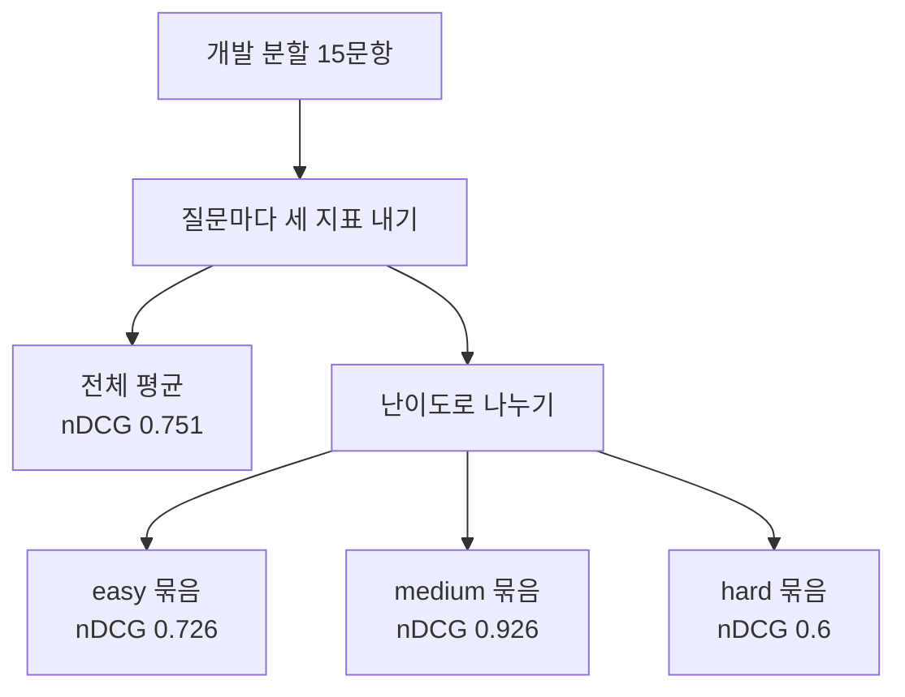
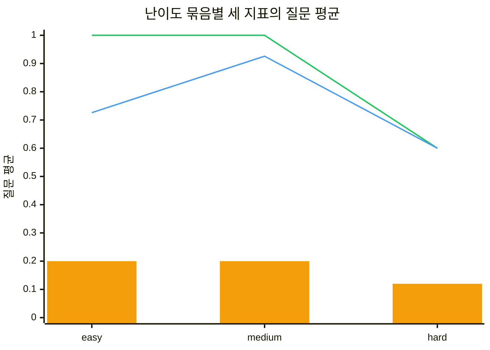
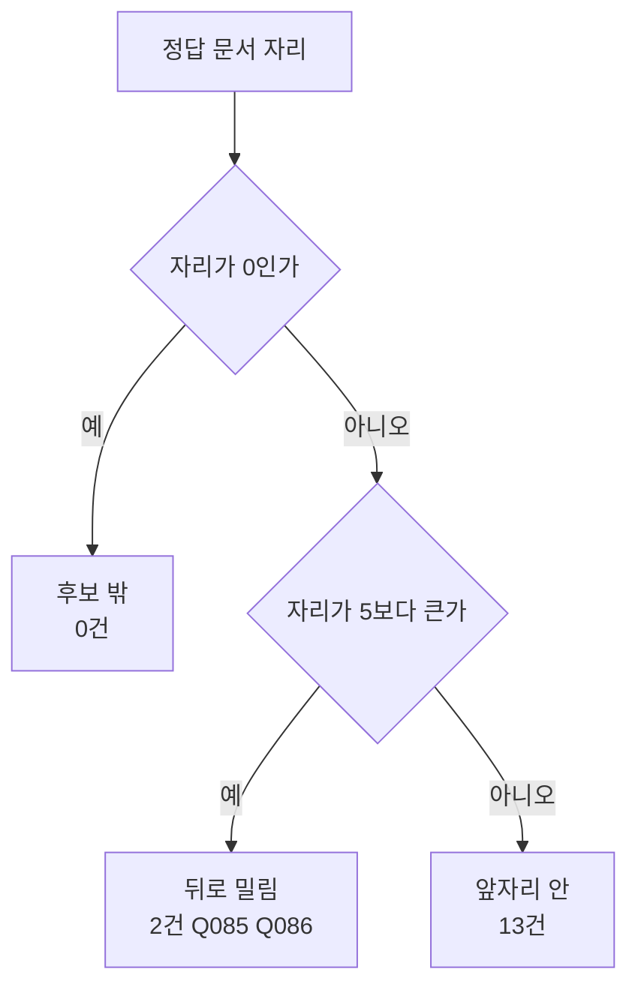
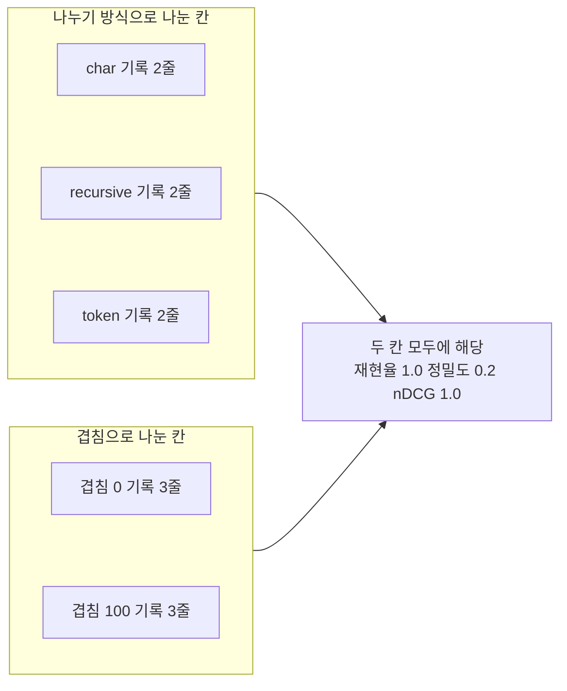

# 05-조건별-평가와-오류-분류

## _src 본문 (HTML 원본)

```html
<!--meta: 강의 1h | 실습 1h | 코드 notebooks/05-조건별-평가와-오류-분류.ipynb | 새 용어 5 -->

<h2 id="b1"><span class="no">1</span>학습 목표</h2>
<div class="goal"><ul>
<li>이 절을 마치면 같은 점수를 난이도와 질문 갈래로 나눠 평균할 수 있습니다.</li>
<li>이 절을 마치면 묶음 크기를 지표 옆에 함께 적어야 하는 까닭을 설명할 수 있습니다.</li>
<li>이 절을 마치면 정답 문서 자리를 보고 오류 이름 셋 가운데 하나를 고를 수 있습니다.</li>
<li>이 절을 마치면 앞 챕터 기록을 설정 조건으로 나눠 같은 지표를 낼 수 있습니다.</li>
</ul></div>

<h2 id="b2"><span class="no">2</span>이 내용을 배우는 이유</h2>
<p>04절까지 세 지표를 모두 만들었습니다. 다만 개발 분할 15문항을 한 덩어리로 평균했습니다. 평균 하나는 어느 질문에서 값이 낮았는지 알려 주지 않습니다.</p>
<p>고칠 자리를 찾으려면 낮은 값이 어디에 모여 있는지 봐야 합니다. 평가셋에는 질문마다 난이도 칸과 갈래 칸이 있습니다. 같은 점수를 이 칸으로 나누면 묶음마다 값이 갈립니다.</p>
<p>낮은 값의 까닭도 한 갈래가 아닙니다. 정답 문서가 후보 목록에 아예 없었을 수도 있고 후보에는 있었는데 뒤로 밀렸을 수도 있습니다. 두 경우는 고칠 자리가 다르므로 이름을 따로 붙입니다.</p>
<p>이 절의 질문은 둘입니다. 어느 묶음에서 값이 낮았는가와 그 질문에 어떤 이름을 붙일 것인가입니다.</p>

<h2 id="b3"><span class="no">3</span>앞에서 배운 내용</h2>
<ul>
<li><strong>세 지표 함수</strong> — 02·03·04절에서 <code>recall_at()</code>과 <code>precision_at()</code>과 <code>ndcg_at()</code>을 만들었습니다. 셋 다 인자 모양이 같습니다.</li>
<li><strong>질문 평균</strong> — 02절에서 질문마다 점수를 따로 내고 같은 무게로 평균했습니다. 함수 이름은 <code>mean_score()</code>입니다.</li>
<li><strong>자리 5의 세 값</strong> — 04절에서 재현율 0.867과 정밀도 0.173과 nDCG 0.751을 한 자리에서 냈습니다.</li>
<li><strong>정답 문서 자리</strong> — 01절 <code>find_gold_rank()</code>는 고유 문서 목록의 몇 번째가 정답 문서인지 냅니다. 찾지 못하면 0을 냅니다.</li>
<li><strong>난이도 칸과 분할 칸</strong> — 01절에서 평가셋 30문항이 난이도 셋과 분할 둘로 나뉘는 것을 보았습니다.</li>
<li><strong>검색 누락</strong> — Ch 9 05절에서 정답 출처가 색인에는 있는데 검색 결과에 들지 않은 경우를 그렇게 불렀습니다.</li>
<li><strong>네 가지 실패 모드</strong> — Ch 8 04절에서 목록에 든 내용 때문에 답이 틀어지는 경우에 네 이름을 붙였습니다.</li>
<li><strong>기록 줄 수와 설정 칸</strong> — Ch 10 08절 기록 여섯 줄은 나누기 방식 셋과 겹침 둘을 곱한 설정으로 실행한 결과입니다.</li>
</ul>
<p>노트북은 01~04절 함수 일곱 개와 Ch 9 02절 <code>load_pdf_pages()</code>를 도구 파일 <code>rag_tools.py</code>에서 가져옵니다. 이 절에서 새로 만드는 함수 다섯 개만 노트북에 적습니다.</p>

<h2 id="b4"><span class="no">4</span>핵심 개념</h2>
<h3>비유 — 한 묶음을 세 더미로 나누기</h3>
<p>책상 위에 흰 카드가 한 무더기 쌓여 있습니다. 카드 한 장이 질문 하나입니다. 무더기를 통째로 보면 전체가 어떤 모습인지만 알 수 있습니다.</p>
<p>같은 카드를 세 더미로 나눠 놓으면 더미마다 모습이 달라집니다. 대신 더미 하나에 든 카드가 그만큼 적어집니다. 카드가 적은 더미는 한 장만 바뀌어도 더미 전체의 인상이 달라집니다.</p>
<p>이 절이 하는 일이 그 나누기입니다. 점수는 그대로 두고 담는 자리만 바꿉니다. 그래서 더미마다 카드가 몇 장인지 늘 함께 적습니다.</p>
{{img:05-5-한-묶음을-세-더미로|평면 그림으로 나무 책상 위를 비스듬히 내려다본 모습이고 왼쪽에는 흰 카드가 두껍게 쌓인 무더기 하나가 있으며 오른쪽에는 같은 흰 카드가 서로 두께가 비슷하고 왼쪽 무더기보다 얇은 세 더미로 나뉘어 한 줄로 놓여 있고 왼쪽 무더기에서 오른쪽 세 더미로 가는 회색 화살표가 하나 있음|한 무더기로 쌓여 있던 카드를 세 더미로 나누면 더미마다 카드가 그만큼 적어집니다}}
<p><strong>그림 읽기</strong> — 먼저 왼쪽 무더기를 봅니다. 흰 카드가 한 자리에 두껍게 쌓여 있습니다. 이 무더기가 15문항 전체입니다.</p>
<p>다음으로 화살표를 따라 오른쪽을 봅니다. 같은 카드가 세 더미로 나뉘어 한 줄로 놓여 있습니다. 세 더미는 서로 두께가 비슷하고 왼쪽 무더기보다 얇습니다. 난이도 묶음이 다섯 문항씩이라 크기가 같기 때문입니다.</p>
<p>앞 절 그림에서 흰 카드는 후보 한 줄이었습니다. 이 그림의 카드는 질문 한 장입니다. 같은 모양이지만 가리키는 것이 다르므로 함께 읽지 않습니다.</p>

<h3>이 절에서 쓰는 말</h3>
<table><thead><tr><th>용어</th><th>뜻과 일상 예</th><th>이 절에서 보이는 모습</th></tr></thead><tbody>
<tr><td>조건별 평균(slice mean)</td><td>질문이나 기록을 조건 칸으로 나눠 같은 지표를 따로 평균한 값. 반 전체 평균과 분단별 평균을 함께 보는 것과 같음</td><td>노트북 8절 <code>easy | 5 | 1.0 | 0.2 | 0.726</code></td></tr>
<tr><td>묶음 크기(group size)</td><td>한 묶음에 든 질문 수나 기록 줄 수. 평균 옆에 적는 사람 수와 같음</td><td>노트북 9절 <code>multi_doc | 1 | 1.0 | 0.2 | 0.631</code>의 둘째 칸</td></tr>
<tr><td>오류 이름(error label)</td><td>값이 낮은 질문에 붙이는 검색 단계 이름. 고칠 자리를 가리키는 꼬리표와 같음</td><td>노트북 10절 <code>Q085 | 10 | 뒤로 밀림</code></td></tr>
<tr><td>후보 밖(candidate miss)</td><td>정답 문서가 고유 문서 목록 어디에도 없는 상태. 서가 전체를 훑었는데 그 책이 없는 것과 같음</td><td>노트북 10절 <code>'후보 밖': 0</code></td></tr>
<tr><td>뒤로 밀림(ranking miss)</td><td>정답 문서가 목록에는 있지만 자르는 자리 밖인 상태. 책은 서가에 있는데 손이 닿는 칸에 없는 것과 같음</td><td>노트북 10절 <code>'뒤로 밀림': 2</code></td></tr>
</tbody></table>
<p>세 번째 이름은 앞자리 안입니다. 정답 문서가 앞 다섯 자리 안에 든 상태이고 이번 실행에서는 13건이었습니다. 문서 청크·색인·벡터스토어·정답 문서 ID는 Ch 9에서 정한 뜻 그대로입니다. 기록 줄 수와 나누기 방식과 겹침은 Ch 10 뜻이고 고유 문서는 01절 뜻입니다. 후보 목록·자르는 자리·재현율·질문 평균은 02절, 정밀도는 03절, 자리 무게는 04절 뜻입니다.</p>

<h3>도식 — 같은 점수를 조건으로 나누는 순서</h3>
{{mermaid:05-1-조건으로-나누기|위에서 아래로 내려가는 흐름도로 맨 위에 초록 상자 개발 분할 15문항이 있고 그 아래 파란 상자 질문마다 세 지표 내기에서 왼쪽 노란 상자 전체 평균 nDCG 0.751과 오른쪽 파란 상자 난이도로 나누기로 갈라지며 그 아래에 노란 상자 세 개가 나란히 서서 easy 묶음 nDCG 0.726과 medium 묶음 nDCG 0.926과 hard 묶음 nDCG 0.6을 보여 줌|같은 열다섯 문항을 난이도로 나누면 nDCG가 0.726과 0.926과 0.6으로 갈립니다}}
<p><strong>도식 읽기</strong> — 맨 위 초록 상자부터 아래로 봅니다. 04절까지 쓴 개발 분할 15문항 그대로입니다. 그 아래 파란 상자에서 질문마다 세 지표를 냅니다.</p>
<p>거기서 길이 둘로 갈립니다. 왼쪽 노란 상자가 04절에서 낸 전체 평균입니다. 오른쪽 파란 상자가 이 절이 더하는 일입니다.</p>
<p>맨 아래 노란 상자 세 개가 난이도로 나눈 뒤의 값입니다. 세 값이 서로 다릅니다. 검색도 계산도 다시 하지 않고 담는 자리만 바꾼 결과입니다.</p>

<h3>묶음 크기를 지표 옆에 적습니다</h3>
<p>나눈 묶음은 전체보다 작습니다. 개발 분할 15문항을 난이도 셋으로 나누면 묶음마다 다섯 문항입니다. 다섯 문항 묶음에서는 한 문항이 0으로 바뀌면 평균이 크게 움직입니다.</p>
<p>갈래 칸으로 나누면 묶음 크기가 더 고르지 않습니다. 이번 개발 분할에서 가장 큰 묶음은 아홉 문항이고 네 묶음은 질문이 하나씩입니다. 묶음 크기가 1이면 평균이 그 한 문항의 값 그대로입니다.</p>
<p>그래서 이 절의 표는 묶음 크기 칸을 늘 둘째 칸에 둡니다. 값이 낮은 묶음을 보면 크기부터 확인합니다. 크기를 보지 않으면 한 문항을 묶음 전체의 성질로 잘못 읽게 됩니다.</p>

<h3>오류 이름은 검색 단계를 가리킵니다</h3>
<p>이 절의 오류 이름 셋은 정답 문서 자리 하나로 갈립니다. 자리가 0이면 후보 밖이고, 자리가 자르는 자리보다 크면 뒤로 밀림이며, 그 밖이면 앞자리 안입니다. 이름은 관찰한 위치이지 원인 설명이 아닙니다.</p>
<p>이 자리는 Ch 9 05절이 검색 누락이라고 부른 자리입니다. 그 절은 필요한 근거가 검색 결과에 들어오지 않은 경우를 한 이름으로 묶었습니다. 이 절은 같은 자리를 후보 목록과 앞 다섯 자리로 한 번 더 가릅니다.</p>
<p>Ch 8 04절의 네 이름은 다른 자리에 씁니다. 그 네 이름은 목록에 든 내용 때문에 답이 틀어지는 경우의 이름입니다. 이 절은 답을 쓰지 않으므로 그 네 이름을 쓰지 않습니다.</p>

<h2 id="b5"><span class="no">5</span>실행 예제</h2>
<p>내려받은 실습 폴더에서 노트북을 열고 위에서 아래로 실행합니다. 04절과 같은 다섯 패키지를 씁니다. 임베딩 요청은 열일곱 번입니다.</p>
<p>색인 한 벌에 한 번, 질문 검색에 열다섯 번, 마지막 절의 묶은 함수 확인에 한 번입니다. 04절보다 한 번 많습니다. 보낼 조각 수는 색인이 59190개 어림이고 예상 비용은 0.01달러 미만입니다. 답을 쓰는 모델은 이 절에서 부르지 않습니다.</p>
<p>읽는 파일은 네 갈래입니다. 말뭉치 PDF 18건과 말뭉치 목록, 평가셋 파일, Ch 9와 Ch 10 기록입니다. 이 절은 파일을 쓰지 않습니다.</p>
<p>이 페이지의 출력은 2026-09-21에 실행한 결과입니다. 새 커널로 두 번 이어 실행해 출력할 값이 같은 것을 확인했습니다. 임베딩 점수는 이 절에서도 출력하지 않습니다. 실행 시간은 패키지 설치를 빼면 1분 안팎입니다.</p>
<p>강의 시간에는 노트북 2절과 6~10절을 설명합니다. 나눠 볼 조건 칸, 질문마다 세 지표 담기, 묶어서 평균 내기, 오류 이름 붙이기입니다. 노트북 3절 지표 함수는 도구 파일에서 가져오고, 4절 색인 만들기는 02~04절과 같은 코드라 실행만 하고 넘어갑니다. 11~13절은 함께 실행하고 실습 시간에 다시 읽습니다.</p>
{{mermaid:05-2-난이도별-세-지표|가로축에 easy와 medium과 hard 세 칸이 있고 세로축이 질문 평균 0에서 1까지인 그림으로 주황 막대 높이가 0.2와 0.2와 0.12이고 초록 선은 1.0과 1.0과 0.6이며 파란 선은 0.726과 0.926과 0.6임|난이도 hard 묶음에서만 주황 막대 정밀도와 초록 선 재현율과 파란 선 nDCG가 함께 내려갑니다}}
<p><strong>도식 읽기</strong> — 왼쪽부터 오른쪽으로 봅니다. 주황 막대가 정밀도이고 초록 선이 재현율이며 파란 선이 nDCG입니다. 가로축 세 칸은 난이도 묶음 셋입니다.</p>
<p>왼쪽 두 칸에서는 초록 선이 1.0에 붙어 있습니다. 주황 막대도 0.2로 같습니다. 파란 선만 0.726과 0.926으로 다릅니다.</p>
<p>오른쪽 hard 칸에서는 세 값이 함께 내려갑니다. 초록 선은 0.6이고 주황 막대는 0.12이며 파란 선도 0.6입니다. 이 묶음에 값이 0인 질문이 둘 있기 때문입니다. 초록 선과 파란 선이 같은 값이라 오른쪽 끝에서는 한 선처럼 보입니다.</p>
{{mermaid:05-3-오류-이름-가르기|위에서 아래로 내려가는 판정 흐름도로 맨 위 노란 상자 정답 문서 자리에서 파란 마름모 자리가 0인가로 내려가고 예 쪽 화살표는 노란 상자 후보 밖 0건으로 아니오 쪽 화살표는 파란 마름모 자리가 5보다 큰가로 이어지며 그 아래 예 쪽은 노란 상자 뒤로 밀림 2건 Q085 Q086으로 아니오 쪽은 노란 상자 앞자리 안 13건으로 이어짐|정답 문서 자리를 두 번 물어 오류 이름 셋 가운데 하나를 고릅니다}}
<p><strong>도식 읽기</strong> — 맨 위 노란 상자부터 아래로 봅니다. 함수 <code>find_gold_rank()</code>가 낸 정답 문서 자리입니다. 그 아래 파란 마름모가 첫 물음입니다.</p>
<p>첫 물음에 예로 답하면 왼쪽 아래 노란 상자로 갑니다. 후보 밖이고 이번 실행에서는 0건입니다. 아니오로 답하면 둘째 물음으로 내려갑니다.</p>
<p>둘째 물음에 예로 답하면 뒤로 밀림입니다. 이번 실행에서는 두 건이고 질문 번호가 상자에 적혀 있습니다. 아니오로 답하면 앞자리 안이고 13건입니다.</p>
{{notebook:05-조건별-평가와-오류-분류}}
<p class="look"><b>확인할 점</b> — 난이도 표 세 줄은 <code>easy | 5 | 1.0 | 0.2 | 0.726</code>과 <code>medium | 5 | 1.0 | 0.2 | 0.926</code>과 <code>hard | 5 | 0.6 | 0.12 | 0.6</code>입니다. 갈래 표에서는 네 줄의 묶음 크기가 <code>1</code>입니다. 오류 이름 세기는 <code>{'후보 밖': 0, '뒤로 밀림': 2, '앞자리 안': 13}</code>입니다. 앞 챕터 기록 여섯 줄은 두 표 모두 <code>1.0</code>과 <code>0.2</code>와 <code>1.0</code>으로 같습니다.</p>

<h2 id="b6"><span class="no">6</span>실험 결과 해석</h2>
<p>난이도로 나눈 표에서 hard 묶음만 세 지표가 함께 내려갔습니다. 그 묶음의 다섯 문항 가운데 둘이 값 0이었기 때문입니다. 나머지 두 묶음은 재현율과 정밀도가 천장에 붙어 있어 nDCG만 갈립니다.</p>
<p>이 차이를 난이도 탓이라고 적지 않습니다. 묶음마다 질문이 다섯 개뿐이고 정답 문서도 묶음마다 다릅니다. 이번 실행에서 이 묶음의 평균이 낮았다는 것까지가 이 표로 말할 수 있는 내용입니다.</p>
<p>갈래로 나눈 표는 묶음 크기를 더 뚜렷하게 보여 줍니다. 가장 낮은 줄은 값이 모두 0인 <code>reasoning</code> 묶음입니다. 그런데 그 묶음에는 질문이 하나뿐이라 평균이 한 문항의 값 그대로입니다. 묶음 크기 칸이 없으면 이 줄을 갈래 전체의 성질로 읽기 쉽습니다.</p>
<p>오류 이름 세기에서 후보 밖은 0건이었습니다. 정답 문서가 고유 문서 목록에는 모두 들어왔다는 뜻입니다. 02절에서 자리 50의 재현율이 열다섯 문항 모두 1.0이었던 것과 같은 사실입니다.</p>
<p>남은 두 건은 뒤로 밀림입니다. 두 질문 모두 정답 문서가 고유 목록 10번째였습니다. 후보를 더 모으는 쪽이 아니라 순서를 매기는 쪽이 이 두 건의 고칠 자리입니다. 사례가 둘뿐이라 어느 방법이 낫다는 판정은 하지 않았습니다.</p>
{{mermaid:05-4-설정-조건으로-나누기|왼쪽 위 칸에 나누기 방식으로 나눈 초록 상자 세 개가 char 기록 2줄과 recursive 기록 2줄과 token 기록 2줄로 있고 왼쪽 아래 칸에 겹침으로 나눈 초록 상자 두 개가 겹침 0 기록 3줄과 겹침 100 기록 3줄로 있으며 두 칸에서 오른쪽 회색 상자 두 칸 모두에 해당 재현율 1.0 정밀도 0.2 nDCG 1.0으로 화살표가 모임|Ch 10 기록 여섯 줄은 나누기 방식으로 나눠도 겹침으로 나눠도 세 지표가 같습니다}}
<p><strong>도식 읽기</strong> — 위 칸과 아래 칸을 차례로 봅니다. 위 칸은 나누기 방식으로 나눈 묶음 셋이고 아래 칸은 겹침으로 나눈 묶음 둘입니다. 초록 상자마다 그 묶음에 든 기록 줄 수가 적혀 있습니다.</p>
<p>오른쪽 회색 상자는 두 칸 모두에 해당합니다. 다섯 묶음의 세 지표가 모두 같았기 때문입니다. 값은 재현율 1.0과 정밀도 0.2와 nDCG 1.0입니다.</p>
<p>값이 같다고 설정이 같다는 뜻은 아닙니다. Ch 10 08절 기록은 질문 하나를 여섯 설정으로 실행한 것입니다. 여섯 실행 모두 정답 문서가 첫 자리라 세 지표가 갈릴 자리가 없었습니다.</p>

<h2 id="b7"><span class="no">7</span>주의할 점과 실무 메모</h2>
<ul>
<li><strong>묶음 크기를 지표 옆에 늘 함께 적습니다.</strong> 이 절 표는 묶음 크기를 둘째 칸에 두었습니다. 크기가 1인 묶음의 평균은 한 문항의 값 그대로입니다.</li>
<li><strong>결과를 본 뒤 나누는 칸을 계속 늘리지 않습니다.</strong> 칸을 늘릴수록 묶음이 작아지고 우연한 차이가 커 보입니다. 이 절은 평가셋에 이미 있는 두 칸만 썼습니다.</li>
<li><strong>오류 이름은 관찰한 위치이지 원인이 아닙니다.</strong> 뒤로 밀림이라는 이름은 정답 문서가 앞 다섯 자리 밖이었다는 사실만 말합니다. 왜 밀렸는지는 질문과 근거 글을 읽어야 알 수 있습니다.</li>
<li><strong>Ch 8 04절 네 이름과 자리를 가릅니다.</strong> 그 네 이름은 목록에 든 내용 때문에 답이 틀어지는 경우의 이름입니다. 이 절 세 이름은 필요한 근거가 목록 앞자리에 오지 않은 경우의 이름입니다.</li>
<li><strong>받은 개수는 표와 그림에 넣지 않았습니다.</strong> 후보 50개의 뒤쪽 순서가 실행마다 달라져 고유 문서 수가 한두 개 움직입니다. 정답 문서 자리는 두 번 실행에서 모두 같았습니다.</li>
<li><strong>실습 폴더 도구는 난이도와 분할로 나눕니다.</strong> 파일 <code>evaluate.py</code>의 보고서에는 <code>slices</code>와 <code>split_slices</code> 칸이 있습니다. 갈래 칸으로 나누는 일은 이 노트북에서만 했습니다.</li>
<li><strong>함수 <code>metrics()</code>의 모양은 실습 폴더 테스트가 봅니다.</strong> 파일 <code>tests/test_evaluate.py</code>가 이 셀을 찾아 그대로 실행합니다. 이름과 인자와 반환 모양을 바꾸면 그 테스트가 함께 바뀌어야 합니다.</li>
<li><strong>이 절은 시험 분할을 보지 않았습니다.</strong> 01절에서 시험 분할은 설정을 다 고른 뒤 한 번만 보기로 정했습니다. 조건별로 나눠 보는 일은 개발 분할에서 합니다.</li>
<li><strong>두 기준선의 숫자를 나란히 놓지 않습니다.</strong> 실습 폴더 <code>evaluate.py</code>의 기준선은 낱말과 두 글자 조각의 겹침으로 점수를 냅니다. 이 절 기준선은 02~04절과 같은 임베딩 검색입니다.</li>
<li><strong>이번에 실행하지 않은 것을 적어 둡니다.</strong> 정답 문서가 여러 개인 질문의 평균과 답할 수 없는 질문을 실제로 빼는 일입니다. 점수 기준값으로 후보를 거르는 일과 시험 분할 보기도 하지 않았습니다. 낮은 값의 원인을 근거 글을 읽어 확인하는 일은 Ch 12에서 다룹니다.</li>
</ul>

<h2 id="b8"><span class="no">8</span>정리와 다음 절</h2>
<ul>
<li>전체 평균 하나는 어느 질문에서 값이 낮았는지 알려 주지 않습니다.</li>
<li>같은 점수를 조건 칸으로 나누면 묶음마다 값이 갈립니다.</li>
<li>이번 실행의 난이도 묶음 nDCG는 0.726과 0.926과 0.6이었습니다.</li>
<li>묶음 크기가 1이면 평균이 한 문항의 값 그대로입니다.</li>
<li>정답 문서 자리 하나로 오류 이름 셋을 가릅니다.</li>
<li>이번 실행은 후보 밖 0건에 뒤로 밀림 2건이었습니다.</li>
<li>같은 질문을 다른 설정으로 돌린 기록도 조건으로 나눌 수 있습니다.</li>
</ul>
<p><strong>다음 학습과 이어지는 지점</strong> — 06절에서는 설정과 지표와 날짜를 실행 기록 한 줄로 남깁니다. 실습 폴더 도구로 같은 계산을 자동으로 실행합니다.</p>
<p>이 절까지는 값을 화면에 출력하기만 했습니다. 며칠 뒤에 다시 보려면 어떤 설정이 만든 값인지 파일에 남겨야 합니다. 그 일이 06절 주제입니다.</p>

<h2 id="b9"><span class="no">9</span>복습 문제</h2>
<details class="quiz" open><summary>문제 4개 · 해설 포함</summary>
<p class="quiz-q">1. [하] 후보 밖과 뒤로 밀림은 어떻게 갈립니까?</p>
<p class="quiz-a">정답 문서 자리가 0이면 후보 밖이고 자리가 자르는 자리보다 크면 뒤로 밀림입니다. 이번 실행에서는 후보 밖이 0건이고 뒤로 밀림이 2건이었습니다.</p>
<p class="quiz-q">2. [중] 조건별 평균 옆에 묶음 크기를 반드시 적는 까닭은 무엇입니까?</p>
<p class="quiz-a">묶음이 작을수록 한 문항이 평균을 크게 움직이기 때문입니다. 묶음 크기가 1이면 평균이 그 한 문항의 값 그대로입니다.</p>
<p class="quiz-q">3. [중] 갈래 표에서 값이 모두 0인 줄을 보았습니다. 다음에 무엇을 먼저 봐야 합니까?</p>
<p class="quiz-a">그 줄의 묶음 크기를 먼저 봅니다. 이번 표에서 그 줄은 질문이 하나뿐이었습니다. 그다음 그 질문의 정답 문서 자리와 오류 이름을 봅니다.</p>
<p class="quiz-q">4. [상] Ch 10 기록 여섯 줄을 두 설정 칸으로 나눴는데 값이 모두 같았습니다. 어떤 뜻입니까?</p>
<p class="quiz-a">이 질문 하나에서는 설정을 바꿔도 세 지표가 갈리지 않았다는 뜻입니다. 여섯 실행 모두 정답 문서가 첫 자리였기 때문입니다. 설정이 서로 같다는 뜻도 아니고 어느 설정이 낫다는 뜻도 아닙니다.</p>
</details>

<h2 id="b10"><span class="no">10</span>참고 자료</h2>
<ul>
<li><div><a href="https://arxiv.org/abs/2011.14027">Slice-based Learning</a></div>확인 2026-09-18 · 조건으로 나눈 묶음을 따로 보는 방식의 배경 자료.</li>
<li><div><a href="https://docs.haystack.deepset.ai/docs/evaluators">Haystack Evaluators</a></div>확인 2026-09-18 · 검색 지표를 묶음별로 내는 라이브러리 쪽 구성 참고.</li>
<li>04절 nDCG at 5 — 자리 무게와 세 지표를 한 자리에서 낸 값, 같은 기준선 코드.</li>
<li>Ch 9 05절 첫 실패 보기 — 검색 누락과 답이 없는 질문을 가르는 순서.</li>
<li>기준 버전은 pypdf 6.1.1과 langchain-core 1.6.2, langchain-openai 1.6.0입니다. 패키지 numpy는 2.5.3이고 python-dotenv는 1.2.3입니다. 교재 출력은 Linux의 Python 3.12.13으로 만들었습니다. 다른 버전과 Windows·macOS에서는 이번에 실행하지 않았습니다.</li>
</ul>
```

## 노트북 셀 (순서대로)

### [0] markdown {'html': 'skip'}

# 조건별 평가와 오류 분류

**이 노트북에서 할 일**

1. 개발 분할 15문항의 세 지표를 난이도와 질문 갈래로 나눠 평균합니다.
2. 값이 낮은 질문에 검색 단계 이름을 붙이고 이름별로 몇 개인지 셉니다.
3. Ch 10 08절 기록 여섯 줄을 나누기 방식과 겹침으로 나눠 같은 지표를 냅니다.

**준비물** — 프로젝트 맨 위 폴더의 `.env` 파일에 `OPENAI_API_KEY`가 있어야 합니다.
임베딩 요청은 모두 열일곱 번입니다.
색인 한 벌에 한 번, 질문 검색에 열다섯 번, 묶은 함수 확인에 한 번입니다.

04절보다 한 번 많습니다. 마지막 절에서 함수 하나를 확인하며 질문 하나를 다시 검색하기 때문입니다.
답을 쓰는 모델은 이 절에서 부르지 않습니다.

보낼 조각 수는 색인이 59190개 어림이고 질문은 한 번에 스무 개 안팎입니다.
예상 비용은 열일곱 번을 합쳐 0.01달러 미만입니다.
임베딩 요금은 OpenAI 모델 안내(2026-09-17 확인)의 100만 토큰당 0.02달러입니다.
실행 시간은 패키지 설치를 빼면 1분 안팎입니다.

**데이터** — 읽는 파일은 네 갈래이고 모두 실습 묶음에 들어 있습니다.

- 말뭉치 `labs/data/rag-corpus/pdf/`의 디지털 PDF 18건과 `labs/data/rag-corpus/manifest.json`
- 평가셋 `labs/part3/ch11-evaluation/data/evaluation-queries.jsonl`
- Ch 9 06절 기록 `labs/part3/ch09-rag-first-run/runs/continuity-ch09-search.jsonl`
- Ch 10 08절 기록 `labs/part3/ch10-document-processing/runs/continuity-ch10-indexing.jsonl`

이 절은 파일을 쓰지 않습니다. 02~04절과 같은 기준선 색인을 다시 만듭니다.

**강의와 실습 범위** — 강의 시간에는 2·6~10절을 설명합니다.
나눠 볼 조건 칸, 질문마다 세 지표 담기, 묶어서 평균 내기, 오류 이름 붙이기입니다.
3절 지표 함수는 도구 파일에서 가져오고, 4절 색인 만들기는 02~04절과 같은 코드라 실행만 하고 넘어갑니다.
11~13절은 함께 실행하고 실습 시간에 다시 읽습니다.

**기준 버전** — 고정한 패키지는 다섯 개입니다.

- 쪽 읽기: pypdf 6.1.1
- 색인과 임베딩: langchain-core 1.6.2 · langchain-openai 1.6.0
- 코사인 유사도 계산: numpy 2.5.3
- 키 읽기: python-dotenv 1.2.3

교재 출력은 Linux의 Python 3.12.13으로 만들었습니다.
다른 버전과 Windows·macOS에서는 이번에 실행하지 않았습니다.

실습 폴더 `labs/part3/ch11-evaluation`에서 `uv sync --locked`를 실행합니다.
그다음 이 폴더의 `.venv` 커널을 고르고 첫 셀부터 순서대로 실행합니다.

### [1] markdown {'html': 'skip'}

## 오늘 볼 그림


맨 위 초록 상자가 이 절의 입력입니다. 04절까지 쓴 개발 분할 15문항 그대로입니다.
그 아래 파란 상자에서 질문마다 세 지표를 냅니다.
왼쪽 노란 상자가 04절에서 낸 전체 평균이고, 오른쪽 파란 상자가 이 절이 더하는 일입니다.
맨 아래 노란 상자 세 개가 난이도로 나눈 뒤의 값입니다.

### [2] markdown {}

## 1. 준비

첫 셀은 패키지를 설치하고 설치된 버전을 출력합니다. 설치에는 몇십 초가 걸릴 수 있습니다.
02~04절에서 쓴 다섯 개와 같습니다. 이 절도 같은 색인을 다시 만들기 때문입니다.

### [3] code {'execution': {'iopub.execute_input': '2026-09-21T07:05:10.079347Z', 'iopub.status.busy': '2026-09-21T07:05:10.079158Z', 'iopub.status.idle': '2026-09-21T07:05:10.524352Z', 'shell.execute_reply': '2026-09-21T07:05:10.523750Z'}, 'lesson_role': 'setup'}

```python
# 이 절에서 쓰는 패키지를 설치하고 버전을 확인합니다
%pip install -q "pypdf==6.1.1" "langchain-core==1.6.2" "langchain-openai==1.6.0" "numpy==2.5.3" "python-dotenv==1.2.3"
from importlib.metadata import version

print("pypdf:", version("pypdf"))
print("langchain-core:", version("langchain-core"))
print("langchain-openai:", version("langchain-openai"))
print("numpy:", version("numpy"))
print("python-dotenv:", version("python-dotenv"))
```

출력:
```
Note: you may need to restart the kernel to use updated packages.
pypdf: 6.1.1
langchain-core: 1.6.2
langchain-openai: 1.6.0
numpy: 2.5.3
python-dotenv: 1.2.3

```

### [4] markdown {}

**결과 읽기** — 출력 다섯 줄 가운데 첫 줄은 `pypdf: 6.1.1`입니다.
둘째 줄 `langchain-core: 1.6.2`와 셋째 줄 `langchain-openai: 1.6.0`도 보세요.
넷째 줄 `numpy: 2.5.3`은 색인이 코사인 유사도를 계산할 때 쓰는 패키지입니다.
준비물에 적은 기준 버전과 같습니다.

다음 셀은 이 절에서 쓸 이름을 불러옵니다. 패키지 이름은 02·03절과 같습니다.

앞에서 배운 함수는 `rag_tools.py`에 모아 두었습니다. 파일을 열면 코드를 볼 수 있습니다. 노트북과 같은 폴더(`notebooks/`)에 있는 파일입니다.
이 노트북은 01~04절 함수 일곱 개와 Ch 9 02절 `load_pdf_pages()`를 가져옵니다.
01절 `unique_doc_ids()`·`find_gold_rank()`, 02절 `recall_at()`·`mean_score()`·`make_candidate_list()`, 03절 `precision_at()`, 04절 `ndcg_at()`입니다.

### [5] code {'execution': {'iopub.execute_input': '2026-09-21T07:05:10.525766Z', 'iopub.status.busy': '2026-09-21T07:05:10.525657Z', 'iopub.status.idle': '2026-09-21T07:05:11.642737Z', 'shell.execute_reply': '2026-09-21T07:05:11.642394Z'}, 'lesson_role': 'setup'}

```python
# 평가셋 읽기·임베딩·색인에 쓸 이름을 불러옵니다
import json

from langchain_core.vectorstores import InMemoryVectorStore
from langchain_openai import OpenAIEmbeddings
# 01~04절과 Ch 9 02절 함수 여덟 개를 도구 파일에서 가져옵니다
from rag_tools import find_gold_rank, load_pdf_pages, make_candidate_list, mean_score
from rag_tools import ndcg_at, precision_at, recall_at, unique_doc_ids
```

출력:
```

```

### [6] markdown {}

**결과 읽기** — 이 셀은 이름을 불러오기만 하므로 출력이 없습니다.
04절에서 자리 무게를 만들 때 쓴 모듈 `math`는 도구 파일 안에서 부릅니다.

다음 셀은 키가 있는지 확인합니다. 키 값은 출력하지 않고 있는지만 봅니다.

### [7] code {'execution': {'iopub.execute_input': '2026-09-21T07:05:11.643711Z', 'iopub.status.busy': '2026-09-21T07:05:11.643616Z', 'iopub.status.idle': '2026-09-21T07:05:11.647252Z', 'shell.execute_reply': '2026-09-21T07:05:11.646939Z'}, 'lesson_role': 'setup'}

```python
# .env 파일에서 OpenAI API 키를 읽습니다(키 값은 출력하지 않습니다)
import os
from dotenv import find_dotenv, load_dotenv

env_path = find_dotenv(usecwd=True)
load_dotenv(env_path)
has_key = os.getenv("OPENAI_API_KEY") is not None
print("OPENAI_API_KEY 설정 여부:", has_key)
assert has_key, "프로젝트 폴더의 .env 파일에 OPENAI_API_KEY를 적어 주세요."
```

출력:
```
OPENAI_API_KEY 설정 여부: True

```

### [8] markdown {}

**결과 읽기** — 출력 줄은 `OPENAI_API_KEY 설정 여부: True`입니다.
이 셀은 모듈 `os`도 함께 불러옵니다. 다음 셀에서 파일이 있는지 확인할 때 씁니다.

다음 셀은 프로젝트 맨 위 폴더를 찾습니다. 01~04절과 같은 코드입니다.

### [9] code {'execution': {'iopub.execute_input': '2026-09-21T07:05:11.647826Z', 'iopub.status.busy': '2026-09-21T07:05:11.647772Z', 'iopub.status.idle': '2026-09-21T07:05:11.649618Z', 'shell.execute_reply': '2026-09-21T07:05:11.649324Z'}, 'lesson_role': 'setup'}

```python
# 노트북을 어느 폴더에서 열어도 프로젝트 맨 위를 찾게 후보 세 개를 차례로 봅니다
candidates = [".", "../../..", "../../../.."]
root_path = None
for candidate in candidates:
    if os.path.exists(candidate + "/labs/data/rag-corpus"):
        root_path = candidate
        break
print("고른 경로:", root_path)
assert root_path is not None, "notebooks 폴더나 실습 폴더 맨 위에서 노트북을 열어 주세요."
```

출력:
```
고른 경로: .

```

### [10] markdown {}

**결과 읽기** — 출력 줄은 `고른 경로: .`입니다. `assert`도 통과했습니다.
교재 출력은 프로젝트 맨 위를 작업 폴더로 삼아 실행해서 첫째 후보를 골랐습니다.

다음 셀은 고른 경로에 파일 이름을 이어 붙여 네 갈래 경로를 만듭니다.

### [11] code {'execution': {'iopub.execute_input': '2026-09-21T07:05:11.650176Z', 'iopub.status.busy': '2026-09-21T07:05:11.650132Z', 'iopub.status.idle': '2026-09-21T07:05:11.652350Z', 'shell.execute_reply': '2026-09-21T07:05:11.652082Z'}, 'lesson_role': 'setup'}

```python
# 이 절에서 읽을 파일 네 갈래의 경로를 만듭니다
corpus_path = root_path + "/labs/data/rag-corpus"
manifest_path = corpus_path + "/manifest.json"
dataset_path = root_path + "/labs/part3/ch11-evaluation/data/evaluation-queries.jsonl"
ch09_log_path = root_path + "/labs/part3/ch09-rag-first-run/runs/continuity-ch09-search.jsonl"
ch10_log_path = root_path + "/labs/part3/ch10-document-processing/runs/continuity-ch10-indexing.jsonl"
print("평가셋 파일이 있는가:", os.path.exists(dataset_path))
print("말뭉치 목록이 있는가:", os.path.exists(manifest_path))
print("Ch 9 기록이 있는가:", os.path.exists(ch09_log_path))
print("Ch 10 기록이 있는가:", os.path.exists(ch10_log_path))
```

출력:
```
평가셋 파일이 있는가: True
말뭉치 목록이 있는가: True
Ch 9 기록이 있는가: True
Ch 10 기록이 있는가: True

```

### [12] markdown {}

**결과 읽기** — 네 줄 모두 `True`입니다. 02~04절이 읽은 네 갈래와 같습니다.

## 2. 나눠 볼 조건 칸 보기

04절까지는 15문항을 한 덩어리로 평균했습니다.
평균 하나는 어느 질문에서 값이 낮았는지 알려 주지 않습니다.
평가셋에는 질문마다 난이도 칸과 갈래 칸이 있습니다. 이 칸으로 질문을 나눠 봅니다.

먼저 평가셋 30줄을 읽고 개발 분할 15문항만 남깁니다. 02~04절과 같은 코드입니다.

### [13] code {'execution': {'iopub.execute_input': '2026-09-21T07:05:11.652871Z', 'iopub.status.busy': '2026-09-21T07:05:11.652821Z', 'iopub.status.idle': '2026-09-21T07:05:11.655271Z', 'shell.execute_reply': '2026-09-21T07:05:11.654908Z'}}

```python
# 평가셋 30줄을 읽고 설정을 고를 때 쓰는 개발 분할만 남깁니다(04절 2절과 같은 코드)
with open(dataset_path, encoding="utf-8") as dataset_file:
    dataset_lines = dataset_file.read().splitlines()

queries = []
for line in dataset_lines:
    queries.append(json.loads(line))

dev_queries = []
for query in queries:
    if query["split"] == "dev":
        dev_queries.append(query)
print("평가셋 줄 수:", len(queries))
print("개발 분할 질문 수:", len(dev_queries))
print("첫 질문 번호:", dev_queries[0]["qid"])
```

출력:
```
평가셋 줄 수: 30
개발 분할 질문 수: 15
첫 질문 번호: Q001

```

### [14] markdown {}

**결과 읽기** — 출력 줄은 `평가셋 줄 수: 30`과 `개발 분할 질문 수: 15`입니다.
셋째 줄 `첫 질문 번호: Q001`은 02~04절에서 후보 목록을 본 그 질문입니다.

다음 셀은 개발 분할 15문항이 난이도와 갈래로 몇 개씩 나뉘는지 셉니다.
자르는 자리와 후보 개수도 여기서 정합니다. 02~04절과 같은 값입니다.
실행 전에 예상합니다. 01절에서 난이도별 질문 수가 열 개씩이었으므로 개발 분할은 다섯 개씩일 것입니다.

### [15] code {'execution': {'iopub.execute_input': '2026-09-21T07:05:11.655798Z', 'iopub.status.busy': '2026-09-21T07:05:11.655754Z', 'iopub.status.idle': '2026-09-21T07:05:11.657459Z', 'shell.execute_reply': '2026-09-21T07:05:11.657140Z'}}

```python
# 개발 분할 15문항의 난이도별·갈래별 질문 수를 세고 이 절에서 쓸 두 수를 정합니다
candidate_count = 50
cutoff_narrow = 5
tier_counts = {}
type_counts = {}
for query in dev_queries:
    tier_counts[query["tier"]] = tier_counts.get(query["tier"], 0) + 1
    type_counts[query["type"]] = type_counts.get(query["type"], 0) + 1
print("후보 개수:", candidate_count)
print("자르는 자리:", cutoff_narrow)
print("난이도별 질문 수:", tier_counts)
print("갈래별 질문 수:", type_counts)
```

출력:
```
후보 개수: 50
자르는 자리: 5
난이도별 질문 수: {'easy': 5, 'medium': 5, 'hard': 5}
갈래별 질문 수: {'single': 9, 'table': 2, 'multi_doc': 1, 'reasoning': 1, 'temporal': 1, 'multi_hop': 1}

```

### [16] markdown {}

**결과 읽기** — 첫 두 줄은 `후보 개수: 50`과 `자르는 자리: 5`입니다.
셋째 줄 `난이도별 질문 수: {'easy': 5, 'medium': 5, 'hard': 5}`는 예상한 대로입니다.

넷째 줄은 `갈래별 질문 수: {'single': 9, 'table': 2, 'multi_doc': 1, 'reasoning': 1, 'temporal': 1, 'multi_hop': 1}`입니다.
갈래 묶음은 크기가 고르지 않습니다.
가장 큰 묶음이 아홉 문항이고 네 묶음은 질문이 하나씩입니다.
묶음에 질문이 하나면 평균이 그 한 문항의 값 그대로입니다.

## 3. 앞 절 지표 함수

01~04절에서 만든 지표 함수는 준비 셀에서 도구 파일로부터 가져왔습니다. 이 절은 지표 공식을 바꾸지 않습니다.
세 지표 함수 `recall_at()`·`precision_at()`·`ndcg_at()`은 모두 `doc_ids`와 `gold_doc_ids`와 `cutoff`를 받습니다.
인자 모양이 같아 한 반복문에서 세 값을 함께 낼 수 있습니다.

정답 문서 자리를 찾는 01절 `find_gold_rank()`는 찾지 못하면 `0`을 냅니다.
이 절은 그 `0`을 오류 이름 하나로 씁니다.

## 4. 기준선 색인 만들기

02~04절과 같은 다섯 셀입니다. 같은 색인을 다시 만들어야 이 절 값이 앞 절 값과 이어집니다.
먼저 말뭉치 목록에서 스캔 변형을 뺍니다.

### [17] code {'execution': {'iopub.execute_input': '2026-09-21T07:05:11.658078Z', 'iopub.status.busy': '2026-09-21T07:05:11.658030Z', 'iopub.status.idle': '2026-09-21T07:05:11.660208Z', 'shell.execute_reply': '2026-09-21T07:05:11.659970Z'}}

```python
# 말뭉치 목록에서 스캔 변형을 빼고 디지털 PDF 18건만 골라 둡니다(02절 5절과 같은 코드)
with open(manifest_path, encoding="utf-8") as manifest_file:
    manifest_rows = json.loads(manifest_file.read())

digital_rows = []
for row in manifest_rows:
    if row["tier"] != "scanned":
        digital_rows.append(row)
print("목록의 전체 행 수:", len(manifest_rows))
print("디지털 PDF 수:", len(digital_rows))
```

출력:
```
목록의 전체 행 수: 21
디지털 PDF 수: 18

```

### [18] markdown {}

**결과 읽기** — 출력 줄은 `목록의 전체 행 수: 21`과 `디지털 PDF 수: 18`입니다.
02~04절에서 본 값과 같습니다.

다음 셀은 18건을 차례로 읽어 쪽 Document를 한 목록에 모읍니다.
읽기는 준비 셀에서 가져온 Ch 9 02절 로더 함수 `load_pdf_pages()`가 맡습니다.
메타데이터 칸 이름은 Ch 10 01절에서 정한 `doc_id`·`page`·`source`입니다.

### [19] code {'execution': {'iopub.execute_input': '2026-09-21T07:05:11.660778Z', 'iopub.status.busy': '2026-09-21T07:05:11.660730Z', 'iopub.status.idle': '2026-09-21T07:05:12.354325Z', 'shell.execute_reply': '2026-09-21T07:05:12.353874Z'}}

```python
# 디지털 PDF 18건을 차례로 읽어 쪽 Document를 한 목록에 모읍니다(02절 5절과 같은 코드)
corpus_pages = []
for row in digital_rows:
    file_path = corpus_path + "/" + row["file"]
    row_pages = load_pdf_pages(file_path, row["doc_id"])
    for page_document in row_pages:
        corpus_pages.append(page_document)
print("읽은 문서 수:", len(digital_rows))
print("읽은 쪽 수:", len(corpus_pages))
```

출력:
```
읽은 문서 수: 18
읽은 쪽 수: 93

```

### [20] markdown {}

**결과 읽기** — 출력 줄은 `읽은 문서 수: 18`과 `읽은 쪽 수: 93`입니다.
02~04절과 같은 값입니다.

다음 셀은 글자 층이 빈 쪽을 빼고 색인 재료를 고릅니다.

### [21] code {'execution': {'iopub.execute_input': '2026-09-21T07:05:12.355613Z', 'iopub.status.busy': '2026-09-21T07:05:12.355526Z', 'iopub.status.idle': '2026-09-21T07:05:12.357805Z', 'shell.execute_reply': '2026-09-21T07:05:12.357443Z'}}

```python
# 글자 층이 빈 쪽을 빼고 색인 재료를 고른 뒤 글이 있는 문서 수를 셉니다(02절 5절과 같은 코드)
index_pages = []
text_doc_ids = []
for page_document in corpus_pages:
    if len(page_document.page_content) > 0:
        index_pages.append(page_document)
        if page_document.metadata["doc_id"] not in text_doc_ids:
            text_doc_ids.append(page_document.metadata["doc_id"])
print("색인에 넣을 쪽 수:", len(index_pages))
print("글이 있는 문서 수:", len(text_doc_ids))
```

출력:
```
색인에 넣을 쪽 수: 90
글이 있는 문서 수: 17

```

### [22] markdown {}

**결과 읽기** — 출력 줄은 `색인에 넣을 쪽 수: 90`과 `글이 있는 문서 수: 17`입니다.
읽은 쪽 93개에서 세 쪽이 빠졌습니다.

빠진 세 쪽은 Ch 10 08절에서 글자 층이 비는 것을 확인한 `H05`의 쪽입니다.

다음 셀은 임베딩 모델을 준비하고 쪽 90개로 색인 한 벌을 만듭니다.
여기서 임베딩 요청 한 번이 나갑니다.

### [23] code {'execution': {'iopub.execute_input': '2026-09-21T07:05:12.358543Z', 'iopub.status.busy': '2026-09-21T07:05:12.358479Z', 'iopub.status.idle': '2026-09-21T07:05:13.245255Z', 'shell.execute_reply': '2026-09-21T07:05:13.244541Z'}}

```python
# 임베딩 모델을 준비하고 쪽 Document 90개로 색인 한 벌을 만듭니다(02절 5절과 같은 코드)
embedding_model_name = "text-embedding-3-small"
embedding_model = OpenAIEmbeddings(model=embedding_model_name)
store = InMemoryVectorStore(embedding=embedding_model)
store.add_documents(index_pages)
print("임베딩 모델 이름:", embedding_model_name)
print("차원 수를 주었는가:", embedding_model.dimensions is not None)
print("색인에 들어간 항목 수:", len(store.store))
```

출력:
```
임베딩 모델 이름: text-embedding-3-small
차원 수를 주었는가: False
색인에 들어간 항목 수: 90

```

### [24] markdown {}

**결과 읽기** — 출력 첫 줄은 `임베딩 모델 이름: text-embedding-3-small`입니다.
둘째 줄 `차원 수를 주었는가: False`는 Ch 10 07절에서 정한 기본 설정으로 벡터를 만들었다는 뜻입니다.
셋째 줄 `색인에 들어간 항목 수: 90`은 앞 셀에서 고른 쪽 수와 같습니다.
이 노트북의 출력은 2026-09-21에 이 임베딩 모델로 실행한 결과입니다.

## 5. 검색을 한 함수로 감싸기

02~04절은 검색과 중복 빼기와 자르기를 셀마다 따로 적었습니다.
이 절은 그 세 단계를 함수 하나로 묶습니다. 뒤에서 질문 하나를 넣고 부르기 좋기 때문입니다.

다음 셀이 이 절에서 새로 만드는 함수입니다.
질문과 볼 자리 수를 받아 후보 50개를 검색하고 문서 ID 중복을 뺀 뒤 앞에서 자릅니다.
후보 목록은 준비 셀에서 가져온 02절 `make_candidate_list()`로 만듭니다.
중복 제거를 자르기보다 먼저 하는 순서는 01절에서 정한 그대로입니다.

### [25] code {'execution': {'iopub.execute_input': '2026-09-21T07:05:13.246695Z', 'iopub.status.busy': '2026-09-21T07:05:13.246583Z', 'iopub.status.idle': '2026-09-21T07:05:13.249481Z', 'shell.execute_reply': '2026-09-21T07:05:13.248829Z'}}

```python
# 질문을 검색해 문서 ID 중복을 뺀 뒤 앞에서 count개만 남긴 목록을 냅니다
def search(question, count):
    hit_documents = store.similarity_search(question, k=candidate_count)
    candidate_list = make_candidate_list(hit_documents)
    doc_ids = unique_doc_ids(candidate_list)
    picked = []
    for doc_id in doc_ids[:count]:
        picked.append({"doc_id": doc_id})
    return picked
```

출력:
```

```

### [26] markdown {}

**결과 읽기** — 이 셀은 함수만 정의하므로 출력이 없습니다.
함수 `search()`는 문서 한 개짜리 딕셔너리를 담은 목록을 냅니다.
칸 이름 `doc_id`는 02~04절 후보 목록과 같아서 앞 절 함수가 그대로 받습니다.

다음 셀은 개발 분할 15문항을 차례로 검색합니다. 질문 하나에 임베딩 요청 한 번이 나갑니다.
반복문 안에서는 목록만 모으고 끝난 뒤에 한꺼번에 출력합니다.

### [27] code {'execution': {'iopub.execute_input': '2026-09-21T07:05:13.250535Z', 'iopub.status.busy': '2026-09-21T07:05:13.250439Z', 'iopub.status.idle': '2026-09-21T07:05:15.489369Z', 'shell.execute_reply': '2026-09-21T07:05:15.488144Z'}}

```python
# 개발 분할 15문항을 차례로 검색해 질문마다 고유 문서 목록을 모읍니다
unique_by_qid = {}
for query in dev_queries:
    query_hits = search(query["question"], candidate_count)
    unique_by_qid[query["qid"]] = unique_doc_ids(query_hits)
print("검색한 질문 수:", len(unique_by_qid))
print("질문 Q001의 앞 5자리:", unique_by_qid["Q001"][:cutoff_narrow])
```

출력:
```
검색한 질문 수: 15
질문 Q001의 앞 5자리: ['E01', 'M04', 'H03', 'M05', 'E04']

```

### [28] markdown {}

**결과 읽기** — 첫 줄은 `검색한 질문 수: 15`입니다.
둘째 줄은 `질문 Q001의 앞 5자리: ['E01', 'M04', 'H03', 'M05', 'E04']`입니다.
03·04절 노트북에서 본 목록과 같습니다.

받은 개수는 이 절 표에 넣지 않습니다.
후보 50개의 뒤쪽 순서가 실행마다 달라져 고유 문서 수가 한두 개 움직이기 때문입니다.

## 6. 질문마다 세 지표 담기

나눠 보려면 먼저 질문마다 값을 따로 남겨야 합니다.
질문 번호와 조건 칸 두 개, 정답 문서 자리, 세 지표를 한 딕셔너리에 담습니다.
실행 전에 예상합니다. 04절에서 아홉 문항이 자리 1이었으므로 nDCG가 1.0인 줄이 아홉 개일 것입니다.

### [29] code {'execution': {'iopub.execute_input': '2026-09-21T07:05:15.492050Z', 'iopub.status.busy': '2026-09-21T07:05:15.491858Z', 'iopub.status.idle': '2026-09-21T07:05:15.497756Z', 'shell.execute_reply': '2026-09-21T07:05:15.496835Z'}}

```python
# 질문마다 조건 칸과 정답 문서 자리와 세 지표를 담고 한 줄씩 출력합니다
score_rows = []
print("질문 번호 | 난이도 | 정답 문서 자리 | 재현율 | 정밀도 | nDCG")
for query in dev_queries:
    doc_ids = unique_by_qid[query["qid"]]
    gold_ids = query["gold_doc_ids"]
    row = {"질문 번호": query["qid"], "난이도": query["tier"], "갈래": query["type"]}
    row["정답 문서 자리"] = find_gold_rank(doc_ids, gold_ids)
    row["재현율"] = recall_at(doc_ids, gold_ids, cutoff_narrow)
    row["정밀도"] = precision_at(doc_ids, gold_ids, cutoff_narrow)
    row["nDCG"] = ndcg_at(doc_ids, gold_ids, cutoff_narrow)
    score_rows.append(row)
    print(row["질문 번호"], "|", row["난이도"], "|", row["정답 문서 자리"], "|", row["재현율"], "|", row["정밀도"], "|", round(row["nDCG"], 3))
```

출력:
```
질문 번호 | 난이도 | 정답 문서 자리 | 재현율 | 정밀도 | nDCG
Q001 | easy | 1 | 1.0 | 0.2 | 1.0
Q002 | easy | 1 | 1.0 | 0.2 | 1.0
Q003 | easy | 3 | 1.0 | 0.2 | 0.5
Q004 | easy | 3 | 1.0 | 0.2 | 0.5
Q005 | easy | 2 | 1.0 | 0.2 | 0.631
Q037 | medium | 1 | 1.0 | 0.2 | 1.0
Q038 | medium | 2 | 1.0 | 0.2 | 0.631
Q039 | medium | 1 | 1.0 | 0.2 | 1.0
Q040 | medium | 1 | 1.0 | 0.2 | 1.0
Q041 | medium | 1 | 1.0 | 0.2 | 1.0
Q085 | hard | 10 | 0.0 | 0.0 | 0.0
Q086 | hard | 10 | 0.0 | 0.0 | 0.0
Q087 | hard | 1 | 1.0 | 0.2 | 1.0
Q088 | hard | 1 | 1.0 | 0.2 | 1.0
Q089 | hard | 1 | 1.0 | 0.2 | 1.0

```

### [30] markdown {}

**결과 읽기** — 라벨 줄 아래에 15줄이 있습니다.
첫 줄은 `Q001 | easy | 1 | 1.0 | 0.2 | 1.0`입니다.
자리가 뒤인 줄은 `Q003 | easy | 3 | 1.0 | 0.2 | 0.5`처럼 마지막 칸만 내려갑니다.

정답 문서가 앞 5자리 밖인 줄은 두 개입니다.
그 두 줄은 `Q085 | hard | 10 | 0.0 | 0.0 | 0.0`과 `Q086 | hard | 10 | 0.0 | 0.0 | 0.0`입니다.
두 줄만 세 칸이 모두 `0.0`입니다.

다음 셀은 04절에서 낸 전체 평균을 다시 확인합니다. 나누기 전의 기준값입니다.

### [31] code {'execution': {'iopub.execute_input': '2026-09-21T07:05:15.499337Z', 'iopub.status.busy': '2026-09-21T07:05:15.499211Z', 'iopub.status.idle': '2026-09-21T07:05:15.502600Z', 'shell.execute_reply': '2026-09-21T07:05:15.501915Z'}}

```python
# 15문항을 한 덩어리로 평균해 나누기 전의 기준값을 확인합니다
whole_recalls = []
whole_precisions = []
whole_ndcgs = []
for row in score_rows:
    whole_recalls.append(row["재현율"])
    whole_precisions.append(row["정밀도"])
    whole_ndcgs.append(row["nDCG"])
print("전체 질문 평균 재현율:", mean_score(whole_recalls))
print("전체 질문 평균 정밀도:", mean_score(whole_precisions))
print("전체 질문 평균 nDCG:", mean_score(whole_ndcgs))
```

출력:
```
전체 질문 평균 재현율: 0.867
전체 질문 평균 정밀도: 0.173
전체 질문 평균 nDCG: 0.751

```

### [32] markdown {}

**결과 읽기** — 세 줄은 `전체 질문 평균 재현율: 0.867`과 `전체 질문 평균 정밀도: 0.173`과
`전체 질문 평균 nDCG: 0.751`입니다.
04절에서 낸 자리 5의 세 값과 같습니다. 같은 색인과 같은 후보 목록을 썼기 때문입니다.

## 7. 묶어서 평균 내는 도우미

조건 칸 값이 같은 줄만 골라 평균을 내는 일을 여러 번 합니다.
그래서 짧은 함수 두 개로 나눠 둡니다. 하나는 평균을 내고 하나는 표를 출력합니다.

### [33] code {'execution': {'iopub.execute_input': '2026-09-21T07:05:15.504407Z', 'iopub.status.busy': '2026-09-21T07:05:15.504302Z', 'iopub.status.idle': '2026-09-21T07:05:15.506966Z', 'shell.execute_reply': '2026-09-21T07:05:15.506232Z'}}

```python
# 담아 둔 줄에서 지표 한 칸만 꺼내 질문 평균을 냅니다
def group_mean(rows, metric):
    scores = []
    for row in rows:
        scores.append(row[metric])
    return mean_score(scores)
```

출력:
```

```

### [34] markdown {}

**결과 읽기** — 이 셀은 함수만 정의하므로 출력이 없습니다.

다음 셀은 조건 칸 이름과 그 칸에 나온 값들을 받아 표 한 장을 출력합니다.
Ch 9 07절 `print_rows()`와 Ch 10 09절 `print_hit_rows()`가 있던 자리의 기록 장치입니다.

### [35] code {'execution': {'iopub.execute_input': '2026-09-21T07:05:15.508203Z', 'iopub.status.busy': '2026-09-21T07:05:15.508098Z', 'iopub.status.idle': '2026-09-21T07:05:15.511001Z', 'shell.execute_reply': '2026-09-21T07:05:15.510390Z'}}

```python
# 조건 칸 값마다 묶음 크기와 세 지표의 질문 평균을 한 줄씩 출력합니다
def print_group_table(rows, field, values):
    print(field, "| 묶음 크기 | 재현율 | 정밀도 | nDCG")
    for value in values:
        group = []
        for row in rows:
            if row[field] == value:
                group.append(row)
        print(value, "|", len(group), "|", group_mean(group, "재현율"), "|", group_mean(group, "정밀도"), "|", group_mean(group, "nDCG"))
```

출력:
```

```

### [36] markdown {}

**결과 읽기** — 이 셀도 함수만 정의하므로 출력이 없습니다.
첫 줄에서 조건 칸 이름을 라벨 줄로 먼저 출력합니다.
묶음 크기를 지표 옆에 늘 함께 출력하도록 함수 안에 넣었습니다.

## 8. 실행 1 — 난이도로 나누기

같은 점수를 난이도 칸으로 나눠 평균합니다. 검색은 다시 하지 않습니다.
실행 전에 예상합니다. 값이 `0.0`인 두 질문이 모두 hard이므로 그 묶음이 낮을 것입니다.

### [37] code {'execution': {'iopub.execute_input': '2026-09-21T07:05:15.512112Z', 'iopub.status.busy': '2026-09-21T07:05:15.512010Z', 'iopub.status.idle': '2026-09-21T07:05:15.514418Z', 'shell.execute_reply': '2026-09-21T07:05:15.513926Z'}}

```python
# 난이도 칸으로 묶어 묶음 크기와 세 지표의 질문 평균을 봅니다
print_group_table(score_rows, "난이도", tier_counts.keys())
```

출력:
```
난이도 | 묶음 크기 | 재현율 | 정밀도 | nDCG
easy | 5 | 1.0 | 0.2 | 0.726
medium | 5 | 1.0 | 0.2 | 0.926
hard | 5 | 0.6 | 0.12 | 0.6

```

### [38] markdown {}

**결과 읽기** — 라벨 줄 `난이도 | 묶음 크기 | 재현율 | 정밀도 | nDCG` 아래 세 줄이 있습니다.
첫 줄은 `easy | 5 | 1.0 | 0.2 | 0.726`이고 둘째 줄은 `medium | 5 | 1.0 | 0.2 | 0.926`입니다.
셋째 줄은 `hard | 5 | 0.6 | 0.12 | 0.6`입니다.

세 묶음 모두 질문이 다섯 개씩입니다.
난이도 hard 묶음만 세 지표가 함께 내려갔습니다. 예상한 대로입니다.
값이 `0.0`인 두 질문이 다섯 문항 가운데 둘이라 평균을 크게 움직였습니다.
이번 실행에서 이 묶음의 평균이 낮았다는 것까지가 이 표로 말할 수 있는 내용입니다.

## 9. 실행 2 — 나누는 칸만 갈래로 바꾸기

같은 점수를 그대로 두고 나누는 칸만 갈래로 바꿉니다. 검색도 계산도 다시 하지 않습니다.
실행 전에 예상합니다. 묶음 네 개는 질문이 하나씩이라 평균이 그 한 문항의 값과 같을 것입니다.

### [39] code {'execution': {'iopub.execute_input': '2026-09-21T07:05:15.515523Z', 'iopub.status.busy': '2026-09-21T07:05:15.515437Z', 'iopub.status.idle': '2026-09-21T07:05:15.518143Z', 'shell.execute_reply': '2026-09-21T07:05:15.517570Z'}}

```python
# 나누는 칸만 갈래로 바꿔 같은 점수를 다시 묶습니다
print_group_table(score_rows, "갈래", type_counts.keys())
```

출력:
```
갈래 | 묶음 크기 | 재현율 | 정밀도 | nDCG
single | 9 | 0.889 | 0.178 | 0.737
table | 2 | 1.0 | 0.2 | 1.0
multi_doc | 1 | 1.0 | 0.2 | 0.631
reasoning | 1 | 0.0 | 0.0 | 0.0
temporal | 1 | 1.0 | 0.2 | 1.0
multi_hop | 1 | 1.0 | 0.2 | 1.0

```

### [40] markdown {}

**결과 읽기** — 라벨 줄 아래 여섯 줄이 있습니다.
첫 줄은 `single | 9 | 0.889 | 0.178 | 0.737`이고 둘째 줄은 `table | 2 | 1.0 | 0.2 | 1.0`입니다.
나머지 네 줄은 묶음 크기가 `1`입니다.

`reasoning | 1 | 0.0 | 0.0 | 0.0` 줄이 가장 낮습니다.
그러나 이 묶음에는 질문이 하나뿐이라 평균이 그 한 문항의 값 그대로입니다.
`multi_doc | 1 | 1.0 | 0.2 | 0.631` 줄도 한 문항의 값입니다.
묶음 크기를 함께 보지 않으면 한 문항을 갈래 전체의 성질로 잘못 읽게 됩니다.

## 10. 값이 낮은 질문에 이름 붙이기

값이 낮은 까닭은 두 갈래로 갈립니다.
정답 문서가 후보 목록에 아예 없었을 수 있고, 후보에는 있었는데 뒤로 밀렸을 수 있습니다.
고칠 자리가 다르므로 이름을 따로 붙입니다.

다음 셀은 정답 문서 자리를 두 번 물어 이름 셋 가운데 하나를 고르는 함수입니다.

### [41] code {'execution': {'iopub.execute_input': '2026-09-21T07:05:15.519176Z', 'iopub.status.busy': '2026-09-21T07:05:15.519095Z', 'iopub.status.idle': '2026-09-21T07:05:15.521352Z', 'shell.execute_reply': '2026-09-21T07:05:15.520832Z'}}

```python
# 정답 문서 자리를 보고 오류 이름 셋 가운데 하나를 고릅니다
def error_name(gold_rank, cutoff):
    if gold_rank == 0:
        return "후보 밖"
    if gold_rank > cutoff:
        return "뒤로 밀림"
    return "앞자리 안"
```

출력:
```

```

### [42] markdown {}

**결과 읽기** — 이 셀은 함수만 정의하므로 출력이 없습니다.
자리가 `0`이면 고유 문서 목록 어디에도 정답 문서가 없다는 뜻입니다.
자리가 있고 자르는 자리보다 크면 후보에는 들었지만 앞 다섯 자리 밖입니다.

다음 셀은 질문마다 이름을 붙이고 이름별로 몇 개인지 셉니다.
실행 전에 예상합니다. 02절에서 자리 50의 재현율이 모두 1.0이었으므로 후보 밖은 없을 것입니다.

### [43] code {'execution': {'iopub.execute_input': '2026-09-21T07:05:15.522313Z', 'iopub.status.busy': '2026-09-21T07:05:15.522218Z', 'iopub.status.idle': '2026-09-21T07:05:15.525449Z', 'shell.execute_reply': '2026-09-21T07:05:15.524886Z'}}

```python
# 질문마다 오류 이름을 붙이고 이름별 질문 수를 셉니다
name_counts = {"후보 밖": 0, "뒤로 밀림": 0, "앞자리 안": 0}
print("질문 번호 | 정답 문서 자리 | 오류 이름")
for row in score_rows:
    row_name = error_name(row["정답 문서 자리"], cutoff_narrow)
    name_counts[row_name] = name_counts[row_name] + 1
    print(row["질문 번호"], "|", row["정답 문서 자리"], "|", row_name)
print("오류 이름별 질문 수:", name_counts)
```

출력:
```
질문 번호 | 정답 문서 자리 | 오류 이름
Q001 | 1 | 앞자리 안
Q002 | 1 | 앞자리 안
Q003 | 3 | 앞자리 안
Q004 | 3 | 앞자리 안
Q005 | 2 | 앞자리 안
Q037 | 1 | 앞자리 안
Q038 | 2 | 앞자리 안
Q039 | 1 | 앞자리 안
Q040 | 1 | 앞자리 안
Q041 | 1 | 앞자리 안
Q085 | 10 | 뒤로 밀림
Q086 | 10 | 뒤로 밀림
Q087 | 1 | 앞자리 안
Q088 | 1 | 앞자리 안
Q089 | 1 | 앞자리 안
오류 이름별 질문 수: {'후보 밖': 0, '뒤로 밀림': 2, '앞자리 안': 13}

```

### [44] markdown {}

**결과 읽기** — 라벨 줄 아래 15줄이 있고 마지막에 세기 결과가 있습니다.
첫 줄은 `Q001 | 1 | 앞자리 안`입니다.
이름이 다른 줄은 `Q085 | 10 | 뒤로 밀림`과 `Q086 | 10 | 뒤로 밀림` 둘뿐입니다.

마지막 줄은 `오류 이름별 질문 수: {'후보 밖': 0, '뒤로 밀림': 2, '앞자리 안': 13}`입니다.
후보 밖은 이번 실행에서 한 건도 없었습니다. 예상한 대로입니다.
사례가 둘뿐이라 이름별 수로 검색 방법을 판정하지는 않습니다.

## 11. 앞 챕터 기록을 설정 조건으로 나누기

질문만 조건이 되는 것은 아닙니다. 같은 질문을 다른 설정으로 돌린 기록도 조건으로 나눌 수 있습니다.
Ch 10 08절 기록 여섯 줄은 질문 Q001 하나를 나누기 방식 셋과 겹침 둘로 실행한 결과입니다.

다음 셀은 01절에서 읽은 두 기록을 다시 읽습니다.

### [45] code {'execution': {'iopub.execute_input': '2026-09-21T07:05:15.526460Z', 'iopub.status.busy': '2026-09-21T07:05:15.526381Z', 'iopub.status.idle': '2026-09-21T07:05:15.532133Z', 'shell.execute_reply': '2026-09-21T07:05:15.531610Z'}}

```python
# 01절에서 읽은 두 기록을 다시 읽어 한 목록에 모읍니다(04절 5절과 같은 코드)
log_paths = [ch09_log_path, ch10_log_path]
records = []
for log_path in log_paths:
    with open(log_path, encoding="utf-8") as log_file:
        log_lines = log_file.read().splitlines()
    for line in log_lines:
        records.append(json.loads(line))
print("읽은 기록 줄 수:", len(records))
```

출력:
```
읽은 기록 줄 수: 7

```

### [46] markdown {}

**결과 읽기** — 출력 줄은 `읽은 기록 줄 수: 7`입니다.
Ch 9 기록 한 줄과 Ch 10 기록 여섯 줄을 합한 수입니다.

다음 셀은 자리 5를 계산할 수 있는 줄만 남기고 설정 칸 두 개를 함께 담습니다.
Ch 9 기록은 검색 개수 2로 실행해 남은 항목이 두 개라 여기서 빠집니다.

### [47] code {'execution': {'iopub.execute_input': '2026-09-21T07:05:15.533300Z', 'iopub.status.busy': '2026-09-21T07:05:15.533194Z', 'iopub.status.idle': '2026-09-21T07:05:15.537029Z', 'shell.execute_reply': '2026-09-21T07:05:15.536512Z'}}

```python
# 자리 5를 계산할 수 있는 줄만 남기고 설정 칸 두 개와 세 지표를 담습니다
setting_rows = []
for record in records:
    if len(record["retrieved"]) >= cutoff_narrow:
        record_unique = unique_doc_ids(record["retrieved"])
        record_gold = record["gold_doc_ids"]
        row = {"나누기 방식": record["config"]["chunk_method"]}
        row["겹침"] = record["config"]["split_config"]["chunk_overlap"]
        row["재현율"] = recall_at(record_unique, record_gold, cutoff_narrow)
        row["정밀도"] = precision_at(record_unique, record_gold, cutoff_narrow)
        row["nDCG"] = ndcg_at(record_unique, record_gold, cutoff_narrow)
        setting_rows.append(row)
print("자리 5를 계산할 수 있는 기록 줄 수:", len(setting_rows))
```

출력:
```
자리 5를 계산할 수 있는 기록 줄 수: 6

```

### [48] markdown {}

**결과 읽기** — 출력 줄은 `자리 5를 계산할 수 있는 기록 줄 수: 6`입니다.
일곱 줄 가운데 Ch 10 기록 여섯 줄만 남았습니다.

다음 셀은 남은 여섯 줄에 어떤 설정 값이 있었는지 셉니다.

### [49] code {'execution': {'iopub.execute_input': '2026-09-21T07:05:15.537978Z', 'iopub.status.busy': '2026-09-21T07:05:15.537891Z', 'iopub.status.idle': '2026-09-21T07:05:15.540464Z', 'shell.execute_reply': '2026-09-21T07:05:15.540005Z'}}

```python
# 남은 기록 여섯 줄에 나온 나누기 방식과 겹침 값을 셉니다
method_counts = {}
overlap_counts = {}
for row in setting_rows:
    method_counts[row["나누기 방식"]] = method_counts.get(row["나누기 방식"], 0) + 1
    overlap_counts[row["겹침"]] = overlap_counts.get(row["겹침"], 0) + 1
print("나누기 방식별 기록 줄 수:", method_counts)
print("겹침별 기록 줄 수:", overlap_counts)
```

출력:
```
나누기 방식별 기록 줄 수: {'char': 2, 'recursive': 2, 'token': 2}
겹침별 기록 줄 수: {0: 3, 100: 3}

```

### [50] markdown {}

**결과 읽기** — 첫 줄은 `나누기 방식별 기록 줄 수: {'char': 2, 'recursive': 2, 'token': 2}`입니다.
둘째 줄은 `겹침별 기록 줄 수: {0: 3, 100: 3}`입니다.
Ch 10 05절에서 배운 문자 방식과 재귀 방식과 토큰 방식이 두 줄씩입니다.

다음 셀은 같은 함수로 기록 여섯 줄을 설정 칸 두 개로 각각 묶습니다.
실행 전에 예상합니다. 여섯 줄 모두 정답 문서가 첫 자리였으므로 값이 갈리지 않을 것입니다.

### [51] code {'execution': {'iopub.execute_input': '2026-09-21T07:05:15.541268Z', 'iopub.status.busy': '2026-09-21T07:05:15.541201Z', 'iopub.status.idle': '2026-09-21T07:05:15.543530Z', 'shell.execute_reply': '2026-09-21T07:05:15.543071Z'}}

```python
# 기록 여섯 줄을 설정 칸 두 개로 각각 묶어 세 지표를 봅니다
print_group_table(setting_rows, "나누기 방식", method_counts.keys())
print_group_table(setting_rows, "겹침", overlap_counts.keys())
```

출력:
```
나누기 방식 | 묶음 크기 | 재현율 | 정밀도 | nDCG
char | 2 | 1.0 | 0.2 | 1.0
recursive | 2 | 1.0 | 0.2 | 1.0
token | 2 | 1.0 | 0.2 | 1.0
겹침 | 묶음 크기 | 재현율 | 정밀도 | nDCG
0 | 3 | 1.0 | 0.2 | 1.0
100 | 3 | 1.0 | 0.2 | 1.0

```

### [52] markdown {}

**결과 읽기** — 표 두 장이 이어서 나옵니다. 표마다 라벨 줄이 따로 있습니다.
첫 표의 세 줄은 `char | 2 | 1.0 | 0.2 | 1.0`과 `recursive | 2 | 1.0 | 0.2 | 1.0`과
`token | 2 | 1.0 | 0.2 | 1.0`입니다.

둘째 표의 두 줄은 `0 | 3 | 1.0 | 0.2 | 1.0`과 `100 | 3 | 1.0 | 0.2 | 1.0`입니다.
두 표의 모든 줄에서 세 지표가 같습니다. 예상한 대로입니다.
질문이 하나뿐이고 여섯 실행 모두 정답 문서가 첫 자리였기 때문입니다.
값이 같다고 설정이 같다는 뜻은 아닙니다.

## 12. 질문 하나를 한 함수로 묶기

06절에서 쓸 실습 폴더 도구는 질문 하나를 넣으면 지표가 나오는 모양입니다.
같은 모양을 손으로 한 번 만들어 봅니다.
함수 `metrics()`는 질문 딕셔너리 하나를 받아 검색부터 두 지표까지를 한 번에 합니다.

### [53] code {'execution': {'iopub.execute_input': '2026-09-21T07:05:15.544406Z', 'iopub.status.busy': '2026-09-21T07:05:15.544336Z', 'iopub.status.idle': '2026-09-21T07:05:15.546462Z', 'shell.execute_reply': '2026-09-21T07:05:15.546073Z'}}

```python
# 질문 하나를 검색해 자르는 자리 5의 재현율과 정밀도를 함께 냅니다
def metrics(item):
    cutoff = 5
    found = 0
    for hit in search(item["question"], cutoff):
        if hit["doc_id"] in item["gold_doc_ids"]:
            found = found + 1
    recall = found / len(item["gold_doc_ids"])
    precision = found / cutoff
    return recall, precision
```

출력:
```

```

### [54] markdown {}

**결과 읽기** — 이 셀은 함수만 정의하므로 출력이 없습니다.
함수 안에서 부르는 바깥 이름은 `search()` 하나뿐입니다.
자르는 자리는 함수 안에서 따로 만들어 씁니다. 실습 폴더 테스트가 이 셀을 그대로 실행하기 때문입니다.

다음 셀은 질문 Q001 하나로 함수를 확인합니다. 여기서 임베딩 요청 한 번이 더 나갑니다.

### [55] code {'execution': {'iopub.execute_input': '2026-09-21T07:05:15.547456Z', 'iopub.status.busy': '2026-09-21T07:05:15.547370Z', 'iopub.status.idle': '2026-09-21T07:05:15.702743Z', 'shell.execute_reply': '2026-09-21T07:05:15.701961Z'}}

```python
# 질문 Q001 하나에 묶은 함수를 불러 두 지표가 함께 나오는지 봅니다
first_recall, first_precision = metrics(dev_queries[0])
print("질문 Q001의 재현율 자리 5:", first_recall)
print("질문 Q001의 정밀도 자리 5:", first_precision)
```

출력:
```
질문 Q001의 재현율 자리 5: 1.0
질문 Q001의 정밀도 자리 5: 0.2

```

### [56] markdown {}

**결과 읽기** — 출력 줄은 `질문 Q001의 재현율 자리 5: 1.0`과 `질문 Q001의 정밀도 자리 5: 0.2`입니다.

두 값은 6절 표 첫 줄 `Q001 | easy | 1 | 1.0 | 0.2 | 1.0`의 넷째 칸·다섯째 칸과 같습니다.
같은 색인과 같은 후보 목록을 다시 썼기 때문입니다.

## 13. 정리

1. 전체 평균 하나는 어느 질문에서 값이 낮았는지 알려 주지 않습니다.
2. 조건 칸으로 나누면 묶음마다 값이 갈립니다. 이번 실행의 난이도 hard 묶음은 nDCG가 0.6이었습니다.
3. 묶음 크기를 지표 옆에 함께 적습니다. 묶음 크기가 1이면 평균이 한 문항의 값 그대로입니다.
4. 정답 문서 자리로 오류 이름을 가릅니다. 이번 실행은 후보 밖 0건에 뒤로 밀림 2건이었습니다.
5. 같은 질문을 다른 설정으로 돌린 기록도 조건으로 나눌 수 있습니다.

다음 06절에서는 설정과 지표와 날짜를 실행 기록 한 줄로 남기고 실습 폴더 도구로 자동 실행합니다.

## 그림

### 05-1-조건으로-나누기.mmd



같은 열다섯 문항을 한 덩어리로 평균하면 nDCG가 0.751이고 난이도로 나누면 0.726과 0.926과 0.6으로 갈립니다.

### 05-2-난이도별-세-지표.mmd



주황 막대 정밀도는 hard 묶음에서만 0.12로 내려가고 초록 선 재현율도 0.6으로 내려가며 파란 선 nDCG는 0.726과 0.926과 0.6으로 갈립니다.

### 05-3-오류-이름-가르기.mmd



정답 문서 자리를 두 번 물어 오류 이름을 가르고 이번 실행에서는 후보 밖이 0건이며 뒤로 밀림이 Q085와 Q086 두 건입니다.

### 05-4-설정-조건으로-나누기.mmd



Ch 10 기록 여섯 줄을 나누기 방식으로 나눠도 겹침으로 나눠도 세 지표가 재현율 1.0 정밀도 0.2 nDCG 1.0으로 같습니다.

### 05-5-한-묶음을-세-더미로.prompt.md

# 05-5-한-묶음을-세-더미로 (Higgsfield 삽화)

설명 대상 문장(본문 b4 비유 단락): 같은 카드를 세 더미로 나눠 놓으면 더미마다 모습이 달라집니다. 대신 더미 하나에 든 카드가 그만큼 적어집니다.

구성 요소와 배치: 나무 책상 하나. 왼쪽에 흰 카드가 높이 쌓인 한 무더기(= 개발 분할 15문항 전체). 오른쪽에 같은 흰 카드가 서로 높이가 비슷하고 왼쪽 무더기보다 낮은 세 더미로 나뉘어 한 줄로(= 난이도 묶음 셋, 다섯 문항씩). 왼쪽 무더기에서 오른쪽 세 더미로 가는 회색 화살표 하나.

시선 순서: 왼쪽 무더기 → 화살표 → 오른쪽 세 더미 → 세 더미와 왼쪽 무더기의 높이 차이.

검수 기준: 그림만 보고 「한 무더기를 세 더미로 나눴다」와 「더미 하나에 든 카드가 무더기보다 적다」가 읽히는가.

Ch 9·Ch 10·01~04절 비유 계열과의 관계: 01-6 쪽지와 책 → 02-5 넓은 쟁반·좁은 문·작은 쟁반 → 03-5 칸이 다섯인 쟁반 → 04-5 받침 높이가 다른 쟁반 다음 장면입니다. **흰 카드의 뜻이 이 절에서 바뀝니다.** 02~04절에서 흰 카드는 후보 한 줄이었고 이 그림의 카드는 질문 한 장입니다. 본문 「그림 읽기」 마지막 단락에 그 사실을 적었습니다. 쟁반·카드 상자(Ch 9 색인)·봉투(Ch 10 출처 기록)·서랍(Ch 10 벡터 캐시)은 뜻이 정해져 있어 쓰지 않았습니다. 정답 문서를 가리키던 파란 카드도 이 그림에는 없습니다(이 그림은 질문을 나누는 장면이라 정답 문서가 나오지 않습니다).

주의: 세 더미의 카드 수는 노트북 8절 난이도 묶음 크기(다섯씩)와 뜻이 같지만 장수를 그 수에 맞춘 것은 아닙니다. 「그림 읽기」에는 높이 관계만 적었습니다.

## 프롬프트

```text
Simple flat educational illustration, white background, limited soft palette,
clean outlines, plain everyday objects, no text, no letters, no numbers, no logos.

A plain light wooden table seen from directly above. On the left half of the
table lies one single tall neat stack of plain white index cards, all squarely
aligned into one pile. On the right half of the table the same white index cards
lie in three separate smaller stacks of equal height, placed side by side in one
row with clear empty table space between them. One simple thin grey arrow points
from the single left stack toward the three right stacks. All cards are the same
size and the same plain white colour. Plain soft daylight, simple shadow. No
trays, no boxes, no envelopes, no drawers, no monitors, no screens, no people,
no hands, no text labels.
```

## 상태

- 2026-09-18 · `nano_banana_pro`(응답 모델 이름 `nano_banana_2`) · 16:9 · 2k · `use_unlim: false` · 장당 2크레딧 · 1회 생성 2크레딧 · 잔액 2776에서 시작해 2774로 끝.
- 1차 job `4a1668ed-28eb-4f12-817c-f52a15799ef8` **채택**: 왼쪽에 흰 카드가 두껍게 쌓인 무더기 하나, 오른쪽에 두께가 비슷하고 왼쪽보다 얇은 세 더미가 한 줄로 있고 가운데에 회색 화살표가 오른쪽을 가리킵니다. 「한 무더기를 세 더미로 나눴다」와 「더미가 무더기보다 얇다」가 그림만으로 읽힙니다.
- 프롬프트와 다르게 나온 점(그림 읽기에 적지 않음): 책상을 바로 위가 아니라 비스듬히 내려다본 구도이고, 왼쪽 무더기의 카드는 세로로 긴 모양인데 오른쪽 세 더미의 카드는 가로로 긴 모양입니다. 높이 관계는 프롬프트대로입니다.
- 저장: 폭 1100px로 줄여 `figures/05-5-한-묶음을-세-더미로.png`(1100 × 614). 원본 2752px(sha256 `3d6529600265c4c06a9cf763f3803d6e9ed20ca9cc91b9ebd6194ba0f129d002`)는 저장하지 않았습니다. 저장 PNG를 채택 job 결과에서 같은 폭으로 줄인 그림과 픽셀 단위로 대조해 차이가 없음을 확인했습니다(규격 §5-4).

