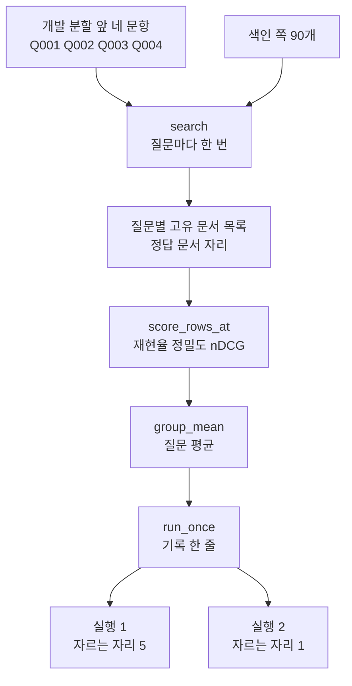
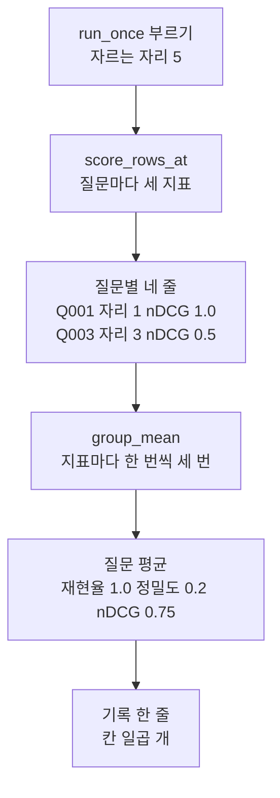
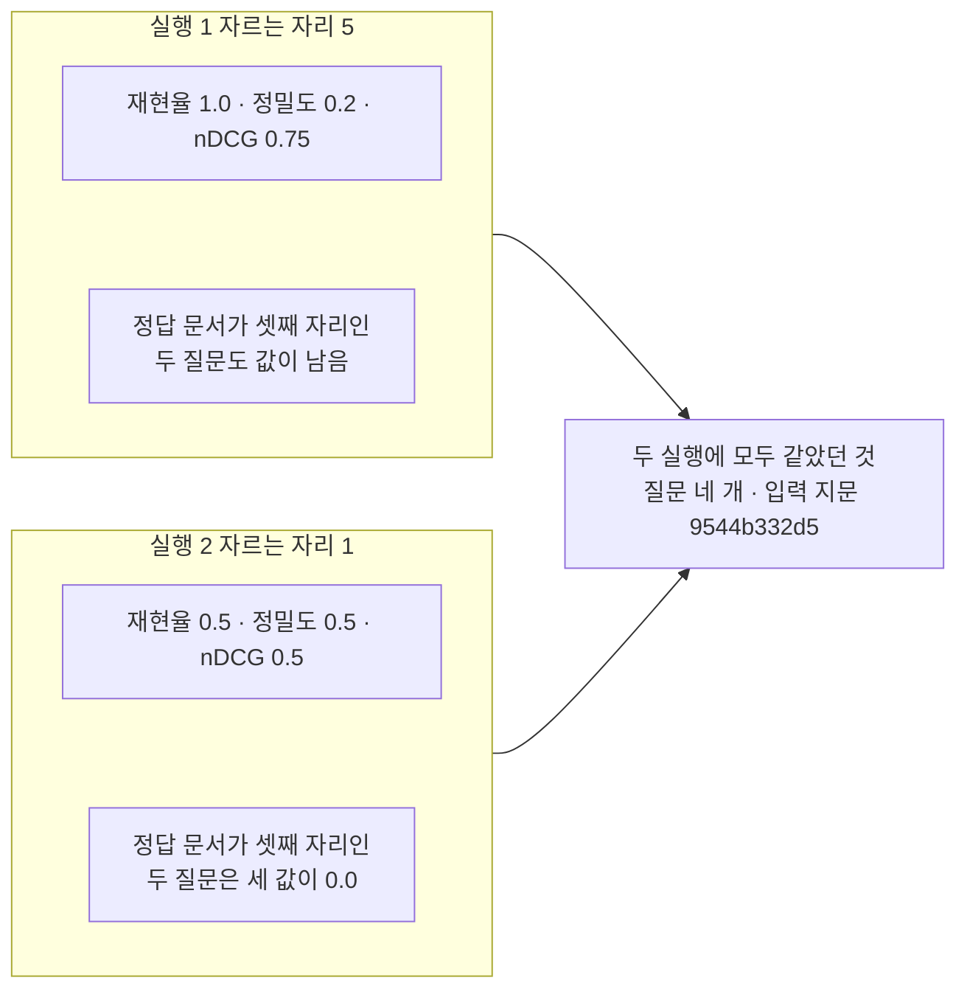

# 07-평가-기초-실습

## _src 본문 (HTML 원본)

```html
<!--meta: 실습 30분 | 코드 notebooks/07-평가-기초-실습.ipynb | 새 용어 0 -->

<h2 id="b1"><span class="no">1</span>학습 목표</h2>
<div class="goal"><ul>
<li>이 절을 마치면 질문 묶음을 줄이면 지표 값과 요청 수가 어떻게 달라지는지 말할 수 있습니다.</li>
<li>이 절을 마치면 자르는 자리를 받아 세 지표를 함께 내는 함수를 만들 수 있습니다.</li>
<li>이 절을 마치면 설정과 질문 수와 입력 지문과 지표를 기록 한 줄로 담을 수 있습니다.</li>
<li>이 절을 마치면 자르는 자리만 바꾼 두 실행의 기록을 한 표로 견줄 수 있습니다.</li>
</ul></div>

<h2 id="b2"><span class="no">2</span>이 내용을 배우는 이유</h2>
<p>01절부터 06절까지는 평가의 단계를 하나씩 따로 익혔습니다. 질문과 정답 문서 ID를 적어 두고, 세 지표를 만들고, 조건으로 나누고, 실행을 기록으로 남겼습니다.</p>
<p>실제로 설정을 고를 때는 이 단계가 한 번에 돌아갑니다. 값을 하나 바꾸고 같은 계산을 다시 한 뒤, 두 결과를 같은 칸 순서로 놓고 견줍니다.</p>
<p>이 실습에서 바꾸는 값은 자르는 자리입니다. 앞 몇 자리까지 보고 셀지는 사람이 정하는 값이고, 02~05절은 그 값을 5로 두었습니다.</p>
<p>이번 절은 이 챕터의 실습입니다. 01~06절에서 쓴 이름과 문법만 쓰고, 따로 내는 과제는 없습니다. 강사와 함께 노트북 셀을 차례로 실행합니다.</p>
<p><strong>이 절의 질문</strong> — 같은 검색 결과를 두고 자르는 자리만 바꾸면, 세 지표와 기록 한 줄은 어떻게 달라질까요?</p>

<h2 id="b3"><span class="no">3</span>앞에서 배운 내용</h2>
<p>이번 실습은 아래 절에서 배운 것을 그대로 가져옵니다.</p>
<table><thead><tr><th>절</th><th>배운 것</th><th>실습에서 쓰는 곳</th></tr></thead><tbody>
<tr><td>01절</td><td>정답 문서 ID와 고유 문서, <code>unique_doc_ids()</code>, <code>find_gold_rank()</code></td><td>5절 검색 결과 정리와 정답 문서 자리</td></tr>
<tr><td>02절</td><td>재현율 <code>recall_at()</code>, 질문 평균 <code>mean_score()</code>, 색인 다섯 셀</td><td>4절 색인, 6절 지표 함수</td></tr>
<tr><td>03절</td><td>정밀도 <code>precision_at()</code>와 고정 분모</td><td>6절 지표 함수, 9·10절 표</td></tr>
<tr><td>04절</td><td>자리 무게와 <code>ndcg_at()</code>, 자리 1·5·10 비교</td><td>6절 지표 함수, 10절 예상</td></tr>
<tr><td>05절</td><td>검색을 묶은 <code>search()</code>, 묶음 평균 <code>group_mean()</code></td><td>5절 검색, 8절 조립</td></tr>
<tr><td>06절</td><td>기록 한 줄의 칸, 입력 지문, 실행 날짜</td><td>3절 지문, 8절 기록 한 줄</td></tr>
<tr><td>Ch 10 08절</td><td><code>load_pdf_pages()</code>와 글자 층이 빈 쪽</td><td>4절 색인 재료</td></tr>
</tbody></table>
<p>읽는 파일도 앞 절과 같습니다. 말뭉치 디지털 PDF 18건과 평가셋 30줄입니다. 이번 실습에서 새로 만든 데이터는 없습니다.</p>
<p>새로 정의하는 함수는 세 개입니다. 질문별 표를 적는 <code>print_score_rows()</code>, 자르는 자리를 받아 줄을 만드는 <code>score_rows_at()</code>, 기록 한 줄을 조립하는 <code>run_once()</code>입니다. 앞 절에서 배운 함수 여덟 개는 도구 파일 <code>rag_tools.py</code>에서 가져옵니다.</p>
<p>06절이 <code>runs</code> 폴더에 남긴 파일 세 개는 이번 실습에서 읽지도 쓰지도 않습니다. 이 노트북은 파일을 만들거나 고치지 않습니다.</p>

<h2 id="b4"><span class="no">4</span>핵심 개념</h2>
<h3>비유로 시작하기</h3>
<p>책상 위에 얕은 쟁반 두 개가 나란히 놓여 있습니다. 왼쪽 쟁반은 칸이 다섯이고 오른쪽 쟁반은 카드가 들어갈 칸이 하나뿐입니다.</p>
<p>두 쟁반에 담으려는 카드 줄은 같습니다. 칸이 다섯이면 다섯 장이 모두 들어가고, 칸이 하나면 첫 장만 들어갑니다. 나머지는 쟁반 밖에 남습니다.</p>
{{img:07-4-쟁반-둘과-공책-두-줄|위에서 내려다본 나무 책상에 얕은 쟁반 두 개가 나란히 놓여 있고 왼쪽 쟁반 윗줄 다섯 칸에는 카드가 한 장씩 서 있는데 왼쪽에서 셋째만 파란 카드이고 나머지는 흰 카드이며 아랫줄 다섯 칸은 비어 있고 오른쪽 쟁반은 왼쪽 끝 한 칸에만 흰 카드 한 장이 서 있고 옆의 넓은 자리는 비어 있으며 그 쟁반 오른쪽 책상에 흰 카드 세 장과 파란 카드 한 장이 흩어져 있고 두 쟁반 앞에는 가로줄만 그어진 공책이 한 권씩 펼쳐져 맨 윗줄에 빨강 노랑 초록 색 딱지 세 개가 한 줄로 붙어 있는 삽화|같은 카드 줄이라도 칸이 다섯인 쟁반과 칸이 하나인 쟁반은 담기는 카드가 다릅니다}}
<p><strong>그림 읽기</strong> — 먼저 왼쪽 쟁반 윗줄을 봅니다. 칸 다섯에 카드가 한 장씩 서 있고 왼쪽에서 셋째만 파란 카드입니다. 아랫줄 다섯 칸은 비어 있습니다.</p>
<p>다음으로 오른쪽 쟁반을 봅니다. 카드가 들어간 칸은 왼쪽 끝 하나뿐이고 옆의 넓은 자리는 비어 있습니다. 쟁반 오른쪽 책상에 카드 네 장이 남아 있고 파란 카드도 그 가운데 있습니다.</p>
<p>마지막으로 두 쟁반 앞의 공책을 봅니다. 맨 윗줄에 색 딱지가 세 개씩 한 줄로 붙어 있습니다. 딱지 세 개는 지표 세 값이고 기록 한 줄의 칸 수와는 다릅니다.</p>
<p>흰 카드는 02~04절과 같이 후보 한 줄이고 파란 카드는 정답 문서입니다. 쟁반의 칸 수가 자르는 자리이고, 공책 한 줄은 06절에서 만든 기록 한 줄입니다.</p>

<h3>실습 조립의 구성</h3>
{{mermaid:07-1-조립도|위에서 아래로 내려가는 흐름도로 초록 상자 개발 분할 앞 네 문항 Q001 Q002 Q003 Q004와 초록 상자 색인 쪽 90개가 파란 상자 search 질문마다 한 번으로 모이고 노란 상자 질문별 고유 문서 목록과 정답 문서 자리를 지나 파란 상자 score_rows_at 재현율 정밀도 nDCG와 파란 상자 group_mean 질문 평균과 파란 상자 run_once 기록 한 줄로 내려간 뒤 노란 상자 실행 1 자르는 자리 5와 노란 상자 실행 2 자르는 자리 1로 갈라지는 그림|실습 조립 순서. 질문 네 개를 한 번만 검색해 두고 두 실행이 같은 검색 결과를 다시 씁니다}}
<p><strong>도식 읽기</strong> — 위에서 아래로 읽습니다. 맨 위 초록 상자 둘은 노트북 3·4절에서 만드는 재료입니다. 질문 묶음은 네 문항이고 색인 항목은 쪽 90개입니다.</p>
<p>파란 상자 네 개는 노트북이 부르는 함수입니다. 맨 위 검색 함수와 셋째 평균 함수는 05절 함수를 도구 파일에서 가져오고, 둘째와 넷째는 이 절에서 새로 만듭니다.</p>
<p>노란 상자는 출력으로 확인한 값입니다. 가운데 상자가 검색 한 번으로 얻은 목록이고, 맨 아래 두 상자가 자르는 자리만 다른 두 실행입니다.</p>
<table><thead><tr><th>함수</th><th>하는 일</th><th>가져온 곳</th></tr></thead><tbody>
<tr><td><code>search(store, question, count, candidate_count)</code></td><td>질문을 검색해 문서 ID 중복을 뺀 목록을 냄</td><td>05절(도구 파일)</td></tr>
<tr><td><code>find_gold_rank(doc_ids, gold_doc_ids)</code></td><td>고유 문서 목록에서 정답 문서 자리를 찾음</td><td>01절(도구 파일)</td></tr>
<tr><td><code>recall_at()</code>·<code>precision_at()</code>·<code>ndcg_at()</code></td><td>자른 목록으로 세 지표를 각각 냄</td><td>02·03·04절(도구 파일)</td></tr>
<tr><td><code>group_mean(rows, metric)</code></td><td>담아 둔 줄에서 지표 칸만 모아 질문 평균을 냄</td><td>05절(도구 파일)</td></tr>
<tr><td><code>print_score_rows(rows)</code></td><td>질문별 줄을 라벨 줄 아래에 한 줄씩 적음</td><td>05절 표 모양(새로 정의)</td></tr>
<tr><td><code>score_rows_at(cutoff)</code></td><td>자르는 자리를 받아 질문마다 세 지표를 낸 줄을 만듦</td><td>02·03·04절 함수를 묶음(새로 정의)</td></tr>
<tr><td><code>run_once(run_name, cutoff)</code></td><td>질문별 줄과 06절 모양의 기록 한 줄을 함께 냄</td><td>05·06절(새로 정의)</td></tr>
</tbody></table>

<h3>기록 한 줄에 담는 칸</h3>
<p>기록 한 줄의 칸은 일곱 개입니다. 실행 ID와 실행 날짜, 지표 규칙 이름, 자르는 자리, 질문 수, 입력 지문, 지표입니다.</p>
<p>06절 기록에는 설정을 여섯 칸짜리 덩어리로 담았습니다. 이번 실습은 두 실행에서 달라지는 설정이 자르는 자리 하나뿐이라 그 한 칸으로 줄였습니다.</p>
<p>질문 수와 입력 지문은 두 실행이 같아야 하는 칸입니다. 이 두 칸이 다르면 같은 자료로 잰 값이 아니어서 지표만 놓고 견주기 어렵습니다.</p>

<h3>두 번의 실행</h3>
<p>실행 1은 02~05절과 같이 자르는 자리 5입니다. 실행 2는 자르는 자리만 1로 바꿉니다.</p>
<p>질문 묶음과 색인, 후보 개수 50, 임베딩 모델은 두 실행에서 같게 둔 조건입니다. 두 실행은 5절에서 받아 둔 같은 검색 결과를 다시 씁니다.</p>
<p>질문은 개발 분할 앞 네 문항입니다. 요청을 다섯 번으로 줄이려고 15문항 대신 네 문항만 골랐습니다. 네 문항은 모두 난이도 <code>easy</code>이고 정답 문서가 <code>E01</code> 하나입니다.</p>

<h2 id="b5"><span class="no">5</span>실행 예제</h2>
<p>노트북은 먼저 평가셋에서 질문 네 개를 고르고 평가셋 파일의 지문을 만듭니다. 그다음 02~06절과 같은 다섯 셀로 색인을 만들고 질문 네 개를 검색합니다. 마지막으로 실행 1, 실행 2, 두 실행 비교를 차례로 합니다.</p>
<p>함수를 만드는 셀은 세 개입니다. 앞 절에서 배운 함수 여덟 개는 준비 셀에서 도구 파일로부터 가져옵니다. 3·5절의 재료와 9~11절의 표를 강사와 함께 읽습니다.</p>
<p>실제 OpenAI 임베딩 모델을 부릅니다. 이 페이지의 출력은 2026-09-21에 실행한 결과입니다. 임베딩 요청은 모두 다섯 번이고 색인 한 벌에 한 번, 질문 검색에 네 번입니다. 예상 비용은 0.01달러 미만이고 답을 쓰는 모델은 부르지 않습니다.</p>
{{notebook:07-평가-기초-실습}}
<p class="look"><b>확인할 점</b> — 5절 출력에서 질문 번호별 정답 문서 자리를 봅니다. 9·10절 출력에서 질문별 표 네 줄과 기록 한 줄의 지표 칸을 봅니다. 11절 표에서 두 줄의 지표 세 칸을 견줍니다.</p>

<h3>실행 1의 실제 순서</h3>
{{mermaid:07-2-실행1-순서|위에서 아래로 내려가는 흐름도로 파란 상자 run_once 부르기 자르는 자리 5에서 파란 상자 score_rows_at 질문마다 세 지표로 내려가고 노란 상자 질문별 네 줄 Q001 자리 1 nDCG 1.0 Q003 자리 3 nDCG 0.5를 지나 파란 상자 group_mean 지표마다 한 번씩 세 번과 노란 상자 질문 평균 재현율 1.0 정밀도 0.2 nDCG 0.75를 거쳐 파란 상자 기록 한 줄 칸 일곱 개로 이어지는 그림|실행 1에서 조립 함수가 질문별 줄을 만들고 질문 평균을 낸 뒤 기록 한 줄로 담는 차례}}
<p><strong>도식 읽기</strong> — 위에서 아래로 읽습니다. 맨 위 파란 상자가 조립 함수를 부르는 자리이고 인자는 자르는 자리 5입니다.</p>
<p>둘째 파란 상자가 질문마다 세 지표를 냅니다. 그 아래 노란 상자가 노트북 9절 표의 네 줄이고, 자리가 다른 두 줄을 예로 적었습니다.</p>
<p>셋째 파란 상자는 지표마다 한 번씩 세 번 평균을 냅니다. 그 아래 노란 상자가 기록에 담을 세 값이고 맨 아래 파란 상자가 기록 한 줄입니다. 이 흐름에는 임베딩 요청이 없습니다.</p>

<h2 id="b6"><span class="no">6</span>실험 결과 해석</h2>
<p>실행 1의 질문별 표에서는 네 줄의 재현율이 모두 <code>1.0</code>이었습니다. 네 질문 모두 정답 문서가 앞 다섯 자리 안에 있었기 때문입니다. 정밀도는 네 줄이 모두 <code>0.2</code>였고 nDCG만 <code>1.0</code>과 <code>0.5</code>로 갈렸습니다.</p>
<p>갈린 자리는 정답 문서 자리입니다. 질문 <code>Q001</code>과 <code>Q002</code>는 정답 문서가 첫 자리였고 <code>Q003</code>과 <code>Q004</code>는 셋째 자리였습니다. 순위를 값에 넣는 지표가 nDCG뿐이라 그 칸만 달라졌습니다.</p>
<p>실행 2에서는 자르는 자리를 1로 바꿨습니다. 정답 문서가 셋째 자리인 두 질문은 세 값이 모두 <code>0.0</code>이 되었고, 첫 자리인 두 질문은 세 값이 모두 <code>1.0</code>이 되었습니다.</p>
{{mermaid:07-3-두-실행-비교|위아래 두 칸으로 나뉜 비교 그림으로 위 칸 실행 1 자르는 자리 5에는 노란 상자 재현율 1.0 정밀도 0.2 nDCG 0.75와 노란 상자 정답 문서가 셋째 자리인 두 질문도 값이 남음이 들어 있고 아래 칸 실행 2 자르는 자리 1에는 노란 상자 재현율 0.5 정밀도 0.5 nDCG 0.5와 노란 상자 정답 문서가 셋째 자리인 두 질문은 세 값이 0.0이 들어 있으며 두 칸에서 나온 화살표가 회색 상자 두 실행에 모두 같았던 것 질문 네 개 입력 지문 9544b332d5로 모이는 그림|자르는 자리만 바꾼 두 실행. 정밀도는 올라가고 재현율과 nDCG는 내려갔습니다}}
<p><strong>도식 읽기</strong> — 위 칸이 실행 1이고 아래 칸이 실행 2입니다. 칸마다 노란 상자가 둘씩 있고 위 상자가 질문 평균 세 값입니다.</p>
<p>아래 상자는 정답 문서가 셋째 자리인 두 질문에서 무엇이 달라졌는지 적은 것입니다. 위 칸에서는 값이 남았고 아래 칸에서는 세 값이 모두 <code>0.0</code>이 되었습니다.</p>
<p>오른쪽 회색 상자는 두 실행에 모두 같았던 값입니다. 한 실행의 결과가 아니라서 어느 칸에도 넣지 않았습니다.</p>
<p>질문 평균을 보면 재현율은 <code>1.0</code>에서 <code>0.5</code>로, nDCG는 <code>0.75</code>에서 <code>0.5</code>로 내려갔습니다. 정밀도만 <code>0.2</code>에서 <code>0.5</code>로 올라갔습니다. 03절에서 본 대로 정밀도는 자르는 자리로 나누기 때문입니다.</p>
<p>실행 2에서는 세 값이 모두 <code>0.5</code>로 같았습니다. 정답 문서가 한 개이고 자르는 자리가 1이면 세 공식이 같은 수를 냅니다. 04절에서 자리 1의 세 값이 모두 <code>0.6</code>이었던 것과 같은 모양입니다.</p>
<p>기록 두 줄에서 질문 수 <code>4</code>와 입력 지문 <code>9544b332d5</code>는 같았습니다. 같은 질문 묶음과 같은 평가셋으로 잰 값이라는 뜻입니다. 지표 세 칸만 보고 견줄 수 있는 까닭이 이 두 칸에 있습니다.</p>
<p>결론은 이렇습니다. 같은 검색 결과라도 자르는 자리를 좁히면 앞자리 정확도는 올라가고 뒤에 있던 정답 문서는 빠집니다. 이 결과는 질문 네 개·색인 한 벌·자르는 자리 두 가지의 범위입니다.</p>

<h2 id="b7"><span class="no">7</span>주의할 점과 실무 메모</h2>
<ul>
<li><strong>질문을 네 문항으로 줄였습니다.</strong> 01~06절은 개발 분할 15문항을 썼고 임베딩 요청이 절마다 열여섯 번이었습니다. 실습 절은 요청을 다섯 번으로 잡아 앞 네 문항만 골랐습니다.</li>
<li><strong>그래서 값이 01~06절과 다릅니다.</strong> 15문항 자리 5의 질문 평균은 재현율 <code>0.867</code>, 정밀도 <code>0.173</code>, nDCG <code>0.751</code>이었습니다. 네 문항은 모두 난이도 <code>easy</code>이고 정답 문서가 <code>E01</code> 하나여서 값이 더 높게 나옵니다.</li>
<li><strong>어느 자르는 자리가 더 낫다고 정하지 않았습니다.</strong> 자르는 자리는 무엇을 보고 싶은지에 따라 정하는 값입니다. 앞자리 정확도를 보려면 좁게, 후보 누락을 보려면 넓게 둡니다.</li>
<li><strong>받은 개수는 출력하지 않았습니다.</strong> 후보 50개의 뒤쪽 순서가 실행마다 달라져 고유 문서 수가 한두 개 움직입니다. 정답 문서 자리는 이 챕터의 여러 실행에서 같은 값이었습니다.</li>
<li><strong>이 실습은 파일을 쓰지 않습니다.</strong> 06절이 <code>runs</code> 폴더에 남긴 파일 세 개와 앞 챕터 기록은 읽지도 고치지도 않았습니다. 기록 한 줄은 화면에만 냈습니다. 파일로 남기는 방법은 06절 8절에 있습니다.</li>
<li><strong>실행 ID에는 실행한 날이 들어갑니다.</strong> 이름 <code>cut5-20260921</code>의 뒷부분이 그 날짜입니다. 같은 날 다시 실행하면 같은 이름이 나오므로, 하루에 여러 번 견줄 때는 이름 규칙을 더 잘게 정해야 합니다.</li>
<li><strong>05절 노트북은 건드리지 않았습니다.</strong> 실습 폴더 테스트가 05절 노트북의 <code>metrics()</code> 셀을 직접 실행합니다. 이 실습은 그 셀을 다시 쓰지 않고 <code>search()</code>만 도구 파일에서 가져왔습니다.</li>
<li><strong>실습 폴더 도구는 부르지 않았습니다.</strong> 파일 <code>evaluate.py</code>는 검색 방법이 달라 숫자를 나란히 놓지 않습니다. 06절 b7에 적은 규칙을 그대로 지켰습니다.</li>
<li><strong>교재 출력은 Linux의 Python 3.12.13으로 만들었습니다.</strong> 패키지는 pypdf 6.1.1과 langchain-core 1.6.2, langchain-openai 1.6.0입니다. 패키지 numpy는 2.5.3이고 python-dotenv는 1.2.3입니다. 다른 버전과 Windows·macOS에서는 이번에 실행하지 않았습니다.</li>
</ul>

<h2 id="b8"><span class="no">8</span>정리와 다음 절</h2>
<ul>
<li>01절 정답 문서 자리와 02~04절 세 지표, 05절 <code>search()</code>와 묶음 평균, 06절 기록 한 줄을 <code>run_once()</code> 하나로 이었습니다.</li>
<li>질문 네 개를 한 번만 검색해 두고 두 실행이 그 결과를 다시 써서 임베딩 요청이 다섯 번이었습니다.</li>
<li>자르는 자리 5인 실행 1은 재현율 <code>1.0</code>, 정밀도 <code>0.2</code>, nDCG <code>0.75</code>였습니다.</li>
<li>자르는 자리 1인 실행 2는 세 값이 모두 <code>0.5</code>였습니다. 정답 문서가 한 개이고 자리가 1일 때 나오는 모양입니다.</li>
<li>기록 두 줄의 질문 수와 입력 지문이 같아서 지표 세 칸만 보고 견줄 수 있었습니다.</li>
</ul>
<p><strong>다음 학습과 이어지는 지점</strong> — 이 절로 Ch 11이 끝납니다. Ch 12에서는 검색 설정 서른여섯 가지를 개발 분할 15문항으로 견줍니다. 고른 설정 하나는 시험 분할 15문항에 한 번만 적용합니다.</p>
<p>이 실습에서 바꾼 값은 지표 쪽 설정이고 검색 자체는 그대로였습니다. Ch 12에서 바꾸는 값은 검색 쪽 설정이라 후보 목록이 실행마다 달라집니다. 그때도 기록 한 줄의 입력 지문과 질문 수를 먼저 맞추고 지표를 견줍니다.</p>

<h2 id="b9"><span class="no">9</span>복습 문제</h2>
<details class="quiz" open><summary>문제 5개 · 해설 포함</summary>
<p class="quiz-q">1. [하] 두 실행에서 바꾼 값은 무엇입니까?</p>
<p class="quiz-a">자르는 자리입니다. 실행 1은 5이고 실행 2는 1입니다. 질문 묶음과 색인, 후보 개수 50, 임베딩 모델은 같게 두었습니다.</p>
<p class="quiz-q">2. [중] 실행을 두 번 했는데 임베딩 요청이 다섯 번인 까닭은 무엇입니까?</p>
<p class="quiz-a">검색을 한 번만 했기 때문입니다. 색인 한 벌에 한 번, 질문 네 개에 네 번을 보냈고 두 실행은 담아 둔 검색 결과를 다시 썼습니다. 자르는 자리는 받아 둔 목록을 자르는 값이라 새 요청이 필요하지 않습니다.</p>
<p class="quiz-q">3. [중] 실행 2에서 세 지표가 모두 <code>0.5</code>로 같아진 까닭은 무엇입니까?</p>
<p class="quiz-a">정답 문서가 한 개이고 자르는 자리가 1이기 때문입니다. 재현율은 정답 수로, 정밀도는 자르는 자리로 나누는데 둘 다 1입니다. nDCG도 첫 자리 무게가 <code>1.0</code>이고 만점도 <code>1.0</code>이라 같은 수가 나옵니다.</p>
<p class="quiz-q">4. [중] 기록 한 줄에 질문 수와 입력 지문을 함께 담는 까닭은 무엇입니까?</p>
<p class="quiz-a">같은 자료로 잰 값인지 확인하려고 담습니다. 질문 묶음이 다르거나 평가셋 파일이 바뀌면 지표 값만 놓고 견주기 어렵습니다. 이번 두 실행은 두 칸이 같아서 지표 세 칸만 보고 견줄 수 있었습니다.</p>
<p class="quiz-q">5. [상] 동료가 「실습 결과를 보니 이 검색기의 재현율은 <code>1.0</code>」이라고 적었습니다. 이 절 출력으로 무엇이라고 답하나요?</p>
<p class="quiz-a">질문 네 개의 자리 5 값이라고 답합니다. 네 문항은 모두 난이도 <code>easy</code>이고 정답 문서가 <code>E01</code> 하나입니다. 같은 검색기로 15문항을 잰 02절 값은 <code>0.867</code>이었고, 자르는 자리를 1로 바꾸면 이 네 문항에서도 <code>0.5</code>가 나옵니다.</p>
</details>

<h2 id="b10"><span class="no">10</span>참고 자료</h2>
<ul>
<li><div><a href="https://developers.openai.com/api/docs/models/text-embedding-3-small">OpenAI text-embedding-3-small 모델 안내</a></div>확인 2026-09-17 · 100만 토큰당 0.02달러 참고.</li>
<li><div><a href="https://reference.langchain.com/python/langchain-core/vectorstores/in_memory/InMemoryVectorStore">LangChain 공식 API InMemoryVectorStore</a></div>확인 2026-09-18 · <code>add_documents()</code>와 <code>similarity_search()</code> 참고.</li>
<li><div><a href="https://docs.python.org/3.12/library/json.html">Python json</a></div>확인 2026-09-18 · Python 3.12 · 딕셔너리를 보기 좋은 글로 적는 방법.</li>
<li>06절 실험 로그와 자동 실행 — 기록 한 줄의 칸과 입력 지문을 정한 자리.</li>
<li>04절 nDCG at 5 — 자리 무게와 자리 1·5·10 비교, 이 실습이 이어 쓴 세 지표 함수.</li>
<li>기준 버전은 pypdf 6.1.1과 langchain-core 1.6.2, langchain-openai 1.6.0입니다. 패키지 numpy는 2.5.3이고 python-dotenv는 1.2.3입니다. 교재 출력은 Linux의 Python 3.12.13으로 만들었습니다. 다른 버전과 Windows·macOS에서는 이번에 실행하지 않았습니다.</li>
</ul>
```

## 노트북 셀 (순서대로)

### [0] markdown {'html': 'skip'}

# 평가 기초 실습: 자르는 자리를 바꿔 두 실행 견주기

**이 노트북에서 할 일**

1. 개발 분할 앞 네 문항을 한 번 검색해 질문마다 정답 문서 자리를 봅니다.
2. 자르는 자리를 받아 세 지표를 내고 기록 한 줄을 만드는 함수를 조립합니다.
3. 자르는 자리 5와 자리 1로 두 번 실행해 기록 두 줄을 나란히 견줍니다.

**준비물** — 프로젝트 맨 위 폴더의 `.env` 파일에 `OPENAI_API_KEY`가 있어야 합니다.
임베딩 요청은 모두 다섯 번입니다. 색인 한 벌에 한 번, 질문 검색에 네 번입니다.
답을 쓰는 모델은 이 절에서도 부르지 않습니다.

두 실행은 같은 검색 결과를 다시 씁니다. 그래서 실행이 두 번이어도 요청은 늘지 않습니다.
보낼 조각 수는 색인이 59190개 어림이고 질문은 한 번에 스무 개 안팎입니다.

예상 비용은 다섯 번을 합쳐 0.01달러 미만입니다.
임베딩 요금은 OpenAI 모델 안내(2026-09-17 확인)의 100만 토큰당 0.02달러입니다.
실행 시간은 패키지 설치를 빼면 1분 안팎입니다.

**데이터** — 읽는 파일은 두 갈래이고 모두 실습 묶음에 들어 있습니다.

- 말뭉치 `labs/data/rag-corpus/pdf/`의 디지털 PDF 18건과 `labs/data/rag-corpus/manifest.json`
- 평가셋 `labs/part3/ch11-evaluation/data/evaluation-queries.jsonl`

**이 노트북은 파일을 쓰지 않습니다** — 06절이 `runs` 폴더에 남긴 파일은 읽지도 고치지도 않습니다.
기록 한 줄은 화면에만 냅니다. 파일로 남기는 방법은 06절 8절에서 보았습니다.

**강의와 실습 범위** — 강사와 함께 첫 셀부터 차례로 실행합니다. 따로 내는 과제는 없습니다.
함수를 만드는 셀은 세 개입니다. 01~05절에서 배운 함수는 준비 셀에서 도구 파일로부터 가져옵니다.
3·5절의 재료와 9~11절의 표를 함께 읽습니다.

**기준 버전** — 고정한 패키지는 다섯 개입니다.

- 쪽 읽기: pypdf 6.1.1
- 색인과 임베딩: langchain-core 1.6.2 · langchain-openai 1.6.0
- 코사인 유사도 계산: numpy 2.5.3
- 키 읽기: python-dotenv 1.2.3

교재 출력은 Linux의 Python 3.12.13으로 만들었습니다.
다른 버전과 Windows·macOS에서는 이번에 실행하지 않았습니다.

실습 폴더 `labs/part3/ch11-evaluation`에서 `uv sync --locked`를 실행합니다.
그다음 이 폴더의 `.venv` 커널을 고르고 첫 셀부터 순서대로 실행합니다.

### [1] markdown {'html': 'skip'}

## 오늘 볼 그림


위에서 아래로 읽습니다. 맨 위 초록 상자 둘은 노트북 3·4절에서 만드는 재료입니다.

파란 상자 네 개는 노트북이 부르는 함수입니다. 맨 위와 셋째 상자는 05절 함수를 도구 파일에서 가져옵니다.
둘째와 넷째 상자는 이 절에서 새로 만듭니다.
맨 아래 노란 상자 둘이 이 실습의 두 실행입니다. 두 실행은 자르는 자리 하나만 다릅니다.

### [2] markdown {}

## 1. 준비

첫 셀은 패키지를 설치하고 설치된 버전을 출력합니다. 설치에는 몇십 초가 걸릴 수 있습니다.
02~06절에서 쓴 다섯 개와 같습니다. 이 절도 같은 색인을 다시 만들기 때문입니다.

### [3] code {'execution': {'iopub.execute_input': '2026-09-21T07:05:59.382482Z', 'iopub.status.busy': '2026-09-21T07:05:59.382220Z', 'iopub.status.idle': '2026-09-21T07:05:59.852757Z', 'shell.execute_reply': '2026-09-21T07:05:59.852144Z'}, 'lesson_role': 'setup'}

```python
# 이 절에서 쓰는 패키지를 설치하고 버전을 확인합니다
%pip install -q "pypdf==6.1.1" "langchain-core==1.6.2" "langchain-openai==1.6.0" "numpy==2.5.3" "python-dotenv==1.2.3"
from importlib.metadata import version

print("pypdf:", version("pypdf"))
print("langchain-core:", version("langchain-core"))
print("langchain-openai:", version("langchain-openai"))
print("numpy:", version("numpy"))
print("python-dotenv:", version("python-dotenv"))
```

출력:
```
Note: you may need to restart the kernel to use updated packages.
pypdf: 6.1.1
langchain-core: 1.6.2
langchain-openai: 1.6.0
numpy: 2.5.3
python-dotenv: 1.2.3

```

### [4] markdown {}

**결과 읽기** — 출력 다섯 줄 가운데 첫 줄은 `pypdf: 6.1.1`입니다.
둘째 줄 `langchain-core: 1.6.2`와 셋째 줄 `langchain-openai: 1.6.0`도 보세요.
준비물에 적은 기준 버전과 같습니다.

다음 셀은 이 절에서 쓸 이름을 불러옵니다. 표준 모듈은 06절 목록에서 둘을 뺀 셋입니다.

앞에서 배운 함수는 `rag_tools.py`에 모아 두었습니다. 파일을 열면 코드를 볼 수 있습니다. 노트북과 같은 폴더(`notebooks/`)에 있는 파일입니다.
이 노트북은 01~05절 함수 일곱 개와 Ch 9 02절 `load_pdf_pages()`를 가져옵니다.
01절 `unique_doc_ids()`·`find_gold_rank()`, 02~04절 `recall_at()`·`precision_at()`·`ndcg_at()`, 05절 `search()`·`group_mean()`입니다.

### [5] code {'execution': {'iopub.execute_input': '2026-09-21T07:05:59.853877Z', 'iopub.status.busy': '2026-09-21T07:05:59.853790Z', 'iopub.status.idle': '2026-09-21T07:06:01.203239Z', 'shell.execute_reply': '2026-09-21T07:06:01.202713Z'}, 'lesson_role': 'setup'}

```python
# 평가셋 읽기·지문 만들기·날짜 적기·색인에 쓸 이름을 불러옵니다
import hashlib
import json
import time

from langchain_core.vectorstores import InMemoryVectorStore
from langchain_openai import OpenAIEmbeddings
# 01~05절과 Ch 9 02절 함수 여덟 개를 도구 파일에서 가져옵니다
from rag_tools import find_gold_rank, group_mean, load_pdf_pages, ndcg_at
from rag_tools import precision_at, recall_at, search, unique_doc_ids
```

출력:
```

```

### [6] markdown {}

**결과 읽기** — 이 셀은 이름을 불러오기만 하므로 출력이 없습니다.
모듈 `hashlib`은 01·06절에서 파일 지문을 만들 때 쓴 모듈입니다.
모듈 `time`은 06절에서 기록에 날짜를 적을 때 쓴 모듈입니다.

06절이 쓰던 `subprocess`와 `sys`는 부르지 않습니다. 이 절은 다른 프로그램을 실행하지 않습니다.

다음 셀은 키가 있는지 확인합니다. 키 값은 출력하지 않고 있는지만 봅니다.

### [7] code {'execution': {'iopub.execute_input': '2026-09-21T07:06:01.204666Z', 'iopub.status.busy': '2026-09-21T07:06:01.204519Z', 'iopub.status.idle': '2026-09-21T07:06:01.209281Z', 'shell.execute_reply': '2026-09-21T07:06:01.208787Z'}, 'lesson_role': 'setup'}

```python
# .env 파일에서 OpenAI API 키를 읽습니다(키 값은 출력하지 않습니다)
import os
from dotenv import find_dotenv, load_dotenv

env_path = find_dotenv(usecwd=True)
load_dotenv(env_path)
has_key = os.getenv("OPENAI_API_KEY") is not None
print("OPENAI_API_KEY 설정 여부:", has_key)
assert has_key, "프로젝트 폴더의 .env 파일에 OPENAI_API_KEY를 적어 주세요."
```

출력:
```
OPENAI_API_KEY 설정 여부: True

```

### [8] markdown {}

**결과 읽기** — 출력 줄은 `OPENAI_API_KEY 설정 여부: True`입니다.
이 셀은 모듈 `os`도 함께 불러옵니다. 뒤에서 파일이 있는지 볼 때 씁니다.

다음 셀은 프로젝트 맨 위 폴더를 찾습니다. 01~06절과 같은 코드입니다.

### [9] code {'execution': {'iopub.execute_input': '2026-09-21T07:06:01.210113Z', 'iopub.status.busy': '2026-09-21T07:06:01.210036Z', 'iopub.status.idle': '2026-09-21T07:06:01.212777Z', 'shell.execute_reply': '2026-09-21T07:06:01.212247Z'}, 'lesson_role': 'setup'}

```python
# 노트북을 어느 폴더에서 열어도 프로젝트 맨 위를 찾게 후보 세 개를 차례로 봅니다
candidates = [".", "../../..", "../../../.."]
root_path = None
for candidate in candidates:
    if os.path.exists(candidate + "/labs/data/rag-corpus"):
        root_path = candidate
        break
print("고른 경로:", root_path)
assert root_path is not None, "notebooks 폴더나 실습 폴더 맨 위에서 노트북을 열어 주세요."
```

출력:
```
고른 경로: .

```

### [10] markdown {}

**결과 읽기** — 출력 줄은 `고른 경로: .`입니다. `assert`도 통과했습니다.
교재 출력은 프로젝트 맨 위를 작업 폴더로 삼아 실행해서 첫째 후보를 골랐습니다.

다음 셀은 고른 경로에 파일 이름을 이어 붙여 두 갈래 경로를 만듭니다.
06절이 읽던 앞 챕터 기록 두 갈래는 이 절에서 읽지 않습니다.

### [11] code {'execution': {'iopub.execute_input': '2026-09-21T07:06:01.213697Z', 'iopub.status.busy': '2026-09-21T07:06:01.213628Z', 'iopub.status.idle': '2026-09-21T07:06:01.215893Z', 'shell.execute_reply': '2026-09-21T07:06:01.215531Z'}, 'lesson_role': 'setup'}

```python
# 이 절에서 읽을 파일 두 갈래의 경로를 만듭니다
corpus_path = root_path + "/labs/data/rag-corpus"
manifest_path = corpus_path + "/manifest.json"
dataset_path = root_path + "/labs/part3/ch11-evaluation/data/evaluation-queries.jsonl"
print("평가셋 파일이 있는가:", os.path.exists(dataset_path))
print("말뭉치 목록이 있는가:", os.path.exists(manifest_path))
```

출력:
```
평가셋 파일이 있는가: True
말뭉치 목록이 있는가: True

```

### [12] markdown {}

**결과 읽기** — 두 줄 모두 `True`입니다.

## 2. 실습 주제 — 자르는 자리를 바꿔 두 실행 견주기

작은 검색 창구의 품질을 재는 일을 맡았다고 봅니다.
같은 색인과 같은 질문으로 값을 내는데, 앞 몇 자리까지 보고 셀지는 사람이 정합니다.
02~05절은 그 자리를 5로 두었고 04절에서 자리 1과 자리 10도 한 번 보았습니다.

이번 실습은 자르는 자리를 바꾼 두 실행을 각각 기록 한 줄로 남겨 견줍니다.
06절에서 만든 기록 한 줄이 그 비교표의 한 줄이 됩니다.

바꾸는 값은 하나입니다. 실행 1은 자르는 자리 5이고 실행 2는 자르는 자리 1입니다.
질문 묶음과 색인, 후보 개수 50, 임베딩 모델은 두 실행에서 같게 둡니다.

## 3. 재료 만들기 — 질문 네 개와 입력 지문

먼저 평가셋 30줄을 읽고 개발 분할 15문항만 남깁니다. 02~06절과 같은 코드입니다.

### [13] code {'execution': {'iopub.execute_input': '2026-09-21T07:06:01.216945Z', 'iopub.status.busy': '2026-09-21T07:06:01.216858Z', 'iopub.status.idle': '2026-09-21T07:06:01.220311Z', 'shell.execute_reply': '2026-09-21T07:06:01.219789Z'}}

```python
# 평가셋 30줄을 읽고 설정을 고를 때 쓰는 개발 분할만 남깁니다(06절 2절과 같은 코드)
with open(dataset_path, encoding="utf-8") as dataset_file:
    dataset_lines = dataset_file.read().splitlines()

queries = []
for line in dataset_lines:
    queries.append(json.loads(line))

dev_queries = []
for query in queries:
    if query["split"] == "dev":
        dev_queries.append(query)
print("평가셋 줄 수:", len(queries))
print("개발 분할 질문 수:", len(dev_queries))
```

출력:
```
평가셋 줄 수: 30
개발 분할 질문 수: 15

```

### [14] markdown {}

**결과 읽기** — 출력 줄은 `평가셋 줄 수: 30`과 `개발 분할 질문 수: 15`입니다.
01~06절에서 본 값과 같습니다.

다음 셀은 그 15문항 가운데 앞 네 문항만 골라 실습 질문 묶음으로 둡니다.
목록 슬라이싱 `[:4]`로 앞에서 네 개를 잘라 냅니다. 요청을 다섯 번으로 줄이려고 질문 수를 줄였습니다.
같은 셀에서 두 실행의 자르는 자리도 미리 정합니다.

### [15] code {'execution': {'iopub.execute_input': '2026-09-21T07:06:01.221147Z', 'iopub.status.busy': '2026-09-21T07:06:01.221077Z', 'iopub.status.idle': '2026-09-21T07:06:01.223222Z', 'shell.execute_reply': '2026-09-21T07:06:01.222881Z'}}

```python
# 개발 분할 앞 네 문항을 실습 질문 묶음으로 두고 두 실행의 자르는 자리를 정합니다
small_queries = dev_queries[:4]
small_qids = []
for query in small_queries:
    small_qids.append(query["qid"])
candidate_count = 50
cutoff_narrow = 5
cutoff_top = 1
print("실습 질문 번호:", small_qids)
print("첫 질문 글:", small_queries[0]["question"])
print("후보 개수:", candidate_count)
print("실행 1의 자르는 자리:", cutoff_narrow)
print("실행 2의 자르는 자리:", cutoff_top)
```

출력:
```
실습 질문 번호: ['Q001', 'Q002', 'Q003', 'Q004']
첫 질문 글: 미르시립도서관의 정기 휴관일은 언제인가요?
후보 개수: 50
실행 1의 자르는 자리: 5
실행 2의 자르는 자리: 1

```

### [16] markdown {}

**결과 읽기** — 첫 줄은 `실습 질문 번호: ['Q001', 'Q002', 'Q003', 'Q004']`입니다.
둘째 줄 `첫 질문 글: 미르시립도서관의 정기 휴관일은 언제인가요?`는 01~06절에서 되풀이해 본 질문입니다.

셋째 줄 `후보 개수: 50`은 02~06절과 같은 값입니다. 이 값을 바꾸면 앞 절 값과 이어지지 않습니다.
넷째 줄과 다섯째 줄이 두 실행에서 다르게 둘 값입니다.

네 문항은 모두 난이도 `easy`이고 정답 문서가 `E01` 하나입니다.
그래서 이 절의 평균은 01~06절 15문항 평균과 다른 값이 나옵니다.

다음 셀은 평가셋 파일의 지문과 기록에 적을 날짜를 만듭니다. 06절 6·7절과 같은 방법입니다.

### [17] code {'execution': {'iopub.execute_input': '2026-09-21T07:06:01.223896Z', 'iopub.status.busy': '2026-09-21T07:06:01.223845Z', 'iopub.status.idle': '2026-09-21T07:06:01.226482Z', 'shell.execute_reply': '2026-09-21T07:06:01.226085Z'}}

```python
# 평가셋 파일 지문과 기록에 적을 날짜를 미리 만들어 둡니다(06절 6·7절과 같은 방법)
with open(dataset_path, "rb") as dataset_bytes:
    dataset_fingerprint = hashlib.sha256(dataset_bytes.read()).hexdigest()

run_day = time.strftime("%Y%m%d")
run_date_text = time.strftime("%Y-%m-%d")
print("평가셋 지문 앞 10자:", dataset_fingerprint[:10])
print("기록에 적을 날짜:", run_date_text)
```

출력:
```
평가셋 지문 앞 10자: 9544b332d5
기록에 적을 날짜: 2026-09-21

```

### [18] markdown {}

**결과 읽기** — 첫 줄은 `평가셋 지문 앞 10자: 9544b332d5`입니다.
01·06절에서 본 값과 같습니다. 평가셋 파일이 그대로라는 뜻입니다.
둘째 줄은 이 노트북을 실행한 날입니다. 교재 출력은 2026-09-21입니다.

## 4. 색인 만들기

02~06절과 같은 다섯 셀입니다. 같은 색인을 다시 만들어야 이 절 값이 앞 절 값과 이어집니다.
먼저 말뭉치 목록에서 스캔 변형을 뺍니다.

### [19] code {'execution': {'iopub.execute_input': '2026-09-21T07:06:01.227320Z', 'iopub.status.busy': '2026-09-21T07:06:01.227253Z', 'iopub.status.idle': '2026-09-21T07:06:01.230034Z', 'shell.execute_reply': '2026-09-21T07:06:01.229516Z'}}

```python
# 말뭉치 목록에서 스캔 변형을 빼고 디지털 PDF 18건만 골라 둡니다(06절 4절과 같은 코드)
with open(manifest_path, encoding="utf-8") as manifest_file:
    manifest_rows = json.loads(manifest_file.read())

digital_rows = []
for row in manifest_rows:
    if row["tier"] != "scanned":
        digital_rows.append(row)
print("목록의 전체 행 수:", len(manifest_rows))
print("디지털 PDF 수:", len(digital_rows))
```

출력:
```
목록의 전체 행 수: 21
디지털 PDF 수: 18

```

### [20] markdown {}

**결과 읽기** — 출력 줄은 `목록의 전체 행 수: 21`과 `디지털 PDF 수: 18`입니다.
02~06절에서 본 값과 같습니다.

다음 셀은 18건을 차례로 읽어 쪽 Document를 한 목록에 모읍니다.
읽기는 준비 셀에서 가져온 Ch 9 02절 로더 함수 `load_pdf_pages()`가 맡습니다.
메타데이터 칸 이름은 Ch 10 01절에서 정한 `doc_id`·`page`·`source`입니다.

### [21] code {'execution': {'iopub.execute_input': '2026-09-21T07:06:01.230728Z', 'iopub.status.busy': '2026-09-21T07:06:01.230667Z', 'iopub.status.idle': '2026-09-21T07:06:01.957146Z', 'shell.execute_reply': '2026-09-21T07:06:01.956566Z'}}

```python
# 디지털 PDF 18건을 차례로 읽어 쪽 Document를 한 목록에 모읍니다(06절 4절과 같은 코드)
corpus_pages = []
for row in digital_rows:
    file_path = corpus_path + "/" + row["file"]
    row_pages = load_pdf_pages(file_path, row["doc_id"])
    for page_document in row_pages:
        corpus_pages.append(page_document)
print("읽은 문서 수:", len(digital_rows))
print("읽은 쪽 수:", len(corpus_pages))
```

출력:
```
읽은 문서 수: 18
읽은 쪽 수: 93

```

### [22] markdown {}

**결과 읽기** — 출력 줄은 `읽은 문서 수: 18`과 `읽은 쪽 수: 93`입니다.
02~06절과 같은 값입니다.

다음 셀은 글자 층이 빈 쪽을 빼고 색인 재료를 고릅니다.

### [23] code {'execution': {'iopub.execute_input': '2026-09-21T07:06:01.958263Z', 'iopub.status.busy': '2026-09-21T07:06:01.958185Z', 'iopub.status.idle': '2026-09-21T07:06:01.960509Z', 'shell.execute_reply': '2026-09-21T07:06:01.960183Z'}}

```python
# 글자 층이 빈 쪽을 빼고 색인 재료를 고른 뒤 글이 있는 문서 수를 셉니다(06절 4절과 같은 코드)
index_pages = []
text_doc_ids = []
for page_document in corpus_pages:
    if len(page_document.page_content) > 0:
        index_pages.append(page_document)
        if page_document.metadata["doc_id"] not in text_doc_ids:
            text_doc_ids.append(page_document.metadata["doc_id"])
print("색인에 넣을 쪽 수:", len(index_pages))
print("글이 있는 문서 수:", len(text_doc_ids))
```

출력:
```
색인에 넣을 쪽 수: 90
글이 있는 문서 수: 17

```

### [24] markdown {}

**결과 읽기** — 출력 줄은 `색인에 넣을 쪽 수: 90`과 `글이 있는 문서 수: 17`입니다.
읽은 쪽 93개에서 세 쪽이 빠졌습니다. 글자 층이 비는 것을 Ch 10 08절에서 확인한 쪽입니다.

다음 셀은 임베딩 모델을 준비하고 쪽 90개로 색인 한 벌을 만듭니다.
여기서 임베딩 요청 한 번이 나갑니다.

### [25] code {'execution': {'iopub.execute_input': '2026-09-21T07:06:01.961169Z', 'iopub.status.busy': '2026-09-21T07:06:01.961103Z', 'iopub.status.idle': '2026-09-21T07:06:02.992375Z', 'shell.execute_reply': '2026-09-21T07:06:02.991750Z'}}

```python
# 임베딩 모델을 준비하고 쪽 Document 90개로 색인 한 벌을 만듭니다(06절 4절과 같은 코드)
embedding_model_name = "text-embedding-3-small"
embedding_model = OpenAIEmbeddings(model=embedding_model_name)
store = InMemoryVectorStore(embedding=embedding_model)
store.add_documents(index_pages)
print("임베딩 모델 이름:", embedding_model_name)
print("차원 수를 주었는가:", embedding_model.dimensions is not None)
print("색인에 들어간 항목 수:", len(store.store))
```

출력:
```
임베딩 모델 이름: text-embedding-3-small
차원 수를 주었는가: False
색인에 들어간 항목 수: 90

```

### [26] markdown {}

**결과 읽기** — 출력 첫 줄은 `임베딩 모델 이름: text-embedding-3-small`입니다.
둘째 줄 `차원 수를 주었는가: False`는 Ch 10 07절에서 정한 기본 설정으로 벡터를 만들었다는 뜻입니다.
셋째 줄 `색인에 들어간 항목 수: 90`은 앞 셀에서 고른 쪽 수와 같습니다.
이 노트북의 출력은 2026-09-21에 이 임베딩 모델로 실행한 결과입니다.

## 5. 검색해서 정답 문서 자리 보기

검색은 준비 셀에서 가져온 05절 함수 `search()`로 합니다.
셋째 인자 볼 자리 수와 넷째 인자 후보 개수를 모두 50으로 주어 고유 문서 목록을 자르지 않고 받습니다.
정답 문서 자리는 01절 함수 `find_gold_rank()`로 찾습니다.
자리 `0`은 고유 문서 목록 어디에도 정답 문서가 없다는 뜻입니다.

다음 셀이 이 노트북에서 요청을 보내는 마지막 자리입니다.
질문 네 개를 차례로 검색하고 정답 문서 자리도 함께 모읍니다.
반복문 안에서는 담기만 하고 끝난 뒤에 한꺼번에 출력합니다.

실행 전에 예상합니다. 01~06절과 같은 색인이므로 Q001의 앞 5자리가 앞 절과 같을 것입니다.

### [27] code {'execution': {'iopub.execute_input': '2026-09-21T07:06:02.993824Z', 'iopub.status.busy': '2026-09-21T07:06:02.993737Z', 'iopub.status.idle': '2026-09-21T07:06:03.688589Z', 'shell.execute_reply': '2026-09-21T07:06:03.687777Z'}}

```python
# 네 문항을 차례로 검색해 고유 문서 목록과 정답 문서 자리를 함께 모읍니다(임베딩 요청 4번)
unique_by_qid = {}
rank_by_qid = {}
for query in small_queries:
    query_hits = search(store, query["question"], candidate_count, candidate_count)
    doc_ids = unique_doc_ids(query_hits)
    unique_by_qid[query["qid"]] = doc_ids
    rank_by_qid[query["qid"]] = find_gold_rank(doc_ids, query["gold_doc_ids"])
print("검색한 질문 수:", len(unique_by_qid))
print("질문 Q001의 앞 5자리:", unique_by_qid["Q001"][:cutoff_narrow])
print("질문 번호별 정답 문서 자리:", rank_by_qid)
```

출력:
```
검색한 질문 수: 4
질문 Q001의 앞 5자리: ['E01', 'M04', 'H03', 'M05', 'E04']
질문 번호별 정답 문서 자리: {'Q001': 1, 'Q002': 1, 'Q003': 3, 'Q004': 3}

```

### [28] markdown {}

**결과 읽기** — 첫 줄은 `검색한 질문 수: 4`입니다.
둘째 줄은 `질문 Q001의 앞 5자리: ['E01', 'M04', 'H03', 'M05', 'E04']`입니다.
02~06절 노트북에서 본 목록과 같습니다. 예상한 대로입니다.

셋째 줄은 `질문 번호별 정답 문서 자리: {'Q001': 1, 'Q002': 1, 'Q003': 3, 'Q004': 3}`입니다.
네 질문 가운데 둘은 정답 문서가 첫 자리에 있고 둘은 셋째 자리에 있습니다.
이 차이가 자르는 자리를 바꿀 때 값을 가르는 자리입니다.

받은 개수는 이 절에서도 출력하지 않습니다.
후보 50개의 뒤쪽 순서가 실행마다 달라져 고유 문서 수가 한두 개 움직이기 때문입니다.

### [29] markdown {}

## 6. 앞 절 지표 함수 가져오기

02~04절 지표 함수와 05절 묶음 평균 함수는 준비 셀에서 도구 파일로부터 가져왔습니다. 이 절은 지표 공식을 바꾸지 않습니다.
세 지표 함수 `recall_at()`·`precision_at()`·`ndcg_at()`은 모두 `doc_ids`와 `gold_doc_ids`와 `cutoff`를 받습니다.
인자 모양이 같아 한 반복문에서 세 값을 함께 낼 수 있습니다.

묶음 평균 함수 `group_mean()`은 담아 둔 줄과 지표 칸 이름을 받아 질문 평균을 냅니다.
이제 앞 절에서 배운 함수가 모두 준비됐습니다.

## 7. 기록 장치 — 질문별 표

값을 눈으로 읽으려면 한 줄씩 같은 칸 순서로 나와야 합니다.
Ch 9 07절 `print_rows()`와 Ch 10 09절 `print_hit_rows()`가 있던 자리의 기록 장치입니다.
라벨 줄은 함수 안에서 먼저 출력합니다.

### [30] code {'execution': {'iopub.execute_input': '2026-09-21T07:06:03.689861Z', 'iopub.status.busy': '2026-09-21T07:06:03.689760Z', 'iopub.status.idle': '2026-09-21T07:06:03.692497Z', 'shell.execute_reply': '2026-09-21T07:06:03.691499Z'}}

```python
# 질문별 줄을 라벨 줄 아래에 한 줄씩 같은 칸 순서로 출력합니다
def print_score_rows(rows):
    print("질문 번호 | 정답 문서 자리 | 재현율 | 정밀도 | nDCG")
    for row in rows:
        print(row["질문 번호"], "|", row["정답 문서 자리"], "|", row["재현율"], "|", row["정밀도"], "|", row["nDCG"])
```

출력:
```

```

### [31] markdown {}

**결과 읽기** — 이 셀은 함수만 정의하므로 출력이 없습니다.
칸 이름은 05절 질문별 표에서 쓴 한국어 이름을 그대로 씁니다.

## 8. 조립 — 자르는 자리를 받아 기록 한 줄 만들기

이제 앞 절 부품을 하나로 잇습니다. 먼저 자르는 자리를 받아 질문별 줄을 만드는 함수입니다.
질문마다 고유 문서 목록과 정답 문서 ID를 꺼내 세 지표를 함께 냅니다.

### [32] code {'execution': {'iopub.execute_input': '2026-09-21T07:06:03.694131Z', 'iopub.status.busy': '2026-09-21T07:06:03.694050Z', 'iopub.status.idle': '2026-09-21T07:06:03.696608Z', 'shell.execute_reply': '2026-09-21T07:06:03.695997Z'}}

```python
# 자르는 자리를 받아 질문마다 세 지표를 낸 줄 목록을 만듭니다(02·03·04절 함수를 함께 부름)
def score_rows_at(cutoff):
    rows = []
    for query in small_queries:
        doc_ids = unique_by_qid[query["qid"]]
        gold_ids = query["gold_doc_ids"]
        row = {"질문 번호": query["qid"], "정답 문서 자리": rank_by_qid[query["qid"]]}
        row["재현율"] = recall_at(doc_ids, gold_ids, cutoff)
        row["정밀도"] = precision_at(doc_ids, gold_ids, cutoff)
        row["nDCG"] = ndcg_at(doc_ids, gold_ids, cutoff)
        rows.append(row)
    return rows
```

출력:
```

```

### [33] markdown {}

**결과 읽기** — 이 셀도 함수만 정의하므로 출력이 없습니다.
검색은 5절에서 이미 끝났습니다. 이 함수는 담아 둔 목록만 읽으므로 요청을 보내지 않습니다.

다음 셀이 이 실습의 조립 함수입니다.
질문별 줄을 만들고 세 지표의 질문 평균을 낸 뒤 06절 모양의 기록 한 줄로 담습니다.

### [34] code {'execution': {'iopub.execute_input': '2026-09-21T07:06:03.697580Z', 'iopub.status.busy': '2026-09-21T07:06:03.697503Z', 'iopub.status.idle': '2026-09-21T07:06:03.699536Z', 'shell.execute_reply': '2026-09-21T07:06:03.699171Z'}}

```python
# 자르는 자리를 받아 질문별 줄과 06절 모양의 기록 한 줄을 함께 냅니다
def run_once(run_name, cutoff):
    rows = score_rows_at(cutoff)
    scores = {"재현율": group_mean(rows, "재현율"), "정밀도": group_mean(rows, "정밀도")}
    scores["nDCG"] = group_mean(rows, "nDCG")
    record = {"실행 ID": run_name + "-" + run_day, "실행 날짜": run_date_text}
    record["지표 규칙 이름"] = "고유 문서 기준 질문 평균 v1"
    record["자르는 자리"] = cutoff
    record["질문 수"] = len(rows)
    record["입력 지문"] = dataset_fingerprint[:10]
    record["지표"] = scores
    return {"기록": record, "질문별": rows}
```

출력:
```

```

### [35] markdown {}

**결과 읽기** — 이 셀도 함수만 정의하므로 출력이 없습니다.

기록 한 줄의 칸은 일곱 개입니다. 실행 ID와 실행 날짜, 지표 규칙 이름, 자르는 자리, 질문 수, 입력 지문, 지표입니다.
06절 기록에 있던 실행 설정 덩어리는 이 절에서 자르는 자리 한 칸으로 줄였습니다.
두 실행에서 달라지는 설정이 그 한 칸뿐이기 때문입니다.

## 9. 실행 1 — 자르는 자리 5

첫 실행은 02~05절과 같은 자리입니다. 앞 다섯 자리까지 보고 셉니다.

실행 전에 예상합니다. 네 질문 모두 정답 문서가 앞 다섯 자리 안에 있어 재현율이 `1.0`일 것입니다.

### [36] code {'execution': {'iopub.execute_input': '2026-09-21T07:06:03.700530Z', 'iopub.status.busy': '2026-09-21T07:06:03.700459Z', 'iopub.status.idle': '2026-09-21T07:06:03.702459Z', 'shell.execute_reply': '2026-09-21T07:06:03.702052Z'}}

```python
# 실행 1: 자르는 자리 5로 질문별 표와 기록 한 줄을 냅니다
run1 = run_once("cut5", cutoff_narrow)
print_score_rows(run1["질문별"])
print("실행 1의 기록 한 줄:")
print(json.dumps(run1["기록"], ensure_ascii=False, indent=2))
```

출력:
```
질문 번호 | 정답 문서 자리 | 재현율 | 정밀도 | nDCG
Q001 | 1 | 1.0 | 0.2 | 1.0
Q002 | 1 | 1.0 | 0.2 | 1.0
Q003 | 3 | 1.0 | 0.2 | 0.5
Q004 | 3 | 1.0 | 0.2 | 0.5
실행 1의 기록 한 줄:
{
  "실행 ID": "cut5-20260921",
  "실행 날짜": "2026-09-21",
  "지표 규칙 이름": "고유 문서 기준 질문 평균 v1",
  "자르는 자리": 5,
  "질문 수": 4,
  "입력 지문": "9544b332d5",
  "지표": {
    "재현율": 1.0,
    "정밀도": 0.2,
    "nDCG": 0.75
  }
}

```

### [37] markdown {}

**결과 읽기** — 라벨 줄 아래 첫 줄은 `Q001 | 1 | 1.0 | 0.2 | 1.0`입니다.
셋째 줄 `Q003 | 3 | 1.0 | 0.2 | 0.5`는 정답 문서가 셋째 자리에 있던 질문입니다.
재현율은 두 줄이 같고 nDCG만 갈립니다. 자리를 값에 넣는 지표가 nDCG이기 때문입니다.

라벨 줄 `실행 1의 기록 한 줄:` 아래에 칸 일곱 개가 보입니다.
칸 `"자르는 자리": 5`와 `"질문 수": 4`가 그 가운데 둘입니다.
지표 칸은 `"재현율": 1.0`과 `"정밀도": 0.2`와 `"nDCG": 0.75`입니다.

이 세 값은 01~06절 15문항 값과 다릅니다. 질문 묶음이 네 문항으로 작기 때문입니다.

## 10. 실행 2 — 자르는 자리 1

이제 값 하나만 바꿉니다. 자르는 자리를 1로 두고 1위만 보고 셉니다.
질문 묶음과 색인, 후보 개수, 임베딩 모델은 실행 1과 같습니다.

실행 전에 예상합니다. 정답 문서가 셋째 자리인 두 질문은 세 값이 모두 `0.0`일 것입니다.

### [38] code {'execution': {'iopub.execute_input': '2026-09-21T07:06:03.703314Z', 'iopub.status.busy': '2026-09-21T07:06:03.703254Z', 'iopub.status.idle': '2026-09-21T07:06:03.705291Z', 'shell.execute_reply': '2026-09-21T07:06:03.704915Z'}}

```python
# 실행 2: 자르는 자리만 1로 바꿔 같은 검색 결과로 다시 냅니다
run2 = run_once("cut1", cutoff_top)
print_score_rows(run2["질문별"])
print("실행 2의 기록 한 줄:")
print(json.dumps(run2["기록"], ensure_ascii=False, indent=2))
```

출력:
```
질문 번호 | 정답 문서 자리 | 재현율 | 정밀도 | nDCG
Q001 | 1 | 1.0 | 1.0 | 1.0
Q002 | 1 | 1.0 | 1.0 | 1.0
Q003 | 3 | 0.0 | 0.0 | 0.0
Q004 | 3 | 0.0 | 0.0 | 0.0
실행 2의 기록 한 줄:
{
  "실행 ID": "cut1-20260921",
  "실행 날짜": "2026-09-21",
  "지표 규칙 이름": "고유 문서 기준 질문 평균 v1",
  "자르는 자리": 1,
  "질문 수": 4,
  "입력 지문": "9544b332d5",
  "지표": {
    "재현율": 0.5,
    "정밀도": 0.5,
    "nDCG": 0.5
  }
}

```

### [39] markdown {}

**결과 읽기** — 라벨 줄 아래 첫 줄은 `Q001 | 1 | 1.0 | 1.0 | 1.0`입니다.
셋째 줄은 `Q003 | 3 | 0.0 | 0.0 | 0.0`입니다. 예상한 대로입니다.

라벨 줄 `실행 2의 기록 한 줄:` 아래 지표 칸은 `"재현율": 0.5`와 `"정밀도": 0.5`와 `"nDCG": 0.5`입니다.
세 값이 모두 같습니다. 정답 문서가 한 개이고 자르는 자리가 1이면 세 공식이 같은 수를 내기 때문입니다.
04절에서 자리 1의 세 값이 모두 `0.6`이었던 것과 같은 모양입니다.

## 11. 두 실행 비교

두 기록을 한 표로 모아 나란히 봅니다. 06절 기록 한 줄이 비교표의 한 줄이 되는 자리입니다.

실행 전에 예상합니다. 자리를 좁혔으니 정밀도는 오르고 재현율과 nDCG는 내려갈 것입니다.

### [40] code {'execution': {'iopub.execute_input': '2026-09-21T07:06:03.706138Z', 'iopub.status.busy': '2026-09-21T07:06:03.706079Z', 'iopub.status.idle': '2026-09-21T07:06:03.708094Z', 'shell.execute_reply': '2026-09-21T07:06:03.707791Z'}}

```python
# 두 실행의 기록을 한 표로 모아 나란히 봅니다
run_records = [run1["기록"], run2["기록"]]
print("실행 ID | 자르는 자리 | 질문 수 | 입력 지문 | 재현율 | 정밀도 | nDCG")
for record in run_records:
    scores = record["지표"]
    print(record["실행 ID"], "|", record["자르는 자리"], "|", record["질문 수"], "|", record["입력 지문"], "|", scores["재현율"], "|", scores["정밀도"], "|", scores["nDCG"])
```

출력:
```
실행 ID | 자르는 자리 | 질문 수 | 입력 지문 | 재현율 | 정밀도 | nDCG
cut5-20260921 | 5 | 4 | 9544b332d5 | 1.0 | 0.2 | 0.75
cut1-20260921 | 1 | 4 | 9544b332d5 | 0.5 | 0.5 | 0.5

```

### [41] markdown {}

**결과 읽기** — 라벨 줄 아래 두 줄이 나옵니다.
위 줄은 `| 5 | 4 | 9544b332d5 | 1.0 | 0.2 | 0.75`로 끝나고 아래 줄은 `| 1 | 4 | 9544b332d5 | 0.5 | 0.5 | 0.5`로 끝납니다.
예상한 대로 정밀도만 올라갔습니다.

질문 수와 입력 지문은 두 줄이 같습니다. 같은 질문 묶음과 같은 평가셋으로 잰 값이라는 뜻입니다.
이 두 칸이 다르면 지표 값만 보고 견주기 어렵습니다.

자르는 자리를 좁히면 앞자리 정확도는 올라가고 뒤에 있던 정답 문서는 빠집니다.
이번 네 문항에서는 정답 문서가 셋째 자리인 두 질문이 실행 2에서 값 `0.0`을 받았습니다.

## 12. 정리

1. 같은 검색 결과로도 자르는 자리를 바꾸면 세 지표 값이 함께 달라집니다.
2. 실행마다 설정과 질문 수와 입력 지문을 기록 한 줄에 담아야 두 값을 견줄 수 있습니다.
3. 이번 네 문항에서 자리를 5에서 1로 좁히자 정밀도는 `0.2`에서 `0.5`로 올랐고 재현율과 nDCG는 내려갔습니다.

이 절로 Ch 11이 끝납니다. Ch 12에서는 검색 설정 여러 가지를 같은 질문과 정답으로 견줍니다.

## 그림

### 07-1-조립도.mmd



질문 네 개를 한 번만 검색해 두고, 자르는 자리만 바꾼 두 실행이 같은 검색 결과를 다시 씁니다.

### 07-2-실행1-순서.mmd



실행 1에서 조립 함수가 질문별 줄을 만들고 질문 평균을 낸 뒤 기록 한 줄로 담는 차례입니다.

### 07-3-두-실행-비교.mmd



자르는 자리만 바꾸자 정밀도는 0.2에서 0.5로 오르고 재현율과 nDCG는 내려갔습니다.

### 07-4-쟁반-둘과-공책-두-줄.prompt.md

# 07-4-쟁반-둘과-공책-두-줄 (Higgsfield 삽화)

설명 대상 문장(본문 b4 비유 단락): 같은 카드 줄을 놓고 칸이 다섯인 쟁반에 담을 때와 칸이 하나인 쟁반에 담을 때, 담기는 카드가 달라지고 옆 공책에 적히는 한 줄도 달라집니다.

구성 요소와 배치: 나무 책상 하나를 위에서 봄. 왼쪽에 칸이 다섯인 얕은 쟁반, 오른쪽에 칸이 하나인 같은 크기의 쟁반. 왼쪽 쟁반의 다섯 칸에는 카드가 한 장씩 서 있고 왼쪽에서 셋째만 파란 카드(= 정답 문서), 나머지는 흰 카드(= 후보 한 줄). 오른쪽 쟁반은 왼쪽 끝 한 칸에만 흰 카드 한 장이 서 있고, 남은 카드 네 장(흰 셋·파랑 하나)은 쟁반 테두리 밖 책상에 그대로 놓여 있음. 두 쟁반 앞에 작은 공책이 한 권씩 펼쳐져 있고, 가로줄만 그어진 맨 윗줄에 색 딱지 세 개가 한 줄로 붙어 있음(= 기록 한 줄의 지표 세 값).

시선 순서: 왼쪽 쟁반 다섯 칸과 셋째 파란 카드 → 오른쪽 쟁반의 한 칸과 밖에 남은 네 장 → 파란 카드가 오른쪽에서는 쟁반 밖에 있다는 점 → 두 공책 맨 윗줄의 색 딱지 세 개.

검수 기준: 그림만 보고 「같은 카드 줄인데 담는 칸 수가 다르다」와 「칸이 하나면 파란 카드가 밖에 남는다」가 읽히는가.

Ch 9·Ch 10·01~06절 비유 계열과의 관계: 01-6 쪽지와 책 → 02-5 넓은 쟁반·좁은 문·작은 쟁반 → 03-5 칸이 다섯인 쟁반 → 04-5 받침 높이가 다른 쟁반 → 05-5 한 무더기를 세 더미로 → 06-5 공책에 한 줄로 옮기기 다음 장면입니다. 흰 카드는 02~04절 뜻 그대로 후보 한 줄이고 파란 카드는 04-5와 같이 정답 문서입니다. 공책 한 줄과 색 딱지는 06-5에서 이어집니다. 카드 상자(Ch 9 색인)·봉투(Ch 10 출처 기록)·서랍(Ch 10 벡터 캐시)은 뜻이 정해져 있어 쓰지 않았습니다.

주의: 공책 색 딱지 세 개는 지표 세 값에 맞춘 수이고, 기록 한 줄의 칸 수(일곱)와는 다릅니다. 「그림 읽기」에 그 사실을 적었습니다.

## 프롬프트

```text
Simple flat educational illustration, white background, limited soft palette,
clean outlines, plain everyday objects, no text, no letters, no numbers, no logos.

A plain light wooden table seen from above holding two separate shallow trays
placed side by side. The left tray is divided into five equal rectangular
compartments in one row, and each compartment holds one small flat upright card:
four of them plain white and the third card from the left solid blue. The right
tray is exactly the same size and colour but is divided into only one single
rectangular compartment at its left end, holding one plain white upright card;
four further cards, three white and one blue, lie flat on the table just outside
the right tray's rim. In front of each tray one small open plain notebook lies
flat, its pages printed only with evenly spaced thin horizontal ruled lines, and
on the topmost ruled line of each notebook three small coloured square chips are
glued down side by side in one straight row. Plain soft daylight, simple shadow.
No boxes, no envelopes, no drawers, no monitors, no screens, no people, no hands,
no pens, no text labels.
```

## 상태

- 2026-09-18 · `nano_banana_pro`(응답 모델 이름 `nano_banana_2`) · 16:9 · 2k · `use_unlim: false` · 장당 2크레딧 · 1회 생성 2크레딧 · 잔액 2772에서 시작해 2770으로 끝.
- 1차 job `35fe2d85-7f09-496a-8add-c68bbfc28111` **채택**: 왼쪽 쟁반 윗줄 다섯 칸에 카드가 한 장씩 서 있고 왼쪽에서 셋째만 파란 카드입니다. 오른쪽 쟁반은 왼쪽 끝 한 칸에만 흰 카드가 있고 나머지 넓은 자리는 비어 있으며, 파란 카드를 포함한 네 장이 쟁반 테두리 밖에 남아 있습니다. 「같은 카드 줄인데 담는 칸 수가 다르다」와 「칸이 하나면 파란 카드가 밖에 남는다」가 그림만으로 읽힙니다.
- 프롬프트와 다르게 나온 점(그림 읽기와 alt에 반영함): 왼쪽 쟁반에 **빈 아랫줄이 하나 더** 생겨 칸이 두 줄입니다(카드는 윗줄에만). 오른쪽 쟁반은 한 칸 옆이 칸막이 없는 넓은 빈 자리입니다. 쟁반 밖 카드 네 장은 나란히 놓이지 않고 흩어져 있습니다. 공책 색 딱지는 빨강·노랑·초록 세 개입니다.
- 저장: 폭 1100px로 줄여 `figures/07-4-쟁반-둘과-공책-두-줄.png`(1100 × 613, sha256 `a79b4fd54fd7ec226c31cd8019c82170bc0408dda377ea5c6faddc313af2074c`). 원본 2752px(sha256 `9e78eec7cdf714c542384c1203245a828c316884216f51bfe3e90e974f9ec39f`)는 저장하지 않았습니다. 저장 PNG를 채택 job 결과에서 같은 폭으로 줄인 그림과 픽셀 단위로 대조해 차이가 없음을 확인했습니다(`ImageChops.difference().getbbox()`가 `None`, 규격 §5-4).

