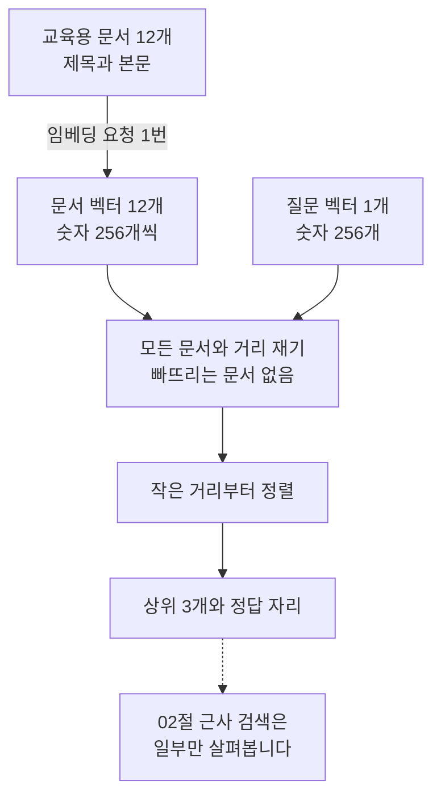
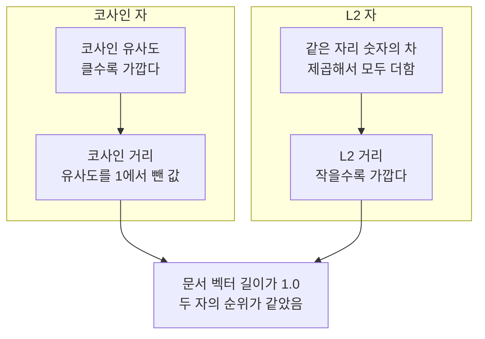
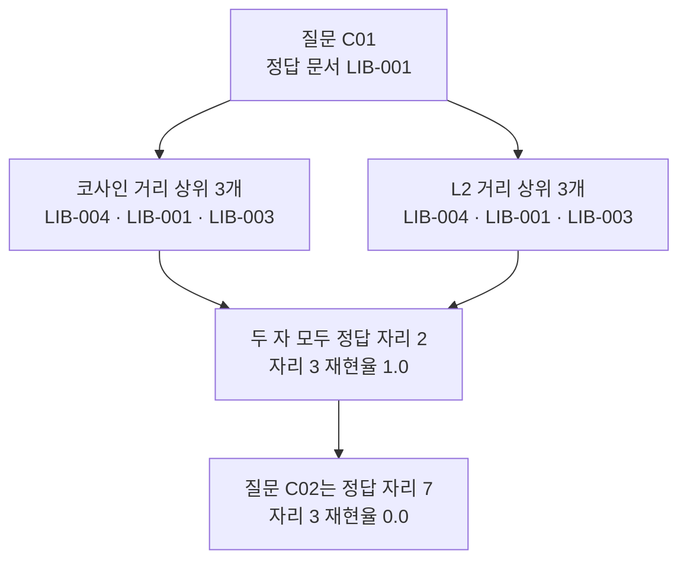
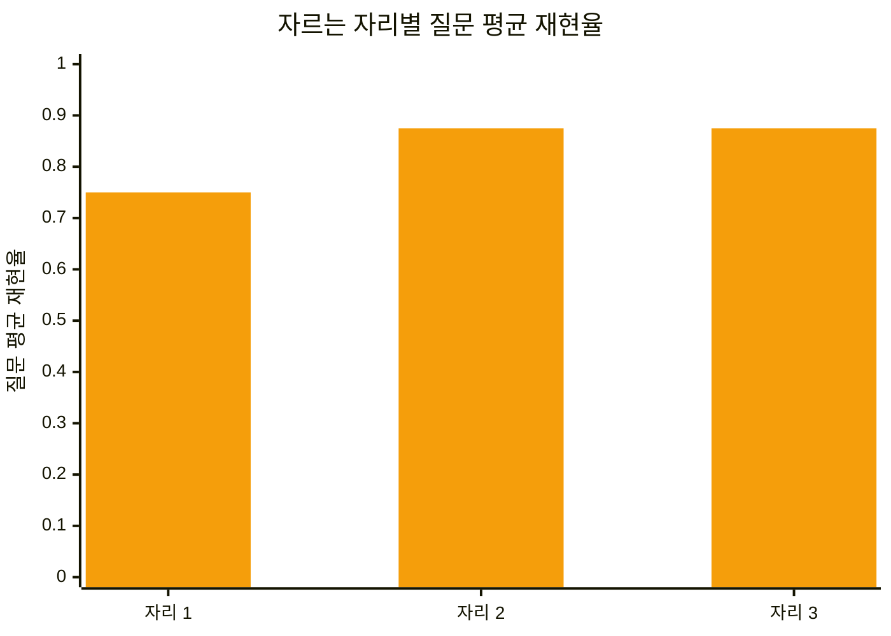

# 01-벡터-거리와-정확-검색

## _src 본문 (HTML 원본)

```html
<!--meta: 강의 1h | 실습 2h | 코드 notebooks/01-벡터-거리와-정확-검색.ipynb | 새 용어 5 -->
<h2 id="b1"><span class="no">1</span>학습 목표</h2><div class="goal"><ul><li>이 절을 마치면 코사인 유사도와 L2 거리가 무엇을 비교하는지 설명할 수 있습니다.</li><li>질문 벡터를 문서 벡터 모두와 재어 가까운 순서를 만들 수 있습니다.</li><li>같은 질문에서 자만 바꿔 순위와 재현율이 달라지는지 확인할 수 있습니다.</li></ul></div>
<h2 id="b2"><span class="no">2</span>이 내용을 배우는 이유</h2><p>검색을 빠르게 하는 색인을 평가하려면 먼저 견줄 기준이 있어야 합니다. 정확 검색은 질문을 문서 모두와 비교합니다. 문서가 많아지면 계산할 값이 늘어납니다. 그래도 후보를 미리 줄이지 않으므로 빠지는 문서가 없습니다.</p><p>그래서 정확 검색의 순위는 뒤 절의 검색 결과를 견줄 기준선이 됩니다. 이 절은 교육용 문서 12개를 모두 비교합니다. 02절에서 같은 벡터를 pgvector 색인에 넣고 두 결과를 대조합니다.</p>
<h2 id="b3"><span class="no">3</span>앞에서 배운 내용</h2><p>Ch 5 02절에서 글을 숫자 목록인 임베딩 벡터로 바꾸고 코사인 유사도를 직접 계산했습니다. 같은 계산을 NumPy의 <code>@</code>와 <code>np.linalg.norm()</code>으로 짧게 적는 방법도 그 절에서 배웠습니다. Ch 9 03절은 그 식으로 벡터스토어 점수를 확인했습니다. 이 절은 그 계산을 함수 <code>cosine_similarity()</code>로 가져오고 거리 함수 두 개를 NumPy로 새로 만듭니다.</p><p>Ch 10 07절에서 임베딩 벡터의 숫자 개수를 <code>dimensions</code> 인자로 정했습니다. Ch 11은 정답 문서 ID와 고유 문서 목록, 자르는 자리, 재현율, 질문 평균을 가르쳤습니다. 이 절은 Ch 11의 함수 네 개를 같은 인자 모양 그대로 가져와 씁니다.</p><p>노트북은 앞에서 배운 함수 다섯 개를 실습 폴더의 도구 파일 <code>notebooks/rag_tools.py</code>에서 한 줄로 가져옵니다. 파일을 열면 함수마다 어느 절에서 배웠는지 적혀 있습니다.</p>
<h2 id="b4"><span class="no">4</span>핵심 개념</h2><h3>비유로 시작하기</h3><p>책 열두 권이 놓인 책상 가운데에 질문을 적은 노란 쪽지를 둡니다. 쪽지에서 책마다 실을 한 줄씩 이어 길이를 잽니다. 열두 권 모두에 실이 있으므로 빠뜨린 책이 없습니다. 짧은 실 세 줄을 고르면 그것이 상위 3개입니다.</p>
{{img:01-5-쪽지와-열두-권|가운데 놓인 노란 쪽지에서 뒤쪽 책 아홉 권으로 길고 옅은 실이 가고 앞쪽 책 세 권으로는 짧고 굵은 진한 실이 가는 그림|질문 쪽지 한 장에서 책 열두 권 모두로 실이 이어지고 짧은 실 세 줄만 굵습니다.}}
<p class="look"><b>그림 읽기</b> — 노란 쪽지는 질문 벡터이고 책 열두 권은 문서 12개입니다. 책등의 빈 흰 이름표는 문서 ID 자리입니다. 실 한 줄이 거리 하나이고, 실이 없는 책은 없습니다. 앞쪽에 가까이 선 책 세 권만 짧고 굵은 실로 이어져 있습니다.</p>
<table><thead><tr><th>말</th><th>뜻</th></tr></thead><tbody><tr><td>L2 거리(L2 distance)</td><td>두 벡터의 같은 자리 숫자의 차를 제곱해 더한 뒤 제곱근을 씌운 값입니다. 작을수록 가깝습니다.</td></tr><tr><td>코사인 거리(cosine distance)</td><td>코사인 유사도를 가장 큰 값 1에서 뺀 값입니다. 작을수록 가깝습니다.</td></tr><tr><td>정확 검색(exact search)</td><td>질문을 문서 모두와 재어 거리 순으로 정렬하는 검색입니다.</td></tr><tr><td>근사 검색(approximate search)</td><td>문서 일부만 살펴보고 가까운 문서를 고르는 검색입니다. 02절에서 실행합니다.</td></tr><tr><td>단위 길이 벡터(unit length vector)</td><td>길이가 1인 벡터입니다. 이번 임베딩 값이 여기에 가까웠습니다.</td></tr></tbody></table>
{{mermaid:01-1-정확-검색-흐름|위에서 아래로 내려가는 흐름도로 초록 상자 문서 12개와 문서 벡터 12개와 질문 벡터 1개가 파란 상자 모든 문서와 거리 재기로 모이고 파란 상자 정렬을 지나 노란 상자 상위 3개와 정답 자리로 가며 점선으로 회색 상자 02절 근사 검색이 붙는 그림|문서 벡터 12개와 질문 벡터 1개를 모두 재고 작은 거리부터 정렬해 상위 3개를 고릅니다.}}
<p class="look"><b>도식 읽기</b> — 위에서 아래로 읽습니다. 초록 상자 세 개가 입력이고 문서에서 벡터로 가는 화살표에 임베딩 요청 1번이 적혀 있습니다. 파란 상자 두 개가 이 절에서 직접 만드는 계산 단계입니다. 노란 상자는 출력으로 확인한 값이고, 맨 아래 회색 상자는 이 절에서 실행하지 않는 02절 몫입니다.</p>
<h3>자가 두 개이면 정렬 방향을 맞춰야 합니다</h3><p>코사인 유사도는 두 벡터가 향하는 방향이 얼마나 비슷한지 나타냅니다. 값이 클수록 가깝습니다. L2 거리는 두 점 사이의 직선거리이고 값이 작을수록 가깝습니다. 두 자를 같은 코드로 다루려면 방향을 맞춰야 합니다.</p><p>그래서 유사도를 가장 큰 값 1에서 빼 코사인 거리로 바꿉니다. 이렇게 하면 두 자 모두 작은 값부터 정렬하면 됩니다. 02절 pgvector의 <code>&lt;=&gt;</code> 연산자가 내는 값도 같은 코사인 거리입니다.</p>
{{mermaid:01-2-두-자의-방향|나란히 놓인 두 칸의 흐름도로 왼쪽 칸은 파란 상자 코사인 유사도에서 파란 상자 코사인 거리로 내려가고 오른쪽 칸은 파란 상자 같은 자리 숫자의 차에서 파란 상자 L2 거리로 내려가며 두 칸이 아래 노란 상자 문서 벡터 길이가 1.0이라 두 자의 순위가 같았음으로 모이는 그림|코사인 유사도는 클수록 가깝고 L2 거리는 작을수록 가까워 정렬 방향이 서로 반대입니다.}}
<p class="look"><b>도식 읽기</b> — 왼쪽 칸이 코사인 자이고 오른쪽 칸이 L2 자입니다. 두 칸 모두 위에서 아래로 읽습니다. 두 칸의 파란 상자는 이 절에서 만든 계산 단계입니다. 두 칸이 만나는 아래 노란 상자는 출력으로 확인한 값입니다. 문서 벡터 길이가 소수 둘째 자리에서 모두 1.0이었고 두 자의 순위가 같았습니다.</p>
<h2 id="b5"><span class="no">5</span>실행 예제</h2><p>교육용 문서 12개와 질문 8개를 숫자 256개짜리 벡터로 바꿉니다. 첫 질문에서 코사인 거리와 L2 거리를 각각 재어 상위 3개를 견줍니다. 그다음 질문 여덟 개로 넓혀 정답 자리와 재현율을 봅니다. 임베딩 요청은 문서 한 번과 질문 여덟 번으로 모두 아홉 번입니다.</p>
{{notebook:01-벡터-거리와-정확-검색}}
{{mermaid:01-3-첫-질문-상위-세-개|위에서 아래로 내려가는 흐름도로 초록 상자 질문 C01에서 노란 상자 코사인 거리 상위 3개와 노란 상자 L2 거리 상위 3개로 갈라졌다가 노란 상자 두 자 모두 정답 자리 2로 모이고 그 아래 노란 상자 질문 C02는 정답 자리 7이 붙는 그림|질문 C01의 상위 3개가 두 자에서 같고 정답 문서 LIB-001은 두 자 모두 자리 2에 있습니다.}}
<p class="look"><b>도식 읽기</b> — 맨 위 초록 상자가 질문이고 정답 문서 ID를 함께 적었습니다. 가운데 두 노란 상자는 실행 1과 실행 2의 상위 3개입니다. 세 문서 ID와 순서가 같습니다. 아래 두 노란 상자는 정답 자리이고, 맨 아래 상자는 여덟 질문 가운데 정답 자리가 가장 뒤였던 질문입니다.</p>
<p class="look"><b>확인할 점</b> — 문서 벡터는 12개이고 벡터마다 숫자가 256개입니다. 첫 문서 벡터의 길이는 소수 둘째 자리에서 <code>1.0</code>입니다. 첫 질문에서 두 자의 상위 3개는 <code>LIB-004</code>·<code>LIB-001</code>·<code>LIB-003</code>으로 같았습니다. 거리 값의 크기만 달랐습니다.</p>
<h2 id="b6"><span class="no">6</span>실험 결과 해석</h2><p>질문 여덟 개에서 정답 자리와 자르는 자리 세 개, 네 칸이 모두 같았습니다. 문서 벡터가 단위 길이에 가까워 한쪽 거리가 커질 때 다른 쪽도 커졌기 때문입니다. 노트북 5절 「두 가지 자 만들기」에서 두 값의 관계를 숫자로 확인했습니다.</p>
{{mermaid:01-4-자리별-질문-평균|가로축이 자리 1과 자리 2와 자리 3이고 세로축이 0에서 1까지인 주황 막대 그림으로 자리 1은 0.75 자리 2와 자리 3은 0.875인 막대가 있는 그림|자르는 자리를 1에서 2로 넓히면 질문 평균 재현율이 0.75에서 0.875로 올라가고 자리 3에서는 그대로입니다.}}
<p class="look"><b>도식 읽기</b> — 주황 막대 세 개가 자르는 자리별 질문 평균 재현율입니다. 코사인과 L2의 값이 같아 막대를 한 계열로만 그렸습니다. 자리 1에서 0.75이고 자리 2에서 0.875로 올라갑니다. 자리 2에서 올라간 값은 질문 <code>C01</code>의 정답 문서가 자리 2였기 때문입니다. 자리 3에서 값이 그대로인 것은 남은 질문 <code>C02</code>의 정답 자리가 7이기 때문입니다.</p>
<p>이 값은 두 자 가운데 어느 쪽이 나은지 가르지 못합니다. 문서가 12개뿐이고 질문이 8개이며 각 질문을 한 번만 실행했습니다. 두 자가 같았다는 결과도 이번 임베딩 값에서 본 것입니다. 길이가 1이 아닌 벡터에서는 이번에 실행하지 않았습니다.</p>
<h2 id="b7"><span class="no">7</span>주의할 점과 실무 메모</h2><ul><li>유사도는 클수록 가깝고 거리는 작을수록 가깝습니다. 정렬 방향을 바꾸면 결과가 거꾸로 나옵니다.</li><li>모델과 차원 수가 다른 벡터를 같은 검색 공간에서 비교하지 않습니다.</li><li>이 챕터는 벡터의 숫자 개수를 256으로 고정합니다. 02절 pgvector 표의 벡터 칸과 12절 실험 기록이 같은 값을 쓰기 때문입니다. Ch 10 08절 색인은 인자 없이 1536이었으므로 두 색인의 점수를 나란히 놓지 않습니다.</li><li>거리 값은 소수 셋째 자리 아래가 실행마다 달라졌습니다. 같은 글을 보내도 임베딩 값이 조금 달라지기 때문입니다. 그래서 둘째 자리까지만 출력하고 그림 라벨에는 거리 값을 넣지 않았습니다.</li><li>이 절의 문서 12개와 질문 8개는 이 챕터 앞부분 여섯 절이 쓰는 교육용 자료입니다. Ch 11 개발 분할 15문항에서 얻은 값과 나란히 놓지 않습니다. 말뭉치와 질문 묶음과 자르는 자리가 모두 다릅니다.</li><li>Ch 11은 개발 분할 15문항으로 설정을 고르고 시험 분할 15문항은 마지막에 한 번만 쓰기로 약속했습니다. 그 평가셋은 07절부터 쓰고, 이 약속도 그때 지킵니다.</li><li>이 절은 문서가 12개라 자르는 자리를 1·2·3으로 두었습니다. 자리 12까지 넓히면 재현율이 1.0이 되므로 자를 고르는 데 쓸 수 없습니다.</li></ul>
<h2 id="b8"><span class="no">8</span>정리와 다음 절</h2><ul><li>정확 검색은 질문 벡터를 문서 벡터 모두와 재므로 후보에서 빠지는 문서가 없습니다.</li><li>코사인 유사도를 1에서 빼면 L2 거리와 같은 방향의 자가 됩니다.</li><li>이번 실행에서는 문서 벡터가 단위 길이에 가까워 두 자의 순위와 재현율이 같았습니다.</li></ul><p><strong>다음 학습과 이어지는 지점</strong> — 02절에서는 같은 문서 12개 벡터를 pgvector 표에 넣고 HNSW 색인으로 검색합니다. 이 절의 정확 검색 순위가 그 결과를 견줄 기준선입니다.</p>
<h2 id="b9"><span class="no">9</span>복습 문제</h2><details class="quiz" open><summary>문제 4개 · 해설 포함</summary><p class="quiz-q">1. 정확 검색이 근사 검색의 기준선이 되는 까닭은 무엇입니까?</p><p class="quiz-a">문서를 모두 재므로 후보에서 빠지는 문서가 없습니다. 근사 색인이 무엇을 놓쳤는지 견줄 수 있습니다. 틀렸다면 「이 내용을 배우는 이유」를 다시 읽습니다.</p><p class="quiz-q">2. 코사인 유사도 0.8과 0.5 가운데 어느 문서가 더 가깝습니까?</p><p class="quiz-a">0.8인 문서입니다. 유사도는 큰 값이 더 가깝습니다. 틀렸다면 「핵심 개념」의 용어 표를 다시 읽습니다.</p><p class="quiz-q">3. 코사인 유사도를 코사인 거리로 바꾸는 까닭은 무엇입니까?</p><p class="quiz-a">두 자를 같은 방향으로 맞추려고 바꿉니다. 거리로 바꾸면 작은 값부터 정렬하는 코드 하나로 둘을 다룰 수 있습니다. 틀렸다면 「자가 두 개이면 정렬 방향을 맞춰야 합니다」를 다시 읽습니다.</p><p class="quiz-q">4. 이번 실험에서 두 자의 재현율이 같았으므로 언제나 같다고 말할 수 있습니까?</p><p class="quiz-a">말할 수 없습니다. 이번 문서 벡터가 단위 길이에 가까웠기 때문입니다. 길이가 1이 아닌 벡터에서는 이번에 실행하지 않았습니다. 틀렸다면 「실험 결과 해석」을 다시 읽습니다.</p></details>
<h2 id="b10"><span class="no">10</span>참고 자료</h2><ul><li><div><a href="https://github.com/pgvector/pgvector/tree/v0.8.6#querying">pgvector Querying</a></div>거리 연산자 설명 · 확인 2026-09-18</li><li><div><a href="https://platform.openai.com/docs/guides/embeddings">OpenAI Embeddings guide</a></div>임베딩 모델과 차원 수 설명 · 확인 2026-09-18</li></ul>
```

## 노트북 셀 (순서대로)

### [0] markdown {'html': 'skip'}

# 벡터 거리와 정확 검색

**이 노트북에서 할 일**

1. 교육용 문서 12개와 질문 8개를 숫자 256개짜리 벡터로 바꿉니다.
2. NumPy로 벡터 길이를 재고 코사인 거리와 L2 거리, 두 가지 자를 만듭니다.
3. 질문 하나를 문서 12개 모두와 재어 가까운 순서를 만듭니다.
4. 자만 코사인 거리에서 L2 거리로 바꿔 순위와 재현율을 견줍니다.

**준비물** — 프로젝트 맨 위 `.env` 파일의 `OPENAI_API_KEY`가 필요합니다.
읽는 자료는 문서 파일과 질문 파일 두 개입니다.
임베딩 요청은 문서 한 번과 질문 여덟 번으로 모두 아홉 번입니다.
보내는 글은 문서 712자와 질문 155자를 더해 900자 아래이고, 예상 비용은 0.01달러 아래입니다.
실행 시간은 30초 안팎입니다.

**데이터** — 두 파일 모두 실습 묶음에 들어 있습니다.

- 문서 `labs/part3/ch12-retrieval-tuning/data/core-documents.json`(12개)
- 질문 `labs/part3/ch12-retrieval-tuning/data/core-queries.json`(8개)

**강의와 실습 범위** — 강의 시간에는 2~5절과 7·8절을 읽습니다.
자료 살펴보기, 벡터 만들기, 벡터 길이, 두 가지 자, 실행 1과 실행 2입니다.
Ch 5·Ch 11에서 배운 함수는 도구 파일에서 가져오므로 다시 적지 않습니다.
6절과 9~12절은 함께 실행하고 실습 시간에 다시 읽습니다.

**기준 버전** — 첫 셀에서 langchain-openai 1.6.1과 python-dotenv 1.2.3을 설치합니다.
벡터 계산에 쓰는 numpy 2.5.3도 함께 설치합니다.
교재 출력은 Linux의 Python 3.12.13으로 만들었습니다.
다른 버전과 Windows·macOS에서는 이번에 실행하지 않았습니다.

실습 폴더 `labs/part3/ch12-retrieval-tuning`에서 `uv sync --locked`를 실행합니다.
그다음 이 폴더의 `.venv` 커널을 고르고 첫 셀부터 순서대로 실행합니다.

### [1] markdown {'html': 'skip'}

## 오늘 볼 그림


정확 검색은 질문 벡터 하나를 문서 벡터 열두 개 모두와 잽니다.
빠뜨리는 문서가 없으므로 뒤 절의 근사 검색이 무엇을 놓쳤는지 견줄 기준선이 됩니다.
맨 아래 회색 상자는 이 노트북에서 실행하지 않는 단계입니다.

### [2] markdown {}

## 1. 준비

첫 셀은 패키지 세 개를 설치하고 설치된 버전을 출력합니다.
설치에는 몇십 초가 걸릴 수 있습니다.

### [3] code {'execution': {'iopub.execute_input': '2026-09-21T07:40:01.050710Z', 'iopub.status.busy': '2026-09-21T07:40:01.050535Z', 'iopub.status.idle': '2026-09-21T07:40:01.597621Z', 'shell.execute_reply': '2026-09-21T07:40:01.597092Z'}, 'lesson_role': 'setup'}

```python
# 이 절에서 쓰는 패키지를 설치하고 버전을 확인합니다
%pip install -q "langchain-openai==1.6.1" "python-dotenv==1.2.3" "numpy==2.5.3"
from importlib.metadata import version

print("langchain-openai:", version("langchain-openai"))
print("python-dotenv:", version("python-dotenv"))
print("numpy:", version("numpy"))
```

출력:
```
Note: you may need to restart the kernel to use updated packages.
langchain-openai: 1.6.1
python-dotenv: 1.2.3
numpy: 2.5.3

```

### [4] markdown {}

**결과 읽기** — 설치가 끝나면 `langchain-openai: 1.6.1`과 `python-dotenv: 1.2.3`이 보입니다.
셋째 줄 `numpy: 2.5.3`도 보입니다. 세 줄이 모두 보이면 다음 셀로 넘어갑니다.

다음 셀은 이 절에서 쓸 이름을 불러옵니다.
패키지 NumPy는 Ch 5 02절에서 코사인 유사도를 계산할 때 쓴 패키지입니다. 같은 짧은 이름 `np`로 불러옵니다.
자료 파일을 딕셔너리로 바꿀 때는 `json`을 씁니다.

앞에서 배운 함수는 `rag_tools.py`에 모아 두었습니다. 파일을 열면 코드를 볼 수 있습니다. 노트북과 같은 폴더(`notebooks/`)에 있는 파일입니다.
이 노트북은 Ch 5 02절 `cosine_similarity()`와 Ch 11 지표 함수 네 개를 가져옵니다.
Ch 11 01절 `unique_doc_ids()`·`find_gold_rank()`, 02절 `recall_at()`·`mean_score()`입니다.

### [5] code {'execution': {'iopub.execute_input': '2026-09-21T07:40:01.598759Z', 'iopub.status.busy': '2026-09-21T07:40:01.598663Z', 'iopub.status.idle': '2026-09-21T07:40:02.678001Z', 'shell.execute_reply': '2026-09-21T07:40:02.677618Z'}, 'lesson_role': 'setup'}

```python
# 자료 파일 읽기·벡터 계산·임베딩에 쓸 이름을 불러옵니다
import json

import numpy as np
from langchain_openai import OpenAIEmbeddings
# Ch 5 02절과 Ch 11 01·02절 함수 다섯 개를 도구 파일에서 가져옵니다
from rag_tools import cosine_similarity, find_gold_rank, mean_score
from rag_tools import recall_at, unique_doc_ids

print("불러온 이름:", "json", "numpy", "OpenAIEmbeddings")
```

출력:
```
불러온 이름: json numpy OpenAIEmbeddings

```

### [6] markdown {}

**결과 읽기** — 출력 줄은 `불러온 이름: json numpy OpenAIEmbeddings` 하나입니다.
이름 `json`은 Python에 들어 있어 설치가 필요 없습니다.
도구 파일에서 가져온 함수 다섯 개는 출력하지 않습니다.

다음 셀은 API 키가 있는지 확인합니다. `True` 값이 나오면 다음으로 넘어갑니다.

### [7] code {'execution': {'iopub.execute_input': '2026-09-21T07:40:02.678733Z', 'iopub.status.busy': '2026-09-21T07:40:02.678645Z', 'iopub.status.idle': '2026-09-21T07:40:02.682178Z', 'shell.execute_reply': '2026-09-21T07:40:02.681796Z'}, 'lesson_role': 'setup'}

```python
# .env 파일에서 OpenAI API 키를 읽습니다(키 값은 출력하지 않습니다)
import os
from dotenv import find_dotenv, load_dotenv

env_path = find_dotenv(usecwd=True)
load_dotenv(env_path)
has_key = os.getenv("OPENAI_API_KEY") is not None
print("OPENAI_API_KEY 설정 여부:", has_key)
assert has_key, "프로젝트 폴더의 .env 파일에 OPENAI_API_KEY를 적어 주세요."
```

출력:
```
OPENAI_API_KEY 설정 여부: True

```

### [8] markdown {}

**결과 읽기** — 출력 줄은 `OPENAI_API_KEY 설정 여부: True`입니다.
키 값은 출력하지 않습니다.

다음 셀은 프로젝트 맨 위 폴더를 찾습니다.
Ch 10 01절·Ch 11 01절과 같은 코드입니다. 후보 경로를 차례로 보고 자료 폴더가 있는 곳에서 멈춥니다.

### [9] code {'execution': {'iopub.execute_input': '2026-09-21T07:40:02.682726Z', 'iopub.status.busy': '2026-09-21T07:40:02.682673Z', 'iopub.status.idle': '2026-09-21T07:40:02.684520Z', 'shell.execute_reply': '2026-09-21T07:40:02.684220Z'}, 'lesson_role': 'setup'}

```python
# 노트북을 어느 폴더에서 열어도 프로젝트 맨 위를 찾게 후보 세 개를 차례로 봅니다
candidates = [".", "../../..", "../../../.."]
root_path = None
for candidate in candidates:
    if os.path.exists(candidate + "/labs/part3/ch12-retrieval-tuning/data"):
        root_path = candidate
        break
print("고른 경로:", root_path)
assert root_path is not None, "notebooks 폴더나 실습 폴더 맨 위에서 노트북을 열어 주세요."
```

출력:
```
고른 경로: .

```

### [10] markdown {}

**결과 읽기** — 출력 줄은 `고른 경로: .`입니다. `assert`도 통과했습니다.
교재 출력은 프로젝트 맨 위를 작업 폴더로 삼아 실행해서 첫째 후보를 골랐습니다.
`notebooks` 폴더에서 열면 셋째 후보, 실습 폴더 맨 위에서 열면 둘째 후보가 나옵니다.

다음 셀은 문서 파일과 질문 파일을 읽습니다.

### [11] code {'execution': {'iopub.execute_input': '2026-09-21T07:40:02.685125Z', 'iopub.status.busy': '2026-09-21T07:40:02.685065Z', 'iopub.status.idle': '2026-09-21T07:40:02.687446Z', 'shell.execute_reply': '2026-09-21T07:40:02.687114Z'}, 'lesson_role': 'setup'}

```python
# 이 절에서 읽을 문서 파일과 질문 파일을 불러옵니다
data_path = root_path + "/labs/part3/ch12-retrieval-tuning/data"
with open(data_path + "/core-documents.json", encoding="utf-8") as file:
    docs = json.loads(file.read())
with open(data_path + "/core-queries.json", encoding="utf-8") as file:
    queries = json.loads(file.read())
print("문서 수:", len(docs))
print("질문 수:", len(queries))
```

출력:
```
문서 수: 12
질문 수: 8

```

### [12] markdown {}

**결과 읽기** — `문서 수: 12`와 `질문 수: 8`이 보입니다.
이 문서 12개는 이 챕터 앞부분 여섯 절이 함께 쓰는 교육용 자료입니다.
Ch 9~Ch 11이 쓴 미르시립도서관 PDF와는 다른 파일입니다.

## 2. 문서와 질문 살펴보기

문서 한 개와 질문 한 개를 펼쳐 칸 이름을 확인합니다.
정답 문서 ID가 어느 칸에 들어 있는지 먼저 보아야 뒤에서 재현율을 낼 수 있습니다.

### [13] code {'execution': {'iopub.execute_input': '2026-09-21T07:40:02.687948Z', 'iopub.status.busy': '2026-09-21T07:40:02.687887Z', 'iopub.status.idle': '2026-09-21T07:40:02.689580Z', 'shell.execute_reply': '2026-09-21T07:40:02.689284Z'}}

```python
# 문서 한 개와 질문 한 개의 칸 이름과 값을 봅니다
first_doc = docs[0]
first_query = queries[0]
print("문서의 칸 이름:", first_doc.keys())
print("첫 문서:", first_doc["doc_id"], "|", first_doc["category"], "|", first_doc["title"])
print("질문의 칸 이름:", first_query.keys())
print("첫 질문:", first_query["qid"], "|", first_query["question"])
print("첫 질문의 정답 문서 ID:", first_query["gold_doc_id"])
```

출력:
```
문서의 칸 이름: dict_keys(['doc_id', 'category', 'title', 'text'])
첫 문서: LIB-001 | library | 도서 대출 기간
질문의 칸 이름: dict_keys(['qid', 'question', 'gold_doc_id', 'kind'])
첫 질문: C01 | 책을 빌릴 수 있는 기간은 며칠인가요?
첫 질문의 정답 문서 ID: LIB-001

```

### [14] markdown {}

**결과 읽기** — 문서의 칸은 `doc_id`·`category`·`title`·`text` 네 개입니다.
첫 문서는 `LIB-001`이고 갈래는 `library`, 제목은 「도서 대출 기간」입니다.
질문의 칸은 `qid`·`question`·`gold_doc_id`·`kind` 네 개이고 첫 질문은 `C01`입니다.
정답 문서 ID 칸 이름이 `gold_doc_id` 하나짜리 글이라는 점을 기억해 둡니다.
Ch 11 평가셋은 같은 뜻을 목록 칸 `gold_doc_ids`로 담았습니다.

다음 셀은 임베딩 모델과 벡터의 숫자 개수를 정합니다.
이 챕터는 숫자 256개로 고정합니다. 02절 pgvector 표의 벡터 칸도 같은 256입니다.

### [15] code {'execution': {'iopub.execute_input': '2026-09-21T07:40:02.690104Z', 'iopub.status.busy': '2026-09-21T07:40:02.690051Z', 'iopub.status.idle': '2026-09-21T07:40:03.007382Z', 'shell.execute_reply': '2026-09-21T07:40:03.006974Z'}}

```python
# 이 챕터가 쓸 임베딩 모델과 벡터의 숫자 개수를 정합니다(요청은 아직 보내지 않습니다)
embedding_model_name = "text-embedding-3-small"
vector_dimensions = 256
embedding_model = OpenAIEmbeddings(model=embedding_model_name, dimensions=vector_dimensions)
print("임베딩 모델 이름:", embedding_model.model)
print("벡터의 숫자 개수 설정:", embedding_model.dimensions)
```

출력:
```
임베딩 모델 이름: text-embedding-3-small
벡터의 숫자 개수 설정: 256

```

### [16] markdown {}

**결과 읽기** — `임베딩 모델 이름: text-embedding-3-small`과 `벡터의 숫자 개수 설정: 256`이 보입니다.
이 셀은 객체만 만들므로 요청을 보내지 않습니다.
이 노트북의 출력은 2026-09-21에 이 모델로 실행한 결과입니다.

다음 셀은 이 절에서 되풀이해 쓸 값에 이름을 붙입니다.

### [17] code {'execution': {'iopub.execute_input': '2026-09-21T07:40:03.008012Z', 'iopub.status.busy': '2026-09-21T07:40:03.007958Z', 'iopub.status.idle': '2026-09-21T07:40:03.009600Z', 'shell.execute_reply': '2026-09-21T07:40:03.009313Z'}}

```python
# 이 절에서 되풀이해 쓸 값에 이름을 붙입니다
similarity_top = 1
doubling_factor = 2
cutoff_values = [1, 2, 3]
cutoff_three = 3
print("코사인 유사도의 가장 큰 값:", similarity_top)
print("자르는 자리 세 가지:", cutoff_values)
```

출력:
```
코사인 유사도의 가장 큰 값: 1
자르는 자리 세 가지: [1, 2, 3]

```

### [18] markdown {}

**결과 읽기** — `코사인 유사도의 가장 큰 값: 1`과 `자르는 자리 세 가지: [1, 2, 3]`이 보입니다.
자르는 자리는 순위 목록을 앞에서 몇 개까지 볼지 정한 약속입니다.
Ch 11은 쪽 90개를 색인해서 자리 5와 자리 50을 썼습니다.
이 절은 문서가 12개뿐이라 자리 1·2·3으로 좁혔습니다.

## 3. 벡터로 바꾸기

문서 12개를 한 번에 임베딩합니다.
제목과 본문을 한 칸 띄어 이어 붙인 글을 보냅니다.

### [19] code {'execution': {'iopub.execute_input': '2026-09-21T07:40:03.010188Z', 'iopub.status.busy': '2026-09-21T07:40:03.010141Z', 'iopub.status.idle': '2026-09-21T07:40:03.472690Z', 'shell.execute_reply': '2026-09-21T07:40:03.471718Z'}}

```python
# 문서 12개의 제목과 본문을 이어 붙여 한 번에 임베딩합니다(임베딩 요청 1번)
doc_texts = []
doc_ids = []
for doc in docs:
    doc_texts.append(doc["title"] + " " + doc["text"])
    doc_ids.append(doc["doc_id"])
doc_vectors = embedding_model.embed_documents(doc_texts)
print("문서 벡터 수:", len(doc_vectors))
print("첫 문서 벡터의 숫자 개수:", len(doc_vectors[0]))
print("문서 ID 목록:")
print(doc_ids)
```

출력:
```
문서 벡터 수: 12
첫 문서 벡터의 숫자 개수: 256
문서 ID 목록:
['LIB-001', 'LIB-002', 'LIB-003', 'LIB-004', 'FAC-001', 'FAC-002', 'FAC-003', 'FAC-004', 'ACC-001', 'ACC-002', 'ACC-003', 'ACC-004']

```

### [20] markdown {}

**결과 읽기** — `문서 벡터 수: 12`와 `첫 문서 벡터의 숫자 개수: 256`이 보입니다.
문서 ID 목록은 라벨 줄 아래에 한 줄로 나옵니다. `LIB-001`부터 `ACC-004`까지 열두 개입니다.
문서 열두 개를 한 번에 보냈으므로 임베딩 요청은 한 번입니다.

다음 셀은 질문 여덟 개를 하나씩 임베딩합니다.

### [21] code {'execution': {'iopub.execute_input': '2026-09-21T07:40:03.474776Z', 'iopub.status.busy': '2026-09-21T07:40:03.474616Z', 'iopub.status.idle': '2026-09-21T07:40:04.634025Z', 'shell.execute_reply': '2026-09-21T07:40:04.633019Z'}}

```python
# 질문 8개를 하나씩 임베딩해 질문 벡터 목록을 만듭니다(임베딩 요청 8번)
query_vectors = []
for query in queries:
    query_vectors.append(embedding_model.embed_query(query["question"]))
print("질문 벡터 수:", len(query_vectors))
print("첫 질문 벡터의 숫자 개수:", len(query_vectors[0]))
```

출력:
```
질문 벡터 수: 8
첫 질문 벡터의 숫자 개수: 256

```

### [22] markdown {}

**결과 읽기** — `질문 벡터 수: 8`과 `첫 질문 벡터의 숫자 개수: 256`이 보입니다.
질문은 하나씩 보내므로 요청이 여덟 번입니다. 여기까지 요청은 모두 아홉 번입니다.
문서 벡터와 질문 벡터의 숫자 개수가 같아야 같은 자로 잴 수 있습니다.

## 4. 벡터 길이 재기

벡터 길이는 같은 자리 숫자를 제곱해 모두 더한 뒤 제곱근을 씌운 값입니다.
Ch 5 02절에서 NumPy 함수 `np.linalg.norm()`으로 벡터 하나의 길이를 쟀습니다.
길이가 모두 1에 가까우면 두 가지 자의 순위가 비슷해질 수 있습니다.

다음 셀은 문서 벡터 열두 개를 표 하나로 묶어 길이를 한꺼번에 잽니다.
속성 `shape`에는 표의 행 수와 칸 수가 들어 있습니다.
인자 `axis=1`을 주면 표의 행마다 따로 길이를 잽니다.

### [23] code {'execution': {'iopub.execute_input': '2026-09-21T07:40:04.636494Z', 'iopub.status.busy': '2026-09-21T07:40:04.636291Z', 'iopub.status.idle': '2026-09-21T07:40:04.641616Z', 'shell.execute_reply': '2026-09-21T07:40:04.640599Z'}}

```python
# 문서 벡터 열두 개를 표 하나로 묶고 행마다 길이를 잽니다
doc_matrix = np.array(doc_vectors)
print("문서 벡터 표의 모양:", doc_matrix.shape)
# axis=1을 주면 표의 행(문서 벡터 하나)마다 따로 길이를 잽니다
doc_lengths = np.linalg.norm(doc_matrix, axis=1)
print("문서 벡터 길이(소수 둘째 자리):")
print(np.round(doc_lengths, 2).tolist())
```

출력:
```
문서 벡터 표의 모양: (12, 256)
문서 벡터 길이(소수 둘째 자리):
[1.0, 1.0, 1.0, 1.0, 1.0, 1.0, 1.0, 1.0, 1.0, 1.0, 1.0, 1.0]

```

### [24] markdown {}

**결과 읽기** — 출력 줄 `문서 벡터 표의 모양: (12, 256)`은 행 12개와 칸 256개라는 뜻입니다.
행 하나가 문서 벡터 하나입니다.
라벨 줄 아래에 길이 열두 개가 한 줄로 나옵니다. 모두 `1.0`입니다.

소수 셋째 자리 아래는 실행마다 조금 달라지므로 `np.round()`로 둘째 자리까지만 남겼습니다.
길이를 1로 맞춘 벡터를 단위 길이 벡터라고 부릅니다.
이 임베딩 모델은 따로 맞추지 않아도 단위 길이에 가까운 값을 보냈습니다.

## 5. 두 가지 자 만들기

코사인 유사도는 점곱을 두 길이의 곱으로 나눈 값입니다.
Ch 5 02절에서 배운 이 계산을 NumPy로 적은 함수 `cosine_similarity()`를 준비 셀에서 가져왔습니다.
코사인 유사도는 클수록 가깝습니다. 가까운 것부터 정렬하려면 값이 작을수록 가까운 자가 편합니다.

그래서 가장 큰 값 1에서 유사도를 뺀 값을 코사인 거리로 씁니다.
02절 pgvector의 `<=>` 연산자가 내는 값도 같은 코사인 거리입니다.

### [25] code {'execution': {'iopub.execute_input': '2026-09-21T07:40:04.643207Z', 'iopub.status.busy': '2026-09-21T07:40:04.643059Z', 'iopub.status.idle': '2026-09-21T07:40:04.645789Z', 'shell.execute_reply': '2026-09-21T07:40:04.645246Z'}}

```python
# 코사인 유사도를 코사인 거리로 바꾸는 함수를 정의합니다
def cosine_distance(first, second):
    similarity = cosine_similarity(first, second)
    # 가장 큰 값 1에서 빼면 값이 작을수록 가까운 자가 됩니다
    return similarity_top - similarity
```

출력:
```

```

### [26] markdown {}

**결과 읽기** — 정의 셀이라 출력이 없습니다.

L2 거리는 두 점 사이의 직선거리입니다.
같은 자리 숫자의 차를 제곱해 모두 더한 뒤 제곱근을 씌웁니다.
NumPy 배열끼리 빼면 같은 자리 숫자끼리 뺀 배열이 나옵니다.
그 배열의 길이를 `np.linalg.norm()`으로 재면 L2 거리가 됩니다.

### [27] code {'execution': {'iopub.execute_input': '2026-09-21T07:40:04.647156Z', 'iopub.status.busy': '2026-09-21T07:40:04.647045Z', 'iopub.status.idle': '2026-09-21T07:40:04.649647Z', 'shell.execute_reply': '2026-09-21T07:40:04.649084Z'}}

```python
# 두 벡터의 L2 거리(같은 자리 숫자의 차를 제곱해 더한 뒤 제곱근을 씌운 값)를 정의합니다
def l2_distance(first, second):
    # 배열끼리 빼면 같은 자리 숫자끼리 뺀 차를 담은 배열이 나옵니다
    gap = np.array(first) - np.array(second)
    # 차를 담은 배열의 길이가 곧 L2 거리입니다
    return np.linalg.norm(gap)
```

출력:
```

```

### [28] markdown {}

**결과 읽기** — 정의 셀이라 출력이 없습니다.

다음 셀은 첫 질문과 첫 문서 사이를 두 자로 잽니다.
단위 길이 벡터에서는 L2 거리를 두 번 곱한 값이 코사인 거리의 두 배와 같아집니다.

### [29] code {'execution': {'iopub.execute_input': '2026-09-21T07:40:04.650958Z', 'iopub.status.busy': '2026-09-21T07:40:04.650842Z', 'iopub.status.idle': '2026-09-21T07:40:04.654428Z', 'shell.execute_reply': '2026-09-21T07:40:04.653815Z'}}

```python
# 첫 질문과 첫 문서 사이를 두 자로 재고 두 값의 관계를 봅니다
first_question_vector = query_vectors[0]
first_doc_vector = doc_vectors[0]
first_cosine = cosine_distance(first_question_vector, first_doc_vector)
first_l2 = l2_distance(first_question_vector, first_doc_vector)
squared_l2 = first_l2 * first_l2
doubled_cosine = first_cosine * doubling_factor
print("코사인 거리:", round(first_cosine, 2))
print("L2 거리:", round(first_l2, 2))
print("L2 거리를 두 번 곱한 값:", round(squared_l2, 2))
print("코사인 거리를 두 배로 한 값:", round(doubled_cosine, 2))
```

출력:
```
코사인 거리: 0.56
L2 거리: 1.06
L2 거리를 두 번 곱한 값: 1.12
코사인 거리를 두 배로 한 값: 1.12

```

### [30] markdown {}

**결과 읽기** — `코사인 거리: 0.56`과 `L2 거리: 1.06`이 보입니다.
두 값의 크기는 다르지만 `L2 거리를 두 번 곱한 값: 1.12`와 `코사인 거리를 두 배로 한 값: 1.12`가 같습니다.
단위 길이 벡터에서는 한쪽이 커질 때 다른 쪽도 커지므로 정렬 결과가 같아집니다.
길이가 1이 아닌 벡터에서는 이 관계가 성립하지 않습니다. 이번에 그 경우는 실행하지 않았습니다.

## 6. 정확 검색 만들기

정확 검색은 질문 벡터를 문서 벡터 모두와 재는 방법입니다.
다음 셀은 자 이름을 받아 거리 목록을 만듭니다.

### [31] code {'execution': {'iopub.execute_input': '2026-09-21T07:40:04.655750Z', 'iopub.status.busy': '2026-09-21T07:40:04.655635Z', 'iopub.status.idle': '2026-09-21T07:40:04.658627Z', 'shell.execute_reply': '2026-09-21T07:40:04.658004Z'}}

```python
# 질문 벡터 하나를 문서 벡터 열두 개 모두와 재어 거리 목록을 반환합니다
def measure_all(question_vector, distance_name):
    distance_list = []
    for doc_vector in doc_vectors:
        if distance_name == "코사인":
            distance_list.append(cosine_distance(question_vector, doc_vector))
        else:
            distance_list.append(l2_distance(question_vector, doc_vector))
    return distance_list
```

출력:
```

```

### [32] markdown {}

**결과 읽기** — 정의 셀이라 출력이 없습니다.

거리 목록을 작은 값부터 늘어놓으면 가까운 순서가 됩니다.
함수 `np.argsort(목록)`는 값을 직접 정렬하지 않고 작은 값부터 그 자리 번호를 차례로 줍니다.
다음 셀은 그 자리 번호로 문서 ID와 거리를 함께 꺼냅니다.

### [33] code {'execution': {'iopub.execute_input': '2026-09-21T07:40:04.659724Z', 'iopub.status.busy': '2026-09-21T07:40:04.659624Z', 'iopub.status.idle': '2026-09-21T07:40:04.662128Z', 'shell.execute_reply': '2026-09-21T07:40:04.661634Z'}}

```python
# 거리가 작은 문서부터 순위 목록을 만듭니다(거리는 작을수록 가깝습니다)
def rank_by_distance(id_list, distance_list):
    ranked = []
    # np.argsort(목록)는 값이 작은 것부터 그 자리 번호를 차례로 담은 배열을 반환합니다
    for position in np.argsort(distance_list):
        ranked.append({"doc_id": id_list[position], "거리": round(distance_list[position], 2)})
    return ranked
```

출력:
```

```

### [34] markdown {}

**결과 읽기** — 정의 셀이라 출력이 없습니다.

## 7. 실행 1 — 코사인 거리

실행 전에 예상해 봅니다. 첫 질문은 「책을 빌릴 수 있는 기간은 며칠인가요?」이고 정답 문서는 `LIB-001`입니다.
대출 기간을 적은 문서가 앞자리에 오면 좋겠습니다.

### [35] code {'execution': {'iopub.execute_input': '2026-09-21T07:40:04.663448Z', 'iopub.status.busy': '2026-09-21T07:40:04.663341Z', 'iopub.status.idle': '2026-09-21T07:40:04.667204Z', 'shell.execute_reply': '2026-09-21T07:40:04.666684Z'}}

```python
# 실행 1: 첫 질문을 코사인 거리로 문서 12개 모두와 재어 가까운 순서를 만듭니다
cosine_distances = measure_all(first_question_vector, "코사인")
cosine_ranked = rank_by_distance(doc_ids, cosine_distances)
print("재어 본 문서 수:", len(cosine_distances))
print("순위 | 문서 ID | 코사인 거리")
for rank_number in range(cutoff_three):
    row = cosine_ranked[rank_number]
    print(rank_number + 1, "|", row["doc_id"], "|", row["거리"])
```

출력:
```
재어 본 문서 수: 12
순위 | 문서 ID | 코사인 거리
1 | LIB-004 | 0.43
2 | LIB-001 | 0.56
3 | LIB-003 | 0.62

```

### [36] markdown {}

**결과 읽기** — `재어 본 문서 수: 12`가 보입니다. 열두 개를 하나도 빠뜨리지 않았습니다.
라벨 줄 아래 세 줄은 `1 | LIB-004 | 0.43`, `2 | LIB-001 | 0.56`, `3 | LIB-003 | 0.62`입니다.
1위는 전자책 문서 `LIB-004`이고 정답 문서 `LIB-001`은 2위입니다.
전자책 문서에도 대출 기간 7일이 적혀 있어 질문 글과 겹치는 내용이 많았습니다.

## 8. 실행 2 — 자만 L2 거리로

질문과 문서는 그대로 두고 자만 바꿉니다.
실행 전에 예상해 봅니다. 단위 길이 벡터라면 순위가 같을 것입니다.

### [37] code {'execution': {'iopub.execute_input': '2026-09-21T07:40:04.668146Z', 'iopub.status.busy': '2026-09-21T07:40:04.668059Z', 'iopub.status.idle': '2026-09-21T07:40:04.671195Z', 'shell.execute_reply': '2026-09-21T07:40:04.670606Z'}}

```python
# 실행 2: 같은 질문에서 자만 L2 거리로 바꿔 같은 순서 만들기를 되풀이합니다
l2_distances = measure_all(first_question_vector, "L2")
l2_ranked = rank_by_distance(doc_ids, l2_distances)
print("재어 본 문서 수:", len(l2_distances))
print("순위 | 문서 ID | L2 거리")
for rank_number in range(cutoff_three):
    row = l2_ranked[rank_number]
    print(rank_number + 1, "|", row["doc_id"], "|", row["거리"])
```

출력:
```
재어 본 문서 수: 12
순위 | 문서 ID | L2 거리
1 | LIB-004 | 0.93
2 | LIB-001 | 1.06
3 | LIB-003 | 1.11

```

### [38] markdown {}

**결과 읽기** — 라벨 줄 아래 세 줄은 `1 | LIB-004 | 0.93`, `2 | LIB-001 | 1.06`, `3 | LIB-003 | 1.11`입니다.
문서 ID와 순서가 실행 1과 같습니다. 거리 값의 크기만 다릅니다.
예상과 맞았습니다. 이번 실행에서는 단위 길이 벡터라 두 자의 순위가 같았습니다.

## 9. 문서 ID만 남기기

지표를 내려면 순위 목록에서 문서 ID만 뽑아야 합니다.
준비 셀에서 가져온 Ch 11 01절 함수 `unique_doc_ids()`가 중복을 뺀 문서 ID 목록을 만듭니다.
다음 셀은 두 자의 순위 목록에서 문서 ID를 뽑아 개수를 견줍니다.

### [39] code {'execution': {'iopub.execute_input': '2026-09-21T07:40:04.672144Z', 'iopub.status.busy': '2026-09-21T07:40:04.672057Z', 'iopub.status.idle': '2026-09-21T07:40:04.674794Z', 'shell.execute_reply': '2026-09-21T07:40:04.674070Z'}}

```python
# 두 자의 순위 목록에서 문서 ID만 뽑아 길이와 앞 세 개를 견줍니다
cosine_doc_ids = unique_doc_ids(cosine_ranked)
l2_doc_ids = unique_doc_ids(l2_ranked)
print("코사인 순위 항목 수:", len(cosine_ranked), "중복을 뺀 문서 수:", len(cosine_doc_ids))
print("L2 순위 항목 수:", len(l2_ranked), "중복을 뺀 문서 수:", len(l2_doc_ids))
print("코사인 앞 세 개:", cosine_doc_ids[:cutoff_three])
print("L2 앞 세 개:", l2_doc_ids[:cutoff_three])
```

출력:
```
코사인 순위 항목 수: 12 중복을 뺀 문서 수: 12
L2 순위 항목 수: 12 중복을 뺀 문서 수: 12
코사인 앞 세 개: ['LIB-004', 'LIB-001', 'LIB-003']
L2 앞 세 개: ['LIB-004', 'LIB-001', 'LIB-003']

```

### [40] markdown {}

**결과 읽기** — `코사인 순위 항목 수: 12 중복을 뺀 문서 수: 12`이고 L2도 같습니다.
이 절은 후보 한 개가 문서 한 개라 중복 제거가 목록을 바꾸지 않았습니다.
Ch 11은 후보가 쪽이어서 한 문서의 여러 쪽이 올라왔고 중복 제거가 목록을 줄였습니다.
마지막 두 줄의 목록은 모두 `['LIB-004', 'LIB-001', 'LIB-003']`입니다.

## 10. 지표 세 함수 이어 쓰기

지표 세 함수는 준비 셀에서 가져온 Ch 11 함수입니다.
함수 `find_gold_rank()`는 정답 문서가 몇 번째 자리에 있는지 찾습니다.
함수 `recall_at()`은 자르는 자리까지 자른 목록에 정답 문서가 들어온 비율을 냅니다.
함수 `mean_score()`는 질문마다 낸 점수를 같은 무게로 평균합니다.

다음 셀은 첫 질문에서 두 자의 정답 자리와 재현율을 봅니다.
Ch 11 함수는 정답 문서 ID를 목록으로 받으므로 글 하나를 목록에 담아 넘깁니다.

### [41] code {'execution': {'iopub.execute_input': '2026-09-21T07:40:04.676355Z', 'iopub.status.busy': '2026-09-21T07:40:04.676234Z', 'iopub.status.idle': '2026-09-21T07:40:04.678881Z', 'shell.execute_reply': '2026-09-21T07:40:04.678485Z'}}

```python
# 첫 질문의 정답 자리와 자르는 자리별 재현율을 두 자에서 봅니다
first_gold_doc_ids = [first_query["gold_doc_id"]]
print("정답 문서 ID:", first_gold_doc_ids)
print("코사인 정답 자리:", find_gold_rank(cosine_doc_ids, first_gold_doc_ids))
print("L2 정답 자리:", find_gold_rank(l2_doc_ids, first_gold_doc_ids))
print("코사인 자리 3 재현율:", recall_at(cosine_doc_ids, first_gold_doc_ids, cutoff_three))
print("L2 자리 3 재현율:", recall_at(l2_doc_ids, first_gold_doc_ids, cutoff_three))
```

출력:
```
정답 문서 ID: ['LIB-001']
코사인 정답 자리: 2
L2 정답 자리: 2
코사인 자리 3 재현율: 1.0
L2 자리 3 재현율: 1.0

```

### [42] markdown {}

**결과 읽기** — `정답 문서 ID: ['LIB-001']`이고 두 자 모두 `정답 자리: 2`입니다.
자리 3 재현율은 두 자 모두 `1.0`입니다. 자리 3까지 보면 정답 문서가 들어옵니다.
정답 자리가 2였으므로 자리 1까지만 보면 재현율이 0이 됩니다.

## 11. 질문 여덟 개로 넓히기

질문 하나로는 자를 고를 수 없습니다.
다음 셀은 질문 하나를 한 자로 재어 기록 한 줄을 만드는 함수입니다.

### [43] code {'execution': {'iopub.execute_input': '2026-09-21T07:40:04.679826Z', 'iopub.status.busy': '2026-09-21T07:40:04.679752Z', 'iopub.status.idle': '2026-09-21T07:40:04.682300Z', 'shell.execute_reply': '2026-09-21T07:40:04.681745Z'}}

```python
# 질문 하나를 한 자로 재어 기록 한 줄을 만듭니다
def score_one(query_index, distance_name):
    query = queries[query_index]
    gold_doc_ids = [query["gold_doc_id"]]
    distance_list = measure_all(query_vectors[query_index], distance_name)
    ranked = rank_by_distance(doc_ids, distance_list)
    found_ids = unique_doc_ids(ranked)
    row = {"자": distance_name, "질문": query["qid"]}
    row["정답 자리"] = find_gold_rank(found_ids, gold_doc_ids)
    for cutoff in cutoff_values:
        row["자리 " + str(cutoff)] = recall_at(found_ids, gold_doc_ids, cutoff)
    return row
```

출력:
```

```

### [44] markdown {}

**결과 읽기** — 정의 셀이라 출력이 없습니다.

다음 셀은 질문 여덟 개를 두 자로 모두 재어 기록 줄을 담습니다.
질문 벡터와 문서 벡터를 이미 만들어 두었으므로 임베딩 요청이 늘지 않습니다.

### [45] code {'execution': {'iopub.execute_input': '2026-09-21T07:40:04.683240Z', 'iopub.status.busy': '2026-09-21T07:40:04.683156Z', 'iopub.status.idle': '2026-09-21T07:40:04.688554Z', 'shell.execute_reply': '2026-09-21T07:40:04.688199Z'}}

```python
# 질문 여덟 개를 두 자로 모두 재어 기록 줄을 담습니다(임베딩 요청은 더 보내지 않습니다)
score_rows = []
for distance_name in ["코사인", "L2"]:
    for query_index in range(len(queries)):
        score_rows.append(score_one(query_index, distance_name))
print("담은 기록 줄 수:", len(score_rows))
```

출력:
```
담은 기록 줄 수: 16

```

### [46] markdown {}

**결과 읽기** — `담은 기록 줄 수: 16`이 보입니다. 질문 여덟 개에 자 두 가지를 곱한 수입니다.

다음 셀은 담은 줄을 표로 출력합니다.

### [47] code {'execution': {'iopub.execute_input': '2026-09-21T07:40:04.689536Z', 'iopub.status.busy': '2026-09-21T07:40:04.689462Z', 'iopub.status.idle': '2026-09-21T07:40:04.692099Z', 'shell.execute_reply': '2026-09-21T07:40:04.691603Z'}}

```python
# 자·질문·정답 자리·자리 1·자리 3 다섯 칸을 라벨 줄 아래에 차례로 출력합니다
print("자 | 질문 | 정답 자리 | 자리 1 재현율 | 자리 3 재현율")
for row in score_rows:
    print(row["자"], "|", row["질문"], "|", row["정답 자리"], "|", row["자리 1"], "|", row["자리 3"])
```

출력:
```
자 | 질문 | 정답 자리 | 자리 1 재현율 | 자리 3 재현율
코사인 | C01 | 2 | 0.0 | 1.0
코사인 | C02 | 7 | 0.0 | 0.0
코사인 | C03 | 1 | 1.0 | 1.0
코사인 | C04 | 1 | 1.0 | 1.0
코사인 | C05 | 1 | 1.0 | 1.0
코사인 | C06 | 1 | 1.0 | 1.0
코사인 | C07 | 1 | 1.0 | 1.0
코사인 | C08 | 1 | 1.0 | 1.0
L2 | C01 | 2 | 0.0 | 1.0
L2 | C02 | 7 | 0.0 | 0.0
L2 | C03 | 1 | 1.0 | 1.0
L2 | C04 | 1 | 1.0 | 1.0
L2 | C05 | 1 | 1.0 | 1.0
L2 | C06 | 1 | 1.0 | 1.0
L2 | C07 | 1 | 1.0 | 1.0
L2 | C08 | 1 | 1.0 | 1.0

```

### [48] markdown {}

**결과 읽기** — 라벨 줄 아래 열여섯 줄에서 정답 자리가 대부분 `1`입니다.
질문 `C01`은 두 자 모두 정답 자리 `2`입니다.
질문 `C02`는 두 자 모두 정답 자리 `7`이라 자리 3 재현율이 `0.0`입니다.

질문 C02는 「책을 늦게 반납하면 돈을 내나요?」입니다.
정답 문서인 연체 안내 문서에는 연체료를 부과하지 않는다고 적혀 있습니다.
질문 글과 겹치는 낱말이 적어 자리가 뒤로 밀렸습니다.
같은 질문 줄에서 코사인과 L2의 네 칸이 모두 같습니다.

## 12. 두 자와 자르는 자리 견주기

질문 평균은 질문마다 낸 점수를 같은 무게로 더해 나눈 값입니다.
자르는 자리를 넓히면 재현율이 어디까지 올라가는지 봅니다.

### [49] code {'execution': {'iopub.execute_input': '2026-09-21T07:40:04.692849Z', 'iopub.status.busy': '2026-09-21T07:40:04.692784Z', 'iopub.status.idle': '2026-09-21T07:40:04.695302Z', 'shell.execute_reply': '2026-09-21T07:40:04.694778Z'}}

```python
# 두 자의 질문 평균 재현율을 자르는 자리마다 견줍니다
print("자 | 자르는 자리 | 질문 평균 재현율")
for distance_name in ["코사인", "L2"]:
    picked = []
    for row in score_rows:
        if row["자"] == distance_name:
            picked.append(row)
    for cutoff in cutoff_values:
        scores = []
        for row in picked:
            scores.append(row["자리 " + str(cutoff)])
        print(distance_name, "|", cutoff, "|", mean_score(scores))
```

출력:
```
자 | 자르는 자리 | 질문 평균 재현율
코사인 | 1 | 0.75
코사인 | 2 | 0.875
코사인 | 3 | 0.875
L2 | 1 | 0.75
L2 | 2 | 0.875
L2 | 3 | 0.875

```

### [50] markdown {}

**결과 읽기** — 라벨 줄 아래 여섯 줄이 나옵니다.
코사인은 자리 1에서 `0.75`, 자리 2에서 `0.875`, 자리 3에서 `0.875`입니다.
L2도 세 값이 같습니다.

자리 2에서 값이 올라간 것은 질문 C01의 정답 문서가 자리 2였기 때문입니다.
자리 3에서 값이 그대로인 것은 남은 질문 C02의 정답 자리가 7이기 때문입니다.
문서가 12개뿐이라 자리 12까지 넓히면 재현율이 1.0이 됩니다.
이 값은 자를 고르는 데 쓸 수 없습니다.

## 정리

1. 정확 검색은 질문 벡터를 문서 벡터 모두와 재므로 후보에서 빠지는 문서가 없습니다.
2. 코사인 유사도는 클수록 가깝고 L2 거리는 작을수록 가까워 정렬 방향이 반대입니다. 유사도를 1에서 빼면 같은 방향의 자가 됩니다.
3. 이번 실행에서는 문서 벡터가 단위 길이라 두 자의 순위와 재현율이 모두 같았습니다.

02절에서는 같은 문서 12개 벡터를 pgvector 표에 넣고 HNSW 색인으로 검색합니다.
이 절의 정확 검색 순위가 그 결과를 견줄 기준선입니다.

## 그림

### 01-1-정확-검색-흐름.mmd



문서 벡터 12개와 질문 벡터 1개를 모두 재고 작은 거리부터 정렬해 상위 3개를 고릅니다.

### 01-2-두-자의-방향.mmd



코사인 유사도는 클수록 가깝고 L2 거리는 작을수록 가까워 정렬 방향이 서로 반대입니다.

### 01-3-첫-질문-상위-세-개.mmd



질문 C01의 상위 3개가 두 자에서 같고 정답 문서 LIB-001은 두 자 모두 자리 2에 있습니다.

### 01-4-자리별-질문-평균.mmd



자르는 자리를 1에서 2로 넓히면 질문 평균 재현율이 0.75에서 0.875로 올라가고 자리 3에서는 그대로입니다.

### 01-5-쪽지와-열두-권.prompt.md

# 01-5-쪽지와-열두-권 (Higgsfield 삽화)

설명 대상 문장(본문 b4 비유 단락): 질문 쪽지 한 장에서 열두 권 모두로 실을 이어 길이를 재고, 가장 짧은 실 세 줄을 고릅니다.

구성 요소와 배치: 가운데에 노란 정사각 쪽지 한 장(= 질문 벡터), 그 둘레에 세워 둔 책 열두 권(= 문서 12개)과 책등의 빈 흰 이름표(= 문서 ID). 쪽지에서 책등 이름표마다 가는 회색 실이 한 줄씩 이어져 실이 없는 책이 없습니다(= 정확 검색). 그 가운데 짧은 실 세 줄만 굵고 진하며, 그 세 권은 쪽지에 조금 더 가까이 서 있습니다(= 상위 3개).

시선 순서: 노란 쪽지 → 열두 줄의 실 → 굵은 실 세 줄 → 가까이 선 책 세 권.

검수 기준: 그림만 보고 「쪽지 한 장에서 모든 책으로 실이 간다」와 「짧은 실 세 줄만 굵다」가 읽히는가.

Ch 9~Ch 11 비유 계열과의 관계: 노란 쪽지 = 질문(Ch 9 03-5, Ch 11 05-5), 책과 책등 이름표 = 문서와 문서 ID(Ch 11 01-6). 실 길이 = 거리는 이 절에서 새로 정한 뜻입니다. 카드 상자(Ch 9 색인)·흰 카드(Ch 9 문서 청크)·봉투(Ch 10 출처 기록)·서랍(Ch 10 벡터 캐시)·쟁반(Ch 11 후보 목록)은 뜻이 정해져 있어 쓰지 않았습니다.

## 프롬프트

```text
Simple flat educational illustration, white background, limited soft palette,
clean outlines, plain everyday objects, no text, no letters, no numbers, no logos.

In the centre of a plain light table lies one small yellow square sticky note.
Twelve upright books stand in a wide arc around the note, each book with a small
blank white label on its spine. One thin grey thread runs from the yellow note to
every single book label, so that no book is left without a thread. Exactly three
of those threads are clearly shorter, thicker and darker than the other nine, and
the three books they reach stand slightly closer to the note. No screens, no
monitors, no people, no hands, no arrows.
```

## 상태

- 2026-09-18 · `nano_banana_pro`(응답 모델 이름 `nano_banana_2`) · 16:9 · 2k · `use_unlim: false` · 장당 2크레딧 · 2회 생성 4크레딧 · 생성 뒤 잔액 2764.5.
- 1차 job `5dc38f62-3678-401a-ad24-d93481520f26` **탈락**: 굵은 실이 두 줄뿐이었고, 그 두 줄이 가장 먼 책으로 가서 「가까운 것을 고른다」가 거꾸로 읽혔습니다. 가까이 선 책 세 권도 보이지 않았습니다.
- 2차 job `54736b6b-6faa-421c-b501-5faa652175b2` **채택**: 뒤쪽 아홉 권은 길고 옅은 실, 앞쪽 세 권은 짧고 굵은 진한 실이며 책마다 실이 하나씩 있습니다. 책 열두 권 모두 책등에 빈 흰 이름표가 있습니다.
- 2차 프롬프트는 1차 프롬프트에서 「뒤쪽에 아홉 권과 긴 옅은 실」·「앞쪽에 세 권과 짧고 굵은 진한 실」·「책마다 실은 정확히 한 줄」을 나눠 적은 판입니다.
- 저장: 폭 1100px로 줄여 `figures/01-5-쪽지와-열두-권.png`(1100 × 614). 원본 2752px는 저장하지 않았습니다. 저장 PNG를 채택 job 결과에서 같은 폭으로 줄인 그림과 픽셀 단위로 대조해 차이가 없음을 확인했고(`ImageChops.difference` 범위 `None`), 1차 탈락본과는 다름을 확인했습니다(규격 §5-4).
- 원본 해시: 1차 `ffddf09c885caeea0e5f958295840737bec1bd710d4826c6d747b079e7824f42`, 2차(채택) `478479eaebdceea2c528fd95f711f6ed6e33489e5109005af894f3eff15fcc73`.

