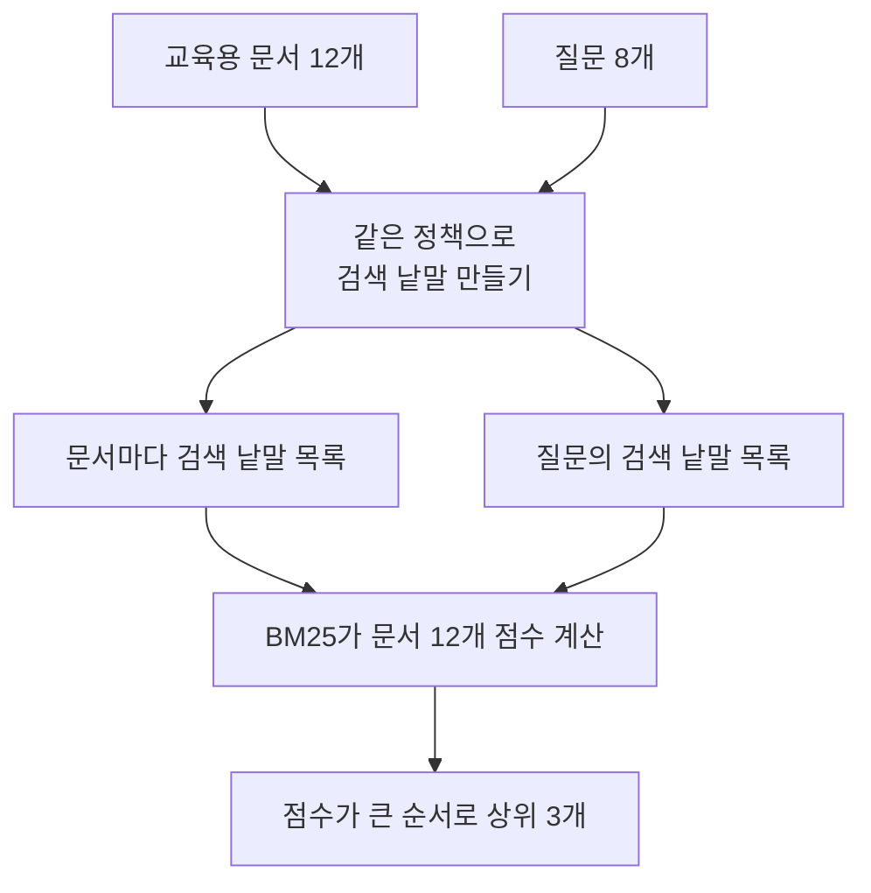
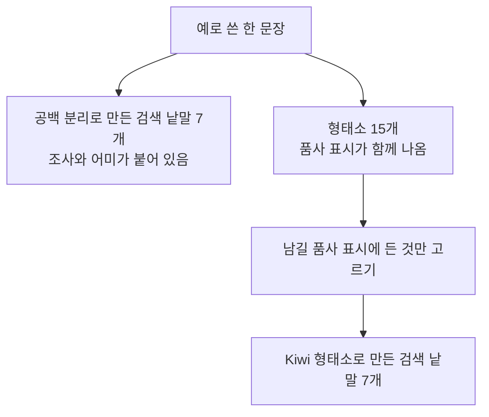
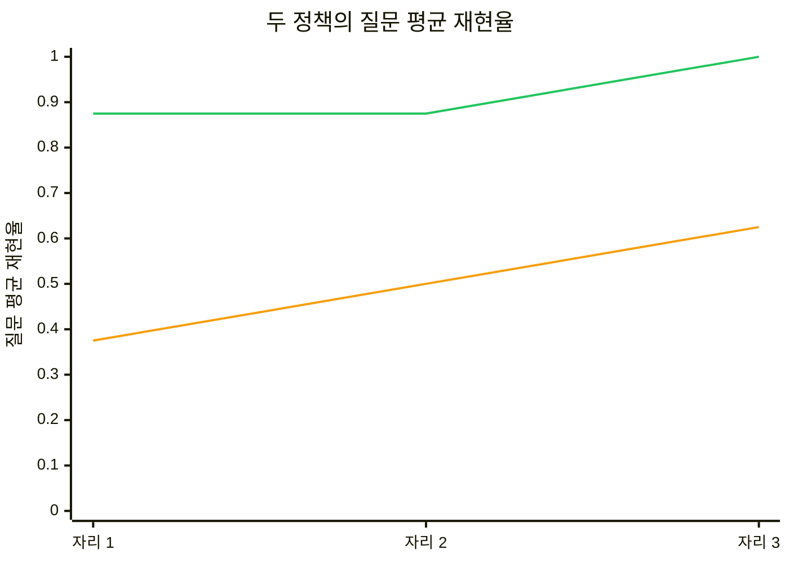
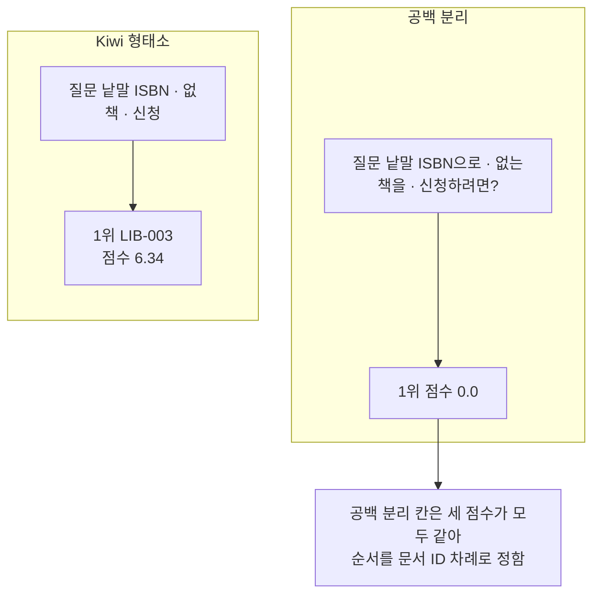

# 04-한국어-Kiwi와-BM25

## _src 본문 (HTML 원본)

```html
<!--meta: 강의 1h | 실습 3h | 코드 notebooks/04-한국어-Kiwi와-BM25.ipynb | 새 용어 7 -->
<h2 id="b1"><span class="no">1</span>학습 목표</h2><div class="goal"><ul><li>이 절을 마치면 한국어 문장에서 검색에 쓸 낱말을 형태소 단위로 만들 수 있습니다.</li><li>낱말이 겹치는 정도로 순위를 내는 BM25 점수를 읽을 수 있습니다.</li><li>낱말 정책을 바꾸면 질문 평균 재현율이 어떻게 달라지는지 확인할 수 있습니다.</li></ul></div>
<h2 id="b2"><span class="no">2</span>이 내용을 배우는 이유</h2><p>뜻이 비슷한 문서를 찾는 검색은 표현이 달라도 가까운 글을 찾아냅니다. 그런데 ISBN이나 제품 코드, 조항 이름처럼 표기가 그대로 맞아야 하는 질문도 있습니다. 이런 질문에는 같은 낱말이 문서에 있는지 보는 검색이 도움이 됩니다.</p><p>한국어는 낱말 뒤에 조사와 어미가 붙습니다. 공백으로만 나누면 <code>도서를</code>과 <code>도서</code>가 서로 다른 낱말이 됩니다. 그래서 검색에 쓸 낱말의 단위를 먼저 정해야 합니다. 이 절은 그 단위를 형태소로 잡고 점수 차이를 출력으로 확인합니다.</p>
<h2 id="b3"><span class="no">3</span>앞에서 배운 내용</h2><p>01절에서 문서 12개와 질문 8개를 숫자 256개짜리 벡터로 바꿨습니다. 02절은 같은 벡터를 pgvector 표에 넣고 거리 연산자로 순위를 받았습니다. 03절은 그 표에 범주 조건을 붙여 받아 온 줄 수를 살펴봤습니다.</p><p>01~03절이 쓴 값은 모두 거리였고 작을수록 가깝다는 뜻이었습니다. 이 절의 BM25 점수는 반대로 클수록 관련 있다는 뜻입니다. 정렬 방향이 반대이므로 두 값을 한 줄에 나란히 놓지 않습니다.</p><p>Ch 5에서 조각은 모델이 글을 처리하는 단위라고 배웠습니다. 이 절의 검색 낱말은 검색에 쓰려고 우리가 남긴 단위입니다. 나누는 규칙과 쓰는 곳이 달라 두 수를 견주지 않습니다.</p><p>Ch 11과 01~03절에서 쓴 지표 함수 네 개는 실습 폴더의 도구 파일 <code>notebooks/rag_tools.py</code>에서 가져옵니다. 함수 <code>recall_at()</code>은 중복을 뺀 문서 ID 목록을 받고 자르기를 함수 안에서 합니다.</p>
<h2 id="b4"><span class="no">4</span>핵심 개념</h2><h3>비유로 시작하기</h3><p>나무 쟁반 두 개에 같은 크기의 둥근 단추가 두 개씩 놓여 있습니다. 왼쪽 쟁반의 두 단추에는 서로 다른 작은 모양이 붙어 있어 겹칠 수 없습니다. 오른쪽 쟁반은 그 작은 모양을 떼어 내 두 단추가 겹칩니다. 붙은 것을 떼어 내야 같은 단추인지 알 수 있습니다.</p>
{{img:04-5-꼬리를-떼어-맞춘-단추|나무 쟁반 두 개가 나란히 놓여 있고 왼쪽 쟁반에는 크기가 같은 둥근 나무 단추 두 개가 서로 떨어져 있으며 위쪽 단추에는 파란 삼각형이 아래쪽 단추에는 초록 사각형이 붙어 있고 오른쪽 쟁반에는 그 작은 모양을 떼어 낸 단추가 가운데에 겹쳐 쌓여 있으며 떼어 낸 파란 삼각형과 초록 사각형은 쟁반 바깥 오른쪽 바닥에 놓여 있는 그림|왼쪽 쟁반의 두 단추는 붙은 작은 모양이 달라 겹치지 않고 오른쪽 쟁반은 그 모양을 떼어 내 단추가 겹쳐 쌓입니다.}}
<p class="look"><b>그림 읽기</b> — 단추의 둥근 몸통이 뜻을 담은 부분이고 붙은 작은 모양이 조사와 어미입니다. 왼쪽 쟁반은 공백으로만 나눈 낱말이라 꼬리가 붙어 있습니다. 두 단추가 겹치지 않는 것은 같은 말인지 알 수 없다는 뜻입니다. 오른쪽 쟁반은 형태소로 나눠 꼬리를 떼어 낸 낱말입니다. 겹쳐 쌓인 단추는 질문과 문서가 같은 낱말을 쓴 자리입니다.</p>
<table><thead><tr><th>말</th><th>뜻</th></tr></thead><tbody><tr><td>형태소(morpheme)</td><td>뜻이나 문법 기능을 지닌 가장 작은 말의 단위입니다.</td></tr><tr><td>형태소 분석기(morphological analyzer)</td><td>문장을 형태소로 나누고 품사 표시를 붙이는 프로그램입니다. 이 절은 Kiwi를 씁니다.</td></tr><tr><td>품사 표시(part-of-speech tag)</td><td>형태소마다 붙는 갈래 이름입니다. 일반 명사는 <code>NNG</code>이고 조사는 <code>JKS</code>처럼 적습니다.</td></tr><tr><td>검색 낱말</td><td>검색에 쓰려고 남긴 낱말 하나입니다. 문서 한 건은 검색 낱말 목록 하나가 됩니다.</td></tr><tr><td>낱말 정책</td><td>글 하나에서 검색 낱말을 만드는 방법입니다. 이 절은 공백 분리와 Kiwi 형태소 두 가지를 견줍니다.</td></tr><tr><td>BM25</td><td>질문 낱말이 문서에 나온 횟수와 그 낱말이 있는 문서 수, 문서 길이를 함께 쓰는 순위 함수입니다. 점수는 클수록 관련 있습니다.</td></tr><tr><td>낱말 겹침 검색(sparse retrieval)</td><td>질문과 문서에 같은 낱말이 있는지로 순위를 내는 검색입니다. 01~03절의 벡터 거리 검색과 갈래가 다릅니다.</td></tr></tbody></table>
{{mermaid:04-1-같은-정책으로-만든-검색-낱말|위에서 아래로 내려가는 흐름도로 초록 상자 교육용 문서 12개와 초록 상자 질문 8개가 파란 상자 같은 정책으로 검색 낱말 만들기로 모이고 초록 상자 문서마다 검색 낱말 목록과 초록 상자 질문의 검색 낱말 목록으로 갈라진 뒤 파란 상자 BM25가 문서 12개 점수 계산을 지나 맨 아래 노란 상자 점수가 큰 순서로 상위 3개로 이어지는 그림|문서와 질문이 같은 정책을 지나 검색 낱말이 되고 BM25가 그 낱말로 문서 12개의 점수를 냅니다.}}
<p class="look"><b>도식 읽기</b> — 맨 위 초록 상자 두 개가 이 절에서 쓰는 자료입니다. 왼쪽이 문서이고 오른쪽이 질문이며 위에서 아래로 읽습니다. 가운데 파란 상자는 우리가 정한 처리입니다. 문서와 질문이 같은 정책을 지나는 점이 이 절의 핵심입니다. 맨 아래 노란 상자는 노트북 출력으로 확인한 결과입니다.</p>
<h3>형태소로 나누면 달라지는 것</h3><p>색인에 <code>예약자가</code>가 있고 질문에 <code>예약자는</code>이 있으면 공백 분리는 둘을 다른 낱말로 봅니다. 형태소 분석기 Kiwi는 앞쪽 명사와 뒤에 붙은 말을 나눕니다. 이 절 예로 쓴 문장에서 <code>예약자가</code>는 <code>예약</code>과 <code>자</code>, <code>가</code> 셋으로 갈렸습니다. 남길 품사 표시를 명사 쪽으로 정하면 두 표현이 <code>예약</code>에서 만납니다.</p><p>남길 품사 표시는 이 수업에서 아홉 가지로 정했습니다. 명사 세 가지와 수사, 동사, 형용사, 부사, 숫자, 영문 낱말입니다. 문서와 질문에 서로 다른 정책을 쓰면 같은 말도 겹치지 않으므로 같은 함수를 씁니다.</p>
<h3>BM25가 점수를 정하는 세 가지</h3><p>순위 함수 BM25는 세 가지를 함께 씁니다. 질문 낱말이 그 문서에 몇 번 나왔는지가 첫째입니다. 그 낱말이 문서 몇 건에 있는지가 둘째이고 적을수록 점수가 커집니다. 문서가 평균보다 긴지가 셋째이고 길면 점수가 조금 내려갑니다.</p><p>낱말 <code>ISBN</code>은 문서 열두 건 가운데 한 건에만 있었습니다. 그래서 그 낱말이 든 질문에서 문서 <code>LIB-003</code>의 점수가 크게 나왔습니다. 표현이 달라 겹치는 낱말이 없으면 점수가 <code>0.0</code>이 됩니다. 점수가 모두 같을 때 순서는 BM25가 아니라 우리가 정한 정렬 규칙이 정합니다.</p>
<h2 id="b5"><span class="no">5</span>실행 예제</h2><p>01~03절과 같은 문서 12개와 질문 8개를 그대로 씁니다. 문서마다 제목과 본문을 이어 붙인 글에서 검색 낱말 목록을 만듭니다. 남길 품사 표시는 아홉 가지로 정하고 문서와 질문에 같은 함수를 씁니다.</p><p>이 절은 임베딩 요청을 한 번도 보내지 않습니다. 낱말이 겹치는 정도만 세므로 API 키와 데이터베이스가 필요하지 않습니다. 받아 올 줄 수는 3으로 두고 자르는 자리는 1과 2, 3으로 둡니다.</p>
{{mermaid:04-2-한-문장이-검색-낱말이-되는-과정|위에서 아래로 내려가는 흐름도로 초록 상자 예로 쓴 한 문장에서 두 갈래로 갈려 왼쪽 갈래는 노란 상자 공백 분리로 만든 검색 낱말 7개 조사와 어미가 붙어 있음으로 끝나고 오른쪽 갈래는 노란 상자 형태소 15개 품사 표시가 함께 나옴에서 파란 상자 남길 품사 표시에 든 것만 고르기를 지나 노란 상자 Kiwi 형태소로 만든 검색 낱말 7개로 이어지는 그림|한 문장이 형태소 15개로 갈린 뒤 남길 품사 표시에 든 것만 남아 검색 낱말 7개가 됩니다.}}
<p class="look"><b>도식 읽기</b> — 맨 위 초록 상자가 예로 쓴 한 문장입니다. 거기서 두 갈래로 갈리고 왼쪽 갈래가 공백 분리입니다. 오른쪽 갈래는 형태소 열다섯 개를 먼저 내고 파란 상자에서 남길 것만 고릅니다. 노란 상자 세 개는 모두 노트북 출력으로 확인한 값입니다. 두 갈래 모두 검색 낱말이 일곱 개인데 낱말의 모양이 다릅니다.</p>
{{notebook:04-한국어-Kiwi와-BM25}}
{{mermaid:04-4-같은-질문-두-정책|나란히 놓인 두 칸의 흐름도로 칸 제목 Kiwi 형태소 아래에는 노란 상자 질문 낱말 ISBN 없 책 신청에서 노란 상자 1위 LIB-003 점수 6.34로 내려가고 칸 제목 공백 분리 아래에는 노란 상자 질문 낱말 ISBN으로 없는 책을 신청하려면에서 노란 상자 1위 점수 0.0으로 내려간 뒤 회색 상자 공백 분리 칸은 세 점수가 모두 같아 순서를 문서 ID 차례로 정함으로 이어지는 그림|같은 질문에서 Kiwi 형태소 칸은 1위 점수가 6.34이고 공백 분리 칸은 1위 점수가 0.0입니다.}}
<p class="look"><b>도식 읽기</b> — 두 칸의 제목이 쓴 낱말 정책입니다. 칸 제목 <code>Kiwi 형태소</code> 아래 두 상자가 그 정책의 질문 낱말과 1위입니다. 칸 제목 <code>공백 분리</code> 아래 두 상자는 같은 질문을 꼬리가 붙은 낱말로 잰 결과입니다. 맨 아래 회색 상자는 공백 분리 칸에만 해당하는 사실입니다.</p>
<p class="look"><b>확인할 점</b> — 예로 쓴 문장은 공백으로는 일곱 개, 형태소로는 열다섯 개였습니다. 검색 낱말은 <code>['예약', '없', '일반', '도서', '연장', '수', '있']</code> 일곱 개입니다. 낱말 <code>ISBN</code>이 있는 문서는 열두 건 가운데 한 건입니다. 실행 1에서 문서 <code>LIB-003</code>이 <code>6.34</code>로 1위였고 낱말 정책을 바꾸니 세 줄 모두 <code>0.0</code>이었습니다.</p>
<h2 id="b6"><span class="no">6</span>실험 결과 해석</h2><p>질문 여덟 개를 두 정책으로 모두 재어 기록 열여섯 줄을 만들었습니다. Kiwi 형태소 쪽은 자리 3 질문 평균 재현율이 <code>1.0</code>이었습니다. 여덟 질문 모두 정답 문서가 상위 세 자리에 들어왔다는 뜻입니다. 공백 분리 쪽은 같은 자리에서 <code>0.625</code>였습니다.</p>
{{mermaid:04-3-두-정책의-질문-평균|가로축이 자리 1과 자리 2와 자리 3이고 세로축이 질문 평균 재현율 0에서 1까지인 꺾은선 그림으로 초록 선은 자리 1과 자리 2에서 0.875이고 자리 3에서 1.0으로 올라가며 주황 선은 자리 1에서 0.375이고 자리 2에서 0.5 자리 3에서 0.625로 올라가는 그림|초록 선 Kiwi 형태소는 자리 3에서 1.0이고 주황 선 공백 분리는 자리 3에서 0.625입니다.}}
<p class="look"><b>도식 읽기</b> — 가로축이 자르는 자리이고 세로축이 질문 평균 재현율입니다. 초록 선은 Kiwi 형태소이고 주황 선은 공백 분리입니다. 초록 선은 자리 1에서 <code>0.875</code>이고 자리 3에서 <code>1.0</code>으로 올라갑니다. 주황 선은 자리 1에서 <code>0.375</code>이고 자리 3에서 <code>0.625</code>입니다. 두 선의 간격이 자리를 늘려도 좁혀지지 않았습니다.</p>
<p>형태소로 나누는 쪽이 늘 앞선 것은 아닙니다. 질문 <code>C01</code>에서는 공백 분리가 정답 문서를 자리 2에 두었고 Kiwi 형태소는 자리 3에 두었습니다. 공백 분리 쪽 여덟 줄 가운데 네 줄은 1위 점수가 <code>0.0</code>이었습니다. 질문 <code>C08</code>의 정답 자리 3은 점수가 모두 같아 문서 ID 차례로 정해진 자리입니다. 낱말이 겹쳐서 올라온 자리가 아니므로 그 한 줄을 성과로 읽지 않습니다.</p><p>문서 12개와 질문 8개에서 나온 값이라 한국어 검색 전체의 성능이 아닙니다. 형태소 하나가 순위를 바꿨다고 단정하지 않고 낱말 목록과 점수를 함께 읽습니다.</p>
<h2 id="b7"><span class="no">7</span>주의할 점과 실무 메모</h2><ul><li>라이브러리 <code>rank_bm25</code>는 글을 나누지 않습니다. 문서와 질문의 낱말 목록을 코드에서 직접 만들어 넘깁니다.</li><li>문서와 질문에 다른 낱말 정책을 쓰면 같은 말도 겹치지 않습니다. 두 쪽에 같은 함수를 쓰는지 확인합니다.</li><li>남길 품사 표시 아홉 가지는 이 수업에서 정한 한 설정입니다. 모든 한국어 검색에 맞는 표준이 아닙니다. 의존 명사와 수사를 뺀 더 짧은 목록도 탐색 실행에서 함께 보고 아홉 가지로 정했습니다. 그 탐색 실행의 결과는 노트북에 싣지 않았습니다. 본문이 적은 갈래와 목록을 맞추려고 아홉 가지로 두었습니다.</li><li>명사만 남기면 부정이나 행동을 나타내는 말이 빠질 수 있습니다. 노트북은 목록 하나로만 실행했고 여러 목록을 한 표에서 견주는 일은 이번에 하지 않았습니다.</li><li>점수가 모두 같으면 순서는 정렬 규칙이 정합니다. 이 절 코드는 점수가 같을 때 문서 ID 차례로 놓습니다.</li><li>BM25 점수는 색인마다 크기가 달라 다른 색인의 점수와 견주지 않습니다. 이 절 점수는 문서 12개로 만든 색인의 값입니다.</li><li>01~03절 거리 값과 이 절 점수를 한 줄에 나란히 놓지 않습니다. 거리는 작을수록 가깝고 점수는 클수록 관련 있습니다.</li><li>형태소 분석 결과는 판이 바뀌면 달라질 수 있습니다. 준비물에 kiwipiepy 0.23.2와 rank-bm25 0.2.2를 적었습니다.</li><li>이 절은 검색에 걸린 시간을 재지 않았습니다. 형태소 분석은 글이 길면 시간이 늘 수 있고 그 값은 따로 재야 합니다.</li><li>데이터베이스에도 낱말로 순위를 내는 전문 검색 함수가 있습니다. 그 함수가 BM25와 같은 계산인지는 이번에 확인하지 않았습니다.</li><li>이 절은 파일을 쓰지 않습니다. 01~03절이 만든 데이터베이스 표도 읽지 않습니다.</li></ul>
<h2 id="b8"><span class="no">8</span>정리와 다음 절</h2><ul><li>공백으로만 나누면 꼬리가 붙어 같은 말이 서로 다른 낱말이 되었습니다.</li><li>낱말 <code>ISBN</code>은 문서 한 건에만 있어 그 문서 점수가 <code>6.34</code>로 크게 나왔습니다.</li><li>이번 실행에서는 자리 3 질문 평균 재현율이 공백 분리 <code>0.625</code>에 Kiwi 형태소 <code>1.0</code>이었습니다.</li></ul><p><strong>다음 학습과 이어지는 지점</strong> — 05절에서는 같은 질문 여덟 개에서 벡터 거리 검색과 낱말 겹침 검색의 결과를 나란히 놓습니다. 두 검색이 서로 다른 문서를 고르는 자리를 찾습니다.</p>
<h2 id="b9"><span class="no">9</span>복습 문제</h2><details class="quiz" open><summary>문제 4개 · 해설 포함</summary><p class="quiz-q">1. 공백으로 나누면 <code>도서를</code>과 <code>도서</code>가 다른 낱말이 되는 까닭은 무엇입니까?</p><p class="quiz-a">공백 사이의 글 전체를 낱말 하나로 쓰기 때문입니다. 틀렸다면 「이 내용을 배우는 이유」를 다시 읽습니다.</p><p class="quiz-q">2. 문서와 질문에 같은 낱말 정책을 써야 하는 까닭은 무엇입니까?</p><p class="quiz-a">같은 말이 같은 낱말로 맞춰져야 점수에 보태지기 때문입니다. 틀렸다면 「형태소로 나누면 달라지는 것」을 다시 읽습니다.</p><p class="quiz-q">3. 낱말 <code>ISBN</code>이 든 질문에서 점수가 크게 벌어진 까닭은 무엇입니까?</p><p class="quiz-a">그 낱말이 문서 열두 건 가운데 한 건에만 있어 가리키는 힘이 셌기 때문입니다. 틀렸다면 「BM25가 점수를 정하는 세 가지」를 다시 읽습니다.</p><p class="quiz-q">4. 자리 3 재현율 <code>1.0</code>으로 한국어 문서 전체에서 잘 찾는다고 말할 수 있습니까?</p><p class="quiz-a">말할 수 없습니다. 문서 12개와 질문 8개에서 한 번 확인한 값입니다. 틀렸다면 「실험 결과 해석」을 다시 읽습니다.</p></details>
<h2 id="b10"><span class="no">10</span>참고 자료</h2><ul><li><div><a href="https://github.com/bab2min/kiwipiepy">kiwipiepy README</a></div>설치와 <code>tokenize</code> 사용법 · 0.23.2 · 확인 2026-09-18</li><li><div><a href="https://bab2min.github.io/kiwipiepy/v0.23.2/kr/">kiwipiepy 설명서</a></div>품사 표시 목록과 형태소 분석 설명 · 0.23.2 · 확인 2026-09-18</li><li><div><a href="https://github.com/dorianbrown/rank_bm25">rank_bm25</a></div>낱말 목록을 받아 점수를 내는 구현 · 0.2.2 · 확인 2026-09-18</li><li><div><a href="https://www.postgresql.org/docs/17/textsearch-controls.html">PostgreSQL Text Search Controls</a></div>데이터베이스 전문 검색 순위 함수 설명 · 확인 2026-09-18</li></ul>
```

## 노트북 셀 (순서대로)

### [0] markdown {'html': 'skip'}

# 한국어 Kiwi와 BM25

**이 노트북에서 할 일**

1. 한국어 한 문장을 공백과 형태소로 나눈 결과를 견줍니다.
2. 문서 12개와 질문 8개에 같은 정책으로 검색 낱말을 만듭니다.
3. BM25 점수로 상위 세 문서를 받아 오고 드문 낱말의 몫을 봅니다.
4. 정책만 공백 분리로 바꿔 질문 여덟 개의 재현율을 견줍니다.

**준비물** — 이 절은 OpenAI API 키와 데이터베이스를 쓰지 않습니다.
임베딩 요청도 보내지 않으므로 드는 비용이 없습니다.
읽는 자료는 01~03절과 같은 문서 파일과 질문 파일 두 개입니다.
실행 시간은 30초 안팎이고 첫 셀의 설치가 가장 오래 걸립니다.

**데이터** — 두 파일 모두 실습 묶음에 들어 있습니다.

- 문서 `labs/part3/ch12-retrieval-tuning/data/core-documents.json`(12개)
- 질문 `labs/part3/ch12-retrieval-tuning/data/core-queries.json`(8개)

**강의와 실습 범위** — 강의 시간에는 3~4절과 6~7절, 9~10절을 읽습니다.
형태소와 품사 표시를 보고 검색 낱말을 만드는 자리입니다.
이어서 BM25 모델을 만들고 드문 낱말을 세어 봅니다.
9~10절은 실행 1과 값 바꿔 보기입니다.
2절과 5절, 8절, 11~12절은 함께 실행하고 실습 시간에 다시 읽습니다.

**기준 버전** — 첫 셀에서 kiwipiepy 0.23.2와 rank-bm25 0.2.2를 설치합니다.
도구 파일이 불러오는 numpy 2.5.3도 함께 설치합니다.
형태소 사전은 설치할 때 함께 들어오므로 첫 실행에서 따로 내려받지 않습니다.
교재 출력은 Linux의 Python 3.12.13으로 만들었습니다.
다른 버전과 Windows·macOS에서는 이번에 실행하지 않았습니다.

실습 폴더 `labs/part3/ch12-retrieval-tuning`에서 `uv sync --locked`를 실행합니다.
그다음 이 폴더의 `.venv` 커널을 고르고 첫 셀부터 순서대로 실행합니다.

### [1] markdown {'html': 'skip'}

## 오늘 볼 그림


맨 위 초록 상자 두 개가 이 절에서 쓰는 자료입니다.
가운데 파란 상자는 우리가 정한 처리이고 위에서 아래로 읽습니다.
문서와 질문이 같은 정책을 지나는 점이 이 절의 핵심입니다.
맨 아래 노란 상자는 이 노트북의 출력으로 확인한 결과입니다.

### [2] markdown {}

## 1. 준비

첫 셀은 패키지 세 개를 설치하고 설치된 버전을 출력합니다.
설치에는 몇십 초가 걸릴 수 있습니다.

### [3] code {'execution': {'iopub.execute_input': '2026-09-21T07:40:17.774973Z', 'iopub.status.busy': '2026-09-21T07:40:17.774809Z', 'iopub.status.idle': '2026-09-21T07:40:18.277970Z', 'shell.execute_reply': '2026-09-21T07:40:18.277376Z'}, 'lesson_role': 'setup'}

```python
# 이 절에서 쓰는 패키지를 설치하고 버전을 확인합니다
%pip install -q "kiwipiepy==0.23.2" "rank-bm25==0.2.2" "numpy==2.5.3"
from importlib.metadata import version

print("kiwipiepy:", version("kiwipiepy"))
print("rank-bm25:", version("rank-bm25"))
print("numpy:", version("numpy"))
```

출력:
```
Note: you may need to restart the kernel to use updated packages.
kiwipiepy: 0.23.2
rank-bm25: 0.2.2
numpy: 2.5.3

```

### [4] markdown {}

**결과 읽기** — 설치가 끝나면 `kiwipiepy: 0.23.2`와 `rank-bm25: 0.2.2`가 보입니다.
셋째 줄 `numpy: 2.5.3`은 도구 파일이 불러오는 패키지입니다. 세 줄이 모두 보이면 다음 셀로 넘어갑니다.
이 노트북의 출력은 2026-09-21에 이 판들로 실행한 결과입니다.

다음 셀은 이 절에서 쓸 이름 네 개를 불러옵니다.

앞에서 배운 함수는 `rag_tools.py`에 모아 두었습니다. 파일을 열면 코드를 볼 수 있습니다. 노트북과 같은 폴더(`notebooks/`)에 있는 파일입니다.
이 노트북은 Ch 11 지표 함수 네 개를 가져옵니다.
Ch 11 01절 `unique_doc_ids()`·`find_gold_rank()`, 02절 `recall_at()`·`mean_score()`입니다.

### [5] code {'execution': {'iopub.execute_input': '2026-09-21T07:40:18.279141Z', 'iopub.status.busy': '2026-09-21T07:40:18.279049Z', 'iopub.status.idle': '2026-09-21T07:40:18.390459Z', 'shell.execute_reply': '2026-09-21T07:40:18.390290Z'}, 'lesson_role': 'setup'}

```python
# 자료 파일 읽기·폴더 확인·형태소 분석·낱말 점수에 쓸 이름을 불러옵니다
import json
import os

from kiwipiepy import Kiwi
from rank_bm25 import BM25Okapi
# Ch 11 01·02절 함수 네 개를 도구 파일에서 가져옵니다
from rag_tools import find_gold_rank, mean_score, recall_at, unique_doc_ids

print("불러온 이름:", "json", "os", "Kiwi", "BM25Okapi")
```

출력:
```
불러온 이름: json os Kiwi BM25Okapi

```

### [6] markdown {}

**결과 읽기** — 출력 줄은 `불러온 이름: json os Kiwi BM25Okapi` 하나입니다.
이름 `Kiwi`는 한국어 문장을 형태소로 나누는 분석기입니다.
이름 `BM25Okapi`는 낱말이 겹치는 정도로 문서 점수를 내는 모델입니다.
도구 파일에서 가져온 함수 네 개는 출력하지 않습니다.

다음 셀은 프로젝트 맨 위 폴더를 찾습니다. 01~03절과 같은 코드입니다.

### [7] code {'execution': {'iopub.execute_input': '2026-09-21T07:40:18.392666Z', 'iopub.status.busy': '2026-09-21T07:40:18.392595Z', 'iopub.status.idle': '2026-09-21T07:40:18.394191Z', 'shell.execute_reply': '2026-09-21T07:40:18.394053Z'}, 'lesson_role': 'setup'}

```python
# 노트북을 어느 폴더에서 열어도 프로젝트 맨 위를 찾게 후보 세 개를 차례로 봅니다
candidates = [".", "../../..", "../../../.."]
root_path = None
for candidate in candidates:
    if os.path.exists(candidate + "/labs/part3/ch12-retrieval-tuning/data"):
        root_path = candidate
        break
print("고른 경로:", root_path)
assert root_path is not None, "notebooks 폴더나 실습 폴더 맨 위에서 노트북을 열어 주세요."
```

출력:
```
고른 경로: .

```

### [8] markdown {}

**결과 읽기** — 출력 줄은 `고른 경로: .`입니다. `assert`도 통과했습니다.

다음 셀은 01~03절이 쓴 문서 파일과 질문 파일을 그대로 읽습니다.

### [9] code {'execution': {'iopub.execute_input': '2026-09-21T07:40:18.394683Z', 'iopub.status.busy': '2026-09-21T07:40:18.394500Z', 'iopub.status.idle': '2026-09-21T07:40:18.396905Z', 'shell.execute_reply': '2026-09-21T07:40:18.396814Z'}, 'lesson_role': 'setup'}

```python
# 01~03절과 같은 문서 파일과 질문 파일을 불러옵니다
data_path = root_path + "/labs/part3/ch12-retrieval-tuning/data"
with open(data_path + "/core-documents.json", encoding="utf-8") as file:
    docs = json.loads(file.read())
with open(data_path + "/core-queries.json", encoding="utf-8") as file:
    queries = json.loads(file.read())
print("문서 수:", len(docs))
print("질문 수:", len(queries))
```

출력:
```
문서 수: 12
질문 수: 8

```

### [10] markdown {}

**결과 읽기** — `문서 수: 12`와 `질문 수: 8`이 보입니다.
01~03절과 같은 교육용 자료입니다.
이 절은 벡터를 만들지 않고 같은 글에서 낱말만 꺼내 씁니다.

## 2. 이 절에서 쓸 값 정하기

먼저 검색에 남길 품사 표시를 정합니다.
품사 표시는 형태소마다 붙는 갈래 이름입니다.
이름 `NNG`는 일반 명사이고 `NNP`는 고유 명사, `NNB`는 의존 명사입니다.
이름 `NR`는 수사이고 `VV`는 동사, `VA`는 형용사, `MAG`는 부사입니다.
이름 `SN`은 숫자이고 `SL`은 영문 낱말입니다.

### [11] code {'execution': {'iopub.execute_input': '2026-09-21T07:40:18.397392Z', 'iopub.status.busy': '2026-09-21T07:40:18.397353Z', 'iopub.status.idle': '2026-09-21T07:40:18.399178Z', 'shell.execute_reply': '2026-09-21T07:40:18.399014Z'}}

```python
# 검색에 남길 품사 표시와 받아 올 줄 수, 자르는 자리, 견줄 정책 이름을 정합니다
keep_tags = ["NNG", "NNP", "NNB", "NR", "VV", "VA", "MAG", "SN", "SL"]
top_three = 3
cutoff_values = [1, 2, 3]
policy_names = ["공백 분리", "Kiwi 형태소"]
print("남길 품사 표시:", keep_tags)
print("받아 올 줄 수:", top_three)
print("자르는 자리 세 가지:", cutoff_values)
print("견줄 정책 두 가지:", policy_names)
```

출력:
```
남길 품사 표시: ['NNG', 'NNP', 'NNB', 'NR', 'VV', 'VA', 'MAG', 'SN', 'SL']
받아 올 줄 수: 3
자르는 자리 세 가지: [1, 2, 3]
견줄 정책 두 가지: ['공백 분리', 'Kiwi 형태소']

```

### [12] markdown {}

**결과 읽기** — 라벨 줄 `남길 품사 표시:` 뒤에 이름 아홉 개가 보입니다.
조사와 어미의 이름은 목록에 없으므로 검색 낱말에서 빠집니다.
출력 줄 `받아 올 줄 수: 3`과 `자르는 자리 세 가지: [1, 2, 3]`은 01~03절과 같은 값입니다.
`견줄 정책 두 가지: ['공백 분리', 'Kiwi 형태소']` 줄의 두 이름으로 뒤에서 기록을 나눕니다.

## 3. 형태소 분석기 써 보기

한국어는 낱말 뒤에 조사와 어미가 붙습니다.
그래서 공백으로만 나누면 같은 말이 서로 다른 낱말이 됩니다.
예로 쓸 한 문장을 두 방법으로 나눠 봅니다.

### [13] code {'execution': {'iopub.execute_input': '2026-09-21T07:40:18.399608Z', 'iopub.status.busy': '2026-09-21T07:40:18.399566Z', 'iopub.status.idle': '2026-09-21T07:40:19.830364Z', 'shell.execute_reply': '2026-09-21T07:40:19.829888Z'}}

```python
# 형태소 분석기를 준비하고 예로 쓸 한 문장을 공백으로 나눠 봅니다
kiwi = Kiwi()
sample_text = "예약자가 없으면 일반 도서를 연장할 수 있습니다."
space_words = sample_text.split()
sample_tokens = kiwi.tokenize(sample_text)
print("공백 분리로 만든 검색 낱말 수:", len(space_words))
print("공백 분리로 만든 검색 낱말:", space_words)
print("형태소 수:", len(sample_tokens))
```

출력:
```
공백 분리로 만든 검색 낱말 수: 7
공백 분리로 만든 검색 낱말: ['예약자가', '없으면', '일반', '도서를', '연장할', '수', '있습니다.']
형태소 수: 15

```

### [14] markdown {}

**결과 읽기** — `공백 분리로 만든 검색 낱말 수: 7`이고 `형태소 수: 15`입니다.
공백으로 나눈 목록에는 `예약자가`와 `도서를`처럼 꼬리가 붙어 있습니다.
형태소는 그 꼬리를 떼어 내므로 수가 더 많습니다.

다음 셀은 형태소마다 붙은 품사 표시를 함께 봅니다.

### [15] code {'execution': {'iopub.execute_input': '2026-09-21T07:40:19.831151Z', 'iopub.status.busy': '2026-09-21T07:40:19.831097Z', 'iopub.status.idle': '2026-09-21T07:40:19.833102Z', 'shell.execute_reply': '2026-09-21T07:40:19.832728Z'}}

```python
# 형태소와 품사 표시를 라벨 줄 아래에 한 줄씩 출력합니다
print("형태소 | 품사 표시")
for token in sample_tokens:
    print(token.form, "|", token.tag)
```

출력:
```
형태소 | 품사 표시
예약 | NNG
자 | XSN
가 | JKS
없 | VA
으면 | EC
일반 | NNG
도서 | NNG
를 | JKO
연장 | NNG
하 | XSV
ᆯ | ETM
수 | NNB
있 | VA
습니다 | EF
. | SF

```

### [16] markdown {}

**결과 읽기** — 라벨 줄 아래 열다섯 줄이 나옵니다.
첫 줄 `예약 | NNG`와 둘째 줄 `자 | XSN`, 셋째 줄 `가 | JKS`를 보면 `예약자가`가 셋으로 갈렸습니다.
이름 `JKS`는 조사이고 `XSN`은 명사 뒤에 붙는 말입니다.
낱말 `예약자`가 한 덩어리로 남지 않는 점도 출력에서 확인합니다.
열째 줄 `하 | XSV`와 열한째 줄 `ᆯ | ETM`은 `연장할`에서 갈린 형태소입니다.

## 4. 검색 낱말 만들기

이제 남길 품사 표시에 든 형태소만 골라 목록으로 만듭니다.
문서와 질문에 같은 함수를 쓰는 것이 이 절의 규칙입니다.
정책이 다르면 같은 말도 서로 다른 낱말이 되어 점수에 보태지지 않습니다.

### [17] code {'execution': {'iopub.execute_input': '2026-09-21T07:40:19.833672Z', 'iopub.status.busy': '2026-09-21T07:40:19.833614Z', 'iopub.status.idle': '2026-09-21T07:40:19.835328Z', 'shell.execute_reply': '2026-09-21T07:40:19.834996Z'}}

```python
# 남길 품사 표시에 든 형태소만 골라 검색 낱말 목록을 반환합니다
def kiwi_terms(text):
    terms = []
    for token in kiwi.tokenize(text):
        # 조사와 어미는 품사 표시가 목록에 없어 빠집니다
        if token.tag in keep_tags:
            terms.append(token.form)
    return terms
```

출력:
```

```

### [18] markdown {}

**결과 읽기** — 정의 셀이라 출력이 없습니다.
빈 목록을 만든 뒤 `for`와 `append`로 채웁니다. Ch 2 03절에서 배운 모양입니다.

다음 셀은 예로 쓴 문장에 그 함수를 적용합니다.

### [19] code {'execution': {'iopub.execute_input': '2026-09-21T07:40:19.835861Z', 'iopub.status.busy': '2026-09-21T07:40:19.835816Z', 'iopub.status.idle': '2026-09-21T07:40:19.838048Z', 'shell.execute_reply': '2026-09-21T07:40:19.837658Z'}}

```python
# 예로 쓴 한 문장의 검색 낱말을 만들어 공백 분리 결과와 견줍니다
sample_terms = kiwi_terms(sample_text)
print("Kiwi 형태소로 만든 검색 낱말 수:", len(sample_terms))
print("Kiwi 형태소로 만든 검색 낱말:", sample_terms)
```

출력:
```
Kiwi 형태소로 만든 검색 낱말 수: 7
Kiwi 형태소로 만든 검색 낱말: ['예약', '없', '일반', '도서', '연장', '수', '있']

```

### [20] markdown {}

**결과 읽기** — `Kiwi 형태소로 만든 검색 낱말 수: 7`이 보입니다.
목록은 `['예약', '없', '일반', '도서', '연장', '수', '있']`입니다.
공백으로 나눈 목록과 수는 같지만 꼬리가 떨어져 있습니다.
낱말 `도서`는 이제 `도서를`이 아니라 `도서`여서 문서의 `도서`와 짝이 맞습니다.

## 5. 문서 12개를 두 정책으로 나누기

문서마다 제목과 본문을 이어 붙여 한 글로 만듭니다.
01~03절이 임베딩에 넘긴 글과 같은 모양입니다.

### [21] code {'execution': {'iopub.execute_input': '2026-09-21T07:40:19.838631Z', 'iopub.status.busy': '2026-09-21T07:40:19.838585Z', 'iopub.status.idle': '2026-09-21T07:40:19.840472Z', 'shell.execute_reply': '2026-09-21T07:40:19.840124Z'}}

```python
# 문서 12개의 제목과 본문을 이어 붙이고 문서 ID 목록도 만듭니다(01~03절과 같은 모양)
doc_texts = []
doc_ids = []
for doc in docs:
    doc_texts.append(doc["title"] + " " + doc["text"])
    doc_ids.append(doc["doc_id"])
print("이어 붙인 글 수:", len(doc_texts))
print("첫 문서 ID:", doc_ids[0])
print("첫 문서 글:", doc_texts[0])
```

출력:
```
이어 붙인 글 수: 12
첫 문서 ID: LIB-001
첫 문서 글: 도서 대출 기간 일반 도서는 14일 동안 대출할 수 있습니다. 예약자가 없으면 한 번 연장할 수 있습니다.

```

### [22] markdown {}

**결과 읽기** — `이어 붙인 글 수: 12`와 `첫 문서 ID: LIB-001`이 보입니다.
`첫 문서 글:` 줄에는 제목 `도서 대출 기간`과 본문이 이어져 있습니다.

다음 셀은 그 글 열두 개를 두 정책으로 각각 나눕니다.

### [23] code {'execution': {'iopub.execute_input': '2026-09-21T07:40:19.841008Z', 'iopub.status.busy': '2026-09-21T07:40:19.840950Z', 'iopub.status.idle': '2026-09-21T07:40:19.847782Z', 'shell.execute_reply': '2026-09-21T07:40:19.847431Z'}}

```python
# 문서마다 두 정책으로 검색 낱말 목록을 만들어 두 벌을 준비합니다
kiwi_corpus = []
space_corpus = []
for text in doc_texts:
    kiwi_corpus.append(kiwi_terms(text))
    space_corpus.append(text.split())
print("Kiwi 형태소 목록 수:", len(kiwi_corpus))
print("공백 분리 목록 수:", len(space_corpus))
```

출력:
```
Kiwi 형태소 목록 수: 12
공백 분리 목록 수: 12

```

### [24] markdown {}

**결과 읽기** — `Kiwi 형태소 목록 수: 12`와 `공백 분리 목록 수: 12`가 보입니다.
목록 하나가 문서 한 건의 검색 낱말 목록입니다.
순위 함수에 넘기는 재료는 글이 아니라 이런 목록의 목록입니다.

다음 셀은 문서마다 검색 낱말이 몇 개인지 셉니다.

### [25] code {'execution': {'iopub.execute_input': '2026-09-21T07:40:19.848300Z', 'iopub.status.busy': '2026-09-21T07:40:19.848256Z', 'iopub.status.idle': '2026-09-21T07:40:19.850171Z', 'shell.execute_reply': '2026-09-21T07:40:19.849794Z'}}

```python
# 문서마다 검색 낱말이 몇 개인지 라벨 줄 아래에 출력합니다
print("문서 ID | Kiwi 형태소 | 공백 분리")
for i in range(len(doc_ids)):
    print(doc_ids[i], "|", len(kiwi_corpus[i]), "|", len(space_corpus[i]))
```

출력:
```
문서 ID | Kiwi 형태소 | 공백 분리
LIB-001 | 17 | 17
LIB-002 | 12 | 14
LIB-003 | 14 | 15
LIB-004 | 15 | 14
FAC-001 | 21 | 17
FAC-002 | 16 | 14
FAC-003 | 16 | 14
FAC-004 | 14 | 13
ACC-001 | 14 | 13
ACC-002 | 16 | 15
ACC-003 | 15 | 15
ACC-004 | 14 | 15

```

### [26] markdown {}

**결과 읽기** — 라벨 줄 아래 열두 줄이 나옵니다.
첫 줄은 `LIB-001 | 17 | 17`이고 다섯째 줄은 `FAC-001 | 21 | 17`입니다.
문서마다 낱말 수가 다르고 두 정책의 수도 문서에 따라 다릅니다.
순위 함수 BM25는 이 낱말 수를 문서 길이로 씁니다.

## 6. BM25 모델 만들기

이제 두 벌의 목록으로 모델을 각각 만듭니다.
모델은 낱말마다 「문서 12개 가운데 몇 건에 있는가」와 문서 길이를 미리 셉니다.
정책 이름을 키로 둔 딕셔너리에 담아 두면 함수 하나로 두 정책을 견줄 수 있습니다.

### [27] code {'execution': {'iopub.execute_input': '2026-09-21T07:40:19.850714Z', 'iopub.status.busy': '2026-09-21T07:40:19.850671Z', 'iopub.status.idle': '2026-09-21T07:40:19.852508Z', 'shell.execute_reply': '2026-09-21T07:40:19.852107Z'}}

```python
# 두 벌의 낱말 목록으로 BM25 모델을 각각 만들고 정책 이름을 붙여 담습니다
space_bm25 = BM25Okapi(space_corpus)
kiwi_bm25 = BM25Okapi(kiwi_corpus)
bm25_models = {policy_names[0]: space_bm25, policy_names[1]: kiwi_bm25}
print("만든 모델 수:", len(bm25_models))
print("Kiwi 모델이 본 문서 수:", kiwi_bm25.corpus_size)
print("문서 하나의 평균 검색 낱말 수:", round(kiwi_bm25.avgdl, 2))
```

출력:
```
만든 모델 수: 2
Kiwi 모델이 본 문서 수: 12
문서 하나의 평균 검색 낱말 수: 15.33

```

### [28] markdown {}

**결과 읽기** — `만든 모델 수: 2`와 `Kiwi 모델이 본 문서 수: 12`가 보입니다.
출력 줄 `문서 하나의 평균 검색 낱말 수: 15.33`은 열두 문서 낱말 수의 평균입니다.
순위 함수 BM25는 이 평균보다 긴 문서의 점수를 조금 낮춥니다.

## 7. 드문 낱말 세어 보기

BM25 점수는 질문 낱말이 드물수록 커집니다.
드문 정도는 「그 낱말이 있는 문서가 몇 건인가」로 셉니다.
문서 한 건에만 있는 낱말은 그 문서를 가리키는 힘이 셉니다.

### [29] code {'execution': {'iopub.execute_input': '2026-09-21T07:40:19.853023Z', 'iopub.status.busy': '2026-09-21T07:40:19.852977Z', 'iopub.status.idle': '2026-09-21T07:40:19.854443Z', 'shell.execute_reply': '2026-09-21T07:40:19.854081Z'}}

```python
# 낱말 하나가 문서 12개 가운데 몇 건의 검색 낱말 목록에 있는지 셉니다
def count_docs_with(term):
    found_count = 0
    for terms in kiwi_corpus:
        if term in terms:
            found_count = found_count + 1
    return found_count
```

출력:
```

```

### [30] markdown {}

**결과 읽기** — 정의 셀이라 출력이 없습니다.
낱말이 목록에 몇 번 나오는지가 아니라 몇 건의 문서에 있는지를 셉니다.

다음 셀은 낱말이 중요한 질문 하나를 골라 그 낱말들을 세어 봅니다.

### [31] code {'execution': {'iopub.execute_input': '2026-09-21T07:40:19.855039Z', 'iopub.status.busy': '2026-09-21T07:40:19.854987Z', 'iopub.status.idle': '2026-09-21T07:40:19.857088Z', 'shell.execute_reply': '2026-09-21T07:40:19.856715Z'}}

```python
# 낱말이 중요한 질문 하나를 골라 그 검색 낱말이 몇 건의 문서에 있는지 봅니다
keyword_query = queries[2]
keyword_terms = kiwi_terms(keyword_query["question"])
print("고른 질문:", keyword_query["qid"], "|", keyword_query["question"])
print("그 질문의 정답 문서 ID:", keyword_query["gold_doc_id"])
print("질문의 검색 낱말:", keyword_terms)
print("낱말 | 그 낱말이 있는 문서 수")
for term in keyword_terms:
    print(term, "|", count_docs_with(term))
```

출력:
```
고른 질문: C03 | ISBN으로 없는 책을 신청하려면?
그 질문의 정답 문서 ID: LIB-003
질문의 검색 낱말: ['ISBN', '없', '책', '신청']
낱말 | 그 낱말이 있는 문서 수
ISBN | 1
없 | 2
책 | 2
신청 | 2

```

### [32] markdown {}

**결과 읽기** — `고른 질문: C03 | ISBN으로 없는 책을 신청하려면?`이 보입니다.
`그 질문의 정답 문서 ID: LIB-003`이고 검색 낱말은 `['ISBN', '없', '책', '신청']`입니다.
라벨 줄 아래 네 줄에서 `ISBN | 1`과 `신청 | 2`가 보입니다.
낱말 `ISBN`은 문서 열두 건 가운데 한 건에만 있습니다.
나머지 세 낱말은 두 건씩에 있어 가리키는 힘이 약합니다.

## 8. 순위 함수 만들기

먼저 정책 이름에 맞는 방법으로 검색 낱말을 만드는 함수를 둡니다.
이 함수 하나로 질문 쪽 정책과 문서 쪽 정책을 같게 맞춥니다.

### [33] code {'execution': {'iopub.execute_input': '2026-09-21T07:40:19.857656Z', 'iopub.status.busy': '2026-09-21T07:40:19.857615Z', 'iopub.status.idle': '2026-09-21T07:40:19.859265Z', 'shell.execute_reply': '2026-09-21T07:40:19.858834Z'}}

```python
# 정책 이름에 맞는 방법으로 글 하나에서 검색 낱말 목록을 만듭니다
def terms_by_policy(policy_name, text):
    if policy_name == policy_names[0]:
        return text.split()
    return kiwi_terms(text)
```

출력:
```

```

### [34] markdown {}

**결과 읽기** — 정의 셀이라 출력이 없습니다.

다음 셀은 점수를 내고 순위를 만드는 함수입니다.
01·03절은 거리를 `sorted()`로 정렬해 작은 값을 앞에 두었습니다.
BM25 점수는 클수록 관련 있으므로 방향이 반대입니다.
그래서 점수에 음수를 붙여 담고 `sorted()`로 정렬합니다.

### [35] code {'execution': {'iopub.execute_input': '2026-09-21T07:40:19.859750Z', 'iopub.status.busy': '2026-09-21T07:40:19.859710Z', 'iopub.status.idle': '2026-09-21T07:40:19.861389Z', 'shell.execute_reply': '2026-09-21T07:40:19.861053Z'}}

```python
# 질문 하나를 한 정책으로 재어 점수가 큰 순서로 문서 ID와 점수 목록을 반환합니다
def rank_by_bm25(policy_name, question, top_count):
    question_terms = terms_by_policy(policy_name, question)
    scores = bm25_models[policy_name].get_scores(question_terms)
    pairs = []
    for i in range(len(doc_ids)):
        # 점수에 음수를 붙이면 sorted가 큰 점수를 앞으로 보냅니다
        pairs.append((0 - scores[i], doc_ids[i]))
    hit_list = []
    for pair in sorted(pairs):
        hit_list.append({"doc_id": pair[1], "점수": round(0 - pair[0], 2)})
    return hit_list[:top_count]
```

출력:
```

```

### [36] markdown {}

**결과 읽기** — 정의 셀이라 출력이 없습니다.
튜플의 첫 칸이 음수 점수이고 둘째 칸이 문서 ID입니다.
꺼낼 때 다시 음수를 붙이면 원래 점수가 됩니다.
점수가 같은 문서끼리는 문서 ID 차례로 놓입니다.

다음 셀은 순위 목록을 표 모양으로 출력하는 함수입니다.
02·03절 `print_hits()`는 칸 이름이 `거리`라 이름을 갈랐습니다.

### [37] code {'execution': {'iopub.execute_input': '2026-09-21T07:40:19.861889Z', 'iopub.status.busy': '2026-09-21T07:40:19.861847Z', 'iopub.status.idle': '2026-09-21T07:40:19.863453Z', 'shell.execute_reply': '2026-09-21T07:40:19.863116Z'}}

```python
# 순위 목록을 순위·문서 ID·BM25 점수 세 칸으로 출력합니다
def print_scores(hit_list):
    print("순위 | 문서 ID | BM25 점수")
    for rank_number in range(len(hit_list)):
        row = hit_list[rank_number]
        print(rank_number + 1, "|", row["doc_id"], "|", row["점수"])
```

출력:
```

```

### [38] markdown {}

**결과 읽기** — 정의 셀이라 출력이 없습니다.

## 9. 실행 1 — Kiwi 형태소로 검색

실행 전에 예상해 봅니다.
낱말 `ISBN`이 한 건에만 있으니 그 문서가 1위일 것입니다.

### [39] code {'execution': {'iopub.execute_input': '2026-09-21T07:40:19.863949Z', 'iopub.status.busy': '2026-09-21T07:40:19.863896Z', 'iopub.status.idle': '2026-09-21T07:40:19.866331Z', 'shell.execute_reply': '2026-09-21T07:40:19.866022Z'}}

```python
# 실행 1: Kiwi 형태소 정책으로 고른 질문의 상위 세 문서를 받아 옵니다
kiwi_hits = rank_by_bm25(policy_names[1], keyword_query["question"], top_three)
print("쓴 정책:", policy_names[1])
print_scores(kiwi_hits)
```

출력:
```
쓴 정책: Kiwi 형태소
순위 | 문서 ID | BM25 점수
1 | LIB-003 | 6.34
2 | ACC-003 | 1.45
3 | LIB-004 | 1.45

```

### [40] markdown {}

**결과 읽기** — `쓴 정책: Kiwi 형태소`이고 라벨 줄 아래 첫 줄은 `1 | LIB-003 | 6.34`입니다.
정답 문서가 1위이고 점수가 둘째 줄보다 네 배 넘게 큽니다.
둘째와 셋째 줄은 점수가 같은 `1.45`입니다.
점수가 같으면 순서는 BM25가 아니라 문서 ID 차례가 정합니다.

## 10. 값 바꿔 보기 — 공백 분리로 검색

바꿀 값은 정책 이름 하나입니다.
`Kiwi 형태소`에서 `공백 분리`로 바꿉니다.
질문과 문서, 받아 올 줄 수는 그대로 둡니다.
실행 전에 예상해 봅니다. 질문 낱말에 꼬리가 붙어 겹치는 낱말이 없을 것입니다.

### [41] code {'execution': {'iopub.execute_input': '2026-09-21T07:40:19.866875Z', 'iopub.status.busy': '2026-09-21T07:40:19.866822Z', 'iopub.status.idle': '2026-09-21T07:40:19.868421Z', 'shell.execute_reply': '2026-09-21T07:40:19.868214Z'}}

```python
# 값 바꿔 보기: 정책 이름만 공백 분리로 바꿔 같은 질문을 다시 잽니다
space_hits = rank_by_bm25(policy_names[0], keyword_query["question"], top_three)
print("쓴 정책:", policy_names[0])
print("이 정책이 본 질문 낱말:", keyword_query["question"].split())
print_scores(space_hits)
```

출력:
```
쓴 정책: 공백 분리
이 정책이 본 질문 낱말: ['ISBN으로', '없는', '책을', '신청하려면?']
순위 | 문서 ID | BM25 점수
1 | ACC-001 | 0.0
2 | ACC-002 | 0.0
3 | ACC-003 | 0.0

```

### [42] markdown {}

**결과 읽기** — `이 정책이 본 질문 낱말: ['ISBN으로', '없는', '책을', '신청하려면?']`이 보입니다.
라벨 줄 아래 세 줄의 점수가 모두 `0.0`입니다.
문서 어디에도 `ISBN으로`라는 낱말이 없기 때문입니다.
점수가 모두 같으므로 위에 놓인 세 문서는 문서 ID 차례로 정해졌습니다.
`1 | ACC-001 | 0.0` 줄의 문서는 질문과 낱말이 겹쳐서 올라온 것이 아닙니다.

## 11. 질문 여덟 개를 잴 함수 준비

질문 하나로는 두 정책의 차이를 말할 수 없습니다.
지표 함수 네 개는 준비 셀에서 가져온 Ch 11 함수를 그대로 씁니다.
함수 `unique_doc_ids()`가 보는 키는 `doc_id` 하나여서 칸 이름이 `점수`여도 그대로 씁니다.

다음 셀은 질문 하나를 한 정책으로 재어 기록 한 줄을 만듭니다.
1위 점수를 칸으로 둔 점이 03절 기록과 다릅니다.

### [43] code {'execution': {'iopub.execute_input': '2026-09-21T07:40:19.868993Z', 'iopub.status.busy': '2026-09-21T07:40:19.868945Z', 'iopub.status.idle': '2026-09-21T07:40:19.870792Z', 'shell.execute_reply': '2026-09-21T07:40:19.870430Z'}}

```python
# 질문 하나를 한 정책으로 재어 기록 한 줄을 만듭니다
def score_one(query_index, policy_name):
    query = queries[query_index]
    gold_doc_ids = [query["gold_doc_id"]]
    hit_list = rank_by_bm25(policy_name, query["question"], top_three)
    found_ids = unique_doc_ids(hit_list)
    row = {"정책": policy_name, "질문": query["qid"]}
    row["1위 점수"] = hit_list[0]["점수"]
    row["정답 자리"] = find_gold_rank(found_ids, gold_doc_ids)
    for cutoff in cutoff_values:
        row["자리 " + str(cutoff)] = recall_at(found_ids, gold_doc_ids, cutoff)
    return row
```

출력:
```

```

### [44] markdown {}

**결과 읽기** — 정의 셀이라 출력이 없습니다.

## 12. 두 정책의 재현율 견주기

질문 여덟 개를 두 정책으로 모두 잽니다.
모델을 미리 만들어 두었으므로 새로 세는 일은 없습니다.

### [45] code {'execution': {'iopub.execute_input': '2026-09-21T07:40:19.871310Z', 'iopub.status.busy': '2026-09-21T07:40:19.871270Z', 'iopub.status.idle': '2026-09-21T07:40:19.874990Z', 'shell.execute_reply': '2026-09-21T07:40:19.874648Z'}}

```python
# 질문 여덟 개를 두 정책으로 모두 재어 기록 줄을 담습니다
score_rows = []
for policy_name in policy_names:
    for query_index in range(len(queries)):
        score_rows.append(score_one(query_index, policy_name))
print("담은 기록 줄 수:", len(score_rows))
```

출력:
```
담은 기록 줄 수: 16

```

### [46] markdown {}

**결과 읽기** — `담은 기록 줄 수: 16`이 보입니다. 질문 여덟 개에 정책 두 가지를 곱한 수입니다.

다음 셀은 담은 줄을 표로 출력합니다.

### [47] code {'execution': {'iopub.execute_input': '2026-09-21T07:40:19.875580Z', 'iopub.status.busy': '2026-09-21T07:40:19.875528Z', 'iopub.status.idle': '2026-09-21T07:40:19.877504Z', 'shell.execute_reply': '2026-09-21T07:40:19.877191Z'}}

```python
# 정책·질문·1위 점수·정답 자리·자리 1·자리 3을 라벨 줄 아래에 차례로 출력합니다
print("정책 | 질문 | 1위 점수 | 정답 자리 | 자리 1 재현율 | 자리 3 재현율")
for row in score_rows:
    print(row["정책"], "|", row["질문"], "|", row["1위 점수"], "|", row["정답 자리"], "|", row["자리 1"], "|", row["자리 3"])
```

출력:
```
정책 | 질문 | 1위 점수 | 정답 자리 | 자리 1 재현율 | 자리 3 재현율
공백 분리 | C01 | 2.58 | 2 | 0.0 | 1.0
공백 분리 | C02 | 0.0 | 0 | 0.0 | 0.0
공백 분리 | C03 | 0.0 | 0 | 0.0 | 0.0
공백 분리 | C04 | 1.9 | 1 | 1.0 | 1.0
공백 분리 | C05 | 0.0 | 0 | 0.0 | 0.0
공백 분리 | C06 | 3.02 | 1 | 1.0 | 1.0
공백 분리 | C07 | 2.5 | 1 | 1.0 | 1.0
공백 분리 | C08 | 0.0 | 3 | 0.0 | 1.0
Kiwi 형태소 | C01 | 3.37 | 3 | 0.0 | 1.0
Kiwi 형태소 | C02 | 2.26 | 1 | 1.0 | 1.0
Kiwi 형태소 | C03 | 6.34 | 1 | 1.0 | 1.0
Kiwi 형태소 | C04 | 8.18 | 1 | 1.0 | 1.0
Kiwi 형태소 | C05 | 3.41 | 1 | 1.0 | 1.0
Kiwi 형태소 | C06 | 2.99 | 1 | 1.0 | 1.0
Kiwi 형태소 | C07 | 8.73 | 1 | 1.0 | 1.0
Kiwi 형태소 | C08 | 4.99 | 1 | 1.0 | 1.0

```

### [48] markdown {}

**결과 읽기** — 라벨 줄 아래 앞 여덟 줄이 공백 분리입니다.
그 가운데 네 줄의 1위 점수가 `0.0`이고 세 줄은 정답 자리가 `0`입니다.
줄 `공백 분리 | C08 | 0.0 | 3`은 점수가 모두 같아 정해진 자리입니다.
뒤 여덟 줄은 Kiwi 형태소이고 일곱 질문의 정답 자리가 `1`입니다.
줄 `Kiwi 형태소 | C01 | 3.37 | 3`은 정답 문서가 셋째 자리였던 질문입니다.

다음 셀은 자르는 자리마다 질문 평균 재현율을 견줍니다.

### [49] code {'execution': {'iopub.execute_input': '2026-09-21T07:40:19.878028Z', 'iopub.status.busy': '2026-09-21T07:40:19.877985Z', 'iopub.status.idle': '2026-09-21T07:40:19.879987Z', 'shell.execute_reply': '2026-09-21T07:40:19.879586Z'}}

```python
# 두 정책의 질문 평균 재현율을 자르는 자리마다 견줍니다
print("정책 | 자르는 자리 | 질문 평균 재현율")
for policy_name in policy_names:
    picked = []
    for row in score_rows:
        if row["정책"] == policy_name:
            picked.append(row)
    for cutoff in cutoff_values:
        scores = []
        for row in picked:
            scores.append(row["자리 " + str(cutoff)])
        print(policy_name, "|", cutoff, "|", mean_score(scores))
```

출력:
```
정책 | 자르는 자리 | 질문 평균 재현율
공백 분리 | 1 | 0.375
공백 분리 | 2 | 0.5
공백 분리 | 3 | 0.625
Kiwi 형태소 | 1 | 0.875
Kiwi 형태소 | 2 | 0.875
Kiwi 형태소 | 3 | 1.0

```

### [50] markdown {}

**결과 읽기** — 라벨 줄 아래 여섯 줄이 나옵니다.
공백 분리는 자리 1에서 `0.375`, 자리 3에서 `0.625`입니다.
Kiwi 형태소는 자리 1에서 `0.875`, 자리 3에서 `1.0`입니다.
자리 3 값 `1.0`은 여덟 질문 모두 정답 문서가 상위 세 자리에 들어왔다는 뜻입니다.

## 정리

1. 공백으로만 나누면 꼬리가 붙어 같은 말이 서로 다른 낱말이 되었습니다.
2. 낱말 `ISBN`은 문서 한 건에만 있어 그 문서 점수가 `6.34`로 크게 나왔습니다.
3. 질문 여덟 개 질문 평균 재현율은 자리 3에서 공백 분리 `0.625`, Kiwi 형태소 `1.0`이었습니다.

05절에서는 같은 질문 여덟 개에서 벡터 거리 검색과 낱말 겹침 검색의 결과를 나란히 놓습니다.
두 검색이 서로 다른 문서를 고르는 자리를 찾습니다.

## 그림

### 04-1-같은-정책으로-만든-검색-낱말.mmd



문서와 질문이 같은 정책을 지나 검색 낱말이 되고 BM25가 그 낱말로 문서 12개의 점수를 냅니다.

### 04-2-한-문장이-검색-낱말이-되는-과정.mmd



한 문장이 형태소 15개로 갈린 뒤 남길 품사 표시에 든 것만 남아 검색 낱말 7개가 됩니다.

### 04-3-두-정책의-질문-평균.mmd



초록 선 Kiwi 형태소는 자리 3에서 1.0이고 주황 선 공백 분리는 자리 3에서 0.625입니다.

### 04-4-같은-질문-두-정책.mmd



같은 질문에서 Kiwi 형태소 칸은 1위 점수가 6.34이고 공백 분리 칸은 1위 점수가 0.0입니다.

### 04-5-꼬리를-떼어-맞춘-단추.prompt.md

# 04-5-꼬리를-떼어-맞춘-단추 (Higgsfield 삽화)

설명 대상 문장(본문 b4 비유 단락): 왼쪽 쟁반의 두 단추에는 서로 다른 작은 모양이 붙어 있어 겹칠 수 없고, 오른쪽 쟁반은 그 작은 모양을 떼어 내 두 단추가 정확히 겹칩니다.

구성 요소와 배치(저장한 그림 기준): 나무 쟁반 두 개가 나란히 놓여 있습니다. 왼쪽 쟁반에는 크기와 색이 같은 둥근 나무 단추 두 개가 서로 떨어져 놓여 있고, 위쪽 단추에는 파란 삼각형이, 아래쪽 단추에는 초록 사각형이 붙어 있습니다(= 공백으로만 나눈 낱말, 붙은 모양 = 조사와 어미). 오른쪽 쟁반에는 그 작은 모양을 떼어 낸 단추가 가운데에 겹쳐 쌓여 있고, 떼어 낸 파란 삼각형과 초록 사각형은 쟁반 바깥 오른쪽 바닥에 따로 놓여 있습니다(= 형태소로 나눠 꼬리를 떼어 낸 낱말).

시선 순서: 왼쪽 쟁반의 떨어져 있는 두 단추 → 각 단추에 붙은 다른 모양 → 오른쪽 쟁반의 겹쳐 쌓인 단추 → 쟁반 밖에 놓인 두 모양.

검수 기준: 그림만 보고 「왼쪽은 붙은 모양이 달라 두 단추가 겹치지 않고, 오른쪽은 그 모양을 떼어 내 단추가 겹친다」가 읽히는가.

Ch 9~Ch 12 비유 계열과의 관계: 나무 쟁반은 Ch 11 02-5의 「받아 온 후보 목록」 쟁반 계열을 이어 씁니다. 단추는 이 절에서 처음 쓰는 물건이고 **검색 낱말 하나**를 가리킵니다. 카드(Ch 9 문서 청크·Ch 11 후보 한 줄)·봉투(Ch 10 출처 기록)·서랍(Ch 10 벡터 캐시)·책과 끈(Ch 12 01~03절 문서와 색인 이웃 관계)은 뜻이 정해져 있어 쓰지 않았습니다. 「조각」은 Ch 5 토큰 뜻 전용이라 이 그림에서도 쓰지 않습니다.

## 프롬프트 (1차, 채택)

```text
Simple flat educational illustration, white background, limited soft palette,
clean outlines, plain everyday objects, no text, no letters, no numbers, no logos.

Two plain wooden trays sit side by side on a white surface. On the left tray lie two
round wooden buttons of exactly the same size and colour, but each button has a
different small shape joined to its right edge: the upper button has a small triangle
joined to it, the lower button has a small square joined to it. Because those joined
shapes differ, the two buttons on the left tray lie apart and do not overlap. On the
right tray the same two round buttons appear with those small shapes detached: the
loose small triangle and the loose small square lie on the white surface just outside
the right tray, and the two plain round buttons, now identical, are stacked neatly one
exactly on top of the other in the middle of the right tray. No hands, no people, no
monitors, no screens, no arrows, no thread.
```

## 상태

- 2026-09-18 · `nano_banana_pro`(응답 모델 이름 `nano_banana_2`) · 16:9 · 2k · `use_unlim: false` · 장당 2크레딧 · 1회 생성 2크레딧 · 생성 전 잔액 2733.
- 1차 job `f2ab200e-0e4a-4b9d-9376-d632369e55d3` **채택**: 검수 기준의 두 관계가 모두 읽힙니다. 원본 해시 `bc2af9b4a7a7e1bd9569bce3a62c9cf7d1c84b160237fdf53b785a37bce8d42c`.
- **프롬프트와 그림이 다른 점(그림 읽기에 반영)**: 프롬프트는 오른쪽 쟁반에 단추 「두 개」가 겹친다고 적었지만 저장한 그림의 쌓인 단추는 층이 셋 넘게 보여 개수가 또렷하지 않습니다. 그래서 본문 비유·alt·캡션·「그림 읽기」에 오른쪽 단추 개수를 적지 않고 「겹쳐 쌓여 있다」로만 썼습니다.
- 저장: 폭 1100px로 줄여 `figures/04-5-꼬리를-떼어-맞춘-단추.png`(1100 × 614). 원본 2752px는 저장하지 않았습니다. 저장 PNG를 채택 job 결과에서 같은 폭으로 줄인 그림과 픽셀 단위로 대조해 차이가 없음을 확인했습니다(`ImageChops.difference` bbox `None`, 세 칸 extrema 모두 `(0, 0)`, 규격 §5-4).

