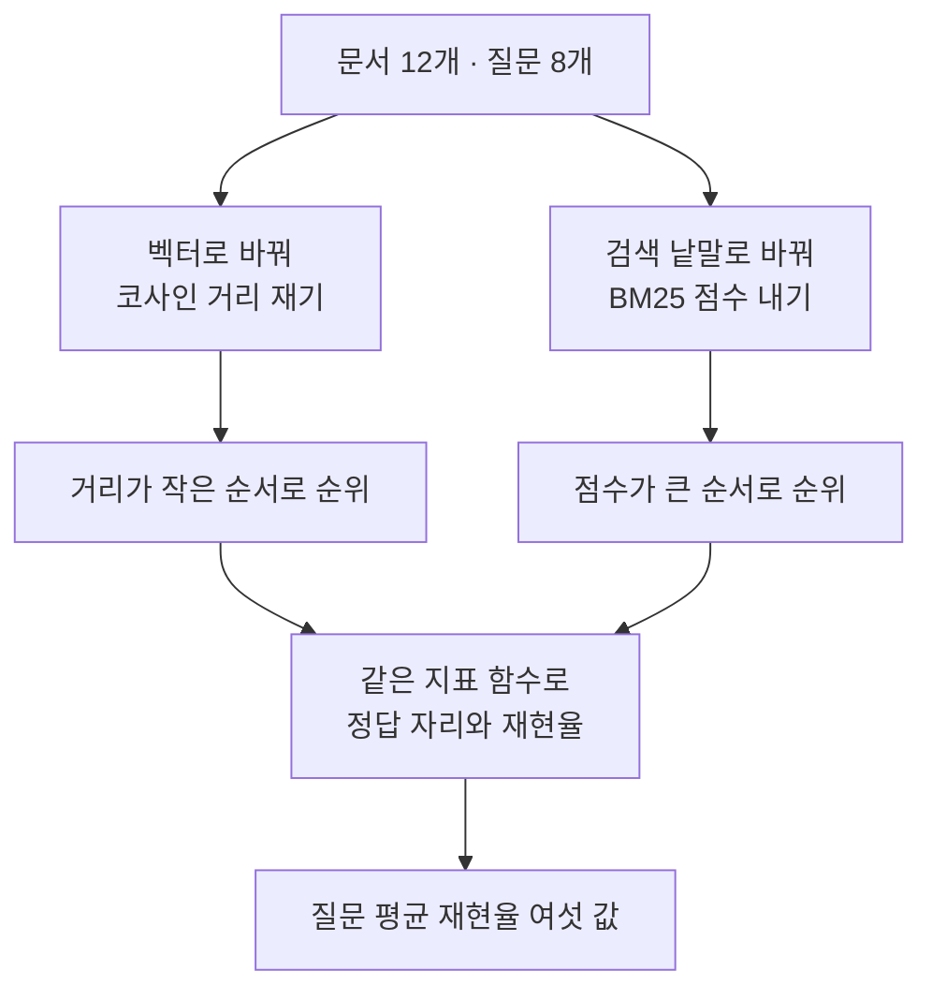
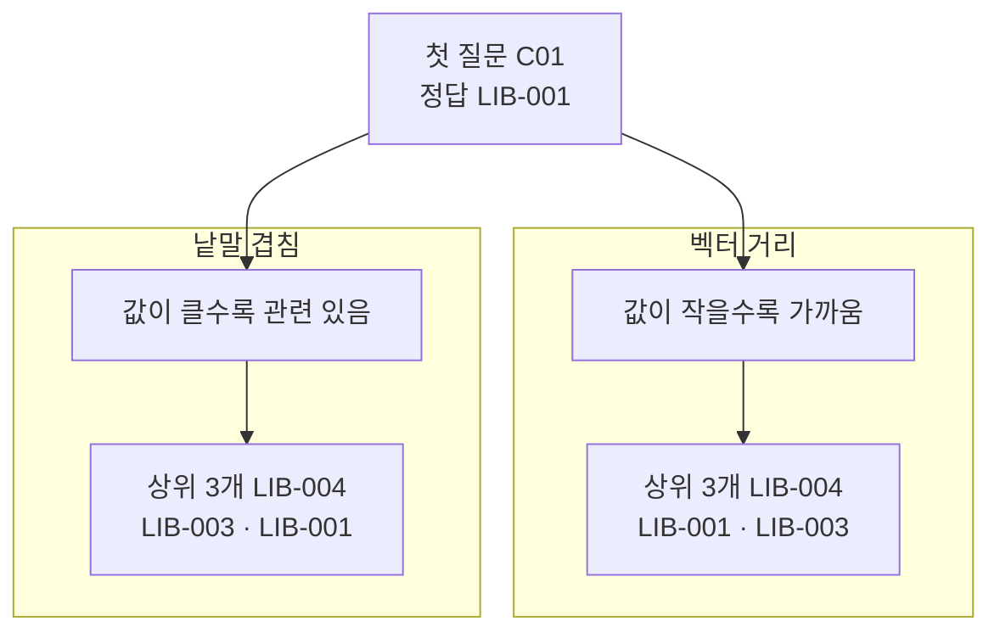
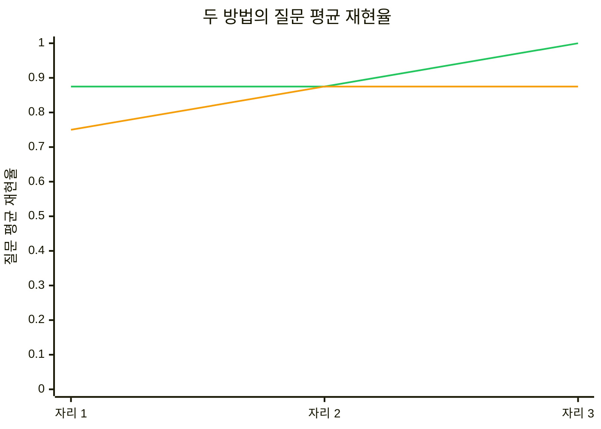
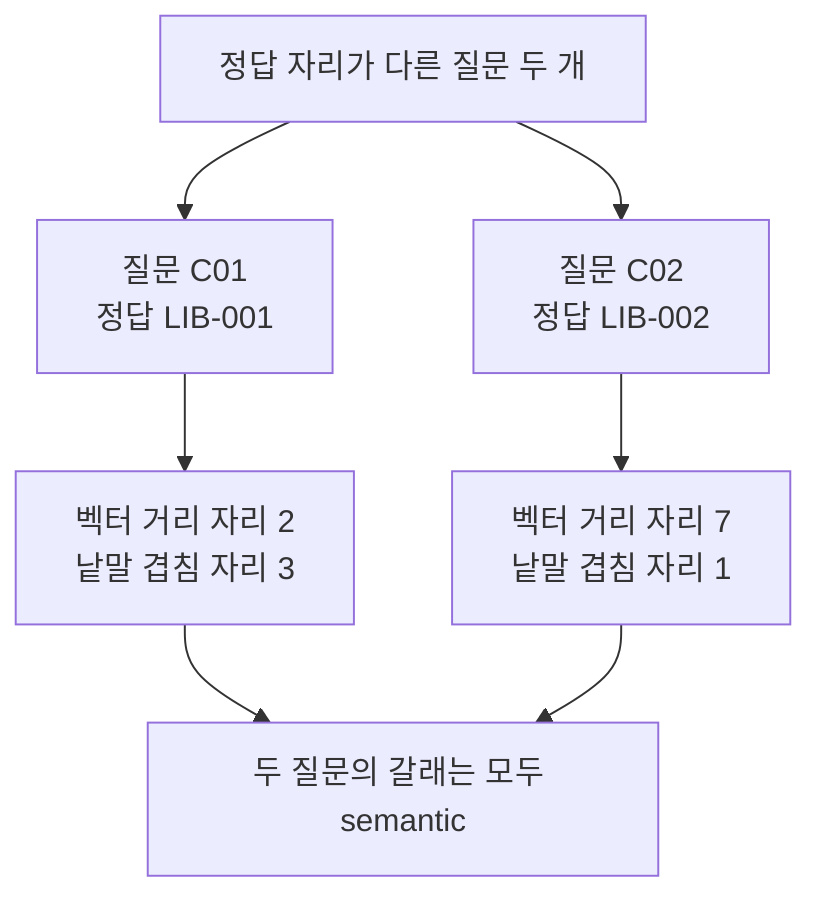

# 05-dense와-sparse-비교

## _src 본문 (HTML 원본)

```html
<!--meta: 강의 1h | 실습 2h | 코드 notebooks/05-dense와-sparse-비교.ipynb | 새 용어 4 -->
<h2 id="b1"><span class="no">1</span>학습 목표</h2><div class="goal"><ul><li>이 절을 마치면 같은 자료에서 두 검색 방법의 순위를 나란히 놓을 수 있습니다.</li><li>거리와 점수의 방향이 반대인 것을 알고 두 값을 한 줄에 섞지 않을 수 있습니다.</li><li>두 방법의 정답 자리가 다른 질문을 찾아 검색 낱말로 확인할 수 있습니다.</li></ul></div>
<h2 id="b2"><span class="no">2</span>이 내용을 배우는 이유</h2><p>검색 방법은 여러 가지입니다. 어느 방법을 쓸지 정하려면 같은 자료에서 재어 봐야 합니다. 방법을 바꾸면서 자료나 자르는 자리를 함께 바꾸면 무엇이 값을 바꿨는지 알 수 없습니다.</p><p>두 방법이 내는 값은 크기도 방향도 다릅니다. 거리는 작을수록 가깝고 점수는 클수록 관련 있습니다. 그래서 값을 바로 더하는 대신 순위와 정답 자리를 봅니다.</p>
<h2 id="b3"><span class="no">3</span>앞에서 배운 내용</h2><p>01절에서 문서 12개와 질문 8개를 숫자 256개짜리 벡터로 바꿨습니다. 코사인 거리로 문서를 모두 재어 순위를 만들고 그것을 기준선으로 삼았습니다. 02·03절은 같은 벡터를 데이터베이스 표에 넣고 색인과 범주 조건을 붙였습니다.</p><p>04절에서는 같은 글을 형태소로 갈라 검색 낱말을 만들고 BM25 점수로 순위를 냈습니다. 그 절의 점수는 클수록 관련 있는 값이었습니다. 이 절은 01절 방법과 04절 방법을 같은 자료에서 견줍니다.</p><p>Ch 11과 01~04절에서 쓴 지표 함수 네 개를 그대로 이어 씁니다. 함수 <code>recall_at()</code>은 중복을 뺀 문서 ID 목록을 받고 자르기를 함수 안에서 합니다.</p><p>노트북은 이 지표 함수와 01절 <code>rank_by_distance()</code>, 04절 <code>kiwi_terms()</code>·<code>count_docs_with()</code>·<code>rank_by_bm25()</code>를 실습 폴더의 도구 파일 <code>notebooks/rag_tools.py</code>에서 가져옵니다. 도구 파일 판은 앞 절 판이 노트북에서 바로 읽던 벡터·분석기·모델을 인자로 받습니다.</p><p>03·04절 기록은 상위 3개만 담아 정답 자리가 0에서 3까지였습니다. 이 절은 두 방법 모두 문서 12개를 끝까지 재어 자리가 1에서 12까지 나옵니다. 그래서 01절 표의 자리와 이 절 표의 자리를 그대로 견줄 수 있습니다.</p>
<h2 id="b4"><span class="no">4</span>핵심 개념</h2><h3>비유로 시작하기</h3><p>책이 한 줄로 꽂힌 나무 선반이 있습니다. 그 앞에 쪽지 두 장이 놓여 있습니다. 한 쪽지에는 파란 타원이 있고 색이 비슷한 책을 찾습니다. 다른 쪽지에는 줄무늬 삼각형이 있고 무늬가 똑같은 책을 찾습니다. 두 쪽지가 뽑아낸 책은 서로 다른 책입니다.</p>
{{img:05-5-비슷한-색과-똑같은-무늬|나무 선반에 책이 한 줄로 꽂혀 있고 책등마다 작은 모양이 하나씩 있으며 책 두 권이 절반쯤 뽑혀 나와 기울어져 있고 선반 앞 바닥에 쪽지 두 장이 놓여 왼쪽 쪽지에는 파란 타원이 오른쪽 쪽지에는 주황 줄무늬 삼각형이 그려져 있으며 왼쪽 쪽지 옆으로 뽑힌 책은 파란 동그라미를 오른쪽 쪽지 옆으로 뽑힌 책은 같은 주황 줄무늬 삼각형을 보이는 그림|쪽지의 표시와 짝이 맞는 책 두 권이 선반에서 뽑혀 나와 있습니다.}}
<p class="look"><b>그림 읽기</b> — 선반에 꽂힌 책이 우리가 가진 문서입니다. 앞에 놓인 쪽지 두 장은 같은 질문을 두 방법으로 적은 것입니다. 왼쪽 쪽지의 파란 타원은 색이 비슷한 책을 뽑아냈습니다. 오른쪽 쪽지의 줄무늬 삼각형은 무늬가 똑같은 책을 뽑아냈습니다. 뽑혀 나온 두 책이 서로 다른 책이라는 점이 이 절의 물음입니다.</p>
<table><thead><tr><th>말</th><th>뜻</th></tr></thead><tbody><tr><td>벡터 거리 검색(dense retrieval)</td><td>글을 숫자 목록으로 바꿔 거리가 가까운 문서를 찾는 검색입니다. 01~03절이 쓴 방법입니다.</td></tr><tr><td>말 바꾼 질문(semantic variation)</td><td>뜻은 그대로 두고 표기를 바꿔 물은 질문입니다. 질문 파일의 갈래 칸에 <code>semantic</code>으로 적혀 있습니다.</td></tr><tr><td>낱말 일치(lexical match)</td><td>질문의 낱말이 문서에 그대로 나타나는 관계입니다. 갈래 칸이 <code>keyword</code>인 질문이 이 관계를 노립니다.</td></tr><tr><td>점수 방향</td><td>값이 커질 때 가까워지는지 멀어지는지를 가리키는 말입니다. 거리는 작을수록 가깝고 BM25 점수는 클수록 관련 있습니다.</td></tr></tbody></table>
{{mermaid:05-1-같은-자료-두-갈래-순위|위에서 아래로 내려가는 흐름도로 맨 위 초록 상자 문서 12개와 질문 8개에서 두 갈래로 갈려 왼쪽 갈래는 파란 상자 벡터로 바꿔 코사인 거리 재기에서 노란 상자 거리가 작은 순서로 순위로 이어지고 오른쪽 갈래는 파란 상자 검색 낱말로 바꿔 BM25 점수 내기에서 노란 상자 점수가 큰 순서로 순위로 이어진 뒤 두 순위가 파란 상자 같은 지표 함수로 정답 자리와 재현율로 모이고 맨 아래 노란 상자 질문 평균 재현율 여섯 값으로 끝나는 그림|같은 문서 12개와 질문 8개가 두 갈래로 갈려 순위가 되고 같은 지표 함수에서 다시 만납니다.}}
<p class="look"><b>도식 읽기</b> — 맨 위 초록 상자가 두 방법이 함께 보는 자료입니다. 위에서 아래로 읽고 왼쪽 갈래가 벡터 거리, 오른쪽 갈래가 낱말 겹침입니다. 가운데 파란 상자는 우리가 정한 처리입니다. 두 갈래의 노란 상자는 값의 방향이 서로 반대입니다. 맨 아래 파란 상자와 노란 상자에서 두 순위가 같은 함수로 모입니다.</p>
<h3>같게 두어야 하는 다섯 가지</h3><p>두 방법을 견주려면 다섯 가지를 같게 둡니다. 문서 12개와 질문 8개가 첫째와 둘째입니다. 후보 하나가 문서 한 건인 점이 셋째입니다. 자르는 자리 세 가지가 넷째이고 지표 함수가 다섯째입니다.</p><p>이 절은 두 방법 모두 문서 12개를 끝까지 재어 정답 자리를 셉니다. 한쪽만 상위 3개로 자르면 자리의 범위가 달라져 견줄 수 없습니다. 값 칸 이름은 <code>거리</code>와 <code>점수</code>로 갈라 두고 한 표에는 자리와 재현율만 담습니다.</p>
<h3>거리와 점수는 방향이 반대입니다</h3><p>코사인 거리는 0에 가까울수록 두 글이 가깝습니다. BM25 점수는 커질수록 질문 낱말이 그 문서에 많이 겹칩니다. 두 값은 계산 방법도 크기도 달라 한 줄에 나란히 놓지 않습니다.</p><p>그래서 순위를 만들 때 정렬 방향이 서로 반대입니다. 거리 쪽은 작은 값을 앞에 두고 점수 쪽은 큰 값을 앞에 둡니다. 순위를 만든 뒤에는 자리 번호만 쓰므로 두 방법을 같은 함수로 잴 수 있습니다.</p>
<h2 id="b5"><span class="no">5</span>실행 예제</h2><p>01~04절과 같은 문서 12개와 질문 8개를 그대로 씁니다. 두 방법의 재료를 먼저 만들고 순위 함수 두 개는 도구 파일에서 가져옵니다. 실행 1은 첫 질문 <code>C01</code>이고 값 바꿔 보기는 질문만 <code>C02</code>로 바꿉니다.</p><p>임베딩 요청은 문서 1번과 질문 8번으로 모두 아홉 번입니다. 예상 비용은 미화 0.01달러 아래이고 답을 쓰는 모델은 부르지 않습니다. 형태소 분석과 BM25는 요청을 보내지 않습니다.</p>
{{mermaid:05-2-두-순위의-값-방향|위에서 아래로 내려가는 흐름도로 맨 위 초록 상자 첫 질문 C01 정답 LIB-001에서 두 칸으로 갈리고 칸 제목 벡터 거리 아래에는 노란 상자 값이 작을수록 가까움에서 노란 상자 상위 3개 LIB-004 LIB-001 LIB-003으로 내려가며 칸 제목 낱말 겹침 아래에는 노란 상자 값이 클수록 관련 있음에서 노란 상자 상위 3개 LIB-004 LIB-003 LIB-001로 내려가는 그림|같은 질문에서 두 방법의 상위 3개는 같은 문서 세 건이고 순서만 다릅니다.}}
<p class="look"><b>도식 읽기</b> — 맨 위 초록 상자가 실행 1에서 고른 질문과 그 정답 문서입니다. 칸 제목 <code>벡터 거리</code> 아래 두 상자가 그 방법의 값 방향과 상위 3개입니다. 칸 제목 <code>낱말 겹침</code> 아래 두 상자는 같은 질문을 낱말 겹침으로 잰 결과입니다. 두 칸의 문서 세 건은 같고 둘째와 셋째의 차례가 서로 바뀌었습니다. 정답 문서 <code>LIB-001</code>은 어느 칸에서도 1위가 아닙니다.</p>
{{notebook:05-dense와-sparse-비교}}
<p class="look"><b>확인할 점</b> — 실행 1에서 두 방법의 상위 세 문서는 같은 세 건이었고 순서만 달랐습니다. 정답 문서 <code>LIB-001</code>의 자리는 벡터 거리 2와 낱말 겹침 3입니다. 질문만 <code>C02</code>로 바꾸니 벡터 거리 상위 세 줄에 정답 문서가 없었습니다. 낱말 겹침 쪽은 <code>1 | LIB-002 | 2.26</code>으로 정답 문서를 1위에 두었습니다. 두 질문의 갈래는 모두 <code>semantic</code>입니다.</p>
<h2 id="b6"><span class="no">6</span>실험 결과 해석</h2><p>질문 여덟 개를 두 방법으로 모두 재어 기록 열여섯 줄을 만들었습니다. 자리 3 질문 평균 재현율은 벡터 거리 <code>0.875</code>, 낱말 겹침 <code>1.0</code>이었습니다. 자리 1에서는 <code>0.75</code>와 <code>0.875</code>였고 자리 2에서는 두 값이 같았습니다.</p>
{{mermaid:05-3-두-방법의-질문-평균|가로축이 자리 1과 자리 2와 자리 3이고 세로축이 질문 평균 재현율 0에서 1까지인 꺾은선 그림으로 초록 선은 자리 1과 자리 2에서 0.875이고 자리 3에서 1.0으로 올라가며 주황 선은 자리 1에서 0.75이고 자리 2와 자리 3에서 0.875인 그림|초록 선 낱말 겹침은 자리 3에서 1.0이고 주황 선 벡터 거리는 자리 3에서 0.875입니다.}}
<p class="look"><b>도식 읽기</b> — 가로축이 자르는 자리이고 세로축이 질문 평균 재현율입니다. 초록 선은 낱말 겹침이고 주황 선은 벡터 거리입니다. 두 선은 자리 2에서 <code>0.875</code>로 만납니다. 자리 3에서 초록 선은 <code>1.0</code>으로 올라가고 주황 선은 <code>0.875</code>에 머뭅니다.</p>
<p>평균만 보면 한쪽이 앞선 것처럼 보입니다. 그런데 질문마다 보면 이긴 방법이 갈립니다.</p>
{{mermaid:05-4-서로-이기는-두-질문|위에서 아래로 내려가는 흐름도로 맨 위 노란 상자 정답 자리가 다른 질문 두 개에서 두 갈래로 갈려 왼쪽 갈래는 초록 상자 질문 C01 정답 LIB-001에서 노란 상자 벡터 거리 자리 2 낱말 겹침 자리 3으로 내려가고 오른쪽 갈래는 초록 상자 질문 C02 정답 LIB-002에서 노란 상자 벡터 거리 자리 7 낱말 겹침 자리 1로 내려간 뒤 두 갈래가 맨 아래 회색 상자 두 질문의 갈래는 모두 semantic으로 모이는 그림|질문 C01은 벡터 거리 쪽 자리가 앞이고 질문 C02는 낱말 겹침 쪽 자리가 앞입니다.}}
<p class="look"><b>도식 읽기</b> — 맨 위 노란 상자가 두 방법의 정답 자리가 다른 질문 두 개입니다. 위에서 아래로 읽고 왼쪽 갈래가 질문 <code>C01</code>입니다. 초록 상자는 질문과 정답 문서이고 그 아래 노란 상자가 두 방법의 자리입니다. 왼쪽 갈래에서는 벡터 거리 쪽 자리가 앞이고 오른쪽 갈래에서는 낱말 겹침 쪽 자리가 앞입니다. 맨 아래 회색 상자는 두 갈래에 모두 해당하는 사실입니다.</p>
<p>질문 <code>C02</code>에서 낱말 겹침이 정답 문서를 1위에 둔 단서를 낱말로 확인했습니다. 질문과 정답 문서에 함께 있는 낱말은 <code>반납</code> 하나였습니다. 그 낱말은 문서 열두 건 가운데 한 건에만 있었습니다. 벡터 거리 쪽이 그 문서를 일곱째 자리에 둔 까닭은 이번에 확인하지 않았습니다.</p><p>문서 12개와 질문 8개에서 한 번 실행한 값입니다. 어느 방법이 한국어 검색에서 나은지 이 자료로 말할 수 없습니다. 두 질문의 갈래가 같은데 이긴 방법이 달랐으므로 갈래로 방법을 고르지 않습니다.</p>
<h2 id="b7"><span class="no">7</span>주의할 점과 실무 메모</h2><ul><li>두 방법의 값 크기가 다르므로 거리와 점수를 그대로 더하거나 견주지 않습니다. 순위와 자리 번호를 씁니다.</li><li>방법을 바꿀 때 문서·질문·자르는 자리·후보 단위를 함께 바꾸지 않습니다. 함께 바꾸면 무엇이 값을 바꿨는지 알 수 없습니다.</li><li>정답 자리는 재는 문서 수에 따라 범위가 달라집니다. 이 절은 문서 12개를 끝까지 재어 자리가 1에서 12까지이고 03·04절 표는 0에서 3까지였습니다.</li><li>질문 평균만 보지 말고 한쪽만 정답 문서를 앞에 둔 질문을 읽습니다. 이번 실행에서는 <code>C01</code>과 <code>C02</code> 두 질문이 갈렸습니다.</li><li>실행 1과 값 바꿔 보기에 쓴 질문 두 개는 여덟 질문을 먼저 모두 재어 정답 자리가 갈린 질문을 고른 것입니다. 흐름을 보여 주려고 정한 예이고 질문을 고르는 기준이 아닙니다.</li><li>질문 파일의 갈래 칸은 질문을 만들 때 사람이 적어 둔 표시입니다. 이번 실행에서 갈래가 같은 두 질문의 결과가 달라 갈래로 방법을 고를 수 없었습니다.</li><li>거리 값의 소수 셋째 자리 아래는 실행마다 흔들립니다. 그래서 거리는 소수 둘째 자리까지만 출력하고 그림 라벨에는 넣지 않았습니다.</li><li>BM25 점수는 색인마다 크기가 달라 다른 색인의 점수와 견주지 않습니다. 이 절 점수는 문서 12개로 만든 색인의 값입니다.</li><li>정답 문서가 한 개인 질문에서는 자르는 자리가 커질수록 정밀도의 최댓값이 내려갑니다. 그 성질은 Ch 11 03절에서 배웠고 이 절은 재현율만 재었습니다.</li><li>이 절은 검색에 걸린 시간을 재지 않았습니다. 두 방법의 빠르기를 견주는 일은 이번에 하지 않았습니다.</li><li>04절이 견준 공백 분리 정책은 이 절에 다시 싣지 않았습니다. 이 절에서 견줄 것은 벡터 거리 검색과 낱말 겹침 검색입니다.</li><li>두 순위를 하나로 합치는 일은 06절에서 합니다. 이 절은 두 순위를 나란히 놓기만 합니다.</li><li>이 절은 파일을 쓰지 않습니다. 01~03절이 만든 데이터베이스 표도 읽지 않습니다.</li></ul>
<h2 id="b8"><span class="no">8</span>정리와 다음 절</h2><ul><li>같은 문서 12개와 질문 8개를 두 방법에 넣어 순위를 나란히 놓았습니다.</li><li>질문 <code>C01</code>은 벡터 거리 쪽 자리가 2이고 낱말 겹침 쪽이 3이었습니다.</li><li>이번 실행에서 자리 3 질문 평균 재현율은 벡터 거리 <code>0.875</code>, 낱말 겹침 <code>1.0</code>이었습니다.</li></ul><p><strong>다음 학습과 이어지는 지점</strong> — 06절에서는 두 순위를 하나로 합칩니다. 점수를 더하지 않고 자리 번호만 써서 합치는 방법을 씁니다.</p>
<h2 id="b9"><span class="no">9</span>복습 문제</h2><details class="quiz" open><summary>문제 4개 · 해설 포함</summary><p class="quiz-q">1. 두 검색 방법을 견줄 때 같게 두어야 하는 다섯 가지 가운데 세 가지를 적어 보세요.</p><p class="quiz-a">문서와 질문, 자르는 자리입니다. 후보 단위와 지표 함수도 같게 둡니다. 틀렸다면 「같게 두어야 하는 다섯 가지」를 다시 읽습니다.</p><p class="quiz-q">2. 코사인 거리 <code>0.43</code>과 BM25 점수 <code>3.37</code>을 바로 견줄 수 없는 까닭은 무엇입니까?</p><p class="quiz-a">계산 방법과 값의 크기가 다르고 방향도 반대이기 때문입니다. 틀렸다면 「거리와 점수는 방향이 반대입니다」를 다시 읽습니다.</p><p class="quiz-q">3. 질문 <code>C02</code>에서 낱말 겹침이 정답 문서를 1위에 둔 단서는 무엇이었습니까?</p><p class="quiz-a">질문과 정답 문서에 함께 있는 낱말 <code>반납</code>이고 그 낱말은 문서 한 건에만 있었습니다. 틀렸다면 「실험 결과 해석」을 다시 읽습니다.</p><p class="quiz-q">4. 자리 3 질문 평균 재현율이 <code>0.875</code>와 <code>1.0</code>이면 어느 방법이 더 낫다고 말할 수 있습니까?</p><p class="quiz-a">말할 수 없습니다. 문서 12개와 질문 8개에서 한 번 확인한 값이고 질문마다 이긴 방법이 달랐습니다. 틀렸다면 「실험 결과 해석」의 마지막 단락을 확인합니다.</p></details>
<h2 id="b10"><span class="no">10</span>참고 자료</h2><ul><li><div><a href="https://platform.openai.com/docs/guides/embeddings">OpenAI Embeddings guide</a></div>임베딩 모델과 차원 수 설명 · 확인 2026-09-18</li><li><div><a href="https://python.langchain.com/api_reference/openai/embeddings/langchain_openai.embeddings.base.OpenAIEmbeddings.html">LangChain OpenAIEmbeddings</a></div>문서와 질문을 벡터로 바꾸는 두 메서드 설명 · 1.6.1 · 확인 2026-09-18</li><li><div><a href="https://github.com/bab2min/kiwipiepy">kiwipiepy README</a></div>설치와 <code>tokenize</code> 사용법 · 0.23.2 · 확인 2026-09-18</li><li><div><a href="https://github.com/dorianbrown/rank_bm25">rank_bm25</a></div>낱말 목록을 받아 점수를 내는 구현 · 0.2.2 · 확인 2026-09-18</li></ul>
```

## 노트북 셀 (순서대로)

### [0] markdown {'html': 'skip'}

# dense와 sparse 비교

**이 노트북에서 할 일**

1. 같은 문서 12개와 질문 8개로 두 검색 방법의 재료를 만듭니다.
2. 질문 하나를 두 방법으로 재어 상위 세 문서를 나란히 봅니다.
3. 질문만 바꿔 두 방법의 1위가 어떻게 달라지는지 봅니다.
4. 질문 여덟 개의 정답 자리와 재현율을 한 표에서 견줍니다.

**준비물** — 프로젝트 폴더의 `.env`에 `OPENAI_API_KEY`가 있어야 합니다.
임베딩 요청은 문서 1번과 질문 8번으로 모두 아홉 번입니다.
예상 비용은 미화 0.01달러 아래이고 답을 쓰는 모델은 부르지 않습니다.
실행 시간은 1분 안팎이고 첫 셀의 설치가 가장 오래 걸립니다.

**데이터** — 두 파일 모두 실습 묶음에 들어 있습니다.

- 문서 `labs/part3/ch12-retrieval-tuning/data/core-documents.json`(12개)
- 질문 `labs/part3/ch12-retrieval-tuning/data/core-queries.json`(8개)

**강의와 실습 범위** — 강의 시간에는 3~5절과 6~7절, 9절을 읽습니다.
두 방법의 재료를 만들고 가져온 순위 함수 두 개의 인자를 확인하는 자리입니다.
6~7절은 실행 1과 값 바꿔 보기이고 9절은 질문 여덟 개 비교입니다.
1~2절과 8절은 함께 실행하고 실습 시간에 다시 읽습니다.

**기준 버전** — 첫 셀에서 다섯 패키지를 고정한 판으로 설치합니다.
교재 출력은 Linux의 Python 3.12.13으로 만들었습니다.
다른 판과 Windows·macOS에서는 이번에 실행하지 않았습니다.

실습 폴더 `labs/part3/ch12-retrieval-tuning`에서 `uv sync --locked`를 실행합니다.
그다음 이 폴더의 `.venv` 커널을 고르고 첫 셀부터 순서대로 실행합니다.

### [1] markdown {'html': 'skip'}

## 오늘 볼 그림


맨 위 초록 상자가 두 방법이 함께 보는 자료입니다.
거기서 두 갈래로 갈리고 파란 상자는 우리가 정한 처리입니다.
두 갈래의 노란 상자는 값의 방향이 서로 반대입니다.
아래에서 두 순위가 같은 지표 함수로 모입니다.
맨 아래 노란 상자가 이 노트북의 마지막 출력입니다.

### [2] markdown {}

## 1. 준비

첫 셀은 패키지 다섯 개를 설치하고 설치된 버전을 출력합니다.
설치에는 몇십 초가 걸릴 수 있습니다.

### [3] code {'execution': {'iopub.execute_input': '2026-09-21T07:40:21.674211Z', 'iopub.status.busy': '2026-09-21T07:40:21.673979Z', 'iopub.status.idle': '2026-09-21T07:40:22.215645Z', 'shell.execute_reply': '2026-09-21T07:40:22.215066Z'}, 'lesson_role': 'setup'}

```python
# 이 절에서 쓰는 패키지를 설치하고 버전을 확인합니다
%pip install -q "langchain-openai==1.6.1" "python-dotenv==1.2.3" "kiwipiepy==0.23.2" "rank-bm25==0.2.2" "numpy==2.5.3"
from importlib.metadata import version

print("langchain-openai:", version("langchain-openai"))
print("python-dotenv:", version("python-dotenv"))
print("kiwipiepy:", version("kiwipiepy"))
print("rank-bm25:", version("rank-bm25"))
print("numpy:", version("numpy"))
```

출력:
```
Note: you may need to restart the kernel to use updated packages.
langchain-openai: 1.6.1
python-dotenv: 1.2.3
kiwipiepy: 0.23.2
rank-bm25: 0.2.2
numpy: 2.5.3

```

### [4] markdown {}

**결과 읽기** — 설치가 끝나면 `langchain-openai: 1.6.1`과 `kiwipiepy: 0.23.2`가 보입니다.
마지막 줄 `numpy: 2.5.3`은 도구 파일이 벡터 계산에 쓰는 패키지입니다. 다섯 줄이 모두 보이면 다음 셀로 넘어갑니다.
01~03절은 앞 두 패키지를 썼고 04절은 셋째와 넷째 패키지를 썼습니다.

다음 셀은 이 절에서 쓸 이름 네 개를 불러옵니다.

앞에서 배운 함수는 `rag_tools.py`에 모아 두었습니다. 파일을 열면 코드를 볼 수 있습니다. 노트북과 같은 폴더(`notebooks/`)에 있는 파일입니다.

이 노트북은 01·04절 함수 네 개와 Ch 11 지표 함수 네 개를 가져옵니다.
01절 `rank_by_distance()`, 04절 `kiwi_terms()`·`count_docs_with()`·`rank_by_bm25()`입니다.
Ch 11 함수는 `unique_doc_ids()`·`find_gold_rank()`·`recall_at()`·`mean_score()`입니다.
인자 모양이 앞 절 판과 다른 함수는 쓰는 자리에서 설명합니다.

### [5] code {'execution': {'iopub.execute_input': '2026-09-21T07:40:22.216927Z', 'iopub.status.busy': '2026-09-21T07:40:22.216808Z', 'iopub.status.idle': '2026-09-21T07:40:23.334145Z', 'shell.execute_reply': '2026-09-21T07:40:23.333919Z'}, 'lesson_role': 'setup'}

```python
# 자료 읽기·임베딩·형태소 분석·낱말 점수에 쓸 이름을 불러옵니다
import json

from kiwipiepy import Kiwi
from langchain_openai import OpenAIEmbeddings
from rank_bm25 import BM25Okapi
# 01·04절과 Ch 11 01·02절 함수 여덟 개를 도구 파일에서 가져옵니다
from rag_tools import count_docs_with, find_gold_rank, kiwi_terms, mean_score
from rag_tools import rank_by_bm25, rank_by_distance, recall_at, unique_doc_ids

print("불러온 이름:", "json", "Kiwi", "OpenAIEmbeddings", "BM25Okapi")
```

출력:
```
불러온 이름: json Kiwi OpenAIEmbeddings BM25Okapi

```

### [6] markdown {}

**결과 읽기** — 출력 줄은 `불러온 이름:` 뒤에 이름 네 개가 붙은 한 줄입니다.
이름 `OpenAIEmbeddings`는 글을 벡터로 바꾸는 도구입니다.
이름 `Kiwi`와 `BM25Okapi`는 04절에서 쓴 두 도구입니다.
도구 파일에서 가져온 함수 여덟 개는 출력하지 않습니다.

다음 셀은 API 키가 있는지 확인합니다. `True` 값이 나오면 다음으로 넘어갑니다.

### [7] code {'execution': {'iopub.execute_input': '2026-09-21T07:40:23.335714Z', 'iopub.status.busy': '2026-09-21T07:40:23.335575Z', 'iopub.status.idle': '2026-09-21T07:40:23.339612Z', 'shell.execute_reply': '2026-09-21T07:40:23.339323Z'}, 'lesson_role': 'setup'}

```python
# .env 파일에서 OpenAI API 키를 읽습니다(키 값은 출력하지 않습니다)
import os
from dotenv import find_dotenv, load_dotenv

env_path = find_dotenv(usecwd=True)
load_dotenv(env_path)
has_key = os.getenv("OPENAI_API_KEY") is not None
print("OPENAI_API_KEY 설정 여부:", has_key)
assert has_key, "프로젝트 폴더의 .env 파일에 OPENAI_API_KEY를 적어 주세요."
```

출력:
```
OPENAI_API_KEY 설정 여부: True

```

### [8] markdown {}

**결과 읽기** — 출력 줄은 `OPENAI_API_KEY 설정 여부: True` 하나입니다.
키 값은 출력하지 않습니다.
04절은 임베딩을 쓰지 않아 이 셀이 없었습니다.

다음 셀은 프로젝트 맨 위 폴더를 찾습니다. 01~04절과 같은 코드입니다.

### [9] code {'execution': {'iopub.execute_input': '2026-09-21T07:40:23.340204Z', 'iopub.status.busy': '2026-09-21T07:40:23.340149Z', 'iopub.status.idle': '2026-09-21T07:40:23.342170Z', 'shell.execute_reply': '2026-09-21T07:40:23.341890Z'}, 'lesson_role': 'setup'}

```python
# 노트북을 어느 폴더에서 열어도 프로젝트 맨 위를 찾게 후보 세 개를 차례로 봅니다
candidates = [".", "../../..", "../../../.."]
root_path = None
for candidate in candidates:
    if os.path.exists(candidate + "/labs/part3/ch12-retrieval-tuning/data"):
        root_path = candidate
        break
print("고른 경로:", root_path)
assert root_path is not None, "notebooks 폴더나 실습 폴더 맨 위에서 노트북을 열어 주세요."
```

출력:
```
고른 경로: .

```

### [10] markdown {}

**결과 읽기** — 출력 줄은 `고른 경로: .`입니다. `assert`도 통과했습니다.

다음 셀은 01~04절이 쓴 문서 파일과 질문 파일을 그대로 읽습니다.

### [11] code {'execution': {'iopub.execute_input': '2026-09-21T07:40:23.342771Z', 'iopub.status.busy': '2026-09-21T07:40:23.342709Z', 'iopub.status.idle': '2026-09-21T07:40:23.345379Z', 'shell.execute_reply': '2026-09-21T07:40:23.345063Z'}, 'lesson_role': 'setup'}

```python
# 01~04절과 같은 문서 파일과 질문 파일을 불러옵니다
data_path = root_path + "/labs/part3/ch12-retrieval-tuning/data"
with open(data_path + "/core-documents.json", encoding="utf-8") as file:
    docs = json.loads(file.read())
with open(data_path + "/core-queries.json", encoding="utf-8") as file:
    queries = json.loads(file.read())
print("문서 수:", len(docs))
print("질문 수:", len(queries))
```

출력:
```
문서 수: 12
질문 수: 8

```

### [12] markdown {}

**결과 읽기** — `문서 수: 12`와 `질문 수: 8`이 보입니다.
01~04절과 같은 교육용 자료입니다.
같은 자료를 써야 두 방법의 값을 나란히 놓을 수 있습니다.

## 2. 이 절에서 쓸 값 정하기

값 다섯 개를 먼저 정합니다.
이름 `top_all`은 정답 자리를 셀 때 재는 문서 수입니다.
문서 12개를 끝까지 재면 정답 자리가 1에서 12 사이로 나옵니다.
남길 품사 표시 아홉 가지는 04절에서 정한 목록과 같습니다.

### [13] code {'execution': {'iopub.execute_input': '2026-09-21T07:40:23.345878Z', 'iopub.status.busy': '2026-09-21T07:40:23.345823Z', 'iopub.status.idle': '2026-09-21T07:40:23.348035Z', 'shell.execute_reply': '2026-09-21T07:40:23.347890Z'}}

```python
# 이 절에서 되풀이해 쓸 값과 견줄 방법 이름을 정합니다
top_three = 3
top_all = 12
cutoff_values = [1, 2, 3]
keep_tags = ["NNG", "NNP", "NNB", "NR", "VV", "VA", "MAG", "SN", "SL"]
method_names = ["벡터 거리", "낱말 겹침"]
print("나란히 볼 상위 문서 수:", top_three)
print("자리를 셀 때 재는 문서 수:", top_all)
print("자르는 자리 세 가지:", cutoff_values)
print("남길 품사 표시:", keep_tags)
print("견줄 방법 두 가지:", method_names)
```

출력:
```
나란히 볼 상위 문서 수: 3
자리를 셀 때 재는 문서 수: 12
자르는 자리 세 가지: [1, 2, 3]
남길 품사 표시: ['NNG', 'NNP', 'NNB', 'NR', 'VV', 'VA', 'MAG', 'SN', 'SL']
견줄 방법 두 가지: ['벡터 거리', '낱말 겹침']

```

### [14] markdown {}

**결과 읽기** — `나란히 볼 상위 문서 수: 3`과 `자리를 셀 때 재는 문서 수: 12`가 보입니다.
출력 줄 `자르는 자리 세 가지: [1, 2, 3]`은 01~04절과 같은 값입니다.
`견줄 방법 두 가지: ['벡터 거리', '낱말 겹침']` 줄의 두 이름으로 뒤에서 기록을 나눕니다.
라벨 줄 `남길 품사 표시:` 뒤에는 이름 아홉 개가 있습니다.

## 3. 두 방법이 볼 재료 만들기

두 방법은 같은 글에서 서로 다른 재료를 만듭니다.
먼저 문서 12개의 제목과 본문을 이어 붙여 글 열두 개로 만듭니다.
이 글이 벡터로도 바뀌고 검색 낱말로도 바뀝니다.

### [15] code {'execution': {'iopub.execute_input': '2026-09-21T07:40:23.349623Z', 'iopub.status.busy': '2026-09-21T07:40:23.349512Z', 'iopub.status.idle': '2026-09-21T07:40:23.351290Z', 'shell.execute_reply': '2026-09-21T07:40:23.351115Z'}}

```python
# 문서 12개의 제목과 본문을 이어 붙이고 문서 ID 목록도 만듭니다(01~04절과 같은 모양)
doc_texts = []
doc_ids = []
for doc in docs:
    doc_texts.append(doc["title"] + " " + doc["text"])
    doc_ids.append(doc["doc_id"])
print("이어 붙인 글 수:", len(doc_texts))
print("첫 문서 글:", doc_texts[0])
print("문서 ID 목록:")
print(doc_ids)
```

출력:
```
이어 붙인 글 수: 12
첫 문서 글: 도서 대출 기간 일반 도서는 14일 동안 대출할 수 있습니다. 예약자가 없으면 한 번 연장할 수 있습니다.
문서 ID 목록:
['LIB-001', 'LIB-002', 'LIB-003', 'LIB-004', 'FAC-001', 'FAC-002', 'FAC-003', 'FAC-004', 'ACC-001', 'ACC-002', 'ACC-003', 'ACC-004']

```

### [16] markdown {}

**결과 읽기** — `이어 붙인 글 수: 12`가 보입니다.
출력 줄 `첫 문서 글:` 뒤에는 제목 `도서 대출 기간`과 본문이 이어져 있습니다.
라벨 줄 `문서 ID 목록:` 아래 줄에 `LIB-001`부터 열두 개가 있습니다.
이 순서가 뒤에서 순위를 만들 때 문서를 가리키는 차례입니다.

다음 셀은 벡터 거리 쪽 재료를 만듭니다.
01~03절과 같은 모델과 같은 숫자 개수를 씁니다.

### [17] code {'execution': {'iopub.execute_input': '2026-09-21T07:40:23.351771Z', 'iopub.status.busy': '2026-09-21T07:40:23.351724Z', 'iopub.status.idle': '2026-09-21T07:40:25.083349Z', 'shell.execute_reply': '2026-09-21T07:40:25.082451Z'}}

```python
# 01~03절과 같은 모델로 문서 12개와 질문 8개를 벡터로 바꿉니다(임베딩 요청 9번)
embedding_model_name = "text-embedding-3-small"
vector_dimensions = 256
embedding_model = OpenAIEmbeddings(model=embedding_model_name, dimensions=vector_dimensions)
doc_vectors = embedding_model.embed_documents(doc_texts)
query_vectors = []
for query in queries:
    query_vectors.append(embedding_model.embed_query(query["question"]))
print("임베딩 모델 이름:", embedding_model.model)
print("벡터의 숫자 개수 설정:", embedding_model.dimensions)
print("문서 벡터 수:", len(doc_vectors))
print("질문 벡터 수:", len(query_vectors))
```

출력:
```
임베딩 모델 이름: text-embedding-3-small
벡터의 숫자 개수 설정: 256
문서 벡터 수: 12
질문 벡터 수: 8

```

### [18] markdown {}

**결과 읽기** — `벡터의 숫자 개수 설정: 256`과 `문서 벡터 수: 12`가 보입니다.
출력 줄 `질문 벡터 수: 8`까지 나오면 임베딩 요청 아홉 번이 끝났습니다.
이 노트북의 출력은 2026-09-21에 이 모델로 실행한 결과입니다.

다음 셀은 낱말 겹침 쪽 재료를 만듭니다.
검색 낱말은 준비 셀에서 가져온 04절 함수 `kiwi_terms()`로 만듭니다.
도구 파일 판은 04절 판이 바로 읽던 분석기와 남길 품사 표시를 인자로 받습니다.
분석기를 만드는 줄 `kiwi = Kiwi()`는 1초 안팎 걸립니다.

### [19] code {'execution': {'iopub.execute_input': '2026-09-21T07:40:25.085694Z', 'iopub.status.busy': '2026-09-21T07:40:25.085443Z', 'iopub.status.idle': '2026-09-21T07:40:26.386462Z', 'shell.execute_reply': '2026-09-21T07:40:26.385968Z'}}

```python
# 04절과 같은 형태소 분석기로 문서 12개의 검색 낱말 목록을 만들고 BM25 모델을 만듭니다
kiwi = Kiwi()
kiwi_corpus = []
for text in doc_texts:
    kiwi_corpus.append(kiwi_terms(kiwi, text, keep_tags))
bm25_model = BM25Okapi(kiwi_corpus)
print("검색 낱말 목록 수:", len(kiwi_corpus))
print("BM25 모델이 본 문서 수:", bm25_model.corpus_size)
print("문서 하나의 평균 검색 낱말 수:", round(bm25_model.avgdl, 2))
```

출력:
```
검색 낱말 목록 수: 12
BM25 모델이 본 문서 수: 12
문서 하나의 평균 검색 낱말 수: 15.33

```

### [20] markdown {}

**결과 읽기** — `검색 낱말 목록 수: 12`와 `BM25 모델이 본 문서 수: 12`가 보입니다.
출력 줄 `문서 하나의 평균 검색 낱말 수: 15.33`은 04절과 같은 값입니다.
같은 글에서 같은 함수로 만든 목록이라 04절 색인과 같습니다.

## 4. 벡터 거리로 순위 만들기

벡터 거리 쪽 순위는 준비 셀에서 가져온 `rank_by_distance()`가 만듭니다.
질문 벡터를 문서 벡터 모두와 01절 코사인 거리로 재고, 거리가 작은 순서로 앞 몇 개를 남깁니다.
인자는 질문 벡터, 문서 벡터 목록, 문서 ID 목록, 남길 개수 네 가지입니다. 값 칸 이름은 `거리`입니다.
03절에서 범주 하나에 쓴 함수와 같은 판입니다.

## 5. 낱말 겹침으로 순위 만들기

낱말 겹침 쪽 순위는 04절 함수 `rank_by_bm25()`를 가져와 만듭니다.
도구 파일 판은 모델 하나와 질문의 검색 낱말 목록, 문서 ID 목록, 남길 개수를 받습니다.
04절 판은 정책 이름과 질문 글을 받아 함수 안에서 검색 낱말을 만들었습니다.
점수는 클수록 관련 있어 점수에 음수를 붙여 `sorted()`로 정렬하는 방법은 04절과 같습니다.

값 칸 이름은 `점수`입니다. 앞 함수의 `거리`와 뜻이 반대라 이름을 갈랐습니다.
다음 셀은 순위 목록을 표 모양으로 출력하는 함수입니다.
값 칸 이름을 인자로 받아 두 방법에 모두 씁니다.

### [21] code {'execution': {'iopub.execute_input': '2026-09-21T07:40:26.387404Z', 'iopub.status.busy': '2026-09-21T07:40:26.387316Z', 'iopub.status.idle': '2026-09-21T07:40:26.389271Z', 'shell.execute_reply': '2026-09-21T07:40:26.388980Z'}}

```python
# 순위 목록을 순위·문서 ID·값 세 칸으로 출력합니다(값 칸 이름을 인자로 받습니다)
def print_ranked(hit_list, value_name):
    print("순위 | 문서 ID |", value_name)
    for rank_number in range(len(hit_list)):
        row = hit_list[rank_number]
        print(rank_number + 1, "|", row["doc_id"], "|", row[value_name])
```

출력:
```

```

### [22] markdown {}

**결과 읽기** — 정의 셀이라 출력이 없습니다.

## 6. 실행 1 — 같은 질문을 두 방법으로

첫 질문을 두 방법으로 재어 상위 세 문서를 나란히 봅니다.
실행 전에 예상해 봅니다.
질문이 `책을 빌릴 수 있는 기간은 며칠인가요?`이므로 대출 기간 문서가 앞에 올 것입니다.

### [23] code {'execution': {'iopub.execute_input': '2026-09-21T07:40:26.389907Z', 'iopub.status.busy': '2026-09-21T07:40:26.389855Z', 'iopub.status.idle': '2026-09-21T07:40:26.393334Z', 'shell.execute_reply': '2026-09-21T07:40:26.392974Z'}}

```python
# 실행 1: 첫 질문을 두 방법으로 재어 상위 세 문서를 나란히 봅니다
first_query = queries[0]
first_terms = kiwi_terms(kiwi, first_query["question"], keep_tags)
first_distance_hits = rank_by_distance(query_vectors[0], doc_vectors, doc_ids, top_three)
first_score_hits = rank_by_bm25(bm25_model, first_terms, doc_ids, top_three)
print("고른 질문:", first_query["qid"], "|", first_query["question"])
print("그 질문의 정답 문서 ID:", first_query["gold_doc_id"])
print("질문의 갈래:", first_query["kind"])
print("질문의 검색 낱말:", first_terms)
print_ranked(first_distance_hits, "거리")
print_ranked(first_score_hits, "점수")
```

출력:
```
고른 질문: C01 | 책을 빌릴 수 있는 기간은 며칠인가요?
그 질문의 정답 문서 ID: LIB-001
질문의 갈래: semantic
질문의 검색 낱말: ['책', '빌리', '수', '있', '기간', '며칠']
순위 | 문서 ID | 거리
1 | LIB-004 | 0.43
2 | LIB-001 | 0.56
3 | LIB-003 | 0.62
순위 | 문서 ID | 점수
1 | LIB-004 | 3.37
2 | LIB-003 | 2.59
3 | LIB-001 | 2.01

```

### [24] markdown {}

**결과 읽기** — 라벨 줄 `순위 | 문서 ID | 거리` 아래 첫 줄은 `1 | LIB-004 | 0.43`입니다.
정답 문서 `LIB-001`은 `2 | LIB-001 | 0.56` 줄에 있습니다.
라벨 줄 `순위 | 문서 ID | 점수` 아래 첫 줄은 `1 | LIB-004 | 3.37`이고 정답 문서는 `3 | LIB-001 | 2.01` 줄입니다.
두 방법의 상위 세 문서는 같은 세 건이고 순서만 다릅니다.
정답 문서가 1위인 방법은 없고 자리는 벡터 거리 2와 낱말 겹침 3입니다.

두 방법 모두 1위로 `LIB-004`를 골랐습니다.
그 문서는 전자책 대출 기간을 다루고 정답 문서는 일반 도서 대출 기간을 다룹니다.
출력 줄 `질문의 갈래: semantic`은 질문 파일이 「말을 바꾼 질문」으로 적어 둔 표시입니다.

## 7. 값 바꿔 보기 — 질문 하나만 바꾸기

바꿀 값은 질문 하나입니다.
문서와 재는 방법, 상위 문서 수는 그대로 둡니다.
실행 전에 예상해 봅니다. 두 방법이 같은 문서를 1위로 고를 것입니다.

### [25] code {'execution': {'iopub.execute_input': '2026-09-21T07:40:26.394065Z', 'iopub.status.busy': '2026-09-21T07:40:26.394002Z', 'iopub.status.idle': '2026-09-21T07:40:26.396390Z', 'shell.execute_reply': '2026-09-21T07:40:26.396069Z'}}

```python
# 값 바꿔 보기: 질문 하나만 바꿔 같은 두 방법으로 다시 잽니다
second_query = queries[1]
second_terms = kiwi_terms(kiwi, second_query["question"], keep_tags)
second_distance_hits = rank_by_distance(query_vectors[1], doc_vectors, doc_ids, top_three)
second_score_hits = rank_by_bm25(bm25_model, second_terms, doc_ids, top_three)
print("고른 질문:", second_query["qid"], "|", second_query["question"])
print("그 질문의 정답 문서 ID:", second_query["gold_doc_id"])
print("질문의 갈래:", second_query["kind"])
print("질문의 검색 낱말:", second_terms)
print_ranked(second_distance_hits, "거리")
print_ranked(second_score_hits, "점수")
```

출력:
```
고른 질문: C02 | 책을 늦게 반납하면 돈을 내나요?
그 질문의 정답 문서 ID: LIB-002
질문의 갈래: semantic
질문의 검색 낱말: ['책', '늦', '반납', '돈', '내']
순위 | 문서 ID | 거리
1 | LIB-003 | 0.56
2 | LIB-004 | 0.58
3 | LIB-001 | 0.65
순위 | 문서 ID | 점수
1 | LIB-002 | 2.26
2 | LIB-003 | 2.11
3 | LIB-004 | 1.45

```

### [26] markdown {}

**결과 읽기** — 예상과 달랐습니다.
라벨 줄 `순위 | 문서 ID | 거리` 아래 세 줄에 정답 문서 `LIB-002`가 없습니다.
첫 줄은 `1 | LIB-003 | 0.56`입니다.
라벨 줄 `순위 | 문서 ID | 점수` 아래 첫 줄은 `1 | LIB-002 | 2.26`으로 정답 문서입니다.
이 질문의 갈래도 `semantic`인데 앞 질문과 이긴 방법이 다릅니다.

다음 셀은 낱말 겹침 쪽이 정답 문서를 1위로 고른 자리를 찾습니다.
질문의 검색 낱말과 정답 문서의 검색 낱말을 견줍니다.

### [27] code {'execution': {'iopub.execute_input': '2026-09-21T07:40:26.396883Z', 'iopub.status.busy': '2026-09-21T07:40:26.396838Z', 'iopub.status.idle': '2026-09-21T07:40:26.398842Z', 'shell.execute_reply': '2026-09-21T07:40:26.398415Z'}}

```python
# 값 바꿔 보기 질문과 그 정답 문서에 함께 있는 검색 낱말을 찾습니다
second_gold_terms = []
for i in range(len(doc_ids)):
    if doc_ids[i] == second_query["gold_doc_id"]:
        second_gold_terms = kiwi_corpus[i]
        break
shared_terms = []
for term in second_terms:
    if term in second_gold_terms:
        shared_terms.append(term)
print("정답 문서의 검색 낱말:", second_gold_terms)
print("질문과 정답 문서에 함께 있는 낱말:", shared_terms)
```

출력:
```
정답 문서의 검색 낱말: ['연체', '대출', '제한', '반납', '예정일', '넘기', '연체', '날짜', '대출', '제한', '연체료', '부과']
질문과 정답 문서에 함께 있는 낱말: ['반납']

```

### [28] markdown {}

**결과 읽기** — 출력 줄 `정답 문서의 검색 낱말:` 뒤에 낱말 열두 개가 보입니다.
출력 줄 `질문과 정답 문서에 함께 있는 낱말: ['반납']`에서 겹치는 낱말이 하나입니다.
낱말 `돈`과 `연체료`는 뜻이 이어지지만 글자가 달라 겹치지 않습니다.

다음 셀은 그 낱말이 문서 몇 건에 있는지 셉니다.
04절 함수 `count_docs_with()`를 가져와 씁니다. 도구 파일 판은 검색 낱말 목록의 목록을 첫 인자로 받습니다.

### [29] code {'execution': {'iopub.execute_input': '2026-09-21T07:40:26.399346Z', 'iopub.status.busy': '2026-09-21T07:40:26.399302Z', 'iopub.status.idle': '2026-09-21T07:40:26.400982Z', 'shell.execute_reply': '2026-09-21T07:40:26.400653Z'}}

```python
# 함께 있는 낱말이 문서 12개 가운데 몇 건에 있는지 04절 함수로 셉니다
print("함께 있는 낱말 | 그 낱말이 있는 문서 수")
for term in shared_terms:
    print(term, "|", count_docs_with(kiwi_corpus, term))
```

출력:
```
함께 있는 낱말 | 그 낱말이 있는 문서 수
반납 | 1

```

### [30] markdown {}

**결과 읽기** — 라벨 줄 아래 한 줄 `반납 | 1`이 보입니다.
낱말 `반납`은 문서 열두 건 가운데 한 건에만 있습니다.
04절에서 본 대로 드문 낱말은 그 문서를 가리키는 힘이 셉니다.
벡터 거리 쪽이 왜 이 문서를 뒤로 두었는지는 모델 안을 볼 수 없어 적지 않습니다.

## 8. 질문 여덟 개를 잴 함수 준비

질문 두 개로는 두 방법의 차이를 말할 수 없습니다.
지표 함수 네 개는 준비 셀에서 가져온 Ch 11 함수를 그대로 씁니다.
함수 `unique_doc_ids()`가 보는 키는 `doc_id` 하나여서 두 방법의 순위 목록에 모두 씁니다.

다음 셀은 순위 목록 하나를 받아 기록 한 줄을 만듭니다.
값 칸을 빼고 자리와 재현율만 담아 두 방법을 한 표에 둡니다.

### [31] code {'execution': {'iopub.execute_input': '2026-09-21T07:40:26.401562Z', 'iopub.status.busy': '2026-09-21T07:40:26.401520Z', 'iopub.status.idle': '2026-09-21T07:40:26.403335Z', 'shell.execute_reply': '2026-09-21T07:40:26.403005Z'}}

```python
# 순위 목록 하나를 받아 정답 자리와 자르는 자리별 재현율을 기록 한 줄로 만듭니다
def score_one(query_index, method_name, hit_list):
    query = queries[query_index]
    gold_doc_ids = [query["gold_doc_id"]]
    found_ids = unique_doc_ids(hit_list)
    row = {"방법": method_name, "질문": query["qid"], "갈래": query["kind"]}
    row["정답 자리"] = find_gold_rank(found_ids, gold_doc_ids)
    for cutoff in cutoff_values:
        row["자리 " + str(cutoff)] = recall_at(found_ids, gold_doc_ids, cutoff)
    return row
```

출력:
```

```

### [32] markdown {}

**결과 읽기** — 정의 셀이라 출력이 없습니다.
인자 `hit_list`를 밖에서 받으므로 이 함수는 어느 방법인지 보지 않습니다.

## 9. 두 방법의 재현율 견주기

질문 여덟 개를 두 방법으로 모두 잽니다.
벡터와 BM25 모델을 미리 만들어 두었으므로 요청은 더 보내지 않습니다.

### [33] code {'execution': {'iopub.execute_input': '2026-09-21T07:40:26.403845Z', 'iopub.status.busy': '2026-09-21T07:40:26.403799Z', 'iopub.status.idle': '2026-09-21T07:40:26.408380Z', 'shell.execute_reply': '2026-09-21T07:40:26.408057Z'}}

```python
# 질문 여덟 개를 두 방법으로 모두 재어 기록 줄을 담습니다(임베딩 요청은 더 보내지 않습니다)
score_rows = []
for method_name in method_names:
    for query_index in range(len(queries)):
        # 두 방법이 갈리는 곳은 이 조건 하나입니다
        if method_name == method_names[0]:
            hit_list = rank_by_distance(query_vectors[query_index], doc_vectors, doc_ids, top_all)
        else:
            question_terms = kiwi_terms(kiwi, queries[query_index]["question"], keep_tags)
            hit_list = rank_by_bm25(bm25_model, question_terms, doc_ids, top_all)
        score_rows.append(score_one(query_index, method_name, hit_list))
print("담은 기록 줄 수:", len(score_rows))
```

출력:
```
담은 기록 줄 수: 16

```

### [34] markdown {}

**결과 읽기** — `담은 기록 줄 수: 16`이 보입니다. 질문 여덟 개에 방법 두 가지를 곱한 수입니다.

다음 셀은 담은 줄을 표로 출력합니다.

### [35] code {'execution': {'iopub.execute_input': '2026-09-21T07:40:26.408894Z', 'iopub.status.busy': '2026-09-21T07:40:26.408850Z', 'iopub.status.idle': '2026-09-21T07:40:26.410824Z', 'shell.execute_reply': '2026-09-21T07:40:26.410544Z'}}

```python
# 방법·질문·갈래·정답 자리·자리 1·자리 3을 라벨 줄 아래에 차례로 출력합니다
print("방법 | 질문 | 갈래 | 정답 자리 | 자리 1 재현율 | 자리 3 재현율")
for row in score_rows:
    print(row["방법"], "|", row["질문"], "|", row["갈래"], "|", row["정답 자리"], "|", row["자리 1"], "|", row["자리 3"])
```

출력:
```
방법 | 질문 | 갈래 | 정답 자리 | 자리 1 재현율 | 자리 3 재현율
벡터 거리 | C01 | semantic | 2 | 0.0 | 1.0
벡터 거리 | C02 | semantic | 7 | 0.0 | 0.0
벡터 거리 | C03 | keyword | 1 | 1.0 | 1.0
벡터 거리 | C04 | keyword | 1 | 1.0 | 1.0
벡터 거리 | C05 | semantic | 1 | 1.0 | 1.0
벡터 거리 | C06 | semantic | 1 | 1.0 | 1.0
벡터 거리 | C07 | keyword | 1 | 1.0 | 1.0
벡터 거리 | C08 | semantic | 1 | 1.0 | 1.0
낱말 겹침 | C01 | semantic | 3 | 0.0 | 1.0
낱말 겹침 | C02 | semantic | 1 | 1.0 | 1.0
낱말 겹침 | C03 | keyword | 1 | 1.0 | 1.0
낱말 겹침 | C04 | keyword | 1 | 1.0 | 1.0
낱말 겹침 | C05 | semantic | 1 | 1.0 | 1.0
낱말 겹침 | C06 | semantic | 1 | 1.0 | 1.0
낱말 겹침 | C07 | keyword | 1 | 1.0 | 1.0
낱말 겹침 | C08 | semantic | 1 | 1.0 | 1.0

```

### [36] markdown {}

**결과 읽기** — 라벨 줄 아래 앞 여덟 줄이 벡터 거리입니다.
줄 `벡터 거리 | C02 | semantic | 7 | 0.0 | 0.0`에서 정답 자리가 7입니다.
자리 3 재현율이 `0.0`이므로 상위 세 자리 안에 정답 문서가 없었습니다.
뒤 여덟 줄은 낱말 겹침이고 `낱말 겹침 | C02 | semantic | 1 | 1.0 | 1.0` 줄이 같은 질문입니다.
줄 `낱말 겹침 | C01 | semantic | 3 | 0.0 | 1.0`은 정답 문서가 셋째 자리였던 질문입니다.

벡터 거리 쪽 여덟 줄의 정답 자리는 01절 표의 값과 같습니다.
낱말 겹침 쪽 여덟 줄의 정답 자리는 04절 표의 값과 같습니다.
03·04절 표는 상위 3개만 담아 자리가 0에서 3까지였습니다.
이 표는 문서 12개를 끝까지 재어 자리가 1에서 12까지 나옵니다.

다음 셀은 자르는 자리마다 질문 평균 재현율을 견줍니다.

### [37] code {'execution': {'iopub.execute_input': '2026-09-21T07:40:26.411323Z', 'iopub.status.busy': '2026-09-21T07:40:26.411282Z', 'iopub.status.idle': '2026-09-21T07:40:26.413263Z', 'shell.execute_reply': '2026-09-21T07:40:26.412893Z'}}

```python
# 두 방법의 질문 평균 재현율을 자르는 자리마다 견줍니다
print("방법 | 자르는 자리 | 질문 평균 재현율")
for method_name in method_names:
    picked = []
    for row in score_rows:
        if row["방법"] == method_name:
            picked.append(row)
    for cutoff in cutoff_values:
        scores = []
        for row in picked:
            scores.append(row["자리 " + str(cutoff)])
        print(method_name, "|", cutoff, "|", mean_score(scores))
```

출력:
```
방법 | 자르는 자리 | 질문 평균 재현율
벡터 거리 | 1 | 0.75
벡터 거리 | 2 | 0.875
벡터 거리 | 3 | 0.875
낱말 겹침 | 1 | 0.875
낱말 겹침 | 2 | 0.875
낱말 겹침 | 3 | 1.0

```

### [38] markdown {}

**결과 읽기** — 라벨 줄 아래 여섯 줄이 나옵니다.
벡터 거리는 자리 1에서 `0.75`이고 자리 3에서 `0.875`입니다.
낱말 겹침은 자리 1에서 `0.875`이고 자리 3에서 `1.0`입니다.
앞 세 줄은 01절 질문 평균과 같고 뒤 세 줄은 04절 질문 평균과 같습니다.

다음 셀은 정답 자리가 다른 질문만 골라 봅니다.

### [39] code {'execution': {'iopub.execute_input': '2026-09-21T07:40:26.413728Z', 'iopub.status.busy': '2026-09-21T07:40:26.413686Z', 'iopub.status.idle': '2026-09-21T07:40:26.415352Z', 'shell.execute_reply': '2026-09-21T07:40:26.415054Z'}}

```python
# 두 방법의 정답 자리가 다른 질문만 골라 라벨 줄 아래에 출력합니다
print("질문 | 벡터 거리 자리 | 낱말 겹침 자리")
for query_index in range(len(queries)):
    qid = queries[query_index]["qid"]
    places = []
    for row in score_rows:
        if row["질문"] == qid:
            places.append(row["정답 자리"])
    if places[0] != places[1]:
        print(qid, "|", places[0], "|", places[1])
```

출력:
```
질문 | 벡터 거리 자리 | 낱말 겹침 자리
C01 | 2 | 3
C02 | 7 | 1

```

### [40] markdown {}

**결과 읽기** — 라벨 줄 아래 두 줄 `C01 | 2 | 3`과 `C02 | 7 | 1`이 보입니다.
질문 `C01`에서는 벡터 거리 쪽 자리가 앞이고 `C02`에서는 낱말 겹침 쪽 자리가 앞입니다.
두 질문 모두 갈래가 `semantic`이라 갈래로 방법을 고를 수 없습니다.
나머지 여섯 질문은 두 방법의 정답 자리가 같았습니다.

## 정리

1. 같은 문서 12개와 질문 8개를 두 방법에 넣어 순위를 나란히 놓았습니다.
2. 질문 `C01`은 벡터 거리 쪽 자리가 2이고 낱말 겹침 쪽이 3이었습니다.
3. 질문 `C02`는 벡터 거리 쪽 자리가 7이고 낱말 겹침 쪽이 1이었습니다.

06절에서는 두 순위를 하나로 합칩니다.
점수를 더하지 않고 자리 번호만 써서 합치는 방법을 씁니다.

## 그림

### 05-1-같은-자료-두-갈래-순위.mmd



같은 문서 12개와 질문 8개가 두 갈래로 갈려 순위가 되고 같은 지표 함수에서 다시 만납니다.

### 05-2-두-순위의-값-방향.mmd



같은 질문에서 두 방법의 상위 3개는 같은 문서 세 건이고 순서만 다릅니다.

### 05-3-두-방법의-질문-평균.mmd



초록 선 낱말 겹침은 자리 3에서 1.0이고 주황 선 벡터 거리는 자리 3에서 0.875입니다.

### 05-4-서로-이기는-두-질문.mmd



질문 C01은 벡터 거리 쪽 자리가 앞이고 질문 C02는 낱말 겹침 쪽 자리가 앞입니다.

### 05-5-비슷한-색과-똑같은-무늬.prompt.md

# 05-5 비슷한 색과 똑같은 무늬 (Higgsfield 삽화)

상태: 2026-09-18 생성·채택 · 모델 `nano_banana_pro`(응답 model `nano_banana_2`) · 16:9 · 2k · job `7955a20b-3f68-4724-bc17-cd222e49ab78` · 2크레딧 · 1차 채택(재생성 없음) · 생성 뒤 잔액 2729.

설명 대상 문장(본문 b4 비유 단락): 쪽지 한 장은 색이 비슷한 책을 찾고 다른 쪽지는 무늬가 똑같은 책을 찾으며, 두 쪽지가 뽑아낸 책은 서로 다른 책입니다.

구성 요소와 배치: 나무 선반에 책이 한 줄로 꽂혀 있고 책등마다 작은 모양이 하나씩 있습니다. 선반 앞 바닥에 쪽지 두 장이 놓여 있습니다. 왼쪽 쪽지에는 파란 타원이 있고 그 옆의 책 한 권이 절반쯤 뽑혀 나와 파란 동그라미를 보입니다. 오른쪽 쪽지에는 주황 줄무늬 삼각형이 있고 다른 책 한 권이 절반쯤 뽑혀 나와 같은 줄무늬 삼각형을 보입니다.

시선 순서: 선반의 책 줄 → 뽑혀 나온 두 책 → 앞에 놓인 두 쪽지 → 쪽지와 책의 짝.

검수(그림만 보고 관계가 읽히는가): 통과. 쪽지와 뽑힌 책의 짝이 왼쪽은 「색이 비슷함」, 오른쪽은 「무늬가 똑같음」으로 갈려 보입니다. 뽑혀 나온 두 책이 줄의 서로 다른 자리에 있어 「방법이 다르면 고르는 문서가 다를 수 있다」가 읽힙니다. 글자·숫자·화면 요소는 없습니다.

저장: 원본 2752x1536(SHA-256 `64d18e27e3eb0b7dd3e0ca6c0a3540695ab7d58407fcf0b145a267852ef37600`)을 폭 1100px로 줄여 `05-5-비슷한-색과-똑같은-무늬.png`(SHA-256 `be13133292c46139b124b29c07628481b675fbee4d1557a1ba943ea0f32e65f0`)로 저장했습니다. 저장한 PNG를 채택 job 결과와 픽셀로 대조했습니다(규격 §5-4).

프롬프트:

```text
Simple flat educational illustration, white background, limited soft palette,
clean outlines, plain everyday objects, no text, no letters, no numbers, no logos.
A low light wooden shelf holds twelve identical closed books standing upright in one row,
every plain spine carrying one small simple shape. Two of the books are pulled clearly
halfway out of the row. In front of the shelf lie two small paper cards. The left card
shows a solid blue circle, and the nearest pulled-out book leans toward it with a solid
circle in a slightly lighter blue on its spine. The right card shows an orange triangle
filled with stripes, and the other pulled-out book leans toward it with exactly the same
striped orange triangle on its spine. The two pulled-out books are clearly different books
at different places in the row. No monitors, no screens, no people, no hands, no arrows,
no shadows.
```

