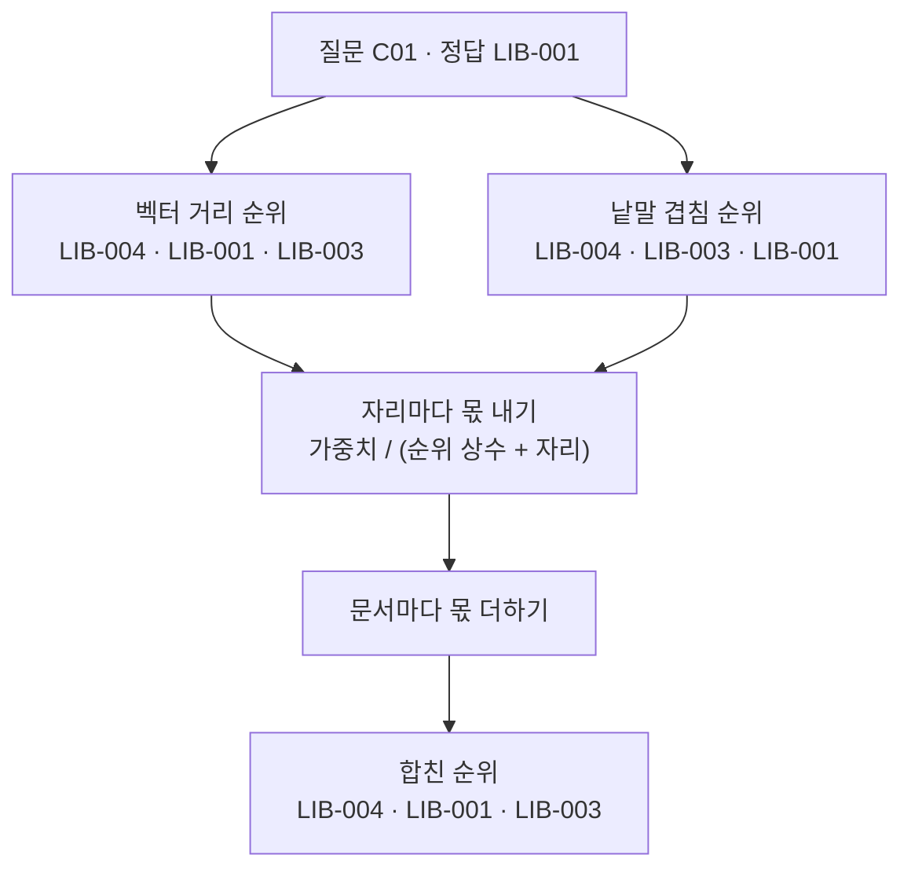
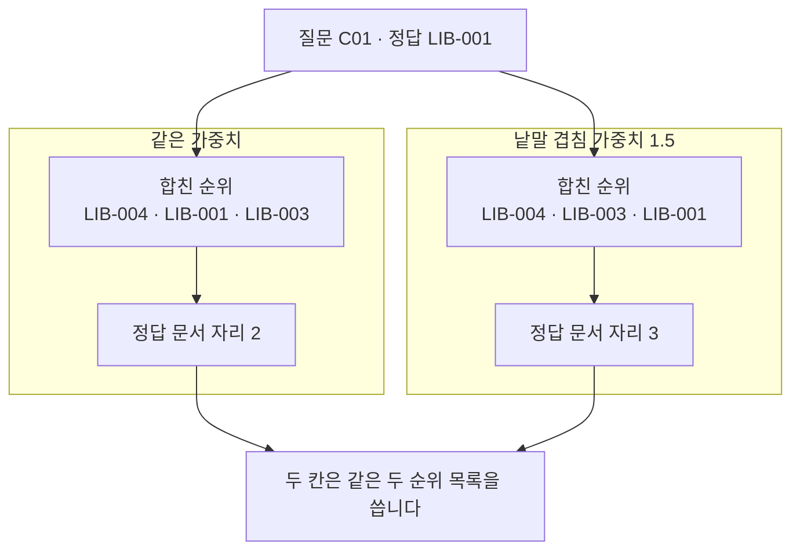
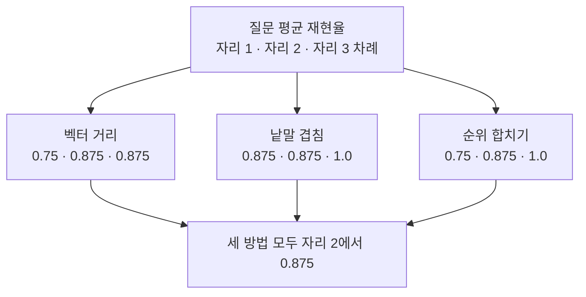
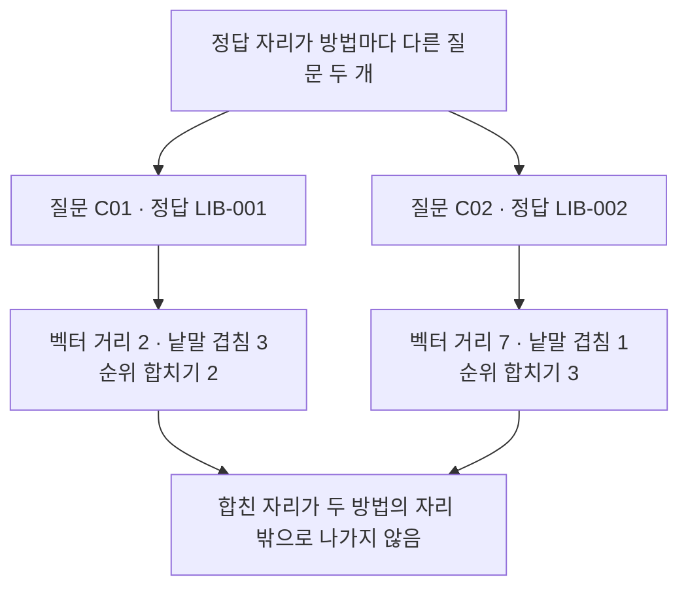

# 06-RRF-하이브리드-검색

## _src 본문 (HTML 원본)

```html
<!--meta: 강의 1h | 실습 3h | 코드 notebooks/06-RRF-하이브리드-검색.ipynb | 새 용어 5 -->
<h2 id="b1"><span class="no">1</span>학습 목표</h2><div class="goal"><ul><li>이 절을 마치면 두 순위를 자리 번호만 써서 하나로 합칠 수 있습니다.</li><li>합치는 식의 순위 상수와 가중치가 무엇을 바꾸는지 설명할 수 있습니다.</li><li>합친 결과를 앞 두 방법과 같은 지표로 재고 결론을 실제 값으로 한정할 수 있습니다.</li></ul></div>
<h2 id="b2"><span class="no">2</span>이 내용을 배우는 이유</h2><p>05절에서 두 검색 방법이 서로 다른 질문에서 앞섰습니다. 그러면 두 결과를 함께 쓰고 싶어집니다. 그런데 거리와 점수는 크기도 방향도 달라 그대로 더할 수 없습니다.</p><p>값을 더하지 못하면 자리 번호를 쓰면 됩니다. 어느 방법에서 나왔든 자리 번호는 1부터 차례로 붙은 같은 모양의 수입니다. 이 절은 자리 번호만으로 두 순위를 하나로 합치고 그 결과를 같은 지표로 잽니다.</p>
<h2 id="b3"><span class="no">3</span>앞에서 배운 내용</h2><p>01절에서 문서 12개와 질문 8개를 숫자 256개짜리 벡터로 바꿨습니다. 코사인 거리로 문서를 모두 재어 순위를 만들었습니다. 04절에서는 같은 글을 형태소로 갈라 검색 낱말을 만들고 BM25 점수로 순위를 냈습니다.</p><p>05절은 두 순위를 같은 자료에서 나란히 놓았습니다. 문서와 질문, 후보 단위, 자르는 자리, 지표 함수 다섯 가지를 같게 두었습니다. 두 방법 모두 문서 12개를 끝까지 재어 정답 자리를 1에서 12까지 셌습니다.</p><p>이 절도 그 다섯 가지를 그대로 둡니다. 합친 순위까지 세 방법을 한 표에 담으려면 재는 문서 수가 같아야 합니다.</p><p>Ch 11과 01~05절에서 쓴 지표 함수 네 개를 그대로 이어 씁니다. 함수 <code>unique_doc_ids()</code>가 만든 문서 ID 목록이 이 절에서 합칠 재료입니다.</p><p>노트북은 이 지표 함수와 01절 <code>rank_by_distance()</code>, 04절 <code>kiwi_terms()</code>·<code>rank_by_bm25()</code>를 실습 폴더의 도구 파일 <code>notebooks/rag_tools.py</code>에서 가져옵니다. 인자 모양은 05절에서 쓴 것과 같습니다.</p>
<h2 id="b4"><span class="no">4</span>핵심 개념</h2><h3>비유로 시작하기</h3><p>탁자 위에 같은 물건이 두 줄로 놓여 있습니다. 두 줄의 차례는 서로 다릅니다. 각 줄에서 앞자리에 놓인 물건일수록 큰 칩을 하나 받습니다. 같은 물건이 받은 칩 두 개를 한 접시에 모읍니다. 칩이 가장 많이 쌓인 접시의 물건이 새 줄의 맨 앞이 됩니다.</p>
{{img:06-5-두-줄에서-받은-몫|왼쪽에 나무 타일 세 개짜리 줄이 위아래로 두 줄 있고 타일마다 파란 동그라미와 빨간 네모와 초록 잎 가운데 하나가 그려져 있으며 그 위에 놓인 둥근 칩이 앞자리일수록 크고 두 줄 모두 앞자리는 파란 동그라미이며 오른쪽에는 같은 표시가 앞면에 그려진 얕은 그릇 세 개가 있고 파란 동그라미 그릇에만 큰 칩 두 개가 담겨 가장 차 있는 그림|두 줄에서 모두 앞자리인 물건의 접시에만 큰 칩 두 개가 쌓입니다.}}
<p class="look"><b>그림 읽기</b> — 왼쪽의 두 줄이 서로 다른 방법이 낸 두 순위입니다. 타일에 그려진 표시가 문서이고 그 위의 칩이 그 자리에서 받는 몫입니다. 두 줄 모두 앞자리 칩이 가장 크고 뒤로 갈수록 작아집니다. 오른쪽 그릇은 표시가 같은 타일에서 나온 칩을 한곳에 모은 것입니다. 파란 동그라미만 두 줄 모두 앞자리라 그 그릇에 큰 칩 두 개가 담겼습니다.</p>
<table><thead><tr><th>말</th><th>뜻</th></tr></thead><tbody><tr><td>순위 합치기(Reciprocal Rank Fusion, RRF)</td><td>여러 순위의 자리 번호만 써서 하나의 순위로 만드는 방법입니다. 값의 크기는 보지 않습니다.</td></tr><tr><td>합친 점수(fused score)</td><td>한 문서가 방법마다 받은 몫을 모두 더한 값입니다. 이 값이 클수록 앞자리가 됩니다.</td></tr><tr><td>순위 상수(rank constant)</td><td>자리 번호에 더하는 고정된 수입니다. 이 절에서는 60을 씁니다.</td></tr><tr><td>가중치(weight)</td><td>한 방법이 주는 몫을 늘리거나 줄이는 수입니다. 이 절의 기본값은 1.0입니다.</td></tr><tr><td>하이브리드 검색(hybrid search)</td><td>서로 다른 검색 방법의 결과를 함께 쓰는 검색입니다. 이 절의 순위 합치기가 그 한 가지입니다.</td></tr></tbody></table>
<h3>자리 번호를 몫으로 바꾸기</h3><p>앞자리일수록 큰 몫을 줍니다. 식은 <code>가중치 / (순위 상수 + 자리)</code>입니다. 자리 1인 문서는 <code>1.0 / (60 + 1)</code>로 약 <code>0.0164</code>를 받습니다.</p><p>자리 2는 약 <code>0.0161</code>이고 자리 3은 약 <code>0.0159</code>입니다. 자리가 뒤로 갈수록 몫이 조금씩 줄어듭니다. 한 문서가 두 방법에서 모두 앞자리이면 큰 몫을 두 번 받습니다.</p><p>순위 상수를 크게 두면 앞자리와 뒷자리의 몫 차이가 작아집니다. 이 절은 60 하나만 실행했고 다른 값은 이번에 확인하지 않았습니다.</p>
{{mermaid:06-1-두-순위를-자리로-합치기|위에서 아래로 내려가는 흐름도로 맨 위 초록 상자 질문 C01 정답 LIB-001에서 두 갈래로 갈려 왼쪽 갈래는 노란 상자 벡터 거리 순위 LIB-004 LIB-001 LIB-003으로 이어지고 오른쪽 갈래는 노란 상자 낱말 겹침 순위 LIB-004 LIB-003 LIB-001로 이어진 뒤 두 순위가 파란 상자 자리마다 몫 내기로 모이고 파란 상자 문서마다 몫 더하기를 지나 맨 아래 노란 상자 합친 순위 LIB-004 LIB-001 LIB-003으로 끝나는 그림|두 순위의 자리 번호만 몫으로 바꿔 문서마다 더하면 합친 순위가 나옵니다.}}
<p class="look"><b>도식 읽기</b> — 맨 위 초록 상자가 실행 1에서 고른 질문과 그 정답 문서입니다. 위에서 아래로 읽고 왼쪽 갈래가 벡터 거리, 오른쪽 갈래가 낱말 겹침입니다. 두 갈래의 노란 상자는 05절에서 만든 순위이고 문서 ID만 들어 있습니다. 가운데 파란 상자 두 개가 이 절에서 새로 만드는 처리입니다. 맨 아래 노란 상자가 합친 순위이고 앞 세 개는 왼쪽 갈래와 같은 차례입니다.</p>
<h3>같게 두어야 하는 것</h3><p>합친 순위를 앞 두 방법과 함께 재려면 05절의 다섯 가지를 그대로 둡니다. 그래서 세 방법 모두 문서 12개를 끝까지 재어 자리를 1에서 12까지 셉니다. 한 방법만 앞에서 잘라 넣으면 자리의 범위가 달라져 견줄 수 없습니다.</p><p>합치는 함수에 넣는 것은 문서 ID 목록 두 개뿐입니다. 거리와 점수는 넘기지 않습니다. 그래서 두 값의 크기를 서로 맞추는 일이 필요 없습니다.</p>
<h3>가중치는 검색 점수를 바꾸지 않습니다</h3><p>가중치는 한 방법이 주는 몫에 곱하는 수입니다. 낱말 겹침 쪽 가중치를 올려도 BM25 점수 자체는 그대로입니다. 합친 점수에서 낱말 겹침 순위가 차지하는 몫만 커집니다.</p><p>이 절은 가중치 두 벌만 실행했습니다. 값을 한 번에 두 개 바꾸면 무엇이 결과를 바꿨는지 알 수 없습니다.</p>
<h2 id="b5"><span class="no">5</span>실행 예제</h2><p>01~05절과 같은 문서 12개와 질문 8개를 그대로 씁니다. 질문마다 두 방법의 순위 목록을 미리 만들고 합치는 함수 두 개를 정의합니다. 실행 1은 첫 질문 <code>C01</code>이고 값 바꿔 보기는 가중치 하나만 바꿉니다.</p><p>임베딩 요청은 문서 1번과 질문 8번으로 모두 아홉 번입니다. 예상 비용은 미화 0.01달러 아래이고 답을 쓰는 모델은 부르지 않습니다. 합치는 계산은 요청을 보내지 않습니다.</p><p>노트북 6절에서 함수 <code>find_gold_rank()</code>를 문서 하나의 자리를 찾는 데도 씁니다. 목록에서 찾는 ID가 몇 번째인지 세는 함수라 정답 문서가 아닌 문서에도 쓸 수 있습니다.</p>
{{mermaid:06-2-가중치를-바꾼-합친-순위|위에서 아래로 내려가는 흐름도로 맨 위 초록 상자 질문 C01 정답 LIB-001에서 두 칸으로 갈리고 칸 제목 같은 가중치 아래에는 노란 상자 합친 순위 LIB-004 LIB-001 LIB-003과 노란 상자 정답 문서 자리 2가 있으며 칸 제목 낱말 겹침 가중치 1.5 아래에는 노란 상자 합친 순위 LIB-004 LIB-003 LIB-001과 노란 상자 정답 문서 자리 3이 있고 두 칸이 맨 아래 회색 상자로 모이는 그림|가중치를 낱말 겹침 쪽으로 올리니 정답 문서의 자리가 2에서 3으로 내려갑니다.}}
<p class="look"><b>도식 읽기</b> — 맨 위 초록 상자가 두 칸이 함께 보는 질문과 정답 문서입니다. 칸 제목 <code>같은 가중치</code> 아래 두 상자가 실행 1의 결과입니다. 칸 제목 <code>낱말 겹침 가중치 1.5</code> 아래 두 상자가 값 바꿔 보기의 결과입니다. 두 칸에서 1위 문서는 같고 둘째와 셋째가 서로 바뀌었습니다. 맨 아래 회색 상자는 두 칸에 모두 해당하는 사실입니다.</p>
{{notebook:06-RRF-하이브리드-검색}}
<p class="look"><b>확인할 점</b> — 실행 1에서 합친 순위 앞 세 개는 <code>LIB-004</code>·<code>LIB-001</code>·<code>LIB-003</code>이었습니다. 둘째와 셋째의 합친 점수가 <code>0.032</code>로 같아 문서 ID 차례가 자리를 정했습니다. 가중치를 올리니 둘째와 셋째가 서로 바뀌고 정답 문서 <code>LIB-001</code>이 자리 3으로 내려갔습니다. 질문 여덟 개에서는 합친 순위의 자리 3 질문 평균 재현율이 <code>1.0</code>이었습니다.</p>
<h2 id="b6"><span class="no">6</span>실험 결과 해석</h2><p>질문 여덟 개를 세 방법으로 모두 재어 기록 스물네 줄을 만들었습니다. 자리 1 질문 평균 재현율은 벡터 거리 <code>0.75</code>, 낱말 겹침 <code>0.875</code>, 순위 합치기 <code>0.75</code>였습니다. 자리 3에서는 차례로 <code>0.875</code>와 <code>1.0</code>과 <code>1.0</code>이었습니다. 자리 2에서는 세 값이 모두 <code>0.875</code>였습니다.</p>
{{mermaid:06-3-세-방법의-질문-평균|위에서 아래로 내려가는 흐름도로 맨 위 노란 상자 질문 평균 재현율 자리 1 자리 2 자리 3 차례에서 세 칸으로 갈려 노란 상자 벡터 거리 0.75 0.875 0.875와 노란 상자 낱말 겹침 0.875 0.875 1.0과 노란 상자 순위 합치기 0.75 0.875 1.0이 나오고 세 상자가 맨 아래 회색 상자 세 방법 모두 자리 2에서 0.875로 모이는 그림|합친 순위의 질문 평균은 자리 1에서 벡터 거리와 같고 자리 3에서 낱말 겹침과 같습니다.}}
<p class="look"><b>도식 읽기</b> — 맨 위 노란 상자가 아래 세 상자의 숫자 차례를 알려 줍니다. 세 상자는 왼쪽부터 벡터 거리, 낱말 겹침, 순위 합치기입니다. 순위 합치기의 첫 값은 벡터 거리와 같고 마지막 값은 낱말 겹침과 같습니다. 맨 아래 회색 상자는 세 상자의 가운데 값이 모두 같다는 사실입니다.</p>
<p>합친 값이 두 방법보다 높은 자리는 세 자리 가운데 없었습니다. 이번 자료에서는 합쳤다고 해서 좋아지지 않았습니다. 낱말 겹침 쪽이 이미 자리 3에서 <code>1.0</code>이라 더 올라갈 자리가 없었습니다.</p><p>평균만 보면 합친 값이 두 방법 가운데에 있습니다. 질문마다 보면 자리가 어떻게 놓였는지 더 잘 보입니다.</p>
{{mermaid:06-4-방법마다-갈린-두-질문|위에서 아래로 내려가는 흐름도로 맨 위 노란 상자 정답 자리가 방법마다 다른 질문 두 개에서 두 갈래로 갈려 왼쪽 갈래는 초록 상자 질문 C01 정답 LIB-001에서 노란 상자 벡터 거리 2 낱말 겹침 3 순위 합치기 2로 내려가고 오른쪽 갈래는 초록 상자 질문 C02 정답 LIB-002에서 노란 상자 벡터 거리 7 낱말 겹침 1 순위 합치기 3으로 내려간 뒤 두 갈래가 맨 아래 회색 상자로 모이는 그림|질문 C01과 C02에서 합친 순위의 정답 자리가 두 방법의 자리 밖으로 나가지 않습니다.}}
<p class="look"><b>도식 읽기</b> — 맨 위 노란 상자가 세 방법의 정답 자리가 갈린 질문 두 개입니다. 위에서 아래로 읽고 왼쪽 갈래가 질문 <code>C01</code>입니다. 초록 상자는 질문과 정답 문서이고 그 아래 노란 상자가 세 방법의 자리입니다. 왼쪽 갈래에서 합친 자리는 벡터 거리와 같고 오른쪽 갈래에서는 두 자리 가운데에 있습니다. 맨 아래 회색 상자는 두 갈래에서 모두 확인한 사실입니다.</p>
<p>질문 <code>C02</code>에서 벡터 거리는 정답 문서를 자리 7에 두었고 낱말 겹침은 자리 1에 두었습니다. 합친 순위에서는 자리 3이었습니다. 한쪽이 크게 뒤로 둔 문서를 다른 쪽이 앞으로 끌어올린 자리입니다. 질문 여덟 개 모두 합친 자리가 두 방법의 자리 밖으로 나가지 않았습니다.</p><p>가중치를 낱말 겹침 쪽만 <code>1.5</code>로 올린 뒤 질문 여덟 개를 다시 쟀습니다. 정답 자리가 달라진 질문은 <code>C01</code> 하나였고 자리가 2에서 3으로 내려갔습니다. 자리가 앞으로 온 질문은 이번 실행에 없었습니다.</p><p>문서 12개와 질문 8개에서 한 번 실행한 값입니다. 순위 상수와 후보 수는 한 벌만 실행했습니다. 합치기가 어떤 자료에서 도움이 되는지 이 자료로 말할 수 없습니다.</p>
<h2 id="b7"><span class="no">7</span>주의할 점과 실무 메모</h2><ul><li>합치는 함수에는 자리 번호만 넣습니다. 거리와 점수를 그대로 더하거나 견주지 않습니다.</li><li>자리 번호는 1부터 셉니다. 0부터 넣으면 자리 1의 몫이 달라집니다.</li><li>합친 점수가 같은 자리는 결과로 읽지 않습니다. 실행 1의 자리 2와 자리 3이 그런 자리였습니다.</li><li>값은 한 번에 하나만 바꿉니다. 이 절은 가중치만 바꾸고 순위 상수와 문서, 질문, 재는 문서 수를 그대로 두었습니다.</li><li>세 방법의 정답 자리를 한 표에 담으려면 재는 문서 수를 같게 둡니다. 이 절은 세 방법 모두 문서 12개를 끝까지 쟀습니다.</li><li>두 순위 목록에 문서 열두 건이 모두 들어 있어 한쪽에만 있는 문서는 이번에 나오지 않았습니다. 후보를 앞에서 잘라 넣는 방법은 이번에 실행하지 않았습니다.</li><li>순위 상수는 60 하나만 실행했습니다. 다른 값에서 순위가 어떻게 달라지는지는 이번에 확인하지 않았습니다.</li><li>가중치를 올려도 BM25 점수는 바뀌지 않습니다. 합친 점수에서 그 방법이 차지하는 몫만 커집니다.</li><li>합친 점수는 소수 다섯째 자리까지 출력했습니다. 두 문서의 값이 같은지 보려면 그 자리까지 필요합니다.</li><li>거리 값의 소수 셋째 자리 아래는 실행마다 흔들립니다. 그래서 거리는 소수 둘째 자리까지만 출력하고 그림 라벨에 넣지 않았습니다.</li><li>실행 1과 값 바꿔 보기에 쓴 질문은 여덟 질문을 먼저 모두 재어 고른 것입니다. 흐름을 보여 주려고 정한 예이고 질문을 고르는 기준이 아닙니다.</li><li>가중치 <code>1.5</code>도 탐색 실행에서 결과가 달라지는 값을 보고 정했습니다. 실무에서 쓸 값을 권하는 것이 아닙니다.</li><li>이 절은 검색에 걸린 시간을 재지 않았습니다. 정밀도와 nDCG도 재지 않았습니다.</li><li>이 절은 파일을 쓰지 않습니다. 01~03절이 만든 데이터베이스 표도 읽지 않습니다.</li></ul>
<h2 id="b8"><span class="no">8</span>정리와 다음 절</h2><ul><li>자리 번호만 써서 두 순위를 하나로 합치는 함수를 만들었습니다.</li><li>질문 <code>C01</code>에서 합친 순위의 정답 자리는 2였고 가중치를 올리니 3이 되었습니다.</li><li>이번 실행에서 합친 값이 두 방법보다 높은 자리는 없었습니다.</li></ul><p><strong>다음 학습과 이어지는 지점</strong> — 07절에서는 후보 목록을 고정해 두고 질문과 후보 본문을 함께 읽어 순서를 다시 정합니다. 그 절부터 쓰는 문서와 질문 묶음이 바뀝니다.</p>
<h2 id="b9"><span class="no">9</span>복습 문제</h2><details class="quiz" open><summary>문제 4개 · 해설 포함</summary><p class="quiz-q">1. 두 검색 결과의 값을 그대로 더하지 않고 자리 번호를 쓰는 까닭은 무엇입니까?</p><p class="quiz-a">두 값은 계산 방법과 크기가 다르고 방향도 반대이기 때문입니다. 자리 번호는 두 방법에서 같은 모양의 수입니다. 틀렸다면 「이 내용을 배우는 이유」를 다시 읽습니다.</p><p class="quiz-q">2. 자리 1인 문서가 한 방법에서 받는 몫은 얼마입니까?</p><p class="quiz-a">식 <code>1.0 / (60 + 1)</code>로 약 <code>0.0164</code>가 됩니다. 틀렸다면 「자리 번호를 몫으로 바꾸기」를 다시 읽습니다.</p><p class="quiz-q">3. 낱말 겹침 쪽 가중치를 올리면 BM25 점수는 어떻게 됩니까?</p><p class="quiz-a">그대로입니다. 합친 점수에서 낱말 겹침 순위가 차지하는 몫만 커집니다. 틀렸다면 「가중치는 검색 점수를 바꾸지 않습니다」를 다시 읽습니다.</p><p class="quiz-q">4. 합친 순위의 자리 3 질문 평균 재현율이 <code>1.0</code>이면 합치기가 더 낫다고 말할 수 있습니까?</p><p class="quiz-a">말할 수 없습니다. 낱말 겹침도 같은 자리에서 <code>1.0</code>이었고 자리 1에서는 합친 값이 더 낮았습니다. 틀렸다면 「실험 결과 해석」을 다시 읽습니다.</p></details>
<h2 id="b10"><span class="no">10</span>참고 자료</h2><ul><li><div><a href="https://www.elastic.co/docs/reference/elasticsearch/rest-apis/reciprocal-rank-fusion">Elasticsearch Reciprocal Rank Fusion</a></div>순위만 써서 여러 검색 결과를 합치는 방법 설명 · 확인 2026-09-09</li><li><div><a href="https://github.com/pgvector/pgvector/tree/v0.8.6#hybrid-search">pgvector Hybrid Search</a></div>데이터베이스에서 두 검색을 함께 쓰는 예 · v0.8.6 · 확인 2026-09-09</li></ul>
```

## 노트북 셀 (순서대로)

### [0] markdown {'html': 'skip'}

# RRF 하이브리드 검색

**이 노트북에서 할 일**

1. 05절과 같은 두 검색 방법의 순위 목록을 다시 만듭니다.
2. 자리 번호만 써서 두 순위를 하나로 합치는 함수를 만듭니다.
3. 가중치 하나만 올려 합친 순위가 어떻게 달라지는지 봅니다.
4. 질문 여덟 개에서 세 방법의 정답 자리와 재현율을 견줍니다.

**준비물** — 프로젝트 폴더의 `.env`에 `OPENAI_API_KEY`가 있어야 합니다.
임베딩 요청은 문서 1번과 질문 8번으로 모두 아홉 번입니다.
예상 비용은 미화 0.01달러 아래이고 답을 쓰는 모델은 부르지 않습니다.
실행 시간은 1분 안팎이고 첫 셀의 설치가 가장 오래 걸립니다.

**데이터** — 두 파일 모두 실습 묶음에 들어 있습니다.

- 문서 `labs/part3/ch12-retrieval-tuning/data/core-documents.json`(12개)
- 질문 `labs/part3/ch12-retrieval-tuning/data/core-queries.json`(8개)

**강의와 실습 범위** — 강의 시간에는 2절과 5~7절, 9절을 읽습니다.
합치는 식을 정하고 함수 두 개를 만드는 자리가 5절입니다.
6~7절은 실행 1과 값 바꿔 보기이고 9절은 세 방법 비교입니다.
1·3·4·8절은 함께 실행하고 실습 시간에 다시 읽습니다.

**기준 버전** — 첫 셀에서 다섯 패키지를 고정한 판으로 설치합니다.
교재 출력은 Linux의 Python 3.12.13으로 만들었습니다.
다른 판과 Windows·macOS에서는 이번에 실행하지 않았습니다.

실습 폴더 `labs/part3/ch12-retrieval-tuning`에서 `uv sync --locked`를 실행합니다.
그다음 이 폴더의 `.venv` 커널을 고르고 첫 셀부터 순서대로 실행합니다.

### [1] markdown {'html': 'skip'}

## 오늘 볼 그림


맨 위 초록 상자가 이 절에서 자세히 볼 질문과 그 정답 문서입니다.
거기서 두 갈래로 갈리고 왼쪽이 벡터 거리, 오른쪽이 낱말 겹침입니다.
두 갈래의 노란 상자는 05절에서 만든 순위입니다.
가운데 파란 상자 두 개가 이 절에서 새로 만드는 처리입니다.
맨 아래 노란 상자가 합친 순위이고 이 노트북 6절의 출력입니다.

### [2] markdown {}

## 1. 준비

첫 셀은 패키지 다섯 개를 설치하고 설치된 버전을 출력합니다.
설치에는 몇십 초가 걸릴 수 있습니다.

### [3] code {'execution': {'iopub.execute_input': '2026-09-21T07:40:28.252949Z', 'iopub.status.busy': '2026-09-21T07:40:28.252794Z', 'iopub.status.idle': '2026-09-21T07:40:28.768736Z', 'shell.execute_reply': '2026-09-21T07:40:28.768106Z'}, 'lesson_role': 'setup'}

```python
# 이 절에서 쓰는 패키지를 설치하고 버전을 확인합니다
%pip install -q "langchain-openai==1.6.1" "python-dotenv==1.2.3" "kiwipiepy==0.23.2" "rank-bm25==0.2.2" "numpy==2.5.3"
from importlib.metadata import version

print("langchain-openai:", version("langchain-openai"))
print("python-dotenv:", version("python-dotenv"))
print("kiwipiepy:", version("kiwipiepy"))
print("rank-bm25:", version("rank-bm25"))
print("numpy:", version("numpy"))
```

출력:
```
Note: you may need to restart the kernel to use updated packages.
langchain-openai: 1.6.1
python-dotenv: 1.2.3
kiwipiepy: 0.23.2
rank-bm25: 0.2.2
numpy: 2.5.3

```

### [4] markdown {}

**결과 읽기** — 설치가 끝나면 `langchain-openai: 1.6.1`과 `rank-bm25: 0.2.2`가 보입니다.
다섯 줄이 모두 보이면 다음 셀로 넘어갑니다.
05절과 같은 다섯 패키지입니다.

다음 셀은 이 절에서 쓸 이름 네 개를 불러옵니다.

앞에서 배운 함수는 `rag_tools.py`에 모아 두었습니다. 파일을 열면 코드를 볼 수 있습니다. 노트북과 같은 폴더(`notebooks/`)에 있는 파일입니다.

이 노트북은 01·04절 함수 세 개와 Ch 11 지표 함수 네 개를 가져옵니다.
01절 `rank_by_distance()`, 04절 `kiwi_terms()`·`rank_by_bm25()`입니다.
Ch 11 함수는 `unique_doc_ids()`·`find_gold_rank()`·`recall_at()`·`mean_score()`입니다.
인자 모양은 05절에서 쓴 것과 같습니다.

### [5] code {'execution': {'iopub.execute_input': '2026-09-21T07:40:28.769792Z', 'iopub.status.busy': '2026-09-21T07:40:28.769703Z', 'iopub.status.idle': '2026-09-21T07:40:29.856217Z', 'shell.execute_reply': '2026-09-21T07:40:29.856064Z'}, 'lesson_role': 'setup'}

```python
# 자료 읽기·임베딩·형태소 분석·낱말 점수에 쓸 이름을 불러옵니다
import json

from kiwipiepy import Kiwi
from langchain_openai import OpenAIEmbeddings
from rank_bm25 import BM25Okapi
# 01·04절과 Ch 11 01·02절 함수 일곱 개를 도구 파일에서 가져옵니다
from rag_tools import find_gold_rank, kiwi_terms, mean_score, rank_by_bm25
from rag_tools import rank_by_distance, recall_at, unique_doc_ids

print("불러온 이름:", "json", "Kiwi", "OpenAIEmbeddings", "BM25Okapi")
```

출력:
```
불러온 이름: json Kiwi OpenAIEmbeddings BM25Okapi

```

### [6] markdown {}

**결과 읽기** — 출력 줄은 `불러온 이름:` 뒤에 이름 네 개가 붙은 한 줄입니다.
이름 `OpenAIEmbeddings`는 글을 벡터로 바꾸는 도구입니다.
이름 `Kiwi`와 `BM25Okapi`는 낱말 겹침 쪽에서 쓰는 두 도구입니다.
도구 파일에서 가져온 함수 일곱 개는 출력하지 않습니다.

다음 셀은 API 키가 있는지 확인합니다. `True` 값이 나오면 다음으로 넘어갑니다.

### [7] code {'execution': {'iopub.execute_input': '2026-09-21T07:40:29.857555Z', 'iopub.status.busy': '2026-09-21T07:40:29.857422Z', 'iopub.status.idle': '2026-09-21T07:40:29.860942Z', 'shell.execute_reply': '2026-09-21T07:40:29.860762Z'}, 'lesson_role': 'setup'}

```python
# .env 파일에서 OpenAI API 키를 읽습니다(키 값은 출력하지 않습니다)
import os
from dotenv import find_dotenv, load_dotenv

env_path = find_dotenv(usecwd=True)
load_dotenv(env_path)
has_key = os.getenv("OPENAI_API_KEY") is not None
print("OPENAI_API_KEY 설정 여부:", has_key)
assert has_key, "프로젝트 폴더의 .env 파일에 OPENAI_API_KEY를 적어 주세요."
```

출력:
```
OPENAI_API_KEY 설정 여부: True

```

### [8] markdown {}

**결과 읽기** — 출력 줄은 `OPENAI_API_KEY 설정 여부: True` 하나입니다.
키 값은 출력하지 않습니다.

다음 셀은 프로젝트 맨 위 폴더를 찾습니다. 01~05절과 같은 코드입니다.

### [9] code {'execution': {'iopub.execute_input': '2026-09-21T07:40:29.861367Z', 'iopub.status.busy': '2026-09-21T07:40:29.861323Z', 'iopub.status.idle': '2026-09-21T07:40:29.863244Z', 'shell.execute_reply': '2026-09-21T07:40:29.863083Z'}, 'lesson_role': 'setup'}

```python
# 노트북을 어느 폴더에서 열어도 프로젝트 맨 위를 찾게 후보 세 개를 차례로 봅니다
candidates = [".", "../../..", "../../../.."]
root_path = None
for candidate in candidates:
    if os.path.exists(candidate + "/labs/part3/ch12-retrieval-tuning/data"):
        root_path = candidate
        break
print("고른 경로:", root_path)
assert root_path is not None, "notebooks 폴더나 실습 폴더 맨 위에서 노트북을 열어 주세요."
```

출력:
```
고른 경로: .

```

### [10] markdown {}

**결과 읽기** — 출력 줄은 `고른 경로: .`입니다. `assert`도 통과했습니다.

다음 셀은 01~05절이 쓴 문서 파일과 질문 파일을 그대로 읽습니다.

### [11] code {'execution': {'iopub.execute_input': '2026-09-21T07:40:29.863633Z', 'iopub.status.busy': '2026-09-21T07:40:29.863592Z', 'iopub.status.idle': '2026-09-21T07:40:29.865896Z', 'shell.execute_reply': '2026-09-21T07:40:29.865738Z'}, 'lesson_role': 'setup'}

```python
# 01~05절과 같은 문서 파일과 질문 파일을 불러옵니다
data_path = root_path + "/labs/part3/ch12-retrieval-tuning/data"
with open(data_path + "/core-documents.json", encoding="utf-8") as file:
    docs = json.loads(file.read())
with open(data_path + "/core-queries.json", encoding="utf-8") as file:
    queries = json.loads(file.read())
print("문서 수:", len(docs))
print("질문 수:", len(queries))
```

출력:
```
문서 수: 12
질문 수: 8

```

### [12] markdown {}

**결과 읽기** — `문서 수: 12`와 `질문 수: 8`이 보입니다.
01~05절과 같은 교육용 자료입니다.
같은 자료를 써야 05절에서 만든 두 순위를 그대로 합칠 수 있습니다.

## 2. 이 절에서 쓸 값 정하기

05절에서 쓴 값 다섯 개를 그대로 다시 정합니다.
이름 `top_all`은 자리를 셀 때 재는 문서 수입니다.
이름 `method_names`에 담을 방법이 05절 둘에서 셋으로 늘었습니다.

### [13] code {'execution': {'iopub.execute_input': '2026-09-21T07:40:29.866295Z', 'iopub.status.busy': '2026-09-21T07:40:29.866253Z', 'iopub.status.idle': '2026-09-21T07:40:29.868117Z', 'shell.execute_reply': '2026-09-21T07:40:29.867968Z'}}

```python
# 05절에서 쓴 값을 그대로 다시 정하고 견줄 방법 이름을 셋으로 늘립니다
top_three = 3
top_all = 12
cutoff_values = [1, 2, 3]
keep_tags = ["NNG", "NNP", "NNB", "NR", "VV", "VA", "MAG", "SN", "SL"]
method_names = ["벡터 거리", "낱말 겹침", "순위 합치기"]
print("나란히 볼 상위 문서 수:", top_three)
print("자리를 셀 때 재는 문서 수:", top_all)
print("자르는 자리 세 가지:", cutoff_values)
print("남길 품사 표시:", keep_tags)
print("견줄 방법 세 가지:", method_names)
```

출력:
```
나란히 볼 상위 문서 수: 3
자리를 셀 때 재는 문서 수: 12
자르는 자리 세 가지: [1, 2, 3]
남길 품사 표시: ['NNG', 'NNP', 'NNB', 'NR', 'VV', 'VA', 'MAG', 'SN', 'SL']
견줄 방법 세 가지: ['벡터 거리', '낱말 겹침', '순위 합치기']

```

### [14] markdown {}

**결과 읽기** — `자리를 셀 때 재는 문서 수: 12`가 보입니다.
출력 줄 `자르는 자리 세 가지: [1, 2, 3]`은 01~05절과 같은 값입니다.
줄 `견줄 방법 세 가지: ['벡터 거리', '낱말 겹침', '순위 합치기']`의 세 이름으로 기록을 나눕니다.
라벨 줄 `남길 품사 표시:` 뒤에는 이름 아홉 개가 있습니다.

다음 셀은 자리 번호를 몫으로 바꾸는 식에 쓸 값을 정합니다.
앞자리일수록 큰 몫을 주려고 자리 번호를 나누는 수에 넣습니다.
식은 `가중치 / (순위 상수 + 자리)`입니다.

### [15] code {'execution': {'iopub.execute_input': '2026-09-21T07:40:29.868487Z', 'iopub.status.busy': '2026-09-21T07:40:29.868449Z', 'iopub.status.idle': '2026-09-21T07:40:29.870215Z', 'shell.execute_reply': '2026-09-21T07:40:29.870057Z'}}

```python
# 자리 번호를 몫으로 바꾸는 식에 쓸 값을 정하고 앞자리 세 곳의 몫을 봅니다
rank_constant = 60
base_weight = 1.0
raised_weight = 1.5
equal_weights = [base_weight, base_weight]
sparse_up_weights = [base_weight, raised_weight]
print("순위 상수:", rank_constant)
print("같은 가중치:", equal_weights)
print("낱말 겹침 쪽만 올린 가중치:", sparse_up_weights)
print("자리 | 기본 가중치가 주는 몫")
for position in range(top_three):
    share = base_weight / (rank_constant + position + 1)
    print(position + 1, "|", round(share, 4))
```

출력:
```
순위 상수: 60
같은 가중치: [1.0, 1.0]
낱말 겹침 쪽만 올린 가중치: [1.0, 1.5]
자리 | 기본 가중치가 주는 몫
1 | 0.0164
2 | 0.0161
3 | 0.0159

```

### [16] markdown {}

**결과 읽기** — 라벨 줄 아래 세 줄이 자리 1·2·3의 몫입니다.
자리 1은 `1 | 0.0164`이고 자리 3은 `3 | 0.0159`입니다.
자리가 하나 뒤로 갈 때마다 몫이 조금씩 줄어듭니다.
줄 `순위 상수: 60`의 60은 앞자리 사이의 차이를 줄이려고 더하는 수입니다.
출력 줄 `낱말 겹침 쪽만 올린 가중치: [1.0, 1.5]`는 7절에서 쓸 값입니다.

## 3. 두 방법이 볼 재료 만들기

두 방법은 같은 글에서 서로 다른 재료를 만듭니다.
먼저 문서 12개의 제목과 본문을 이어 붙여 글 열두 개로 만듭니다.

### [17] code {'execution': {'iopub.execute_input': '2026-09-21T07:40:29.870598Z', 'iopub.status.busy': '2026-09-21T07:40:29.870559Z', 'iopub.status.idle': '2026-09-21T07:40:29.872218Z', 'shell.execute_reply': '2026-09-21T07:40:29.872060Z'}}

```python
# 문서 12개의 제목과 본문을 이어 붙이고 문서 ID 목록도 만듭니다(01~05절과 같은 모양)
doc_texts = []
doc_ids = []
for doc in docs:
    doc_texts.append(doc["title"] + " " + doc["text"])
    doc_ids.append(doc["doc_id"])
print("이어 붙인 글 수:", len(doc_texts))
print("첫 문서 글:", doc_texts[0])
print("문서 ID 목록:")
print(doc_ids)
```

출력:
```
이어 붙인 글 수: 12
첫 문서 글: 도서 대출 기간 일반 도서는 14일 동안 대출할 수 있습니다. 예약자가 없으면 한 번 연장할 수 있습니다.
문서 ID 목록:
['LIB-001', 'LIB-002', 'LIB-003', 'LIB-004', 'FAC-001', 'FAC-002', 'FAC-003', 'FAC-004', 'ACC-001', 'ACC-002', 'ACC-003', 'ACC-004']

```

### [18] markdown {}

**결과 읽기** — `이어 붙인 글 수: 12`가 보입니다.
출력 줄 `첫 문서 글:` 뒤에는 제목 `도서 대출 기간`과 본문이 이어져 있습니다.
라벨 줄 `문서 ID 목록:` 아래 줄에 `LIB-001`부터 열두 개가 있습니다.

다음 셀은 벡터 거리 쪽 재료를 만듭니다.
01~03절·05절과 같은 모델과 같은 숫자 개수를 씁니다.

### [19] code {'execution': {'iopub.execute_input': '2026-09-21T07:40:29.872581Z', 'iopub.status.busy': '2026-09-21T07:40:29.872543Z', 'iopub.status.idle': '2026-09-21T07:40:31.598176Z', 'shell.execute_reply': '2026-09-21T07:40:31.596883Z'}}

```python
# 01~03절·05절과 같은 모델로 문서 12개와 질문 8개를 벡터로 바꿉니다(임베딩 요청 9번)
embedding_model_name = "text-embedding-3-small"
vector_dimensions = 256
embedding_model = OpenAIEmbeddings(model=embedding_model_name, dimensions=vector_dimensions)
doc_vectors = embedding_model.embed_documents(doc_texts)
query_vectors = []
for query in queries:
    query_vectors.append(embedding_model.embed_query(query["question"]))
print("임베딩 모델 이름:", embedding_model.model)
print("벡터의 숫자 개수 설정:", embedding_model.dimensions)
print("문서 벡터 수:", len(doc_vectors))
print("질문 벡터 수:", len(query_vectors))
```

출력:
```
임베딩 모델 이름: text-embedding-3-small
벡터의 숫자 개수 설정: 256
문서 벡터 수: 12
질문 벡터 수: 8

```

### [20] markdown {}

**결과 읽기** — `벡터의 숫자 개수 설정: 256`과 `문서 벡터 수: 12`가 보입니다.
출력 줄 `질문 벡터 수: 8`까지 나오면 임베딩 요청 아홉 번이 끝났습니다.
이 노트북의 출력은 2026-09-21에 이 모델로 실행한 결과입니다.

다음 셀은 낱말 겹침 쪽 재료를 만듭니다.
검색 낱말은 05절처럼 도구 파일의 `kiwi_terms()`에 분석기와 남길 품사 표시를 넘겨 만듭니다.
분석기를 만드는 줄 `kiwi = Kiwi()`는 1초 안팎 걸립니다.

### [21] code {'execution': {'iopub.execute_input': '2026-09-21T07:40:31.600873Z', 'iopub.status.busy': '2026-09-21T07:40:31.600649Z', 'iopub.status.idle': '2026-09-21T07:40:32.937448Z', 'shell.execute_reply': '2026-09-21T07:40:32.936951Z'}}

```python
# 04·05절과 같은 형태소 분석기로 문서 12개의 검색 낱말 목록을 만들고 BM25 모델을 만듭니다
kiwi = Kiwi()
kiwi_corpus = []
for text in doc_texts:
    kiwi_corpus.append(kiwi_terms(kiwi, text, keep_tags))
bm25_model = BM25Okapi(kiwi_corpus)
print("검색 낱말 목록 수:", len(kiwi_corpus))
print("BM25 모델이 본 문서 수:", bm25_model.corpus_size)
print("문서 하나의 평균 검색 낱말 수:", round(bm25_model.avgdl, 2))
```

출력:
```
검색 낱말 목록 수: 12
BM25 모델이 본 문서 수: 12
문서 하나의 평균 검색 낱말 수: 15.33

```

### [22] markdown {}

**결과 읽기** — `검색 낱말 목록 수: 12`와 `BM25 모델이 본 문서 수: 12`가 보입니다.
출력 줄 `문서 하나의 평균 검색 낱말 수: 15.33`은 04·05절과 같은 값입니다.

## 4. 두 방법의 순위 목록 만들기

두 방법의 순위는 05절처럼 도구 파일의 `rank_by_distance()`와 `rank_by_bm25()`로 만듭니다.
값 칸 이름은 `거리`와 `점수`로 뜻이 반대입니다.
두 순위 목록에서 문서 ID만 차례로 모으는 일은 `unique_doc_ids()`가 맡습니다.
합치는 함수에 넣을 재료가 바로 이 문서 ID 목록입니다.

다음 셀은 질문 여덟 개마다 두 방법의 순위 목록을 미리 만듭니다.
문서 12개를 끝까지 재므로 목록 하나에 문서 ID가 열두 개 들어갑니다.

### [23] code {'execution': {'iopub.execute_input': '2026-09-21T07:40:32.938575Z', 'iopub.status.busy': '2026-09-21T07:40:32.938496Z', 'iopub.status.idle': '2026-09-21T07:40:32.945243Z', 'shell.execute_reply': '2026-09-21T07:40:32.944790Z'}}

```python
# 질문 여덟 개마다 두 방법의 순위 목록을 문서 ID 차례로 미리 만들어 둡니다
distance_id_lists = []
score_id_lists = []
for query_index in range(len(queries)):
    distance_hits = rank_by_distance(query_vectors[query_index], doc_vectors, doc_ids, top_all)
    question_terms = kiwi_terms(kiwi, queries[query_index]["question"], keep_tags)
    score_hits = rank_by_bm25(bm25_model, question_terms, doc_ids, top_all)
    distance_id_lists.append(unique_doc_ids(distance_hits))
    score_id_lists.append(unique_doc_ids(score_hits))
print("만든 순위 목록 쌍 수:", len(distance_id_lists))
print("목록 하나의 문서 수:", len(distance_id_lists[0]))
print("첫 질문의 벡터 거리 순위 앞 세 개:", distance_id_lists[0][:top_three])
print("첫 질문의 낱말 겹침 순위 앞 세 개:", score_id_lists[0][:top_three])
```

출력:
```
만든 순위 목록 쌍 수: 8
목록 하나의 문서 수: 12
첫 질문의 벡터 거리 순위 앞 세 개: ['LIB-004', 'LIB-001', 'LIB-003']
첫 질문의 낱말 겹침 순위 앞 세 개: ['LIB-004', 'LIB-003', 'LIB-001']

```

### [24] markdown {}

**결과 읽기** — `만든 순위 목록 쌍 수: 8`과 `목록 하나의 문서 수: 12`가 보입니다.
줄 `첫 질문의 벡터 거리 순위 앞 세 개: ['LIB-004', 'LIB-001', 'LIB-003']`은 05절 실행 1과 같습니다.
낱말 겹침 쪽은 `['LIB-004', 'LIB-003', 'LIB-001']`로 둘째와 셋째가 서로 바뀌어 있습니다.

## 5. 자리 번호로 합치는 함수 만들기

두 목록에는 값이 아니라 문서 ID만 들어 있습니다.
합치는 함수는 그 목록에서 자리 번호만 보고 몫을 냅니다.
그래서 거리와 점수의 크기가 달라도 두 결과를 함께 쓸 수 있습니다.

### [25] code {'execution': {'iopub.execute_input': '2026-09-21T07:40:32.945854Z', 'iopub.status.busy': '2026-09-21T07:40:32.945797Z', 'iopub.status.idle': '2026-09-21T07:40:32.947761Z', 'shell.execute_reply': '2026-09-21T07:40:32.947394Z'}}

```python
# 순위 목록 여러 개를 받아 문서마다 자리 몫을 더한 합친 점수를 냅니다
def fuse_scores(ranking_list, weight_list):
    scores = {}
    for list_index in range(len(ranking_list)):
        ranking = ranking_list[list_index]
        weight = weight_list[list_index]
        # 자리 번호는 1부터 세고 앞자리일수록 나누는 수가 작아 몫이 큽니다
        for position in range(len(ranking)):
            doc_id = ranking[position]
            share = weight / (rank_constant + position + 1)
            scores[doc_id] = scores.get(doc_id, 0.0) + share
    return scores
```

출력:
```

```

### [26] markdown {}

**결과 읽기** — 정의 셀이라 출력이 없습니다.
인자 `ranking_list`에 순위 목록 두 개를 담아 넘깁니다.
줄 `scores.get(doc_id, 0.0) + share`는 아직 없는 문서 ID의 몫을 0에서 시작합니다.

다음 셀은 합친 점수가 큰 순서로 문서 ID 목록을 만듭니다.
점수는 클수록 앞이라 04·05절처럼 점수에 음수를 붙여 정렬합니다.

### [27] code {'execution': {'iopub.execute_input': '2026-09-21T07:40:32.948308Z', 'iopub.status.busy': '2026-09-21T07:40:32.948261Z', 'iopub.status.idle': '2026-09-21T07:40:32.950140Z', 'shell.execute_reply': '2026-09-21T07:40:32.949726Z'}}

```python
# 합친 점수가 큰 순서로 문서 ID 목록을 만듭니다(04·05절과 같은 음수 붙이기)
def fuse_rank(ranking_list, weight_list):
    scores = fuse_scores(ranking_list, weight_list)
    pairs = []
    for doc_id in scores:
        # 점수에 음수를 붙이면 sorted가 큰 점수를 앞으로 보냅니다
        pairs.append((0 - scores[doc_id], doc_id))
    fused_ids = []
    for pair in sorted(pairs):
        fused_ids.append(pair[1])
    return fused_ids
```

출력:
```

```

### [28] markdown {}

**결과 읽기** — 정의 셀이라 출력이 없습니다.
합친 점수가 같은 문서가 있으면 문서 ID 차례가 자리를 정합니다.

## 6. 실행 1 — 두 순위를 같은 가중치로 합치기

첫 질문의 두 순위 목록을 같은 가중치로 합칩니다.
합친 순위 앞자리 문서가 두 순위에서 몇 번째였는지는 `find_gold_rank()`로 찾습니다.
목록에서 찾는 ID가 몇 번째인지 세는 함수라 정답 문서가 아닌 문서에도 쓸 수 있습니다.
실행 전에 예상해 봅니다.
두 방법이 모두 자리 1에 둔 `LIB-004`가 합친 순위에서도 1위일 것입니다.

### [29] code {'execution': {'iopub.execute_input': '2026-09-21T07:40:32.950668Z', 'iopub.status.busy': '2026-09-21T07:40:32.950624Z', 'iopub.status.idle': '2026-09-21T07:40:32.952709Z', 'shell.execute_reply': '2026-09-21T07:40:32.952460Z'}}

```python
# 실행 1: 첫 질문의 두 순위 목록을 같은 가중치로 합칩니다
first_query = queries[0]
first_ranking_list = [distance_id_lists[0], score_id_lists[0]]
first_scores = fuse_scores(first_ranking_list, equal_weights)
first_fused_ids = fuse_rank(first_ranking_list, equal_weights)
print("고른 질문:", first_query["qid"], "|", first_query["question"])
print("그 질문의 정답 문서 ID:", first_query["gold_doc_id"])
print("순위 | 문서 ID | 벡터 거리 자리 | 낱말 겹침 자리 | 합친 점수")
for position in range(top_three):
    doc_id = first_fused_ids[position]
    distance_place = find_gold_rank(distance_id_lists[0], [doc_id])
    score_place = find_gold_rank(score_id_lists[0], [doc_id])
    print(position + 1, "|", doc_id, "|", distance_place, "|", score_place, "|", round(first_scores[doc_id], 5))
```

출력:
```
고른 질문: C01 | 책을 빌릴 수 있는 기간은 며칠인가요?
그 질문의 정답 문서 ID: LIB-001
순위 | 문서 ID | 벡터 거리 자리 | 낱말 겹침 자리 | 합친 점수
1 | LIB-004 | 1 | 1 | 0.03279
2 | LIB-001 | 2 | 3 | 0.032
3 | LIB-003 | 3 | 2 | 0.032

```

### [30] markdown {}

**결과 읽기** — 라벨 줄 아래 첫 줄은 `1 | LIB-004 | 1 | 1 | 0.03279`입니다.
그 문서는 두 방법에서 모두 자리 1이라 가장 큰 몫을 두 번 받았습니다.
둘째 줄 `2 | LIB-001 | 2 | 3 | 0.032`와 셋째 줄 `3 | LIB-003 | 3 | 2 | 0.032`는 합친 점수가 같습니다.
두 문서의 자리 번호가 2와 3으로 서로 바뀐 짝이라 몫의 합이 같아졌습니다.

정답 문서 `LIB-001`의 자리는 2입니다.
합친 점수가 같을 때 자리를 정하는 것은 이 코드의 정렬 규칙입니다.
04절에서 본 대로 점수가 같은 자리는 결과로 읽지 않습니다.

## 7. 값 바꿔 보기 — 가중치 하나만 올리기

바꿀 값은 낱말 겹침 쪽 가중치 하나입니다.
문서와 질문, 순위 상수, 두 순위 목록은 그대로 둡니다.
실행 전에 예상해 봅니다. 낱말 겹침이 앞에 둔 문서가 위로 올라올 것입니다.

### [31] code {'execution': {'iopub.execute_input': '2026-09-21T07:40:32.953317Z', 'iopub.status.busy': '2026-09-21T07:40:32.953275Z', 'iopub.status.idle': '2026-09-21T07:40:32.955309Z', 'shell.execute_reply': '2026-09-21T07:40:32.954896Z'}}

```python
# 값 바꿔 보기: 같은 두 순위 목록에서 낱말 겹침 쪽 가중치만 올립니다
second_scores = fuse_scores(first_ranking_list, sparse_up_weights)
second_fused_ids = fuse_rank(first_ranking_list, sparse_up_weights)
print("쓴 가중치:", sparse_up_weights)
print("순위 | 문서 ID | 벡터 거리 자리 | 낱말 겹침 자리 | 합친 점수")
for position in range(top_three):
    doc_id = second_fused_ids[position]
    distance_place = find_gold_rank(distance_id_lists[0], [doc_id])
    score_place = find_gold_rank(score_id_lists[0], [doc_id])
    print(position + 1, "|", doc_id, "|", distance_place, "|", score_place, "|", round(second_scores[doc_id], 5))
```

출력:
```
쓴 가중치: [1.0, 1.5]
순위 | 문서 ID | 벡터 거리 자리 | 낱말 겹침 자리 | 합친 점수
1 | LIB-004 | 1 | 1 | 0.04098
2 | LIB-003 | 3 | 2 | 0.04007
3 | LIB-001 | 2 | 3 | 0.03994

```

### [32] markdown {}

**결과 읽기** — 출력 줄 `쓴 가중치: [1.0, 1.5]` 아래 표에서 둘째와 셋째가 서로 바뀌었습니다.
둘째 줄은 `2 | LIB-003 | 3 | 2 | 0.04007`이고 셋째 줄은 `3 | LIB-001 | 2 | 3 | 0.03994`입니다.
정답 문서 `LIB-001`의 자리가 2에서 3으로 내려갔습니다.

낱말 겹침 쪽 몫이 한 배 반이 되면서 같았던 두 점수가 갈렸습니다.
낱말 겹침 순위에서 앞자리였던 `LIB-003`이 위로 올라갔습니다.
가중치를 올려도 BM25 점수 자체는 바뀌지 않습니다.
합친 점수에서 낱말 겹침 순위가 차지하는 몫만 커집니다.

## 8. 질문 여덟 개를 잴 함수 준비

질문 하나로는 세 방법의 차이를 말할 수 없습니다.
재현율과 질문 평균은 준비 셀에서 가져온 Ch 11 함수 `recall_at()`과 `mean_score()`로 냅니다.

다음 셀은 문서 ID 목록 하나를 받아 기록 한 줄을 만듭니다.
값 칸을 두지 않아 세 방법을 한 표에 담을 수 있습니다.

### [33] code {'execution': {'iopub.execute_input': '2026-09-21T07:40:32.955825Z', 'iopub.status.busy': '2026-09-21T07:40:32.955772Z', 'iopub.status.idle': '2026-09-21T07:40:32.957387Z', 'shell.execute_reply': '2026-09-21T07:40:32.957111Z'}}

```python
# 문서 ID 목록 하나를 받아 정답 자리와 자르는 자리별 재현율을 기록 한 줄로 만듭니다
def score_one(query_index, method_name, found_ids):
    query = queries[query_index]
    gold_doc_ids = [query["gold_doc_id"]]
    row = {"방법": method_name, "질문": query["qid"], "갈래": query["kind"]}
    row["정답 자리"] = find_gold_rank(found_ids, gold_doc_ids)
    for cutoff in cutoff_values:
        row["자리 " + str(cutoff)] = recall_at(found_ids, gold_doc_ids, cutoff)
    return row
```

출력:
```

```

### [34] markdown {}

**결과 읽기** — 정의 셀이라 출력이 없습니다.
인자 `found_ids`를 밖에서 받으므로 이 함수는 어느 방법인지 보지 않습니다.

## 9. 세 방법의 재현율 견주기

질문 여덟 개를 세 방법으로 모두 잽니다.
순위 목록을 미리 만들어 두었으므로 요청은 더 보내지 않습니다.

### [35] code {'execution': {'iopub.execute_input': '2026-09-21T07:40:32.958118Z', 'iopub.status.busy': '2026-09-21T07:40:32.958065Z', 'iopub.status.idle': '2026-09-21T07:40:32.960174Z', 'shell.execute_reply': '2026-09-21T07:40:32.959798Z'}}

```python
# 질문 여덟 개를 세 방법으로 모두 재어 기록 줄을 담습니다(임베딩 요청은 더 보내지 않습니다)
score_rows = []
for method_name in method_names:
    for query_index in range(len(queries)):
        # 세 방법이 갈리는 곳은 이 조건 세 갈래뿐입니다
        if method_name == method_names[0]:
            found_ids = distance_id_lists[query_index]
        elif method_name == method_names[1]:
            found_ids = score_id_lists[query_index]
        else:
            ranking_list = [distance_id_lists[query_index], score_id_lists[query_index]]
            found_ids = fuse_rank(ranking_list, equal_weights)
        score_rows.append(score_one(query_index, method_name, found_ids))
print("담은 기록 줄 수:", len(score_rows))
```

출력:
```
담은 기록 줄 수: 24

```

### [36] markdown {}

**결과 읽기** — `담은 기록 줄 수: 24`가 보입니다.
질문 여덟 개에 방법 세 가지를 곱한 수입니다.

다음 셀은 담은 줄을 표로 출력합니다.

### [37] code {'execution': {'iopub.execute_input': '2026-09-21T07:40:32.960666Z', 'iopub.status.busy': '2026-09-21T07:40:32.960622Z', 'iopub.status.idle': '2026-09-21T07:40:32.962737Z', 'shell.execute_reply': '2026-09-21T07:40:32.962423Z'}}

```python
# 방법·질문·갈래·정답 자리·자리 1·자리 3을 라벨 줄 아래에 차례로 출력합니다
print("방법 | 질문 | 갈래 | 정답 자리 | 자리 1 재현율 | 자리 3 재현율")
for row in score_rows:
    print(row["방법"], "|", row["질문"], "|", row["갈래"], "|", row["정답 자리"], "|", row["자리 1"], "|", row["자리 3"])
```

출력:
```
방법 | 질문 | 갈래 | 정답 자리 | 자리 1 재현율 | 자리 3 재현율
벡터 거리 | C01 | semantic | 2 | 0.0 | 1.0
벡터 거리 | C02 | semantic | 7 | 0.0 | 0.0
벡터 거리 | C03 | keyword | 1 | 1.0 | 1.0
벡터 거리 | C04 | keyword | 1 | 1.0 | 1.0
벡터 거리 | C05 | semantic | 1 | 1.0 | 1.0
벡터 거리 | C06 | semantic | 1 | 1.0 | 1.0
벡터 거리 | C07 | keyword | 1 | 1.0 | 1.0
벡터 거리 | C08 | semantic | 1 | 1.0 | 1.0
낱말 겹침 | C01 | semantic | 3 | 0.0 | 1.0
낱말 겹침 | C02 | semantic | 1 | 1.0 | 1.0
낱말 겹침 | C03 | keyword | 1 | 1.0 | 1.0
낱말 겹침 | C04 | keyword | 1 | 1.0 | 1.0
낱말 겹침 | C05 | semantic | 1 | 1.0 | 1.0
낱말 겹침 | C06 | semantic | 1 | 1.0 | 1.0
낱말 겹침 | C07 | keyword | 1 | 1.0 | 1.0
낱말 겹침 | C08 | semantic | 1 | 1.0 | 1.0
순위 합치기 | C01 | semantic | 2 | 0.0 | 1.0
순위 합치기 | C02 | semantic | 3 | 0.0 | 1.0
순위 합치기 | C03 | keyword | 1 | 1.0 | 1.0
순위 합치기 | C04 | keyword | 1 | 1.0 | 1.0
순위 합치기 | C05 | semantic | 1 | 1.0 | 1.0
순위 합치기 | C06 | semantic | 1 | 1.0 | 1.0
순위 합치기 | C07 | keyword | 1 | 1.0 | 1.0
순위 합치기 | C08 | semantic | 1 | 1.0 | 1.0

```

### [38] markdown {}

**결과 읽기** — 라벨 줄 아래 앞 여덟 줄이 벡터 거리이고 그다음 여덟 줄이 낱말 겹침입니다.
마지막 여덟 줄이 순위 합치기이고 그 가운데 `순위 합치기 | C02 | semantic | 3 | 0.0 | 1.0` 줄이 있습니다.
같은 질문에서 벡터 거리는 `벡터 거리 | C02 | semantic | 7 | 0.0 | 0.0`이고 낱말 겹침은 자리 1입니다.
합친 자리 3은 두 방법의 자리 7과 1 사이입니다.

앞 열여섯 줄은 05절 표와 같은 값입니다.
세 방법 모두 문서 12개를 끝까지 재어 자리가 1에서 12까지 나옵니다.

다음 셀은 자르는 자리마다 질문 평균 재현율을 견줍니다.

### [39] code {'execution': {'iopub.execute_input': '2026-09-21T07:40:32.963266Z', 'iopub.status.busy': '2026-09-21T07:40:32.963219Z', 'iopub.status.idle': '2026-09-21T07:40:32.965096Z', 'shell.execute_reply': '2026-09-21T07:40:32.964846Z'}}

```python
# 세 방법의 질문 평균 재현율을 자르는 자리마다 견줍니다
print("방법 | 자르는 자리 | 질문 평균 재현율")
for method_name in method_names:
    picked = []
    for row in score_rows:
        if row["방법"] == method_name:
            picked.append(row)
    for cutoff in cutoff_values:
        picked_scores = []
        for row in picked:
            picked_scores.append(row["자리 " + str(cutoff)])
        print(method_name, "|", cutoff, "|", mean_score(picked_scores))
```

출력:
```
방법 | 자르는 자리 | 질문 평균 재현율
벡터 거리 | 1 | 0.75
벡터 거리 | 2 | 0.875
벡터 거리 | 3 | 0.875
낱말 겹침 | 1 | 0.875
낱말 겹침 | 2 | 0.875
낱말 겹침 | 3 | 1.0
순위 합치기 | 1 | 0.75
순위 합치기 | 2 | 0.875
순위 합치기 | 3 | 1.0

```

### [40] markdown {}

**결과 읽기** — 라벨 줄 아래 아홉 줄이 나옵니다.
벡터 거리는 `벡터 거리 | 1 | 0.75`이고 낱말 겹침은 `낱말 겹침 | 1 | 0.875`입니다.
순위 합치기는 `순위 합치기 | 1 | 0.75`로 벡터 거리와 같습니다.
자리 3에서는 `순위 합치기 | 3 | 1.0`으로 낱말 겹침과 같습니다.
세 방법의 자리 2 값은 모두 `0.875`입니다.

합친 값이 두 방법보다 높은 자리는 세 자리 가운데 없었습니다.
합쳤다고 해서 좋아지지는 않았습니다.

다음 셀은 가중치만 올린 합친 순위의 정답 자리를 견줍니다.

### [41] code {'execution': {'iopub.execute_input': '2026-09-21T07:40:32.965641Z', 'iopub.status.busy': '2026-09-21T07:40:32.965597Z', 'iopub.status.idle': '2026-09-21T07:40:32.967539Z', 'shell.execute_reply': '2026-09-21T07:40:32.967207Z'}}

```python
# 가중치만 올린 합친 순위를 질문 여덟 개에서 다시 재어 정답 자리를 견줍니다
print("질문 | 같은 가중치 자리 | 낱말 겹침 1.5 자리")
for query_index in range(len(queries)):
    ranking_list = [distance_id_lists[query_index], score_id_lists[query_index]]
    equal_ids = fuse_rank(ranking_list, equal_weights)
    raised_ids = fuse_rank(ranking_list, sparse_up_weights)
    gold_doc_ids = [queries[query_index]["gold_doc_id"]]
    equal_place = find_gold_rank(equal_ids, gold_doc_ids)
    raised_place = find_gold_rank(raised_ids, gold_doc_ids)
    print(queries[query_index]["qid"], "|", equal_place, "|", raised_place)
```

출력:
```
질문 | 같은 가중치 자리 | 낱말 겹침 1.5 자리
C01 | 2 | 3
C02 | 3 | 3
C03 | 1 | 1
C04 | 1 | 1
C05 | 1 | 1
C06 | 1 | 1
C07 | 1 | 1
C08 | 1 | 1

```

### [42] markdown {}

**결과 읽기** — 라벨 줄 아래 여덟 줄 가운데 값이 다른 줄은 `C01 | 2 | 3` 하나입니다.
질문 `C02`는 `C02 | 3 | 3`으로 두 가중치에서 자리가 같습니다.
나머지 여섯 질문은 두 가중치 모두 자리 1입니다.
가중치를 올려 자리가 앞으로 온 질문은 이번 실행에 없었습니다.

## 정리

1. 자리 번호만 써서 두 순위를 하나로 합치는 함수를 만들었습니다.
2. 질문 `C01`에서 합친 순위의 정답 자리는 2였고 가중치를 올리니 3이 되었습니다.
3. 이번 실행에서 합친 값이 두 방법보다 높은 자리는 없었습니다.

07절에서는 후보 목록을 고정해 두고 질문과 후보 본문을 함께 읽어 순서를 다시 정합니다.
그 절부터 쓰는 문서와 질문 묶음이 바뀝니다.

## 그림

### 06-1-두-순위를-자리로-합치기.mmd



두 순위의 자리 번호만 몫으로 바꿔 문서마다 더하면 합친 순위가 나옵니다.

### 06-2-가중치를-바꾼-합친-순위.mmd



가중치를 낱말 겹침 쪽으로 올리니 정답 문서의 자리가 2에서 3으로 내려갑니다.

### 06-3-세-방법의-질문-평균.mmd



합친 순위의 질문 평균은 자리 1에서 벡터 거리와 같고 자리 3에서 낱말 겹침과 같습니다.

### 06-4-방법마다-갈린-두-질문.mmd



질문 C01과 C02에서 합친 순위의 정답 자리가 두 방법의 자리 밖으로 나가지 않습니다.

### 06-5-두-줄에서-받은-몫.prompt.md

# 06-5 두 줄에서 받은 몫 (Higgsfield 삽화)

상태: 2026-09-18 생성·채택 · 모델 `nano_banana_pro`(응답 model `nano_banana_2`) · 16:9 · 2k · 2차 job `87fe07ed-5750-4f5f-8d16-c6dc0761dd4b` 채택 · 1차 job `3e4c1f98-ad86-44c3-ab74-3b67b13cdcfd` 탈락 · 4크레딧 · 생성 전 잔액 2729.

설명 대상 문장(본문 b4 비유 단락): 같은 물건이 두 줄에 서로 다른 차례로 놓이고, 각 줄에서 앞자리일수록 큰 칩을 받으며, 같은 물건이 받은 칩을 한 접시에 모으면 두 줄에서 모두 앞자리인 물건의 접시가 가장 찹니다.

구성 요소와 배치: 왼쪽에 나무 타일 세 개짜리 줄이 위아래로 두 줄 있습니다. 타일마다 작은 표시(파란 동그라미·빨간 네모·초록 잎)가 하나씩 그려져 있고 그 위에 납작한 둥근 칩이 하나씩 놓여 있습니다. 두 줄 모두 앞자리 칩이 가장 크고 뒤로 갈수록 작아집니다. 두 줄의 차례는 서로 다르지만 파란 동그라미만 두 줄 모두 앞자리입니다. 오른쪽에는 같은 표시가 앞면에 그려진 얕은 그릇 세 개가 위아래로 놓여 있고, 그릇마다 같은 표시의 타일에서 나온 칩 두 개가 담겨 있습니다.

시선 순서: 위 줄의 칩 크기 → 아래 줄의 칩 크기 → 표시가 같은 타일끼리 짝짓기 → 오른쪽 그릇에 쌓인 칩의 양.

검수(그림만 보고 관계가 읽히는가): 통과. 앞자리일수록 칩이 크다는 규칙이 두 줄에서 같게 보이고, 그릇 앞면 표시로 어느 타일의 칩인지 짝이 읽힙니다. 파란 동그라미 그릇에만 큰 칩 두 개가 있어 「두 줄에서 모두 앞자리면 가장 많이 모인다」가 보입니다. 나머지 두 그릇은 중간 칩 하나와 작은 칩 하나로 담긴 양이 비슷해 「자리 번호가 서로 바뀐 짝은 합이 같다」도 함께 읽힙니다. 글자·숫자·화면 요소는 없습니다.

1차 탈락 사유: 아래 줄에서 파란 동그라미 타일이 뒷자리(작은 칩)였는데 파란 동그라미 그릇에는 큰 칩 두 개가 담겨 있었습니다. 줄의 자리와 그릇의 칩이 어긋나 짝짓기가 읽히지 않았습니다. 2차 프롬프트에서 두 줄의 차례와 그릇마다 담길 칩 크기를 모두 이름으로 적었습니다.

저장: 원본 2752x1536(SHA-256 `3166d072afb0dcb63078b2c5c717f4af848ed49852a093a088af9cd5b214e21c`)을 폭 1100px로 줄여 `06-5-두-줄에서-받은-몫.png`(SHA-256 `9c7b124acc76ca8063a827f5f3fbf12d3c5edcfa2be4c90032abc2f6c74ec2b8`)로 저장했습니다. 저장한 PNG를 채택 job 결과와 픽셀로 대조했습니다(차이 상자 `None`, 탈락본과는 전체가 다름 — 규격 §5-4).

프롬프트:

```text
Simple flat educational illustration, white background, limited soft palette,
clean outlines, plain everyday objects, no text, no letters, no numbers, no logos.
On the left, two separate horizontal rows of three plain wooden tiles, one row above
the other. Each tile carries one small painted shape and one round flat chip resting
above that shape. Top row from left to right: a tile with a blue circle and a large
chip, a tile with a red square and a medium chip, a tile with a green leaf and a small
chip. Bottom row from left to right: a tile with a blue circle and a large chip, a tile
with a green leaf and a medium chip, a tile with a red square and a small chip. On the
right, three shallow open bowls stacked vertically, each painted on its front with one
of the same three shapes. The bowl with the blue circle holds two large chips and is
clearly the fullest. The bowl with the red square holds one medium chip and one small
chip. The bowl with the green leaf holds one medium chip and one small chip, so the two
lower bowls look equally full. No monitors, no screens, no people, no hands, no arrows,
no shadows.
```

