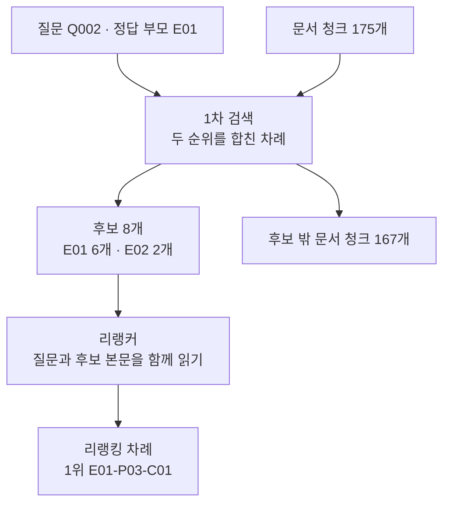
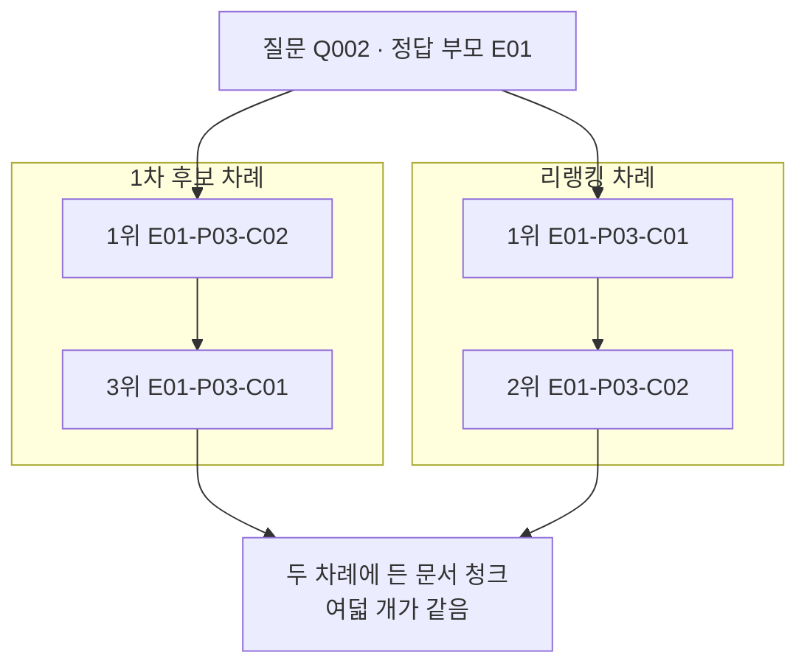
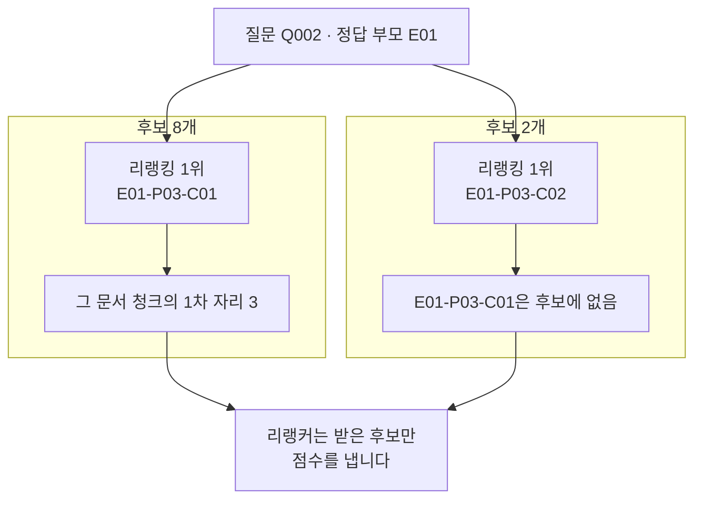
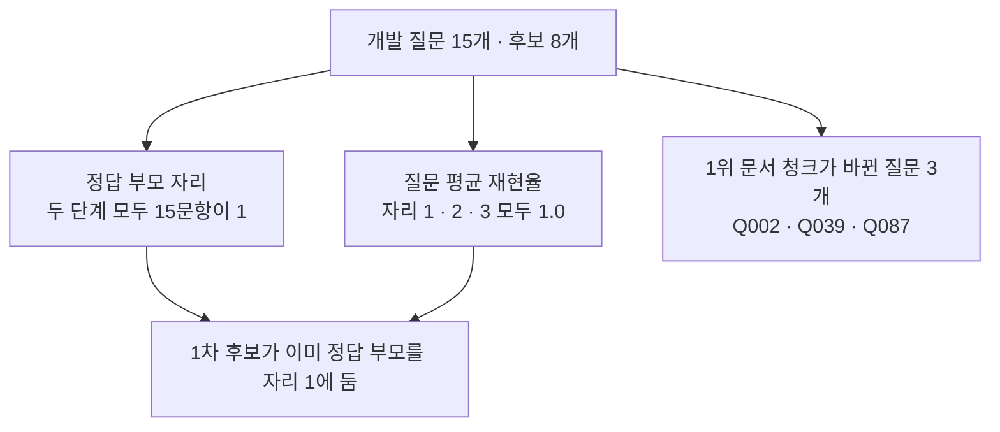

# 07-cross-encoder-리랭킹

## _src 본문 (HTML 원본)

```html
<!--meta: 강의 1h | 실습 3h | 코드 notebooks/07-cross-encoder-리랭킹.ipynb | 새 용어 5 -->
<h2 id="b1"><span class="no">1</span>학습 목표</h2><div class="goal"><ul><li>이 절을 마치면 1차 검색으로 후보를 좁힌 뒤 그 후보의 자리를 다시 정할 수 있습니다.</li><li>질문과 후보 본문을 한 쌍으로 읽는 모델의 입력과 출력을 설명할 수 있습니다.</li><li>리랭커가 후보 목록 밖 문서 청크를 볼 수 없다는 것을 실행 결과로 보일 수 있습니다.</li></ul></div>
<h2 id="b2"><span class="no">2</span>이 내용을 배우는 이유</h2><p>01~06절의 검색은 질문과 문서를 따로 벡터나 낱말로 바꾼 뒤 견주었습니다. 이 방법은 문서가 많아도 빠릅니다. 대신 질문의 낱말과 본문의 낱말을 같은 자리에서 보지는 못합니다.</p><p>질문과 본문을 한 쌍으로 묶어 함께 읽으면 더 자세히 견줄 수 있습니다. 그런데 쌍마다 모델을 한 번씩 지나야 해서 문서 청크 175개 전체에는 쓰기 어렵습니다. 그래서 먼저 후보를 좁히고 그 후보만 다시 읽습니다.</p><p>후보를 좁히는 단계와 다시 읽는 단계는 서로 다른 일을 합니다. 두 단계를 갈라 두어야 무엇이 결과를 바꿨는지 말할 수 있습니다.</p>
<h2 id="b3"><span class="no">3</span>앞에서 배운 내용</h2><p>01절에서 문서와 질문을 숫자 256개짜리 벡터로 바꾸고 코사인 거리로 순위를 만들었습니다. 04절에서는 같은 글을 형태소로 갈라 검색 낱말을 만들고 BM25 점수로 순위를 냈습니다. 06절에서는 두 순위의 자리 번호만 써서 하나로 합쳤습니다. 이 절의 1차 검색은 그 합친 순위입니다.</p><p>06절에서 합친 순위가 두 방법보다 나아지지는 않았습니다. 여기서 합친 순위를 쓰는 까닭은 두 방법이 앞에 둔 문서 청크를 후보 목록에 함께 담기 위해서입니다. 어느 1차 검색이 더 나은지는 이 절에서 재지 않습니다.</p><p>이 절부터 자료가 바뀝니다. 01~06절이 쓴 문서 12개와 질문 8개는 검색 원리를 짧은 셀로 보려고 만든 교육용 자료였습니다. 07절부터는 공개 PDF 6건에서 뽑은 문서 청크 175개와 Ch 11 평가셋 30문항을 씁니다. 문서·질문·후보 단위가 모두 달라져 앞 절 숫자와 이 절 숫자를 나란히 놓지 않습니다.</p><p>Ch 11이 정한 약속도 그대로 지킵니다. 개발 15문항으로 설정을 고르고 시험 15문항은 설정을 다 고른 뒤 한 번만 씁니다. 이 절은 개발 묶음만 보고 시험 묶음은 열어 보지 않습니다.</p><p>지표 함수는 Ch 11과 01~06절에서 쓴 함수를 그대로 이어 씁니다. 그 함수들은 중복을 뺀 문서 ID 목록을 받으므로 후보를 부모 문서 ID 목록으로 바꾼 뒤 넘깁니다.</p><p>노트북은 앞에서 배운 함수 여덟 개를 실습 폴더의 도구 파일 <code>notebooks/rag_tools.py</code>에서 한 줄로 가져옵니다. 04절 <code>kiwi_terms()</code>와 06절 <code>fuse_rank()</code>, Ch 11 지표 함수 세 개입니다. 01~06절 순위 함수를 문서 청크에 쓰는 판 세 개도 함께 가져옵니다. 계산은 같고 순위 칸 이름만 <code>chunk_id</code>입니다.</p>
<h2 id="b4"><span class="no">4</span>핵심 개념</h2><h3>비유로 시작하기</h3><p>선반에 책이 가득한데 모두 펼쳐 읽을 시간은 없습니다. 그래서 겉만 보고 몇 권을 골라 쟁반에 꺼내 놓습니다. 꺼낸 책만 쪽지와 나란히 놓고 한 권씩 읽어 표식을 붙입니다. 표식이 큰 순서로 다시 놓으면 새 차례가 됩니다. 선반에 남은 책은 아무리 알맞아도 쪽지와 짝지어지지 않아 표식을 받지 못합니다.</p>
{{img:07-5-쪽지와-여덟-권|왼쪽에 회색 책이 가득 꽂힌 나무 선반이 있고 그 앞 바닥의 얕은 나무 쟁반에 크림색 펼친 책 세 권이 나란히 놓여 있으며 오른쪽에는 노란 쪽지 한 장과 크림색 펼친 책 한 권과 파란 동그라미 표식이 한 줄씩 짝지은 세 줄이 위아래로 있고 표식은 맨 위가 가장 크고 아래로 갈수록 작아지며 선반에 남은 회색 책 옆에는 쪽지도 표식도 없는 그림|쟁반에 꺼낸 책만 쪽지와 짝지어 표식을 받고 선반에 남은 책은 표식을 받지 못합니다.}}
<p class="look"><b>그림 읽기</b> — 왼쪽 선반의 회색 책이 후보로 고르지 않은 문서 청크입니다. 선반 앞 쟁반에 꺼낸 크림색 책 세 권이 후보입니다. 오른쪽 세 줄에서 노란 쪽지가 질문이고 그 옆 책이 후보 본문입니다. 줄 끝의 파란 동그라미가 그 쌍이 받은 점수이고 위로 갈수록 큽니다. 선반에 남은 책 옆에는 쪽지도 동그라미도 없습니다.</p>
<table><thead><tr><th>말</th><th>뜻</th></tr></thead><tbody><tr><td>1차 검색(first-stage retrieval)</td><td>많은 문서 청크에서 후보를 빠르게 좁히는 단계입니다. 이 절의 1차 검색은 05·06절에서 만든 검색입니다.</td></tr><tr><td>리랭킹(reranking)</td><td>1차 검색이 고른 후보의 자리를 다시 정하는 단계입니다. 후보를 늘리거나 줄이지 않습니다.</td></tr><tr><td>교차 인코더(cross-encoder)</td><td>질문과 후보 본문을 한 쌍으로 함께 읽어 점수를 내는 모델입니다. 이 절의 리랭커가 그 한 가지입니다.</td></tr><tr><td>리랭킹 점수(reranking score)</td><td>교차 인코더가 쌍마다 내는 값입니다. 이 절의 리랭커는 0과 1 사이 값을 냈습니다.</td></tr><tr><td>부모 문서(parent document)</td><td>문서 청크가 나온 원래 문서입니다. 질문 파일의 정답 칸에 이 문서의 ID가 들어 있습니다.</td></tr></tbody></table>
<h3>두 단계로 나누는 까닭</h3><p>1차 검색은 질문과 문서 청크를 따로 표현해 견줍니다. 문서 청크마다 벡터와 낱말을 한 번씩만 만들면 됩니다. 교차 인코더는 쌍마다 모델을 한 번씩 지납니다. 두 단계에 걸린 시간은 이번에 재지 않았습니다.</p><p>그래서 1차 검색이 후보를 좁히고 교차 인코더가 그 후보만 다시 읽습니다. 이 절은 후보를 여덟 개로 두었습니다. 후보 수를 어떻게 정할지는 08절에서 여러 값으로 견줍니다.</p>
{{mermaid:07-1-후보를-만들고-다시-읽기|위에서 아래로 내려가는 흐름도로 맨 위 초록 상자 두 개 질문 Q002 정답 부모 E01과 문서 청크 175개가 파란 상자 1차 검색으로 모이고 거기서 두 갈래로 갈려 왼쪽은 노란 상자 후보 8개 E01 6개 E02 2개로 오른쪽은 회색 상자 후보 밖 문서 청크 167개로 이어지며 왼쪽 갈래만 보라 상자 리랭커를 지나 맨 아래 노란 상자 리랭킹 차례 1위 E01-P03-C01로 끝나는 그림|1차 검색이 고른 후보 8개만 리랭커에 들어가고 후보 밖 문서 청크 167개는 들어가지 않습니다.}}
<p class="look"><b>도식 읽기</b> — 맨 위 초록 상자 두 개가 이 절이 쓰는 질문과 문서 청크 묶음입니다. 위에서 아래로 읽고 가운데 파란 상자가 05·06절에서 만든 1차 검색입니다. 거기서 두 갈래로 갈리고 왼쪽 노란 상자가 후보 8개, 오른쪽 회색 상자가 후보 밖 문서 청크 167개입니다.</p>
<p class="look">후보 여덟 개 가운데 여섯 개가 <code>E01</code>에서, 두 개가 <code>E02</code>에서 나왔습니다. 보라 상자 리랭커로 가는 화살표는 왼쪽 갈래에만 있습니다. 회색 상자에서 보라 상자로 가는 길이 없다는 것이 이 그림의 요점입니다.</p>
<h3>쌍으로 읽는다는 것</h3><p>교차 인코더에 넣는 것은 문서 청크 하나가 아니라 <code>(질문, 후보 본문)</code> 모양의 쌍입니다. 후보가 여덟 개면 쌍도 여덟 개이고 점수도 여덟 개가 나옵니다. 코드는 그 점수가 큰 순서로 후보를 다시 놓습니다.</p><p>이 절의 리랭커가 낸 점수는 0과 1 사이 값이었습니다. 설치판 소스에서도 값이 하나인 리랭커는 점수를 0과 1 사이로 눌러 준다고 확인했습니다. 다만 값의 크기를 확률로 읽지 않고 같은 질문 안의 차례만 봅니다.</p>
<h3>후보 목록이 곧 한계</h3><p>리랭커는 받은 쌍에만 점수를 냅니다. 후보 목록에 없는 문서 청크는 점수를 받을 자리가 없습니다. 그래서 1차 검색이 놓친 문서 청크는 리랭킹으로 되돌아오지 않습니다.</p><p>후보 수를 늘리면 리랭커가 볼 수 있는 범위가 넓어집니다. 대신 쌍이 늘어 시간도 늘어납니다. 이 절은 후보 여덟 개와 둘 두 벌만 실행했습니다.</p>
<h2 id="b5"><span class="no">5</span>실행 예제</h2><p>개발 15문항마다 1차 검색으로 후보 여덟 개를 만듭니다. 실행 1은 개발 질문 <code>Q002</code> 하나를 자세히 보고 값 바꿔 보기는 후보 수만 둘로 줄입니다. 질문과 리랭커, 1차 검색은 그대로 둡니다.</p><p>임베딩 요청은 문서 청크 1번과 질문 15번으로 모두 열여섯 번입니다. 예상 비용은 미화 0.01달러 아래이고 답을 쓰는 모델은 부르지 않습니다. 리랭커는 내 컴퓨터에서 도는 모델이라 요청 비용이 들지 않고 파일 약 2.2GB를 처음 한 번 내려받습니다. 리랭커를 만들고 쓰는 동안 메모리를 약 3GB 씁니다. 다른 프로그램을 닫고 실행합니다.</p>
{{mermaid:07-2-리랭킹이-바꾼-자리|위에서 아래로 내려가는 흐름도로 맨 위 초록 상자 질문 Q002 정답 부모 E01에서 두 칸으로 갈리고 칸 제목 1차 후보 차례 아래에는 노란 상자 1위 E01-P03-C02와 노란 상자 3위 E01-P03-C01이 있으며 칸 제목 리랭킹 차례 아래에는 노란 상자 1위 E01-P03-C01과 노란 상자 2위 E01-P03-C02가 있고 두 칸이 맨 아래 회색 상자로 모이는 그림|1차 자리 3이던 문서 청크가 리랭킹 뒤 1위가 되고 1차 1위는 2위로 내려갑니다.}}
<p class="look"><b>도식 읽기</b> — 맨 위 초록 상자가 두 칸이 함께 보는 질문과 정답 부모 문서입니다. 칸 제목 <code>1차 후보 차례</code> 아래 두 상자가 1차 검색이 만든 자리입니다. 칸 제목 <code>리랭킹 차례</code> 아래 두 상자가 리랭킹 뒤 자리입니다. 두 칸에 같은 문서 청크 두 개가 자리를 바꿔 놓여 있습니다. 맨 아래 회색 상자는 두 칸의 출력에서 함께 확인한 사실입니다.</p>
{{mermaid:07-3-후보-수를-줄인-결과|위에서 아래로 내려가는 흐름도로 맨 위 초록 상자 질문 Q002 정답 부모 E01에서 두 칸으로 갈리고 칸 제목 후보 8개 아래에는 노란 상자 리랭킹 1위 E01-P03-C01과 노란 상자 그 문서 청크의 1차 자리 3이 있으며 칸 제목 후보 2개 아래에는 노란 상자 리랭킹 1위 E01-P03-C02와 노란 상자 E01-P03-C01은 후보에 없음이 있고 두 칸이 맨 아래 회색 상자로 모이는 그림|후보를 2개로 줄이면 리랭킹 1위였던 문서 청크가 목록에 없어 결과에 나오지 않습니다.}}
<p class="look"><b>도식 읽기</b> — 두 칸은 같은 질문과 같은 리랭커를 쓰고 후보 수만 다릅니다. 칸 제목 <code>후보 8개</code> 아래 상자가 실행 1의 결과입니다. 칸 제목 <code>후보 2개</code> 아래 상자가 값 바꿔 보기의 결과입니다. 왼쪽 칸에서 1위였던 문서 청크의 1차 자리가 3이라 오른쪽 칸 후보에는 들지 못했습니다. 맨 아래 회색 상자는 두 칸에서 모두 확인한 사실입니다.</p>
{{notebook:07-cross-encoder-리랭킹}}
<p class="look"><b>확인할 점</b> — 실행 1에서 리랭킹 1위는 <code>E01-P03-C01</code>이고 그 문서 청크의 1차 자리는 3이었습니다. 리랭킹 점수는 그 줄이 <code>0.2246</code>이고 1차 1위였던 <code>E01-P03-C02</code>가 <code>0.003</code>이었습니다. 리랭킹 전후에 든 문서 청크 여덟 개는 같았습니다. 후보를 둘로 줄이니 <code>E01-P03-C01</code>이 목록에 없어 결과에 나오지 않았습니다. 3·4·5위는 소수 넷째 자리까지 같아 보이지만 정렬은 반올림 전 값으로 했고 그 차례는 결과로 읽지 않습니다.</p>
<h2 id="b6"><span class="no">6</span>실험 결과 해석</h2><p>개발 질문 열다섯 개를 두 단계로 모두 재어 기록 서른 줄을 만들었습니다. 정답 부모 자리는 서른 줄이 모두 1이었습니다. 자르는 자리 1·2·3의 질문 평균 재현율도 두 단계 모두 <code>1.0</code>이었습니다.</p>
{{mermaid:07-4-개발-15문항의-두-단계|위에서 아래로 내려가는 흐름도로 맨 위 초록 상자 개발 질문 15개 후보 8개에서 세 갈래로 갈려 노란 상자 정답 부모 자리 두 단계 모두 15문항이 1과 노란 상자 질문 평균 재현율 자리 1 2 3 모두 1.0과 노란 상자 1위 문서 청크가 바뀐 질문 3개 Q002 Q039 Q087이 나오고 왼쪽 두 상자만 맨 아래 회색 상자 1차 후보가 이미 정답 부모를 자리 1에 둠으로 모이는 그림|정답 부모 자리는 두 단계에서 같고 1위 문서 청크만 세 질문에서 바뀝니다.}}
<p class="look"><b>도식 읽기</b> — 맨 위 초록 상자가 이번에 잰 질문 묶음과 후보 수입니다. 위에서 아래로 읽고 세 갈래는 왼쪽부터 정답 부모 자리, 질문 평균 재현율, 1위 문서 청크가 바뀐 질문입니다. 맨 아래 회색 상자에는 왼쪽 두 갈래에서만 화살표가 닿습니다. 오른쪽 갈래는 그 사실로 설명되지 않아 잇지 않았습니다.</p>
<p>재현율이 두 단계에서 같은 까닭은 1차 후보가 이미 정답 부모를 자리 1에 두었기 때문입니다. 올라갈 자리가 없으면 어떤 리랭킹도 값을 올리지 못합니다. Ch 11에서도 값이 천장에 닿아 설정을 가를 수 없는 자리가 있었습니다. 까닭은 이 절과 다릅니다.</p><p>그렇다고 리랭킹이 아무 일도 하지 않은 것은 아닙니다. 1위 문서 청크는 질문 세 개에서 바뀌었습니다. 세 질문 모두 바뀐 앞뒤 문서 청크의 부모 문서가 같아 재현율에는 나타나지 않았습니다.</p><p>실행 1의 질문은 빌릴 수 있는 권수와 기간을 함께 묻습니다. 자료 파일에서 확인한 사실입니다. 리랭킹 1위로 올라온 문서 청크에는 권수에 해당하는 글이 있습니다. 1차 1위 문서 청크에는 기간에 해당하는 글이 있습니다.</p><p>노트북은 두 문서 청크의 본문을 출력하지 않았습니다. 어느 쪽이 더 맞는 답인지는 이 절에서 판정하지 않았습니다.</p><p>후보 수를 둘로 줄인 실행은 후보 목록의 경계를 보여 줍니다. 리랭킹 1위였던 문서 청크의 1차 자리가 3이라 앞 둘에 들지 못했습니다. 리랭커는 그 문서 청크를 보지 못했고 목록 안에서만 자리를 정했습니다.</p><p>문서 청크 175개와 개발 질문 열다섯 개에서 한 번 실행한 값입니다. 후보 수는 두 벌, 리랭커는 한 가지만 실행했습니다. 이 자료에서 리랭킹이 재현율을 올리지 못했다는 것까지만 말할 수 있습니다.</p>
<h2 id="b7"><span class="no">7</span>주의할 점과 실무 메모</h2><ul><li>리랭킹 전후에 든 문서 청크 묶음이 같은지 확인합니다. 묶음이 달라졌다면 자리 바꾸기 말고 다른 처리가 섞인 것입니다.</li><li>리랭킹 점수의 크기를 확률로 읽지 않습니다. 같은 질문 안의 차례만 봅니다.</li><li>다른 질문의 점수끼리 견주지 않습니다. 이 절은 질문마다 따로 정렬만 했습니다.</li><li>후보 목록 밖 문서 청크는 리랭킹으로 돌아오지 않습니다. 1차 검색이 놓친 문서는 후보 수를 늘려야 들어옵니다.</li><li>후보 단위와 정답 단위가 다릅니다. 후보는 문서 청크이고 정답은 부모 문서라 지표를 재기 전에 부모 문서 ID 목록으로 바꿉니다.</li><li>정답 부모 자리가 이미 1이면 재현율로 두 단계를 가를 수 없습니다. 값이 천장에 닿았는지 먼저 확인합니다.</li><li>01~06절 재현율과 이 절 재현율을 나란히 놓지 않습니다. 문서·질문·후보 단위가 모두 다릅니다.</li><li>시험 15문항은 이 절에서 열어 보지 않았습니다. 설정을 다 고른 뒤 12절에서 한 번만 씁니다.</li><li>실행 1에 쓴 질문은 열다섯 질문을 먼저 모두 재어 고른 것입니다. 흐름을 보여 주려고 정한 예이고 질문을 고르는 기준이 아닙니다.</li><li>줄여 볼 후보 수 둘도 탐색 실행에서 결과가 갈리는 값을 보고 정했습니다. 실무에서 쓸 값을 권하는 것이 아닙니다.</li><li>이 절은 리랭킹에 걸린 시간을 재지 않았습니다. 정밀도와 nDCG도 재지 않았습니다.</li><li>리랭커 모델은 한 가지만 실행했습니다. 다른 리랭커에서 자리가 어떻게 달라지는지는 08절에서 봅니다.</li><li>리랭커 파일은 약 2.2GB이고 판 번호를 고정해 받았습니다. 판 번호를 적지 않으면 다음에 다른 파일을 받을 수 있습니다.</li><li>이 절은 파일을 쓰지 않습니다. 01~03절이 만든 데이터베이스 표도 읽지 않습니다.</li></ul>
<h2 id="b8"><span class="no">8</span>정리와 다음 절</h2><ul><li>1차 검색으로 후보 여덟 개를 만들고 리랭커로 그 자리를 다시 정했습니다.</li><li>후보 수를 둘로 줄이니 앞에서 1위였던 문서 청크가 결과에 나오지 않았습니다.</li><li>이번 실행에서 정답 부모 자리는 두 단계 모두 열다섯 질문이 1이었습니다.</li></ul><p><strong>다음 학습과 이어지는 지점</strong> — 08절에서는 같은 개발 질문에서 후보 수와 리랭커를 여러 벌로 바꿔 가며 견줍니다.</p>
<h2 id="b9"><span class="no">9</span>복습 문제</h2><details class="quiz" open><summary>문제 4개 · 해설 포함</summary><p class="quiz-q">1. 문서 청크 175개를 모두 교차 인코더에 넣지 않고 후보를 먼저 좁히는 까닭은 무엇입니까?</p><p class="quiz-a">교차 인코더는 쌍마다 모델을 한 번씩 지나야 해서 1차 검색이 후보를 먼저 좁힙니다. 틀렸다면 「두 단계로 나누는 까닭」을 다시 읽습니다.</p><p class="quiz-q">2. 리랭킹은 후보 목록의 무엇을 바꾸고 무엇을 바꾸지 않습니까?</p><p class="quiz-a">자리는 바꾸고 목록에 든 문서 청크는 바꾸지 않습니다. 실행 1에서 리랭킹 전후 여덟 개가 같은 묶음이었습니다. 틀렸다면 「후보 목록이 곧 한계」를 다시 읽습니다.</p><p class="quiz-q">3. 후보 수를 둘로 줄였을 때 리랭킹 1위가 달라진 까닭은 무엇입니까?</p><p class="quiz-a">앞에서 1위였던 문서 청크의 1차 자리가 3이라 후보 둘에 들지 못했기 때문입니다. 리랭커는 받은 후보에만 점수를 냅니다. 틀렸다면 「실험 결과 해석」을 다시 읽습니다.</p><p class="quiz-q">4. 두 단계의 질문 평균 재현율이 모두 <code>1.0</code>이면 리랭킹이 쓸모없다고 말할 수 있습니까?</p><p class="quiz-a">말할 수 없습니다. 1차 후보가 이미 정답 부모를 자리 1에 두어 값이 천장에 닿았고, 1위 문서 청크는 질문 세 개에서 바뀌었습니다. 틀렸다면 「실험 결과 해석」을 다시 읽습니다.</p></details>
<h2 id="b10"><span class="no">10</span>참고 자료</h2><ul><li><div><a href="https://www.sbert.net/examples/cross_encoder/applications/README.html">Sentence Transformers Cross-Encoder 사용 예</a></div>질문과 본문을 쌍으로 넣어 순서를 다시 정하는 방법 설명 · 6.0.1 · 확인 2026-09-18</li><li><div><a href="https://huggingface.co/BAAI/bge-reranker-v2-m3">BAAI bge-reranker-v2-m3 모델 카드</a></div>이 절에서 쓴 리랭커의 모델 카드 · 확인 2026-09-18</li></ul>
```

## 노트북 셀 (순서대로)

### [0] markdown {'html': 'skip'}

# cross encoder 리랭킹

**이 노트북에서 할 일**

1. 07절부터 쓰는 문서 청크 175개와 질문 30개를 불러와 개발 묶음을 가릅니다.
2. 05·06절 방법으로 개발 질문마다 후보 여덟 개를 만듭니다.
3. 질문과 후보 본문을 함께 읽는 리랭커로 후보의 자리를 다시 정합니다.
4. 후보 수를 둘로 줄여 후보 목록 밖 문서 청크가 어떻게 되는지 봅니다.

**준비물** — 프로젝트 폴더의 `.env`에 `OPENAI_API_KEY`가 있어야 합니다.
임베딩 요청은 문서 청크 1번과 질문 15번으로 모두 열여섯 번입니다.
예상 비용은 미화 0.01달러 아래이고 답을 쓰는 모델은 부르지 않습니다.

리랭커는 내 컴퓨터에서 도는 모델이라 요청 비용이 들지 않습니다.
처음 실행할 때 리랭커 파일 약 2.2GB를 내려받고 그다음부터는 받아 둔 파일을 씁니다.
실행 시간은 내려받기를 빼고 2분 안팎이며 리랭커 호출이 가장 오래 걸립니다.
리랭커를 만들고 쓰는 동안 메모리를 약 3GB 씁니다.
교재 출력은 메모리 3.8GB 환경에서 만들었고 최대 사용량은 약 3.1GB였습니다.

**데이터** — 두 파일 모두 실습 묶음에 들어 있습니다.

- 문서 `labs/part3/ch12-retrieval-tuning/data/advanced-documents.json`(부모 6건·문서 청크 175개)
- 질문 `labs/part3/ch12-retrieval-tuning/data/advanced-queries.json`(30개)

**강의와 실습 범위** — 강의 시간에는 2~3절과 7~9절을 읽습니다.
개발 묶음과 시험 묶음을 가르는 자리가 2절이고 리랭커를 준비하는 자리가 7절입니다.
8절이 실행 1이고 9절이 값 바꿔 보기입니다.
1·4~6·10절은 함께 실행하고 실습 시간에 다시 읽습니다.

**기준 버전** — 첫 셀에서 여섯 패키지를 고정한 판으로 설치합니다.
리랭커는 판 번호 `953dc6f6f85a`를 고정해 받습니다.
교재 출력은 Linux의 Python 3.12.13으로 만들었습니다.
다른 판과 Windows·macOS에서는 이번에 실행하지 않았습니다.

실습 폴더 `labs/part3/ch12-retrieval-tuning`에서 `uv sync --locked`를 실행합니다.
그다음 이 폴더의 `.venv` 커널을 고르고 첫 셀부터 순서대로 실행합니다.

### [1] markdown {'html': 'skip'}

## 오늘 볼 그림


맨 위 초록 상자 두 개가 이 절이 쓰는 질문과 문서 청크 묶음입니다.
가운데 파란 상자가 05·06절에서 만든 검색이고 여기서 후보를 고릅니다.
왼쪽 노란 상자가 후보 8개이고 오른쪽 회색 상자가 후보 밖 문서 청크입니다.
보라 상자 리랭커로 가는 화살표는 왼쪽 갈래에만 있습니다.
맨 아래 노란 상자가 이 노트북 8절의 출력입니다.

### [2] markdown {}

## 1. 준비

첫 셀은 패키지 여섯 개를 설치하고 설치된 버전을 출력합니다.
설치에는 몇십 초가 걸릴 수 있습니다.

### [3] code {'execution': {'iopub.execute_input': '2026-09-21T08:16:39.022796Z', 'iopub.status.busy': '2026-09-21T08:16:39.022604Z', 'iopub.status.idle': '2026-09-21T08:16:39.557779Z', 'shell.execute_reply': '2026-09-21T08:16:39.557392Z'}, 'lesson_role': 'setup'}

```python
# 이 절에서 쓰는 패키지를 설치하고 버전을 확인합니다
%pip install -q "langchain-openai==1.6.1" "python-dotenv==1.2.3" "kiwipiepy==0.23.2" "rank-bm25==0.2.2" "sentence-transformers==6.0.1" "numpy==2.5.3"
from importlib.metadata import version

print("langchain-openai:", version("langchain-openai"))
print("python-dotenv:", version("python-dotenv"))
print("kiwipiepy:", version("kiwipiepy"))
print("rank-bm25:", version("rank-bm25"))
print("sentence-transformers:", version("sentence-transformers"))
print("numpy:", version("numpy"))
```

출력:
```
Note: you may need to restart the kernel to use updated packages.
langchain-openai: 1.6.1
python-dotenv: 1.2.3
kiwipiepy: 0.23.2
rank-bm25: 0.2.2
sentence-transformers: 6.0.1
numpy: 2.5.3

```

### [4] markdown {}

**결과 읽기** — 설치가 끝나면 `langchain-openai: 1.6.1`과 `sentence-transformers: 6.0.1`이 보입니다.
마지막 줄 `numpy: 2.5.3`은 도구 파일이 벡터 계산에 쓰는 패키지입니다. 여섯 줄이 모두 보이면 다음 셀로 넘어갑니다.
05·06절 다섯 패키지에 리랭커를 부르는 패키지 하나가 늘었습니다.

다음 셀은 이 절에서 쓸 이름 다섯 개를 불러옵니다.
이름 `CrossEncoder`가 리랭커를 만드는 도구이고 이 챕터에서 처음 나옵니다.
환경 변수 `HF_HUB_DISABLE_PROGRESS_BARS`를 켜 두면 파일을 읽는 진행 막대가 나오지 않습니다.
환경 변수는 프로그램 밖에서 넘기는 설정 값이고 이름과 값이 모두 글입니다.

앞에서 배운 함수는 `rag_tools.py`에 모아 두었습니다. 파일을 열면 코드를 볼 수 있습니다. 노트북과 같은 폴더(`notebooks/`)에 있는 파일입니다.

이 노트북은 04·06절 함수 두 개와 Ch 11 지표 함수 세 개를 가져옵니다.
04절 `kiwi_terms()`, 06절 `fuse_rank()`, Ch 11 `find_gold_rank()`·`recall_at()`·`mean_score()`입니다.
01~06절 순위 함수를 문서 청크에 쓰는 판 세 개도 함께 가져옵니다.
인자 모양은 5절에서 설명합니다.

### [5] code {'execution': {'iopub.execute_input': '2026-09-21T08:16:39.558871Z', 'iopub.status.busy': '2026-09-21T08:16:39.558778Z', 'iopub.status.idle': '2026-09-21T08:16:48.989397Z', 'shell.execute_reply': '2026-09-21T08:16:48.988847Z'}, 'lesson_role': 'setup'}

```python
# 자료 읽기·형태소 분석·임베딩·낱말 점수·리랭커에 쓸 이름을 불러옵니다
import json
import os
import warnings

# 리랭커 파일을 읽을 때 나오는 진행 막대와 위젯 경고는 계산과 관계없어 화면에 내지 않습니다
os.environ["HF_HUB_DISABLE_PROGRESS_BARS"] = "1"
warnings.filterwarnings("ignore", message="IProgress not found")

from kiwipiepy import Kiwi
from langchain_openai import OpenAIEmbeddings
from rank_bm25 import BM25Okapi
from sentence_transformers import CrossEncoder
# 04·06절과 Ch 11 함수, 01~06절 순위 함수의 문서 청크 판 여덟 개를 도구 파일에서 가져옵니다
from rag_tools import find_gold_rank, fuse_rank, kiwi_terms, mean_score, rank_chunks_by_bm25
from rag_tools import rank_chunks_by_distance, recall_at, unique_chunk_ids

print("불러온 이름:", "json", "Kiwi", "OpenAIEmbeddings", "BM25Okapi", "CrossEncoder")
```

출력:
```
불러온 이름: json Kiwi OpenAIEmbeddings BM25Okapi CrossEncoder

```

### [6] markdown {}

**결과 읽기** — 출력 줄은 `불러온 이름:` 뒤에 이름 다섯 개가 붙은 한 줄입니다.
앞의 네 이름은 01~06절에서 쓰던 이름과 같습니다.
도구 파일에서 가져온 함수 여덟 개는 출력하지 않습니다.

다음 셀은 API 키가 있는지 확인합니다. `True` 값이 나오면 다음으로 넘어갑니다.

### [7] code {'execution': {'iopub.execute_input': '2026-09-21T08:16:48.992150Z', 'iopub.status.busy': '2026-09-21T08:16:48.991938Z', 'iopub.status.idle': '2026-09-21T08:16:48.995854Z', 'shell.execute_reply': '2026-09-21T08:16:48.995547Z'}, 'lesson_role': 'setup'}

```python
# .env 파일에서 OpenAI API 키를 읽습니다(키 값은 출력하지 않습니다)
import os
from dotenv import find_dotenv, load_dotenv

env_path = find_dotenv(usecwd=True)
load_dotenv(env_path)
has_key = os.getenv("OPENAI_API_KEY") is not None
print("OPENAI_API_KEY 설정 여부:", has_key)
assert has_key, "프로젝트 폴더의 .env 파일에 OPENAI_API_KEY를 적어 주세요."
```

출력:
```
OPENAI_API_KEY 설정 여부: True

```

### [8] markdown {}

**결과 읽기** — 출력 줄은 `OPENAI_API_KEY 설정 여부: True` 하나입니다.
키 값은 출력하지 않습니다.

다음 셀은 프로젝트 맨 위 폴더를 찾습니다. 01~06절과 같은 코드입니다.

### [9] code {'execution': {'iopub.execute_input': '2026-09-21T08:16:48.996584Z', 'iopub.status.busy': '2026-09-21T08:16:48.996519Z', 'iopub.status.idle': '2026-09-21T08:16:48.998371Z', 'shell.execute_reply': '2026-09-21T08:16:48.998114Z'}, 'lesson_role': 'setup'}

```python
# 노트북을 어느 폴더에서 열어도 프로젝트 맨 위를 찾게 후보 세 개를 차례로 봅니다
candidates = [".", "../../..", "../../../.."]
root_path = None
for candidate in candidates:
    if os.path.exists(candidate + "/labs/part3/ch12-retrieval-tuning/data"):
        root_path = candidate
        break
print("고른 경로:", root_path)
assert root_path is not None, "notebooks 폴더나 실습 폴더 맨 위에서 노트북을 열어 주세요."
```

출력:
```
고른 경로: .

```

### [10] markdown {}

**결과 읽기** — 출력 줄은 `고른 경로: .`입니다. `assert`도 통과했습니다.

다음 셀은 07절부터 쓰는 자료 두 벌을 읽습니다.
01~06절이 쓴 문서 12개와 질문 8개는 검색 원리를 짧게 보려고 만든 교육용 자료입니다.
이 절부터는 공개 PDF에서 뽑은 문서와 Ch 11 평가셋을 씁니다.

### [11] code {'execution': {'iopub.execute_input': '2026-09-21T08:16:48.999009Z', 'iopub.status.busy': '2026-09-21T08:16:48.998947Z', 'iopub.status.idle': '2026-09-21T08:16:49.002425Z', 'shell.execute_reply': '2026-09-21T08:16:49.002164Z'}, 'lesson_role': 'setup'}

```python
# 07절부터 쓰는 문서 파일과 질문 파일을 불러옵니다(01~06절과 다른 벌입니다)
data_path = root_path + "/labs/part3/ch12-retrieval-tuning/data"
with open(data_path + "/advanced-documents.json", encoding="utf-8") as file:
    documents = json.loads(file.read())
with open(data_path + "/advanced-queries.json", encoding="utf-8") as file:
    queries = json.loads(file.read())
parents = documents["parents"]
chunks = documents["chunks"]
print("부모 문서 수:", len(parents))
print("문서 청크 수:", len(chunks))
print("질문 수:", len(queries))
```

출력:
```
부모 문서 수: 6
문서 청크 수: 175
질문 수: 30

```

### [12] markdown {}

**결과 읽기** — `부모 문서 수: 6`과 `문서 청크 수: 175`, `질문 수: 30`이 보입니다.
문서 한 건을 쪽과 단락으로 잘라 둔 것이 문서 청크입니다.
그 문서 청크가 나온 원래 문서를 이 절에서는 부모 문서라고 부릅니다.
질문 파일의 정답 칸에는 부모 문서 ID가 들어 있습니다.

## 2. 개발 묶음과 시험 묶음 가르기

질문 파일에는 `split` 칸이 있고 값은 `dev`와 `test` 두 가지입니다.
Ch 11이 정한 약속은 개발 15문항으로 설정을 고르고 시험 15문항은 마지막에 한 번만 쓰는 것입니다.
이 절도 그 약속을 지켜 개발 묶음만 봅니다.
시험 묶음은 12절의 마지막 평가까지 열어 보지 않습니다.

### [13] code {'execution': {'iopub.execute_input': '2026-09-21T08:16:49.003166Z', 'iopub.status.busy': '2026-09-21T08:16:49.003096Z', 'iopub.status.idle': '2026-09-21T08:16:49.005082Z', 'shell.execute_reply': '2026-09-21T08:16:49.004814Z'}}

```python
# 질문 30개를 개발 묶음과 시험 묶음으로 나눕니다(Ch 11이 정해 둔 split 칸을 그대로 씁니다)
dev_queries = []
test_queries = []
for query in queries:
    if query["split"] == "dev":
        dev_queries.append(query)
    else:
        test_queries.append(query)
print("개발 질문 수:", len(dev_queries))
print("시험 질문 수:", len(test_queries))
print("첫 개발 질문:", dev_queries[0]["qid"], "|", dev_queries[0]["question"])
print("그 질문의 정답 부모 문서 ID:", dev_queries[0]["gold_doc_ids"])
```

출력:
```
개발 질문 수: 15
시험 질문 수: 15
첫 개발 질문: Q001 | 미르시립도서관의 정기 휴관일은 언제인가요?
그 질문의 정답 부모 문서 ID: ['E01']

```

### [14] markdown {}

**결과 읽기** — `개발 질문 수: 15`와 `시험 질문 수: 15`가 보입니다.
줄 `첫 개발 질문:` 뒤에 질문 ID와 질문 글이 있습니다.
정답 칸 값은 `['E01']`처럼 목록입니다.
01~06절 질문 파일은 정답 문서 ID가 글 하나였고 이 파일은 목록입니다.

## 3. 이 절에서 쓸 값 정하기

01~06절에서 쓴 값 두 개를 그대로 다시 정합니다.
이름 `method_names`에 담을 두 이름이 이 절에서 견줄 두 단계입니다.

### [15] code {'execution': {'iopub.execute_input': '2026-09-21T08:16:49.005684Z', 'iopub.status.busy': '2026-09-21T08:16:49.005625Z', 'iopub.status.idle': '2026-09-21T08:16:49.007527Z', 'shell.execute_reply': '2026-09-21T08:16:49.007155Z'}}

```python
# 01~06절에서 쓴 값을 그대로 다시 정하고 이 절에서 견줄 두 단계 이름을 정합니다
cutoff_values = [1, 2, 3]
keep_tags = ["NNG", "NNP", "NNB", "NR", "VV", "VA", "MAG", "SN", "SL"]
method_names = ["1차 후보", "리랭킹"]
print("자르는 자리 세 가지:", cutoff_values)
print("남길 품사 표시:", keep_tags)
print("견줄 두 단계:", method_names)
```

출력:
```
자르는 자리 세 가지: [1, 2, 3]
남길 품사 표시: ['NNG', 'NNP', 'NNB', 'NR', 'VV', 'VA', 'MAG', 'SN', 'SL']
견줄 두 단계: ['1차 후보', '리랭킹']

```

### [16] markdown {}

**결과 읽기** — 줄 `견줄 두 단계: ['1차 후보', '리랭킹']`의 두 이름으로 기록을 나눕니다.
출력 줄 `자르는 자리 세 가지: [1, 2, 3]`은 01~06절과 같은 값입니다.
라벨 줄 `남길 품사 표시:` 뒤에는 이름 아홉 개가 있습니다.

다음 셀은 후보 수와 06절 합치기 설정을 정합니다.
후보 수 여덟 개는 리랭커가 볼 수 있는 문서 청크 수입니다.

### [17] code {'execution': {'iopub.execute_input': '2026-09-21T08:16:49.008122Z', 'iopub.status.busy': '2026-09-21T08:16:49.008071Z', 'iopub.status.idle': '2026-09-21T08:16:49.009720Z', 'shell.execute_reply': '2026-09-21T08:16:49.009460Z'}}

```python
# 후보 수와 06절 합치기 설정을 정합니다
candidate_count = 8
small_candidate_count = 2
rank_constant = 60
base_weight = 1.0
equal_weights = [base_weight, base_weight]
print("후보 수:", candidate_count)
print("줄여 볼 후보 수:", small_candidate_count)
print("순위 상수:", rank_constant)
print("같은 가중치:", equal_weights)
```

출력:
```
후보 수: 8
줄여 볼 후보 수: 2
순위 상수: 60
같은 가중치: [1.0, 1.0]

```

### [18] markdown {}

**결과 읽기** — `후보 수: 8`과 `줄여 볼 후보 수: 2`가 보입니다.
줄 `순위 상수: 60`과 `같은 가중치: [1.0, 1.0]`은 06절과 같은 값입니다.

## 4. 두 단계가 볼 재료 만들기

문서 청크마다 제목과 본문을 이어 붙여 글 하나로 만듭니다.
청크 ID로 부모 문서 ID와 글을 찾을 수 있게 짝도 함께 만들어 둡니다.

### [19] code {'execution': {'iopub.execute_input': '2026-09-21T08:16:49.010361Z', 'iopub.status.busy': '2026-09-21T08:16:49.010307Z', 'iopub.status.idle': '2026-09-21T08:16:49.012331Z', 'shell.execute_reply': '2026-09-21T08:16:49.012046Z'}}

```python
# 문서 청크마다 제목과 본문을 이어 붙이고 청크 ID·부모 문서 ID·글을 짝지어 둡니다
chunk_texts = []
chunk_ids = []
parent_by_chunk = {}
text_by_chunk = {}
for chunk in chunks:
    chunk_text = chunk["title"] + " " + chunk["text"]
    chunk_texts.append(chunk_text)
    chunk_ids.append(chunk["chunk_id"])
    parent_by_chunk[chunk["chunk_id"]] = chunk["parent_id"]
    text_by_chunk[chunk["chunk_id"]] = chunk_text
print("이어 붙인 글 수:", len(chunk_texts))
print("첫 문서 청크 ID:", chunk_ids[0])
print("첫 문서 청크 글:", chunk_texts[0])
```

출력:
```
이어 붙인 글 수: 175
첫 문서 청크 ID: E01-P01-C01
첫 문서 청크 글: 미르시립도서관 이용 안내 미르시립도서관 이용 안내 미르시립도서관 2026년판 발행 2026. 3. 1.

```

### [20] markdown {}

**결과 읽기** — `이어 붙인 글 수: 175`가 보입니다.
줄 `첫 문서 청크 ID: E01-P01-C01`의 이름은 부모 ID와 쪽 번호, 문서 청크 번호를 이은 것입니다.
출력 줄 `첫 문서 청크 글:` 뒤에는 제목과 본문이 이어져 있습니다.

다음 셀은 벡터 거리 쪽 재료를 만듭니다.
01~06절과 같은 모델과 같은 숫자 개수를 씁니다.

### [21] code {'execution': {'iopub.execute_input': '2026-09-21T08:16:49.012847Z', 'iopub.status.busy': '2026-09-21T08:16:49.012794Z', 'iopub.status.idle': '2026-09-21T08:16:52.199130Z', 'shell.execute_reply': '2026-09-21T08:16:52.198158Z'}}

```python
# 01~06절과 같은 모델로 문서 청크와 개발 질문을 벡터로 바꿉니다(임베딩 요청 16번)
embedding_model_name = "text-embedding-3-small"
vector_dimensions = 256
embedding_model = OpenAIEmbeddings(model=embedding_model_name, dimensions=vector_dimensions)
chunk_vectors = embedding_model.embed_documents(chunk_texts)
query_vectors = []
for query in dev_queries:
    query_vectors.append(embedding_model.embed_query(query["question"]))
print("임베딩 모델 이름:", embedding_model.model)
print("벡터의 숫자 개수 설정:", embedding_model.dimensions)
print("문서 청크 벡터 수:", len(chunk_vectors))
print("질문 벡터 수:", len(query_vectors))
```

출력:
```
임베딩 모델 이름: text-embedding-3-small
벡터의 숫자 개수 설정: 256
문서 청크 벡터 수: 175
질문 벡터 수: 15

```

### [22] markdown {}

**결과 읽기** — `벡터의 숫자 개수 설정: 256`과 `문서 청크 벡터 수: 175`가 보입니다.
출력 줄 `질문 벡터 수: 15`까지 나오면 임베딩 요청 열여섯 번이 끝났습니다.
이 노트북의 출력은 2026-09-21에 이 모델로 실행한 결과입니다.

다음 셀은 문서 청크의 검색 낱말 목록으로 BM25 모델을 만듭니다.
검색 낱말은 05·06절처럼 도구 파일의 `kiwi_terms()`에 분석기와 남길 품사 표시를 넘겨 만듭니다.
분석기를 만드는 줄 `kiwi = Kiwi()`는 1초 안팎 걸립니다.

### [23] code {'execution': {'iopub.execute_input': '2026-09-21T08:16:52.201370Z', 'iopub.status.busy': '2026-09-21T08:16:52.201152Z', 'iopub.status.idle': '2026-09-21T08:16:53.712493Z', 'shell.execute_reply': '2026-09-21T08:16:53.712043Z'}}

```python
# 04~06절과 같은 형태소 분석기로 문서 청크마다 검색 낱말 목록을 만들고 BM25 모델을 만듭니다
kiwi = Kiwi()
kiwi_corpus = []
for text in chunk_texts:
    kiwi_corpus.append(kiwi_terms(kiwi, text, keep_tags))
bm25_model = BM25Okapi(kiwi_corpus)
print("검색 낱말 목록 수:", len(kiwi_corpus))
print("BM25 모델이 본 문서 청크 수:", bm25_model.corpus_size)
print("문서 청크 하나의 평균 검색 낱말 수:", round(bm25_model.avgdl, 2))
```

출력:
```
검색 낱말 목록 수: 175
BM25 모델이 본 문서 청크 수: 175
문서 청크 하나의 평균 검색 낱말 수: 44.01

```

### [24] markdown {}

**결과 읽기** — `검색 낱말 목록 수: 175`와 `BM25 모델이 본 문서 청크 수: 175`가 보입니다.
줄 `문서 청크 하나의 평균 검색 낱말 수: 44.01`은 문서 청크 하나에 든 낱말 수입니다.
01~06절 교육용 문서보다 한 건이 길어 나온 값입니다.

## 5. 1차 검색 함수의 인자 확인하기

1차 검색 함수는 준비 셀에서 도구 파일로부터 가져왔습니다.
07절부터 후보 단위가 문서 청크라 순위 칸 이름이 `doc_id`에서 `chunk_id`로 바뀝니다.
그래서 05·06절 순위 함수의 문서 청크 판을 씁니다. 계산은 05·06절 판과 같습니다.

함수 `rank_chunks_by_distance()`는 질문 벡터, 문서 청크 벡터 목록, 문서 청크 ID 목록, 남길 개수를 받습니다.
값 칸 이름은 `거리`입니다.
함수 `rank_chunks_by_bm25()`는 BM25 모델, 질문의 검색 낱말 목록, 문서 청크 ID 목록, 남길 개수를 받습니다.
값 칸 이름은 `점수`입니다. 앞 함수의 `거리`와 뜻이 반대라 이름을 갈랐습니다.

함수 `unique_chunk_ids()`는 순위 목록에서 문서 청크 ID만 차례로 모읍니다.
Ch 11 `unique_doc_ids()`와 같은 모양이고 보는 키만 `chunk_id`입니다.
06절 `fuse_rank()`는 도구 파일 판이라 순위 상수를 셋째 인자로 받습니다.

## 6. 후보 목록 만들기

개발 질문마다 두 순위를 만들어 합치고 앞자리 여덟 개를 후보로 자릅니다.
06절에서 합친 순위가 두 방법보다 나아지지는 않았습니다.
여기서 합친 순위를 쓰는 까닭은 두 방법이 앞에 둔 문서 청크를 후보에 함께 담기 위해서입니다.
어느 1차 검색이 더 나은지는 이 절에서 재지 않습니다.

### [25] code {'execution': {'iopub.execute_input': '2026-09-21T08:16:53.713398Z', 'iopub.status.busy': '2026-09-21T08:16:53.713322Z', 'iopub.status.idle': '2026-09-21T08:16:53.755817Z', 'shell.execute_reply': '2026-09-21T08:16:53.755414Z'}}

```python
# 개발 질문마다 두 순위를 합쳐 전체 차례를 만들고 앞자리 여덟 개를 후보로 자릅니다
all_chunk_count = len(chunk_ids)
fused_lists = []
candidate_lists = []
for query_index in range(len(dev_queries)):
    distance_hits = rank_chunks_by_distance(query_vectors[query_index], chunk_vectors, chunk_ids, all_chunk_count)
    question_terms = kiwi_terms(kiwi, dev_queries[query_index]["question"], keep_tags)
    score_hits = rank_chunks_by_bm25(bm25_model, question_terms, chunk_ids, all_chunk_count)
    ranking_list = [unique_chunk_ids(distance_hits), unique_chunk_ids(score_hits)]
    fused_ids = fuse_rank(ranking_list, equal_weights, rank_constant)
    fused_lists.append(fused_ids)
    candidate_lists.append(fused_ids[:candidate_count])
print("만든 후보 목록 수:", len(candidate_lists))
print("후보 목록 하나의 문서 청크 수:", len(candidate_lists[0]))
```

출력:
```
만든 후보 목록 수: 15
후보 목록 하나의 문서 청크 수: 8

```

### [26] markdown {}

**결과 읽기** — `만든 후보 목록 수: 15`와 `후보 목록 하나의 문서 청크 수: 8`이 보입니다.
개발 질문 하나에 후보 목록 하나가 만들어졌습니다.
이름 `fused_lists`에는 자르기 전 전체 차례가 그대로 남아 있습니다.

다음 셀은 문서 청크 ID 목록을 부모 문서 ID 목록으로 바꾸는 함수입니다.
질문 파일의 정답이 부모 문서 ID라 지표를 재기 전에 이 단계가 필요합니다.

### [27] code {'execution': {'iopub.execute_input': '2026-09-21T08:16:53.756492Z', 'iopub.status.busy': '2026-09-21T08:16:53.756432Z', 'iopub.status.idle': '2026-09-21T08:16:53.758310Z', 'shell.execute_reply': '2026-09-21T08:16:53.757909Z'}}

```python
# 문서 청크 ID 목록을 부모 문서 ID 목록으로 바꾸고 처음 나온 것만 남깁니다
def parent_ids_of(found_chunk_ids):
    parent_ids = []
    for chunk_id in found_chunk_ids:
        parent_id = parent_by_chunk[chunk_id]
        if parent_id not in parent_ids:
            parent_ids.append(parent_id)
    return parent_ids
```

출력:
```

```

### [28] markdown {}

**결과 읽기** — 정의 셀이라 출력이 없습니다.
후보 여덟 개가 같은 부모에서 나오면 목록 하나만 남습니다.

## 7. 리랭커 준비

리랭커는 질문과 후보 본문을 한 쌍으로 묶어 함께 읽는 모델입니다.
1차 검색은 질문과 문서 청크를 따로 벡터로 만들어 견주었습니다.
쌍으로 읽으면 질문의 낱말과 본문의 낱말을 같은 자리에서 볼 수 있습니다.
대신 후보마다 한 번씩 모델을 지나야 해서 문서 청크 175개 전체에는 쓰기 어렵습니다.

### [29] code {'execution': {'iopub.execute_input': '2026-09-21T08:16:53.758884Z', 'iopub.status.busy': '2026-09-21T08:16:53.758833Z', 'iopub.status.idle': '2026-09-21T08:16:57.222698Z', 'shell.execute_reply': '2026-09-21T08:16:57.221497Z'}}

```python
# 질문과 후보 본문을 함께 읽는 리랭커를 판 번호를 고정해 준비합니다
reranker_name = "BAAI/bge-reranker-v2-m3"
reranker_revision = "953dc6f6f85a1b2dbfca4c34a2796e7dde08d41e"
reranker_max_length = 256
reranker = CrossEncoder(
    reranker_name,
    revision=reranker_revision,
    max_length=reranker_max_length,
    device="cpu",
)
print("리랭커 이름:", reranker_name)
print("리랭커 판 번호 앞 열두 글자:", reranker_revision[:12])
print("한 쌍에서 읽는 최대 조각 수:", reranker.max_seq_length)
```

출력:
```
Warning: You are sending unauthenticated requests to the HF Hub. Please set a HF_TOKEN to enable higher rate limits and faster downloads.
리랭커 이름: BAAI/bge-reranker-v2-m3
리랭커 판 번호 앞 열두 글자: 953dc6f6f85a
한 쌍에서 읽는 최대 조각 수: 256

```

### [30] markdown {}

**결과 읽기** — 출력 맨 위의 영문 알림은 계정을 밝히지 않고 파일을 받았다는 뜻입니다.
줄 `리랭커 판 번호 앞 열두 글자: 953dc6f6f85a`가 그다음에 보입니다.
줄 `한 쌍에서 읽는 최대 조각 수: 256`은 한 쌍에서 앞쪽 조각만 읽는다는 뜻입니다.
처음 실행할 때는 이 셀에서 파일 약 2.2GB를 내려받아 몇 분이 걸립니다.
판 번호를 고정하면 다음에 실행해도 같은 파일을 씁니다.

다음 셀은 리랭커에 넣을 쌍 목록을 만드는 함수입니다.

### [31] code {'execution': {'iopub.execute_input': '2026-09-21T08:16:57.225336Z', 'iopub.status.busy': '2026-09-21T08:16:57.225087Z', 'iopub.status.idle': '2026-09-21T08:16:57.228294Z', 'shell.execute_reply': '2026-09-21T08:16:57.227702Z'}}

```python
# 질문 하나와 후보 본문을 짝지어 리랭커에 넣을 쌍 목록을 만듭니다
def make_pairs(question, found_chunk_ids):
    pairs = []
    for chunk_id in found_chunk_ids:
        # 쌍 하나는 (질문, 후보 본문) 모양의 튜플입니다
        pairs.append((question, text_by_chunk[chunk_id]))
    return pairs
```

출력:
```

```

### [32] markdown {}

**결과 읽기** — 정의 셀이라 출력이 없습니다.
쌍 하나에 질문 글과 후보 본문이 함께 들어갑니다.

다음 셀은 쌍마다 점수를 받아 다시 정렬하는 함수입니다.
함수 `predict()`가 주는 값은 넘파이 배열이라 `tolist()`로 파이썬 목록으로 바꿉니다.
점수는 클수록 관련 있는 값이라 04~06절처럼 음수를 붙여 정렬합니다.

### [33] code {'execution': {'iopub.execute_input': '2026-09-21T08:16:57.229805Z', 'iopub.status.busy': '2026-09-21T08:16:57.229681Z', 'iopub.status.idle': '2026-09-21T08:16:57.233295Z', 'shell.execute_reply': '2026-09-21T08:16:57.232540Z'}}

```python
# 쌍마다 리랭킹 점수를 받아 점수가 큰 순서로 후보를 다시 정렬합니다
def rerank(question, found_chunk_ids):
    pairs = make_pairs(question, found_chunk_ids)
    scores = reranker.predict(pairs, show_progress_bar=False)
    # predict가 주는 값은 넘파이 배열이라 tolist()로 파이썬 목록으로 바꿉니다
    score_list = scores.tolist()
    ranked_pairs = []
    for i in range(len(found_chunk_ids)):
        ranked_pairs.append((0 - score_list[i], found_chunk_ids[i]))
    hit_list = []
    for pair in sorted(ranked_pairs):
        hit_list.append({"chunk_id": pair[1], "리랭킹 점수": round(0 - pair[0], 4)})
    return hit_list
```

출력:
```

```

### [34] markdown {}

**결과 읽기** — 정의 셀이라 출력이 없습니다.
설치판 소스 확인: 값이 하나인 리랭커는 점수를 0과 1 사이로 눌러 줍니다.
그래서 이 절은 그 값을 리랭킹 점수라고 부르고 확률로 읽지 않습니다.

## 8. 실행 1 — 후보 여덟 개를 다시 정렬하기

개발 질문 하나를 골라 1차 검색이 만든 후보를 먼저 봅니다.
실행 전에 예상해 봅니다. 후보 여덟 개의 부모 문서는 한두 건일 것입니다.

### [35] code {'execution': {'iopub.execute_input': '2026-09-21T08:16:57.234741Z', 'iopub.status.busy': '2026-09-21T08:16:57.234609Z', 'iopub.status.idle': '2026-09-21T08:16:57.238408Z', 'shell.execute_reply': '2026-09-21T08:16:57.237835Z'}}

```python
# 실행 1: 개발 질문 하나를 골라 1차 검색이 만든 후보 여덟 개를 자리 차례로 봅니다
example_index = 1
example_query = dev_queries[example_index]
example_candidates = candidate_lists[example_index]
print("고른 질문:", example_query["qid"], "|", example_query["question"])
print("그 질문의 정답 부모 문서 ID:", example_query["gold_doc_ids"])
print("1차 자리 | 문서 청크 ID | 부모 문서 ID")
for position in range(candidate_count):
    chunk_id = example_candidates[position]
    print(position + 1, "|", chunk_id, "|", parent_by_chunk[chunk_id])
print("후보의 부모 문서 차례:", parent_ids_of(example_candidates))
print("후보 밖 문서 청크 수:", all_chunk_count - candidate_count)
```

출력:
```
고른 질문: Q002 | 도서는 한 번에 몇 권까지, 며칠 동안 빌릴 수 있나요?
그 질문의 정답 부모 문서 ID: ['E01']
1차 자리 | 문서 청크 ID | 부모 문서 ID
1 | E01-P03-C02 | E01
2 | E01-P04-C06 | E01
3 | E01-P03-C01 | E01
4 | E01-P03-C08 | E01
5 | E01-P03-C04 | E01
6 | E01-P03-C06 | E01
7 | E02-P02-C05 | E02
8 | E02-P03-C02 | E02
후보의 부모 문서 차례: ['E01', 'E02']
후보 밖 문서 청크 수: 167

```

### [36] markdown {}

**결과 읽기** — 라벨 줄 아래 여덟 줄 가운데 앞 여섯 줄의 부모가 `E01`입니다.
줄 `후보의 부모 문서 차례: ['E01', 'E02']`에 부모 두 건이 있습니다.
정답 부모 `E01`이 후보 안에 있고 차례로도 앞입니다.
출력 줄 `후보 밖 문서 청크 수: 167`이 리랭커가 보지 못하는 문서 청크 수입니다.

다음 셀은 같은 후보 여덟 개를 리랭커에 넣습니다.
후보 한 건의 1차 자리는 Ch 11 함수 `find_gold_rank()`로 찾습니다.
목록에서 찾는 ID가 몇 번째인지 세는 함수라 정답이 아닌 문서 청크에도 쓸 수 있습니다.
실행 전에 예상해 봅니다. 문서 청크 여덟 개는 그대로이고 자리만 바뀔 것입니다.

### [37] code {'execution': {'iopub.execute_input': '2026-09-21T08:16:57.240454Z', 'iopub.status.busy': '2026-09-21T08:16:57.240267Z', 'iopub.status.idle': '2026-09-21T08:17:00.349001Z', 'shell.execute_reply': '2026-09-21T08:17:00.348146Z'}}

```python
# 같은 후보 여덟 개를 리랭커에 넣어 자리를 다시 정합니다
example_ranked = rerank(example_query["question"], example_candidates)
example_ranked_ids = unique_chunk_ids(example_ranked)
print("리랭킹 자리 | 문서 청크 ID | 1차 자리 | 리랭킹 점수")
for position in range(len(example_ranked)):
    row = example_ranked[position]
    first_place = find_gold_rank(example_candidates, [row["chunk_id"]])
    print(position + 1, "|", row["chunk_id"], "|", first_place, "|", row["리랭킹 점수"])
print("리랭킹 뒤 부모 문서 차례:", parent_ids_of(example_ranked_ids))
print("리랭킹 전후 문서 청크가 같은 묶음인가:", sorted(example_candidates) == sorted(example_ranked_ids))
```

출력:
```
리랭킹 자리 | 문서 청크 ID | 1차 자리 | 리랭킹 점수
1 | E01-P03-C01 | 3 | 0.2246
2 | E01-P03-C02 | 1 | 0.003
3 | E01-P03-C08 | 4 | 0.0003
4 | E01-P04-C06 | 2 | 0.0003
5 | E01-P03-C04 | 5 | 0.0003
6 | E01-P03-C06 | 6 | 0.0002
7 | E02-P03-C02 | 8 | 0.0001
8 | E02-P02-C05 | 7 | 0.0
리랭킹 뒤 부모 문서 차례: ['E01', 'E02']
리랭킹 전후 문서 청크가 같은 묶음인가: True

```

### [38] markdown {}

**결과 읽기** — 라벨 줄 아래 첫 줄은 `1 | E01-P03-C01 | 3 | 0.2246`입니다.
1차 자리 3이던 문서 청크가 리랭킹 뒤 1위로 올라왔습니다.
둘째 줄 `2 | E01-P03-C02 | 1 | 0.003`이 1차 1위였던 문서 청크입니다.
출력 줄 `리랭킹 전후 문서 청크가 같은 묶음인가: True`는 여덟 개가 그대로라는 뜻입니다.

3·4·5위는 소수 넷째 자리까지 같아 보이지만 정렬은 반올림 전 값으로 했습니다.
그 차례는 결과로 읽지 않습니다.

질문은 빌릴 수 있는 권수와 기간을 함께 묻습니다.
자료 파일에서 확인한 사실이고 이 셀은 두 본문을 출력하지 않았습니다.
리랭킹 1위로 올라온 문서 청크에는 권수에 해당하는 글이 있습니다.
1차 1위였던 문서 청크에는 기간에 해당하는 글이 있습니다.
어느 쪽이 더 맞는 답인지는 이 절에서 판정하지 않습니다.

## 9. 값 바꿔 보기 — 후보 수를 둘로 줄이기

바꿀 값은 후보 수 하나입니다.
질문과 리랭커, 1차 검색은 그대로 둡니다.
실행 전에 예상해 봅니다. 앞에서 1위였던 문서 청크가 후보에 없을 것입니다.

### [39] code {'execution': {'iopub.execute_input': '2026-09-21T08:17:00.351234Z', 'iopub.status.busy': '2026-09-21T08:17:00.351133Z', 'iopub.status.idle': '2026-09-21T08:17:00.668165Z', 'shell.execute_reply': '2026-09-21T08:17:00.667765Z'}}

```python
# 값 바꿔 보기: 같은 질문과 같은 리랭커에서 후보 수만 둘로 줄입니다
small_candidates = fused_lists[example_index][:small_candidate_count]
small_ranked = rerank(example_query["question"], small_candidates)
best_chunk_id = example_ranked[0]["chunk_id"]
print("쓴 후보 수:", small_candidate_count)
print("리랭킹 자리 | 문서 청크 ID | 리랭킹 점수")
for position in range(len(small_ranked)):
    print(position + 1, "|", small_ranked[position]["chunk_id"], "|", small_ranked[position]["리랭킹 점수"])
print("후보 여덟 개의 리랭킹 1위:", best_chunk_id)
print("그 문서 청크가 후보 둘에 있는가:", best_chunk_id in small_candidates)
print("그 문서 청크의 1차 자리:", find_gold_rank(fused_lists[example_index], [best_chunk_id]))
```

출력:
```
쓴 후보 수: 2
리랭킹 자리 | 문서 청크 ID | 리랭킹 점수
1 | E01-P03-C02 | 0.003
2 | E01-P04-C06 | 0.0003
후보 여덟 개의 리랭킹 1위: E01-P03-C01
그 문서 청크가 후보 둘에 있는가: False
그 문서 청크의 1차 자리: 3

```

### [40] markdown {}

**결과 읽기** — 줄 `그 문서 청크가 후보 둘에 있는가: False`가 이 절의 요점입니다.
후보 여덟 개에서 1위였던 `E01-P03-C01`의 1차 자리가 3이라 앞 둘에 들지 못했습니다.
그래서 후보 둘의 리랭킹 1위는 `E01-P03-C02`입니다.
리랭커는 받은 후보에만 점수를 내고 목록 밖 문서 청크를 끌어오지 못합니다.

후보 수를 줄이면 리랭커가 볼 수 있는 범위도 줄어듭니다.
후보 수와 리랭커를 여러 벌로 견주는 일은 08절에서 합니다.

## 10. 개발 질문 열다섯 개로 두 단계 견주기

질문 하나로는 두 단계의 차이를 말할 수 없습니다.
재현율과 질문 평균은 준비 셀에서 가져온 Ch 11 함수 `recall_at()`과 `mean_score()`로 냅니다.
자르는 자리까지 자른 목록에 정답 부모가 있으면 재현율 1.0이 나옵니다.

다음 셀은 문서 청크 ID 목록 하나를 받아 기록 한 줄을 만듭니다.
목록을 부모 문서 ID로 바꾼 뒤에 자리와 재현율을 잽니다.

### [41] code {'execution': {'iopub.execute_input': '2026-09-21T08:17:00.669029Z', 'iopub.status.busy': '2026-09-21T08:17:00.668949Z', 'iopub.status.idle': '2026-09-21T08:17:00.671259Z', 'shell.execute_reply': '2026-09-21T08:17:00.671002Z'}}

```python
# 문서 청크 ID 목록 하나를 받아 부모 문서 ID로 바꾼 뒤 기록 한 줄을 만듭니다
def score_one(query_index, method_name, found_chunk_ids):
    query = dev_queries[query_index]
    found_ids = parent_ids_of(found_chunk_ids)
    row = {"방법": method_name, "질문": query["qid"], "난이도": query["tier"]}
    row["1위 문서 청크"] = found_chunk_ids[0]
    row["정답 자리"] = find_gold_rank(found_ids, query["gold_doc_ids"])
    for cutoff in cutoff_values:
        row["자리 " + str(cutoff)] = recall_at(found_ids, query["gold_doc_ids"], cutoff)
    return row
```

출력:
```

```

### [42] markdown {}

**결과 읽기** — 정의 셀이라 출력이 없습니다.
칸 `1위 문서 청크`에는 바꾸기 전 목록의 첫 문서 청크 ID를 담습니다.

## 두 단계를 모두 재기

개발 질문 열다섯 개를 두 단계로 모두 잽니다.
1차 후보는 앞에서 만들어 두었고 리랭킹은 질문마다 한 번씩 부릅니다.

### [43] code {'execution': {'iopub.execute_input': '2026-09-21T08:17:00.671837Z', 'iopub.status.busy': '2026-09-21T08:17:00.671785Z', 'iopub.status.idle': '2026-09-21T08:17:39.411200Z', 'shell.execute_reply': '2026-09-21T08:17:39.410092Z'}}

```python
# 개발 질문 열다섯 개를 두 단계로 모두 재어 기록 줄을 담습니다(리랭커 호출 열다섯 번)
score_rows = []
for method_name in method_names:
    for query_index in range(len(dev_queries)):
        # 두 단계가 갈리는 곳은 이 조건 두 갈래뿐입니다
        if method_name == method_names[0]:
            found_chunk_ids = candidate_lists[query_index]
        else:
            ranked = rerank(dev_queries[query_index]["question"], candidate_lists[query_index])
            found_chunk_ids = unique_chunk_ids(ranked)
        score_rows.append(score_one(query_index, method_name, found_chunk_ids))
print("담은 기록 줄 수:", len(score_rows))
```

출력:
```
담은 기록 줄 수: 30

```

### [44] markdown {}

**결과 읽기** — `담은 기록 줄 수: 30`이 보입니다.
개발 질문 열다섯 개에 단계 두 가지를 곱한 수입니다.

다음 셀은 담은 줄을 표로 출력합니다.

### [45] code {'execution': {'iopub.execute_input': '2026-09-21T08:17:39.412602Z', 'iopub.status.busy': '2026-09-21T08:17:39.412522Z', 'iopub.status.idle': '2026-09-21T08:17:39.416060Z', 'shell.execute_reply': '2026-09-21T08:17:39.415845Z'}}

```python
# 방법·질문·난이도·1위 문서 청크·정답 자리·자리 1·자리 3을 라벨 줄 아래에 차례로 출력합니다
print("방법 | 질문 | 난이도 | 1위 문서 청크 | 정답 자리 | 자리 1 재현율 | 자리 3 재현율")
for row in score_rows:
    print(row["방법"], "|", row["질문"], "|", row["난이도"], "|", row["1위 문서 청크"], "|", row["정답 자리"], "|", row["자리 1"], "|", row["자리 3"])
```

출력:
```
방법 | 질문 | 난이도 | 1위 문서 청크 | 정답 자리 | 자리 1 재현율 | 자리 3 재현율
1차 후보 | Q001 | easy | E01-P02-C04 | 1 | 1.0 | 1.0
1차 후보 | Q002 | easy | E01-P03-C02 | 1 | 1.0 | 1.0
1차 후보 | Q003 | easy | E01-P03-C04 | 1 | 1.0 | 1.0
1차 후보 | Q004 | easy | E01-P04-C04 | 1 | 1.0 | 1.0
1차 후보 | Q005 | easy | E01-P03-C08 | 1 | 1.0 | 1.0
1차 후보 | Q037 | medium | M01-P03-C02 | 1 | 1.0 | 1.0
1차 후보 | Q038 | medium | M01-P02-C02 | 1 | 1.0 | 1.0
1차 후보 | Q039 | medium | M01-P05-C05 | 1 | 1.0 | 1.0
1차 후보 | Q040 | medium | M01-P02-C05 | 1 | 1.0 | 1.0
1차 후보 | Q041 | medium | M01-P04-C02 | 1 | 1.0 | 1.0
1차 후보 | Q085 | hard | H01-P03-C02 | 1 | 1.0 | 1.0
1차 후보 | Q086 | hard | H01-P03-C02 | 1 | 1.0 | 1.0
1차 후보 | Q087 | hard | H01-P07-C02 | 1 | 1.0 | 1.0
1차 후보 | Q088 | hard | H01-P05-C02 | 1 | 1.0 | 1.0
1차 후보 | Q089 | hard | H01-P04-C01 | 1 | 1.0 | 1.0
리랭킹 | Q001 | easy | E01-P02-C04 | 1 | 1.0 | 1.0
리랭킹 | Q002 | easy | E01-P03-C01 | 1 | 1.0 | 1.0
리랭킹 | Q003 | easy | E01-P03-C04 | 1 | 1.0 | 1.0
리랭킹 | Q004 | easy | E01-P04-C04 | 1 | 1.0 | 1.0
리랭킹 | Q005 | easy | E01-P03-C08 | 1 | 1.0 | 1.0
리랭킹 | Q037 | medium | M01-P03-C02 | 1 | 1.0 | 1.0
리랭킹 | Q038 | medium | M01-P02-C02 | 1 | 1.0 | 1.0
리랭킹 | Q039 | medium | M01-P03-C01 | 1 | 1.0 | 1.0
리랭킹 | Q040 | medium | M01-P02-C05 | 1 | 1.0 | 1.0
리랭킹 | Q041 | medium | M01-P04-C02 | 1 | 1.0 | 1.0
리랭킹 | Q085 | hard | H01-P03-C02 | 1 | 1.0 | 1.0
리랭킹 | Q086 | hard | H01-P03-C02 | 1 | 1.0 | 1.0
리랭킹 | Q087 | hard | H01-P07-C03 | 1 | 1.0 | 1.0
리랭킹 | Q088 | hard | H01-P05-C02 | 1 | 1.0 | 1.0
리랭킹 | Q089 | hard | H01-P04-C01 | 1 | 1.0 | 1.0

```

### [46] markdown {}

**결과 읽기** — 라벨 줄 아래 앞 열다섯 줄이 1차 후보이고 그다음 열다섯 줄이 리랭킹입니다.
정답 자리 칸은 서른 줄이 모두 `1`입니다.
자리 1 재현율과 자리 3 재현율도 서른 줄이 모두 `1.0`입니다.
칸 `1위 문서 청크`는 줄마다 다릅니다.

다음 셀은 자르는 자리마다 질문 평균 재현율을 견줍니다.

### [47] code {'execution': {'iopub.execute_input': '2026-09-21T08:17:39.416736Z', 'iopub.status.busy': '2026-09-21T08:17:39.416670Z', 'iopub.status.idle': '2026-09-21T08:17:39.418580Z', 'shell.execute_reply': '2026-09-21T08:17:39.418330Z'}}

```python
# 두 단계의 질문 평균 재현율을 자르는 자리마다 견줍니다
print("방법 | 자르는 자리 | 질문 평균 재현율")
for method_name in method_names:
    picked = []
    for row in score_rows:
        if row["방법"] == method_name:
            picked.append(row)
    for cutoff in cutoff_values:
        picked_scores = []
        for row in picked:
            picked_scores.append(row["자리 " + str(cutoff)])
        print(method_name, "|", cutoff, "|", mean_score(picked_scores))
```

출력:
```
방법 | 자르는 자리 | 질문 평균 재현율
1차 후보 | 1 | 1.0
1차 후보 | 2 | 1.0
1차 후보 | 3 | 1.0
리랭킹 | 1 | 1.0
리랭킹 | 2 | 1.0
리랭킹 | 3 | 1.0

```

### [48] markdown {}

**결과 읽기** — 라벨 줄 아래 여섯 줄이 모두 `1.0`입니다.
1차 후보가 이미 정답 부모를 자리 1에 두어 더 올라갈 자리가 없습니다.
부모 문서가 6건뿐이라 부모 차례도 길지 않습니다.
이런 자리에서는 재현율로 두 단계를 가를 수 없습니다.

다음 셀은 두 단계의 1위 문서 청크를 질문마다 견줍니다.

### [49] code {'execution': {'iopub.execute_input': '2026-09-21T08:17:39.419110Z', 'iopub.status.busy': '2026-09-21T08:17:39.419057Z', 'iopub.status.idle': '2026-09-21T08:17:39.421004Z', 'shell.execute_reply': '2026-09-21T08:17:39.420777Z'}}

```python
# 두 단계의 1위 문서 청크를 질문마다 견주고 달라진 줄만 출력합니다
dev_count = len(dev_queries)
changed_count = 0
print("질문 | 1차 1위 문서 청크 | 리랭킹 1위 문서 청크")
for query_index in range(dev_count):
    before_row = score_rows[query_index]
    after_row = score_rows[dev_count + query_index]
    if before_row["1위 문서 청크"] != after_row["1위 문서 청크"]:
        changed_count = changed_count + 1
        print(before_row["질문"], "|", before_row["1위 문서 청크"], "|", after_row["1위 문서 청크"])
print("1위 문서 청크가 바뀐 질문 수:", changed_count)
```

출력:
```
질문 | 1차 1위 문서 청크 | 리랭킹 1위 문서 청크
Q002 | E01-P03-C02 | E01-P03-C01
Q039 | M01-P05-C05 | M01-P03-C01
Q087 | H01-P07-C02 | H01-P07-C03
1위 문서 청크가 바뀐 질문 수: 3

```

### [50] markdown {}

**결과 읽기** — 줄 `1위 문서 청크가 바뀐 질문 수: 3`이 보입니다.
바뀐 질문은 `Q002`와 `Q039`, `Q087` 셋입니다.
세 줄 모두 1차 1위와 리랭킹 1위의 부모 문서 ID 앞 세 글자가 같습니다.
재현율은 그대로였지만 앞자리에 놓인 문서 청크는 바뀌었습니다.

## 정리

1. 1차 검색으로 후보 여덟 개를 만들고 리랭커로 자리를 다시 정했습니다.
2. 후보 수를 둘로 줄이니 앞에서 1위였던 문서 청크가 결과에 나오지 않았습니다.
3. 이번 실행에서 정답 부모 자리는 두 단계 모두 열다섯 질문이 1이었습니다.

08절에서는 같은 개발 질문에서 후보 수와 리랭커를 여러 벌로 바꿔 가며 견줍니다.

## 그림

### 07-1-후보를-만들고-다시-읽기.mmd



1차 검색이 고른 후보 8개만 리랭커에 들어가고 후보 밖 문서 청크 167개는 들어가지 않습니다.

### 07-2-리랭킹이-바꾼-자리.mmd



1차 자리 3이던 문서 청크가 리랭킹 뒤 1위가 되고 1차 1위는 2위로 내려갑니다.

### 07-3-후보-수를-줄인-결과.mmd



후보를 2개로 줄이면 리랭킹 1위였던 문서 청크가 목록에 없어 결과에 나오지 않습니다.

### 07-4-개발-15문항의-두-단계.mmd



정답 부모 자리는 두 단계에서 같고 1위 문서 청크만 세 질문에서 바뀝니다.

### 07-5-쪽지와-여덟-권.prompt.md

# 07-5 쪽지와 여덟 권 (Higgsfield 삽화)

상태: 2026-09-18 생성·채택 · 모델 `nano_banana_pro`(응답 model `nano_banana_2`) · 16:9 · 2k · 2차 job `1e88e31e-1643-49d6-b7fb-6a2da7b3121e` 채택 · 1차 job `d5f1e9ba-64e9-41a6-8d0a-838040bd3fda` 탈락 · 4크레딧 · 생성 전 잔액 2725.

설명 대상 문장(본문 b4 비유 단락): 선반의 책을 모두 펼쳐 읽을 수는 없어 먼저 몇 권만 쟁반에 꺼내 놓고, 꺼낸 책만 쪽지와 나란히 놓아 한 권씩 읽어 표식을 붙이며, 표식이 큰 순서로 다시 놓습니다. 선반에 남은 책은 쪽지와 짝지어지지 않아 표식을 받지 못합니다.

구성 요소와 배치: 왼쪽에 회색 책이 가득 꽂힌 나무 선반이 있고 그 앞 바닥에 얕은 나무 쟁반이 놓여 있습니다. 쟁반에는 선반에서 꺼낸 크림색 책 세 권이 펼쳐진 채 나란히 있습니다. 오른쪽에는 가로로 늘어선 짝 세 개가 위아래로 놓여 있고, 짝마다 노란 쪽지 한 장과 크림색 펼친 책 한 권이 나란히 있으며 그 오른쪽 끝에 파란 동그라미 표식이 하나 있습니다. 표식은 맨 위가 가장 크고 가운데가 그 절반, 맨 아래가 가장 작습니다. 선반에 남은 회색 책 옆에는 쪽지도 표식도 없습니다.

시선 순서: 왼쪽 선반의 회색 책 → 앞쪽 쟁반에 꺼낸 크림색 책 세 권 → 오른쪽 짝의 쪽지와 책 → 표식 크기가 위에서 아래로 줄어드는 차례.

검수(그림만 보고 관계가 읽히는가): 통과. 쟁반에 꺼낸 책 세 권과 오른쪽 짝 세 개의 책이 같은 크림색·같은 모양이라 짝이 읽힙니다. 쪽지가 책 옆에 나란히 놓여 「함께 읽는다」가 보이고, 표식 크기가 위에서 아래로 뚜렷이 줄어 「표식 큰 순서로 다시 놓는다」가 보입니다. 선반의 회색 책에는 쪽지도 표식도 없어 「꺼내지 않은 책은 표식을 받지 못한다」가 함께 읽힙니다. 글자·숫자·화면 요소는 없습니다.

1차 탈락 사유: 쟁반에 펼친 책이 두 권만 있어 오른쪽 짝 세 개와 수가 맞지 않았고, 위 두 짝의 표식 크기가 거의 같아 보여 차례가 읽히지 않았습니다. 2차 프롬프트에서 쟁반의 책 수를 「exactly three」로 적고 표식 크기를 「절반·사분의 일」로 적었습니다.

저장: 원본 2752x1536(SHA-256 `646d4faf2295c9b41819cc2429320dc8486aa29e8e0c42ddef41639703bbea57`)을 폭 1100px로 줄여 `07-5-쪽지와-여덟-권.png`(SHA-256 `0743659928a9f213d32bcedb6ee7a6109d66c2842f36a9806294ed14c6ff6b4b`)로 저장했습니다. 저장한 PNG를 채택 job 결과와 픽셀로 대조했습니다(차이 상자 `None` — 규격 §5-4).

프롬프트:

```text
Simple flat educational illustration, white background, limited soft palette,
clean outlines, plain everyday objects, no text, no letters, no numbers, no logos.
On the left, a tall open shelf filled with many closed plain books standing upright,
all the same muted grey. In front of the shelf stands a shallow open wooden tray
holding exactly three open books lying flat side by side, each a warm cream color,
clearly lifted out of the grey shelf. On the right, exactly three horizontal pairs
arranged one above the other: in each pair one small yellow note card lies flat
directly beside one open cream book of the same kind as the three in the tray, and
one solid round blue dot sits at the right end of that pair. The dot in the top pair
is very large, the dot in the middle pair is clearly half that width, and the dot in
the bottom pair is clearly a quarter of that width, so the three dots shrink from top
to bottom. The grey books still on the shelf have no note card and no dot beside them.
No monitors, no screens, no people, no hands, no arrows, no shadows.
```

