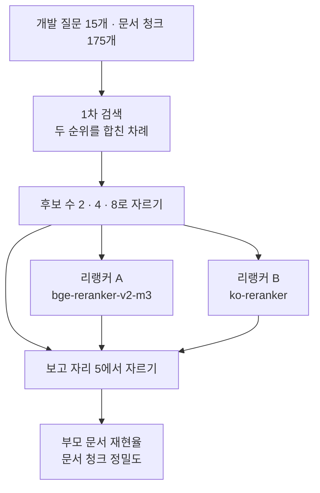
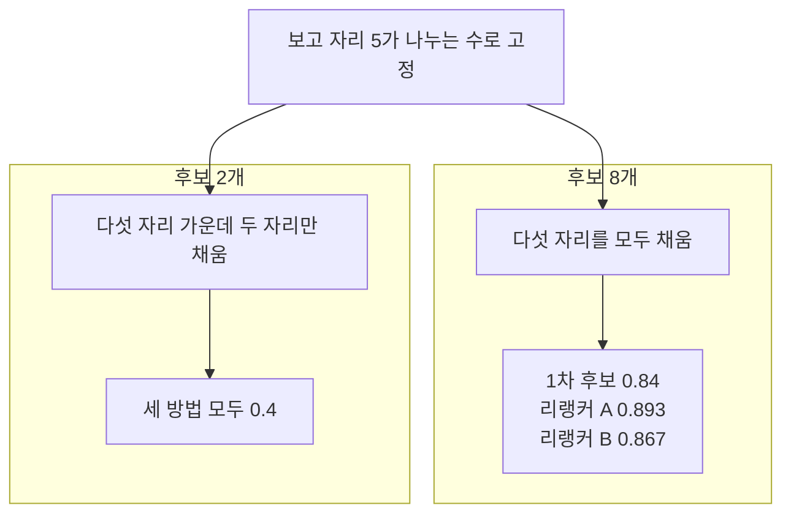
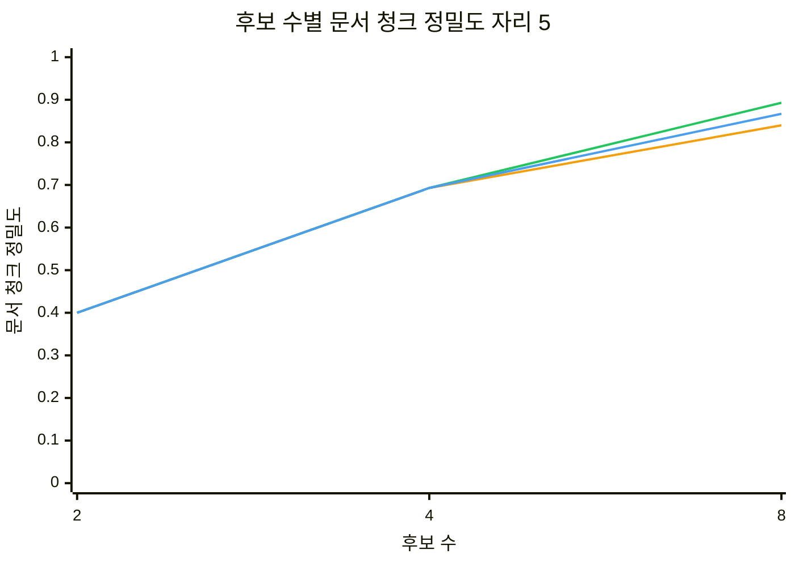
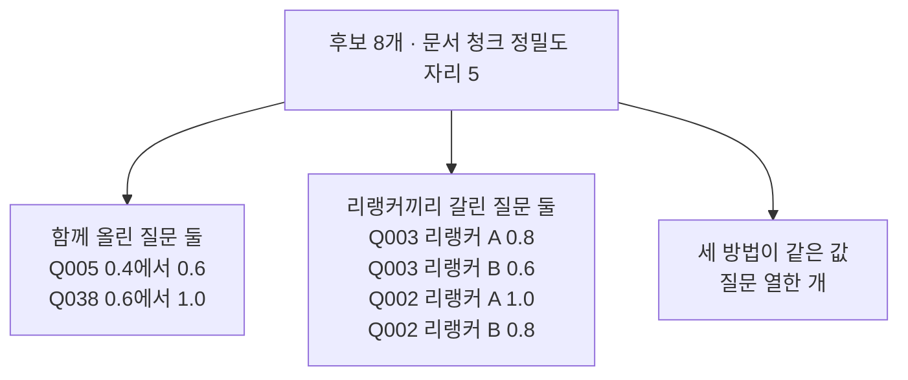

# 08-후보-수와-리랭커-비교

## _src 본문 (HTML 원본)

```html
<!--meta: 강의 1h | 실습 3h | 코드 notebooks/08-후보-수와-리랭커-비교.ipynb | 새 용어 3 -->
<h2 id="b1"><span class="no">1</span>학습 목표</h2><div class="goal"><ul><li>이 절을 마치면 후보 수와 리랭커를 한 번에 한 가지씩 바꿔 견줄 수 있습니다.</li><li>지표가 천장에 닿아 설정을 가르지 못하는 상황을 알아보고 보고 단위를 바꿀 수 있습니다.</li><li>관찰한 값이 설명하는 범위와 설명하지 못하는 범위를 나눠 적을 수 있습니다.</li></ul></div>
<h2 id="b2"><span class="no">2</span>이 내용을 배우는 이유</h2><p>07절에서는 후보 여덟 개를 리랭커 하나로 다시 정렬했습니다. 그때 쓴 후보 수 여덟과 리랭커 한 가지는 골라서 정한 값이 아니라 그냥 정해 둔 값이었습니다. 설정을 고르려면 값을 바꿔 가며 직접 재야 합니다.</p><p>이 절은 후보 수 세 가지와 리랭커 두 가지를 견줍니다. 한 번에 한 가지만 바꾸면 무엇이 결과를 바꿨는지 말할 수 있습니다.</p><p>그런데 07절에서 잰 부모 문서 재현율은 두 단계 모두 <code>1.0</code>이었습니다. 지표가 가장 큰 값에 닿아 있으면 무엇을 바꿔도 값이 같습니다. 그래서 이 절은 설정을 견주기 전에 무엇을 재고 있는지부터 다시 봅니다.</p>
<h2 id="b3"><span class="no">3</span>앞에서 배운 내용</h2><p>07절에서 1차 검색으로 후보를 좁히고 리랭커로 그 자리를 다시 정했습니다. 후보 목록 밖 문서 청크는 리랭킹으로 돌아오지 않는다는 것도 실행으로 보았습니다. 이 절의 1차 검색과 후보 목록은 07절과 같은 방법으로 만듭니다.</p><p>노트북은 앞에서 배운 함수 일곱 개를 실습 폴더의 도구 파일 <code>notebooks/rag_tools.py</code>에서 가져옵니다. 07절과 같은 문서 청크 판 순위 함수 세 개와 04·06·07절 함수 세 개, Ch 11 <code>recall_at()</code>입니다. 07절 <code>parent_ids_of()</code>는 짝 사전 <code>parent_by_chunk</code>를 둘째 인자로 받는 판입니다.</p><p>Ch 11이 정한 약속도 그대로 지킵니다. 개발 15문항으로 설정을 고르고 시험 15문항은 설정을 다 고른 뒤 한 번만 씁니다. 이 절은 개발 묶음만 보고 시험 묶음은 열어 보지 않습니다.</p><p>Ch 11에서 재현율과 정밀도를 배웠습니다. 재현율은 정답 문서 개수로 나누고 정밀도는 자르는 자리로 나눕니다. 나누는 수가 다르면 값이 뜻하는 것도 달라집니다. 이 절은 그 차이를 실제로 쓰는 자리를 보여 줍니다.</p><p>01~06절이 쓴 문서 12개와 질문 8개는 이 절에서 쓰지 않습니다. 문서·질문·후보 단위가 모두 달라 앞 절 숫자와 이 절 숫자를 나란히 놓지 않습니다.</p>
<h2 id="b4"><span class="no">4</span>핵심 개념</h2><h3>비유로 시작하기</h3><p>안내대에서 손님에게 건네는 쟁반에는 칸이 다섯 개 있습니다. 서가에서 두 권만 꺼내 두면 다섯 칸 가운데 세 칸이 빕니다. 더 많이 꺼내 두면 다섯 칸을 모두 채울 수 있습니다. 어떤 다섯 권을 앞에 놓을지는 꺼내 둔 책 안에서만 고릅니다.</p>
{{img:08-5-쟁반-다섯-칸|위아래로 놓인 나무 쟁반 두 개에 각각 같은 크기의 네모 칸 다섯 개가 한 줄로 있고 위 쟁반은 왼쪽 두 칸에만 크림색 책이 서 있고 오른쪽 세 칸은 바닥이 보이게 비어 있으며 아래 쟁반은 다섯 칸에 모두 크림색 책이 놓여 있고 위 쟁반 왼쪽에는 크림색 책 두 권을 포갠 낮은 더미가 아래 쟁반 왼쪽에는 같은 색 책을 포갠 높은 더미가 있는 그림|칸 수는 다섯으로 같고 꺼내 둔 책이 적으면 칸이 빕니다.}}
<p class="look"><b>그림 읽기</b> — 두 쟁반의 칸 수는 다섯으로 같습니다. 위 쟁반은 왼쪽 두 칸만 차 있고 오른쪽 세 칸이 비어 있습니다. 아래 쟁반은 다섯 칸이 모두 차 있습니다. 쟁반 왼쪽의 책 더미 높이가 위아래로 다릅니다. 꺼내 둔 책이 적으면 칸을 다 채우지 못한다는 것이 이 그림의 요점입니다.</p>
<table><thead><tr><th>말</th><th>뜻</th></tr></thead><tbody><tr><td>후보 수(candidate count)</td><td>1차 검색이 리랭커에 넘기는 문서 청크 수입니다. 07절에서 값으로 썼고 이 절에서는 견주는 설정입니다.</td></tr><tr><td>보고 자리(report place)</td><td>검색 결과에서 다음 단계로 넘길 문서 청크 수입니다. 이 절은 다섯으로 고정했습니다.</td></tr><tr><td>문서 청크 정밀도(chunk precision)</td><td>앞자리 문서 청크 가운데 정답 부모 문서에서 나온 몫입니다. 나누는 수는 보고 자리입니다.</td></tr></tbody></table>
<h3>한 번에 한 가지만 바꾸기</h3><p>후보 수는 리랭커가 볼 수 있는 범위를 정합니다. 리랭커는 그 범위 안에서 차례를 정합니다. 두 가지가 하는 일이 다르므로 한 번에 한 가지만 바꿔야 합니다.</p><p>이 절은 같은 후보 목록을 후보 수 2·4·8로 자르고, 같은 자른 목록을 리랭커 두 개에 넣습니다. 리랭커를 거치지 않은 1차 후보 차례도 같은 방법으로 잽니다. 방법 세 가지와 후보 수 세 가지를 곱해 아홉 줄이 나옵니다.</p>
{{mermaid:08-1-후보-수와-리랭커-격자|위에서 아래로 내려가는 흐름도로 맨 위 초록 상자 개발 질문 15개와 문서 청크 175개가 파란 상자 1차 검색으로 이어지고 그 아래 파란 상자 후보 수 2 4 8로 자르기에서 갈래 셋이 나와 가운데는 보라 상자 리랭커 A 오른쪽은 보라 상자 리랭커 B로 가고 나머지 한 갈래는 왼쪽 바깥으로 돌아 곧바로 파란 상자 보고 자리 5에서 자르기로 들어가며 세 갈래가 모인 뒤 맨 아래 노란 상자 부모 문서 재현율과 문서 청크 정밀도로 끝나는 그림|같은 후보 목록이 후보 수 세 가지로 잘린 뒤 리랭커 두 개를 지나거나 곧바로 보고 자리로 갑니다.}}
<p class="look"><b>도식 읽기</b> — 위에서 아래로 읽습니다. 맨 위 초록 상자가 이 절이 쓰는 질문 묶음과 문서 청크 묶음입니다. 파란 상자 <code>후보 수 2 · 4 · 8로 자르기</code>에서 갈래가 셋으로 나뉩니다. 가운데 보라 상자가 리랭커 A이고 오른쪽 보라 상자가 리랭커 B입니다. 왼쪽 바깥으로 도는 갈래는 보라 상자를 거치지 않는 1차 후보입니다.</p><p class="look">세 갈래가 다시 파란 상자 <code>보고 자리 5에서 자르기</code>로 모입니다. 같은 자리에서 잘라야 세 방법의 값을 견줄 수 있습니다. 맨 아래 노란 상자가 이 절이 내는 두 지표입니다.</p>
<h3>재현율이 가르지 못할 때</h3><p>부모 문서는 6건뿐이고 1차 후보는 이미 정답 부모를 맨 앞에 둡니다. 그래서 부모 문서 재현율은 어떤 설정에서도 <code>1.0</code>입니다. 값이 가장 큰 자리에 붙어 있으면 설정을 가를 수 없습니다.</p><p>이럴 때 자르는 자리를 더 낮춰도 소용이 없습니다. 자리 1에서 이미 <code>1.0</code>이기 때문입니다. 대신 세는 단위를 바꿔 봅니다. 정답 부모가 들어왔는지 대신, 앞자리 문서 청크 가운데 몇 개가 정답 부모에서 나왔는지를 셉니다.</p>
<h3>보고 자리가 나누는 수</h3><p>문서 청크 정밀도는 정답 개수가 아니라 보고 자리로 나눕니다. 이 절은 보고 자리를 다섯으로 고정했습니다. 후보 수가 다섯보다 적으면 앞 다섯 자리를 다 채우지 못합니다. 그래서 후보 수가 지표 값에 그대로 들어옵니다.</p>
<h2 id="b5"><span class="no">5</span>실행 예제</h2><p>개발 15문항마다 1차 검색으로 후보 여덟 개를 만듭니다. 리랭커 두 개를 차례로 만들어 같은 후보에 점수를 냅니다. 점수는 한 번만 내고 앞 2·4·8개로 잘라 씁니다.</p><p>임베딩 요청은 문서 청크 1번과 질문 15번으로 모두 열여섯 번입니다. 예상 비용은 미화 0.01달러 아래이고 답을 쓰는 모델은 부르지 않습니다. 리랭커는 내 컴퓨터에서 도는 모델이라 요청 비용이 들지 않습니다. 두 모델의 파일은 각각 약 2.2GB이고 처음 한 번만 내려받습니다.</p>
{{mermaid:08-2-보고-자리를-채우는-후보-수|위에서 아래로 내려가는 흐름도로 맨 위 파란 상자 보고 자리 5가 나누는 수로 고정에서 두 칸으로 갈리고 왼쪽 칸 제목 후보 2개 아래에는 노란 상자 다섯 자리 가운데 두 자리만 채움과 노란 상자 세 방법 모두 0.4가 있으며 오른쪽 칸 제목 후보 8개 아래에는 노란 상자 다섯 자리를 모두 채움과 노란 상자 1차 후보 0.84 리랭커 A 0.893 리랭커 B 0.867이 있는 그림|후보 2개는 보고 자리 다섯을 못 채워 값이 0.4에서 멈추고 후보 8개는 다섯 자리를 모두 채웁니다.}}
<p class="look"><b>도식 읽기</b> — 맨 위 파란 상자가 두 칸에 함께 걸리는 설정입니다. 칸 제목 <code>후보 2개</code>가 왼쪽이고 <code>후보 8개</code>가 오른쪽입니다. 왼쪽 칸의 값 <code>0.4</code>는 다섯 자리 가운데 두 자리만 채운 결과입니다. 오른쪽 칸의 값 세 개는 다섯 자리를 모두 채운 뒤 갈린 결과입니다. 두 칸의 노란 상자 값은 모두 노트북 9절 출력에서 그 칸에 해당하는 줄만 옮긴 것입니다.</p>
{{notebook:08-후보-수와-리랭커-비교}}
<p class="look"><b>확인할 점</b> — 아홉 줄의 부모 문서 재현율이 모두 <code>1.0</code>입니다. 문서 청크 정밀도는 후보 2에서 세 방법 모두 <code>0.4</code>였습니다. 후보 8에서는 <code>1차 후보 | 8 | 1.0 | 0.84</code>와 <code>리랭커 A | 8 | 1.0 | 0.893</code>, 리랭커 B의 <code>0.867</code>로 갈립니다. 보고 자리를 3으로 줄이면 후보 8의 세 줄이 모두 <code>0.933</code>으로 같아집니다.</p>
<h2 id="b6"><span class="no">6</span>실험 결과 해석</h2><p>부모 문서 재현율은 아홉 줄이 모두 <code>1.0</code>이었습니다. 이 조건에서는 그 지표로 후보 수도 리랭커도 가를 수 없습니다. 값을 그대로 싣되 고를 근거로 쓰지 않습니다.</p><p>문서 청크 정밀도는 후보 수에 따라 크게 달라졌습니다. 후보 2에서 <code>0.4</code>, 후보 4에서 <code>0.693</code>, 후보 8에서 <code>0.84</code> 위로 올랐습니다. 후보 2의 <code>0.4</code>는 다섯 자리 가운데 두 자리만 채운 값입니다.</p>
{{mermaid:08-3-후보-수별-문서-청크-정밀도|가로축 이름이 후보 수이고 눈금이 2 4 8이며 세로축 이름이 문서 청크 정밀도이고 눈금이 0에서 1까지인 선 그래프로 선 세 개가 눈금 2의 0.4와 눈금 4의 0.693에서 같은 값이라 겹쳐 있고 눈금 8에서 주황 선은 0.84 초록 선은 0.893 파란 선은 0.867로 갈라지는 그림|세 선이 후보 2와 후보 4에서 겹치고 후보 8에서 주황 선 0.84 · 초록 선 0.893 · 파란 선 0.867로 갈립니다.}}
<p class="look"><b>도식 읽기</b> — 이 차트의 선 색은 앞 그림의 상자 색과 별개로 계열을 가르는 색입니다. 가로축 이름은 후보 수이고 눈금은 2·4·8입니다. 주황 선이 1차 후보, 초록 선이 리랭커 A, 파란 선이 리랭커 B입니다. 왼쪽 두 눈금에서는 세 선의 값이 같아 겹쳐 그려집니다.</p><p class="look">겹친 구간에서는 마지막에 그린 파란 선만 보입니다. 선이 갈라지는 구간은 눈금 4에서 눈금 8 사이뿐입니다. 후보 수를 8로 늘려야 리랭커가 고를 여지가 생긴다는 뜻입니다.</p>
<p>후보 8에서 리랭커 A는 <code>0.893</code>, 리랭커 B는 <code>0.867</code>이었습니다. 1차 후보의 <code>0.84</code>보다 둘 다 높습니다. 두 리랭커의 차이는 질문 두 개에서 나왔습니다.</p>
{{mermaid:08-4-방법마다-갈린-네-질문|위에서 아래로 내려가는 흐름도로 맨 위 노란 상자 후보 8개 문서 청크 정밀도 자리 5에서 세 갈래로 갈려 왼쪽 노란 상자 함께 올린 질문 둘 Q005 0.4에서 0.6 Q038 0.6에서 1.0과 가운데 노란 상자 리랭커끼리 갈린 질문 둘 Q003 리랭커 A 0.8 리랭커 B 0.6 Q002 리랭커 A 1.0 리랭커 B 0.8과 오른쪽 회색 상자 세 방법이 같은 값 질문 열한 개로 이어지는 그림|열다섯 질문 가운데 네 질문에서만 값이 갈리고 그 가운데 둘은 두 리랭커끼리도 다릅니다.}}
<p class="look"><b>도식 읽기</b> — 맨 위 노란 상자가 이번에 견준 설정입니다. 세 갈래는 왼쪽부터 함께 올린 질문 둘, 리랭커끼리 갈린 질문 둘, 세 방법이 같은 값인 질문 열한 개입니다. 왼쪽 갈래의 두 질문은 두 리랭커가 같은 방향으로 값을 올렸습니다. 가운데 갈래의 두 질문은 두 리랭커의 값이 서로 다릅니다. 오른쪽 회색 상자는 세 방법 모두에 해당하는 사실이라 색을 주지 않았습니다.</p>
<p>값 바꿔 보기에서는 보고 자리만 5에서 3으로 줄였습니다. 후보 8의 세 줄이 모두 <code>0.933</code>으로 같아졌습니다. 후보 4에서만 리랭커 B의 <code>0.911</code>이 다른 두 방법의 <code>0.933</code>과 갈렸습니다. 앞 세 자리에 든 문서 청크가 대부분 같아 값이 겹친 것입니다.</p><p>같은 자료라도 보고 자리를 어디에 두느냐에 따라 가를 수 있는 폭이 달라집니다. 보고 자리를 3으로 두면 이 자료에서는 다시 천장에 가까워집니다.</p><p>문서 청크 175개와 개발 15문항에서 한 번 실행한 값입니다. 후보 수는 세 가지, 리랭커는 두 가지만 실행했습니다. 이 범위에서 후보 수를 늘리면 문서 청크 정밀도가 올랐다는 것까지 말할 수 있습니다. 어느 리랭커가 더 낫다는 말은 질문 두 개 차이로 할 수 없습니다.</p>
<h2 id="b7"><span class="no">7</span>주의할 점과 실무 메모</h2><ul><li>지표가 가장 큰 값에 붙어 있으면 설정을 가를 수 없습니다. 값을 보기 전에 천장에 닿았는지 먼저 확인합니다.</li><li>천장에 닿았을 때 자르는 자리를 낮추는 것만으로는 풀리지 않습니다. 이 자료는 자리 1에서 이미 <code>1.0</code>이었습니다.</li><li>세는 단위를 바꾸면 가려지던 차이가 보일 수 있습니다. 이 절은 부모 문서 대신 문서 청크를 세어 차이를 보았습니다.</li><li>후보 수 세 가지와 보고 자리 다섯은 탐색 실행에서 값이 갈리는 조합을 보고 정했습니다. 흐름을 보여 주려고 정한 예이고 실무에서 쓸 값을 권하는 것이 아닙니다.</li><li>문서 청크 정밀도의 나누는 수는 보고 자리입니다. 후보 수가 보고 자리보다 적으면 남은 자리가 비어 값이 내려갑니다.</li><li>천장에 닿은 지표도 표에서 빼지 않습니다. 「이 조건에서는 가를 수 없다」를 함께 적습니다.</li><li>두 리랭커의 값 차이는 열다섯 질문 가운데 두 질문에서 나왔습니다. 이 결과로 모델의 우열을 말하지 않습니다.</li><li>같은 글을 보내도 임베딩 값이 호출마다 아주 조금 달라질 수 있습니다. 문서 청크 정밀도는 다시 실행하면 소수 둘째 자리가 조금 달라질 수 있습니다. 09절에서 같은 코드로 <code>0.84</code>가 <code>0.853</code>으로 나온 적이 있습니다.</li><li>후보 수마다 리랭커를 다시 부르지 않았습니다. 후보 여덟 개에 낸 점수를 앞에서 잘라 썼습니다.</li><li>리랭킹에 걸린 시간은 이 절의 결론에서 뺐습니다. 시간은 실행마다 흔들리고 컴퓨터마다 다릅니다.</li><li>리랭커 두 개를 한 노트북에서 함께 살려 두지 않습니다. 모델 하나에 메모리가 약 2.5GB 듭니다.</li><li>두 리랭커 모두 판 번호를 고정해 받았습니다. 판 번호를 적지 않으면 다음에 다른 파일을 받을 수 있습니다.</li><li>시험 15문항은 이 절에서 열어 보지 않았습니다. 설정을 다 고른 뒤 12절에서 한 번만 씁니다.</li><li>01~06절 값과 이 절 값을 나란히 놓지 않습니다. 문서·질문·후보 단위가 모두 다릅니다.</li><li>이 절은 파일을 쓰지 않습니다. 01~03절이 만든 데이터베이스 표도 읽지 않습니다.</li></ul>
<h2 id="b8"><span class="no">8</span>정리와 다음 절</h2><ul><li>부모 문서 재현율은 아홉 줄이 모두 <code>1.0</code>이라 이 조건에서는 설정을 가를 수 없었습니다.</li><li>문서 청크 정밀도 자리 5는 후보 수를 2에서 8로 늘릴 때 <code>0.4</code>에서 <code>0.84</code> 위로 올랐습니다.</li><li>후보 8에서 두 리랭커의 값이 <code>0.893</code>과 <code>0.867</code>로 갈렸고 갈린 질문은 두 개였습니다.</li></ul><p><strong>다음 학습과 이어지는 지점</strong> — 09절에서는 작은 문서 청크로 찾은 뒤 부모 문서를 통째로 넘기는 방법을 봅니다.</p>
<h2 id="b9"><span class="no">9</span>복습 문제</h2><details class="quiz" open><summary>문제 4개 · 해설 포함</summary><p class="quiz-q">1. 아홉 줄의 부모 문서 재현율이 모두 <code>1.0</code>이면 어느 설정을 고를 수 있습니까?</p><p class="quiz-a">고를 수 없습니다. 값이 모두 같아 설정 사이의 차이가 보이지 않기 때문입니다. 틀렸다면 「재현율이 가르지 못할 때」를 다시 읽습니다.</p><p class="quiz-q">2. 후보 2에서 문서 청크 정밀도가 <code>0.4</code>를 넘지 못한 까닭은 무엇입니까?</p><p class="quiz-a">나누는 수가 보고 자리 다섯인데 후보가 둘뿐이라 세 자리가 비기 때문입니다. 틀렸다면 「보고 자리가 나누는 수」를 다시 읽습니다.</p><p class="quiz-q">3. 후보 수와 리랭커를 함께 바꾸면 무엇이 어려워집니까?</p><p class="quiz-a">값이 달라져도 어느 쪽 때문인지 말할 수 없습니다. 한 번에 한 가지만 바꿔야 원인을 짚을 수 있습니다. 틀렸다면 「한 번에 한 가지만 바꾸기」를 다시 읽습니다.</p><p class="quiz-q">4. 후보 8에서 리랭커 A가 <code>0.893</code>이고 리랭커 B가 <code>0.867</code>이면 A가 더 좋은 모델입니까?</p><p class="quiz-a">그렇게 말할 수 없습니다. 차이가 열다섯 질문 가운데 두 질문에서만 났고 자료도 문서 청크 175개 한 벌뿐입니다. 틀렸다면 「실험 결과 해석」을 다시 읽습니다.</p></details>
<h2 id="b10"><span class="no">10</span>참고 자료</h2><ul><li><div><a href="https://huggingface.co/BAAI/bge-reranker-v2-m3">BAAI bge-reranker-v2-m3 모델 카드</a></div>이 절의 리랭커 A 모델 카드 · 확인 2026-09-18</li><li><div><a href="https://huggingface.co/Dongjin-kr/ko-reranker">Dongjin-kr ko-reranker 모델 카드</a></div>이 절의 리랭커 B 모델 카드 · 확인 2026-09-18</li><li><div><a href="https://www.sbert.net/examples/cross_encoder/applications/README.html">Sentence Transformers Cross-Encoder 사용 예</a></div>같은 호출로 리랭커를 바꿔 쓰는 방법 설명 · 6.0.1 · 확인 2026-09-18</li></ul>
```

## 노트북 셀 (순서대로)

### [0] markdown {'html': 'skip'}

# 후보 수와 리랭커 비교

**이 노트북에서 할 일**

1. 07절과 같은 방법으로 개발 질문마다 후보 여덟 개를 만듭니다.
2. 리랭커 두 개를 차례로 만들어 같은 후보에 점수를 냅니다.
3. 후보 수 2·4·8과 방법 세 가지로 아홉 줄을 견줍니다.
4. 보고 자리를 5에서 3으로 줄여 같은 아홉 줄을 다시 봅니다.

**준비물** — 프로젝트 폴더의 `.env`에 `OPENAI_API_KEY`가 있어야 합니다.
임베딩 요청은 문서 청크 1번과 질문 15번으로 모두 열여섯 번입니다.
예상 비용은 미화 0.01달러 아래이고 답을 쓰는 모델은 부르지 않습니다.

리랭커는 내 컴퓨터에서 도는 모델이라 요청 비용이 들지 않습니다.
처음 실행할 때 리랭커 두 개의 파일을 각각 약 2.2GB씩 내려받습니다.
그다음부터는 받아 둔 파일을 쓰고 판 번호를 고정해 같은 파일을 씁니다.
실행 시간은 내려받기를 빼고 3분 안팎이며 리랭커 호출이 가장 오래 걸립니다.

**메모리** — 리랭커 하나를 살려 두는 데 약 2.5GB가 듭니다.
두 모델을 함께 살려 두지 않도록 한 모델을 다 쓴 뒤 다음 모델을 만듭니다.

**데이터** — 두 파일 모두 실습 묶음에 들어 있습니다.

- 문서 `labs/part3/ch12-retrieval-tuning/data/advanced-documents.json`(부모 6건·문서 청크 175개)
- 질문 `labs/part3/ch12-retrieval-tuning/data/advanced-queries.json`(30개)

**강의와 실습 범위** — 강의 시간에는 2~4절과 8~10절을 읽습니다.
후보와 지표를 정하는 자리가 2~4절이고 리랭커 두 개를 부르는 자리가 8절입니다.
9절이 실행 1이고 10절이 값 바꿔 보기입니다.
1·5~7·11절은 함께 실행하고 실습 시간에 다시 읽습니다.

**기준 버전** — 첫 셀에서 여섯 패키지를 고정한 판으로 설치합니다.
리랭커는 판 번호 `953dc6f6f85a`와 `8c2ab1a83373`을 고정해 받습니다.
교재 출력은 Linux의 Python 3.12.13으로 만들었습니다.
다른 판과 Windows·macOS에서는 이번에 실행하지 않았습니다.

실습 폴더 `labs/part3/ch12-retrieval-tuning`에서 `uv sync --locked`를 실행합니다.
그다음 이 폴더의 `.venv` 커널을 고르고 첫 셀부터 순서대로 실행합니다.

### [1] markdown {'html': 'skip'}

## 오늘 볼 그림


맨 위 초록 상자가 이 절이 쓰는 질문 묶음과 문서 청크 묶음입니다.
그 아래 파란 상자 두 개가 후보를 만들고 후보 수로 자르는 자리입니다.
보라 상자 둘이 견줄 리랭커이고 가운데 갈래는 리랭커를 거치지 않는 1차 후보입니다.
세 갈래가 다시 파란 상자 보고 자리로 모여 같은 자리에서 잘립니다.
맨 아래 노란 상자가 이 노트북 9절이 내는 두 지표입니다.

### [2] markdown {}

## 1. 준비

첫 셀은 패키지 여섯 개를 설치하고 설치된 버전을 출력합니다.
07절과 같은 여섯 개이고 설치에는 몇십 초가 걸릴 수 있습니다.

### [3] code {'execution': {'iopub.execute_input': '2026-09-21T08:17:45.638513Z', 'iopub.status.busy': '2026-09-21T08:17:45.638325Z', 'iopub.status.idle': '2026-09-21T08:17:46.262835Z', 'shell.execute_reply': '2026-09-21T08:17:46.262291Z'}, 'lesson_role': 'setup'}

```python
# 이 절에서 쓰는 패키지를 설치하고 버전을 확인합니다
%pip install -q "langchain-openai==1.6.1" "python-dotenv==1.2.3" "kiwipiepy==0.23.2" "rank-bm25==0.2.2" "sentence-transformers==6.0.1" "numpy==2.5.3"
from importlib.metadata import version

print("langchain-openai:", version("langchain-openai"))
print("python-dotenv:", version("python-dotenv"))
print("kiwipiepy:", version("kiwipiepy"))
print("rank-bm25:", version("rank-bm25"))
print("sentence-transformers:", version("sentence-transformers"))
print("numpy:", version("numpy"))
```

출력:
```
Note: you may need to restart the kernel to use updated packages.
langchain-openai: 1.6.1
python-dotenv: 1.2.3
kiwipiepy: 0.23.2
rank-bm25: 0.2.2
sentence-transformers: 6.0.1
numpy: 2.5.3

```

### [4] markdown {}

**결과 읽기** — 설치가 끝나면 `langchain-openai: 1.6.1`과 `sentence-transformers: 6.0.1`이 보입니다.
마지막 줄 `numpy: 2.5.3`은 도구 파일이 벡터 계산에 쓰는 패키지입니다. 여섯 줄이 모두 보이면 다음 셀로 넘어갑니다.

다음 셀은 이 절에서 쓸 이름 다섯 개를 불러옵니다.

앞에서 배운 함수는 `rag_tools.py`에 모아 두었습니다. 파일을 열면 코드를 볼 수 있습니다. 노트북과 같은 폴더(`notebooks/`)에 있는 파일입니다.

이 노트북은 04·06·07절 함수 세 개와 Ch 11 `recall_at()`을 가져옵니다.
04절 `kiwi_terms()`, 06절 `fuse_rank()`, 07절 `parent_ids_of()`입니다.
07절과 같은 문서 청크 판 순위 함수 세 개도 함께 가져옵니다.
인자 모양이 앞 절 판과 다른 함수는 5절과 6절에서 설명합니다.

### [5] code {'execution': {'iopub.execute_input': '2026-09-21T08:17:46.263905Z', 'iopub.status.busy': '2026-09-21T08:17:46.263823Z', 'iopub.status.idle': '2026-09-21T08:17:56.017613Z', 'shell.execute_reply': '2026-09-21T08:17:56.016998Z'}, 'lesson_role': 'setup'}

```python
# 자료 읽기·형태소 분석·임베딩·낱말 점수·리랭커에 쓸 이름을 불러옵니다
import json
import os
import warnings

# 리랭커 파일을 읽을 때 나오는 진행 막대와 위젯 경고는 계산과 관계없어 화면에 내지 않습니다
os.environ["HF_HUB_DISABLE_PROGRESS_BARS"] = "1"
warnings.filterwarnings("ignore", message="IProgress not found")

from kiwipiepy import Kiwi
from langchain_openai import OpenAIEmbeddings
from rank_bm25 import BM25Okapi
from sentence_transformers import CrossEncoder
# 04·06·07절과 Ch 11 함수, 01~06절 순위 함수의 문서 청크 판 일곱 개를 도구 파일에서 가져옵니다
from rag_tools import fuse_rank, kiwi_terms, parent_ids_of, rank_chunks_by_bm25
from rag_tools import rank_chunks_by_distance, recall_at, unique_chunk_ids

print("불러온 이름:", "json", "Kiwi", "OpenAIEmbeddings", "BM25Okapi", "CrossEncoder")
```

출력:
```
불러온 이름: json Kiwi OpenAIEmbeddings BM25Okapi CrossEncoder

```

### [6] markdown {}

**결과 읽기** — 출력 줄은 `불러온 이름:` 뒤에 이름 다섯 개가 붙은 한 줄입니다.
도구 파일에서 가져온 함수 일곱 개는 출력하지 않습니다.

다음 셀은 API 키가 있는지 확인합니다. `True` 값이 나오면 다음으로 넘어갑니다.

### [7] code {'execution': {'iopub.execute_input': '2026-09-21T08:17:56.019072Z', 'iopub.status.busy': '2026-09-21T08:17:56.018915Z', 'iopub.status.idle': '2026-09-21T08:17:56.022636Z', 'shell.execute_reply': '2026-09-21T08:17:56.022363Z'}, 'lesson_role': 'setup'}

```python
# .env 파일에서 OpenAI API 키를 읽습니다(키 값은 출력하지 않습니다)
import os
from dotenv import find_dotenv, load_dotenv

env_path = find_dotenv(usecwd=True)
load_dotenv(env_path)
has_key = os.getenv("OPENAI_API_KEY") is not None
print("OPENAI_API_KEY 설정 여부:", has_key)
assert has_key, "프로젝트 폴더의 .env 파일에 OPENAI_API_KEY를 적어 주세요."
```

출력:
```
OPENAI_API_KEY 설정 여부: True

```

### [8] markdown {}

**결과 읽기** — 출력 줄은 `OPENAI_API_KEY 설정 여부: True` 하나입니다.
키 값은 출력하지 않습니다.

다음 셀은 프로젝트 맨 위 폴더를 찾습니다. 01~07절과 같은 코드입니다.

### [9] code {'execution': {'iopub.execute_input': '2026-09-21T08:17:56.023224Z', 'iopub.status.busy': '2026-09-21T08:17:56.023169Z', 'iopub.status.idle': '2026-09-21T08:17:56.025137Z', 'shell.execute_reply': '2026-09-21T08:17:56.024799Z'}, 'lesson_role': 'setup'}

```python
# 노트북을 어느 폴더에서 열어도 프로젝트 맨 위를 찾게 후보 세 개를 차례로 봅니다
candidates = [".", "../../..", "../../../.."]
root_path = None
for candidate in candidates:
    if os.path.exists(candidate + "/labs/part3/ch12-retrieval-tuning/data"):
        root_path = candidate
        break
print("고른 경로:", root_path)
assert root_path is not None, "notebooks 폴더나 실습 폴더 맨 위에서 노트북을 열어 주세요."
```

출력:
```
고른 경로: .

```

### [10] markdown {}

**결과 읽기** — 출력 줄은 `고른 경로: .`입니다. `assert`도 통과했습니다.

다음 셀은 07절과 같은 자료 두 벌을 읽습니다.

### [11] code {'execution': {'iopub.execute_input': '2026-09-21T08:17:56.025714Z', 'iopub.status.busy': '2026-09-21T08:17:56.025665Z', 'iopub.status.idle': '2026-09-21T08:17:56.029447Z', 'shell.execute_reply': '2026-09-21T08:17:56.029137Z'}, 'lesson_role': 'setup'}

```python
# 07절과 같은 문서 파일과 질문 파일을 불러옵니다
data_path = root_path + "/labs/part3/ch12-retrieval-tuning/data"
with open(data_path + "/advanced-documents.json", encoding="utf-8") as file:
    documents = json.loads(file.read())
with open(data_path + "/advanced-queries.json", encoding="utf-8") as file:
    queries = json.loads(file.read())
parents = documents["parents"]
chunks = documents["chunks"]
print("부모 문서 수:", len(parents))
print("문서 청크 수:", len(chunks))
print("질문 수:", len(queries))
```

출력:
```
부모 문서 수: 6
문서 청크 수: 175
질문 수: 30

```

### [12] markdown {}

**결과 읽기** — `부모 문서 수: 6`과 `문서 청크 수: 175`, `질문 수: 30`이 보입니다.
07절과 같은 파일이라 세 값도 같습니다.

## 2. 개발 묶음 가리기

Ch 11이 정한 약속은 개발 15문항으로 설정을 고르는 것입니다.
시험 15문항은 설정을 다 고른 뒤 12절에서 한 번만 씁니다.
이 절도 그 약속을 지켜 개발 묶음만 봅니다.
개발 묶음 안에서도 답할 수 없는 질문과 정답 ID가 빈 질문은 지표에서 뺍니다.
다음 셀은 그 두 가지를 거르는 함수입니다.

### [13] code {'execution': {'iopub.execute_input': '2026-09-21T08:17:56.030072Z', 'iopub.status.busy': '2026-09-21T08:17:56.030003Z', 'iopub.status.idle': '2026-09-21T08:17:56.031649Z', 'shell.execute_reply': '2026-09-21T08:17:56.031357Z'}}

```python
# 답할 수 있고 정답 부모 문서 ID가 있는 질문만 남깁니다
def eligible_items(subset):
    picked = []
    for item in subset:
        gold_ids = []
        # 같은 정답 ID가 두 번 적혀 있으면 지표의 나누는 수가 달라져 한 번만 둡니다
        for gold_id in item["gold_doc_ids"]:
            if gold_id not in gold_ids:
                gold_ids.append(gold_id)
        item["gold_doc_ids"] = gold_ids
        if item["answerable"] and len(gold_ids) > 0:
            picked.append(item)
    return picked
```

출력:
```

```

### [14] markdown {}

**결과 읽기** — 정의 셀이라 출력이 없습니다.
같은 정답 ID가 두 번 적혀 있으면 한 번만 남깁니다.
지표 함수가 정답 ID 개수로 나누기 때문에 겹친 값을 그대로 두면 값이 달라집니다.

다음 셀은 그 함수로 개발 묶음을 가립니다.

### [15] code {'execution': {'iopub.execute_input': '2026-09-21T08:17:56.032211Z', 'iopub.status.busy': '2026-09-21T08:17:56.032158Z', 'iopub.status.idle': '2026-09-21T08:17:56.034086Z', 'shell.execute_reply': '2026-09-21T08:17:56.033797Z'}}

```python
# 질문 30개에서 개발 묶음만 고르고 답할 수 있는 질문만 남깁니다
dev_all = []
for query in queries:
    if query["split"] == "dev":
        dev_all.append(query)
dev_queries = eligible_items(dev_all)
print("개발 질문 수:", len(dev_queries))
print("시험 질문 수:", len(queries) - len(dev_all))
print("첫 개발 질문:", dev_queries[0]["qid"], "|", dev_queries[0]["question"])
print("그 질문의 정답 부모 문서 ID:", dev_queries[0]["gold_doc_ids"])
```

출력:
```
개발 질문 수: 15
시험 질문 수: 15
첫 개발 질문: Q001 | 미르시립도서관의 정기 휴관일은 언제인가요?
그 질문의 정답 부모 문서 ID: ['E01']

```

### [16] markdown {}

**결과 읽기** — `개발 질문 수: 15`와 `시험 질문 수: 15`가 보입니다.
줄 `첫 개발 질문:` 뒤에 질문 ID와 질문 글이 있습니다.
정답 칸 값은 `['E01']`처럼 목록입니다.
이번 개발 묶음에서는 빠진 질문이 없어 열다섯 개가 그대로 남았습니다.

## 3. 이 절에서 쓸 값 정하기

01~07절에서 쓴 값 세 개를 그대로 다시 정합니다.

### [17] code {'execution': {'iopub.execute_input': '2026-09-21T08:17:56.034597Z', 'iopub.status.busy': '2026-09-21T08:17:56.034547Z', 'iopub.status.idle': '2026-09-21T08:17:56.036339Z', 'shell.execute_reply': '2026-09-21T08:17:56.036034Z'}}

```python
# 01~07절에서 쓴 값을 그대로 다시 정합니다
keep_tags = ["NNG", "NNP", "NNB", "NR", "VV", "VA", "MAG", "SN", "SL"]
rank_constant = 60
equal_weights = [1.0, 1.0]
print("남길 품사 표시:", keep_tags)
print("순위 상수:", rank_constant)
print("같은 가중치:", equal_weights)
```

출력:
```
남길 품사 표시: ['NNG', 'NNP', 'NNB', 'NR', 'VV', 'VA', 'MAG', 'SN', 'SL']
순위 상수: 60
같은 가중치: [1.0, 1.0]

```

### [18] markdown {}

**결과 읽기** — 줄 `순위 상수: 60`과 `같은 가중치: [1.0, 1.0]`은 06·07절과 같은 값입니다.
라벨 줄 `남길 품사 표시:` 뒤에는 이름 아홉 개가 있습니다.

다음 셀은 이 절에서 견줄 값을 정합니다.
후보 수는 리랭커가 볼 수 있는 문서 청크 수입니다.
보고 자리는 검색 결과에서 다음 단계로 넘길 문서 청크 수입니다.

### [19] code {'execution': {'iopub.execute_input': '2026-09-21T08:17:56.036803Z', 'iopub.status.busy': '2026-09-21T08:17:56.036756Z', 'iopub.status.idle': '2026-09-21T08:17:56.038499Z', 'shell.execute_reply': '2026-09-21T08:17:56.038253Z'}}

```python
# 이 절에서 견줄 후보 수·지표를 재는 자리·리랭커 두 개를 정합니다
candidate_count = 8
candidate_counts = [2, 4, 8]
recall_place = 3
report_place = 5
method_names = ["1차 후보", "리랭커 A", "리랭커 B"]
reranker_names = ["BAAI/bge-reranker-v2-m3", "Dongjin-kr/ko-reranker"]
first_revision = "953dc6f6f85a1b2dbfca4c34a2796e7dde08d41e"
second_revision = "8c2ab1a833734491fd3158164dd2b7d8b28e071c"
reranker_revisions = [first_revision, second_revision]
reranker_max_length = 256
print("견줄 후보 수 세 가지:", candidate_counts)
print("부모 문서 재현율을 재는 자리:", recall_place)
print("보고 자리:", report_place)
print("견줄 방법 세 가지:", method_names)
```

출력:
```
견줄 후보 수 세 가지: [2, 4, 8]
부모 문서 재현율을 재는 자리: 3
보고 자리: 5
견줄 방법 세 가지: ['1차 후보', '리랭커 A', '리랭커 B']

```

### [20] markdown {}

**결과 읽기** — `견줄 후보 수 세 가지: [2, 4, 8]`과 `보고 자리: 5`가 보입니다.
줄 `부모 문서 재현율을 재는 자리: 3`은 07절에서 쓴 자리와 같습니다.
라벨 줄 `견줄 방법 세 가지:` 뒤에 이름 셋이 있고 그 셋이 표의 왼쪽 칸이 됩니다.
리랭커 두 개의 이름과 판 번호도 이 셀에서 정했습니다.

## 4. 두 지표가 볼 재료 만들기

문서 청크마다 제목과 본문을 이어 붙여 글 하나로 만듭니다.
청크 ID로 부모 문서 ID와 글을 찾을 수 있게 짝도 함께 만들어 둡니다.

### [21] code {'execution': {'iopub.execute_input': '2026-09-21T08:17:56.039074Z', 'iopub.status.busy': '2026-09-21T08:17:56.039008Z', 'iopub.status.idle': '2026-09-21T08:17:56.041049Z', 'shell.execute_reply': '2026-09-21T08:17:56.040721Z'}}

```python
# 문서 청크마다 제목과 본문을 이어 붙이고 청크 ID·부모 문서 ID·글을 짝지어 둡니다
chunk_texts = []
chunk_ids = []
parent_by_chunk = {}
text_by_chunk = {}
for chunk in chunks:
    chunk_text = chunk["title"] + " " + chunk["text"]
    chunk_texts.append(chunk_text)
    chunk_ids.append(chunk["chunk_id"])
    parent_by_chunk[chunk["chunk_id"]] = chunk["parent_id"]
    text_by_chunk[chunk["chunk_id"]] = chunk_text
all_chunk_count = len(chunk_ids)
print("이어 붙인 글 수:", len(chunk_texts))
print("첫 문서 청크 ID:", chunk_ids[0])
```

출력:
```
이어 붙인 글 수: 175
첫 문서 청크 ID: E01-P01-C01

```

### [22] markdown {}

**결과 읽기** — `이어 붙인 글 수: 175`가 보입니다.
줄 `첫 문서 청크 ID: E01-P01-C01`의 이름은 부모 ID와 쪽 번호, 문서 청크 번호를 이은 것입니다.

다음 셀은 벡터 거리 쪽 재료를 만듭니다. 01~07절과 같은 모델을 씁니다.

### [23] code {'execution': {'iopub.execute_input': '2026-09-21T08:17:56.041521Z', 'iopub.status.busy': '2026-09-21T08:17:56.041473Z', 'iopub.status.idle': '2026-09-21T08:17:59.311204Z', 'shell.execute_reply': '2026-09-21T08:17:59.310204Z'}}

```python
# 01~07절과 같은 모델로 문서 청크와 개발 질문을 벡터로 바꿉니다(임베딩 요청 16번)
embedding_model_name = "text-embedding-3-small"
vector_dimensions = 256
embedding_model = OpenAIEmbeddings(model=embedding_model_name, dimensions=vector_dimensions)
chunk_vectors = embedding_model.embed_documents(chunk_texts)
query_vectors = []
for query in dev_queries:
    query_vectors.append(embedding_model.embed_query(query["question"]))
print("임베딩 모델 이름:", embedding_model.model)
print("벡터의 숫자 개수 설정:", embedding_model.dimensions)
print("문서 청크 벡터 수:", len(chunk_vectors))
print("질문 벡터 수:", len(query_vectors))
```

출력:
```
임베딩 모델 이름: text-embedding-3-small
벡터의 숫자 개수 설정: 256
문서 청크 벡터 수: 175
질문 벡터 수: 15

```

### [24] markdown {}

**결과 읽기** — `벡터의 숫자 개수 설정: 256`과 `문서 청크 벡터 수: 175`가 보입니다.
출력 줄 `질문 벡터 수: 15`까지 나오면 임베딩 요청 열여섯 번이 끝났습니다.
이 노트북의 출력은 2026-09-21에 이 모델로 실행한 결과입니다.

다음 셀은 문서 청크의 검색 낱말 목록으로 BM25 모델을 만듭니다.
검색 낱말은 07절처럼 도구 파일의 `kiwi_terms()`에 분석기와 남길 품사 표시를 넘겨 만듭니다.
분석기를 만드는 줄 `kiwi = Kiwi()`는 1초 안팎 걸립니다.

### [25] code {'execution': {'iopub.execute_input': '2026-09-21T08:17:59.313598Z', 'iopub.status.busy': '2026-09-21T08:17:59.313383Z', 'iopub.status.idle': '2026-09-21T08:18:00.828539Z', 'shell.execute_reply': '2026-09-21T08:18:00.828069Z'}}

```python
# 04~07절과 같은 형태소 분석기로 문서 청크마다 검색 낱말 목록을 만들고 BM25 모델을 만듭니다
kiwi = Kiwi()
kiwi_corpus = []
for text in chunk_texts:
    kiwi_corpus.append(kiwi_terms(kiwi, text, keep_tags))
bm25_model = BM25Okapi(kiwi_corpus)
print("검색 낱말 목록 수:", len(kiwi_corpus))
print("BM25 모델이 본 문서 청크 수:", bm25_model.corpus_size)
print("문서 청크 하나의 평균 검색 낱말 수:", round(bm25_model.avgdl, 2))
```

출력:
```
검색 낱말 목록 수: 175
BM25 모델이 본 문서 청크 수: 175
문서 청크 하나의 평균 검색 낱말 수: 44.01

```

### [26] markdown {}

**결과 읽기** — `검색 낱말 목록 수: 175`와 `BM25 모델이 본 문서 청크 수: 175`가 보입니다.
줄 `문서 청크 하나의 평균 검색 낱말 수: 44.01`은 07절과 같은 값입니다.

## 5. 1차 검색 함수의 인자 확인하기

1차 검색 함수는 07절과 같은 판을 준비 셀에서 도구 파일로부터 가져왔습니다.
함수 `rank_chunks_by_distance()`와 `rank_chunks_by_bm25()`가 두 순위를 만듭니다.
값 칸 이름은 `거리`와 `점수`이고 문서 청크 ID는 칸 `chunk_id`에 있습니다.
함수 `unique_chunk_ids()`는 그 순위 목록에서 문서 청크 ID만 차례로 모읍니다.
06절 `fuse_rank()`는 순위 상수를 셋째 인자로 받습니다.

## 6. 후보 목록 만들기

개발 질문마다 두 순위를 만들어 합치고 앞자리 여덟 개를 후보로 자릅니다.
07절과 같은 1차 검색이라 후보 목록도 같습니다.
이 셀은 1차 차례를 그대로 점수로도 남깁니다.
그래야 리랭커를 거치지 않은 차례도 같은 함수로 잴 수 있습니다.

### [27] code {'execution': {'iopub.execute_input': '2026-09-21T08:18:00.829480Z', 'iopub.status.busy': '2026-09-21T08:18:00.829402Z', 'iopub.status.idle': '2026-09-21T08:18:00.872573Z', 'shell.execute_reply': '2026-09-21T08:18:00.872169Z'}}

```python
# 개발 질문마다 두 순위를 합쳐 앞자리 여덟 개를 후보로 자르고 1차 차례도 점수로 남깁니다
candidate_sets = {}
first_scored = {}
place_scores = []
# 자리 번호에 음수를 붙이면 앞자리가 큰 점수가 되어 1차 차례를 그대로 쓸 수 있습니다
for position in range(candidate_count):
    place_scores.append(0 - position)
for query_index in range(len(dev_queries)):
    question_id = dev_queries[query_index]["qid"]
    distance_hits = rank_chunks_by_distance(query_vectors[query_index], chunk_vectors, chunk_ids, all_chunk_count)
    question_terms = kiwi_terms(kiwi, dev_queries[query_index]["question"], keep_tags)
    score_hits = rank_chunks_by_bm25(bm25_model, question_terms, chunk_ids, all_chunk_count)
    ranking_list = [unique_chunk_ids(distance_hits), unique_chunk_ids(score_hits)]
    candidate_sets[question_id] = fuse_rank(ranking_list, equal_weights, rank_constant)[:candidate_count]
    first_scored[question_id] = place_scores
print("만든 후보 목록 수:", len(candidate_sets))
print("후보 목록 하나의 문서 청크 수:", len(candidate_sets[dev_queries[0]["qid"]]))
```

출력:
```
만든 후보 목록 수: 15
후보 목록 하나의 문서 청크 수: 8

```

### [28] markdown {}

**결과 읽기** — `만든 후보 목록 수: 15`와 `후보 목록 하나의 문서 청크 수: 8`이 보입니다.
개발 질문 하나에 후보 목록 하나가 만들어졌습니다.
후보 수를 2와 4로 줄일 때는 이 여덟 개의 앞쪽만 씁니다.

문서 청크 ID 목록을 부모 문서 ID 목록으로 바꾸는 일은 07절 `parent_ids_of()`가 맡습니다.
질문 파일의 정답이 부모 문서 ID라 재현율을 재기 전에 이 단계가 필요합니다.
도구 파일 판은 07절 판이 바로 읽던 짝 사전 `parent_by_chunk`를 둘째 인자로 받습니다.

## 7. 리랭커 호출과 다시 정렬 함수

다음 셀은 질문과 후보 본문을 쌍으로 묶어 점수를 받는 함수입니다.
07절과 같은 호출이고 쓰는 리랭커만 이름 `reranker`로 바뀝니다.

### [29] code {'execution': {'iopub.execute_input': '2026-09-21T08:18:00.873321Z', 'iopub.status.busy': '2026-09-21T08:18:00.873258Z', 'iopub.status.idle': '2026-09-21T08:18:00.875227Z', 'shell.execute_reply': '2026-09-21T08:18:00.874868Z'}}

```python
# 질문 하나와 후보 본문을 쌍으로 묶어 리랭커에서 점수 목록을 받습니다(07절과 같은 호출)
def score_candidates(question, found_chunk_ids):
    pairs = []
    for chunk_id in found_chunk_ids:
        # 쌍 하나는 (질문, 후보 본문) 모양의 튜플입니다
        pairs.append((question, text_by_chunk[chunk_id]))
    scores = reranker.predict(pairs, show_progress_bar=False)
    # predict가 주는 값은 넘파이 배열이라 tolist()로 파이썬 목록으로 바꿉니다
    return scores.tolist()
```

출력:
```

```

### [30] markdown {}

**결과 읽기** — 정의 셀이라 출력이 없습니다.
이 함수는 부를 때마다 이름 `reranker`가 가리키는 모델을 씁니다.

다음 셀은 받은 점수로 후보를 다시 놓는 함수입니다.
인자 `candidate_k`가 후보를 앞에서 몇 개까지 볼지 정합니다.

### [31] code {'execution': {'iopub.execute_input': '2026-09-21T08:18:00.875822Z', 'iopub.status.busy': '2026-09-21T08:18:00.875774Z', 'iopub.status.idle': '2026-09-21T08:18:00.877524Z', 'shell.execute_reply': '2026-09-21T08:18:00.877179Z'}}

```python
# 후보를 앞에서 candidate_k개만 남기고 점수가 큰 순서로 다시 놓습니다
def order_by_score(question_id, scored, candidate_k):
    found_chunk_ids = candidate_sets[question_id][:candidate_k]
    score_list = scored[question_id]
    pairs = []
    for i in range(len(found_chunk_ids)):
        # 점수에 음수를 붙이면 sorted가 큰 점수를 앞으로 보냅니다
        pairs.append((0 - score_list[i], found_chunk_ids[i]))
    ranked_ids = []
    for pair in sorted(pairs):
        ranked_ids.append(pair[1])
    return ranked_ids
```

출력:
```

```

### [32] markdown {}

**결과 읽기** — 정의 셀이라 출력이 없습니다.
1차 차례를 점수로 바꿔 둔 목록을 넣으면 자른 차례가 그대로 나옵니다.

## 8. 리랭커 두 개로 점수 내기

리랭커 두 개를 차례로 만들어 같은 후보에 점수를 냅니다.
모델 하나를 살려 두는 데 약 2.5GB가 들어 두 모델을 함께 두지 않습니다.
이름 `reranker`에 `None`을 넣으면 앞 모델이 메모리에서 내려갑니다.
이 셀은 리랭커를 서른 번 불러 2분 안팎 걸립니다.

### [33] code {'execution': {'iopub.execute_input': '2026-09-21T08:18:00.878194Z', 'iopub.status.busy': '2026-09-21T08:18:00.878141Z', 'iopub.status.idle': '2026-09-21T08:19:29.528069Z', 'shell.execute_reply': '2026-09-21T08:19:29.525280Z'}}

```python
# 리랭커 두 개를 차례로 만들어 개발 질문의 후보에 점수를 냅니다(리랭커 호출 30번)
scored_by_method = {}
scored_by_method[method_names[0]] = first_scored
for model_index in range(len(reranker_names)):
    # 다음 모델을 만들기 전에 이름에 None을 넣어 앞 모델을 메모리에서 내려놓습니다
    reranker = None
    reranker = CrossEncoder(
        reranker_names[model_index], revision=reranker_revisions[model_index],
        max_length=reranker_max_length, device="cpu")
    scored = {}
    for item in dev_queries:
        scored[item["qid"]] = score_candidates(item["question"], candidate_sets[item["qid"]])
    scored_by_method[method_names[model_index + 1]] = scored
print("점수를 낸 방법 수:", len(scored_by_method))
print("리랭커 A:", reranker_names[0], "|", first_revision[:12])
print("리랭커 B:", reranker_names[1], "|", second_revision[:12])
print("한 쌍에서 읽는 최대 조각 수:", reranker.max_seq_length)
```

출력:
```
Warning: You are sending unauthenticated requests to the HF Hub. Please set a HF_TOKEN to enable higher rate limits and faster downloads.
점수를 낸 방법 수: 3
리랭커 A: BAAI/bge-reranker-v2-m3 | 953dc6f6f85a
리랭커 B: Dongjin-kr/ko-reranker | 8c2ab1a83373
한 쌍에서 읽는 최대 조각 수: 256

```

### [34] markdown {}

**결과 읽기** — `점수를 낸 방법 수: 3`이 보입니다.
방법 셋은 1차 후보와 리랭커 두 개입니다.
줄 `리랭커 A:`와 `리랭커 B:` 뒤에 모델 이름과 판 번호 앞 열두 글자가 있습니다.
출력 줄 `한 쌍에서 읽는 최대 조각 수: 256`은 두 모델에 같게 준 값입니다.
출력 맨 위의 영문 알림은 계정을 밝히지 않고 파일을 받았다는 뜻입니다.

## 9. 실행 1 — 아홉 줄 견주기

지표는 두 가지입니다.
재현율은 준비 셀에서 가져온 Ch 11 함수 `recall_at()`으로 냅니다.
자르는 자리까지 자른 목록에 정답 부모가 있으면 1.0이 나옵니다.

다음 셀은 이 절에서 새로 만드는 문서 청크 정밀도입니다.
재현율은 정답 개수로 나누고 이 지표는 보고 자리로 나눕니다.

### [35] code {'execution': {'iopub.execute_input': '2026-09-21T08:19:29.537961Z', 'iopub.status.busy': '2026-09-21T08:19:29.537289Z', 'iopub.status.idle': '2026-09-21T08:19:29.545685Z', 'shell.execute_reply': '2026-09-21T08:19:29.545313Z'}}

```python
# 앞자리 문서 청크 가운데 정답 부모 문서에서 나온 것을 세어 보고 자리로 나눕니다
def chunk_precision_at(found_chunk_ids, gold_doc_ids, cutoff):
    top_ids = found_chunk_ids[:cutoff]
    found_count = 0
    for chunk_id in top_ids:
        # 나누는 수가 보고 자리라 자리를 다 채우지 못하면 값이 내려갑니다
        if parent_by_chunk[chunk_id] in gold_doc_ids:
            found_count = found_count + 1
    return found_count / cutoff
```

출력:
```

```

### [36] markdown {}

**결과 읽기** — 정의 셀이라 출력이 없습니다.
후보가 보고 자리보다 적으면 남은 자리가 비어 값이 내려갑니다.

다음 셀은 방법 하나를 개발 질문 열다섯 개로 재는 함수입니다.
반환값은 두 지표의 질문 평균 두 개입니다.

### [37] code {'execution': {'iopub.execute_input': '2026-09-21T08:19:29.546451Z', 'iopub.status.busy': '2026-09-21T08:19:29.546382Z', 'iopub.status.idle': '2026-09-21T08:19:29.548939Z', 'shell.execute_reply': '2026-09-21T08:19:29.548484Z'}}

```python
# 방법 하나의 점수로 개발 질문을 모두 재어 두 지표의 질문 평균을 냅니다
def evaluate(scored, candidate_k):
    if len(dev_queries) == 0:
        raise ValueError("평가 가능한 개발 문항이 없습니다")
    recall_total = 0.0
    precision_total = 0.0
    for item in dev_queries:
        gold_ids = item["gold_doc_ids"]
        ranked_ids = order_by_score(item["qid"], scored, candidate_k)
        parent_ids = parent_ids_of(ranked_ids, parent_by_chunk)
        recall_total = recall_total + recall_at(parent_ids, gold_ids, recall_place)
        precision_total = precision_total + chunk_precision_at(ranked_ids, gold_ids, report_place)
    return round(recall_total / len(dev_queries), 3), round(precision_total / len(dev_queries), 3)
```

출력:
```

```

### [38] markdown {}

**결과 읽기** — 정의 셀이라 출력이 없습니다.
잴 질문이 하나도 없으면 오류를 내고 멈춥니다.

다음 셀이 이 절의 실행 1입니다.
실행 전에 예상해 봅니다. 후보 수를 늘리면 문서 청크 정밀도가 오를 것입니다.

### [39] code {'execution': {'iopub.execute_input': '2026-09-21T08:19:29.549801Z', 'iopub.status.busy': '2026-09-21T08:19:29.549744Z', 'iopub.status.idle': '2026-09-21T08:19:29.552559Z', 'shell.execute_reply': '2026-09-21T08:19:29.552301Z'}}

```python
# 방법 세 가지와 후보 수 세 가지로 두 지표의 질문 평균을 냅니다
print("방법 | 후보 수 | 부모 문서 재현율 자리", recall_place, "| 문서 청크 정밀도 자리", report_place)
for method_name in method_names:
    scored = scored_by_method[method_name]
    for candidate_k in candidate_counts:
        means = evaluate(scored, candidate_k)
        print(method_name, "|", candidate_k, "|", means[0], "|", means[1])
```

출력:
```
방법 | 후보 수 | 부모 문서 재현율 자리 3 | 문서 청크 정밀도 자리 5
1차 후보 | 2 | 1.0 | 0.4
1차 후보 | 4 | 1.0 | 0.693
1차 후보 | 8 | 1.0 | 0.84
리랭커 A | 2 | 1.0 | 0.4
리랭커 A | 4 | 1.0 | 0.693
리랭커 A | 8 | 1.0 | 0.893
리랭커 B | 2 | 1.0 | 0.4
리랭커 B | 4 | 1.0 | 0.693
리랭커 B | 8 | 1.0 | 0.867

```

### [40] markdown {}

**결과 읽기** — 라벨 줄 아래 아홉 줄이 나옵니다.
부모 문서 재현율 칸은 아홉 줄이 모두 `1.0`입니다.
문서 청크 정밀도 칸은 후보 2에서 세 방법이 모두 `0.4`입니다.
후보 8에서는 `1차 후보 | 8 | 1.0 | 0.84`와 `리랭커 A | 8 | 1.0 | 0.893`으로 갈립니다.
리랭커 B는 같은 자리에서 `0.867`입니다.

부모 문서 재현율은 아홉 줄이 모두 같아 이 조건에서는 방법을 가를 수 없습니다.
부모 문서가 6건뿐이고 1차 후보가 이미 정답 부모를 자리 1에 두었기 때문입니다.
문서 청크 정밀도는 후보 수에 따라 크게 달라졌습니다.
후보 2에서는 보고 자리 다섯 가운데 두 자리만 채워 최댓값이 `0.4`입니다.

다음 셀은 후보 여덟 개에서 질문마다 값을 견줍니다.

### [41] code {'execution': {'iopub.execute_input': '2026-09-21T08:19:29.553230Z', 'iopub.status.busy': '2026-09-21T08:19:29.553166Z', 'iopub.status.idle': '2026-09-21T08:19:29.556416Z', 'shell.execute_reply': '2026-09-21T08:19:29.555898Z'}}

```python
# 후보 여덟 개에서 질문마다 문서 청크 정밀도를 견주어 어디서 갈렸는지 봅니다
print("질문 | 난이도 | 1차 후보 | 리랭커 A | 리랭커 B")
for item in dev_queries:
    row_values = []
    for method_name in method_names:
        ranked_ids = order_by_score(item["qid"], scored_by_method[method_name], candidate_count)
        one_score = chunk_precision_at(ranked_ids, item["gold_doc_ids"], report_place)
        row_values.append(round(one_score, 3))
    print(item["qid"], "|", item["tier"], "|", row_values[0], "|", row_values[1], "|", row_values[2])
```

출력:
```
질문 | 난이도 | 1차 후보 | 리랭커 A | 리랭커 B
Q001 | easy | 1.0 | 1.0 | 1.0
Q002 | easy | 1.0 | 1.0 | 0.8
Q003 | easy | 0.6 | 0.8 | 0.6
Q004 | easy | 0.4 | 0.4 | 0.4
Q005 | easy | 0.4 | 0.6 | 0.6
Q037 | medium | 1.0 | 1.0 | 1.0
Q038 | medium | 0.6 | 1.0 | 1.0
Q039 | medium | 1.0 | 1.0 | 1.0
Q040 | medium | 0.8 | 0.8 | 0.8
Q041 | medium | 1.0 | 1.0 | 1.0
Q085 | hard | 1.0 | 1.0 | 1.0
Q086 | hard | 1.0 | 1.0 | 1.0
Q087 | hard | 1.0 | 1.0 | 1.0
Q088 | hard | 1.0 | 1.0 | 1.0
Q089 | hard | 0.8 | 0.8 | 0.8

```

### [42] markdown {}

**결과 읽기** — 라벨 줄 아래 열다섯 줄 가운데 네 줄에서 값이 갈립니다.
줄 `Q005 | easy | 0.4 | 0.6 | 0.6`은 두 리랭커가 함께 값을 올린 질문입니다.
줄 `Q038 | medium | 0.6 | 1.0 | 1.0`도 같은 방향입니다.
줄 `Q003 | easy | 0.6 | 0.8 | 0.6`과 `Q002 | easy | 1.0 | 1.0 | 0.8`은 두 리랭커가 다릅니다.
나머지 열한 줄은 세 방법이 같은 값입니다.

## 10. 값 바꿔 보기 — 보고 자리를 3으로 줄이기

바꿀 값은 보고 자리 하나입니다.
후보 수와 방법, 후보 목록은 그대로 둡니다.
실행 전에 예상해 봅니다. 앞 세 자리만 보면 방법 사이 차이가 줄어들 것입니다.

### [43] code {'execution': {'iopub.execute_input': '2026-09-21T08:19:29.557289Z', 'iopub.status.busy': '2026-09-21T08:19:29.557226Z', 'iopub.status.idle': '2026-09-21T08:19:29.559756Z', 'shell.execute_reply': '2026-09-21T08:19:29.559432Z'}}

```python
# 값 바꿔 보기: 보고 자리만 3으로 줄여 같은 아홉 줄을 다시 냅니다
report_place = 3
print("방법 | 후보 수 | 부모 문서 재현율 자리", recall_place, "| 문서 청크 정밀도 자리", report_place)
for method_name in method_names:
    scored = scored_by_method[method_name]
    for candidate_k in candidate_counts:
        means = evaluate(scored, candidate_k)
        print(method_name, "|", candidate_k, "|", means[0], "|", means[1])
```

출력:
```
방법 | 후보 수 | 부모 문서 재현율 자리 3 | 문서 청크 정밀도 자리 3
1차 후보 | 2 | 1.0 | 0.667
1차 후보 | 4 | 1.0 | 0.933
1차 후보 | 8 | 1.0 | 0.933
리랭커 A | 2 | 1.0 | 0.667
리랭커 A | 4 | 1.0 | 0.933
리랭커 A | 8 | 1.0 | 0.933
리랭커 B | 2 | 1.0 | 0.667
리랭커 B | 4 | 1.0 | 0.911
리랭커 B | 8 | 1.0 | 0.933

```

### [44] markdown {}

**결과 읽기** — 후보 8의 세 줄이 모두 `0.933`으로 같아졌습니다.
후보 4에서만 `리랭커 B | 4 | 1.0 | 0.911`이 다른 두 방법의 `0.933`과 갈립니다.
후보 2에서는 세 방법이 모두 `0.667`입니다.
보고 자리를 줄이면 앞 세 자리에 든 문서 청크 묶음이 대부분 같아 값이 겹칩니다.
같은 자료라도 보고 자리를 어디에 두느냐에 따라 가를 수 있는 폭이 달라집니다.

## 정리

1. 부모 문서 재현율은 아홉 줄이 모두 `1.0`이라 이 조건에서는 방법을 가를 수 없었습니다.
2. 문서 청크 정밀도 자리 5는 후보 수를 2에서 8로 늘릴 때 `0.4`에서 `0.84` 위로 올랐습니다.
3. 후보 8에서 두 리랭커의 값이 `0.893`과 `0.867`로 갈렸고 갈린 질문은 두 개였습니다.

09절에서는 작은 문서 청크로 찾은 뒤 부모 문서를 통째로 넘기는 방법을 봅니다.

## 그림

### 08-1-후보-수와-리랭커-격자.mmd



같은 후보 목록이 후보 수 세 가지로 잘린 뒤 리랭커 두 개를 지나거나 곧바로 보고 자리로 갑니다.

### 08-2-보고-자리를-채우는-후보-수.mmd



후보 2개는 보고 자리 다섯을 못 채워 값이 0.4에서 멈추고 후보 8개는 다섯 자리를 모두 채웁니다.

### 08-3-후보-수별-문서-청크-정밀도.mmd



세 선이 후보 2와 후보 4에서 겹치고 후보 8에서 주황 선 0.84 · 초록 선 0.893 · 파란 선 0.867로 갈립니다.

### 08-4-방법마다-갈린-네-질문.mmd



열다섯 질문 가운데 네 질문에서만 값이 갈리고 그 가운데 둘은 두 리랭커끼리도 다릅니다.

### 08-5-쟁반-다섯-칸.prompt.md

# 08-5 쟁반 다섯 칸 (Higgsfield 삽화)

상태: 2026-09-18 생성·채택 · 모델 `nano_banana_pro`(응답 model `nano_banana_2`) · 16:9 · 2k · 1차 job `4025250c-8d60-47cd-acb7-a53520dffb52` 채택 · 재생성 없음 · 2크레딧 · 생성 전 잔액 2721.

설명 대상 문장(본문 b4 비유 단락): 손님에게 건네는 쟁반의 칸 수는 다섯으로 정해져 있고, 서가에서 두 권만 꺼내 두면 다섯 칸 가운데 세 칸이 빕니다. 더 많이 꺼내 두면 다섯 칸을 모두 채울 수 있고, 어떤 다섯 권을 앞에 놓을지는 꺼내 둔 책 안에서만 고릅니다.

구성 요소와 배치: 나무 쟁반 두 개가 위아래로 놓여 있고 쟁반마다 같은 크기의 네모 칸 다섯 개가 한 줄로 있습니다. 위 쟁반은 앞의 두 칸에만 크림색 책이 서 있고 나머지 세 칸은 바닥이 보이게 비어 있습니다. 아래 쟁반은 다섯 칸에 모두 크림색 책이 놓여 있습니다. 위 쟁반 왼쪽에는 크림색 책 두 권을 포갠 작은 더미가 있고, 아래 쟁반 왼쪽에는 같은 색 책을 여러 권 포갠 높은 더미가 있습니다.

시선 순서: 왼쪽 위 작은 책 더미 → 위 쟁반의 빈 세 칸 → 왼쪽 아래 높은 책 더미 → 아래 쟁반의 채워진 다섯 칸.

검수(그림만 보고 관계가 읽히는가): 통과. 두 쟁반의 칸 수가 다섯으로 같고 채워진 칸 수만 달라 「나누는 수는 그대로이고 채우는 수가 달라진다」가 보입니다. 왼쪽 더미의 높이가 위아래로 뚜렷이 달라 「꺼내 둔 책이 많을수록 칸을 더 채운다」가 함께 읽힙니다. 글자·숫자·화면 요소·사람은 없습니다.

프롬프트와 다른 점: 아래 왼쪽 더미를 「exactly eight」으로 적었으나 그림은 일곱 권 안팎으로 그려졌습니다. 관계를 읽는 데는 더미 높이만 쓰이므로 채택하고, 본문 비유·alt·캡션에서 그 더미의 권수를 세지 않도록 「더 많이 꺼내 두면」으로 적었습니다. 정확한 후보 수 2·4·8은 노트북 출력과 도식 `08-1`·`08-2`가 보여 줍니다.

저장: 원본 2752x1536(SHA-256 `087d3ef092fdc04de4dd5f0e1821a8713866ffae52e24edd51d6ed8bf6b71a53`)을 폭 1100px로 줄여 `08-5-쟁반-다섯-칸.png`(SHA-256 `a883c8317493fee58ccde297824479c9afa09ae12a128b00a1e537a883bfac35`)로 저장했습니다. 저장한 PNG를 채택 job 결과와 픽셀로 대조했습니다(차이 상자 `None` — 규격 §5-4).

프롬프트:

```text
Simple flat educational illustration, white background, limited soft palette,
clean outlines, plain everyday objects, no text, no letters, no numbers, no logos.
Two shallow wooden serving trays are drawn one above the other, and each tray is
divided into exactly five equal square compartments in a single horizontal row.
In the upper tray only the first two compartments hold an upright cream colored
book, and the remaining three compartments are clearly empty and show the bare tray
bottom. In the lower tray every one of the five compartments holds an upright cream
colored book. To the left of the upper tray lies a separate small stack of exactly
two cream colored books. To the left of the lower tray lies a separate taller stack
of exactly eight cream colored books. Both trays are the same width and clearly show
the same five compartments. No monitors, no screens, no people, no hands, no arrows,
no shadows.
```

