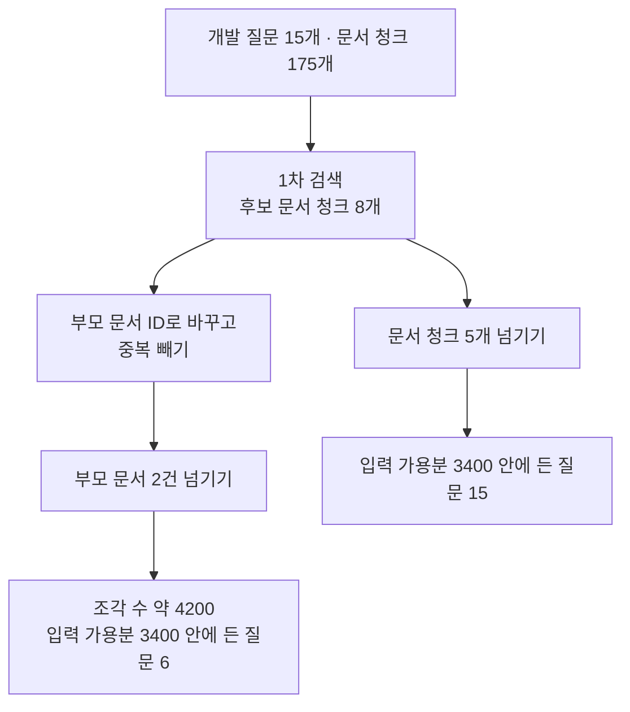
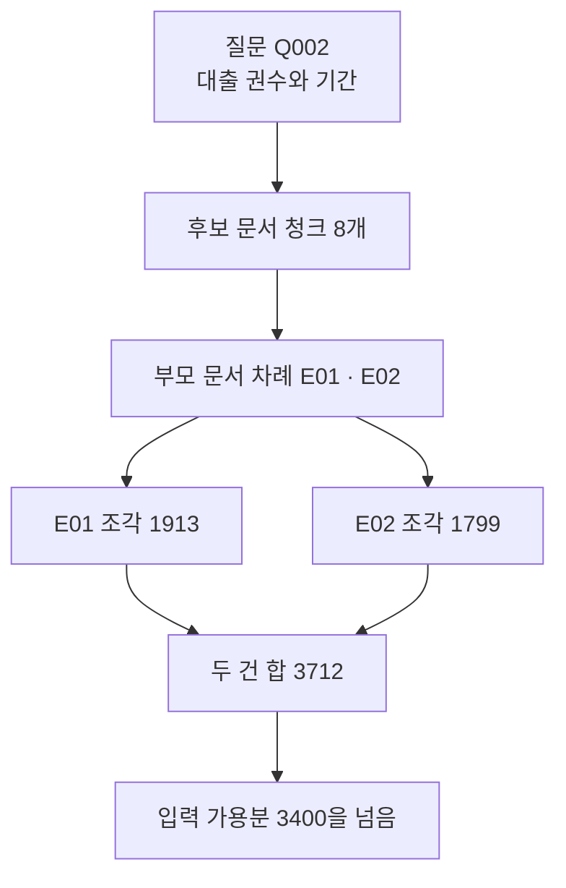
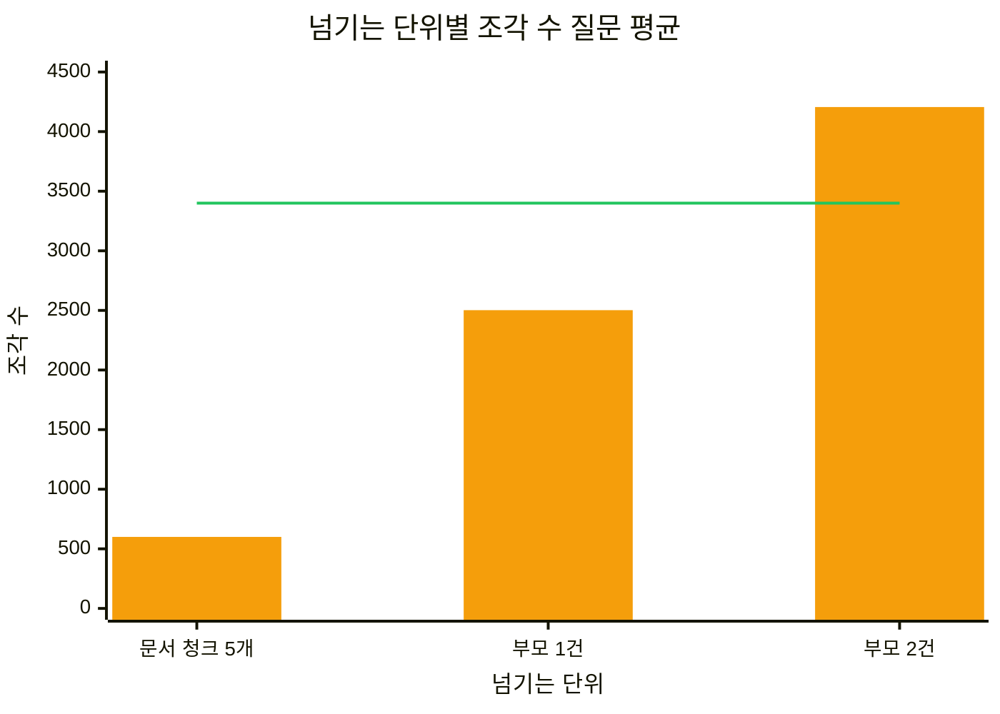
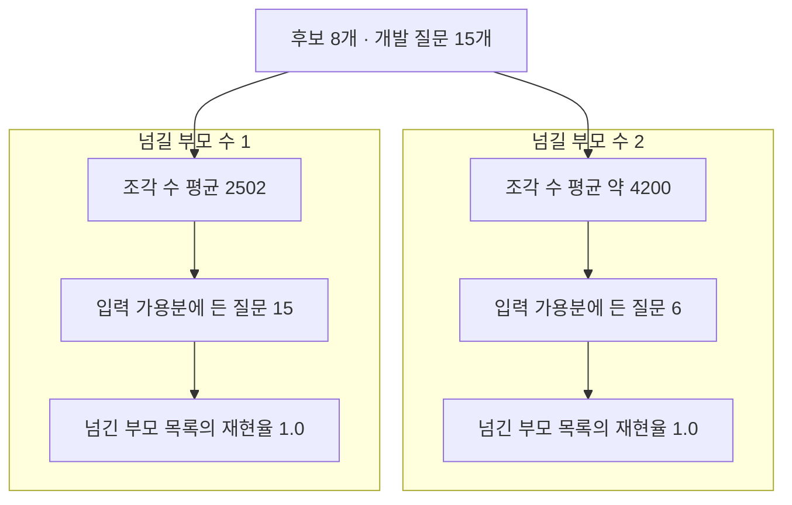

# 09-Parent-document-검색

## _src 본문 (HTML 원본)

```html
<!--meta: 강의 1h | 실습 3h | 코드 notebooks/09-Parent-document-검색.ipynb | 새 용어 3 -->
<h2 id="b1"><span class="no">1</span>학습 목표</h2><div class="goal"><ul><li>이 절을 마치면 작은 문서 청크로 찾고 부모 문서를 통째로 넘길 수 있습니다.</li><li>넘길 글의 길이를 조각 수로 재어 입력 가용분과 견줄 수 있습니다.</li><li>천장에 닿은 지표와 천장이 없는 값을 갈라서 적을 수 있습니다.</li></ul></div>
<h2 id="b2"><span class="no">2</span>이 내용을 배우는 이유</h2><p>01~08절은 검색이 어떤 문서 청크를 앞자리에 두는지만 보았습니다. 검색 뒤에는 그 결과를 다음 단계 모델에 넘기는 일이 남습니다. 무엇을 넘길지는 검색 설정과 따로 정하는 일입니다.</p><p>문서 청크는 찾기에 좋지만 앞뒤 문장이 잘려 있습니다. 그 문서 청크가 나온 부모 문서를 통째로 넘기면 앞뒤가 붙은 글을 줄 수 있습니다. 대신 넘길 글이 길어져 다음 단계의 입력 자리를 많이 차지합니다.</p><p>이 절은 그 맞바꿈을 실제 값으로 잽니다. 찾는 방법은 07·08절 그대로 두고 넘기는 단위만 바꿉니다.</p>
<h2 id="b3"><span class="no">3</span>앞에서 배운 내용</h2><p>07절에서 후보 문서 청크를 부모 문서 ID로 바꾸는 <code>parent_ids_of()</code> 함수를 만들었습니다. 그 함수는 같은 부모를 가리키는 문서 청크를 하나로 묶어 중복을 뺍니다. 이 절의 부모 목록도 그 함수가 만듭니다.</p><p>08절에서는 보고 자리를 정해 문서 청크 다섯 개를 다음 단계로 넘겼습니다. 부모 문서 재현율과 문서 청크 정밀도도 08절에서 쓴 그대로 다시 냅니다. 부모 문서 재현율이 천장에 닿아 설정을 가르지 못한다는 것도 08절에서 보았습니다.</p><p>Ch 8 01절에서 수업 예산과 출력 예약분, 여유분, 입력 가용분을 배웠습니다. 글의 길이를 조각 수로 세는 <code>count_tokens()</code> 함수도 그 절에서 만들었습니다. 이 절은 예산 식을 같은 이름으로 다시 쓰고 <code>count_tokens()</code>는 도구 파일에서 가져옵니다.</p><p>노트북은 앞 절과 앞 챕터에서 배운 함수 열 개를 실습 폴더의 도구 파일 <code>notebooks/rag_tools.py</code>에서 가져옵니다. 07·08절 함수는 짝 사전 <code>parent_by_chunk</code>를 인자로 받는 판입니다. <code>count_tokens()</code> 함수는 토큰화 규칙을 첫 인자로 받습니다.</p><p>Ch 11이 정한 약속대로 개발 15문항만 봅니다. 시험 15문항은 설정을 다 고른 뒤 12절에서 한 번만 씁니다. 01~06절이 쓴 문서 12개와 질문 8개는 이 절에서 쓰지 않습니다.</p>
<h2 id="b4"><span class="no">4</span>핵심 개념</h2><h3>비유로 시작하기</h3><p>안내대의 쟁반 하나에 카드 다섯 장을 올리면 자리가 남습니다. 같은 쟁반에 책 두 권을 통째로 올리면 테두리 밖으로 넘칩니다. 카드는 책에서 옮겨 적은 것이라 내용은 이어지지만 차지하는 자리가 다릅니다.</p>
{{img:09-5-카드-다섯-장과-책-두-권|위아래로 놓인 같은 크기의 나무 쟁반 두 개 가운데 위 쟁반에는 크림색 카드 다섯 장이 한 줄로 모두 테두리 안에 들어가 있고 아래 쟁반에는 두꺼운 책 두 권이 놓여 양쪽 테두리 밖으로 크게 삐져나온 그림|같은 크기의 쟁반에 카드 다섯 장은 들어가고 책 두 권은 테두리 밖으로 넘칩니다.}}
<p class="look"><b>그림 읽기</b> — 위아래 쟁반의 크기가 같습니다. 위 쟁반의 카드 다섯 장은 테두리 안에 모두 들어가고 둘레에 빈 자리도 보입니다. 아래 쟁반의 책 두 권은 왼쪽과 오른쪽 테두리 밖으로 크게 나갔습니다. 두 권의 표지 색이 달라 서로 다른 책이라는 것이 보입니다. 넘기는 단위를 바꾸면 같은 자리가 모자랄 수 있다는 것이 이 그림의 요점입니다.</p>
<table><thead><tr><th>말</th><th>뜻</th></tr></thead><tbody><tr><td>부모 문서 넘기기(parent document retrieval)</td><td>작은 문서 청크로 찾고 그 문서 청크가 나온 부모 문서를 통째로 넘기는 방법입니다.</td></tr><tr><td>넘길 부모 수(parent limit)</td><td>부모 문서를 몇 건까지 넘길지 정한 수입니다. 08절 보고 자리를 부모 단위로 옮긴 값입니다.</td></tr><tr><td>입력 가용분(input budget)</td><td>수업 예산에서 출력 예약분과 여유분을 뺀 나머지입니다. Ch 8 01절과 같은 뜻이고 단위는 조각입니다.</td></tr></tbody></table>
<h3>작게 찾고 크게 넘기기</h3><p>찾는 단위와 넘기는 단위를 따로 둘 수 있습니다. 찾을 때는 짧은 문서 청크가 좋습니다. 질문과 겹치는 대목이 또렷하게 드러나기 때문입니다.</p><p>넘길 때는 부모 문서가 좋을 수 있습니다. 답에 필요한 앞뒤 문장이 잘리지 않기 때문입니다. 두 단위를 갈라 두면 검색 설정을 그대로 두고 넘기는 단위만 바꿔 볼 수 있습니다.</p>
{{mermaid:09-1-작게-찾고-크게-넘기기|위에서 아래로 내려가는 흐름도로 맨 위 초록 상자 개발 질문 15개와 문서 청크 175개가 파란 상자 1차 검색 후보 문서 청크 8개로 이어지고 거기서 두 갈래로 갈려 왼쪽은 파란 상자 부모 문서 ID로 바꾸고 중복 빼기와 파란 상자 부모 문서 2건 넘기기를 지나 노란 상자 조각 수 약 4200과 입력 가용분 3400 안에 든 질문 6으로 가고 오른쪽은 파란 상자 문서 청크 5개 넘기기를 지나 노란 상자 입력 가용분 3400 안에 든 질문 15로 끝나는 그림|같은 후보에서 부모 문서 2건을 넘기면 조각이 약 4200개가 되고 입력 가용분 3400 안에 드는 질문이 15에서 6으로 줄어듭니다.}}
<p class="look"><b>도식 읽기</b> — 위에서 아래로 읽습니다. 맨 위 초록 상자가 이 절이 쓰는 질문 묶음과 문서 청크 묶음입니다. 그 아래 파란 상자에서 07·08절과 같은 방법으로 후보 여덟 개를 만듭니다. 거기서 갈래가 둘로 나뉩니다.</p><p class="look">왼쪽 갈래는 파란 상자 <code>부모 문서 ID로 바꾸고 중복 빼기</code>를 지나 부모 문서 두 건을 넘깁니다. 오른쪽 갈래는 08절까지 쓰던 대로 문서 청크 다섯 개를 넘깁니다. 맨 아래 노란 상자 두 개가 넘길 글의 조각 수와 입력 가용분에 든 질문 수입니다. 두 값은 노트북 10절 표에서 옮긴 것입니다.</p>
<h3>부모 수는 후보 수만큼 늘지 않습니다</h3><p>후보 여덟 개가 부모 여덟 건이 되지는 않습니다. 여러 문서 청크가 같은 부모에서 나오기 때문입니다. 07절 <code>parent_ids_of()</code> 함수가 처음 나온 자리만 남기고 중복을 뺍니다.</p><p>그래서 부모 수는 후보 수보다 훨씬 적습니다. 대신 부모 한 건이 문서 청크 여러 개를 합친 길이입니다. 수는 줄고 길이는 늘어나는 맞바꿈입니다.</p>
<h3>넘길 글의 길이를 재는 자</h3><p>길이는 글자 수가 아니라 조각 수로 잽니다. 조각은 Ch 5에서 배운 대로 모델이 글을 처리하는 단위입니다. Ch 8 01절은 같은 단위를 토큰이라고 불렀고 규칙 이름은 <code>o200k_base</code>였습니다.</p><p>잰 값은 입력 가용분과 견줍니다. 입력 가용분은 수업 예산에서 출력 예약분과 여유분을 뺀 나머지입니다. 이 절은 수업 예산 4000, 출력 예약분 500, 여유분 100으로 두어 입력 가용분이 3400입니다. 답을 쓰는 모델은 이 절에서 부르지 않고 길이만 잽니다.</p>
<h2 id="b5"><span class="no">5</span>실행 예제</h2><p>개발 15문항마다 1차 검색으로 후보 여덟 개를 만듭니다. 후보의 부모 문서를 뽑아 두 건까지 넘길 글 목록을 만듭니다. 08절처럼 문서 청크 다섯 개를 넘기는 쪽도 같은 함수로 재어 나란히 놓습니다.</p><p>임베딩 요청은 문서 청크 1번과 질문 15번으로 모두 열여섯 번입니다. 예상 비용은 미화 0.01달러 아래이고 답을 쓰는 모델은 부르지 않습니다. 리랭커도 쓰지 않아 실행은 1분 안팎입니다.</p>
{{mermaid:09-2-한-질문의-부모-넓히기|위에서 아래로 내려가는 흐름도로 맨 위 초록 상자 질문 Q002 대출 권수와 기간이 파란 상자 후보 문서 청크 8개와 파란 상자 부모 문서 차례 E01 E02로 이어지고 거기서 두 갈래로 갈려 왼쪽 노란 상자 E01 조각 1913과 오른쪽 노란 상자 E02 조각 1799가 다시 노란 상자 두 건 합 3712로 모이고 맨 아래 노란 상자 입력 가용분 3400을 넘음으로 끝나는 그림|질문 Q002의 후보 여덟 개는 부모 두 건으로 줄지만 두 건을 더한 조각 3712개는 입력 가용분을 넘습니다.}}
<p class="look"><b>도식 읽기</b> — 위에서 아래로 읽습니다. 맨 위 초록 상자가 07절에서도 쓴 질문 <code>Q002</code>입니다. 파란 상자 두 개가 후보 여덟 개와 그 후보의 부모 문서 차례입니다. 문서 청크 여덟 개가 부모 두 건으로 줄었습니다.</p><p class="look">그 아래 노란 상자 두 개가 부모 문서 하나씩의 조각 수입니다. 두 값을 더한 3712가 가운데 노란 상자입니다. 맨 아래 노란 상자는 그 합이 입력 가용분 3400을 넘었다는 뜻이고, 노트북 9절 출력 <code>입력 가용분에 드는가: False</code>가 근거입니다.</p>
{{notebook:09-Parent-document-검색}}
<p class="look"><b>확인할 점</b> — 노트북 9절 <code>후보의 부모 문서 차례: ['E01', 'E02']</code>를 봅니다. 같은 절의 <code>넘길 부모 두 건의 조각 수 합: 3712</code>와 10절 표 두 줄 <code>문서 청크 | 5.0 | 600 | 15</code>·<code>부모 문서 | 1.6 | 4206 | 6</code>을 나란히 봅니다. 11절에서 넘길 부모 수를 1로 줄인 줄 <code>부모 문서 | 1.0 | 2502 | 15</code>도 확인합니다.</p>
<h2 id="b6"><span class="no">6</span>실험 결과 해석</h2><p>넘기는 단위를 바꾸자 길이가 크게 달라졌습니다. 문서 청크 다섯 개는 조각 600개였고 부모 문서 두 건은 조각 4200개를 넘었습니다. 글 수는 다섯에서 1.6으로 줄었는데 길이는 일곱 배가 되었습니다.</p>
{{mermaid:09-3-넘기는-단위별-조각-수|가로축 이름이 넘기는 단위이고 눈금이 문서 청크 5개와 부모 1건과 부모 2건이며 세로축 이름이 조각 수이고 눈금이 0에서 4500까지인 막대 그래프로 주황 막대 세 개 가운데 문서 청크 5개가 가장 낮고 부모 1건이 2502이며 부모 2건이 4200을 넘고 가로로 그은 초록 선이 3400인 그림|주황 막대 세 개 가운데 부모 2건만 초록 선으로 그린 입력 가용분 3400을 넘습니다.}}
<p class="look"><b>도식 읽기</b> — 가로축 이름은 넘기는 단위이고 눈금은 세 가지입니다. 세로축 이름은 조각 수이고 0에서 4500까지입니다. 주황 막대가 넘길 글의 조각 수 질문 평균이고 가로로 그은 초록 선이 입력 가용분 3400입니다. 왼쪽 두 막대는 초록 선 아래에 있고 오른쪽 막대만 선을 넘습니다.</p>
<p>입력 가용분에 든 질문 수도 갈렸습니다. 문서 청크 쪽은 열다섯 질문이 모두 들었고 부모 문서 쪽은 여섯 질문만 들었습니다. 부모 문서가 가장 짧은 <code>E02</code>도 조각 1799개라 두 건이면 3400을 넘기 쉽습니다.</p>
{{mermaid:09-4-넘길-부모-수-둘과-하나|위에서 아래로 내려가는 흐름도로 맨 위 파란 상자 후보 8개 개발 질문 15개에서 두 칸으로 갈리고 왼쪽 칸 제목 넘길 부모 수 1 아래에는 노란 상자 조각 수 평균 2502와 노란 상자 입력 가용분에 든 질문 15와 노란 상자 넘긴 부모 목록의 재현율 1.0이 있고 오른쪽 칸 제목 넘길 부모 수 2 아래에는 노란 상자 조각 수 평균 약 4200과 노란 상자 입력 가용분에 든 질문 6과 노란 상자 넘긴 부모 목록의 재현율 1.0이 있는 그림|넘길 부모 수를 1로 줄이면 조각 수 평균이 절반이 되고 재현율은 두 칸 모두 1.0으로 같습니다.}}
<p class="look"><b>도식 읽기</b> — 맨 위 파란 상자가 두 칸에 함께 걸리는 설정입니다. 칸 제목 <code>넘길 부모 수 1</code>이 왼쪽이고 <code>넘길 부모 수 2</code>가 오른쪽입니다. 왼쪽 칸의 조각 수 평균 2502는 오른쪽 칸 약 4200의 절반 남짓입니다.</p><p class="look">입력 가용분에 든 질문은 왼쪽 칸이 열다섯이고 오른쪽 칸이 여섯입니다. 맨 아래 두 상자의 재현율은 두 칸 모두 <code>1.0</code>입니다. 값이 같아 이 지표로는 두 설정을 가를 수 없습니다.</p>
<p>부모 문서 재현율 자리 3은 <code>1.0</code>이었고 넘긴 부모 목록의 재현율도 <code>1.0</code>이었습니다. 부모 문서가 6건뿐이고 1차 후보의 1위 문서 청크가 정답 부모에서 나왔기 때문입니다. 넘길 부모 수를 1로 줄여도 값이 그대로여서 이 조건에서는 두 설정을 가를 수 없습니다.</p><p>가른 값은 길이 쪽이었습니다. 넘길 부모 수를 1로 줄이자 조각 수 평균이 4200 남짓에서 2502로 내려갔습니다. 입력 가용분에 든 질문은 여섯에서 열다섯이 되었습니다. 같은 재현율을 유지하면서 넘길 글을 절반으로 줄인 셈입니다.</p><p>부모 문서 6건과 개발 15문항에서 한 번 실행한 값입니다. 넘길 부모 수는 1과 2만 실행했고 후보 수는 여덟으로 두었습니다. 답 품질은 이 절에서 재지 않았으므로 어느 단위가 더 나은 답을 만드는지는 말할 수 없습니다.</p>
<h2 id="b7"><span class="no">7</span>주의할 점과 실무 메모</h2><ul><li>찾는 단위와 넘기는 단위를 갈라 두면 검색 설정을 그대로 두고 넘기는 쪽만 바꿔 볼 수 있습니다.</li><li>부모 문서를 통째로 넘기기 전에 길이를 먼저 잽니다. 이 자료에서는 부모 두 건이 입력 가용분을 넘는 질문이 아홉이었습니다.</li><li>수업 예산 4000과 출력 예약분 500, 여유분 100은 탐색 실행에서 흐름이 보이도록 정한 예입니다. 실무에서 쓸 값을 권하는 것이 아닙니다.</li><li>같은 글을 보내도 임베딩 값이 호출마다 아주 조금 달라질 수 있습니다. 넘길 글의 조각 수 평균과 문서 청크 정밀도는 다시 실행하면 조금 달라질 수 있습니다. 부모 문서 두 건의 조각 수 평균은 <code>4213</code>으로 나온 적이 있습니다. 문서 청크 정밀도 <code>0.84</code>는 <code>0.853</code>으로 나오기도 했습니다. 그래서 그림 라벨과 정리에는 조각 수를 약 4200으로 적었습니다.</li><li>부모 문서 재현율은 이 자료에서 천장에 닿아 있습니다. 천장에 닿은 지표는 값 그대로 싣되 설정을 고르는 근거로 쓰지 않습니다.</li><li>천장이 없는 값을 함께 냅니다. 이 절에서는 고유 부모 수와 조각 수, 입력 가용분에 든 질문 수가 그런 값입니다.</li><li>부모 수는 후보 수만큼 늘지 않습니다. 후보를 2에서 8로 늘려도 <code>Q002</code>의 부모는 한 건에서 두 건이 되었습니다.</li><li>부모 문서를 넘기면 질문과 무관한 대목도 함께 갑니다. 그 몫은 이 절에서 재지 않았습니다.</li><li>조각 수는 다음 단계 모델에 넣기 전에 잰 값입니다. 실제 요청의 사용량은 이 절에서 확인하지 않았습니다.</li><li>시험 15문항은 이 절에서 열어 보지 않았습니다. 설정을 다 고른 뒤 12절에서 한 번만 씁니다.</li><li>01~06절 값과 이 절 값을 나란히 놓지 않습니다. 문서·질문·후보 단위가 모두 다릅니다.</li><li>이 절은 파일을 쓰지 않습니다. 01~03절이 만든 데이터베이스 표도 읽지 않습니다.</li></ul>
<h2 id="b8"><span class="no">8</span>정리와 다음 절</h2><ul><li>후보 여덟 개의 부모 문서는 중복을 빼면 질문 평균 두 건 아래였습니다.</li><li>부모 문서 두 건을 통째로 넘기면 문서 청크 다섯 개를 넘길 때보다 조각 수가 일곱 배 가까이 늘어 4200을 넘었습니다.</li><li>넘길 부모 수를 1로 줄이면 조각 수가 2502가 되고 재현율은 <code>1.0</code>으로 같았습니다.</li></ul><p><strong>다음 학습과 이어지는 지점</strong> — 10절에서는 넘길 목록에서 서로 닮은 문서 청크를 줄이는 MMR을 봅니다.</p>
<h2 id="b9"><span class="no">9</span>복습 문제</h2><details class="quiz" open><summary>문제 4개 · 해설 포함</summary><p class="quiz-q">1. 후보 여덟 개가 부모 여덟 건이 되지 않는 까닭은 무엇입니까?</p><p class="quiz-a">여러 문서 청크가 같은 부모에서 나오기 때문입니다. <code>parent_ids_of()</code> 함수가 처음 나온 자리만 남기고 중복을 뺍니다. 틀렸다면 「부모 수는 후보 수만큼 늘지 않습니다」를 다시 읽습니다.</p><p class="quiz-q">2. 부모 문서를 통째로 넘길 때 먼저 재야 하는 값은 무엇입니까?</p><p class="quiz-a">넘길 글의 조각 수입니다. 입력 가용분과 견주어야 다음 단계에 그대로 넣을 수 있는지 알 수 있습니다. 틀렸다면 「넘길 글의 길이를 재는 자」를 다시 읽습니다.</p><p class="quiz-q">3. 넘길 부모 수를 2에서 1로 줄였을 때 재현율로 두 설정을 가를 수 있었습니까?</p><p class="quiz-a">가를 수 없었습니다. 두 설정 모두 <code>1.0</code>이었습니다. 부모 문서가 6건뿐이고 1위 문서 청크가 정답 부모에서 나왔기 때문입니다. 틀렸다면 6절을 다시 읽습니다.</p><p class="quiz-q">4. 부모 문서를 넘기면 답이 좋아진다고 이 절의 결과로 말할 수 있습니까?</p><p class="quiz-a">말할 수 없습니다. 이 절은 넘길 글의 길이와 검색 지표만 쟀고 답을 쓰는 모델은 부르지 않았습니다. 틀렸다면 6절 마지막 단락을 다시 읽습니다.</p></details>
<h2 id="b10"><span class="no">10</span>참고 자료</h2><ul><li><div><a href="https://python.langchain.com/docs/how_to/parent_document_retriever/">LangChain How to use the parent document retriever</a></div>작은 단위로 찾고 부모 문서를 통째로 내주는 검색기 설명 · 확인 2026-09-18</li><li><div><a href="https://github.com/openai/tiktoken">openai/tiktoken 저장소</a></div>이 절에서 조각 수를 셀 때 쓴 규칙 파일과 사용법 · 0.14.0 · 확인 2026-09-18</li><li><div><a href="https://platform.openai.com/docs/guides/embeddings">OpenAI Embeddings 안내</a></div>후보를 만들 때 쓴 임베딩 모델과 차원 수 설정 설명 · 확인 2026-09-18</li></ul>
```

## 노트북 셀 (순서대로)

### [0] markdown {'html': 'skip'}

# Parent document 검색

**이 노트북에서 할 일**

1. 07·08절과 같은 방법으로 개발 질문마다 후보 여덟 개를 만듭니다.
2. 후보 문서 청크의 부모 문서를 뽑아 통째로 넘길 글 목록을 만듭니다.
3. 넘길 글의 조각 수를 재어 입력 가용분과 견줍니다.
4. 넘길 부모 수를 2에서 1로 줄여 길이와 지표를 다시 봅니다.

**준비물** — 프로젝트 폴더의 `.env`에 `OPENAI_API_KEY`가 있어야 합니다.
임베딩 요청은 문서 청크 1번과 질문 15번으로 모두 열여섯 번입니다.
예상 비용은 미화 0.01달러 아래이고 답을 쓰는 모델은 부르지 않습니다.
조각 수를 세는 규칙 파일은 처음 실행할 때 한 번 내려받습니다.
실행 시간은 1분 안팎이고 07·08절과 달리 리랭커는 쓰지 않습니다.

**데이터** — 두 파일 모두 실습 묶음에 들어 있습니다.

- 문서 `labs/part3/ch12-retrieval-tuning/data/advanced-documents.json`(부모 6건·문서 청크 175개)
- 질문 `labs/part3/ch12-retrieval-tuning/data/advanced-queries.json`(30개)

**강의와 실습 범위** — 강의 시간에는 7~10절을 읽습니다.
길이를 재는 자를 만드는 자리가 7절이고 부모 문서를 넘기는 자리가 8절입니다.
9·10절이 실행 1이고 11절이 값 바꿔 보기입니다.
1~6절은 함께 실행하고 실습 시간에 다시 읽습니다.

**기준 버전** — 첫 셀에서 여섯 패키지를 고정한 판으로 설치합니다.
교재 출력은 Linux의 Python 3.12.13으로 만들었습니다.
다른 판과 Windows·macOS에서는 이번에 실행하지 않았습니다.

실습 폴더 `labs/part3/ch12-retrieval-tuning`에서 `uv sync --locked`를 실행합니다.
그다음 이 폴더의 `.venv` 커널을 고르고 첫 셀부터 순서대로 실행합니다.

### [1] markdown {'html': 'skip'}

## 오늘 볼 그림


맨 위 초록 상자가 이 절이 쓰는 질문 묶음과 문서 청크 묶음입니다.
그 아래 파란 상자에서 07·08절과 같은 방법으로 후보 여덟 개를 만듭니다.
왼쪽 갈래는 후보의 부모 문서를 뽑아 두 건을 통째로 넘깁니다.
오른쪽 갈래는 08절까지 쓰던 대로 문서 청크 다섯 개를 넘깁니다.
맨 아래 노란 상자 두 개가 넘길 글의 조각 수와 입력 가용분에 든 질문 수입니다.

### [2] markdown {}

## 1. 준비

첫 셀은 패키지 여섯 개를 설치하고 설치된 버전을 출력합니다.
07·08절 여섯 개에서 리랭커 꾸러미를 빼고 조각 수를 세는 꾸러미를 넣었습니다.

### [3] code {'execution': {'iopub.execute_input': '2026-09-21T08:19:48.636417Z', 'iopub.status.busy': '2026-09-21T08:19:48.636237Z', 'iopub.status.idle': '2026-09-21T08:19:49.255532Z', 'shell.execute_reply': '2026-09-21T08:19:49.255017Z'}, 'lesson_role': 'setup'}

```python
# 이 절에서 쓰는 패키지를 설치하고 버전을 확인합니다
%pip install -q "langchain-openai==1.6.1" "python-dotenv==1.2.3" "kiwipiepy==0.23.2" "rank-bm25==0.2.2" "tiktoken==0.14.0" "numpy==2.5.3"
from importlib.metadata import version

print("langchain-openai:", version("langchain-openai"))
print("python-dotenv:", version("python-dotenv"))
print("kiwipiepy:", version("kiwipiepy"))
print("rank-bm25:", version("rank-bm25"))
print("tiktoken:", version("tiktoken"))
print("numpy:", version("numpy"))
```

출력:
```
Note: you may need to restart the kernel to use updated packages.
langchain-openai: 1.6.1
python-dotenv: 1.2.3
kiwipiepy: 0.23.2
rank-bm25: 0.2.2
tiktoken: 0.14.0
numpy: 2.5.3

```

### [4] markdown {}

**결과 읽기** — 설치가 끝나면 `langchain-openai: 1.6.1`과 `tiktoken: 0.14.0`이 보입니다.
마지막 줄 `numpy: 2.5.3`은 도구 파일이 벡터 계산에 쓰는 패키지입니다. 여섯 줄이 모두 보이면 다음 셀로 넘어갑니다.

다음 셀은 이 절에서 쓸 이름 다섯 개를 불러옵니다.

앞에서 배운 함수는 `rag_tools.py`에 모아 두었습니다. 파일을 열면 코드를 볼 수 있습니다. 노트북과 같은 폴더(`notebooks/`)에 있는 파일입니다.

이 노트북은 04·06·07·08절 함수 여섯 개와 앞 챕터 함수 두 개를 가져옵니다.
04절 `kiwi_terms()`, 06절 `fuse_rank()`, 07절 `parent_ids_of()`입니다.
08절 `eligible_items()`·`chunk_precision_at()`, Ch 8 `count_tokens()`, Ch 11 `recall_at()`도 가져옵니다.
07절과 같은 문서 청크 판 순위 함수 세 개도 함께 가져옵니다.
인자 모양은 5절과 7절에서 설명합니다.

### [5] code {'execution': {'iopub.execute_input': '2026-09-21T08:19:49.256772Z', 'iopub.status.busy': '2026-09-21T08:19:49.256672Z', 'iopub.status.idle': '2026-09-21T08:19:50.397301Z', 'shell.execute_reply': '2026-09-21T08:19:50.397088Z'}, 'lesson_role': 'setup'}

```python
# 자료 읽기·조각 수 세기·형태소 분석·임베딩·낱말 점수에 쓸 이름을 불러옵니다
import json
import os

import tiktoken
from kiwipiepy import Kiwi
from langchain_openai import OpenAIEmbeddings
from rank_bm25 import BM25Okapi
# 04·06·07·08절과 Ch 8·Ch 11 함수, 문서 청크 판 순위 함수 열 개를 도구 파일에서 가져옵니다
from rag_tools import chunk_precision_at, count_tokens, eligible_items, fuse_rank
from rag_tools import kiwi_terms, parent_ids_of, rank_chunks_by_bm25, rank_chunks_by_distance
from rag_tools import recall_at, unique_chunk_ids

print("불러온 이름:", "json", "tiktoken", "Kiwi", "OpenAIEmbeddings", "BM25Okapi")
```

출력:
```
불러온 이름: json tiktoken Kiwi OpenAIEmbeddings BM25Okapi

```

### [6] markdown {}

**결과 읽기** — 출력 줄은 `불러온 이름:` 뒤에 이름 다섯 개가 붙은 한 줄입니다.
도구 파일에서 가져온 함수 열 개는 출력하지 않습니다.

다음 셀은 API 키가 있는지 확인합니다. `True` 값이 나오면 다음으로 넘어갑니다.

### [7] code {'execution': {'iopub.execute_input': '2026-09-21T08:19:50.398045Z', 'iopub.status.busy': '2026-09-21T08:19:50.397951Z', 'iopub.status.idle': '2026-09-21T08:19:50.401419Z', 'shell.execute_reply': '2026-09-21T08:19:50.401242Z'}, 'lesson_role': 'setup'}

```python
# .env 파일에서 OpenAI API 키를 읽습니다(키 값은 출력하지 않습니다)
import os
from dotenv import find_dotenv, load_dotenv

env_path = find_dotenv(usecwd=True)
load_dotenv(env_path)
has_key = os.getenv("OPENAI_API_KEY") is not None
print("OPENAI_API_KEY 설정 여부:", has_key)
assert has_key, "프로젝트 폴더의 .env 파일에 OPENAI_API_KEY를 적어 주세요."
```

출력:
```
OPENAI_API_KEY 설정 여부: True

```

### [8] markdown {}

**결과 읽기** — 출력 줄은 `OPENAI_API_KEY 설정 여부: True` 하나입니다.
키 값은 출력하지 않습니다.

다음 셀은 프로젝트 맨 위 폴더를 찾습니다. 01~08절과 같은 코드입니다.

### [9] code {'execution': {'iopub.execute_input': '2026-09-21T08:19:50.401994Z', 'iopub.status.busy': '2026-09-21T08:19:50.401848Z', 'iopub.status.idle': '2026-09-21T08:19:50.403999Z', 'shell.execute_reply': '2026-09-21T08:19:50.403791Z'}, 'lesson_role': 'setup'}

```python
# 노트북을 어느 폴더에서 열어도 프로젝트 맨 위를 찾게 후보 세 개를 차례로 봅니다
candidates = [".", "../../..", "../../../.."]
root_path = None
for candidate in candidates:
    if os.path.exists(candidate + "/labs/part3/ch12-retrieval-tuning/data"):
        root_path = candidate
        break
print("고른 경로:", root_path)
assert root_path is not None, "notebooks 폴더나 실습 폴더 맨 위에서 노트북을 열어 주세요."
```

출력:
```
고른 경로: .

```

### [10] markdown {}

**결과 읽기** — 출력 줄은 `고른 경로: .`입니다. `assert`도 통과했습니다.

다음 셀은 07·08절과 같은 자료 두 벌을 읽습니다.
부모 문서 글은 이 절에서 통째로 넘길 글이라 ID로 찾을 수 있게 짝지어 둡니다.

### [11] code {'execution': {'iopub.execute_input': '2026-09-21T08:19:50.404536Z', 'iopub.status.busy': '2026-09-21T08:19:50.404486Z', 'iopub.status.idle': '2026-09-21T08:19:50.408347Z', 'shell.execute_reply': '2026-09-21T08:19:50.408231Z'}, 'lesson_role': 'setup'}

```python
# 07·08절과 같은 파일을 읽고 부모 문서 글도 ID로 찾을 수 있게 둡니다
data_path = root_path + "/labs/part3/ch12-retrieval-tuning/data"
with open(data_path + "/advanced-documents.json", encoding="utf-8") as file:
    documents = json.loads(file.read())
with open(data_path + "/advanced-queries.json", encoding="utf-8") as file:
    queries = json.loads(file.read())
parents = documents["parents"]
chunks = documents["chunks"]
parent_text_by_id = {}
for parent in parents:
    # 문서 청크와 같은 모양으로 제목과 본문을 이어 붙입니다
    parent_text_by_id[parent["doc_id"]] = parent["title"] + " " + parent["text"]
print("부모 문서 수:", len(parents))
print("문서 청크 수:", len(chunks))
print("질문 수:", len(queries))
```

출력:
```
부모 문서 수: 6
문서 청크 수: 175
질문 수: 30

```

### [12] markdown {}

**결과 읽기** — `부모 문서 수: 6`과 `문서 청크 수: 175`, `질문 수: 30`이 보입니다.
07·08절과 같은 파일이라 세 값도 같습니다.
문서 청크 175개는 이 부모 문서 6건을 나눈 것입니다.

## 2. 개발 묶음 가리기

Ch 11이 정한 약속은 개발 15문항으로 설정을 고르는 것입니다.
시험 15문항은 설정을 다 고른 뒤 12절에서 한 번만 씁니다.
답할 수 없는 질문과 정답 ID가 빈 질문은 준비 셀에서 가져온 08절 함수 `eligible_items()`로 거릅니다.
다음 셀이 그 함수로 개발 묶음을 가립니다.

### [13] code {'execution': {'iopub.execute_input': '2026-09-21T08:19:50.408860Z', 'iopub.status.busy': '2026-09-21T08:19:50.408788Z', 'iopub.status.idle': '2026-09-21T08:19:50.410729Z', 'shell.execute_reply': '2026-09-21T08:19:50.410577Z'}}

```python
# 질문 30개에서 개발 묶음만 고르고 답할 수 있는 질문만 남깁니다
dev_all = []
for query in queries:
    if query["split"] == "dev":
        dev_all.append(query)
dev_queries = eligible_items(dev_all)
print("개발 질문 수:", len(dev_queries))
print("시험 질문 수:", len(queries) - len(dev_all))
print("첫 개발 질문:", dev_queries[0]["qid"], "|", dev_queries[0]["question"])
print("그 질문의 정답 부모 문서 ID:", dev_queries[0]["gold_doc_ids"])
```

출력:
```
개발 질문 수: 15
시험 질문 수: 15
첫 개발 질문: Q001 | 미르시립도서관의 정기 휴관일은 언제인가요?
그 질문의 정답 부모 문서 ID: ['E01']

```

### [14] markdown {}

**결과 읽기** — `개발 질문 수: 15`와 `시험 질문 수: 15`가 보입니다.
줄 `첫 개발 질문:` 뒤에 질문 ID와 질문 글이 있습니다.
정답 칸 값은 `['E01']`처럼 목록이고 값은 부모 문서 ID입니다.

## 3. 이 절에서 쓸 값 정하기

01~08절에서 쓴 값 세 개를 그대로 다시 정합니다.

### [15] code {'execution': {'iopub.execute_input': '2026-09-21T08:19:50.411234Z', 'iopub.status.busy': '2026-09-21T08:19:50.411103Z', 'iopub.status.idle': '2026-09-21T08:19:50.412988Z', 'shell.execute_reply': '2026-09-21T08:19:50.412827Z'}}

```python
# 01~08절에서 쓴 값을 그대로 다시 정합니다
keep_tags = ["NNG", "NNP", "NNB", "NR", "VV", "VA", "MAG", "SN", "SL"]
rank_constant = 60
equal_weights = [1.0, 1.0]
print("남길 품사 표시:", keep_tags)
print("순위 상수:", rank_constant)
print("같은 가중치:", equal_weights)
```

출력:
```
남길 품사 표시: ['NNG', 'NNP', 'NNB', 'NR', 'VV', 'VA', 'MAG', 'SN', 'SL']
순위 상수: 60
같은 가중치: [1.0, 1.0]

```

### [16] markdown {}

**결과 읽기** — 줄 `순위 상수: 60`과 `같은 가중치: [1.0, 1.0]`은 06~08절과 같은 값입니다.
라벨 줄 `남길 품사 표시:` 뒤에는 이름 아홉 개가 있습니다.

다음 셀은 이 절에서 견줄 값을 정합니다.
넘길 부모 수는 부모 문서를 몇 건까지 넘길지 정한 수입니다.
08절 보고 자리가 문서 청크를 세는 자리라면 이 값은 부모 문서를 세는 자리입니다.

### [17] code {'execution': {'iopub.execute_input': '2026-09-21T08:19:50.413385Z', 'iopub.status.busy': '2026-09-21T08:19:50.413345Z', 'iopub.status.idle': '2026-09-21T08:19:50.415152Z', 'shell.execute_reply': '2026-09-21T08:19:50.414994Z'}}

```python
# 08절 후보 수와 두 자리를 잇고 이 절에서 견줄 넘길 부모 수를 더합니다
candidate_count = 8
candidate_counts = [2, 4, 8]
recall_place = 3
report_place = 5
parent_limit = 2
print("후보 수:", candidate_count)
print("견줄 후보 수 세 가지:", candidate_counts)
print("보고 자리:", report_place)
print("넘길 부모 수:", parent_limit)
```

출력:
```
후보 수: 8
견줄 후보 수 세 가지: [2, 4, 8]
보고 자리: 5
넘길 부모 수: 2

```

### [18] markdown {}

**결과 읽기** — `후보 수: 8`과 `보고 자리: 5`는 08절에서 쓴 값입니다.
줄 `넘길 부모 수: 2`가 이 절에서 새로 정한 값입니다.
라벨 줄 `견줄 후보 수 세 가지:` 뒤에 값 `[2, 4, 8]`이 있습니다.

## 4. 검색에 쓸 재료 만들기

문서 청크마다 제목과 본문을 이어 붙여 글 하나로 만듭니다.
청크 ID로 부모 문서 ID와 글을 찾을 수 있게 짝도 함께 만들어 둡니다.

### [19] code {'execution': {'iopub.execute_input': '2026-09-21T08:19:50.415535Z', 'iopub.status.busy': '2026-09-21T08:19:50.415495Z', 'iopub.status.idle': '2026-09-21T08:19:50.417421Z', 'shell.execute_reply': '2026-09-21T08:19:50.417269Z'}}

```python
# 문서 청크마다 제목과 본문을 이어 붙이고 청크 ID·부모 문서 ID·글을 짝지어 둡니다
chunk_texts = []
chunk_ids = []
parent_by_chunk = {}
text_by_chunk = {}
for chunk in chunks:
    chunk_text = chunk["title"] + " " + chunk["text"]
    chunk_texts.append(chunk_text)
    chunk_ids.append(chunk["chunk_id"])
    parent_by_chunk[chunk["chunk_id"]] = chunk["parent_id"]
    text_by_chunk[chunk["chunk_id"]] = chunk_text
all_chunk_count = len(chunk_ids)
print("이어 붙인 글 수:", len(chunk_texts))
print("첫 문서 청크 ID:", chunk_ids[0])
```

출력:
```
이어 붙인 글 수: 175
첫 문서 청크 ID: E01-P01-C01

```

### [20] markdown {}

**결과 읽기** — `이어 붙인 글 수: 175`가 보입니다.
줄 `첫 문서 청크 ID: E01-P01-C01`의 이름은 부모 ID와 쪽 번호, 문서 청크 번호를 이은 것입니다.
이름 앞머리 `E01`이 그 문서 청크의 부모 문서 ID입니다.

다음 셀은 벡터 거리 쪽 재료를 만듭니다. 01~08절과 같은 모델을 씁니다.

### [21] code {'execution': {'iopub.execute_input': '2026-09-21T08:19:50.417893Z', 'iopub.status.busy': '2026-09-21T08:19:50.417766Z', 'iopub.status.idle': '2026-09-21T08:19:53.787807Z', 'shell.execute_reply': '2026-09-21T08:19:53.786061Z'}}

```python
# 01~08절과 같은 모델로 문서 청크와 개발 질문을 벡터로 바꿉니다(임베딩 요청 16번)
embedding_model_name = "text-embedding-3-small"
vector_dimensions = 256
embedding_model = OpenAIEmbeddings(model=embedding_model_name, dimensions=vector_dimensions)
chunk_vectors = embedding_model.embed_documents(chunk_texts)
query_vectors = []
for query in dev_queries:
    query_vectors.append(embedding_model.embed_query(query["question"]))
print("임베딩 모델 이름:", embedding_model.model)
print("벡터의 숫자 개수 설정:", embedding_model.dimensions)
print("문서 청크 벡터 수:", len(chunk_vectors))
print("질문 벡터 수:", len(query_vectors))
```

출력:
```
임베딩 모델 이름: text-embedding-3-small
벡터의 숫자 개수 설정: 256
문서 청크 벡터 수: 175
질문 벡터 수: 15

```

### [22] markdown {}

**결과 읽기** — `벡터의 숫자 개수 설정: 256`과 `문서 청크 벡터 수: 175`가 보입니다.
출력 줄 `질문 벡터 수: 15`까지 나오면 임베딩 요청 열여섯 번이 끝났습니다.
이 노트북의 출력은 2026-09-21에 이 모델로 실행한 결과입니다.

## 5. 앞 절 함수의 인자 확인하기

후보를 만드는 함수는 준비 셀에서 도구 파일로부터 가져왔습니다.
두 순위는 07·08절과 같은 문서 청크 판 `rank_chunks_by_distance()`와 `rank_chunks_by_bm25()`가 만듭니다.
합치기는 06절 `fuse_rank()`가 맡고 순위 상수를 셋째 인자로 받습니다.

부모 문서를 다루는 함수 두 개는 짝 사전 `parent_by_chunk`를 인자로 받습니다.
07절 `parent_ids_of()`는 둘째 인자로, 08절 `chunk_precision_at()`은 넷째 인자로 받습니다.
07·08절 판은 이 짝 사전을 함수 안에서 바로 읽었습니다.

## 6. 후보 목록 만들기

다음 셀은 문서 청크의 검색 낱말 목록으로 BM25 모델을 만듭니다.
분석기를 만드는 줄 `kiwi = Kiwi()`는 1초 안팎 걸립니다.

### [23] code {'execution': {'iopub.execute_input': '2026-09-21T08:19:53.790386Z', 'iopub.status.busy': '2026-09-21T08:19:53.790180Z', 'iopub.status.idle': '2026-09-21T08:19:55.424971Z', 'shell.execute_reply': '2026-09-21T08:19:55.424575Z'}}

```python
# 04~08절과 같은 형태소 분석기로 문서 청크마다 검색 낱말 목록을 만들고 BM25 모델을 만듭니다
kiwi = Kiwi()
kiwi_corpus = []
for text in chunk_texts:
    kiwi_corpus.append(kiwi_terms(kiwi, text, keep_tags))
bm25_model = BM25Okapi(kiwi_corpus)
print("검색 낱말 목록 수:", len(kiwi_corpus))
print("BM25 모델이 본 문서 청크 수:", bm25_model.corpus_size)
print("문서 청크 하나의 평균 검색 낱말 수:", round(bm25_model.avgdl, 2))
```

출력:
```
검색 낱말 목록 수: 175
BM25 모델이 본 문서 청크 수: 175
문서 청크 하나의 평균 검색 낱말 수: 44.01

```

### [24] markdown {}

**결과 읽기** — `검색 낱말 목록 수: 175`와 `BM25 모델이 본 문서 청크 수: 175`가 보입니다.
줄 `문서 청크 하나의 평균 검색 낱말 수: 44.01`은 07·08절과 같은 값입니다.

다음 셀은 개발 질문마다 두 순위를 합쳐 앞자리 여덟 개를 후보로 자릅니다.

### [25] code {'execution': {'iopub.execute_input': '2026-09-21T08:19:55.425774Z', 'iopub.status.busy': '2026-09-21T08:19:55.425689Z', 'iopub.status.idle': '2026-09-21T08:19:55.470301Z', 'shell.execute_reply': '2026-09-21T08:19:55.469910Z'}}

```python
# 개발 질문마다 두 순위를 합쳐 앞자리 여덟 개를 후보로 자릅니다(07·08절과 같은 방법)
candidate_sets = {}
for query_index in range(len(dev_queries)):
    question_id = dev_queries[query_index]["qid"]
    distance_hits = rank_chunks_by_distance(query_vectors[query_index], chunk_vectors, chunk_ids, all_chunk_count)
    question_terms = kiwi_terms(kiwi, dev_queries[query_index]["question"], keep_tags)
    score_hits = rank_chunks_by_bm25(bm25_model, question_terms, chunk_ids, all_chunk_count)
    ranking_list = [unique_chunk_ids(distance_hits), unique_chunk_ids(score_hits)]
    fused_ids = fuse_rank(ranking_list, equal_weights, rank_constant)
    candidate_sets[question_id] = fused_ids[:candidate_count]
print("만든 후보 목록 수:", len(candidate_sets))
print("후보 목록 하나의 문서 청크 수:", len(candidate_sets[dev_queries[0]["qid"]]))
```

출력:
```
만든 후보 목록 수: 15
후보 목록 하나의 문서 청크 수: 8

```

### [26] markdown {}

**결과 읽기** — `만든 후보 목록 수: 15`와 `후보 목록 하나의 문서 청크 수: 8`이 보입니다.
07·08절과 같은 1차 검색이라 후보 목록도 같은 방법으로 만든 것입니다.

## 7. 넘길 글의 길이를 재는 자 만들기

여기까지가 08절과 같습니다. 이제 찾은 다음에 무엇을 넘길지를 봅니다.
넘길 글이 길면 다음 단계 모델의 입력 자리를 많이 차지합니다.
그래서 먼저 길이를 재는 자를 만듭니다.
Ch 8 01절에서 쓴 토큰화 규칙과 예산 식을 그대로 씁니다.

### [27] code {'execution': {'iopub.execute_input': '2026-09-21T08:19:55.471049Z', 'iopub.status.busy': '2026-09-21T08:19:55.470973Z', 'iopub.status.idle': '2026-09-21T08:19:55.594684Z', 'shell.execute_reply': '2026-09-21T08:19:55.594317Z'}}

```python
# Ch 8 01절과 같은 토큰화 규칙을 불러오고 같은 식으로 입력 가용분을 냅니다
encoding = tiktoken.encoding_for_model("gpt-5.4-mini")
total_budget = 4000
output_reserve = 500
safety_margin = 100
# 예산에서 답을 쓸 자리와 여유 자리를 먼저 떼면 입력에 쓸 수 있는 조각 수가 남습니다
available = total_budget - output_reserve - safety_margin
print("토큰화 규칙 이름:", encoding.name)
print("수업 예산:", total_budget)
print("출력 예약분:", output_reserve)
print("여유분:", safety_margin)
print("입력 가용분:", available)
```

출력:
```
토큰화 규칙 이름: o200k_base
수업 예산: 4000
출력 예약분: 500
여유분: 100
입력 가용분: 3400

```

### [28] markdown {}

**결과 읽기** — `토큰화 규칙 이름: o200k_base`는 Ch 8 01절에서 본 이름과 같습니다.
줄 `입력 가용분: 3400`은 수업 예산 4000에서 500과 100을 뺀 값입니다.
답을 쓰는 모델은 이 절에서 부르지 않고 넘길 글의 길이만 잽니다.

글 하나의 조각 수는 준비 셀에서 가져온 Ch 8 01절 함수 `count_tokens()`로 셉니다.
도구 파일 판은 토큰화 규칙 `encoding`을 첫 인자로 받습니다.
조각은 Ch 5에서 배운 대로 모델이 글을 처리하는 단위입니다.
다음 셀은 글 목록의 조각 수를 모두 더하는 함수입니다.

### [29] code {'execution': {'iopub.execute_input': '2026-09-21T08:19:55.595472Z', 'iopub.status.busy': '2026-09-21T08:19:55.595403Z', 'iopub.status.idle': '2026-09-21T08:19:55.597322Z', 'shell.execute_reply': '2026-09-21T08:19:55.596990Z'}}

```python
# 글 목록의 글마다 조각 수를 세어 모두 더합니다
def total_tokens(text_list):
    total = 0
    for one_text in text_list:
        total = total + count_tokens(encoding, one_text)
    return total
```

출력:
```

```

### [30] markdown {}

정의 셀이라 출력이 없습니다.

다음 셀은 부모 문서 여섯 건의 길이를 봅니다.

### [31] code {'execution': {'iopub.execute_input': '2026-09-21T08:19:55.597929Z', 'iopub.status.busy': '2026-09-21T08:19:55.597879Z', 'iopub.status.idle': '2026-09-21T08:19:55.613320Z', 'shell.execute_reply': '2026-09-21T08:19:55.612820Z'}}

```python
# 부모 문서 여섯 건의 글자 수와 조각 수를 봅니다
print("부모 문서 ID | 글자 수 | 조각 수")
for parent in parents:
    parent_text = parent_text_by_id[parent["doc_id"]]
    print(parent["doc_id"], "|", len(parent_text), "|", count_tokens(encoding, parent_text))
```

출력:
```
부모 문서 ID | 글자 수 | 조각 수
E01 | 3034 | 1913
E02 | 2747 | 1799
H01 | 4964 | 3172
H02 | 4400 | 2940
M01 | 3917 | 2421
M02 | 4938 | 3283

```

### [32] markdown {}

**결과 읽기** — 라벨 줄 아래 여섯 줄이 나옵니다.
줄 `E01 | 3034 | 1913`은 글자 3034자가 조각 1913개라는 뜻입니다.
가장 긴 `M02`는 글자 `4938`자에 조각 `3283`개입니다.
가장 짧은 `E02`도 조각 `1799`개입니다.
부모 한 건만 넘겨도 입력 가용분 3400의 절반을 넘게 씁니다.

## 8. 부모 문서로 넓혀 넣기

후보는 문서 청크 목록이고 넘길 것은 부모 문서 글입니다.
07절 `parent_ids_of()`가 부모 문서 ID로 바꾸고 중복까지 빼 줍니다.
다음 셀은 그 목록을 넘길 부모 수까지 자르고 글로 바꿉니다.

### [33] code {'execution': {'iopub.execute_input': '2026-09-21T08:19:55.614102Z', 'iopub.status.busy': '2026-09-21T08:19:55.614032Z', 'iopub.status.idle': '2026-09-21T08:19:55.615997Z', 'shell.execute_reply': '2026-09-21T08:19:55.615638Z'}}

```python
# 후보 문서 청크의 부모 문서를 넘길 부모 수까지만 글 목록으로 만듭니다
def parent_texts_of(found_chunk_ids, parent_limit):
    # 중복 빼기는 07절 parent_ids_of()가 이미 하므로 앞에서 자르기만 합니다
    parent_ids = parent_ids_of(found_chunk_ids, parent_by_chunk)
    picked = []
    for parent_id in parent_ids[:parent_limit]:
        picked.append(parent_text_by_id[parent_id])
    return picked
```

출력:
```

```

### [34] markdown {}

정의 셀이라 출력이 없습니다.
새 함수는 이 하나이고 중복 빼기는 07절 함수가 그대로 합니다.

다음 셀은 넘길 글 목록 열다섯 벌을 한 번에 재는 함수입니다.
셋째 값은 조각 수가 입력 가용분 안에 든 질문 수입니다.

### [35] code {'execution': {'iopub.execute_input': '2026-09-21T08:19:55.616708Z', 'iopub.status.busy': '2026-09-21T08:19:55.616640Z', 'iopub.status.idle': '2026-09-21T08:19:55.618633Z', 'shell.execute_reply': '2026-09-21T08:19:55.618261Z'}}

```python
# 넘길 글 목록 열다섯 벌을 받아 글 수·조각 수의 질문 평균과 입력 가용분에 든 질문 수를 냅니다
def summarize(text_lists):
    count_total = 0
    token_total = 0
    fit_count = 0
    for text_list in text_lists:
        tokens = total_tokens(text_list)
        count_total = count_total + len(text_list)
        token_total = token_total + tokens
        # 입력 가용분보다 길면 다음 단계에 그대로 넣을 수 없습니다
        if tokens <= available:
            fit_count = fit_count + 1
    return round(count_total / len(text_lists), 1), round(token_total / len(text_lists)), fit_count
```

출력:
```

```

### [36] markdown {}

정의 셀이라 출력이 없습니다.

## 9. 실행 1 — 한 질문에서 부모까지

07절에서 본 질문 하나를 그대로 씁니다.
실행 전에 예상해 봅니다. 후보 여덟 개의 부모는 여덟 건보다 적을 것입니다.

### [37] code {'execution': {'iopub.execute_input': '2026-09-21T08:19:55.619269Z', 'iopub.status.busy': '2026-09-21T08:19:55.619211Z', 'iopub.status.idle': '2026-09-21T08:19:55.622652Z', 'shell.execute_reply': '2026-09-21T08:19:55.622274Z'}}

```python
# 07절과 같은 질문에서 후보 여덟 개의 부모 차례와 부모 글의 길이를 봅니다
example_index = 1
example_id = dev_queries[example_index]["qid"]
example_found = candidate_sets[example_id]
example_parents = parent_ids_of(example_found, parent_by_chunk)
print("고른 질문:", example_id, "|", dev_queries[example_index]["question"])
print("후보의 부모 문서 차례:", example_parents)
print("부모 문서 ID | 글자 수 | 조각 수")
for parent_id in example_parents:
    parent_text = parent_text_by_id[parent_id]
    print(parent_id, "|", len(parent_text), "|", count_tokens(encoding, parent_text))
```

출력:
```
고른 질문: Q002 | 도서는 한 번에 몇 권까지, 며칠 동안 빌릴 수 있나요?
후보의 부모 문서 차례: ['E01', 'E02']
부모 문서 ID | 글자 수 | 조각 수
E01 | 3034 | 1913
E02 | 2747 | 1799

```

### [38] markdown {}

**결과 읽기** — 줄 `고른 질문: Q002`는 07절 실행 1과 같은 질문입니다.
줄 `후보의 부모 문서 차례: ['E01', 'E02']`에서 문서 청크 여덟 개가 부모 두 건으로 줄었습니다.
라벨 줄 아래 두 줄이 그 부모의 길이입니다.
부모 문서 `E01`은 조각 `1913`개이고 `E02`는 조각 `1799`개입니다.

다음 셀은 같은 질문에서 후보 수만 바꾸고 넘길 두 건의 길이도 잽니다.

### [39] code {'execution': {'iopub.execute_input': '2026-09-21T08:19:55.623347Z', 'iopub.status.busy': '2026-09-21T08:19:55.623286Z', 'iopub.status.idle': '2026-09-21T08:19:55.626191Z', 'shell.execute_reply': '2026-09-21T08:19:55.625869Z'}}

```python
# 같은 질문에서 후보 수만 바꿔 부모 차례를 보고 넘길 두 건의 길이도 잽니다
print("후보 수 | 부모 문서 차례")
for candidate_k in candidate_counts:
    print(candidate_k, "|", parent_ids_of(example_found[:candidate_k], parent_by_chunk))
example_texts = parent_texts_of(example_found, parent_limit)
example_tokens = total_tokens(example_texts)
print("넘길 부모 두 건의 조각 수 합:", example_tokens)
print("입력 가용분에 드는가:", example_tokens <= available)
```

출력:
```
후보 수 | 부모 문서 차례
2 | ['E01']
4 | ['E01']
8 | ['E01', 'E02']
넘길 부모 두 건의 조각 수 합: 3712
입력 가용분에 드는가: False

```

### [40] markdown {}

**결과 읽기** — 라벨 줄 아래 세 줄이 나옵니다.
후보 `2`와 후보 `4`에서는 부모가 `['E01']` 한 건뿐입니다.
후보 `8`에서 `['E01', 'E02']` 두 건이 됩니다.
후보를 네 배로 늘려도 부모는 한 건만 늘었습니다.
여러 문서 청크가 같은 부모에서 나왔기 때문입니다.

줄 `넘길 부모 두 건의 조각 수 합: 3712`는 두 부모 글을 더한 길이입니다.
줄 `입력 가용분에 드는가: False`는 그 길이가 3400을 넘었다는 뜻입니다.
이 질문에서는 부모 두 건을 통째로 넘길 수 없습니다.

## 10. 실행 1 — 열다섯 질문 평균

다음 셀은 질문마다 넘길 글 목록을 두 벌 만듭니다.
한 벌은 08절까지 쓰던 문서 청크 다섯 개이고 다른 한 벌은 부모 문서 두 건입니다.

### [41] code {'execution': {'iopub.execute_input': '2026-09-21T08:19:55.626845Z', 'iopub.status.busy': '2026-09-21T08:19:55.626797Z', 'iopub.status.idle': '2026-09-21T08:19:55.628567Z', 'shell.execute_reply': '2026-09-21T08:19:55.628255Z'}}

```python
# 질문마다 넘길 글 목록을 두 벌 만듭니다(문서 청크 다섯 개 / 부모 문서 두 건)
chunk_lists = []
parent_lists = []
for item in dev_queries:
    found_ids = candidate_sets[item["qid"]][:candidate_count]
    picked = []
    for chunk_id in found_ids[:report_place]:
        picked.append(text_by_chunk[chunk_id])
    chunk_lists.append(picked)
    parent_lists.append(parent_texts_of(found_ids, parent_limit))
print("만든 글 목록 벌 수:", len(chunk_lists), "|", len(parent_lists))
```

출력:
```
만든 글 목록 벌 수: 15 | 15

```

### [42] markdown {}

**결과 읽기** — 출력 줄은 `만든 글 목록 벌 수: 15 | 15` 하나입니다.
질문 하나에 목록 한 벌씩입니다.

다음 셀이 두 벌의 길이를 견줍니다.
실행 전에 예상해 봅니다. 부모 문서 쪽이 훨씬 길 것입니다.

### [43] code {'execution': {'iopub.execute_input': '2026-09-21T08:19:55.629186Z', 'iopub.status.busy': '2026-09-21T08:19:55.629132Z', 'iopub.status.idle': '2026-09-21T08:19:55.641582Z', 'shell.execute_reply': '2026-09-21T08:19:55.641220Z'}}

```python
# 두 벌을 같은 함수로 재어 넘길 글의 길이를 견줍니다
chunk_row = summarize(chunk_lists)
parent_row = summarize(parent_lists)
print("넘기는 단위 | 글 수 평균 | 조각 수 평균 | 입력 가용분에 든 질문 수")
print("문서 청크 |", chunk_row[0], "|", chunk_row[1], "|", chunk_row[2])
print("부모 문서 |", parent_row[0], "|", parent_row[1], "|", parent_row[2])
```

출력:
```
넘기는 단위 | 글 수 평균 | 조각 수 평균 | 입력 가용분에 든 질문 수
문서 청크 | 5.0 | 600 | 15
부모 문서 | 1.6 | 4206 | 6

```

### [44] markdown {}

**결과 읽기** — 라벨 줄 아래 두 줄이 나옵니다.
줄 `문서 청크 | 5.0 | 600 | 15`는 다섯 개를 넘길 때 조각 600개라는 뜻입니다.
그 열다섯 질문이 모두 입력 가용분 안에 들었습니다.

줄 `부모 문서 | 1.6 | 4206 | 6`은 글 수가 더 적은데 조각 수는 일곱 배라는 뜻입니다.
부모 문서를 통째로 넘기면 입력 가용분에 드는 질문이 여섯으로 줄었습니다.
글 수 평균 `1.6`은 후보 여덟 개의 부모가 한 건뿐인 질문이 섞여 있어서 2보다 작습니다.
두 줄의 조각 수 평균은 다시 실행하면 몇 개쯤 달라질 수 있습니다.

다음 셀은 08절 두 지표를 같은 후보에서 다시 냅니다.

### [45] code {'execution': {'iopub.execute_input': '2026-09-21T08:19:55.642308Z', 'iopub.status.busy': '2026-09-21T08:19:55.642246Z', 'iopub.status.idle': '2026-09-21T08:19:55.644620Z', 'shell.execute_reply': '2026-09-21T08:19:55.644224Z'}}

```python
# 08절 두 지표를 같은 후보에서 다시 내고 넘긴 부모 목록의 재현율도 함께 냅니다
recall_total = 0.0
precision_total = 0.0
passed_total = 0.0
for item in dev_queries:
    found_ids = candidate_sets[item["qid"]][:candidate_count]
    parent_ids = parent_ids_of(found_ids, parent_by_chunk)
    recall_total = recall_total + recall_at(parent_ids, item["gold_doc_ids"], recall_place)
    precision_total = precision_total + chunk_precision_at(found_ids, item["gold_doc_ids"], report_place, parent_by_chunk)
    passed_total = passed_total + recall_at(parent_ids, item["gold_doc_ids"], parent_limit)
print("부모 문서 재현율 자리 3:", round(recall_total / len(dev_queries), 3))
print("문서 청크 정밀도 자리 5:", round(precision_total / len(dev_queries), 3))
print("넘긴 부모 목록의 재현율:", round(passed_total / len(dev_queries), 3))
```

출력:
```
부모 문서 재현율 자리 3: 1.0
문서 청크 정밀도 자리 5: 0.84
넘긴 부모 목록의 재현율: 1.0

```

### [46] markdown {}

**결과 읽기** — `부모 문서 재현율 자리 3: 1.0`은 08절 1차 후보 줄과 같은 자리입니다.
줄 `넘긴 부모 목록의 재현율: 1.0`은 넘긴 부모 두 건 안에 정답 부모가 모두 들어왔다는 뜻입니다.
두 재현율은 가장 큰 값에 붙어 있어 설정을 가르지 못합니다.
줄 `문서 청크 정밀도 자리 5: 0.84`는 08절과 같은 방법으로 낸 값입니다.

## 11. 값 바꿔 보기 — 넘길 부모 수를 1로

바꿀 값은 넘길 부모 수 하나입니다.
후보 수와 보고 자리, 후보 목록은 그대로 둡니다.
실행 전에 예상해 봅니다. 조각 수는 줄고 재현율은 그대로일 것입니다.

### [47] code {'execution': {'iopub.execute_input': '2026-09-21T08:19:55.645174Z', 'iopub.status.busy': '2026-09-21T08:19:55.645129Z', 'iopub.status.idle': '2026-09-21T08:19:55.652577Z', 'shell.execute_reply': '2026-09-21T08:19:55.652202Z'}}

```python
# 값 바꿔 보기: 넘길 부모 수만 1로 줄여 같은 값을 다시 냅니다
parent_limit = 1
small_lists = []
passed_total = 0.0
for item in dev_queries:
    found_ids = candidate_sets[item["qid"]][:candidate_count]
    small_lists.append(parent_texts_of(found_ids, parent_limit))
    parent_ids = parent_ids_of(found_ids, parent_by_chunk)
    passed_total = passed_total + recall_at(parent_ids, item["gold_doc_ids"], parent_limit)
small_row = summarize(small_lists)
print("넘길 부모 수:", parent_limit)
print("넘기는 단위 | 글 수 평균 | 조각 수 평균 | 입력 가용분에 든 질문 수")
print("부모 문서 |", small_row[0], "|", small_row[1], "|", small_row[2])
print("넘긴 부모 목록의 재현율:", round(passed_total / len(dev_queries), 3))
```

출력:
```
넘길 부모 수: 1
넘기는 단위 | 글 수 평균 | 조각 수 평균 | 입력 가용분에 든 질문 수
부모 문서 | 1.0 | 2502 | 15
넘긴 부모 목록의 재현율: 1.0

```

### [48] markdown {}

**결과 읽기** — 줄 `부모 문서 | 1.0 | 2502 | 15`가 나옵니다.
조각 수 평균이 4206에서 2502로 줄고 입력 가용분에 든 질문이 여섯에서 열다섯이 되었습니다.
줄 `넘긴 부모 목록의 재현율: 1.0`은 부모를 하나만 넘겨도 그대로입니다.
1차 후보의 1위 문서 청크가 늘 정답 부모에서 나왔기 때문입니다.
부모 문서가 6건뿐인 이 자료에서는 재현율로 두 설정을 가를 수 없습니다.

## 정리

1. 후보 여덟 개의 부모 문서는 중복을 빼면 질문 평균 두 건 아래였습니다.
2. 부모 문서를 통째로 넘기면 문서 청크 다섯 개를 넘길 때보다 조각 수가 일곱 배 가까이 늘어 4200을 넘었습니다.
3. 넘길 부모 수를 1로 줄이면 조각 수가 2502가 되고 열다섯 질문이 모두 입력 가용분에 들었습니다.

10절에서는 넘길 목록에서 서로 닮은 문서 청크를 줄이는 MMR을 봅니다.

## 그림

### 09-1-작게-찾고-크게-넘기기.mmd



같은 후보에서 부모 문서 2건을 넘기면 조각이 약 4200개가 되고 입력 가용분 3400 안에 드는 질문이 15에서 6으로 줄어듭니다.

### 09-2-한-질문의-부모-넓히기.mmd



질문 Q002의 후보 여덟 개는 부모 두 건으로 줄지만 두 건을 더한 조각 3712개는 입력 가용분을 넘습니다.

### 09-3-넘기는-단위별-조각-수.mmd



주황 막대 세 개 가운데 부모 2건만 초록 선으로 그린 입력 가용분 3400을 넘습니다.

### 09-4-넘길-부모-수-둘과-하나.mmd



넘길 부모 수를 1로 줄이면 조각 수 평균이 절반이 되고 재현율은 두 칸 모두 1.0으로 같습니다.

### 09-5-카드-다섯-장과-책-두-권.prompt.md

# 09-5 카드 다섯 장과 책 두 권 (Higgsfield 삽화)

상태: 2026-09-18 생성·채택 · 모델 `nano_banana_pro`(응답 model `nano_banana_2`) · 16:9 · 2k · 1차 job `422d3a4c-ce17-4d93-91ad-49f1f0d9257e` 채택 · 재생성 없음 · 2크레딧 · 생성 전 잔액 2719.

설명 대상 문장(본문 b4 비유 단락): 안내대의 쟁반 하나에 카드 다섯 장을 올리면 자리가 남고, 같은 쟁반에 책 두 권을 통째로 올리면 쟁반 테두리 밖으로 넘칩니다. 카드는 책에서 옮겨 적은 것이라 내용은 이어지지만 차지하는 자리가 다릅니다.

구성 요소와 배치: 같은 크기의 얕은 나무 쟁반 두 개가 위아래로 놓여 있습니다. 위 쟁반에는 크림색 카드 다섯 장이 한 줄로 나란히 놓여 모두 테두리 안에 들어가 있고 카드 둘레에 빈 자리가 보입니다. 아래 쟁반에는 두꺼운 책 두 권이 놓여 있고 두 권 모두 쟁반보다 커서 왼쪽과 오른쪽 테두리 밖으로 크게 삐져나와 있습니다.

시선 순서: 위 쟁반의 카드 다섯 장 → 카드 둘레의 빈 자리 → 아래 쟁반의 두꺼운 책 두 권 → 테두리 밖으로 나간 책의 양쪽 끝.

검수(그림만 보고 관계가 읽히는가): 통과. 두 쟁반의 크기가 같고 위는 다 들어가고 아래는 넘쳐 「자리는 같은데 넘기는 단위를 바꾸면 넘친다」가 보입니다. 글자·숫자·화면 요소·사람은 없습니다.

프롬프트와 다른 점: 책 두 권을 「cream colored」로 적었으나 그림은 파란색·초록색 표지로 그려졌습니다. 두 권이 서로 다른 부모 문서(`E01`·`E02`)라는 뜻과 어긋나지 않아 그대로 채택했습니다. 삽화는 도식 의미 색 규칙의 대상이 아닙니다(설계표 색 배정 칸).

저장: 원본 2752x1536(SHA-256 `b526a53faea0a5672662ebd3228b1f186ec999b1490f637838f9321ed92237b6`)을 폭 1100px로 줄여 `09-5-카드-다섯-장과-책-두-권.png`(SHA-256 `cf406b65b4b209a87c4016fe13b62b9ead7cbb5af64bb4814c5ecda06ae21760`)로 저장했습니다. 저장한 PNG를 채택 job 결과와 대조했습니다(규격 §5-4, 아래 대조 기록).

채택 job 대조: 내려받은 원본을 폭 1100px로 줄인 값이 저장 파일과 같은 파일입니다(같은 명령으로 한 번에 저장). 저장 파일을 다시 열어 그림 읽기와 검수 메모를 썼습니다.

프롬프트:

```text
Simple flat educational illustration, white background, limited soft palette,
clean outlines, plain everyday objects, no text, no letters, no numbers, no logos.
Two identical shallow wooden trays are drawn one above the other and both trays are
exactly the same width and shape. The upper tray holds five thin cream colored cards
lying flat side by side in a single row, and all five cards sit completely inside the
tray rim with a little empty tray space still visible around them. The lower tray
holds two thick cream colored closed books lying flat, and the books are much larger
than the tray so their edges clearly stick far out beyond the left and right rims of
the tray. The tray rims are drawn as clear thin outlines so the reader can see what
fits inside and what does not. No monitors, no screens, no people, no hands, no
arrows, no shadows.
```

