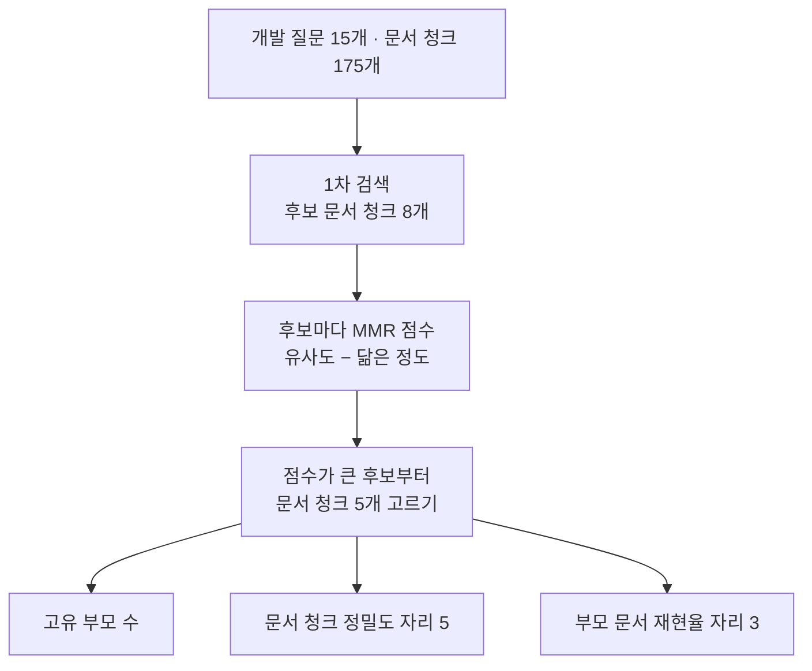
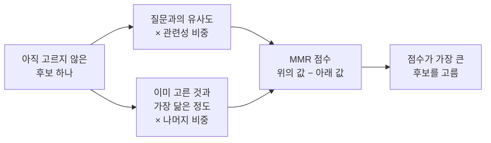
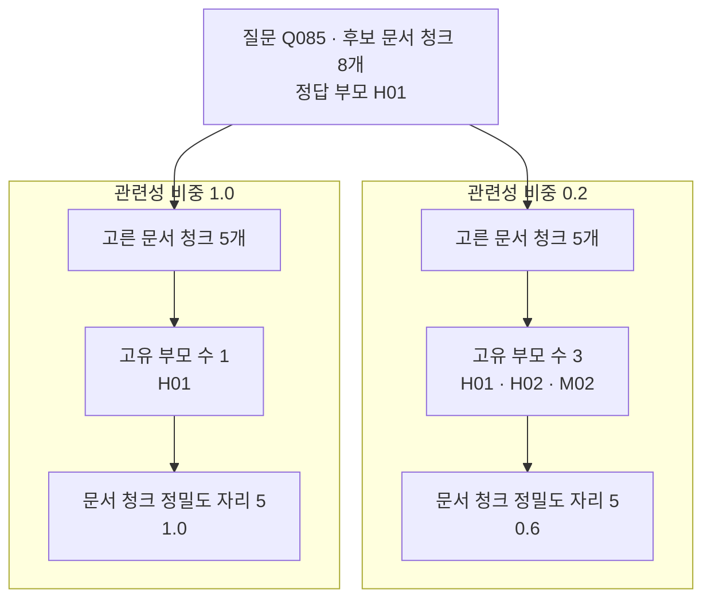
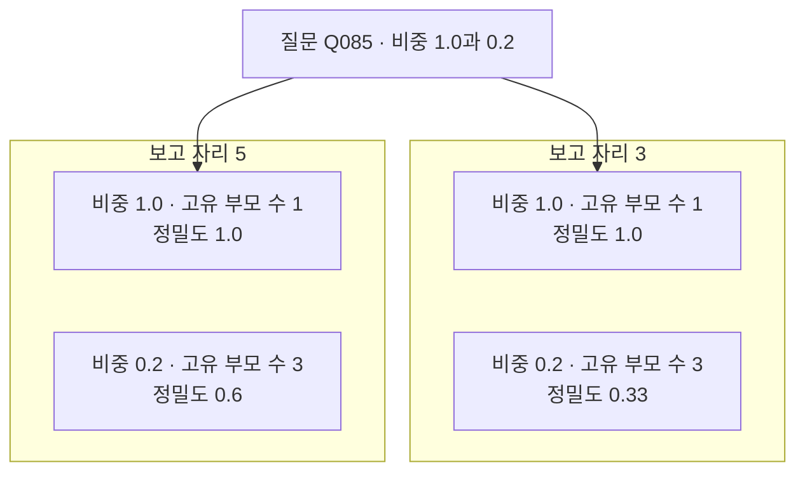

# 10-MMR-다양성-선택

## _src 본문 (HTML 원본)

```html
<!--meta: 강의 1h | 실습 1h | 코드 notebooks/10-MMR-다양성-선택.ipynb | 새 용어 3 -->
<h2 id="b1"><span class="no">1</span>학습 목표</h2><div class="goal"><ul><li>이 절을 마치면 후보 목록에서 서로 닮은 문서 청크를 줄여 고를 수 있습니다.</li><li>관련성 비중을 바꿔 다양성과 관련성의 맞바꿈을 값으로 견줄 수 있습니다.</li><li>천장에 닿은 지표와 천장이 없는 값을 갈라서 적을 수 있습니다.</li></ul></div>
<h2 id="b2"><span class="no">2</span>이 내용을 배우는 이유</h2><p>07~09절은 후보 목록의 앞자리부터 차례대로 다음 단계에 넘겼습니다. 그런데 앞자리에는 서로 닮은 문서 청크가 함께 올라오기 쉽습니다. 같은 부모 문서의 이웃한 대목이 나란히 앉는 일이 잦습니다.</p><p>닮은 글만 다섯 개를 넘기면 다섯 자리를 한 가지 근거로 채우게 됩니다. 질문에 여러 근거가 필요하면 그 다섯 개로는 모자랍니다. 그렇다고 아무 문서 청크나 섞으면 질문과 먼 글이 들어옵니다.</p><p>이 절은 그 사이를 값 하나로 조절하는 방법을 봅니다. 검색과 후보 만들기는 07~09절 그대로 두고 고르는 자리만 바꿉니다.</p>
<h2 id="b3"><span class="no">3</span>앞에서 배운 내용</h2><p>07절에서 1차 검색으로 후보 여덟 개를 만들고 리랭킹으로 자리를 다시 정했습니다. 리랭킹은 후보의 차례만 바꾸고 묶음은 바꾸지 않았습니다. 이 절에서 만드는 고르기도 후보 안에서만 고릅니다.</p><p>08절에서 보고 자리를 정해 문서 청크 다섯 개를 다음 단계로 넘겼습니다. 문서 청크 정밀도와 부모 문서 재현율도 그 절에서 만든 함수를 그대로 씁니다.</p><p>09절에서 후보의 부모 문서를 중복 없이 뽑는 <code>parent_ids_of()</code> 함수를 다시 썼습니다. 이 절의 고유 부모 수도 그 함수가 만든 목록의 길이입니다.</p><p>Ch 5 02절에서 두 벡터의 코사인 유사도를 NumPy로 재는 계산을 배웠습니다. 01절 코사인 거리도 그 계산을 적은 함수 <code>cosine_similarity()</code>로 냈습니다. 이 절은 그 함수를 질문과 후보 사이뿐 아니라 후보끼리에도 씁니다.</p><p>노트북은 앞 절과 앞 챕터에서 배운 함수 열 개를 실습 폴더의 도구 파일 <code>notebooks/rag_tools.py</code>에서 가져옵니다. <code>cosine_similarity()</code>도 그 가운데 하나입니다. 이 절이 새로 만드는 MMR 함수는 노트북에 적습니다.</p><p>Ch 11이 정한 약속대로 개발 15문항만 봅니다. 시험 15문항은 설정을 다 고른 뒤 12절에서 한 번만 씁니다. 01~06절이 쓴 문서 12개와 질문 8개는 이 절에서 쓰지 않습니다.</p>
<h2 id="b4"><span class="no">4</span>핵심 개념</h2><h3>비유로 시작하기</h3><p>접시 하나에 과일 다섯 개를 담습니다. 같은 사과만 다섯 개 담으면 접시는 가득 차지만 고를 것은 한 가지입니다. 사과 세 개에 배 하나와 주황색 과일 하나를 섞으면 같은 다섯 개로 세 가지가 됩니다.</p>
{{img:10-5-같은-과일과-섞인-과일|위아래로 놓인 같은 크기의 둥근 접시 두 개 가운데 위 접시에는 같은 빨간 사과 다섯 개가 한 줄로 놓여 있고 아래 접시에는 빨간 사과 세 개와 초록 배 하나와 주황색 둥근 과일 하나가 한 줄로 놓여 있는 그림|같은 크기의 접시 두 개에 다섯 개씩 담았는데 위는 한 가지이고 아래는 세 가지입니다.}}
<p class="look"><b>그림 읽기</b> — 위아래 접시의 크기와 모양이 같습니다. 위 접시에는 같은 빨간 사과 다섯 개가 한 줄로 놓여 있습니다. 아래 접시에도 다섯 개가 놓였는데 사과 세 개와 초록 배 하나, 주황색 과일 하나입니다. 담긴 수는 같은데 종류는 하나와 셋으로 갈립니다. 같은 자리를 무엇으로 채우는지가 이 그림의 요점입니다.</p>
<table><thead><tr><th>말</th><th>뜻</th></tr></thead><tbody><tr><td>최대 주변 관련성(maximal marginal relevance)</td><td>질문과의 유사도에서 이미 고른 것과 가장 닮은 정도를 빼고 하나씩 고르는 방법입니다. 줄여서 MMR이라고 부릅니다.</td></tr><tr><td>관련성 비중(relevance weight)</td><td>MMR 점수에서 질문과의 유사도가 차지하는 몫입니다. 나머지 몫은 닮은 정도를 빼는 데 씁니다. 라이브러리 LangChain에서는 이 값을 <code>lambda_mult</code>라고 부릅니다.</td></tr><tr><td>고유 부모 수(unique parent count)</td><td>고른 문서 청크의 부모 문서를 중복 없이 센 수입니다. 09절 <code>parent_ids_of()</code>가 만든 목록의 길이입니다.</td></tr></tbody></table>
<h3>몰린 목록을 흩는 자리</h3><p>1차 검색은 질문과 가까운 순서로 후보를 만듭니다. 그 차례대로 앞에서 다섯 개를 자르면 가장 가까운 다섯 개가 됩니다. 서로 닮았는지는 아무도 보지 않습니다.</p><p>최대 주변 관련성(MMR)은 후보를 하나씩 고르면서 이미 고른 목록을 함께 봅니다. 앞에서 고른 것과 닮은 후보는 점수가 깎여 뒤로 밀립니다. 그래서 같은 수를 골라도 목록이 흩어집니다.</p>
{{mermaid:10-1-후보에서-다섯-개-고르기|위에서 아래로 내려가는 흐름도로 맨 위 초록 상자 개발 질문 15개와 문서 청크 175개가 파란 상자 1차 검색 후보 문서 청크 8개로 이어지고 그다음 파란 상자 후보마다 MMR 점수 내기와 파란 상자 점수가 큰 후보부터 문서 청크 5개 고르기를 지나 맨 아래 노란 상자 세 개 고유 부모 수와 문서 청크 정밀도 자리 5와 부모 문서 재현율 자리 3으로 갈라지는 그림|후보 여덟 개에서 MMR 점수로 다섯 개를 고르고 고른 목록에서 값 세 개를 잽니다.}}
<p class="look"><b>도식 읽기</b> — 위에서 아래로 읽습니다. 맨 위 초록 상자가 이 절이 쓰는 질문 묶음과 문서 청크 묶음입니다. 그 아래 파란 상자에서 07~09절과 같은 방법으로 후보 여덟 개를 만듭니다.</p><p class="look">가운데 파란 상자 두 개가 이 절이 새로 만드는 자리입니다. 후보마다 점수를 내고 점수가 큰 후보부터 다섯 개를 고릅니다. 맨 아래 노란 상자 세 개가 고른 목록에서 재는 값이고 왼쪽부터 고유 부모 수, 문서 청크 정밀도, 부모 문서 재현율입니다.</p>
<h3>후보 하나의 점수</h3><p>점수는 두 값으로 만듭니다. 앞의 값은 질문과의 코사인 유사도입니다. 뒤의 값은 이미 고른 것 가운데 가장 닮은 하나와의 코사인 유사도입니다. 두 값 모두 01절에서 만든 같은 함수로 잽니다.</p><p>두 값에 곱하는 몫은 관련성 비중으로 나눕니다. 비중이 1.0이면 나머지 몫이 0이라 뒤의 값을 빼지 않습니다. 비중이 0.2이면 앞의 값에 0.2를 곱하고 뒤의 값에 0.8을 곱해 뺍니다.</p>
{{mermaid:10-2-후보-하나의-점수|왼쪽에서 오른쪽으로 가는 흐름도로 왼쪽 파란 상자 아직 고르지 않은 후보 하나에서 위아래 두 갈래로 갈려 위는 파란 상자 질문과의 유사도 곱하기 관련성 비중이고 아래는 파란 상자 이미 고른 것과 가장 닮은 정도 곱하기 나머지 비중이며 두 갈래가 파란 상자 MMR 점수로 모이고 마지막 파란 상자 점수가 가장 큰 후보를 고름으로 끝나는 그림|후보 하나의 점수는 질문과의 유사도에서 이미 고른 것과 가장 닮은 정도를 뺀 값입니다.}}
<p class="look"><b>도식 읽기</b> — 왼쪽에서 오른쪽으로 읽습니다. 왼쪽 파란 상자가 아직 고르지 않은 후보 하나입니다. 거기서 갈래가 둘로 갈리는데 위 갈래가 더하는 쪽이고 아래 갈래가 빼는 쪽입니다. 두 갈래가 가운데 상자에서 만나 점수 하나가 되고, 맨 오른쪽에서 점수가 가장 큰 후보를 고릅니다. 처음 고를 때는 고른 목록이 비어 있어 아래 갈래 값이 <code>0.0</code>입니다.</p>
<h3>고른 목록에서 재는 값</h3><p>다양성 쪽은 고유 부모 수로 잽니다. 같은 부모에서 나온 문서 청크가 줄면 이 값이 오릅니다.</p><p>관련성 쪽은 08절 문서 청크 정밀도로 잽니다. 고른 다섯 개 가운데 부모가 정답인 것을 세고 다섯으로 나눕니다. 부모 문서 재현율도 09절과 같은 자리에서 함께 냅니다.</p>
<h2 id="b5"><span class="no">5</span>실행 예제</h2><p>개발 15문항마다 1차 검색으로 후보 여덟 개를 만듭니다. 관련성 비중을 1.0·0.5·0.2로 바꿔 가며 문서 청크 다섯 개를 고릅니다. 후보 목록과 보고 자리는 그대로 두고 비중만 바꿉니다.</p><p>임베딩 요청은 문서 청크 1번과 질문 15번으로 모두 열여섯 번입니다. 예상 비용은 미화 0.01달러 아래이고 답을 쓰는 모델은 부르지 않습니다. 리랭커도 쓰지 않아 실행은 1분 안팎입니다.</p>
{{mermaid:10-3-질문-하나의-두-비중|위에서 아래로 내려가는 흐름도로 맨 위 파란 상자 질문 Q085와 후보 문서 청크 8개와 정답 부모 H01에서 두 칸으로 갈리고 왼쪽 칸 제목 관련성 비중 1.0 아래에는 파란 상자 고른 문서 청크 5개와 노란 상자 고유 부모 수 1과 노란 상자 문서 청크 정밀도 자리 5 1.0이 있고 오른쪽 칸 제목 관련성 비중 0.2 아래에는 파란 상자 고른 문서 청크 5개와 노란 상자 고유 부모 수 3과 노란 상자 문서 청크 정밀도 자리 5 0.6이 있는 그림|질문 Q085에서 관련성 비중을 0.2로 낮추면 고유 부모 수가 1에서 3이 되고 정밀도는 1.0에서 0.6이 됩니다.}}
<p class="look"><b>도식 읽기</b> — 맨 위 파란 상자가 두 칸에 함께 걸리는 질문과 후보입니다. 칸 제목 <code>관련성 비중 1.0</code>이 왼쪽이고 <code>관련성 비중 0.2</code>가 오른쪽입니다. 두 칸 모두 같은 후보 여덟 개에서 다섯 개를 골랐습니다.</p><p class="look">왼쪽 칸의 노란 상자는 고유 부모 수 <code>1</code>이고 고른 다섯 개가 모두 <code>H01</code>에서 나왔습니다. 오른쪽 칸은 고유 부모 수 <code>3</code>이고 <code>H02</code>와 <code>M02</code>가 들어왔습니다. 맨 아래 두 상자를 보면 정밀도는 <code>1.0</code>에서 <code>0.6</code>으로 내려갔습니다.</p>
{{notebook:10-MMR-다양성-선택}}
<p class="look"><b>확인할 점</b> — 노트북 8절의 <code>후보의 부모 문서 차례: ['H01', 'H02', 'M02']</code>와 그 아래 여덟 줄을 봅니다. 같은 절에서 비중 <code>1.0</code>의 <code>고유 부모 수: 1</code>과 비중 <code>0.2</code>의 <code>고유 부모 수: 3</code>을 나란히 봅니다. 9절 표 세 줄과 10절 표 세 줄도 함께 확인합니다.</p>
<h2 id="b6"><span class="no">6</span>실험 결과 해석</h2><p>열다섯 질문 평균은 세 줄로 나왔습니다. 보고 자리는 다섯으로 두었습니다.</p>
<table><thead><tr><th>관련성 비중</th><th>고유 부모 수 평균</th><th>문서 청크 정밀도 자리 5</th><th>부모 문서 재현율 자리 3</th></tr></thead><tbody><tr><td>1.0</td><td>1.73</td><td>0.81</td><td>1.0</td></tr><tr><td>0.5</td><td>2.07</td><td>0.76</td><td>1.0</td></tr><tr><td>0.2</td><td>2.07</td><td>0.73</td><td>1.0</td></tr></tbody></table>
<p>비중을 1.0에서 0.5로 낮추자 고유 부모 수 평균이 1.73에서 2.07로 올랐습니다. 같은 자리에서 문서 청크 정밀도는 0.81에서 0.76으로 내려갔습니다. 다양성을 얻은 만큼 관련성 쪽을 내준 셈입니다.</p><p>비중을 0.2로 더 낮춰도 고유 부모 수 평균은 2.07 그대로였습니다. 정밀도만 0.73으로 더 내려갔습니다. 후보 여덟 개 안에 있는 부모만 고를 수 있기 때문입니다. 질문 <code>Q085</code>의 후보도 부모가 세 건뿐이었습니다.</p>
{{mermaid:10-4-보고-자리-다섯과-셋|위에서 아래로 내려가는 흐름도로 맨 위 파란 상자 질문 Q085와 비중 1.0과 0.2에서 두 칸으로 갈리고 왼쪽 칸 제목 보고 자리 5 아래에는 노란 상자 비중 1.0 고유 부모 수 1 정밀도 1.0과 노란 상자 비중 0.2 고유 부모 수 3 정밀도 0.6이 있고 오른쪽 칸 제목 보고 자리 3 아래에는 노란 상자 비중 1.0 고유 부모 수 1 정밀도 1.0과 노란 상자 비중 0.2 고유 부모 수 3 정밀도 0.33이 있는 그림|보고 자리를 3으로 줄이면 같은 질문에서 비중 0.2의 정밀도가 0.6에서 0.33으로 더 내려갑니다.}}
<p class="look"><b>도식 읽기</b> — 칸 제목 <code>보고 자리 5</code>가 왼쪽이고 <code>보고 자리 3</code>이 오른쪽입니다. 두 칸의 위 상자는 값이 같아 비중 <code>1.0</code>에서는 자리 수를 줄여도 달라진 것이 없습니다. 두 칸의 아래 상자를 보면 비중 <code>0.2</code>의 정밀도가 <code>0.6</code>과 <code>0.33</code>으로 갈립니다. 네 상자 모두 질문 <code>Q085</code> 하나의 값입니다.</p>
<p>보고 자리를 3으로 줄이면 열다섯 질문 평균에서도 같은 변화가 더 크게 보였습니다. 고유 부모 수 평균은 1.33에서 1.93으로 올랐고 정밀도는 0.89에서 0.69로 내려갔습니다. 고를 자리가 적어 한 자리가 차지하는 몫이 크기 때문입니다.</p><p>부모 문서 재현율 자리 3은 여섯 줄 모두 1.0이었습니다. 부모 문서가 6건뿐이고 정답 부모의 문서 청크가 늘 앞자리에 있었기 때문입니다. 이 조건에서는 이 지표로 세 비중을 가를 수 없습니다.</p><p>문서 청크 175개와 개발 15문항, 비중 세 가지, 보고 자리 두 가지에서 한 번 실행한 값입니다. 답 품질은 이 절에서 재지 않았으므로 어느 비중이 더 나은 답을 만드는지는 말할 수 없습니다.</p>
<h2 id="b7"><span class="no">7</span>주의할 점과 실무 메모</h2><ul><li>관련성 비중은 후보를 고르는 자리에만 듭니다. 후보 목록 자체는 1차 검색이 정합니다.</li><li>비중을 낮춰도 후보 밖 문서 청크는 들어오지 않습니다. 07절에서 본 후보 범위의 한계와 같습니다.</li><li>고유 부모 수는 후보 안 부모 수를 넘지 못합니다. 질문 <code>Q085</code>의 후보는 부모가 세 건이라 비중을 더 낮춰도 세 건에서 멈췄습니다.</li><li>다양성과 관련성을 한 값으로 함께 읽지 않습니다. 이 절은 고유 부모 수와 문서 청크 정밀도를 따로 냈습니다.</li><li>예로 고른 질문 <code>Q085</code>는 후보가 한 부모에 몰린 질문입니다. 열다섯 질문을 모두 본 뒤 흐름이 보이도록 고른 예입니다.</li><li>관련성 비중 1.0·0.5·0.2도 탐색 실행에서 고른 예입니다. 실무에서 쓸 값을 권하는 것이 아닙니다.</li><li>같은 글을 보내도 임베딩 값이 호출마다 아주 조금 달라질 수 있습니다. 비중 0.5의 정밀도는 다시 실행하면 소수 둘째 자리가 0.01쯤 달라졌습니다.</li><li>부모 문서 재현율은 이 자료에서 천장에 닿아 있습니다. 천장에 닿은 지표는 값 그대로 싣되 설정을 고르는 근거로 쓰지 않습니다.</li><li>고른 문서 청크 수는 세 비중 모두 다섯 개로 같습니다. 09절에서 잰 조각 수는 이 절에서 재지 않았습니다.</li><li>이 절 코드는 후보 수가 커질수록 닮은 정도를 재는 횟수가 늘어납니다. 걸린 시간은 이번에 재지 않았습니다.</li><li>시험 15문항은 이 절에서 열어 보지 않았습니다. 설정을 다 고른 뒤 12절에서 한 번만 씁니다.</li><li>01~06절 값과 이 절 값을 나란히 놓지 않습니다. 문서·질문·후보 단위가 모두 다릅니다.</li><li>이 절은 파일을 쓰지 않습니다. 01~03절이 만든 데이터베이스 표도 읽지 않습니다.</li></ul>
<h2 id="b8"><span class="no">8</span>정리와 다음 절</h2><ul><li>관련성 비중을 낮추면 고른 다섯 개의 고유 부모 수 평균이 1.73에서 2.07로 올랐습니다.</li><li>같은 자리에서 문서 청크 정밀도는 0.81에서 0.73으로 내려갔습니다.</li><li>부모 문서 재현율은 여섯 줄 모두 <code>1.0</code>이라 이 조건에서는 가를 수 없었습니다.</li></ul><p><strong>다음 학습과 이어지는 지점</strong> — 11절에서는 대화에서 빠진 대상을 채운 질문으로 다시 검색합니다.</p>
<h2 id="b9"><span class="no">9</span>복습 문제</h2><details class="quiz" open><summary>문제 4개 · 해설 포함</summary><p class="quiz-q">1. 관련성 비중을 1.0으로 두면 무엇만 보고 고르게 됩니까?</p><p class="quiz-a">질문과의 유사도만 봅니다. 나머지 몫이 0이라 이미 고른 것과 닮았는지는 점수에 들어가지 않습니다. 틀렸다면 「후보 하나의 점수」를 다시 읽습니다.</p><p class="quiz-q">2. 비중을 낮췄을 때 이 절에서 내려간 값은 무엇입니까?</p><p class="quiz-a">문서 청크 정밀도입니다. 보고 자리 5에서 <code>0.81</code>이 <code>0.76</code>과 <code>0.73</code>으로 내려갔습니다. 틀렸다면 6절 표를 다시 읽습니다.</p><p class="quiz-q">3. 부모 문서 재현율로 세 비중을 가를 수 있었습니까?</p><p class="quiz-a">가를 수 없었습니다. 여섯 줄 모두 <code>1.0</code>이었습니다. 부모 문서가 6건뿐이고 정답 부모의 문서 청크가 앞자리에 있었기 때문입니다. 틀렸다면 6절을 다시 읽습니다.</p><p class="quiz-q">4. 비중을 더 낮추면 고유 부모 수가 계속 오릅니까?</p><p class="quiz-a">계속 오르지 않습니다. 후보 안에 있는 부모 수까지만 오릅니다. 비중 <code>0.5</code>와 <code>0.2</code>의 평균이 <code>2.07</code>로 같았습니다. 틀렸다면 6절 셋째 단락을 다시 읽습니다.</p></details>
<h2 id="b10"><span class="no">10</span>참고 자료</h2><ul><li><div><a href="https://reference.langchain.com/python/langchain-core/vectorstores/utils/maximal_marginal_relevance">LangChain maximal_marginal_relevance 참고 문서</a></div>라이브러리가 같은 고르기를 어떤 인자로 받는지 보여 주는 문서 · 확인 2026-09-09</li><li><div><a href="https://docs.haystack.deepset.ai/reference/rankers-api">Haystack Rankers API 문서</a></div>다른 도구가 다양성 고르기를 어디에 두는지 보여 주는 문서 · 확인 2026-09-09</li><li><div><a href="https://platform.openai.com/docs/guides/embeddings">OpenAI Embeddings 안내</a></div>후보와 닮은 정도를 잴 때 쓴 임베딩 모델과 차원 수 설정 설명 · 확인 2026-09-18</li></ul>
```

## 노트북 셀 (순서대로)

### [0] markdown {'html': 'skip'}

# MMR 다양성 선택

**이 노트북에서 할 일**

1. 07~09절과 같은 방법으로 개발 질문마다 후보 여덟 개를 만듭니다.
2. 질문과의 유사도와 이미 고른 것과의 닮음을 함께 보는 MMR 함수를 만듭니다.
3. 관련성 비중을 1.0·0.5·0.2로 바꿔 고른 목록과 값 세 개를 견줍니다.
4. 보고 자리를 5에서 3으로 줄여 같은 세 줄을 다시 냅니다.

**준비물** — 프로젝트 폴더의 `.env`에 `OPENAI_API_KEY`가 있어야 합니다.
임베딩 요청은 문서 청크 1번과 질문 15번으로 모두 열여섯 번입니다.
예상 비용은 미화 0.01달러 아래이고 답을 쓰는 모델은 부르지 않습니다.
실행 시간은 1분 안팎이고 07·08절과 달리 리랭커는 쓰지 않습니다.

**데이터** — 두 파일 모두 실습 묶음에 들어 있습니다.

- 문서 `labs/part3/ch12-retrieval-tuning/data/advanced-documents.json`(부모 6건·문서 청크 175개)
- 질문 `labs/part3/ch12-retrieval-tuning/data/advanced-queries.json`(30개)

**강의와 실습 범위** — 강의 시간에는 7~9절을 읽습니다.
MMR 함수를 만드는 자리가 7절이고 한 질문에서 고른 목록을 보는 자리가 8절입니다.
9절이 열다섯 질문 평균이고 10절이 값 바꿔 보기입니다.
1~6절은 함께 실행하고 실습 시간에 다시 읽습니다.

**기준 버전** — 첫 셀에서 다섯 패키지를 고정한 판으로 설치합니다.
교재 출력은 Linux의 Python 3.12.13으로 만들었습니다.
다른 판과 Windows·macOS에서는 이번에 실행하지 않았습니다.

실습 폴더 `labs/part3/ch12-retrieval-tuning`에서 `uv sync --locked`를 실행합니다.
그다음 이 폴더의 `.venv` 커널을 고르고 첫 셀부터 순서대로 실행합니다.

### [1] markdown {'html': 'skip'}

## 오늘 볼 그림


맨 위 초록 상자가 이 절이 쓰는 질문 묶음과 문서 청크 묶음입니다.
그 아래 파란 상자 두 개에서 07~09절과 같은 방법으로 후보 여덟 개를 만듭니다.
가운데 파란 상자가 이 절이 새로 만드는 자리입니다.
후보마다 MMR 점수를 내고 점수가 큰 후보부터 다섯 개를 고릅니다.
맨 아래 노란 상자 세 개가 고른 목록에서 재는 값입니다.

### [2] markdown {}

## 1. 준비

첫 셀은 패키지 다섯 개를 설치하고 설치된 버전을 출력합니다.
09절 여섯 개에서 조각 수를 세는 꾸러미를 뺐습니다. 이 절은 길이를 재지 않습니다.

### [3] code {'execution': {'iopub.execute_input': '2026-09-21T08:19:56.559274Z', 'iopub.status.busy': '2026-09-21T08:19:56.559062Z', 'iopub.status.idle': '2026-09-21T08:19:57.076869Z', 'shell.execute_reply': '2026-09-21T08:19:57.076225Z'}, 'lesson_role': 'setup'}

```python
# 이 절에서 쓰는 패키지를 설치하고 버전을 확인합니다
%pip install -q "langchain-openai==1.6.1" "python-dotenv==1.2.3" "kiwipiepy==0.23.2" "rank-bm25==0.2.2" "numpy==2.5.3"
from importlib.metadata import version

print("langchain-openai:", version("langchain-openai"))
print("python-dotenv:", version("python-dotenv"))
print("kiwipiepy:", version("kiwipiepy"))
print("rank-bm25:", version("rank-bm25"))
print("numpy:", version("numpy"))
```

출력:
```
Note: you may need to restart the kernel to use updated packages.
langchain-openai: 1.6.1
python-dotenv: 1.2.3
kiwipiepy: 0.23.2
rank-bm25: 0.2.2
numpy: 2.5.3

```

### [4] markdown {}

**결과 읽기** — 설치가 끝나면 `langchain-openai: 1.6.1`과 `rank-bm25: 0.2.2`가 보입니다.
마지막 줄 `numpy: 2.5.3`은 도구 파일이 벡터 계산에 쓰는 패키지입니다. 다섯 줄이 모두 보이면 다음 셀로 넘어갑니다.

다음 셀은 이 절에서 쓸 이름 네 개를 불러옵니다.

앞에서 배운 함수는 `rag_tools.py`에 모아 두었습니다. 파일을 열면 코드를 볼 수 있습니다. 노트북과 같은 폴더(`notebooks/`)에 있는 파일입니다.

이 노트북은 앞 절과 앞 챕터 함수 일곱 개와 문서 청크 판 순위 함수 세 개를 가져옵니다.
Ch 5 `cosine_similarity()`, 04절 `kiwi_terms()`, 06절 `fuse_rank()`, 07절 `parent_ids_of()`입니다.
08절 `eligible_items()`·`chunk_precision_at()`, Ch 11 `recall_at()`도 가져옵니다.
인자 모양은 09절에서 쓴 것과 같고 5절에서 한 번 더 정리합니다.

### [5] code {'execution': {'iopub.execute_input': '2026-09-21T08:19:57.078356Z', 'iopub.status.busy': '2026-09-21T08:19:57.078262Z', 'iopub.status.idle': '2026-09-21T08:19:58.022366Z', 'shell.execute_reply': '2026-09-21T08:19:58.022166Z'}, 'lesson_role': 'setup'}

```python
# 자료 읽기·형태소 분석·임베딩·낱말 점수에 쓸 이름을 불러옵니다
import json
import os

from kiwipiepy import Kiwi
from langchain_openai import OpenAIEmbeddings
from rank_bm25 import BM25Okapi
# Ch 5·04·06·07·08절과 Ch 11 함수, 문서 청크 판 순위 함수 열 개를 도구 파일에서 가져옵니다
from rag_tools import chunk_precision_at, cosine_similarity, eligible_items, fuse_rank
from rag_tools import kiwi_terms, parent_ids_of, rank_chunks_by_bm25, rank_chunks_by_distance
from rag_tools import recall_at, unique_chunk_ids

print("불러온 이름:", "json", "Kiwi", "OpenAIEmbeddings", "BM25Okapi")
```

출력:
```
불러온 이름: json Kiwi OpenAIEmbeddings BM25Okapi

```

### [6] markdown {}

**결과 읽기** — 출력 줄은 `불러온 이름:` 뒤에 이름 네 개가 붙은 한 줄입니다.
도구 파일에서 가져온 함수 열 개는 출력하지 않습니다.

다음 셀은 API 키가 있는지 확인합니다. `True` 값이 나오면 다음으로 넘어갑니다.

### [7] code {'execution': {'iopub.execute_input': '2026-09-21T08:19:58.027399Z', 'iopub.status.busy': '2026-09-21T08:19:58.027254Z', 'iopub.status.idle': '2026-09-21T08:19:58.030404Z', 'shell.execute_reply': '2026-09-21T08:19:58.030241Z'}, 'lesson_role': 'setup'}

```python
# .env 파일에서 OpenAI API 키를 읽습니다(키 값은 출력하지 않습니다)
import os
from dotenv import find_dotenv, load_dotenv

env_path = find_dotenv(usecwd=True)
load_dotenv(env_path)
has_key = os.getenv("OPENAI_API_KEY") is not None
print("OPENAI_API_KEY 설정 여부:", has_key)
assert has_key, "프로젝트 폴더의 .env 파일에 OPENAI_API_KEY를 적어 주세요."
```

출력:
```
OPENAI_API_KEY 설정 여부: True

```

### [8] markdown {}

**결과 읽기** — 출력 줄은 `OPENAI_API_KEY 설정 여부: True` 하나입니다.
키 값은 출력하지 않습니다.

다음 셀은 프로젝트 맨 위 폴더를 찾습니다. 01~09절과 같은 코드입니다.

### [9] code {'execution': {'iopub.execute_input': '2026-09-21T08:19:58.030814Z', 'iopub.status.busy': '2026-09-21T08:19:58.030732Z', 'iopub.status.idle': '2026-09-21T08:19:58.032413Z', 'shell.execute_reply': '2026-09-21T08:19:58.032252Z'}, 'lesson_role': 'setup'}

```python
# 노트북을 어느 폴더에서 열어도 프로젝트 맨 위를 찾게 후보 세 개를 차례로 봅니다
candidates = [".", "../../..", "../../../.."]
root_path = None
for candidate in candidates:
    if os.path.exists(candidate + "/labs/part3/ch12-retrieval-tuning/data"):
        root_path = candidate
        break
print("고른 경로:", root_path)
assert root_path is not None, "notebooks 폴더나 실습 폴더 맨 위에서 노트북을 열어 주세요."
```

출력:
```
고른 경로: .

```

### [10] markdown {}

**결과 읽기** — 출력 줄은 `고른 경로: .`입니다. `assert`도 통과했습니다.

다음 셀은 07~09절과 같은 자료 두 벌을 읽습니다.

### [11] code {'execution': {'iopub.execute_input': '2026-09-21T08:19:58.032779Z', 'iopub.status.busy': '2026-09-21T08:19:58.032737Z', 'iopub.status.idle': '2026-09-21T08:19:58.036136Z', 'shell.execute_reply': '2026-09-21T08:19:58.035899Z'}, 'lesson_role': 'setup'}

```python
# 07~09절과 같은 파일 두 벌을 읽습니다
data_path = root_path + "/labs/part3/ch12-retrieval-tuning/data"
with open(data_path + "/advanced-documents.json", encoding="utf-8") as file:
    documents = json.loads(file.read())
with open(data_path + "/advanced-queries.json", encoding="utf-8") as file:
    queries = json.loads(file.read())
parents = documents["parents"]
chunks = documents["chunks"]
print("부모 문서 수:", len(parents))
print("문서 청크 수:", len(chunks))
print("질문 수:", len(queries))
```

출력:
```
부모 문서 수: 6
문서 청크 수: 175
질문 수: 30

```

### [12] markdown {}

**결과 읽기** — `부모 문서 수: 6`과 `문서 청크 수: 175`, `질문 수: 30`이 보입니다.
07~09절과 같은 파일이라 세 값도 같습니다.

## 2. 개발 묶음 가리기

Ch 11이 정한 약속은 개발 15문항으로 설정을 고르는 것입니다.
시험 15문항은 설정을 다 고른 뒤 12절에서 한 번만 씁니다.
답할 수 없는 질문과 정답 ID가 빈 질문은 준비 셀에서 가져온 08절 함수 `eligible_items()`로 거릅니다.
다음 셀이 그 함수로 개발 묶음을 가립니다.

### [13] code {'execution': {'iopub.execute_input': '2026-09-21T08:19:58.036575Z', 'iopub.status.busy': '2026-09-21T08:19:58.036485Z', 'iopub.status.idle': '2026-09-21T08:19:58.038198Z', 'shell.execute_reply': '2026-09-21T08:19:58.038043Z'}}

```python
# 질문 30개에서 개발 묶음만 고르고 답할 수 있는 질문만 남깁니다
dev_all = []
for query in queries:
    if query["split"] == "dev":
        dev_all.append(query)
dev_queries = eligible_items(dev_all)
print("개발 질문 수:", len(dev_queries))
print("시험 질문 수:", len(queries) - len(dev_all))
print("첫 개발 질문:", dev_queries[0]["qid"], "|", dev_queries[0]["question"])
print("그 질문의 정답 부모 문서 ID:", dev_queries[0]["gold_doc_ids"])
```

출력:
```
개발 질문 수: 15
시험 질문 수: 15
첫 개발 질문: Q001 | 미르시립도서관의 정기 휴관일은 언제인가요?
그 질문의 정답 부모 문서 ID: ['E01']

```

### [14] markdown {}

**결과 읽기** — `개발 질문 수: 15`와 `시험 질문 수: 15`가 보입니다.
줄 `첫 개발 질문:` 뒤에 질문 ID와 질문 글이 있습니다.
정답 칸 값은 `['E01']`처럼 목록이고 값은 부모 문서 ID입니다.

## 3. 이 절에서 쓸 값 정하기

01~09절에서 쓴 값 네 개를 그대로 다시 정합니다.

### [15] code {'execution': {'iopub.execute_input': '2026-09-21T08:19:58.038574Z', 'iopub.status.busy': '2026-09-21T08:19:58.038531Z', 'iopub.status.idle': '2026-09-21T08:19:58.040256Z', 'shell.execute_reply': '2026-09-21T08:19:58.040101Z'}}

```python
# 01~09절에서 쓴 값을 그대로 다시 정합니다
similarity_top = 1
keep_tags = ["NNG", "NNP", "NNB", "NR", "VV", "VA", "MAG", "SN", "SL"]
rank_constant = 60
equal_weights = [1.0, 1.0]
print("코사인 유사도의 가장 큰 값:", similarity_top)
print("남길 품사 표시:", keep_tags)
print("순위 상수:", rank_constant)
print("같은 가중치:", equal_weights)
```

출력:
```
코사인 유사도의 가장 큰 값: 1
남길 품사 표시: ['NNG', 'NNP', 'NNB', 'NR', 'VV', 'VA', 'MAG', 'SN', 'SL']
순위 상수: 60
같은 가중치: [1.0, 1.0]

```

### [16] markdown {}

**결과 읽기** — 줄 `순위 상수: 60`과 `같은 가중치: [1.0, 1.0]`은 06~09절과 같은 값입니다.
줄 `코사인 유사도의 가장 큰 값: 1`은 01절에서 정한 값이고 이 절에서 비중을 나눌 때 다시 씁니다.
라벨 줄 `남길 품사 표시:` 뒤에는 이름 아홉 개가 있습니다.

다음 셀은 이 절에서 견줄 값을 정합니다.
관련성 비중은 MMR 점수에서 질문 관련성이 차지하는 몫입니다.
비중이 1.0이면 닮음을 빼지 않고 0.2이면 닮음 쪽 몫이 0.8이 됩니다.

### [17] code {'execution': {'iopub.execute_input': '2026-09-21T08:19:58.040652Z', 'iopub.status.busy': '2026-09-21T08:19:58.040575Z', 'iopub.status.idle': '2026-09-21T08:19:58.042192Z', 'shell.execute_reply': '2026-09-21T08:19:58.042096Z'}}

```python
# 08·09절 후보 수와 두 자리를 잇고 이 절에서 견줄 관련성 비중 세 가지를 더합니다
candidate_count = 8
recall_place = 3
report_place = 5
relevance_weights = [1.0, 0.5, 0.2]
print("후보 수:", candidate_count)
print("부모 문서 재현율을 재는 자리:", recall_place)
print("보고 자리:", report_place)
print("견줄 관련성 비중 세 가지:", relevance_weights)
```

출력:
```
후보 수: 8
부모 문서 재현율을 재는 자리: 3
보고 자리: 5
견줄 관련성 비중 세 가지: [1.0, 0.5, 0.2]

```

### [18] markdown {}

**결과 읽기** — `후보 수: 8`과 `보고 자리: 5`는 08·09절에서 쓴 값입니다.
라벨 줄 `견줄 관련성 비중 세 가지:` 뒤에 값 `[1.0, 0.5, 0.2]`이 있습니다.
줄 `부모 문서 재현율을 재는 자리: 3`도 08절과 같습니다.

## 4. 검색에 쓸 재료 만들기

문서 청크마다 제목과 본문을 이어 붙여 글 하나로 만듭니다.
청크 ID로 부모 문서 ID를 찾을 수 있게 짝도 함께 만들어 둡니다.

### [19] code {'execution': {'iopub.execute_input': '2026-09-21T08:19:58.042595Z', 'iopub.status.busy': '2026-09-21T08:19:58.042556Z', 'iopub.status.idle': '2026-09-21T08:19:58.044300Z', 'shell.execute_reply': '2026-09-21T08:19:58.044141Z'}}

```python
# 문서 청크마다 제목과 본문을 이어 붙이고 청크 ID·부모 문서 ID를 짝지어 둡니다
chunk_texts = []
chunk_ids = []
parent_by_chunk = {}
for chunk in chunks:
    chunk_text = chunk["title"] + " " + chunk["text"]
    chunk_texts.append(chunk_text)
    chunk_ids.append(chunk["chunk_id"])
    parent_by_chunk[chunk["chunk_id"]] = chunk["parent_id"]
all_chunk_count = len(chunk_ids)
print("이어 붙인 글 수:", len(chunk_texts))
print("첫 문서 청크 ID:", chunk_ids[0])
```

출력:
```
이어 붙인 글 수: 175
첫 문서 청크 ID: E01-P01-C01

```

### [20] markdown {}

**결과 읽기** — `이어 붙인 글 수: 175`가 보입니다.
줄 `첫 문서 청크 ID: E01-P01-C01`의 이름은 부모 ID와 쪽 번호, 문서 청크 번호를 이은 것입니다.
이름 앞머리 `E01`이 그 문서 청크의 부모 문서 ID입니다.

다음 셀은 벡터 쪽 재료를 만듭니다. 01~09절과 같은 모델을 씁니다.
이 절의 고르기는 질문과 후보 사이뿐 아니라 후보끼리도 닮음을 잽니다.
그래서 문서 청크 ID로 벡터를 찾게 해 둡니다.

### [21] code {'execution': {'iopub.execute_input': '2026-09-21T08:19:58.044876Z', 'iopub.status.busy': '2026-09-21T08:19:58.044730Z', 'iopub.status.idle': '2026-09-21T08:20:00.986900Z', 'shell.execute_reply': '2026-09-21T08:20:00.985978Z'}}

```python
# 01~09절과 같은 모델로 문서 청크와 개발 질문을 벡터로 바꿉니다(임베딩 요청 16번)
embedding_model_name = "text-embedding-3-small"
vector_dimensions = 256
embedding_model = OpenAIEmbeddings(model=embedding_model_name, dimensions=vector_dimensions)
chunk_vectors = embedding_model.embed_documents(chunk_texts)
query_vectors = []
for query in dev_queries:
    query_vectors.append(embedding_model.embed_query(query["question"]))
vector_by_chunk = {}
# MMR은 후보끼리도 닮음을 재므로 문서 청크 ID로 벡터를 바로 찾게 해 둡니다
for i in range(len(chunk_ids)):
    vector_by_chunk[chunk_ids[i]] = chunk_vectors[i]
print("임베딩 모델 이름:", embedding_model.model)
print("벡터의 숫자 개수 설정:", embedding_model.dimensions)
print("문서 청크 벡터 수:", len(chunk_vectors))
print("질문 벡터 수:", len(query_vectors))
```

출력:
```
임베딩 모델 이름: text-embedding-3-small
벡터의 숫자 개수 설정: 256
문서 청크 벡터 수: 175
질문 벡터 수: 15

```

### [22] markdown {}

**결과 읽기** — `벡터의 숫자 개수 설정: 256`과 `문서 청크 벡터 수: 175`가 보입니다.
출력 줄 `질문 벡터 수: 15`까지 나오면 임베딩 요청 열여섯 번이 끝났습니다.
이 노트북의 출력은 2026-09-21에 이 모델로 실행한 결과입니다.

## 5. 앞 절 함수의 인자 확인하기

후보를 만드는 함수는 09절과 같은 판을 준비 셀에서 도구 파일로부터 가져왔습니다.
두 순위는 `rank_chunks_by_distance()`와 `rank_chunks_by_bm25()`, 합치기는 06절 `fuse_rank()`가 맡습니다.
07절 `parent_ids_of()`와 08절 `chunk_precision_at()`은 짝 사전 `parent_by_chunk`를 인자로 받습니다.

## 6. 후보 목록 만들기

다음 셀은 문서 청크의 검색 낱말 목록으로 BM25 모델을 만듭니다.
분석기를 만드는 줄 `kiwi = Kiwi()`는 1초 안팎 걸립니다.

### [23] code {'execution': {'iopub.execute_input': '2026-09-21T08:20:00.988618Z', 'iopub.status.busy': '2026-09-21T08:20:00.988517Z', 'iopub.status.idle': '2026-09-21T08:20:02.365821Z', 'shell.execute_reply': '2026-09-21T08:20:02.365422Z'}}

```python
# 04~09절과 같은 형태소 분석기로 문서 청크마다 검색 낱말 목록을 만들고 BM25 모델을 만듭니다
kiwi = Kiwi()
kiwi_corpus = []
for text in chunk_texts:
    kiwi_corpus.append(kiwi_terms(kiwi, text, keep_tags))
bm25_model = BM25Okapi(kiwi_corpus)
print("검색 낱말 목록 수:", len(kiwi_corpus))
print("BM25 모델이 본 문서 청크 수:", bm25_model.corpus_size)
print("문서 청크 하나의 평균 검색 낱말 수:", round(bm25_model.avgdl, 2))
```

출력:
```
검색 낱말 목록 수: 175
BM25 모델이 본 문서 청크 수: 175
문서 청크 하나의 평균 검색 낱말 수: 44.01

```

### [24] markdown {}

**결과 읽기** — `검색 낱말 목록 수: 175`와 `BM25 모델이 본 문서 청크 수: 175`가 보입니다.
줄 `문서 청크 하나의 평균 검색 낱말 수: 44.01`은 07~09절과 같은 값입니다.

다음 셀은 개발 질문마다 두 순위를 합쳐 앞자리 여덟 개를 후보로 자릅니다.
질문 ID로 질문 벡터도 찾을 수 있게 짝지어 둡니다.

### [25] code {'execution': {'iopub.execute_input': '2026-09-21T08:20:02.366584Z', 'iopub.status.busy': '2026-09-21T08:20:02.366519Z', 'iopub.status.idle': '2026-09-21T08:20:02.410047Z', 'shell.execute_reply': '2026-09-21T08:20:02.409653Z'}}

```python
# 개발 질문마다 두 순위를 합쳐 앞자리 여덟 개를 후보로 자릅니다(07~09절과 같은 방법)
candidate_sets = {}
vector_by_query = {}
for query_index in range(len(dev_queries)):
    question_id = dev_queries[query_index]["qid"]
    vector_by_query[question_id] = query_vectors[query_index]
    distance_hits = rank_chunks_by_distance(query_vectors[query_index], chunk_vectors, chunk_ids, all_chunk_count)
    question_terms = kiwi_terms(kiwi, dev_queries[query_index]["question"], keep_tags)
    score_hits = rank_chunks_by_bm25(bm25_model, question_terms, chunk_ids, all_chunk_count)
    ranking_list = [unique_chunk_ids(distance_hits), unique_chunk_ids(score_hits)]
    fused_ids = fuse_rank(ranking_list, equal_weights, rank_constant)
    candidate_sets[question_id] = fused_ids[:candidate_count]
print("만든 후보 목록 수:", len(candidate_sets))
print("후보 목록 하나의 문서 청크 수:", len(candidate_sets[dev_queries[0]["qid"]]))
```

출력:
```
만든 후보 목록 수: 15
후보 목록 하나의 문서 청크 수: 8

```

### [26] markdown {}

**결과 읽기** — `만든 후보 목록 수: 15`와 `후보 목록 하나의 문서 청크 수: 8`이 보입니다.
07~09절과 같은 1차 검색이라 후보 목록도 같은 방법으로 만든 것입니다.

## 7. MMR 점수를 내는 함수 만들기

여기까지가 09절과 같습니다. 이제 후보 여덟 개에서 다섯 개를 고르는 자리를 봅니다.
앞자리부터 다섯 개를 자르면 서로 닮은 문서 청크가 함께 올라올 수 있습니다.
최대 주변 관련성(MMR)은 후보마다 점수를 하나 내고 큰 점수부터 하나씩 고릅니다.
점수는 질문과의 유사도에서 이미 고른 것과 가장 닮은 정도를 뺀 값입니다.

다음 셀은 뺄 쪽을 재는 함수와 점수를 내는 함수를 정의합니다.
닮음을 재는 자는 준비 셀에서 가져온 `cosine_similarity()`입니다.
Ch 5 02절에서 배운 계산을 NumPy로 적은 함수이고 01절 코사인 거리도 이 값으로 냈습니다.

### [27] code {'execution': {'iopub.execute_input': '2026-09-21T08:20:02.410724Z', 'iopub.status.busy': '2026-09-21T08:20:02.410673Z', 'iopub.status.idle': '2026-09-21T08:20:02.412680Z', 'shell.execute_reply': '2026-09-21T08:20:02.412320Z'}, 'upgrade_allow': ['multiple_defs_in_cell']}

```python
# 후보 하나의 닮은 정도와 MMR 점수를 내는 함수 둘을 정의합니다
def similarity_to_chosen(candidate_vectors, chosen, index):
    biggest = 0.0
    for chosen_index in chosen:
        similarity = cosine_similarity(candidate_vectors[index], candidate_vectors[chosen_index])
        if similarity > biggest:
            biggest = similarity
    return biggest


def mmr_score(question_vector, candidate_vectors, chosen, index, relevance_weight):
    # 두 비중을 더하면 1이 되므로 나머지 비중은 빼서 만듭니다
    diversity_weight = similarity_top - relevance_weight
    relevance = cosine_similarity(question_vector, candidate_vectors[index])
    biggest = similarity_to_chosen(candidate_vectors, chosen, index)
    return relevance_weight * relevance - diversity_weight * biggest
```

출력:
```

```

### [28] markdown {}

정의 셀이라 출력이 없습니다.
첫 함수는 아직 고르지 않은 후보 하나가 이미 고른 것들과 얼마나 닮았는지 잽니다.
가장 닮은 하나의 값만 남기므로 고른 목록에 비슷한 글이 하나만 있어도 점수가 내려갑니다.
아직 아무것도 고르지 않았으면 값은 `0.0`이고 점수는 질문 관련성만으로 정해집니다.

다음 셀은 점수가 가장 큰 자리를 찾는 함수입니다.

### [29] code {'execution': {'iopub.execute_input': '2026-09-21T08:20:02.413389Z', 'iopub.status.busy': '2026-09-21T08:20:02.413334Z', 'iopub.status.idle': '2026-09-21T08:20:02.415396Z', 'shell.execute_reply': '2026-09-21T08:20:02.415057Z'}}

```python
# 아직 고르지 않은 후보 가운데 MMR 점수가 가장 큰 자리를 찾습니다
def best_candidate(question_vector, candidate_vectors, chosen, relevance_weight):
    best_index = -1
    best_value = 0.0
    for index in range(len(candidate_vectors)):
        # 이미 고른 자리는 건너뜁니다
        if index not in chosen:
            value = mmr_score(question_vector, candidate_vectors, chosen, index, relevance_weight)
            if best_index == -1 or value > best_value:
                best_index = index
                best_value = value
    return best_index
```

출력:
```

```

### [30] markdown {}

정의 셀이라 출력이 없습니다.
처음 본 후보를 먼저 가장 좋은 자리로 두고 더 큰 점수가 나오면 바꿉니다.
점수가 음수일 수 있어 `best_index == -1`로 첫 후보를 가립니다.

다음 셀은 고를 수를 채울 때까지 한 자리씩 고르는 함수입니다.

### [31] code {'execution': {'iopub.execute_input': '2026-09-21T08:20:02.416002Z', 'iopub.status.busy': '2026-09-21T08:20:02.415956Z', 'iopub.status.idle': '2026-09-21T08:20:02.417586Z', 'shell.execute_reply': '2026-09-21T08:20:02.417288Z'}}

```python
# 고를 수를 채울 때까지 한 자리씩 고르고 고른 자리 번호 목록을 만듭니다
def mmr(question_vector, candidate_vectors, pick_count, relevance_weight):
    chosen = []
    limit = pick_count
    # 후보보다 많이 고를 수는 없습니다
    if len(candidate_vectors) < pick_count:
        limit = len(candidate_vectors)
    while len(chosen) < limit:
        chosen.append(best_candidate(question_vector, candidate_vectors, chosen, relevance_weight))
    return chosen
```

출력:
```

```

### [32] markdown {}

정의 셀이라 출력이 없습니다.
고른 자리 번호를 목록에 담고 그 목록을 다음 점수 계산에 다시 넘깁니다.
그래서 두 번째 후보부터는 앞에서 고른 것과 닮은 만큼 점수가 깎입니다.

다음 셀은 문서 청크 ID로 넣고 문서 청크 ID로 받는 함수입니다.

### [33] code {'execution': {'iopub.execute_input': '2026-09-21T08:20:02.418131Z', 'iopub.status.busy': '2026-09-21T08:20:02.418074Z', 'iopub.status.idle': '2026-09-21T08:20:02.419722Z', 'shell.execute_reply': '2026-09-21T08:20:02.419404Z'}}

```python
# 후보 문서 청크 ID 목록을 넣으면 MMR로 고른 문서 청크 ID 목록이 나옵니다
def mmr_pick(question_vector, found_chunk_ids, place, relevance_weight):
    found_vectors = []
    for chunk_id in found_chunk_ids:
        found_vectors.append(vector_by_chunk[chunk_id])
    chosen = mmr(question_vector, found_vectors, place, relevance_weight)
    picked = []
    for index in chosen:
        picked.append(found_chunk_ids[index])
    return picked
```

출력:
```

```

### [34] markdown {}

정의 셀이라 출력이 없습니다.
후보 ID 목록을 벡터 목록으로 바꾸고 고른 자리 번호를 다시 ID로 바꿉니다.

## 8. 실행 1 — 한 질문에서 비중 세 가지

먼저 후보가 한 부모 문서에 몰린 질문 하나를 봅니다.
실행 전에 예상해 봅니다. 후보 여덟 개의 부모는 여덟 건보다 적을 것입니다.

### [35] code {'execution': {'iopub.execute_input': '2026-09-21T08:20:02.420283Z', 'iopub.status.busy': '2026-09-21T08:20:02.420234Z', 'iopub.status.idle': '2026-09-21T08:20:02.422435Z', 'shell.execute_reply': '2026-09-21T08:20:02.422107Z'}}

```python
# 후보가 한 부모에 몰린 질문 하나를 골라 후보 여덟 개를 봅니다
example_index = 10
example_id = dev_queries[example_index]["qid"]
example_found = candidate_sets[example_id]
example_gold = dev_queries[example_index]["gold_doc_ids"]
print("고른 질문:", example_id, "|", dev_queries[example_index]["question"])
print("그 질문의 정답 부모 문서 ID:", example_gold)
print("후보의 부모 문서 차례:", parent_ids_of(example_found, parent_by_chunk))
print("1차 자리 | 문서 청크 ID | 부모 문서 ID")
for index in range(len(example_found)):
    chunk_id = example_found[index]
    print(index + 1, "|", chunk_id, "|", parent_by_chunk[chunk_id])
```

출력:
```
고른 질문: Q085 | 누리테크가 납기를 지체하면 지체상금은 얼마이며 한도는?
그 질문의 정답 부모 문서 ID: ['H01']
후보의 부모 문서 차례: ['H01', 'H02', 'M02']
1차 자리 | 문서 청크 ID | 부모 문서 ID
1 | H01-P03-C02 | H01
2 | H01-P03-C03 | H01
3 | H01-P04-C05 | H01
4 | H01-P02-C02 | H01
5 | H01-P02-C06 | H01
6 | H01-P03-C04 | H01
7 | H02-P02-C06 | H02
8 | M02-P06-C01 | M02

```

### [36] markdown {}

**결과 읽기** — 줄 `고른 질문: Q085`는 계약서 문서에서 답을 찾는 질문입니다.
줄 `후보의 부모 문서 차례: ['H01', 'H02', 'M02']`에서 후보의 부모가 세 건임을 알 수 있습니다.
라벨 줄 아래 여덟 줄이 후보 하나씩의 1차 자리와 부모 문서 ID입니다.
맨 오른쪽 칸을 세면 여덟 개 가운데 여섯 개가 `H01`에서 나왔습니다.
정답 부모 문서 ID도 `['H01']`이라 앞자리가 정답 부모로 몰려 있습니다.

다음 셀은 같은 후보에서 관련성 비중만 바꿔 다섯 개를 고릅니다.
실행 전에 예상해 봅니다. 비중을 낮추면 다른 부모의 문서 청크가 들어올 것입니다.

### [37] code {'execution': {'iopub.execute_input': '2026-09-21T08:20:02.423061Z', 'iopub.status.busy': '2026-09-21T08:20:02.423002Z', 'iopub.status.idle': '2026-09-21T08:20:02.427284Z', 'shell.execute_reply': '2026-09-21T08:20:02.426900Z'}}

```python
# 같은 후보에서 관련성 비중만 바꿔 문서 청크 다섯 개를 고릅니다
print("관련성 비중 | 고른 문서 청크 ID")
for relevance_weight in relevance_weights:
    example_picked = mmr_pick(vector_by_query[example_id], example_found, report_place, relevance_weight)
    example_parents = parent_ids_of(example_picked, parent_by_chunk)
    example_precision = chunk_precision_at(example_picked, example_gold, report_place, parent_by_chunk)
    print(relevance_weight, "|", example_picked)
    print("  고유 부모 수:", len(example_parents), "| 부모 차례:", example_parents)
    print("  문서 청크 정밀도 자리 5:", round(example_precision, 2))
```

출력:
```
관련성 비중 | 고른 문서 청크 ID
1.0 | ['H01-P03-C02', 'H01-P04-C05', 'H01-P02-C02', 'H01-P03-C03', 'H01-P03-C04']
  고유 부모 수: 1 | 부모 차례: ['H01']
  문서 청크 정밀도 자리 5: 1.0
0.5 | ['H01-P03-C02', 'H02-P02-C06', 'M02-P06-C01', 'H01-P04-C05', 'H01-P02-C02']
  고유 부모 수: 3 | 부모 차례: ['H01', 'H02', 'M02']
  문서 청크 정밀도 자리 5: 0.6
0.2 | ['H01-P03-C02', 'H02-P02-C06', 'M02-P06-C01', 'H01-P02-C02', 'H01-P04-C05']
  고유 부모 수: 3 | 부모 차례: ['H01', 'H02', 'M02']
  문서 청크 정밀도 자리 5: 0.6

```

### [38] markdown {}

**결과 읽기** — 라벨 줄 아래 비중마다 세 줄씩 나옵니다.
비중 `1.0`에서 고른 다섯 개는 `고유 부모 수: 1`이고 모두 `H01`입니다.
비중 `0.5`와 `0.2`에서는 `고유 부모 수: 3`이 되고 부모 차례에 `H02`와 `M02`가 들어왔습니다.
대신 `문서 청크 정밀도 자리 5:` 값이 `1.0`에서 `0.6`으로 내려갔습니다.
목록이 흩어진 만큼 정답 부모가 아닌 문서 청크도 함께 올라온 것입니다.

## 9. 실행 1 — 열다섯 질문 평균

한 질문에서 본 변화가 열다섯 질문에서도 같은 방향인지 봅니다.
다음 셀은 비중 하나로 열다섯 질문을 모두 고르고 값 세 개의 평균을 내는 함수입니다.

### [39] code {'execution': {'iopub.execute_input': '2026-09-21T08:20:02.427858Z', 'iopub.status.busy': '2026-09-21T08:20:02.427808Z', 'iopub.status.idle': '2026-09-21T08:20:02.429637Z', 'shell.execute_reply': '2026-09-21T08:20:02.429333Z'}}

```python
# 비중 하나로 열다섯 질문을 모두 고르고 값 세 개의 질문 평균을 냅니다
def mmr_row(relevance_weight, place):
    parent_total = 0.0
    precision_total = 0.0
    recall_total = 0.0
    for item in dev_queries:
        picked = mmr_pick(vector_by_query[item["qid"]], candidate_sets[item["qid"]], place, relevance_weight)
        parent_ids = parent_ids_of(picked, parent_by_chunk)
        parent_total = parent_total + len(parent_ids)
        precision_total = precision_total + chunk_precision_at(picked, item["gold_doc_ids"], place, parent_by_chunk)
        recall_total = recall_total + recall_at(parent_ids, item["gold_doc_ids"], recall_place)
    parent_mean = round(parent_total / len(dev_queries), 2)
    precision_mean = round(precision_total / len(dev_queries), 2)
    recall_mean = round(recall_total / len(dev_queries), 2)
    return parent_mean, precision_mean, recall_mean
```

출력:
```

```

### [40] markdown {}

정의 셀이라 출력이 없습니다.
고유 부모 수는 고른 문서 청크의 부모를 중복 없이 센 수입니다.
문서 청크 정밀도와 부모 문서 재현율은 08·09절에서 쓴 함수를 그대로 부릅니다.

다음 셀이 비중 세 가지를 한 표로 냅니다.
실행 전에 예상해 봅니다. 비중이 내려가면 부모 수는 오르고 정밀도는 내려갈 것입니다.

### [41] code {'execution': {'iopub.execute_input': '2026-09-21T08:20:02.430152Z', 'iopub.status.busy': '2026-09-21T08:20:02.430107Z', 'iopub.status.idle': '2026-09-21T08:20:02.462330Z', 'shell.execute_reply': '2026-09-21T08:20:02.461965Z'}}

```python
# 관련성 비중 세 가지를 열다섯 질문 평균으로 견줍니다
print("관련성 비중 | 고유 부모 수 평균 | 문서 청크 정밀도 자리 5 | 부모 문서 재현율 자리 3")
for relevance_weight in relevance_weights:
    row = mmr_row(relevance_weight, report_place)
    print(relevance_weight, "|", row[0], "|", row[1], "|", row[2])
```

출력:
```
관련성 비중 | 고유 부모 수 평균 | 문서 청크 정밀도 자리 5 | 부모 문서 재현율 자리 3
1.0 | 1.73 | 0.81 | 1.0
0.5 | 2.07 | 0.76 | 1.0
0.2 | 2.07 | 0.73 | 1.0

```

### [42] markdown {}

**결과 읽기** — 라벨 줄 아래 세 줄이 나옵니다.
줄 `1.0 | 1.73 | 0.81 | 1.0`이 비중 1.0의 세 값입니다.
비중을 `0.5`로 낮추면 고유 부모 수 평균이 `2.07`로 오르고 정밀도는 `0.76`으로 내려갑니다.
비중을 `0.2`로 더 낮춰도 부모 수 평균은 `2.07` 그대로이고 정밀도만 `0.73`이 됩니다.
맨 오른쪽 칸의 부모 문서 재현율은 세 줄 모두 `1.0`이라 이 값으로는 세 비중을 가를 수 없습니다.

## 10. 값 바꿔 보기 — 보고 자리를 3으로

바꿀 값은 보고 자리 하나입니다.
후보 수와 후보 목록, 비중 세 가지는 그대로 둡니다.
실행 전에 예상해 봅니다. 고를 수가 줄어 부모 수도 함께 내려갈 것입니다.

### [43] code {'execution': {'iopub.execute_input': '2026-09-21T08:20:02.462882Z', 'iopub.status.busy': '2026-09-21T08:20:02.462838Z', 'iopub.status.idle': '2026-09-21T08:20:02.466095Z', 'shell.execute_reply': '2026-09-21T08:20:02.465772Z'}}

```python
# 값 바꿔 보기: 보고 자리만 3으로 줄이고 같은 질문을 다시 봅니다
report_place = 3
print("관련성 비중 | 고른 문서 청크 ID | 고유 부모 수 | 문서 청크 정밀도 자리 3")
for relevance_weight in relevance_weights:
    small_picked = mmr_pick(vector_by_query[example_id], example_found, report_place, relevance_weight)
    small_parents = parent_ids_of(small_picked, parent_by_chunk)
    small_precision = chunk_precision_at(small_picked, example_gold, report_place, parent_by_chunk)
    print(relevance_weight, "|", small_picked, "|", len(small_parents), "|", round(small_precision, 2))
```

출력:
```
관련성 비중 | 고른 문서 청크 ID | 고유 부모 수 | 문서 청크 정밀도 자리 3
1.0 | ['H01-P03-C02', 'H01-P04-C05', 'H01-P02-C02'] | 1 | 1.0
0.5 | ['H01-P03-C02', 'H02-P02-C06', 'M02-P06-C01'] | 3 | 0.33
0.2 | ['H01-P03-C02', 'H02-P02-C06', 'M02-P06-C01'] | 3 | 0.33

```

### [44] markdown {}

**결과 읽기** — 라벨 줄 아래 세 줄이 나옵니다.
비중 `1.0`에서 고른 세 개는 모두 `H01`이고 정밀도는 `1.0`입니다.
비중 `0.5`와 `0.2`에서는 세 개가 서로 다른 부모에서 하나씩 나왔습니다.
그 두 줄의 정밀도는 `0.33`입니다.

같은 질문에서 보고 자리 5일 때 정밀도는 0.6이었습니다.
자리 수를 줄이자 같은 비중에서 정밀도가 더 내려갔습니다.

다음 셀은 줄인 보고 자리로 열다섯 질문 평균을 다시 냅니다.

### [45] code {'execution': {'iopub.execute_input': '2026-09-21T08:20:02.466620Z', 'iopub.status.busy': '2026-09-21T08:20:02.466576Z', 'iopub.status.idle': '2026-09-21T08:20:02.483559Z', 'shell.execute_reply': '2026-09-21T08:20:02.483268Z'}}

```python
# 줄인 보고 자리로 열다섯 질문 평균 세 줄을 다시 냅니다
print("관련성 비중 | 고유 부모 수 평균 | 문서 청크 정밀도 자리 3 | 부모 문서 재현율 자리 3")
for relevance_weight in relevance_weights:
    row = mmr_row(relevance_weight, report_place)
    print(relevance_weight, "|", row[0], "|", row[1], "|", row[2])
```

출력:
```
관련성 비중 | 고유 부모 수 평균 | 문서 청크 정밀도 자리 3 | 부모 문서 재현율 자리 3
1.0 | 1.33 | 0.89 | 1.0
0.5 | 1.93 | 0.69 | 1.0
0.2 | 1.93 | 0.67 | 1.0

```

### [46] markdown {}

**결과 읽기** — 줄 `1.0 | 1.33 | 0.89 | 1.0`이 비중 1.0의 세 값입니다.
비중 `0.5`에서 고유 부모 수 평균이 `1.93`으로 오르고 정밀도는 `0.69`로 내려갑니다.
비중 `0.2`에서도 부모 수 평균은 `1.93` 그대로이고 정밀도만 `0.67`이 됩니다.
부모 문서 재현율은 여기서도 세 줄 모두 `1.0`입니다.

9절 표와 견주면 두 값의 차이가 더 커졌습니다.
부모 수 평균은 1.73과 2.07에서 1.33과 1.93으로 벌어졌습니다.
정밀도는 0.81과 0.76에서 0.89와 0.69로 벌어졌습니다.

## 정리

1. 관련성 비중을 낮추면 고른 다섯 개의 고유 부모 수 평균이 1.73에서 2.07로 올랐습니다.
2. 같은 자리에서 문서 청크 정밀도는 0.81에서 0.73으로 내려갔습니다.
3. 부모 문서 재현율은 세 비중 모두 1.0이라 이 조건에서는 가를 수 없었습니다.

11절에서는 대화에서 빠진 대상을 채운 질문으로 다시 검색합니다.

## 그림

### 10-1-후보에서-다섯-개-고르기.mmd



후보 여덟 개에서 MMR 점수로 다섯 개를 고르고 고른 목록에서 값 세 개를 잽니다.

### 10-2-후보-하나의-점수.mmd



후보 하나의 점수는 질문과의 유사도에서 이미 고른 것과 가장 닮은 정도를 뺀 값입니다.

### 10-3-질문-하나의-두-비중.mmd



질문 Q085에서 관련성 비중을 0.2로 낮추면 고유 부모 수가 1에서 3이 되고 정밀도는 1.0에서 0.6이 됩니다.

### 10-4-보고-자리-다섯과-셋.mmd



보고 자리를 3으로 줄이면 같은 질문에서 비중 0.2의 정밀도가 0.6에서 0.33으로 더 내려갑니다.

### 10-5-같은-과일과-섞인-과일.prompt.md

# 10-5 같은 과일과 섞인 과일 (Higgsfield 삽화)

상태: 2026-09-18 생성·채택 · 모델 `nano_banana_pro`(응답 model `nano_banana_2`) · 16:9 · 2k · 1차 job `865a8de9-0ebe-4b26-8f96-6aa1f0bbd37d` 채택 · 재생성 없음 · 2크레딧 · 생성 전 잔액 2717.

설명 대상 문장(본문 b4 비유 단락): 접시 하나에 과일 다섯 개를 담습니다. 같은 사과만 다섯 개 담으면 접시는 가득 차지만 고를 것은 한 가지입니다. 사과 세 개에 배 하나와 주황색 과일 하나를 섞으면 같은 다섯 개로 세 가지가 됩니다.

구성 요소와 배치: 같은 크기의 둥근 접시 두 개가 위아래로 놓여 있습니다. 위 접시에는 같은 크기의 빨간 사과 다섯 개가 한 줄로 놓여 있습니다. 아래 접시에도 다섯 개가 한 줄로 놓여 있는데 빨간 사과 세 개와 초록 배 하나, 주황색 둥근 과일 하나입니다.

시선 순서: 위 접시의 사과 다섯 개 → 아래 접시의 같은 자리 다섯 개 → 아래 줄 가운데의 초록 배와 주황색 과일.

검수(그림만 보고 관계가 읽히는가): 통과. 두 접시의 크기와 담긴 수가 같고 위는 한 가지, 아래는 세 가지라 「같은 수를 채우는 방법이 다르다」가 보입니다. 글자·숫자·화면 요소·사람은 없습니다.

프롬프트와 다른 점: 없습니다. 접시 두 개의 크기와 과일 수(다섯 개씩), 아래 접시의 세 가지 구성이 프롬프트대로 그려졌습니다.

저장: 원본 2752x1536(SHA-256 `0ec20c32163e2a1b0558ec36adf9f2141047f55e9749d4b72f1e9ddb781926c8`)을 폭 1100px로 줄여 `10-5-같은-과일과-섞인-과일.png`(SHA-256 `7fe425799f3cbc1441d64c2cf0545e950e02d34b36c993931543aa1874a4670b`)로 저장했습니다. 저장한 PNG를 채택 job 결과와 대조했습니다(규격 §5-4, 아래 대조 기록).

채택 job 대조: 채택 job의 결과 URL을 내려받아 폭 1100px로 줄인 파일을 그대로 저장했습니다(같은 명령 한 번). 저장 파일을 다시 열어 그림 읽기와 검수 메모를 썼습니다.

프롬프트:

```text
Simple flat educational illustration, white background, limited soft palette,
clean outlines, plain everyday objects, no text, no letters, no numbers, no logos.
Two identical round shallow plates are drawn one above the other and both plates are
exactly the same size and shape. The upper plate holds five identical red apples of the
same size lying in a single row, and all five apples sit clearly inside the plate rim.
The lower plate holds five pieces of fruit in a single row as well, but they are three
red apples, one green pear and one orange, so three clearly different kinds of fruit sit
together on the same plate. Both plates hold the same number of pieces. The plate rims
are drawn as clear thin outlines. No monitors, no screens, no people, no hands, no
arrows, no shadows, no baskets, no tables.
```

