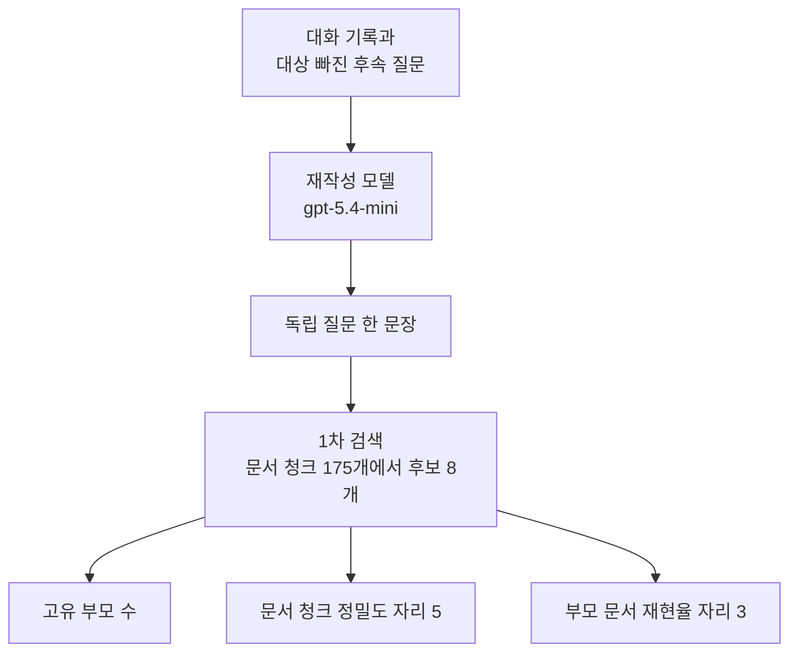
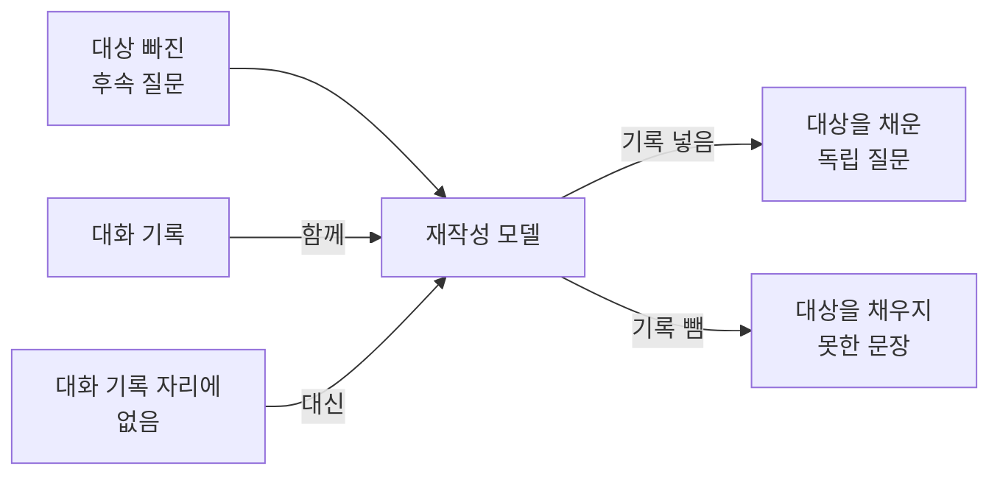
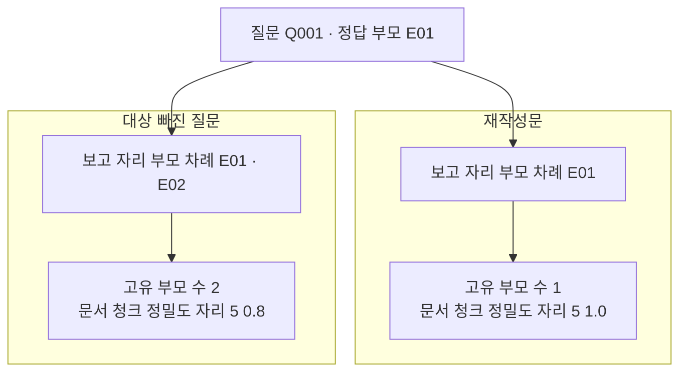
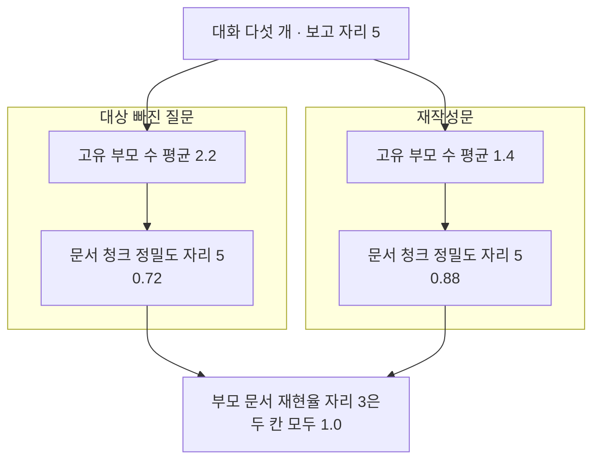

# 11-질문-재작성과-검색

## _src 본문 (HTML 원본)

```html
<!--meta: 강의 1h | 실습 1h | 코드 notebooks/11-질문-재작성과-검색.ipynb | 새 용어 3 -->
<h2 id="b1"><span class="no">1</span>학습 목표</h2><div class="goal"><ul><li>이 절을 마치면 대화에서 빠진 대상을 채운 독립 질문을 만들 수 있습니다.</li><li>원래 질문과 대상 빠진 질문, 재작성문의 검색 결과를 같은 지표로 견줄 수 있습니다.</li><li>재작성 모델이 대화 기록 없이는 무엇을 채우지 못하는지 값으로 보일 수 있습니다.</li></ul></div>
<h2 id="b2"><span class="no">2</span>이 내용을 배우는 이유</h2><p>대화로 이어지는 질문에는 앞에서 말한 대상이 자주 빠집니다. 「그곳의 정기 휴관일은 언제인가요?」에는 기관 이름이 없습니다. 이 문장을 그대로 검색에 넣으면 기관 이름이라는 단서가 사라집니다.</p><p>07~10절은 질문을 그대로 두고 검색 쪽을 바꿨습니다. 이 절은 반대로 검색을 그대로 두고 질문 쪽을 바꿉니다. 바꾸는 방법은 대화 기록을 함께 읽고 빠진 대상을 채우는 것입니다.</p><p>채운 문장이 늘 더 낫다고 말할 수는 없습니다. 모델이 원문의 조건을 빼거나 없던 조건을 넣을 수도 있습니다. 그래서 원문 순위도 버리지 않고 함께 봅니다.</p>
<h2 id="b3"><span class="no">3</span>앞에서 배운 내용</h2><p>07절에서 1차 검색으로 후보 문서 청크 여덟 개를 만들었습니다. 그때 후보 밖에 있는 문서 청크는 뒤 단계에서 되돌릴 수 없다는 것도 보았습니다. 질문을 바꾸면 그 후보 목록 자체가 달라집니다.</p><p>08절에서 보고 자리를 5로 정하고 문서 청크 정밀도를 만들었습니다. 09절에서 후보의 부모 문서를 중복 없이 뽑는 <code>parent_ids_of()</code>를 다시 썼습니다. 10절에서는 그 목록의 길이를 고유 부모 수로 불렀습니다.</p><p>06절 <code>fuse_rank()</code>는 순위 목록 여러 개를 자리 번호만으로 합칩니다. 이 절은 그 함수에 목록을 네 개까지 넣습니다. 이 함수와 04절 형태소 고르기, 07·08절 순위·지표 함수는 실습 폴더의 도구 파일 <code>notebooks/rag_tools.py</code>에서 가져옵니다.</p><p>Ch 6에서 <code>init_chat_model</code>로 모델을 준비하고 <code>invoke</code>로 부르는 방법을 배웠습니다. 이 챕터에서 답을 쓰는 모델을 부르는 것은 이 절이 처음입니다. 07·08절 리랭커는 내려받아 쓰는 다른 모델이었습니다.</p><p>Ch 11이 정한 약속대로 개발 15문항만 봅니다. 시험 15문항은 설정을 다 고른 뒤 12절에서 한 번만 씁니다. 대화에 나오는 미르시립도서관은 Ch 8에서 쓴 그 안내 문서와 같은 소재입니다.</p>
<h2 id="b4"><span class="no">4</span>핵심 개념</h2><h3>비유로 시작하기</h3><p>가운데가 네모로 뚫린 쪽지를 들고 책장 앞에 섰다고 생각해 봅니다. 뚫린 자리에 무엇이 적혀 있었는지 알 수 없어 어느 책인지 고르지 못합니다. 그 자리에 딱 맞는 네모 딱지를 끼우면 책 한 권으로 좁혀집니다.</p>
{{img:11-5-구멍-난-쪽지와-채운-쪽지|위아래 두 줄로 나뉜 그림에서 위 줄은 가운데가 네모로 뚫린 쪽지를 든 손에서 가는 줄 네 개가 나란히 선 책 네 권으로 갈라지고 아래 줄은 같은 쪽지의 뚫린 자리에 네모 딱지가 끼워져 가는 줄 하나가 책 한 권으로만 가는 그림|위 쪽지는 가운데가 뚫려 있어 책 네 권으로 줄이 갈라지고 아래 쪽지는 그 자리를 채워 한 권으로만 갑니다.}}
<p class="look"><b>그림 읽기</b> — 위아래 두 줄에 같은 손과 같은 쪽지, 같은 책 네 권이 있습니다. 위 줄의 쪽지는 가운데가 네모로 뚫려 있고 거기서 가는 줄 네 개가 책 네 권으로 갈라집니다. 아래 줄의 쪽지는 그 자리에 네모 딱지가 끼워져 있고 줄은 하나뿐입니다. 그 줄은 책 네 권 가운데 하나로만 갑니다. 바뀐 것은 쪽지의 빈자리 하나이고 나머지는 모두 같습니다.</p>
<table><thead><tr><th>말</th><th>뜻</th></tr></thead><tbody><tr><td>질문 재작성(query rewriting)</td><td>대화 기록을 함께 읽고 빠진 대상을 채워 질문 한 문장을 다시 쓰는 일입니다.</td></tr><tr><td>독립 질문(standalone question)</td><td>대화 기록 없이 혼자 읽어도 뜻이 통해 그대로 검색에 넣을 수 있는 질문입니다.</td></tr><tr><td>대화 기록(conversation history)</td><td>앞서 오간 말 가운데 지금 질문을 이해하는 데 필요한 부분입니다. 이 절에서는 한 문장을 씁니다.</td></tr></tbody></table>
<h3>대상이 빠진 질문을 다시 쓰는 자리</h3><p>1차 검색은 질문 글자와 문서 청크 글자를 견줍니다. 질문에 기관 이름이 없으면 그 이름으로 맞출 문서 청크도 없습니다. 남은 낱말이 여러 문서에 흔히 나오는 말이면 후보가 여러 문서로 흩어집니다.</p><p>질문 재작성은 검색 앞에 한 단계를 둡니다. 대화 기록과 후속 질문을 모델에 함께 넣고 독립 질문 한 문장을 받습니다. 그 문장을 1차 검색에 넣으면 나머지 단계는 07~10절과 같습니다.</p>
{{mermaid:11-1-대화-질문을-다시-써서-검색|위에서 아래로 내려가는 흐름도로 맨 위 초록 상자 대화 기록과 대상 빠진 후속 질문이 보라 상자 재작성 모델 gpt-5.4-mini로 이어지고 그다음 보라 상자 독립 질문 한 문장과 파란 상자 1차 검색 문서 청크 175개에서 후보 8개를 지나 맨 아래 노란 상자 세 개 고유 부모 수와 문서 청크 정밀도 자리 5와 부모 문서 재현율 자리 3으로 갈라지는 그림|대화 기록과 후속 질문을 모델에 넣어 독립 질문을 만들고 그 질문으로 후보 여덟 개를 찾습니다.}}
<p class="look"><b>도식 읽기</b> — 위에서 아래로 읽습니다. 맨 위 초록 상자가 우리가 넣는 대화 기록과 후속 질문입니다. 그 아래 보라 상자가 이 절이 새로 부르는 재작성 모델이고 모델 이름은 <code>gpt-5.4-mini</code>입니다.</p><p class="look">모델이 낸 독립 질문 한 문장이 그다음 보라 상자입니다. 파란 상자에서 07~10절과 같은 방법으로 후보 여덟 개를 만듭니다. 맨 아래 노란 상자 세 개가 재는 값이고 왼쪽부터 고유 부모 수, 문서 청크 정밀도 자리 5, 부모 문서 재현율 자리 3입니다.</p>
<h3>재작성 모델이 받는 것과 내는 것</h3><p>재작성 모델이 받는 것은 대화 기록과 후속 질문 두 가지입니다. 내는 것은 문장 하나입니다. 대상 이름은 대화 기록에만 있으므로 그 자리를 비우면 모델도 채울 곳이 없습니다.</p>
{{mermaid:11-2-재작성-모델이-받는-것과-내는-것|왼쪽에서 오른쪽으로 가는 흐름도로 왼쪽 초록 상자 세 개 대상 빠진 후속 질문과 대화 기록과 대화 기록 자리에 없음이 가운데 보라 상자 재작성 모델로 모이고 오른쪽에서 기록 넣음 화살표가 보라 상자 대상을 채운 독립 질문으로 기록 뺌 화살표가 보라 상자 대상을 채우지 못한 문장으로 가는 그림|재작성 모델은 대화 기록과 후속 질문을 함께 받아야 빠진 대상을 채울 수 있습니다.}}
<p class="look"><b>도식 읽기</b> — 왼쪽에서 오른쪽으로 읽습니다. 왼쪽 초록 상자 세 개가 모델에 넣는 글입니다. 맨 위는 늘 넣는 후속 질문이고 가운데 대화 기록과 아래 「대화 기록 자리에 없음」은 둘 가운데 하나만 넣습니다. 가운데 보라 상자가 재작성 모델입니다. 오른쪽 보라 상자 두 개는 같은 모델의 결과이고 위가 기록을 넣었을 때, 아래가 기록을 뺐을 때입니다.</p>
<p class="look">노트북 7절 출력에서는 기록을 넣어도 대상이 채워지지 않은 질문이 다섯 가운데 둘 있었습니다. 그림은 두 조건을 짝지은 것이고 늘 채워진다는 뜻이 아닙니다.</p>
<h3>무엇으로 견주는가</h3><p>견줄 갈래는 네 가지입니다. 대상 있는 질문은 대화 없이도 검색할 수 있는 원래 개발 질문입니다. 대상 빠진 질문은 대화의 후속 질문 그대로이고 재작성문은 모델이 쓴 문장입니다.</p><p>합친 순위는 대상 빠진 질문과 재작성문의 순위 목록 네 개를 06절 방법으로 합친 것입니다. 원문 순위를 버리지 않으려고 둡니다. 재는 값은 08~10절에서 쓴 것과 같은 세 가지입니다.</p>
<h2 id="b5"><span class="no">5</span>실행 예제</h2><p>대화 다섯 개를 준비합니다. 대화마다 앞 문장에서 대상을 말하고 후속 질문에서 그 대상을 뺐습니다. 다섯 대화의 정답 부모 문서는 세 건이고 도서관 안내와 기술 사양서, 공급 계약서입니다.</p><p>답을 쓰는 모델 요청은 재작성 다섯 번과 값 바꿔 보기 다섯 번으로 모두 열 번입니다. 임베딩 요청은 문서 청크 1번과 질문 20번으로 모두 스물한 번입니다. 예상 비용은 미화 0.01달러 아래이고 실행은 1분 안팎입니다.</p>
{{mermaid:11-3-한-대화의-두-질문|위에서 아래로 내려가는 흐름도로 맨 위 파란 상자 질문 Q001과 정답 부모 E01에서 두 칸으로 갈리고 왼쪽 칸 제목 대상 빠진 질문 아래에는 노란 상자 보고 자리 부모 차례 E01 E02와 노란 상자 고유 부모 수 2 문서 청크 정밀도 자리 5 0.8이 있고 오른쪽 칸 제목 재작성문 아래에는 노란 상자 보고 자리 부모 차례 E01과 노란 상자 고유 부모 수 1 문서 청크 정밀도 자리 5 1.0이 있는 그림|질문 Q001에서 대상을 빼면 부모 문서 E02가 섞여 들어와 정밀도가 1.0에서 0.8이 됩니다.}}
<p class="look"><b>도식 읽기</b> — 맨 위 파란 상자가 두 칸에 함께 걸리는 질문과 정답 부모입니다. 칸 제목 <code>대상 빠진 질문</code>이 왼쪽이고 <code>재작성문</code>이 오른쪽입니다. 왼쪽 칸은 보고 자리 다섯 개의 부모가 <code>E01</code>과 <code>E02</code> 두 건이고 정밀도가 <code>0.8</code>입니다. 오른쪽 칸은 부모가 <code>E01</code> 한 건이고 정밀도가 <code>1.0</code>입니다. 네 상자 모두 질문 <code>Q001</code> 하나의 값입니다.</p>
{{notebook:11-질문-재작성과-검색}}
<p class="look"><b>확인할 점</b> — 노트북 7절의 재작성문 다섯 줄을 봅니다. 줄 <code>Q001</code>에는 <code>미르시립도서관</code>이 들어왔고 줄 <code>Q087</code>에는 <code>그 모듈</code>이 그대로 남았습니다. 9절 네 줄에서 <code>대상 빠진 질문</code>의 <code>0.8</code>과 <code>재작성문</code>의 <code>1.0</code>을 나란히 봅니다. 10절 표 네 줄과 11절 표 다섯 줄도 함께 확인합니다.</p>
<h2 id="b6"><span class="no">6</span>실험 결과 해석</h2><p>대화 다섯 개의 질문 평균은 다섯 줄로 나왔습니다. 보고 자리는 다섯으로 두었습니다.</p>
<table><thead><tr><th>갈래</th><th>고유 부모 수 평균</th><th>문서 청크 정밀도 자리 5</th><th>부모 문서 재현율 자리 3</th></tr></thead><tbody><tr><td>대상 있는 질문</td><td>1.4</td><td>0.88</td><td>1.0</td></tr><tr><td>대상 빠진 질문</td><td>2.2</td><td>0.72</td><td>1.0</td></tr><tr><td>재작성문</td><td>1.4</td><td>0.88</td><td>1.0</td></tr><tr><td>합친 순위</td><td>1.6</td><td>0.88</td><td>1.0</td></tr><tr><td>기록 없이 재작성문</td><td>2.2</td><td>0.76</td><td>1.0</td></tr></tbody></table>
<p>대상이 빠지자 고유 부모 수 평균이 1.4에서 2.2로 올랐습니다. 같은 자리에서 문서 청크 정밀도는 0.88에서 0.72로 내려갔습니다. 남은 낱말만으로는 한 문서로 좁히지 못해 후보가 여러 문서로 흩어진 것입니다.</p>
{{mermaid:11-4-다섯-대화-평균의-두-갈래|위에서 아래로 내려가는 흐름도로 맨 위 파란 상자 대화 다섯 개와 보고 자리 5에서 두 칸으로 갈리고 왼쪽 칸 제목 대상 빠진 질문 아래에는 노란 상자 고유 부모 수 평균 2.2와 노란 상자 문서 청크 정밀도 자리 5 0.72가 있고 오른쪽 칸 제목 재작성문 아래에는 노란 상자 고유 부모 수 평균 1.4와 노란 상자 문서 청크 정밀도 자리 5 0.88이 있으며 맨 아래 회색 상자에 부모 문서 재현율 자리 3은 두 칸 모두 1.0이라고 적힌 그림|대화 다섯 개 평균에서 대상이 빠지면 고유 부모 수가 1.4에서 2.2로 오르고 정밀도는 0.88에서 0.72가 됩니다.}}
<p class="look"><b>도식 읽기</b> — 칸 제목 <code>대상 빠진 질문</code>이 왼쪽이고 <code>재작성문</code>이 오른쪽입니다. 두 칸의 위 상자가 고유 부모 수 평균이고 아래 상자가 문서 청크 정밀도입니다. 맨 아래 회색 상자는 두 칸에서 모두 확인한 값입니다. 부모 문서 재현율 자리 3이 두 칸 모두 <code>1.0</code>이라 이 값으로는 두 칸을 가를 수 없습니다.</p>
<p>재작성문 줄은 고유 부모 수 평균 1.4와 정밀도 0.88로 대상 있는 질문 줄과 같은 값이 되었습니다. 다섯 대화 가운데 <code>Q001</code>·<code>Q005</code>·<code>Q041</code>에서 대상이 채워졌습니다. 이 다섯 대화에서는 재작성이 잃은 값을 되돌렸다고 적을 수 있습니다.</p><p>합친 순위 줄은 정밀도가 0.88로 재작성문과 같고 고유 부모 수 평균만 1.6으로 조금 큽니다. 원문 순위를 함께 넣어 대상 빠진 질문이 앞에 둔 문서 청크가 일부 남았기 때문입니다. 원문을 버리지 않는 값이 이만큼이라고 보면 됩니다.</p><p>값 바꿔 보기에서 대화 기록 자리만 「없음」으로 바꿨습니다. 고유 부모 수 평균이 2.2로 남아 대상 빠진 질문과 같았습니다. 모델이 문장을 다듬어도 대화 기록에만 있던 기관 이름을 만들어 내지는 못했습니다.</p><p>부모 문서 재현율 자리 3은 다섯 줄 모두 1.0이었습니다. 부모 문서가 6건뿐이고 정답 부모의 문서 청크가 늘 앞자리에 있었기 때문입니다. 이 조건에서는 이 지표로 다섯 갈래를 가를 수 없습니다.</p><p>문서 청크 175개와 대화 다섯 개에서 한 번 실행한 값입니다. 답 품질은 이 절에서 재지 않았으므로 어느 갈래가 더 나은 답을 만드는지는 말할 수 없습니다.</p>
<h2 id="b7"><span class="no">7</span>주의할 점과 실무 메모</h2><ul><li>모델이 쓴 문장은 실행마다 달라질 수 있습니다. 그래서 문장 속 낱말을 <code>assert</code>로 확인하지 않고 재작성문 개수만 확인했습니다.</li><li>재작성문이 늘 대상을 채우지는 않았습니다. 질문 <code>Q087</code>은 <code>그 모듈</code>이 그대로 남았고 대화 기록에 있던 부품 이름이 들어오지 않았습니다.</li><li>표의 <code>기록 없이 재작성문</code> 줄은 정밀도가 다시 실행하면 <code>0.72</code>로 바뀌기도 했습니다. 같은 글을 보내도 임베딩 값이 호출마다 아주 조금 달라지기 때문입니다.</li><li>그래서 그림 라벨에는 실행 세 번에서 모두 같았던 값만 넣었습니다. 흔들린 값은 표와 본문에만 적었습니다.</li><li>대화 다섯 개는 개발 질문에서 대상을 빼어 만든 예입니다. 열 가지 후보를 재어 본 뒤 부모 세 건을 고루 덮도록 고른 것이고 실무 분포를 뜻하지 않습니다.</li><li>다섯 대화 가운데 <code>Q005</code>는 대상을 빼도 정밀도가 오히려 올랐습니다. 다섯 개 평균의 방향까지만 읽고 질문 하나하나로 일반화하지 않습니다.</li><li>재작성은 대상을 채우기도 하지만 원문의 조건을 바꿀 수도 있습니다. 원문 순위를 함께 남기는 합친 순위가 그 위험을 줄이는 자리입니다.</li><li>이 절은 답을 쓰는 모델을 검색 앞 단계에만 씁니다. 찾은 글로 답을 쓰는 단계는 이번에 실행하지 않았습니다.</li><li>대화 기록은 한 문장만 넣었습니다. 여러 차례 오간 긴 대화나 대상이 둘 이상인 대화는 이번에 실행하지 않았습니다.</li><li>재작성에 걸린 시간과 보낸 글의 길이는 이번에 재지 않았습니다. 요청 수만 준비물에 적었습니다.</li><li>부모 문서 재현율은 이 자료에서 천장에 닿아 있습니다. 천장에 닿은 지표는 값 그대로 싣되 갈래를 고르는 근거로 쓰지 않습니다.</li><li>시험 15문항은 이 절에서 열어 보지 않았습니다. 설정을 다 고른 뒤 12절에서 한 번만 씁니다.</li><li>01~06절 값과 이 절 값을 나란히 놓지 않습니다. 문서·질문·후보 단위가 모두 다릅니다.</li><li>이 절은 파일을 쓰지 않습니다. 01~03절이 만든 데이터베이스 표도 읽지 않습니다.</li></ul>
<h2 id="b8"><span class="no">8</span>정리와 다음 절</h2><ul><li>대상이 빠진 질문으로 검색하니 문서 청크 정밀도가 0.88에서 0.72로 내려갔습니다.</li><li>대화 기록으로 재작성하니 0.88로 돌아왔고 고유 부모 수 평균도 1.4가 되었습니다.</li><li>대화 기록을 빼고 재작성하면 고유 부모 수 평균이 2.2로 남아 대상 빠진 질문과 같았습니다.</li></ul><p><strong>다음 학습과 이어지는 지점</strong> — 12절에서는 이 챕터에서 고른 설정을 모아 시험 질문에 한 번 실행하고 기록을 남깁니다.</p>
<h2 id="b9"><span class="no">9</span>복습 문제</h2><details class="quiz" open><summary>문제 4개 · 해설 포함</summary><p class="quiz-q">1. 질문 재작성이 받는 것과 내는 것은 무엇입니까?</p><p class="quiz-a">대화 기록과 후속 질문을 받고 독립 질문 한 문장을 냅니다. 틀렸다면 「재작성 모델이 받는 것과 내는 것」을 다시 읽습니다.</p><p class="quiz-q">2. 대상이 빠지면 이 절에서 내려간 값은 무엇입니까?</p><p class="quiz-a">문서 청크 정밀도입니다. 보고 자리 5에서 <code>0.88</code>이 <code>0.72</code>로 내려갔습니다. 함께 고유 부모 수 평균은 <code>1.4</code>에서 <code>2.2</code>로 올랐습니다. 틀렸다면 6절 표를 다시 읽습니다.</p><p class="quiz-q">3. 부모 문서 재현율로 다섯 갈래를 가를 수 있었습니까?</p><p class="quiz-a">가를 수 없었습니다. 다섯 줄 모두 <code>1.0</code>이었습니다. 부모 문서가 6건뿐이고 정답 부모의 문서 청크가 앞자리에 있었기 때문입니다. 틀렸다면 6절을 다시 읽습니다.</p><p class="quiz-q">4. 대화 기록 자리를 「없음」으로 바꾸면 무엇이 달라집니까?</p><p class="quiz-a">모델이 대상을 채우지 못합니다. 고유 부모 수 평균이 <code>2.2</code>로 남아 대상 빠진 질문과 같았습니다. 대상 이름은 대화 기록에만 있기 때문입니다. 틀렸다면 6절 다섯째 단락을 다시 읽습니다.</p></details>
<h2 id="b10"><span class="no">10</span>참고 자료</h2><ul><li><div><a href="https://docs.langchain.com/oss/python/concepts/providers-and-models">LangChain 모델과 provider</a></div>이 절이 부른 채팅 모델을 준비하는 방법 설명 · 확인 2026-09-09 · LangChain 1.4 기준</li><li><div><a href="https://docs.langchain.com/oss/python/langchain/rag">LangChain RAG 안내</a></div>검색 앞뒤에 단계를 두는 흐름을 보여 주는 문서 · 확인 2026-09-09</li><li><div><a href="https://platform.openai.com/docs/guides/embeddings">OpenAI Embeddings 안내</a></div>질문과 문서 청크를 벡터로 바꿀 때 쓴 모델과 차원 수 설정 설명 · 확인 2026-09-18</li></ul>
```

## 노트북 셀 (순서대로)

### [0] markdown {'html': 'skip'}

# 질문 재작성과 검색

**이 노트북에서 할 일**

1. 대화에서 대상이 빠진 후속 질문 다섯 개를 준비합니다.
2. 대화 기록과 후속 질문을 모델에 넣어 독립 질문을 만듭니다.
3. 대상 있는 질문·대상 빠진 질문·재작성문·합친 순위를 같은 지표로 견줍니다.
4. 대화 기록 자리를 「없음」으로 바꿔 다시 재작성하고 표에 한 줄을 더합니다.

**준비물** — 프로젝트 폴더의 `.env`에 `OPENAI_API_KEY`가 있어야 합니다.
답을 쓰는 모델 요청은 재작성 다섯 번과 값 바꿔 보기 다섯 번으로 모두 열 번입니다.
임베딩 요청은 문서 청크 1번과 질문 20번으로 모두 스물한 번입니다.
예상 비용은 미화 0.01달러 아래이고 실행 시간은 1분 안팎입니다.
이 챕터에서 답을 쓰는 모델을 부르는 첫 절입니다.

**데이터** — 두 파일 모두 실습 묶음에 들어 있습니다.

- 문서 `labs/part3/ch12-retrieval-tuning/data/advanced-documents.json`(부모 6건·문서 청크 175개)
- 질문 `labs/part3/ch12-retrieval-tuning/data/advanced-queries.json`(30개)

**강의와 실습 범위** — 강의 시간에는 6~10절을 읽습니다.
대화 자료를 만드는 자리가 6절이고 재작성 함수를 만드는 자리가 7절입니다.
9절이 한 대화의 결과이고 10절이 대화 다섯 개의 평균입니다.
1~5절은 함께 실행하고 11절은 실습 시간에 다시 읽습니다.

**기준 버전** — 첫 셀에서 여섯 패키지를 고정한 판으로 설치합니다.
교재 출력은 Linux의 Python 3.12.13으로 만들었습니다.
다른 판과 Windows·macOS에서는 이번에 실행하지 않았습니다.

실습 폴더 `labs/part3/ch12-retrieval-tuning`에서 `uv sync --locked`를 실행합니다.
그다음 이 폴더의 `.venv` 커널을 고르고 첫 셀부터 순서대로 실행합니다.

### [1] markdown {'html': 'skip'}

## 오늘 볼 그림


맨 위 초록 상자가 학생이 적어 넣는 대화 기록과 후속 질문입니다.
그 아래 보라 상자가 이 절이 새로 부르는 재작성 모델입니다.
모델이 낸 독립 질문 한 문장이 그다음 보라 상자입니다.
파란 상자에서 07~10절과 같은 방법으로 후보 여덟 개를 만듭니다.
맨 아래 노란 상자 세 개가 보고 자리 다섯 개에서 재는 값입니다.

### [2] markdown {}

## 1. 준비

첫 셀은 패키지 여섯 개를 설치하고 설치된 버전을 출력합니다.
10절 다섯 개에 답을 쓰는 모델을 부르는 꾸러미 하나를 더했습니다.

### [3] code {'execution': {'iopub.execute_input': '2026-09-21T08:20:03.388691Z', 'iopub.status.busy': '2026-09-21T08:20:03.388397Z', 'iopub.status.idle': '2026-09-21T08:20:03.908123Z', 'shell.execute_reply': '2026-09-21T08:20:03.907555Z'}, 'lesson_role': 'setup'}

```python
# 이 절에서 쓰는 패키지를 설치하고 버전을 확인합니다
%pip install -q "langchain==1.4.0" "langchain-openai==1.6.1" "python-dotenv==1.2.3" "kiwipiepy==0.23.2" "rank-bm25==0.2.2" "numpy==2.5.3"
from importlib.metadata import version

print("langchain:", version("langchain"))
print("langchain-openai:", version("langchain-openai"))
print("python-dotenv:", version("python-dotenv"))
print("kiwipiepy:", version("kiwipiepy"))
print("rank-bm25:", version("rank-bm25"))
print("numpy:", version("numpy"))
```

출력:
```
Note: you may need to restart the kernel to use updated packages.
langchain: 1.4.0
langchain-openai: 1.6.1
python-dotenv: 1.2.3
kiwipiepy: 0.23.2
rank-bm25: 0.2.2
numpy: 2.5.3

```

### [4] markdown {}

**결과 읽기** — 설치가 끝나면 `langchain: 1.4.0`과 `rank-bm25: 0.2.2`가 보입니다.
마지막 줄 `numpy: 2.5.3`은 도구 파일이 벡터 계산에 쓰는 패키지입니다. 여섯 줄이 모두 보이면 다음 셀로 넘어갑니다.

다음 셀은 이 절에서 쓸 이름 다섯 개를 불러옵니다.

앞에서 배운 함수는 `rag_tools.py`에 모아 두었습니다. 파일을 열면 코드를 볼 수 있습니다. 노트북과 같은 폴더(`notebooks/`)에 있는 파일입니다.

이 노트북은 04·06·07·08절 함수 다섯 개와 Ch 11 `recall_at()`을 가져옵니다.
04절 `kiwi_terms()`, 06절 `fuse_rank()`, 07절 `parent_ids_of()`, 08절 `eligible_items()`·`chunk_precision_at()`입니다.
07~10절과 같은 문서 청크 판 순위 함수 세 개도 함께 가져옵니다.
인자 모양은 10절에서 쓴 것과 같고 4절에서 한 번 더 정리합니다.

### [5] code {'execution': {'iopub.execute_input': '2026-09-21T08:20:03.909210Z', 'iopub.status.busy': '2026-09-21T08:20:03.909125Z', 'iopub.status.idle': '2026-09-21T08:20:04.908363Z', 'shell.execute_reply': '2026-09-21T08:20:04.908185Z'}, 'lesson_role': 'setup'}

```python
# 자료 읽기·형태소 분석·모델 준비·임베딩·낱말 점수에 쓸 이름을 불러옵니다
import json
import os

from kiwipiepy import Kiwi
from langchain.chat_models import init_chat_model
from langchain_openai import OpenAIEmbeddings
from rank_bm25 import BM25Okapi
# 04·06·07·08절과 Ch 11 함수, 문서 청크 판 순위 함수 아홉 개를 도구 파일에서 가져옵니다
from rag_tools import chunk_precision_at, eligible_items, fuse_rank, kiwi_terms
from rag_tools import parent_ids_of, rank_chunks_by_bm25, rank_chunks_by_distance
from rag_tools import recall_at, unique_chunk_ids

print("불러온 이름:", "json", "Kiwi", "init_chat_model", "OpenAIEmbeddings", "BM25Okapi")
```

출력:
```
불러온 이름: json Kiwi init_chat_model OpenAIEmbeddings BM25Okapi

```

### [6] markdown {}

**결과 읽기** — 출력 줄은 `불러온 이름:` 뒤에 이름 다섯 개가 붙은 한 줄입니다.
이름 `init_chat_model`이 07~10절에는 없던 것입니다.
도구 파일에서 가져온 함수 아홉 개는 출력하지 않습니다.

### [7] markdown {}

API 키가 있는지 확인합니다. `True` 값이 나오면 다음으로 넘어갑니다.

### [8] code {'execution': {'iopub.execute_input': '2026-09-21T08:20:04.910804Z', 'iopub.status.busy': '2026-09-21T08:20:04.910594Z', 'iopub.status.idle': '2026-09-21T08:20:04.914297Z', 'shell.execute_reply': '2026-09-21T08:20:04.914075Z'}, 'lesson_role': 'setup'}

```python
# .env 파일에서 OpenAI API 키를 읽습니다(키 값은 출력하지 않습니다)
import os
from dotenv import find_dotenv, load_dotenv

env_path = find_dotenv(usecwd=True)
load_dotenv(env_path)
has_key = os.getenv("OPENAI_API_KEY") is not None
print("OPENAI_API_KEY 설정 여부:", has_key)
assert has_key, "프로젝트 폴더의 .env 파일에 OPENAI_API_KEY를 적어 주세요."
```

출력:
```
OPENAI_API_KEY 설정 여부: True

```

### [9] markdown {}

실습에 쓸 모델을 준비합니다.
temperature 값을 0으로 두어 매번 비슷한 문장을 고르게 합니다.
설정 `reasoning_effort="none"`은 답을 쓰기 전에 따로 생각하는 단계를 두지 않게 합니다.

### [10] code {'execution': {'iopub.execute_input': '2026-09-21T08:20:04.914787Z', 'iopub.status.busy': '2026-09-21T08:20:04.914742Z', 'iopub.status.idle': '2026-09-21T08:20:05.220581Z', 'shell.execute_reply': '2026-09-21T08:20:05.220124Z'}}

```python
# 실습에 쓸 모델을 준비합니다
model = init_chat_model(
    "openai:gpt-5.4-mini",
    temperature=0,
    reasoning_effort="none",
)
print("모델 이름:", model.model_name)
print("temperature:", model.temperature)
```

출력:
```
모델 이름: gpt-5.4-mini
temperature: 0.0

```

### [11] markdown {}

**결과 읽기** — 모델 이름 `gpt-5.4-mini`, temperature `0.0`이 보이면 준비가 끝났습니다.
이 노트북의 출력은 2026-09-21에 이 모델로 실행한 결과입니다.

### [12] markdown {}

다음 셀은 프로젝트 맨 위 폴더를 찾습니다. 01~10절과 같은 코드입니다.

### [13] code {'execution': {'iopub.execute_input': '2026-09-21T08:20:05.221473Z', 'iopub.status.busy': '2026-09-21T08:20:05.221393Z', 'iopub.status.idle': '2026-09-21T08:20:05.223555Z', 'shell.execute_reply': '2026-09-21T08:20:05.223214Z'}, 'lesson_role': 'setup'}

```python
# 노트북을 어느 폴더에서 열어도 프로젝트 맨 위를 찾게 후보 세 개를 차례로 봅니다
candidates = [".", "../../..", "../../../.."]
root_path = None
for candidate in candidates:
    if os.path.exists(candidate + "/labs/part3/ch12-retrieval-tuning/data"):
        root_path = candidate
        break
print("고른 경로:", root_path)
assert root_path is not None, "notebooks 폴더나 실습 폴더 맨 위에서 노트북을 열어 주세요."
```

출력:
```
고른 경로: .

```

### [14] markdown {}

**결과 읽기** — 출력 줄은 `고른 경로: .`입니다. `assert`도 통과했습니다.

다음 셀은 07~10절과 같은 자료 두 벌을 읽습니다.

### [15] code {'execution': {'iopub.execute_input': '2026-09-21T08:20:05.224377Z', 'iopub.status.busy': '2026-09-21T08:20:05.224283Z', 'iopub.status.idle': '2026-09-21T08:20:05.228280Z', 'shell.execute_reply': '2026-09-21T08:20:05.227945Z'}, 'lesson_role': 'setup'}

```python
# 07~10절과 같은 파일 두 벌을 읽습니다
data_path = root_path + "/labs/part3/ch12-retrieval-tuning/data"
with open(data_path + "/advanced-documents.json", encoding="utf-8") as file:
    documents = json.loads(file.read())
with open(data_path + "/advanced-queries.json", encoding="utf-8") as file:
    queries = json.loads(file.read())
parents = documents["parents"]
chunks = documents["chunks"]
print("부모 문서 수:", len(parents))
print("문서 청크 수:", len(chunks))
print("질문 수:", len(queries))
```

출력:
```
부모 문서 수: 6
문서 청크 수: 175
질문 수: 30

```

### [16] markdown {}

**결과 읽기** — `부모 문서 수: 6`과 `문서 청크 수: 175`, `질문 수: 30`이 보입니다.
07~10절과 같은 파일이라 세 값도 같습니다.

## 2. 이 절에서 쓸 값 정하기

01~10절에서 쓴 값을 그대로 다시 정합니다.
이 절은 순위 목록을 네 개까지 합치므로 가중치 목록도 네 개짜리를 하나 더 만듭니다.

### [17] code {'execution': {'iopub.execute_input': '2026-09-21T08:20:05.228947Z', 'iopub.status.busy': '2026-09-21T08:20:05.228884Z', 'iopub.status.idle': '2026-09-21T08:20:05.230944Z', 'shell.execute_reply': '2026-09-21T08:20:05.230609Z'}}

```python
# 01~10절에서 쓴 값을 그대로 다시 정하고 네 목록을 합칠 때 쓸 가중치를 더합니다
keep_tags = ["NNG", "NNP", "NNB", "NR", "VV", "VA", "MAG", "SN", "SL"]
rank_constant = 60
equal_weights = [1.0, 1.0]
four_weights = [1.0, 1.0, 1.0, 1.0]
candidate_count = 8
recall_place = 3
report_place = 5
print("남길 품사 표시 수:", len(keep_tags))
print("순위 상수:", rank_constant, "| 같은 가중치:", equal_weights)
print("네 순위 목록에 줄 가중치:", four_weights)
print("후보 수:", candidate_count)
print("부모 문서 재현율을 재는 자리:", recall_place, "| 보고 자리:", report_place)
```

출력:
```
남길 품사 표시 수: 9
순위 상수: 60 | 같은 가중치: [1.0, 1.0]
네 순위 목록에 줄 가중치: [1.0, 1.0, 1.0, 1.0]
후보 수: 8
부모 문서 재현율을 재는 자리: 3 | 보고 자리: 5

```

### [18] markdown {}

**결과 읽기** — 줄 `순위 상수: 60 | 같은 가중치: [1.0, 1.0]`은 06~10절과 같은 값입니다.
줄 `네 순위 목록에 줄 가중치: [1.0, 1.0, 1.0, 1.0]`이 이 절에서 더한 값입니다.
줄 `후보 수: 8`과 `부모 문서 재현율을 재는 자리: 3 | 보고 자리: 5`도 08~10절과 같습니다.

## 3. 검색에 쓸 재료 만들기

문서 청크마다 제목과 본문을 이어 붙여 글 하나로 만듭니다.
청크 ID로 부모 문서 ID를 찾을 수 있게 짝도 함께 만들어 둡니다.

### [19] code {'execution': {'iopub.execute_input': '2026-09-21T08:20:05.231714Z', 'iopub.status.busy': '2026-09-21T08:20:05.231661Z', 'iopub.status.idle': '2026-09-21T08:20:05.233625Z', 'shell.execute_reply': '2026-09-21T08:20:05.233372Z'}}

```python
# 문서 청크마다 제목과 본문을 이어 붙이고 청크 ID·부모 문서 ID를 짝지어 둡니다
chunk_texts = []
chunk_ids = []
parent_by_chunk = {}
for chunk in chunks:
    chunk_text = chunk["title"] + " " + chunk["text"]
    chunk_texts.append(chunk_text)
    chunk_ids.append(chunk["chunk_id"])
    parent_by_chunk[chunk["chunk_id"]] = chunk["parent_id"]
all_chunk_count = len(chunk_ids)
print("이어 붙인 글 수:", len(chunk_texts))
print("첫 문서 청크 ID:", chunk_ids[0])
```

출력:
```
이어 붙인 글 수: 175
첫 문서 청크 ID: E01-P01-C01

```

### [20] markdown {}

**결과 읽기** — `이어 붙인 글 수: 175`가 보입니다.
줄 `첫 문서 청크 ID: E01-P01-C01`의 이름 앞머리가 그 문서 청크의 부모 문서 ID입니다.

다음 셀은 문서 청크를 벡터로 바꿉니다. 01~10절과 같은 모델을 씁니다.
질문 쪽 벡터는 질문마다 문장이 달라 뒤에서 따로 만듭니다.

### [21] code {'execution': {'iopub.execute_input': '2026-09-21T08:20:05.234228Z', 'iopub.status.busy': '2026-09-21T08:20:05.234177Z', 'iopub.status.idle': '2026-09-21T08:20:05.662460Z', 'shell.execute_reply': '2026-09-21T08:20:05.661697Z'}}

```python
# 01~10절과 같은 모델로 문서 청크를 벡터로 바꿉니다(임베딩 요청 1번)
embedding_model_name = "text-embedding-3-small"
vector_dimensions = 256
embedding_model = OpenAIEmbeddings(model=embedding_model_name, dimensions=vector_dimensions)
chunk_vectors = embedding_model.embed_documents(chunk_texts)
print("임베딩 모델 이름:", embedding_model.model)
print("벡터의 숫자 개수 설정:", embedding_model.dimensions)
print("문서 청크 벡터 수:", len(chunk_vectors))
```

출력:
```
임베딩 모델 이름: text-embedding-3-small
벡터의 숫자 개수 설정: 256
문서 청크 벡터 수: 175

```

### [22] markdown {}

**결과 읽기** — `벡터의 숫자 개수 설정: 256`과 `문서 청크 벡터 수: 175`가 보입니다.
여기까지 임베딩 요청은 한 번입니다.

## 4. 앞 절 함수의 인자 확인하기

앞 절 함수는 준비 셀에서 도구 파일로부터 가져왔습니다.
두 순위는 07~10절과 같은 문서 청크 판 `rank_chunks_by_distance()`와 `rank_chunks_by_bm25()`가 만듭니다.
합치기는 06절 `fuse_rank()`가 맡고 순위 상수를 셋째 인자로 받습니다.
07절 `parent_ids_of()`와 08절 `chunk_precision_at()`은 짝 사전 `parent_by_chunk`를 인자로 받습니다.

## 5. 개발 묶음과 후보 만들기

Ch 11이 정한 약속은 개발 15문항으로 설정을 고르는 것입니다.
시험 15문항은 설정을 다 고른 뒤 12절에서 한 번만 씁니다.
다음 셀이 준비 셀에서 가져온 08절 함수 `eligible_items()`로 개발 묶음을 가립니다.

### [23] code {'execution': {'iopub.execute_input': '2026-09-21T08:20:05.663684Z', 'iopub.status.busy': '2026-09-21T08:20:05.663597Z', 'iopub.status.idle': '2026-09-21T08:20:05.666813Z', 'shell.execute_reply': '2026-09-21T08:20:05.666192Z'}}

```python
# 질문 30개에서 개발 묶음만 고르고 답할 수 있는 질문만 남깁니다
dev_all = []
for query in queries:
    if query["split"] == "dev":
        dev_all.append(query)
dev_queries = eligible_items(dev_all)
print("개발 질문 수:", len(dev_queries))
print("시험 질문 수:", len(queries) - len(dev_all))
print("첫 개발 질문:", dev_queries[0]["qid"], "|", dev_queries[0]["question"])
print("그 질문의 정답 부모 문서 ID:", dev_queries[0]["gold_doc_ids"])
```

출력:
```
개발 질문 수: 15
시험 질문 수: 15
첫 개발 질문: Q001 | 미르시립도서관의 정기 휴관일은 언제인가요?
그 질문의 정답 부모 문서 ID: ['E01']

```

### [24] markdown {}

**결과 읽기** — `개발 질문 수: 15`와 `시험 질문 수: 15`가 보입니다.
줄 `첫 개발 질문:` 뒤에 질문 ID와 질문 글이 있습니다.
줄 `그 질문의 정답 부모 문서 ID: ['E01']`의 값이 부모 문서 ID 목록입니다.

다음 셀은 문서 청크의 검색 낱말 목록으로 BM25 모델을 만듭니다.
분석기를 만드는 줄 `kiwi = Kiwi()`는 1초 안팎 걸립니다.

### [25] code {'execution': {'iopub.execute_input': '2026-09-21T08:20:05.667823Z', 'iopub.status.busy': '2026-09-21T08:20:05.667752Z', 'iopub.status.idle': '2026-09-21T08:20:06.999140Z', 'shell.execute_reply': '2026-09-21T08:20:06.998692Z'}}

```python
# 04~10절과 같은 형태소 분석기로 문서 청크마다 검색 낱말 목록을 만들고 BM25 모델을 만듭니다
kiwi = Kiwi()
kiwi_corpus = []
for text in chunk_texts:
    kiwi_corpus.append(kiwi_terms(kiwi, text, keep_tags))
bm25_model = BM25Okapi(kiwi_corpus)
print("검색 낱말 목록 수:", len(kiwi_corpus))
print("BM25 모델이 본 문서 청크 수:", bm25_model.corpus_size)
print("문서 청크 하나의 평균 검색 낱말 수:", round(bm25_model.avgdl, 2))
```

출력:
```
검색 낱말 목록 수: 175
BM25 모델이 본 문서 청크 수: 175
문서 청크 하나의 평균 검색 낱말 수: 44.01

```

### [26] markdown {}

**결과 읽기** — `검색 낱말 목록 수: 175`와 `BM25 모델이 본 문서 청크 수: 175`가 보입니다.
줄 `문서 청크 하나의 평균 검색 낱말 수: 44.01`은 07~10절과 같은 값입니다.

다음 셀은 질문 하나를 후보 목록으로 바꾸는 함수 둘입니다.
07~10절은 개발 질문 열다섯 개를 한 번에 벡터로 바꿨습니다.
이 절은 같은 질문을 여러 모양으로 바꿔 검색하므로 질문마다 따로 부릅니다.

### [27] code {'execution': {'iopub.execute_input': '2026-09-21T08:20:06.999836Z', 'iopub.status.busy': '2026-09-21T08:20:06.999783Z', 'iopub.status.idle': '2026-09-21T08:20:07.002620Z', 'shell.execute_reply': '2026-09-21T08:20:07.002219Z'}, 'upgrade_allow': ['multiple_defs_in_cell']}

```python
# 질문 하나로 순위 목록 두 개를 만들고 합친 차례의 앞자리를 후보로 자릅니다
def ranking_lists(question):
    question_vector = embedding_model.embed_query(question)
    distance_hits = rank_chunks_by_distance(question_vector, chunk_vectors, chunk_ids, all_chunk_count)
    question_terms = kiwi_terms(kiwi, question, keep_tags)
    score_hits = rank_chunks_by_bm25(bm25_model, question_terms, chunk_ids, all_chunk_count)
    return [unique_chunk_ids(distance_hits), unique_chunk_ids(score_hits)]


def candidates_of(ranking_list, weight_list):
    fused_ids = fuse_rank(ranking_list, weight_list, rank_constant)
    return fused_ids[:candidate_count]


# 보고 자리 다섯 개에서 고유 부모 수·정밀도·재현율 세 값을 냅니다
def measure(found_chunk_ids, gold_doc_ids):
    top_ids = found_chunk_ids[:report_place]
    parent_ids = parent_ids_of(top_ids, parent_by_chunk)
    precision = chunk_precision_at(found_chunk_ids, gold_doc_ids, report_place, parent_by_chunk)
    recall = recall_at(parent_ids, gold_doc_ids, recall_place)
    return len(parent_ids), round(precision, 2), round(recall, 2)
```

출력:
```

```

### [28] markdown {}

정의 셀이라 출력이 없습니다.
첫 함수는 벡터 거리 순위와 낱말 겹침 순위 두 개를 목록에 담아 냅니다.
둘째 함수는 그 목록들을 06절 방법으로 합쳐 앞자리 여덟 개를 자릅니다.
목록을 네 개 넣으면 가중치도 네 개를 넣어야 합니다.

셋째 함수는 후보 목록 하나에서 값 세 개를 냅니다.
고유 부모 수는 보고 자리 다섯 개의 부모를 중복 없이 센 수입니다.
10절에서는 이 값을 다양성으로 읽었고 이 절에서는 후보가 몇 문서로 흩어졌는지로 읽습니다.
문서 청크 정밀도와 부모 문서 재현율은 08·09절 함수를 그대로 부릅니다.

## 6. 대화 자료 만들기

대화의 후속 질문에는 앞에서 말한 대상이 빠지기 쉽습니다.
다음 셀은 개발 질문 다섯 개를 골라 대화 기록과 대상이 빠진 질문으로 나눈 것입니다.

### [29] code {'execution': {'iopub.execute_input': '2026-09-21T08:20:07.003256Z', 'iopub.status.busy': '2026-09-21T08:20:07.003197Z', 'iopub.status.idle': '2026-09-21T08:20:07.005372Z', 'shell.execute_reply': '2026-09-21T08:20:07.004938Z'}}

```python
# 대화 다섯 개를 적습니다: 한 줄은 (질문 ID, 대화 기록, 대상이 빠진 후속 질문)입니다
conversation_rows = [
    ("Q001", "미르시립도서관 이용 안내를 보고 있어요.", "그곳의 정기 휴관일은 언제인가요?"),
    ("Q005", "미르시립도서관 열람실을 쓰려고 해요.", "그곳 좌석을 예약하고 입실하지 않으면 몇 분 뒤 취소되나요?"),
    ("Q041", "도우미봇 R2 기술 사양서를 보고 있어요.", "그 로봇 로컬 API 토큰의 유효 기간은?"),
    ("Q085", "누리테크와 맺은 부품 공급 기본계약서를 검토하고 있어요.", "납기를 지체하면 지체상금은 얼마이며 한도는?"),
    ("Q087", "누리테크와 맺은 부품 공급 기본계약서를 검토하고 있어요.", "그 모듈의 2026년 2월 이후 단가와 2025년 단가는?"),
]
print("대화 수:", len(conversation_rows))
print("첫 대화 기록:", conversation_rows[0][1])
```

출력:
```
대화 수: 5
첫 대화 기록: 미르시립도서관 이용 안내를 보고 있어요.

```

### [30] markdown {}

**결과 읽기** — `대화 수: 5`가 보입니다.
줄 `첫 대화 기록: 미르시립도서관 이용 안내를 보고 있어요.`가 첫 대화의 앞 문장입니다.

다음 셀은 질문 ID로 대상 있는 질문과 정답 부모를 찾을 수 있게 짝지어 둡니다.

### [31] code {'execution': {'iopub.execute_input': '2026-09-21T08:20:07.005922Z', 'iopub.status.busy': '2026-09-21T08:20:07.005870Z', 'iopub.status.idle': '2026-09-21T08:20:07.007862Z', 'shell.execute_reply': '2026-09-21T08:20:07.007570Z'}}

```python
# 질문 ID로 대상 있는 질문과 정답 부모 문서 ID를 찾을 수 있게 짝지어 둡니다
question_by_id = {}
gold_by_id = {}
for item in dev_queries:
    question_by_id[item["qid"]] = item["question"]
    gold_by_id[item["qid"]] = item["gold_doc_ids"]
print("질문 ID | 정답 부모 | 대상 있는 질문 | 대상 빠진 질문")
for row in conversation_rows:
    print(row[0], "|", gold_by_id[row[0]], "|", question_by_id[row[0]], "|", row[2])
```

출력:
```
질문 ID | 정답 부모 | 대상 있는 질문 | 대상 빠진 질문
Q001 | ['E01'] | 미르시립도서관의 정기 휴관일은 언제인가요? | 그곳의 정기 휴관일은 언제인가요?
Q005 | ['E01'] | 열람실 좌석을 예약하고 입실하지 않으면 몇 분 뒤 취소되나요? | 그곳 좌석을 예약하고 입실하지 않으면 몇 분 뒤 취소되나요?
Q041 | ['M01'] | R2 로컬 API 토큰의 유효 기간은? | 그 로봇 로컬 API 토큰의 유효 기간은?
Q085 | ['H01'] | 누리테크가 납기를 지체하면 지체상금은 얼마이며 한도는? | 납기를 지체하면 지체상금은 얼마이며 한도는?
Q087 | ['H01'] | NT-LD-16 라이다 모듈의 2026년 2월 이후 단가와 2025년 단가는? | 그 모듈의 2026년 2월 이후 단가와 2025년 단가는?

```

### [32] markdown {}

**결과 읽기** — 라벨 줄 아래 다섯 줄이 나옵니다.
줄 `Q001`을 보면 대상 있는 질문에는 `미르시립도서관`이 있고 대상 빠진 질문에는 `그곳`만 있습니다.
정답 부모 칸은 `['E01']`처럼 목록입니다.

## 7. 질문을 다시 쓰는 함수

질문 재작성은 대화 기록을 함께 보고 빠진 대상을 채운 한 문장을 만드는 일입니다.
다음 셀은 프롬프트를 만들어 모델을 한 번 부르는 함수입니다.

### [33] code {'execution': {'iopub.execute_input': '2026-09-21T08:20:07.008396Z', 'iopub.status.busy': '2026-09-21T08:20:07.008348Z', 'iopub.status.idle': '2026-09-21T08:20:07.009884Z', 'shell.execute_reply': '2026-09-21T08:20:07.009535Z'}}

```python
# 대화 기록과 후속 질문을 넣어 독립 질문 한 문장을 받습니다(모델 요청 1번)
def rewrite_question(history_text, question):
    prompt = "다음 대화의 마지막 질문을 문서 검색에 쓸 독립 질문 한 문장으로 다시 쓰세요.\n"
    prompt = prompt + "설명이나 따옴표를 붙이지 마세요.\n"
    prompt = prompt + "대화 기록: " + history_text + "\n"
    prompt = prompt + "마지막 질문: " + question
    answer = model.invoke(prompt)
    return answer.text.strip()
```

출력:
```

```

### [34] markdown {}

정의 셀이라 출력이 없습니다.
프롬프트는 네 줄이고 대화 기록과 마지막 질문을 각각 한 줄에 담습니다.
줄 `answer.text`는 모델이 쓴 글이고 앞뒤 공백을 떼어 냅니다.
모델이 쓴 문장은 실행마다 달라질 수 있으므로 `assert`로 낱말을 확인하지 않습니다.

다음 셀이 대화 다섯 개를 차례로 재작성합니다.
반복문 안에서는 담기만 하고 다 끝난 뒤 한꺼번에 출력합니다.

### [35] code {'execution': {'iopub.execute_input': '2026-09-21T08:20:07.010465Z', 'iopub.status.busy': '2026-09-21T08:20:07.010421Z', 'iopub.status.idle': '2026-09-21T08:20:11.231492Z', 'shell.execute_reply': '2026-09-21T08:20:11.229975Z'}}

```python
# 대화 다섯 개를 차례로 재작성하고 다 끝난 뒤 한꺼번에 출력합니다(모델 요청 5번)
rewritten_by_id = {}
for row in conversation_rows:
    rewritten_by_id[row[0]] = rewrite_question(row[1], row[2])
print("만든 재작성문 수:", len(rewritten_by_id))
print("질문 ID | 재작성문")
for row in conversation_rows:
    print(row[0], "|", rewritten_by_id[row[0]])
assert len(rewritten_by_id) == len(conversation_rows), "대화마다 재작성문이 하나씩 있어야 합니다."
```

출력:
```
만든 재작성문 수: 5
질문 ID | 재작성문
Q001 | 미르시립도서관의 정기 휴관일은 언제인가요?
Q005 | 미르시립도서관 열람실 좌석을 예약한 뒤 입실하지 않으면 몇 분 후에 예약이 취소되나요?
Q041 | 도우미봇 R2 로컬 API 토큰의 유효 기간은 얼마인가?
Q085 | 납기 지체 시 지체상금의 금액과 한도는 어떻게 되나요?
Q087 | 그 모듈의 2025년 단가와 2026년 2월 이후 단가는 얼마인가?

```

### [36] markdown {}

**결과 읽기** — `만든 재작성문 수: 5`가 보이고 라벨 줄 아래 다섯 줄이 나옵니다.
줄 `Q001`의 재작성문에는 대화 기록에 있던 `미르시립도서관`이 들어왔습니다.
줄 `Q087`처럼 대상이 채워지지 않은 줄도 있습니다.

확인 줄 `assert`는 재작성문 개수만 봅니다. 문장 속 낱말은 확인하지 않습니다.
같은 설정으로 다시 실행해도 문장은 조금 달라질 수 있습니다.

## 8. 갈래 네 가지의 후보 목록

이제 견줄 갈래를 정합니다.
대상 있는 질문은 대화 없이도 검색할 수 있는 원래 개발 질문입니다.
대상 빠진 질문은 대화의 후속 질문 그대로이고 재작성문은 모델이 쓴 문장입니다.
합친 순위는 대상 빠진 질문과 재작성문의 순위 목록 네 개를 06절 방법으로 합친 것입니다.

다음 셀은 대화마다 갈래 네 가지의 후보 목록을 만듭니다.
질문 세 가지를 각각 벡터로 바꾸므로 임베딩 요청이 열다섯 번 늘어납니다.

### [37] code {'execution': {'iopub.execute_input': '2026-09-21T08:20:11.234451Z', 'iopub.status.busy': '2026-09-21T08:20:11.234232Z', 'iopub.status.idle': '2026-09-21T08:20:13.600384Z', 'shell.execute_reply': '2026-09-21T08:20:13.599451Z'}}

```python
# 갈래 네 가지를 정하고 대화 다섯 개마다 후보 목록을 만듭니다(임베딩 요청 15번)
branch_names = ["대상 있는 질문", "대상 빠진 질문", "재작성문", "합친 순위"]
found_by_branch = {}
for name in branch_names:
    found_by_branch[name] = {}
for row in conversation_rows:
    full_lists = ranking_lists(question_by_id[row[0]])
    short_lists = ranking_lists(row[2])
    rewritten_lists = ranking_lists(rewritten_by_id[row[0]])
    found_by_branch["대상 있는 질문"][row[0]] = candidates_of(full_lists, equal_weights)
    found_by_branch["대상 빠진 질문"][row[0]] = candidates_of(short_lists, equal_weights)
    found_by_branch["재작성문"][row[0]] = candidates_of(rewritten_lists, equal_weights)
    found_by_branch["합친 순위"][row[0]] = candidates_of(short_lists + rewritten_lists, four_weights)
print("견줄 갈래:", branch_names)
print("갈래 하나의 후보 목록 수:", len(found_by_branch["재작성문"]))
print("후보 목록 하나의 문서 청크 수:", len(found_by_branch["재작성문"]["Q001"]))
```

출력:
```
견줄 갈래: ['대상 있는 질문', '대상 빠진 질문', '재작성문', '합친 순위']
갈래 하나의 후보 목록 수: 5
후보 목록 하나의 문서 청크 수: 8

```

### [38] markdown {}

**결과 읽기** — 줄 `견줄 갈래:` 뒤에 이름 네 개가 보입니다.
줄 `갈래 하나의 후보 목록 수: 5`와 `후보 목록 하나의 문서 청크 수: 8`도 보입니다.
07~10절과 같은 1차 검색이라 후보 수도 같습니다.

## 9. 실행 1 — 한 대화에서

먼저 첫 대화 하나만 봅니다.
실행 전에 예상해 봅니다. 대상이 빠진 질문은 다른 부모 문서까지 후보에 넣을 것입니다.

### [39] code {'execution': {'iopub.execute_input': '2026-09-21T08:20:13.602469Z', 'iopub.status.busy': '2026-09-21T08:20:13.602312Z', 'iopub.status.idle': '2026-09-21T08:20:13.606175Z', 'shell.execute_reply': '2026-09-21T08:20:13.605588Z'}}

```python
# 첫 대화 하나에서 갈래 네 가지의 보고 자리 다섯 개를 견줍니다
example_id = conversation_rows[0][0]
example_gold = gold_by_id[example_id]
print("고른 대화의 질문 ID:", example_id, "| 정답 부모 문서 ID:", example_gold)
print("갈래 | 보고 자리 다섯 개의 부모 문서 차례 | 고유 부모 수 | 문서 청크 정밀도 자리 5")
for name in branch_names:
    example_found = found_by_branch[name][example_id]
    example_row = measure(example_found, example_gold)
    print(name, "|", parent_ids_of(example_found[:report_place], parent_by_chunk), "|", example_row[0], "|", example_row[1])
```

출력:
```
고른 대화의 질문 ID: Q001 | 정답 부모 문서 ID: ['E01']
갈래 | 보고 자리 다섯 개의 부모 문서 차례 | 고유 부모 수 | 문서 청크 정밀도 자리 5
대상 있는 질문 | ['E01'] | 1 | 1.0
대상 빠진 질문 | ['E01', 'E02'] | 2 | 0.8
재작성문 | ['E01'] | 1 | 1.0
합친 순위 | ['E01'] | 1 | 1.0

```

### [40] markdown {}

**결과 읽기** — 줄 `고른 대화의 질문 ID: Q001 | 정답 부모 문서 ID: ['E01']`이 맨 위에 나옵니다.
라벨 줄 아래 갈래마다 한 줄씩 네 줄이 나옵니다.
줄 `대상 있는 질문`은 부모 차례가 `['E01']`이고 고유 부모 수가 `1`입니다.
줄 `대상 빠진 질문`은 부모 차례에 `E02`가 들어와 고유 부모 수가 `2`가 되고 정밀도는 `0.8`입니다.
줄 `재작성문`과 `합친 순위`는 다시 고유 부모 수 `1`과 정밀도 `1.0`입니다.

## 10. 실행 1 — 대화 다섯 개 평균

한 대화에서 본 변화가 다섯 대화에서도 같은 방향인지 봅니다.
다음 셀은 갈래 하나로 다섯 대화를 모두 재는 함수입니다.

### [41] code {'execution': {'iopub.execute_input': '2026-09-21T08:20:13.607285Z', 'iopub.status.busy': '2026-09-21T08:20:13.607184Z', 'iopub.status.idle': '2026-09-21T08:20:13.610188Z', 'shell.execute_reply': '2026-09-21T08:20:13.609572Z'}}

```python
# 갈래 하나로 대화 다섯 개를 모두 재고 값 세 개의 질문 평균을 냅니다
def branch_row(name):
    parent_total = 0.0
    precision_total = 0.0
    recall_total = 0.0
    for row in conversation_rows:
        one = measure(found_by_branch[name][row[0]], gold_by_id[row[0]])
        parent_total = parent_total + one[0]
        precision_total = precision_total + one[1]
        recall_total = recall_total + one[2]
    count = len(conversation_rows)
    return round(parent_total / count, 2), round(precision_total / count, 2), round(recall_total / count, 2)
```

출력:
```

```

### [42] markdown {}

정의 셀이라 출력이 없습니다.
값 세 개를 대화마다 재어 더하고 대화 수로 나눕니다.
인용은 소수 둘째 자리까지만 씁니다.

다음 셀이 갈래 네 가지를 한 표로 냅니다.
실행 전에 예상해 봅니다. 대상이 빠지면 정밀도가 내려가고 고유 부모 수가 오를 것입니다.

### [43] code {'execution': {'iopub.execute_input': '2026-09-21T08:20:13.611314Z', 'iopub.status.busy': '2026-09-21T08:20:13.611216Z', 'iopub.status.idle': '2026-09-21T08:20:13.613823Z', 'shell.execute_reply': '2026-09-21T08:20:13.613285Z'}}

```python
# 갈래마다 대화 다섯 개의 질문 평균 한 줄을 냅니다
print("갈래 | 고유 부모 수 평균 | 문서 청크 정밀도 자리 5 | 부모 문서 재현율 자리 3")
for name in branch_names:
    average_row = branch_row(name)
    print(name, "|", average_row[0], "|", average_row[1], "|", average_row[2])
```

출력:
```
갈래 | 고유 부모 수 평균 | 문서 청크 정밀도 자리 5 | 부모 문서 재현율 자리 3
대상 있는 질문 | 1.4 | 0.88 | 1.0
대상 빠진 질문 | 2.2 | 0.72 | 1.0
재작성문 | 1.4 | 0.88 | 1.0
합친 순위 | 1.6 | 0.88 | 1.0

```

### [44] markdown {}

**결과 읽기** — 라벨 줄 아래 네 줄이 나옵니다.
줄 `대상 있는 질문 | 1.4 | 0.88 | 1.0`이 기준으로 삼을 줄입니다.
줄 `대상 빠진 질문`은 고유 부모 수가 `2.2`로 오르고 정밀도가 `0.72`로 내려갑니다.
줄 `재작성문`은 다시 `1.4`와 `0.88`이 되어 기준 줄과 같아졌습니다.
맨 오른쪽 칸의 부모 문서 재현율은 네 줄 모두 `1.0`이라 이 값으로는 갈래를 가를 수 없습니다.

## 11. 값 바꿔 보기 — 대화 기록 빼기

바꿀 값은 대화 기록 하나입니다.
후속 질문과 검색 방법, 지표, 모델 설정은 그대로 둡니다.
실행 전에 예상해 봅니다. 대상을 채울 근거가 없어 대상 빠진 질문과 비슷해질 것입니다.

### [45] code {'execution': {'iopub.execute_input': '2026-09-21T08:20:13.614904Z', 'iopub.status.busy': '2026-09-21T08:20:13.614827Z', 'iopub.status.idle': '2026-09-21T08:20:17.881419Z', 'shell.execute_reply': '2026-09-21T08:20:17.880602Z'}}

```python
# 값 바꿔 보기: 대화 기록 자리에만 「없음」을 넣고 다시 재작성합니다(모델 요청 5번)
empty_history = "없음"
empty_rewritten_by_id = {}
for row in conversation_rows:
    empty_rewritten_by_id[row[0]] = rewrite_question(empty_history, row[2])
# 기록 없이 만든 문장으로 다섯째 갈래를 더합니다(임베딩 요청 5번)
branch_names.append("기록 없이 재작성문")
found_by_branch["기록 없이 재작성문"] = {}
for row in conversation_rows:
    empty_lists = ranking_lists(empty_rewritten_by_id[row[0]])
    found_by_branch["기록 없이 재작성문"][row[0]] = candidates_of(empty_lists, equal_weights)
print("질문 ID | 대화 기록 없이 만든 재작성문")
for row in conversation_rows:
    print(row[0], "|", empty_rewritten_by_id[row[0]])
print("견줄 갈래 수:", len(branch_names))
```

출력:
```
질문 ID | 대화 기록 없이 만든 재작성문
Q001 | 그곳의 정기 휴관일은 언제인가요?
Q005 | 좌석을 예약한 뒤 입실하지 않으면 몇 분 후에 예약이 취소되나요?
Q041 | 로봇 로컬 API 토큰의 유효 기간은 얼마인가?
Q085 | 납기 지체 시 지체상금의 산정 기준과 한도는 무엇인가?
Q087 | 그 모듈의 2025년 단가와 2026년 2월 이후 단가는 얼마인가?
견줄 갈래 수: 5

```

### [46] markdown {}

**결과 읽기** — 라벨 줄 아래 다섯 줄이 나오고 맨 끝에 `견줄 갈래 수: 5`가 붙습니다.
줄 `Q001`처럼 `그곳`이 그대로 남은 줄이 있습니다.
어느 줄에도 대화 기록에만 있던 기관명이 들어오지 않았습니다.

다음 셀은 앞에서 쓴 같은 표를 다시 냅니다. 갈래가 하나 늘어 다섯 줄이 됩니다.

### [47] code {'execution': {'iopub.execute_input': '2026-09-21T08:20:17.882996Z', 'iopub.status.busy': '2026-09-21T08:20:17.882845Z', 'iopub.status.idle': '2026-09-21T08:20:17.886529Z', 'shell.execute_reply': '2026-09-21T08:20:17.885910Z'}}

```python
# 갈래마다 대화 다섯 개의 질문 평균 한 줄을 냅니다
print("갈래 | 고유 부모 수 평균 | 문서 청크 정밀도 자리 5 | 부모 문서 재현율 자리 3")
for name in branch_names:
    average_row = branch_row(name)
    print(name, "|", average_row[0], "|", average_row[1], "|", average_row[2])
```

출력:
```
갈래 | 고유 부모 수 평균 | 문서 청크 정밀도 자리 5 | 부모 문서 재현율 자리 3
대상 있는 질문 | 1.4 | 0.88 | 1.0
대상 빠진 질문 | 2.2 | 0.72 | 1.0
재작성문 | 1.4 | 0.88 | 1.0
합친 순위 | 1.6 | 0.88 | 1.0
기록 없이 재작성문 | 2.2 | 0.76 | 1.0

```

### [48] markdown {}

**결과 읽기** — 맨 아래 줄 `기록 없이 재작성문`이 새로 생긴 줄입니다.
그 줄의 고유 부모 수는 `2.2`이고 정밀도는 `0.76`입니다.
바로 위 `재작성문` 줄의 `1.4`·`0.88`과 견주면 기준 줄로 돌아가지 못했습니다.
줄 `대상 빠진 질문`의 `2.2`·`0.72`와는 가깝습니다.
부모 문서 재현율은 다섯 줄 모두 `1.0`입니다.

이 줄의 정밀도는 다시 실행하면 `0.72`로 바뀌기도 했습니다.
같은 글을 보내도 임베딩 값이 호출마다 아주 조금 달라지기 때문입니다.

## 정리

1. 대상이 빠진 질문으로 검색하니 정밀도가 0.88에서 0.72로 내려갔습니다.
2. 대화 기록으로 재작성하니 0.88로 돌아왔고 고유 부모 수도 1.4가 되었습니다.
3. 대화 기록을 빼고 재작성하면 고유 부모 수 평균이 2.2로 남아 대상 빠진 질문과 같았습니다.

12절에서는 이 챕터에서 고른 설정을 모아 시험 질문에 한 번 실행합니다.

## 그림

### 11-1-대화-질문을-다시-써서-검색.mmd



대화 기록과 후속 질문을 모델에 넣어 독립 질문을 만들고 그 질문으로 후보 여덟 개를 찾습니다.

### 11-2-재작성-모델이-받는-것과-내는-것.mmd



재작성 모델은 대화 기록과 후속 질문을 함께 받아야 빠진 대상을 채울 수 있습니다.

### 11-3-한-대화의-두-질문.mmd



질문 Q001에서 대상을 빼면 부모 문서 E02가 섞여 들어와 정밀도가 1.0에서 0.8이 됩니다.

### 11-4-다섯-대화-평균의-두-갈래.mmd



대화 다섯 개 평균에서 대상이 빠지면 고유 부모 수가 1.4에서 2.2로 오르고 정밀도는 0.88에서 0.72가 됩니다.

### 11-5-구멍-난-쪽지와-채운-쪽지.prompt.md

# 11-5 구멍 난 쪽지와 채운 쪽지 (Higgsfield 삽화)

상태: **채택** · 2026-09-18 · `nano_banana_pro`(응답 모델 이름 `nano_banana_2`) · 16:9 · 2k · `use_unlim: false`
1차 job `66e61172-8120-41c9-9604-43d85bd16eba` 채택 · 재생성 없음 · 2크레딧
원본 2752x1536 SHA-256 `1d052ff867d1572c2a17b113c956a6d76cc586a5d5e37ede89b6def77b2e31b2`(기기 셸과 클라우드에서 따로 받아 두 해시가 같음)
저장본(폭 1100px) 1100x614 SHA-256 `b6c54e1aa7729d992c21682626d2b56c12cd50dd15cc6b78699a9d1321f3d555`
저장본과 채택 job 결과를 같은 폭으로 줄여 픽셀 대조: **차이 0**(`ImageChops.difference` 경계 상자 `None`)

## 설명 대상 문장

본문 b4 「비유로 시작하기」: 가운데가 뚫린 쪽지로는 어느 책인지 가릴 수 없고, 그 자리를 채우면 한 권으로 좁혀집니다.

## 프롬프트

```text
Simple flat educational illustration, white background, limited soft palette, clean outlines,
plain everyday objects, no text, no letters, no numbers, no logos. Two rows, the same hand and
the same paper note in both rows. Top row: a hand holds a small rectangular paper note that has
a square hole cut right through its middle; from the note four thin grey lines fan out to four
separate closed books standing upright side by side. Bottom row: the same hand holds the same
note, but now a small square paper piece is fitted into the hole so the hole is completely
filled; from this note one single thin grey line goes to just one of the four closed books, and
the other three books have no line at all. No monitors, no screens, no speech bubbles, no labels.
```

## 구성 요소와 배치 · 시선 순서

- 위 줄: 왼쪽에 쪽지를 든 손, 오른쪽에 책 네 권. 쪽지에서 나온 가는 줄 네 개가 네 권으로 갈라집니다.
- 아래 줄: 같은 손과 같은 쪽지인데 뚫린 자리에 네모 딱지가 끼워져 있습니다. 줄은 하나뿐이고 첫 책으로만 갑니다.
- 시선은 왼쪽 손 → 줄 → 오른쪽 책 차례로 갑니다. 위아래를 견주면 줄 수가 넷에서 하나로 줄어든 것이 보입니다.

## 검수 (저장한 PNG를 열어 보고 씀)

- 그림만 보고 관계가 읽히는가: 읽힙니다. 뚫린 자리가 채워지면 갈라지던 줄이 하나로 좁혀집니다.
- 글자·숫자·상표 없음, 화면·모니터 없음을 확인했습니다.
- 두 줄의 손·쪽지·책 네 권이 같은 모양이라 바뀐 것이 쪽지의 빈자리 하나뿐임이 보입니다.
- 책 색(파랑·초록·노랑·빨강)은 권을 가리는 표시일 뿐이고 Mermaid 의미 색과 관계가 없습니다.

