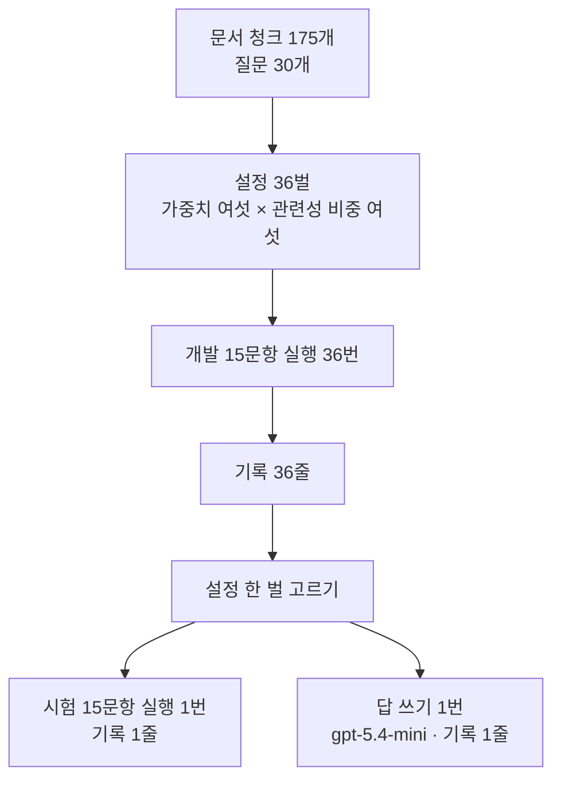
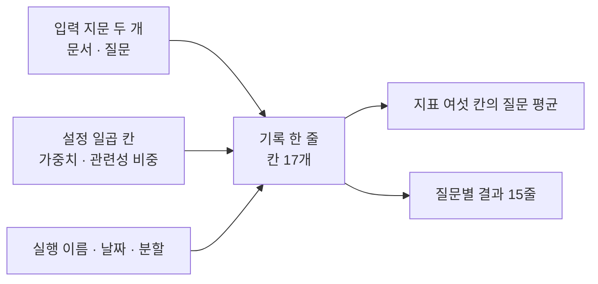
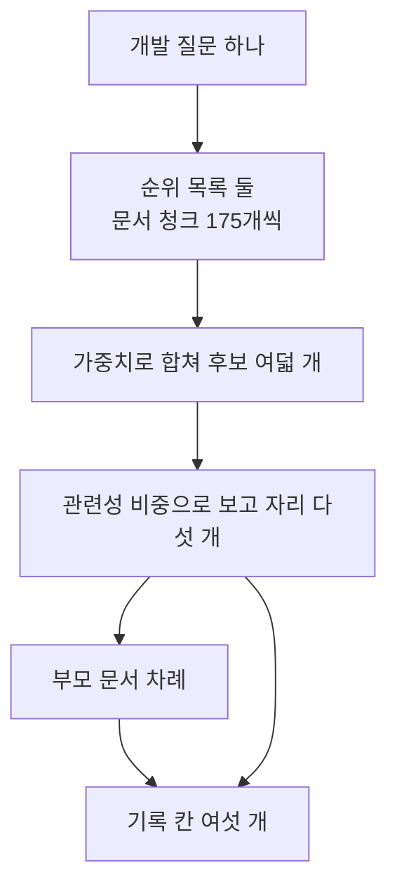
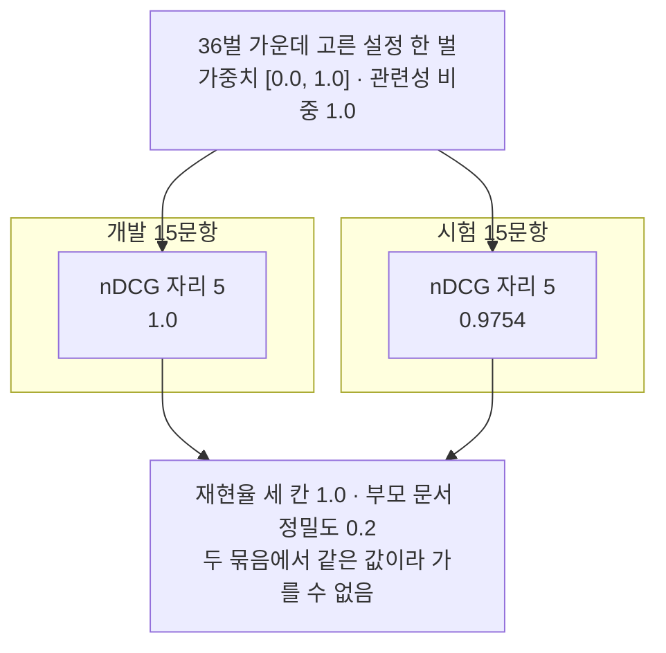

# 12-종합-튜닝과-실험-로그

## _src 본문 (HTML 원본)

```html
<!--meta: 강의 1h | 실습 1h | 코드 notebooks/12-종합-튜닝과-실험-로그.ipynb | 새 용어 4 -->
<h2 id="b1"><span class="no">1</span>학습 목표</h2><div class="goal"><ul><li>이 절을 마치면 손잡이 두 개를 곱해 설정 여러 벌을 만들 수 있습니다.</li><li>설정마다 잰 값을 한 줄로 남겨 어떤 입력에서 잰 값인지 다시 볼 수 있습니다.</li><li>개발 묶음으로 설정을 고른 뒤 시험 묶음을 한 번만 여는 차례를 지킬 수 있습니다.</li></ul></div>
<h2 id="b2"><span class="no">2</span>이 내용을 배우는 이유</h2><p>07~11절에서 바꿀 수 있는 자리를 여러 개 보았습니다. 후보 수와 리랭커, 넘길 부모 수, 관련성 비중, 질문 재작성이 그것입니다. 실무에서는 이 가운데 어떤 값으로 쓸지 한 번은 정해야 합니다.</p><p>값을 하나씩 바꾸다 보면 어느 설정에서 어떤 값이 나왔는지 잊습니다. 기억 대신 파일에 남기면 나중에 같은 조건으로 다시 잴 수 있습니다. 이 절은 설정과 잰 값과 입력 지문을 한 줄에 담아 남깁니다.</p><p>고를 때 본 질문으로 마지막 성적을 매기면 그 성적은 실제보다 높게 나옵니다. 그래서 Ch 11이 질문 서른 개를 개발 열다섯과 시험 열다섯으로 갈라 두었습니다. 이 절은 그 약속을 지키는 차례를 코드로 만듭니다.</p>
<h2 id="b3"><span class="no">3</span>앞에서 배운 내용</h2><p>06절 <code>fuse_rank()</code>는 순위 목록 여러 개를 자리 번호만으로 합칩니다. 목록마다 줄 가중치는 인자로 받습니다. 이 절은 그 가중치를 바꿔 볼 자리 하나로 씁니다.</p><p>10절 MMR은 관련성 비중 하나로 관련성과 흩어짐 사이를 정합니다. 함수 <code>mmr_pick()</code>은 후보 목록에서 보고 자리만큼 골라 냅니다. 이 절은 그 비중을 바꿔 볼 자리 둘째로 씁니다.</p><p>08절에서 보고 자리를 5로 정하고 문서 청크 정밀도를 만들었습니다. 09·11절에서 후보의 부모 문서를 중복 없이 뽑는 <code>parent_ids_of()</code>를 다시 썼습니다. 부모 문서 재현율은 08절처럼 자리 3에서 잽니다.</p><p>Ch 11 02~04절에서 재현율과 정밀도와 nDCG를 파이썬 함수로 만들었습니다. 기록 파일의 칸 이름이 그 도구 이름이라 같은 계산을 그대로 씁니다. 지문을 만드는 <code>hashlib</code>은 Ch 11 01절에서, 파일 쓰기는 Ch 2 05절에서 배웠습니다.</p><p>노트북은 앞 절과 Ch 11에서 배운 함수 열두 개를 실습 폴더의 도구 파일 <code>notebooks/rag_tools.py</code>에서 가져옵니다. 06절 <code>fuse_rank()</code>와 10절 <code>mmr_pick()</code>, Ch 11 지표 함수 세 개가 그 가운데 있습니다. 10절 <code>mmr_pick()</code>은 문서 청크 벡터 짝 사전을 다섯째 인자로 받는 판입니다.</p><p>07·08절 리랭커는 이 절에서 쓰지 않습니다. 설정마다 열다섯 질문을 리랭킹하면 호출이 오백 번을 넘습니다. 08절이 「이 조건에서는 어느 리랭커가 낫다고 말할 수 없다」로 끝난 것도 함께 셈에 넣었습니다.</p><p>Ch 11이 정한 약속대로 시험 열다섯 문항은 설정을 다 고른 뒤에 엽니다. 이 절이 그 한 번을 씁니다. 답을 쓰는 모델은 11절과 같은 <code>gpt-5.4-mini</code>입니다.</p>
<h2 id="b4"><span class="no">4</span>핵심 개념</h2><h3>비유로 시작하기</h3><p>탁자 위에 연습용 자물쇠가 여러 개 놓여 있다고 생각해 봅니다. 열쇠 꾸러미에서 열쇠를 골라 몇 번이든 대 볼 수 있습니다. 옆에는 봉한 띠가 붙은 상자가 하나 있고 여기에는 고른 열쇠를 한 번만 씁니다.</p>
{{img:12-5-연습-자물쇠와-봉한-상자|왼쪽 절반에 열쇠 꾸러미를 든 손과 나무 탁자 위 자물쇠 여섯 개가 있고 가는 회색 줄 여러 개가 꾸러미에서 자물쇠들로 갈라지며 오른쪽 절반에는 봉한 띠가 붙은 상자 하나와 앞면 자물쇠에 이미 꽂힌 열쇠가 있고 그 자물쇠로 가는 줄은 하나뿐이며 가운데 아래에 줄만 그려진 공책이 펼쳐져 있는 그림|연습 자물쇠 여섯 개에는 열쇠를 여러 번 대 보지만 봉한 상자 하나에는 고른 열쇠를 한 번만 씁니다.}}
<p class="look"><b>그림 읽기</b> — 왼쪽 절반에서 손이 열쇠 꾸러미를 들고 있습니다. 가는 회색 줄 여러 개가 꾸러미에서 나와 탁자 위 자물쇠 여섯 개로 갈라집니다. 오른쪽 절반에는 봉한 띠가 붙은 상자가 있고 앞면 자물쇠에 열쇠 하나가 이미 꽂혀 있습니다. 그 자물쇠로 가는 줄은 하나뿐입니다. 가운데 아래 공책은 어느 열쇠를 대 보았는지 적어 두는 자리입니다.</p>
<table><thead><tr><th>말</th><th>뜻</th></tr></thead><tbody><tr><td>손잡이(knob)</td><td>실험에서 값을 바꿔 보는 설정 항목 하나입니다. 이 절의 손잡이는 가중치와 관련성 비중 두 개입니다.</td></tr><tr><td>설정 한 벌(configuration)</td><td>손잡이마다 값을 하나씩 정해 묶은 것입니다. 이 절에서는 설정 한 벌이 기록 한 줄이 됩니다.</td></tr><tr><td>입력 지문(fingerprint)</td><td>파일 내용으로 만든 짧은 글입니다. 파일이 한 글자만 달라져도 값이 바뀝니다.</td></tr><tr><td>실험 기록 한 줄(experiment log row)</td><td>설정 한 벌과 그 설정으로 잰 값을 함께 적은 줄입니다. 파일에 한 줄씩 쌓입니다.</td></tr></tbody></table>
<h3>손잡이 두 개를 곱해 설정 서른여섯 벌 만들기</h3><p>06절 가중치는 뜻 검색과 낱말 검색이 차지하는 몫을 정합니다. 한쪽만 쓰는 값을 양 끝에 두고 모두 여섯 가지를 골랐습니다. 10절 관련성 비중은 1.0에서 0.0까지 0.2씩 내려 여섯 가지를 골랐습니다.</p><p>두 손잡이를 곱하면 설정이 서른여섯 벌입니다. 나머지 값은 모두 앞 절 그대로 둡니다. 순위 상수 60과 후보 수 8, 보고 자리 5, 재현율 자리 3이 그것입니다.</p>
{{mermaid:12-1-설정-서른여섯-벌과-두-번의-실행|위에서 아래로 내려가는 흐름도로 맨 위 초록 상자 문서 청크 175개와 질문 30개가 파란 상자 설정 36벌로 이어지고 그 아래 파란 상자 개발 15문항 실행 36번과 노란 상자 기록 36줄을 지나 파란 상자 설정 한 벌 고르기로 모이며 거기서 왼쪽 파란 상자 시험 15문항 실행 1번 기록 1줄과 오른쪽 보라 상자 답 쓰기 1번 기록 1줄로 갈라지는 그림|설정 서른여섯 벌을 개발 열다섯 문항에서 재고 고른 한 벌만 시험과 답 쓰기에 한 번씩 씁니다.}}
<p class="look"><b>도식 읽기</b> — 위에서 아래로 읽습니다. 맨 위 초록 상자가 07~11절과 같은 자료입니다. 그 아래 파란 상자 세 개가 설정 만들기와 개발 실행과 설정 고르기이고 사이에 노란 상자로 기록이 쌓입니다.</p><p class="look">맨 아래 두 상자는 설정을 고른 뒤에야 도는 자리입니다. 왼쪽 파란 상자가 시험 열다섯 문항 한 번이고 오른쪽 보라 상자가 답을 쓰는 모델 한 번입니다. 두 상자도 기록을 한 줄씩 남깁니다.</p>
<h3>기록 한 줄에 무엇을 담는가</h3><p>같은 설정으로 다시 재려면 설정만 적어서는 모자랍니다. 어떤 문서와 어떤 질문으로 쟀는지도 함께 있어야 합니다. 그래서 두 파일의 입력 지문을 한 줄에 같이 적습니다.</p><p>기록 한 줄에는 칸이 열일곱 개 있습니다. 실행 이름과 날짜, 입력 지문 두 개, 설정 일곱 칸이 앞쪽입니다. 뒤쪽은 지표 여섯 칸의 질문 평균과 난이도 갈래별 평균, 질문별 결과 열다섯 줄입니다.</p>
{{mermaid:12-2-기록-한-줄에-담는-것|왼쪽에서 오른쪽으로 가는 흐름도로 왼쪽 위 초록 상자 입력 지문 두 개와 가운데 파란 상자 설정 일곱 칸과 아래 파란 상자 실행 이름 날짜 분할이 가운데 노란 상자 기록 한 줄 칸 17개로 모이고 거기서 오른쪽 노란 상자 두 개 지표 여섯 칸의 질문 평균과 질문별 결과 15줄로 갈라지는 그림|기록 한 줄에는 입력 지문과 설정과 실행 이름이 함께 들어가고 지표 평균과 질문별 결과가 붙습니다.}}
<p class="look"><b>도식 읽기</b> — 왼쪽에서 오른쪽으로 읽습니다. 왼쪽 상자 세 개가 기록에 넣는 것이고 맨 위 초록만 파일에서 온 값입니다. 가운데 노란 상자가 파일에 한 줄로 들어가는 기록이고 칸이 열일곱 개입니다. 오른쪽 노란 상자 두 개는 그 줄 안에 든 값입니다.</p>
<h3>개발로 고르고 시험은 한 번</h3><p>설정을 고를 때 본 질문은 그 설정에 맞춰진 질문이 됩니다. 그 질문으로 다시 재면 값이 실제보다 높게 나옵니다. 그래서 고르는 일과 마지막으로 재는 일을 다른 묶음으로 나눕니다.</p><p>차례는 하나뿐입니다. 개발 열다섯 문항으로 서른여섯 벌을 재고 기록을 본 뒤 한 벌을 고릅니다. 그러고 나서 시험 열다섯 문항을 한 번 엽니다.</p><p>시험 값을 보고 설정을 다시 고르면 시험 묶음이 개발 묶음이 됩니다. 그러면 마지막으로 잰 값이 새 질문에서의 값을 말해 주지 못합니다. 이 절 노트북은 8절에서 고르고 9절에서 한 번 재는 차례를 그대로 따릅니다.</p>
<h2 id="b5"><span class="no">5</span>실행 예제</h2><p>노트북은 설정 서른여섯 벌을 개발 열다섯 문항에 차례로 적용합니다. 기록 서른여섯 줄을 파일에 쓰고 같은 내용의 사본도 남깁니다. 기록을 읽어 설정 한 벌을 고른 뒤 시험 열다섯 문항을 한 번 엽니다.</p><p>임베딩 요청은 문서 청크 1번과 질문 30번으로 모두 서른한 번입니다. 답을 쓰는 모델 요청은 마지막 통합 실행 한 번뿐입니다. 예상 비용은 미화 0.01달러 아래이고 실행은 2분 안팎입니다.</p>
{{mermaid:12-3-설정-하나가-질문-하나를-재는-차례|위에서 아래로 내려가는 흐름도로 맨 위 초록 상자 개발 질문 하나가 파란 상자 순위 목록 둘 문서 청크 175개씩과 파란 상자 가중치로 합쳐 후보 여덟 개와 파란 상자 관련성 비중으로 보고 자리 다섯 개를 지나 파란 상자 부모 문서 차례로 가고 보고 자리 상자와 부모 차례 상자에서 화살표 두 개가 맨 아래 노란 상자 기록 칸 여섯 개로 모이는 그림|질문 하나는 순위 목록 둘과 후보 여덟 개와 보고 자리 다섯 개를 지나 기록 칸 여섯 개가 됩니다.}}
<p class="look"><b>도식 읽기</b> — 위에서 아래로 읽습니다. 파란 상자 두 개가 이 절의 손잡이가 들어가는 자리입니다. 위쪽은 가중치로 후보를 자르는 자리이고 아래쪽은 관련성 비중으로 보고 자리를 고르는 자리입니다.</p><p class="look">맨 아래 노란 상자로 화살표가 두 개 들어옵니다. 왼쪽 화살표는 부모 문서 차례에서 오고 오른쪽 화살표는 보고 자리 다섯 개에서 옵니다. 부모 문서로 재는 칸과 문서 청크로 재는 칸이 함께 있기 때문입니다.</p>
{{notebook:12-종합-튜닝과-실험-로그}}
<p class="look"><b>확인할 점</b> — 노트북 7절 첫 표에서 값이 한 가지뿐인 칸 넷을 봅니다. 줄 <code>recall_at_3</code>·<code>recall_at_5</code>·<code>recall_at_50</code>이 모두 <code>[1.0]</code>이고 <code>precision_at_5</code>가 <code>[0.2]</code>입니다. 8절에서 고른 설정 두 줄과 9절 표의 <code>ndcg_at_5 | 1.0 | 0.9754</code>를 이어서 봅니다. 10절 마지막 세 셀에서 답 한 문단과 출처 표시 <code>[E01 p.3]</code>도 확인합니다.</p>
<h2 id="b6"><span class="no">6</span>실험 결과 해석</h2><p>서른여섯 줄에서 지표 칸마다 서로 다른 값을 모아 보았습니다. 여섯 칸 가운데 넷은 값이 한 가지뿐이었습니다.</p>
<table><thead><tr><th>기록 칸</th><th>서른여섯 줄에 나온 서로 다른 값</th></tr></thead><tbody><tr><td>recall_at_3</td><td>1.0</td></tr><tr><td>recall_at_5</td><td>1.0</td></tr><tr><td>recall_at_50</td><td>1.0</td></tr><tr><td>precision_at_5</td><td>0.2</td></tr><tr><td>ndcg_at_5</td><td>0.9667 · 0.9754 · 1.0</td></tr><tr><td>chunk_precision_at_5</td><td>0.64에서 0.88까지 열다섯 가지</td></tr></tbody></table>
<p>재현율 세 칸은 서른여섯 줄이 모두 1.0이라 설정을 가를 수 없습니다. 부모 문서가 6건뿐이고 정답 부모가 늘 앞자리에 있기 때문입니다. 07~11절에서 본 천장이 여기서도 그대로입니다.</p><p>부모 문서 정밀도도 서른여섯 줄이 모두 0.2입니다. 질문마다 정답 부모가 한 건이고 보고 자리가 다섯이라 가장 큰 값이 0.2입니다. 이 칸은 설정과 무관하게 정해진 값이므로 고르는 데 쓰지 않습니다.</p><p>남은 칸은 nDCG 자리 5와 문서 청크 정밀도 자리 5 둘입니다. 손잡이 값별로 두 칸의 질문 평균을 냈습니다.</p>
<table><thead><tr><th>가중치(뜻 검색 · 낱말 검색)</th><th>문서 청크 정밀도 자리 5 평균</th><th>nDCG 자리 5 평균</th></tr></thead><tbody><tr><td>1.0, 0.0</td><td>0.68</td><td>0.9681</td></tr><tr><td>3.0, 1.0</td><td>0.7489</td><td>0.9737</td></tr><tr><td>2.0, 1.0</td><td>0.7444</td><td>0.978</td></tr><tr><td>1.0, 1.0</td><td>0.7556</td><td>0.9795</td></tr><tr><td>1.0, 2.0</td><td>0.7578</td><td>0.9795</td></tr><tr><td>0.0, 1.0</td><td>0.7178</td><td>1.0</td></tr></tbody></table>
<table><thead><tr><th>관련성 비중</th><th>문서 청크 정밀도 자리 5 평균</th><th>nDCG 자리 5 평균</th></tr></thead><tbody><tr><td>1.0</td><td>0.8156</td><td>0.9795</td></tr><tr><td>0.8</td><td>0.7556</td><td>0.9766</td></tr><tr><td>0.6</td><td>0.72</td><td>0.9766</td></tr><tr><td>0.4</td><td>0.7067</td><td>0.9766</td></tr><tr><td>0.2</td><td>0.7044</td><td>0.9751</td></tr><tr><td>0.0</td><td>0.7022</td><td>0.9944</td></tr></tbody></table>
<p>관련성 비중 칸에서 두 지표의 방향이 서로 어긋납니다. 비중을 1.0에서 0.0으로 내리면 문서 청크 정밀도 평균은 가장 높은 줄에서 가장 낮은 줄로 갑니다. 같은 방향에서 nDCG 자리 5 평균은 0.9795에서 0.9944로 올라갑니다.</p><p>어느 칸으로 고르느냐에 따라 고르는 값이 달라진다는 뜻입니다. 이 노트북은 값이 가장 잘게 갈린 문서 청크 정밀도 자리 5로 골랐습니다. 두 칸이 어긋난 까닭은 이번에 확인하지 않았습니다.</p><p>고른 줄은 가중치 <code>[0.0, 1.0]</code>과 관련성 비중 <code>1.0</code>입니다. 1차 후보를 낱말 검색 순위만으로 고르고 MMR이 닮음을 빼지 않은 설정입니다. 그 줄의 nDCG 자리 5는 1.0이었고 이는 열다섯 질문 모두 정답 부모가 1위였다는 뜻입니다.</p>
{{mermaid:12-4-개발에서-고르고-시험에서-한-번|위에서 아래로 내려가는 흐름도로 맨 위 파란 상자 36벌 가운데 고른 설정 한 벌 가중치 0.0과 1.0 관련성 비중 1.0에서 두 칸으로 갈리고 왼쪽 칸 제목 개발 15문항 아래에 노란 상자 nDCG 자리 5 1.0이 있고 오른쪽 칸 제목 시험 15문항 아래에 노란 상자 nDCG 자리 5 0.9754가 있으며 두 노란 상자에서 맨 아래 회색 상자 재현율 세 칸 1.0과 부모 문서 정밀도 0.2는 두 묶음에서 같은 값이라 가를 수 없음으로 화살표가 모이는 그림|개발 열다섯 문항에서 1.0이던 nDCG 자리 5가 같은 설정의 시험 열다섯 문항에서 0.9754가 되었습니다.}}
<p class="look"><b>도식 읽기</b> — 맨 위 파란 상자가 두 칸에 함께 걸리는 설정 한 벌입니다. 칸 제목 <code>개발 15문항</code>이 왼쪽이고 <code>시험 15문항</code>이 오른쪽입니다. 왼쪽 노란 상자가 <code>1.0</code>이고 오른쪽 노란 상자가 <code>0.9754</code>입니다. 맨 아래 회색 상자는 두 칸에서 모두 확인한 값이고 이 값으로는 두 묶음을 가를 수 없습니다.</p>
<p>고른 설정 한 벌을 시험 열다섯 문항에 한 번만 적용했습니다. 여섯 칸을 개발 값과 나란히 놓으면 아래와 같습니다.</p>
<table><thead><tr><th>기록 칸</th><th>개발 15문항</th><th>시험 15문항</th></tr></thead><tbody><tr><td>recall_at_3</td><td>1.0</td><td>1.0</td></tr><tr><td>recall_at_5</td><td>1.0</td><td>1.0</td></tr><tr><td>recall_at_50</td><td>1.0</td><td>1.0</td></tr><tr><td>precision_at_5</td><td>0.2</td><td>0.2</td></tr><tr><td>ndcg_at_5</td><td>1.0</td><td>0.9754</td></tr><tr><td>chunk_precision_at_5</td><td>0.88</td><td>0.8533</td></tr></tbody></table>
<p>nDCG 자리 5가 1.0에서 0.9754로 내려갔습니다. 개발 열다섯 문항에 맞춰 고른 설정이 새 문항에서 그대로 나오지는 않은 것입니다. 이 차이가 시험 묶음을 마지막까지 열지 않는 까닭입니다.</p><p>마지막 통합 실행은 개발 문항 <code>Q002</code> 하나로 했습니다. 고른 설정으로 찾은 문서 청크 세 개의 본문과 출처 표시를 모델에 넣었습니다. 답 한 문단과 출처 <code>[E01 p.3]</code>이 나왔고 그 출처는 넣은 자리 안에 있었습니다.</p><p>이 한 번은 단계가 끝까지 이어지는지만 본 실행입니다. 답이 맞는지는 재지 않았고 기록의 <code>retrieval_metrics</code> 칸에도 <code>None</code>을 적었습니다. 문서 청크 175개와 질문 서른 개에서 한 번 실행한 값입니다.</p>
<h2 id="b7"><span class="no">7</span>주의할 점과 실무 메모</h2><ul><li>시험 값을 보고 설정을 다시 고르지 않습니다. 이 노트북은 8절에서 고르고 9절에서 한 번 잽니다.</li><li>재현율 세 칸과 부모 문서 정밀도는 이 자료에서 값이 하나뿐입니다. 천장에 닿은 칸은 값 그대로 싣되 설정을 고르는 근거로 쓰지 않습니다.</li><li>문서 청크 정밀도 평균은 다시 실행하면 소수 셋째 자리에서 흔들립니다. 같은 글을 보내도 임베딩 값이 호출마다 아주 조금 달라지기 때문입니다.</li><li>그래서 그림 라벨과 정리 세 줄에는 새 커널 두 번에서 모두 같았던 값만 넣었습니다. 흔들린 값은 표와 이 목록에만 적었습니다.</li><li>고른 줄의 문서 청크 정밀도 <code>0.88</code>도 한 번은 <code>0.8667</code>이었습니다. 고른 설정은 두 번 모두 같았습니다.</li><li>손잡이 두 가지와 값 여섯 개씩은 흐름을 보여 주려고 정한 예입니다. 탐색 실행에서 계약 네 칸이 모두 천장이었기에 문서 청크 정밀도를 고르는 칸으로 두었습니다.</li><li>순위 상수를 손잡이로 두지 않았습니다. 06절에서 정한 60을 모든 설정에 그대로 썼습니다.</li><li>리랭커는 이 절에서 한 번도 부르지 않았습니다. 서른여섯 벌에 넣으면 호출이 오백 번을 넘고, 통합 실행에만 넣으면 고른 설정과 실제로 돈 설정이 달라집니다.</li><li>답 품질은 재지 않았습니다. 답이 맞는지, 근거가 있는지, 출처 표시가 옳은지는 Ch 15에서 따로 봅니다.</li><li>통합 실행 한 번과 서른여섯 줄의 값을 같은 표에 놓지 않습니다. 질문 수와 재는 단위가 다릅니다.</li><li>기록 파일은 실행할 때마다 덮어씁니다. 사본 폴더 이름에 실행한 시각이 들어가므로 그때 잰 값은 사본에 남습니다.</li><li>기록 칸 여섯 개 가운데 네 개는 검사 스크립트가 다시 계산해 대조합니다. 그 네 개는 <code>recall_at_5</code>·<code>recall_at_50</code>·<code>precision_at_5</code>·<code>ndcg_at_5</code>입니다. 이름과 계산을 바꾸면 그 검사가 멈춥니다.</li><li>난이도 갈래 평균은 갈래마다 질문 수가 달라 갈래끼리 견주지 않았습니다. 기록에 남기기만 했습니다.</li><li>걸린 시간과 보낸 글의 길이는 이번에 재지 않았습니다. 요청 수만 준비물에 적었습니다.</li><li>01~06절 값과 이 절 값을 나란히 놓지 않습니다. 문서와 질문과 재는 단위가 모두 다릅니다.</li></ul>
<h2 id="b8"><span class="no">8</span>정리와 다음 절</h2><ul><li>손잡이 두 개를 곱해 설정 서른여섯 벌을 만들고 개발 열다섯 문항에서 모두 쟀습니다.</li><li>지표 여섯 칸 가운데 넷은 값이 한 가지뿐이라 설정을 가르지 못했습니다.</li><li>고른 설정의 nDCG 자리 5는 개발에서 1.0이었고 시험 열다섯 문항에서 0.9754였습니다.</li></ul><p><strong>다음 학습과 이어지는 지점</strong> — 다음 13절은 이 챕터의 실습입니다. 05절 순위 둘과 06절 가중치, 08절 보고 자리와 두 지표, 이 절의 답 쓰기를 한 상황에 모아 함께 실행합니다. 가중치 한 자리만 바꿔 보고 자리와 답이 어떻게 달라지는지 봅니다. 뒤 챕터로 이어지는 지점은 13절 정리에 적었습니다.</p>
<h2 id="b9"><span class="no">9</span>복습 문제</h2><details class="quiz" open><summary>문제 4개 · 해설 포함</summary><p class="quiz-q">1. 이 절의 손잡이 두 개는 무엇입니까?</p><p class="quiz-a">06절 가중치와 10절 관련성 비중입니다. 여섯 가지씩 곱해 설정 서른여섯 벌을 만들었습니다. 틀렸다면 「손잡이 두 개를 곱해 설정 서른여섯 벌 만들기」를 다시 읽습니다.</p><p class="quiz-q">2. 재현율 세 칸으로 설정을 고르지 못한 까닭은 무엇입니까?</p><p class="quiz-a">서른여섯 줄이 모두 <code>1.0</code>이었기 때문입니다. 부모 문서가 6건뿐이고 정답 부모가 늘 앞자리에 있었습니다. 틀렸다면 6절 첫 표를 다시 읽습니다.</p><p class="quiz-q">3. 시험 열다섯 문항은 언제 엽니까?</p><p class="quiz-a">설정을 다 고른 뒤에 한 번만 엽니다. 고를 때 본 질문으로 마지막 성적을 매기면 그 성적이 실제보다 높게 나옵니다. 틀렸다면 「개발로 고르고 시험은 한 번」을 다시 읽습니다.</p><p class="quiz-q">4. 기록 한 줄에 입력 지문을 함께 적는 까닭은 무엇입니까?</p><p class="quiz-a">어떤 문서와 어떤 질문으로 잰 값인지 남기기 위해서입니다. 파일이 한 글자만 달라져도 지문이 바뀌므로 다른 입력에서 잰 값을 섞지 않을 수 있습니다. 틀렸다면 「기록 한 줄에 무엇을 담는가」를 다시 읽습니다.</p></details>
<h2 id="b10"><span class="no">10</span>참고 자료</h2><ul><li><div><a href="https://www.elastic.co/docs/reference/elasticsearch/rest-apis/reciprocal-rank-fusion">Elasticsearch Reciprocal Rank Fusion</a></div>이 절이 가중치를 붙여 쓴 순위 합치기의 식과 순위 상수 설명 · 확인 2026-09-09</li><li><div><a href="https://platform.openai.com/docs/guides/embeddings">OpenAI Embeddings 안내</a></div>질문과 문서 청크를 벡터로 바꿀 때 쓴 모델과 차원 수 설정 설명 · 확인 2026-09-18</li><li><div><a href="https://docs.langchain.com/oss/python/concepts/providers-and-models">LangChain 모델과 provider</a></div>마지막 통합 실행에서 답을 쓰는 모델을 준비하는 방법 설명 · 확인 2026-09-09 · LangChain 1.4 기준</li></ul>
```

## 노트북 셀 (순서대로)

### [0] markdown {'html': 'skip'}

# 종합 튜닝과 실험 로그

**이 노트북에서 할 일**

1. 06절 가중치와 10절 관련성 비중을 곱해 설정 서른여섯 벌을 만듭니다.
2. 개발 열다섯 문항으로 서른여섯 벌을 재고 기록 파일에 남깁니다.
3. 기록을 보고 설정 한 벌을 고른 뒤 시험 열다섯 문항에 한 번만 적용합니다.
4. 고른 설정으로 찾은 글을 모델에 넣어 답을 쓰고 마지막 기록을 남깁니다.

**준비물** — 프로젝트 폴더의 `.env`에 `OPENAI_API_KEY`가 있어야 합니다.
임베딩 요청은 문서 청크 1번과 질문 30번으로 모두 서른한 번입니다.
답을 쓰는 모델 요청은 통합 실행 한 번뿐입니다.
예상 비용은 미화 0.01달러 아래이고 실행 시간은 2분 안팎입니다.

**쓰는 파일** — 이 절은 이 챕터에서 처음으로 파일을 씁니다.
실습 폴더 `runs/` 아래에 기록 파일 세 개와 같은 내용의 사본 세 개를 만듭니다.
사본 폴더 이름에는 실행한 시각이 들어가므로 실행할 때마다 새로 생깁니다.

**데이터** — 세 파일 모두 실습 묶음에 들어 있습니다.

- 문서 `labs/part3/ch12-retrieval-tuning/data/advanced-documents.json`(부모 6건·문서 청크 175개)
- 질문 `labs/part3/ch12-retrieval-tuning/data/advanced-queries.json`(30개)
- Ch 11 원본 질문 `labs/part3/ch11-evaluation/data/evaluation-queries.jsonl`(30줄)

**강의와 실습 범위** — 강의 시간에는 5~10절을 읽습니다.
지표와 기록 한 줄을 만드는 자리가 5절이고 설정 서른여섯 벌이 6절입니다.
7절이 개발 결과 읽기, 8절이 설정 고르기, 9절이 시험 한 번입니다.
1~4절은 함께 실행하고 10절은 실습 시간에 다시 읽습니다.

**기준 버전** — 첫 셀에서 여섯 패키지를 고정한 판으로 설치합니다.
교재 출력은 Linux의 Python 3.12.13으로 만들었습니다.
다른 판과 Windows·macOS에서는 이번에 실행하지 않았습니다.

실습 폴더 `labs/part3/ch12-retrieval-tuning`에서 `uv sync --locked`를 실행합니다.
그다음 이 폴더의 `.venv` 커널을 고르고 첫 셀부터 순서대로 실행합니다.

### [1] markdown {'html': 'skip'}

## 오늘 볼 그림


맨 위 초록 상자가 07~11절과 같은 자료입니다.
그 아래 파란 상자에서 손잡이 두 개를 곱해 설정 서른여섯 벌을 만듭니다.
개발 열다섯 문항으로 서른여섯 번 재고 노란 상자에 기록 서른여섯 줄을 남깁니다.
그 기록을 보고 설정 한 벌을 고른 뒤에야 시험 열다섯 문항을 한 번 엽니다.
맨 아래 오른쪽 보라 상자가 이 절에서 답을 쓰는 모델을 부르는 한 자리입니다.

### [2] markdown {}

## 1. 준비

첫 셀은 패키지 여섯 개를 설치하고 설치된 버전을 출력합니다.
11절과 같은 여섯 개입니다.

### [3] code {'execution': {'iopub.execute_input': '2026-09-21T08:20:18.805786Z', 'iopub.status.busy': '2026-09-21T08:20:18.805664Z', 'iopub.status.idle': '2026-09-21T08:20:19.297224Z', 'shell.execute_reply': '2026-09-21T08:20:19.296627Z'}, 'lesson_role': 'setup'}

```python
# 이 절에서 쓰는 패키지를 설치하고 버전을 확인합니다
%pip install -q "langchain==1.4.0" "langchain-openai==1.6.1" "python-dotenv==1.2.3" "kiwipiepy==0.23.2" "rank-bm25==0.2.2" "numpy==2.5.3"
from importlib.metadata import version

print("langchain:", version("langchain"))
print("langchain-openai:", version("langchain-openai"))
print("python-dotenv:", version("python-dotenv"))
print("kiwipiepy:", version("kiwipiepy"))
print("rank-bm25:", version("rank-bm25"))
print("numpy:", version("numpy"))
```

출력:
```
Note: you may need to restart the kernel to use updated packages.
langchain: 1.4.0
langchain-openai: 1.6.1
python-dotenv: 1.2.3
kiwipiepy: 0.23.2
rank-bm25: 0.2.2
numpy: 2.5.3

```

### [4] markdown {}

**결과 읽기** — 설치가 끝나면 `langchain: 1.4.0`과 `rank-bm25: 0.2.2`가 보입니다.
마지막 줄 `numpy: 2.5.3`은 도구 파일이 벡터 계산에 쓰는 패키지입니다. 여섯 줄이 모두 보이면 다음 셀로 넘어갑니다.

다음 셀은 이 절에서 쓸 이름 여덟 개를 불러옵니다.

앞에서 배운 함수는 `rag_tools.py`에 모아 두었습니다. 파일을 열면 코드를 볼 수 있습니다. 노트북과 같은 폴더(`notebooks/`)에 있는 파일입니다.

이 노트북은 04·06·07·08·10절 함수 여섯 개와 Ch 11 지표 함수 세 개를 가져옵니다.
04절 `kiwi_terms()`, 06절 `fuse_rank()`, 07절 `parent_ids_of()`, 10절 `mmr_pick()`입니다.
08절 `eligible_items()`·`chunk_precision_at()`, Ch 11 `recall_at()`·`precision_at()`·`ndcg_at()`도 가져옵니다.
07~11절과 같은 문서 청크 판 순위 함수 세 개도 함께 가져옵니다.
인자 모양은 4절에서 정리합니다.

### [5] code {'execution': {'iopub.execute_input': '2026-09-21T08:20:19.298256Z', 'iopub.status.busy': '2026-09-21T08:20:19.298160Z', 'iopub.status.idle': '2026-09-21T08:20:20.341928Z', 'shell.execute_reply': '2026-09-21T08:20:20.341607Z'}, 'lesson_role': 'setup'}

```python
# 자료 읽기·지문 만들기·폴더 만들기·시간 적기와 검색 도구를 불러옵니다
import hashlib
import json
import os
import time

from kiwipiepy import Kiwi
from langchain.chat_models import init_chat_model
from langchain_openai import OpenAIEmbeddings
from rank_bm25 import BM25Okapi
# 04·06·07·08·10절과 Ch 11 함수, 문서 청크 판 순위 함수 열두 개를 도구 파일에서 가져옵니다
from rag_tools import chunk_precision_at, eligible_items, fuse_rank, kiwi_terms, mmr_pick
from rag_tools import ndcg_at, parent_ids_of, precision_at, rank_chunks_by_bm25
from rag_tools import rank_chunks_by_distance, recall_at, unique_chunk_ids

print("불러온 이름:", "hashlib", "json", "os", "time", "Kiwi", "init_chat_model", "OpenAIEmbeddings", "BM25Okapi")
```

출력:
```
불러온 이름: hashlib json os time Kiwi init_chat_model OpenAIEmbeddings BM25Okapi

```

### [6] markdown {}

**결과 읽기** — 출력 줄은 `불러온 이름:` 뒤에 이름 여덟 개가 붙은 한 줄입니다.
이름 `hashlib`과 `time`이 07~11절에는 없던 것입니다.
지문을 만들 때 `hashlib`을 쓰고 실행 이름에 시각을 적을 때 `time`을 씁니다.
도구 파일에서 가져온 함수 열두 개는 출력하지 않습니다.

### [7] markdown {}

API 키가 있는지 확인합니다. `True` 값이 나오면 다음으로 넘어갑니다.

### [8] code {'execution': {'iopub.execute_input': '2026-09-21T08:20:20.346063Z', 'iopub.status.busy': '2026-09-21T08:20:20.345772Z', 'iopub.status.idle': '2026-09-21T08:20:20.349566Z', 'shell.execute_reply': '2026-09-21T08:20:20.349332Z'}, 'lesson_role': 'setup'}

```python
# .env 파일에서 OpenAI API 키를 읽습니다(키 값은 출력하지 않습니다)
import os
from dotenv import find_dotenv, load_dotenv

env_path = find_dotenv(usecwd=True)
load_dotenv(env_path)
has_key = os.getenv("OPENAI_API_KEY") is not None
print("OPENAI_API_KEY 설정 여부:", has_key)
assert has_key, "프로젝트 폴더의 .env 파일에 OPENAI_API_KEY를 적어 주세요."
```

출력:
```
OPENAI_API_KEY 설정 여부: True

```

### [9] markdown {}

실습에 쓸 모델을 준비합니다.
temperature 값을 0으로 두어 매번 비슷한 문장을 고르게 합니다.
설정 `reasoning_effort="none"`은 답을 쓰기 전에 따로 생각하는 단계를 두지 않게 합니다.

### [10] code {'execution': {'iopub.execute_input': '2026-09-21T08:20:20.350093Z', 'iopub.status.busy': '2026-09-21T08:20:20.350040Z', 'iopub.status.idle': '2026-09-21T08:20:20.653646Z', 'shell.execute_reply': '2026-09-21T08:20:20.653373Z'}}

```python
# 실습에 쓸 모델을 준비합니다
model = init_chat_model(
    "openai:gpt-5.4-mini",
    temperature=0,
    reasoning_effort="none",
)
print("모델 이름:", model.model_name)
print("temperature:", model.temperature)
```

출력:
```
모델 이름: gpt-5.4-mini
temperature: 0.0

```

### [11] markdown {}

**결과 읽기** — 모델 이름 `gpt-5.4-mini`, temperature `0.0`이 보이면 준비가 끝났습니다.
이 노트북의 출력은 2026-09-21에 이 모델로 실행한 결과입니다.

### [12] markdown {}

다음 셀은 프로젝트 맨 위 폴더를 찾습니다. 01~11절과 같은 코드입니다.

### [13] code {'execution': {'iopub.execute_input': '2026-09-21T08:20:20.654573Z', 'iopub.status.busy': '2026-09-21T08:20:20.654517Z', 'iopub.status.idle': '2026-09-21T08:20:20.656604Z', 'shell.execute_reply': '2026-09-21T08:20:20.656325Z'}, 'lesson_role': 'setup'}

```python
# 노트북을 어느 폴더에서 열어도 프로젝트 맨 위를 찾게 후보 세 개를 차례로 봅니다
candidates = [".", "../../..", "../../../.."]
root_path = None
for candidate in candidates:
    if os.path.exists(candidate + "/labs/part3/ch12-retrieval-tuning/data"):
        root_path = candidate
        break
print("고른 경로:", root_path)
assert root_path is not None, "notebooks 폴더나 실습 폴더 맨 위에서 노트북을 열어 주세요."
```

출력:
```
고른 경로: .

```

### [14] markdown {}

**결과 읽기** — 출력 줄은 `고른 경로: .`입니다. 확인 줄도 통과했습니다.

다음 셀은 07~11절과 같은 자료 두 벌을 읽습니다.

### [15] code {'execution': {'iopub.execute_input': '2026-09-21T08:20:20.657232Z', 'iopub.status.busy': '2026-09-21T08:20:20.657173Z', 'iopub.status.idle': '2026-09-21T08:20:20.660505Z', 'shell.execute_reply': '2026-09-21T08:20:20.660214Z'}, 'lesson_role': 'setup'}

```python
# 07~11절과 같은 파일 두 벌을 읽습니다
data_path = root_path + "/labs/part3/ch12-retrieval-tuning/data"
with open(data_path + "/advanced-documents.json", encoding="utf-8") as file:
    documents = json.loads(file.read())
with open(data_path + "/advanced-queries.json", encoding="utf-8") as file:
    queries = json.loads(file.read())
parents = documents["parents"]
chunks = documents["chunks"]
print("부모 문서 수:", len(parents))
print("문서 청크 수:", len(chunks))
print("질문 수:", len(queries))
```

출력:
```
부모 문서 수: 6
문서 청크 수: 175
질문 수: 30

```

### [16] markdown {}

**결과 읽기** — `부모 문서 수: 6`과 `문서 청크 수: 175`, `질문 수: 30`이 보입니다.
07~11절과 같은 파일이라 세 값도 같습니다.

## 2. 입력 지문과 값 정하기

기록에는 어떤 입력으로 잰 값인지도 함께 남깁니다.
파일 내용이 한 글자만 달라져도 값이 달라지는 짧은 글을 지문이라고 부릅니다.
다음 셀은 지문을 만드는 함수와 글을 파일로 쓰는 함수를 정의합니다.

### [17] code {'execution': {'iopub.execute_input': '2026-09-21T08:20:20.661087Z', 'iopub.status.busy': '2026-09-21T08:20:20.661036Z', 'iopub.status.idle': '2026-09-21T08:20:20.662669Z', 'shell.execute_reply': '2026-09-21T08:20:20.662341Z'}, 'lesson_role': 'setup', 'upgrade_allow': ['multiple_defs_in_cell']}

```python
# 파일 하나의 지문을 만드는 함수와 글을 파일로 쓰는 함수입니다(Ch 11 01절·Ch 2 05절 코드)
def file_fingerprint(path):
    with open(path, "rb") as file:
        file_bytes = file.read()
    return hashlib.sha256(file_bytes).hexdigest()


def write_text(path, text_value):
    with open(path, "w", encoding="utf-8") as file:
        file.write(text_value)
```

출력:
```

```

### [18] markdown {}

정의 셀이라 출력이 없습니다.
첫 함수는 파일을 바이트로 읽어 SHA-256 지문을 냅니다. Ch 11 01절과 같은 코드입니다.
둘째 함수는 글 하나를 파일로 씁니다. Ch 2 05절에서 배운 모양입니다.

다음 셀은 Ch 11 원본 질문 파일과 이 챕터 복제본이 같은지 보고 지문 두 개를 만듭니다.

### [19] code {'execution': {'iopub.execute_input': '2026-09-21T08:20:20.663227Z', 'iopub.status.busy': '2026-09-21T08:20:20.663175Z', 'iopub.status.idle': '2026-09-21T08:20:20.666539Z', 'shell.execute_reply': '2026-09-21T08:20:20.666222Z'}}

```python
# Ch 11 원본 질문 파일과 이 챕터 복제본이 같은지 보고 두 입력의 지문을 만듭니다
query_source = "labs/part3/ch11-evaluation/data/evaluation-queries.jsonl"
with open(root_path + "/" + query_source, encoding="utf-8") as file:
    source_lines = file.read().splitlines()
source_queries = []
for line in source_lines:
    source_queries.append(json.loads(line))
corpus_fingerprint = file_fingerprint(data_path + "/advanced-documents.json")
query_fingerprint = file_fingerprint(root_path + "/" + query_source)
print("Ch 11 원본 질문 줄 수:", len(source_queries))
print("이 챕터 복제본과 같은가:", source_queries == queries)
print("문서 지문 앞 열 글자:", corpus_fingerprint[:10])
assert source_queries == queries, "Ch 11 원본 질문과 이 챕터 복제본이 다릅니다."
```

출력:
```
Ch 11 원본 질문 줄 수: 30
이 챕터 복제본과 같은가: True
문서 지문 앞 열 글자: 832d89c28a

```

### [20] markdown {}

**결과 읽기** — `Ch 11 원본 질문 줄 수: 30`과 `이 챕터 복제본과 같은가: True`가 보입니다.
줄 `문서 지문 앞 열 글자:` 뒤의 값은 문서 파일의 지문입니다.
지문은 실행마다 같지만 파일을 고치면 달라지므로 본문에 인용하지 않습니다.

다음 셀은 01~11절에서 쓴 값을 그대로 다시 정합니다.

### [21] code {'execution': {'iopub.execute_input': '2026-09-21T08:20:20.667150Z', 'iopub.status.busy': '2026-09-21T08:20:20.667093Z', 'iopub.status.idle': '2026-09-21T08:20:20.669114Z', 'shell.execute_reply': '2026-09-21T08:20:20.668803Z'}}

```python
# 01~11절에서 쓴 값을 그대로 다시 정합니다
keep_tags = ["NNG", "NNP", "NNB", "NR", "VV", "VA", "MAG", "SN", "SL"]
rank_constant = 60
candidate_count = 8
recall_place = 3
report_place = 5
print("남길 품사 표시 수:", len(keep_tags))
print("순위 상수:", rank_constant, "| 후보 수:", candidate_count)
print("부모 문서 재현율을 재는 자리:", recall_place, "| 보고 자리:", report_place)
```

출력:
```
남길 품사 표시 수: 9
순위 상수: 60 | 후보 수: 8
부모 문서 재현율을 재는 자리: 3 | 보고 자리: 5

```

### [22] markdown {}

**결과 읽기** — 줄 `순위 상수: 60 | 후보 수: 8`은 06~11절과 같은 값입니다.
줄 `부모 문서 재현율을 재는 자리: 3 | 보고 자리: 5`도 08~11절과 같습니다.

다음 셀은 이 절에서 바꿔 볼 손잡이 두 가지를 정합니다.
가중치는 06절에서 순위 두 개를 합칠 때 준 몫이고 여섯 가지를 봅니다.
관련성 비중은 10절에서 다양성과 관련성을 맞바꾸던 값이고 여섯 가지를 봅니다.

### [23] code {'execution': {'iopub.execute_input': '2026-09-21T08:20:20.669661Z', 'iopub.status.busy': '2026-09-21T08:20:20.669614Z', 'iopub.status.idle': '2026-09-21T08:20:20.671575Z', 'shell.execute_reply': '2026-09-21T08:20:20.671310Z'}}

```python
# 이 절에서 바꿔 볼 손잡이 두 가지와 기록에 남길 지표 칸 이름을 정합니다
weight_choices = [[1.0, 0.0], [3.0, 1.0], [2.0, 1.0], [1.0, 1.0], [1.0, 2.0], [0.0, 1.0]]
relevance_choices = [1.0, 0.8, 0.6, 0.4, 0.2, 0.0]
metric_names = ["recall_at_3", "recall_at_5", "recall_at_50", "precision_at_5", "ndcg_at_5", "chunk_precision_at_5"]
select_name = "chunk_precision_at_5"
print("가중치 여섯 가지:", weight_choices)
print("관련성 비중 여섯 가지:", relevance_choices)
print("만들 설정 수:", len(weight_choices) * len(relevance_choices))
print("기록에 남길 지표 칸 수:", len(metric_names))
print("설정을 고를 칸:", select_name)
```

출력:
```
가중치 여섯 가지: [[1.0, 0.0], [3.0, 1.0], [2.0, 1.0], [1.0, 1.0], [1.0, 2.0], [0.0, 1.0]]
관련성 비중 여섯 가지: [1.0, 0.8, 0.6, 0.4, 0.2, 0.0]
만들 설정 수: 36
기록에 남길 지표 칸 수: 6
설정을 고를 칸: chunk_precision_at_5

```

### [24] markdown {}

**결과 읽기** — 줄 `만들 설정 수: 36`이 여섯 곱하기 여섯입니다.
줄 `기록에 남길 지표 칸 수: 6` 가운데 넷은 Ch 11 도구가 쓰는 칸 이름입니다.
줄 `설정을 고를 칸: chunk_precision_at_5`가 08~11절에서 쓰던 문서 청크 정밀도입니다.
왜 이 칸으로 고르는지는 7절에서 출력을 보고 정합니다.

## 3. 검색에 쓸 재료 만들기

문서 청크마다 제목과 본문을 이어 붙여 글 하나로 만듭니다.

### [25] code {'execution': {'iopub.execute_input': '2026-09-21T08:20:20.672057Z', 'iopub.status.busy': '2026-09-21T08:20:20.672005Z', 'iopub.status.idle': '2026-09-21T08:20:20.673749Z', 'shell.execute_reply': '2026-09-21T08:20:20.673498Z'}}

```python
# 문서 청크마다 제목과 본문을 이어 붙여 글 하나로 만듭니다(07~11절과 같은 코드)
chunk_texts = []
chunk_ids = []
for chunk in chunks:
    chunk_text = chunk["title"] + " " + chunk["text"]
    chunk_texts.append(chunk_text)
    chunk_ids.append(chunk["chunk_id"])
all_chunk_count = len(chunk_ids)
print("이어 붙인 글 수:", len(chunk_texts))
print("첫 문서 청크 ID:", chunk_ids[0])
```

출력:
```
이어 붙인 글 수: 175
첫 문서 청크 ID: E01-P01-C01

```

### [26] markdown {}

**결과 읽기** — `이어 붙인 글 수: 175`가 보입니다.
줄 `첫 문서 청크 ID: E01-P01-C01`의 이름 앞머리가 그 문서 청크의 부모 문서 ID입니다.

기록에는 문서 ID와 쪽 번호도 함께 남깁니다.
다음 셀은 문서 청크 ID로 부모·쪽·본문을 바로 찾을 수 있게 짝을 만듭니다.

### [27] code {'execution': {'iopub.execute_input': '2026-09-21T08:20:20.674226Z', 'iopub.status.busy': '2026-09-21T08:20:20.674181Z', 'iopub.status.idle': '2026-09-21T08:20:20.676325Z', 'shell.execute_reply': '2026-09-21T08:20:20.675953Z'}}

```python
# 문서 청크 ID로 부모 문서 ID와 쪽 번호와 본문을 바로 찾게 짝을 만듭니다
parent_by_chunk = {}
page_by_chunk = {}
text_by_chunk = {}
for i in range(len(chunks)):
    chunk_id = chunk_ids[i]
    parent_by_chunk[chunk_id] = chunks[i]["parent_id"]
    page_by_chunk[chunk_id] = chunks[i]["page"]
    text_by_chunk[chunk_id] = chunk_texts[i]
print("짝지은 문서 청크 수:", len(parent_by_chunk))
print("첫 문서 청크의 부모 문서 ID:", parent_by_chunk[chunk_ids[0]])
print("첫 문서 청크의 쪽 번호:", page_by_chunk[chunk_ids[0]])
```

출력:
```
짝지은 문서 청크 수: 175
첫 문서 청크의 부모 문서 ID: E01
첫 문서 청크의 쪽 번호: 1

```

### [28] markdown {}

**결과 읽기** — `짝지은 문서 청크 수: 175`가 보입니다.
줄 `첫 문서 청크의 부모 문서 ID: E01`과 `첫 문서 청크의 쪽 번호: 1`이 기록에 들어갈 값입니다.

다음 셀은 문서 청크를 벡터로 바꿉니다. 01~11절과 같은 모델을 씁니다.

### [29] code {'execution': {'iopub.execute_input': '2026-09-21T08:20:20.676801Z', 'iopub.status.busy': '2026-09-21T08:20:20.676759Z', 'iopub.status.idle': '2026-09-21T08:20:21.080294Z', 'shell.execute_reply': '2026-09-21T08:20:21.079072Z'}}

```python
# 01~11절과 같은 모델로 문서 청크를 벡터로 바꿉니다(임베딩 요청 1번)
embedding_model_name = "text-embedding-3-small"
vector_dimensions = 256
embedding_model = OpenAIEmbeddings(model=embedding_model_name, dimensions=vector_dimensions)
chunk_vectors = embedding_model.embed_documents(chunk_texts)
vector_by_chunk = {}
for i in range(len(chunk_ids)):
    vector_by_chunk[chunk_ids[i]] = chunk_vectors[i]
print("임베딩 모델 이름:", embedding_model.model)
print("벡터의 숫자 개수 설정:", embedding_model.dimensions)
print("문서 청크 벡터 수:", len(chunk_vectors))
```

출력:
```
임베딩 모델 이름: text-embedding-3-small
벡터의 숫자 개수 설정: 256
문서 청크 벡터 수: 175

```

### [30] markdown {}

**결과 읽기** — `벡터의 숫자 개수 설정: 256`과 `문서 청크 벡터 수: 175`가 보입니다.
여기까지 임베딩 요청은 한 번입니다.

## 4. 앞 절 함수의 인자 확인하기

앞 절과 Ch 11 함수 열두 개는 준비 셀에서 도구 파일로부터 가져왔습니다.
두 순위와 합치기는 11절과 같은 판입니다. 합치기 `fuse_rank()`는 순위 상수를 셋째 인자로 받습니다.

07절 `parent_ids_of()`와 08절 `chunk_precision_at()`은 짝 사전 `parent_by_chunk`를 인자로 받습니다.
10절 `mmr_pick()`은 도구 파일 판이라 짝 사전 `vector_by_chunk`를 다섯째 인자로 받습니다.
MMR 점수를 내는 10절 함수 네 개는 이 함수 안에서 불립니다.

두 가지만 짚고 넘어갑니다.
Ch 11 04절 `ndcg_at()`은 01~11절에서 쓰지 않았고 이 절에서 처음 다시 씁니다.
기록 파일의 칸 이름이 Ch 11 도구 이름이라 그 계산을 그대로 써야 하기 때문입니다.
정밀도는 이름이 둘입니다. 부모 문서를 세는 쪽이 Ch 11 03절 `precision_at()`이고 문서 청크를 세는 쪽이 08절 `chunk_precision_at()`입니다.

다음 셀은 문서 청크의 검색 낱말 목록으로 BM25 모델을 만듭니다.
분석기를 만드는 줄 `kiwi = Kiwi()`는 1초 안팎 걸립니다.

### [31] code {'execution': {'iopub.execute_input': '2026-09-21T08:20:21.082442Z', 'iopub.status.busy': '2026-09-21T08:20:21.082319Z', 'iopub.status.idle': '2026-09-21T08:20:22.548253Z', 'shell.execute_reply': '2026-09-21T08:20:22.547767Z'}}

```python
# 04~11절과 같은 형태소 분석기로 문서 청크마다 검색 낱말 목록을 만들고 BM25 모델을 만듭니다
kiwi = Kiwi()
kiwi_corpus = []
for text in chunk_texts:
    kiwi_corpus.append(kiwi_terms(kiwi, text, keep_tags))
bm25_model = BM25Okapi(kiwi_corpus)
print("검색 낱말 목록 수:", len(kiwi_corpus))
print("BM25 모델이 본 문서 청크 수:", bm25_model.corpus_size)
print("문서 청크 하나의 평균 검색 낱말 수:", round(bm25_model.avgdl, 2))
```

출력:
```
검색 낱말 목록 수: 175
BM25 모델이 본 문서 청크 수: 175
문서 청크 하나의 평균 검색 낱말 수: 44.01

```

### [32] markdown {}

**결과 읽기** — `검색 낱말 목록 수: 175`와 `BM25 모델이 본 문서 청크 수: 175`가 보입니다.
줄 `문서 청크 하나의 평균 검색 낱말 수: 44.01`은 07~11절과 같은 값입니다.

다음 셀은 개발 묶음을 가릅니다.
Ch 11이 정한 약속은 개발 15문항으로 설정을 고르는 것입니다.
시험 15문항은 설정을 다 고른 뒤 9절에서 한 번만 엽니다.

### [33] code {'execution': {'iopub.execute_input': '2026-09-21T08:20:22.549055Z', 'iopub.status.busy': '2026-09-21T08:20:22.548983Z', 'iopub.status.idle': '2026-09-21T08:20:22.551492Z', 'shell.execute_reply': '2026-09-21T08:20:22.551071Z'}}

```python
# 질문 30개에서 개발 묶음만 고르고 질문 ID로 찾을 수 있게 짝지어 둡니다
dev_all = []
for query in queries:
    if query["split"] == "dev":
        dev_all.append(query)
dev_queries = eligible_items(dev_all)
question_count = len(dev_queries)
item_by_qid = {}
for item in dev_queries:
    item_by_qid[item["qid"]] = item
print("개발 질문 수:", question_count)
print("시험 질문 수:", len(queries) - len(dev_all))
print("첫 개발 질문:", dev_queries[0]["qid"], "|", dev_queries[0]["question"])
```

출력:
```
개발 질문 수: 15
시험 질문 수: 15
첫 개발 질문: Q001 | 미르시립도서관의 정기 휴관일은 언제인가요?

```

### [34] markdown {}

**결과 읽기** — `개발 질문 수: 15`와 `시험 질문 수: 15`가 보입니다.
줄 `첫 개발 질문:` 뒤에 질문 ID와 질문 글이 있습니다.

다음 셀은 질문 하나를 후보 목록으로 바꾸는 함수 둘입니다. 11절과 같은 얼개입니다.

### [35] code {'execution': {'iopub.execute_input': '2026-09-21T08:20:22.552054Z', 'iopub.status.busy': '2026-09-21T08:20:22.551997Z', 'iopub.status.idle': '2026-09-21T08:20:22.553980Z', 'shell.execute_reply': '2026-09-21T08:20:22.553585Z'}, 'upgrade_allow': ['multiple_defs_in_cell']}

```python
# 질문 하나로 순위 목록 두 개를 만들고 설정대로 앞자리를 후보로 자릅니다
def question_lists(question_vector, question):
    distance_hits = rank_chunks_by_distance(question_vector, chunk_vectors, chunk_ids, all_chunk_count)
    question_terms = kiwi_terms(kiwi, question, keep_tags)
    score_hits = rank_chunks_by_bm25(bm25_model, question_terms, chunk_ids, all_chunk_count)
    return [unique_chunk_ids(distance_hits), unique_chunk_ids(score_hits)]


def candidates_of(question_id, config):
    fused_ids = fuse_rank(lists_by_qid[question_id], config["weights"], rank_constant)
    return fused_ids[:config["candidate_k"]]
```

출력:
```

```

### [36] markdown {}

정의 셀이라 출력이 없습니다.
첫 함수는 벡터 거리 순위와 낱말 겹침 순위 두 개를 목록에 담아 냅니다.
둘째 함수는 그 두 목록을 설정의 가중치로 합쳐 앞자리 여덟 개를 자릅니다.
11절과 다른 점은 가중치를 설정에서 꺼내 쓴다는 것뿐입니다.

다음 셀은 개발 질문마다 벡터와 순위 목록을 미리 만들어 둡니다.
설정이 바뀌어도 이 두 가지는 그대로라 한 번만 만들면 됩니다.

### [37] code {'execution': {'iopub.execute_input': '2026-09-21T08:20:22.554554Z', 'iopub.status.busy': '2026-09-21T08:20:22.554504Z', 'iopub.status.idle': '2026-09-21T08:20:24.886655Z', 'shell.execute_reply': '2026-09-21T08:20:24.885844Z'}}

```python
# 개발 질문 열다섯 개를 벡터로 바꾸고 순위 목록 두 개씩 미리 만듭니다(임베딩 요청 15번)
vector_by_qid = {}
lists_by_qid = {}
for item in dev_queries:
    question_vector = embedding_model.embed_query(item["question"])
    vector_by_qid[item["qid"]] = question_vector
    lists_by_qid[item["qid"]] = question_lists(question_vector, item["question"])
first_id = dev_queries[0]["qid"]
print("질문 벡터 수:", len(vector_by_qid))
print("질문 하나의 순위 목록 수:", len(lists_by_qid[first_id]))
print("순위 목록 하나의 문서 청크 수:", len(lists_by_qid[first_id][0]))
```

출력:
```
질문 벡터 수: 15
질문 하나의 순위 목록 수: 2
순위 목록 하나의 문서 청크 수: 175

```

### [38] markdown {}

**결과 읽기** — `질문 벡터 수: 15`와 `질문 하나의 순위 목록 수: 2`가 보입니다.
줄 `순위 목록 하나의 문서 청크 수: 175`는 문서 청크를 모두 줄 세웠다는 뜻입니다.
여기까지 임베딩 요청은 열여섯 번입니다.

## 5. 지표와 기록 한 줄 만들기

기록에 남길 값은 여섯 개입니다. 앞의 네 개는 Ch 11 도구가 쓰는 칸 이름입니다.
다음 셀은 값 여섯 개를 내는 함수와 보고 자리를 기록 모양으로 바꾸는 함수입니다.

### [39] code {'execution': {'iopub.execute_input': '2026-09-21T08:20:24.888210Z', 'iopub.status.busy': '2026-09-21T08:20:24.888104Z', 'iopub.status.idle': '2026-09-21T08:20:24.891951Z', 'shell.execute_reply': '2026-09-21T08:20:24.891344Z'}, 'upgrade_allow': ['multiple_defs_in_cell']}

```python
# 보고한 부모 문서와 문서 청크에서 기록에 남길 값 여섯 개를 냅니다
def metrics(candidate_doc_ids, top_doc_ids, gold_doc_ids, picked_chunk_ids):
    narrow = recall_at(top_doc_ids, gold_doc_ids, recall_place)
    wide = recall_at(top_doc_ids, gold_doc_ids, report_place)
    inside = recall_at(candidate_doc_ids, gold_doc_ids, candidate_count)
    doc_precision = precision_at(top_doc_ids, gold_doc_ids, report_place)
    gain = ndcg_at(top_doc_ids, gold_doc_ids, report_place)
    chunk_precision = chunk_precision_at(picked_chunk_ids, gold_doc_ids, report_place, parent_by_chunk)
    return narrow, wide, inside, doc_precision, gain, chunk_precision


# 고른 문서 청크를 기록 모양(문서 ID·쪽·청크 ID·자리)으로 바꿉니다
def top_results_of(picked_chunk_ids):
    hits = []
    for chunk_id in picked_chunk_ids:
        hit = {"doc_id": parent_by_chunk[chunk_id], "page": page_by_chunk[chunk_id], "chunk_id": chunk_id}
        hit["rank"] = len(hits) + 1
        hits.append(hit)
    return hits
```

출력:
```

```

### [40] markdown {}

정의 셀이라 출력이 없습니다.
칸 `recall_at_3`과 `recall_at_5`는 보고한 부모 문서 차례에서 자리만 다르게 잰 재현율입니다.
칸 `recall_at_50`은 후보 여덟 개의 부모 문서에서 잰 재현율입니다.
이름에 50이 붙은 것은 Ch 11 도구가 정한 이름이라 그대로 두었기 때문입니다.
이름을 바꾸면 과정 검사 스크립트가 이 칸을 찾지 못해 멈춥니다.

칸 `precision_at_5`는 부모 문서를 세고 `chunk_precision_at_5`는 문서 청크를 셉니다.
둘 다 나누는 수는 보고 자리 5로 고정입니다. Ch 11 03절에서 배운 고정 분모입니다.
둘째 함수는 고른 문서 청크마다 문서 ID·쪽·청크 ID·자리 번호를 적습니다.

다음 셀은 기록 줄 여러 개의 평균을 내는 함수와 질문 한 개의 줄을 만드는 함수입니다.

### [41] code {'execution': {'iopub.execute_input': '2026-09-21T08:20:24.892999Z', 'iopub.status.busy': '2026-09-21T08:20:24.892901Z', 'iopub.status.idle': '2026-09-21T08:20:24.895558Z', 'shell.execute_reply': '2026-09-21T08:20:24.895060Z'}}

```python
# 기록 줄 여러 개에서 지표 칸마다 질문 평균을 냅니다
def metric_summary(rows):
    summary = {}
    for name in metric_names:
        total = 0.0
        for row in rows:
            total = total + row[name]
        summary[name] = total / len(rows)
    return summary
```

출력:
```

```

### [42] markdown {}

정의 셀이라 출력이 없습니다.
칸 이름마다 질문 평균을 냅니다. 여기서는 반올림하지 않습니다.
검사 스크립트가 같은 평균을 다시 계산해 대조하기 때문입니다.

다음 셀은 질문 하나의 결과를 기록 한 줄로 만드는 함수입니다.

### [43] code {'execution': {'iopub.execute_input': '2026-09-21T08:20:24.896720Z', 'iopub.status.busy': '2026-09-21T08:20:24.896632Z', 'iopub.status.idle': '2026-09-21T08:20:24.899255Z', 'shell.execute_reply': '2026-09-21T08:20:24.898866Z'}}

```python
# 질문 하나의 결과를 기록 한 줄로 만듭니다
def result_row(item, hits, candidate_doc_ids, scores):
    row = {"qid": item["qid"], "tier": item["tier"], "split": item["split"]}
    row["gold_doc_ids"] = item["gold_doc_ids"]
    row["returned_count"] = len(hits)
    row["candidate_doc_ids"] = candidate_doc_ids
    row["top_results"] = hits
    for index in range(len(metric_names)):
        row[metric_names[index]] = scores[index]
    return row
```

출력:
```

```

### [44] markdown {}

정의 셀이라 출력이 없습니다.
질문 ID·난이도·분할·정답 부모·보고한 자리·지표 여섯 칸을 한 딕셔너리에 담습니다.
칸 `returned_count`는 실제로 보고한 자리 수입니다.

다음 셀은 난이도 갈래마다 평균을 따로 내는 함수입니다.
질문 서른 개는 쉬움·보통·어려움 세 갈래로 나뉘어 있습니다.

### [45] code {'execution': {'iopub.execute_input': '2026-09-21T08:20:24.900438Z', 'iopub.status.busy': '2026-09-21T08:20:24.900327Z', 'iopub.status.idle': '2026-09-21T08:20:24.903314Z', 'shell.execute_reply': '2026-09-21T08:20:24.902871Z'}, 'upgrade_allow': ['multiple_defs_in_cell']}

```python
# 난이도 갈래마다 기록 줄을 모아 갈래별 질문 평균을 냅니다
def slice_summary(rows):
    groups = {}
    for row in rows:
        tier = row["tier"]
        if tier not in groups:
            groups[tier] = []
        groups[tier].append(row)
    summary = {}
    for tier in groups:
        summary[tier] = metric_summary(groups[tier])
    return summary
```

출력:
```

```

### [46] markdown {}

정의 셀이라 출력이 없습니다.
갈래 이름은 질문 파일의 `tier` 칸에 적혀 있고 그대로 씁니다.
갈래마다 줄을 모은 뒤 앞 함수로 같은 평균을 냅니다.

다음 셀은 설정 하나를 질문 하나에 적용하는 함수와 묶음 전체에 적용하는 함수입니다.

### [47] code {'execution': {'iopub.execute_input': '2026-09-21T08:20:24.904640Z', 'iopub.status.busy': '2026-09-21T08:20:24.904538Z', 'iopub.status.idle': '2026-09-21T08:20:24.907849Z', 'shell.execute_reply': '2026-09-21T08:20:24.907270Z'}, 'upgrade_allow': ['multiple_defs_in_cell']}

```python
# 설정 하나로 질문 하나를 재어 기록 한 줄을 만듭니다
def evaluate_item(config, item):
    found_ids = candidates_of(item["qid"], config)
    picked_ids = mmr_pick(vector_by_qid[item["qid"]], found_ids, config["report_k"], config["relevance_weight"], vector_by_chunk)
    candidate_doc_ids = parent_ids_of(found_ids, parent_by_chunk)
    scores = metrics(candidate_doc_ids, parent_ids_of(picked_ids, parent_by_chunk), item["gold_doc_ids"], picked_ids)
    return result_row(item, top_results_of(picked_ids), candidate_doc_ids, scores)


# 설정 하나를 질문 묶음 전체에 적용해 평균·갈래 평균·질문별 줄을 냅니다
def evaluate_config(config, items):
    picked_items = eligible_items(items)
    if len(picked_items) == 0:
        raise ValueError("평가 가능한 문항이 없습니다")
    rows = []
    for item in picked_items:
        rows.append(evaluate_item(config, item))
    return metric_summary(rows), slice_summary(rows), rows
```

출력:
```

```

### [48] markdown {}

정의 셀이라 출력이 없습니다.
첫 함수의 차례는 후보 자르기, MMR로 고르기, 부모 차례 만들기, 값 여섯 개 재기입니다.
07~11절에서 하나씩 배운 단계를 한 줄씩 이어 붙인 것입니다.
둘째 함수는 답할 수 있는 질문만 남기고 하나도 없으면 실행을 멈춥니다.

다음 셀은 실행 이름과 모든 기록 줄에 똑같이 들어갈 칸을 만듭니다.

### [49] code {'execution': {'iopub.execute_input': '2026-09-21T08:20:24.908872Z', 'iopub.status.busy': '2026-09-21T08:20:24.908789Z', 'iopub.status.idle': '2026-09-21T08:20:24.911822Z', 'shell.execute_reply': '2026-09-21T08:20:24.911275Z'}}

```python
# 실행 이름과 모든 기록 줄에 똑같이 들어갈 칸을 미리 만듭니다
session_id = time.strftime("%Y%m%dT%H%M%S")
run_prefix = "advanced-continuity-" + session_id
fixed_fields = {"run_date": time.strftime("%Y-%m-%d"), "source_chapter": "ch12"}
fixed_fields["query_source_chapter"] = "ch11"
fixed_fields["query_source"] = query_source
fixed_fields["corpus_fingerprint"] = corpus_fingerprint
fixed_fields["query_fingerprint"] = query_fingerprint
fixed_fields["evaluation_unit"] = "unique-parent-document"
fixed_fields["metrics_policy"] = "chunk-candidate-unique-parent-macro-v1"
fixed_fields["query_count"] = question_count
fixed_fields["excluded_query_count"] = 0
print("고정으로 넣을 칸 수:", len(fixed_fields))
print("고정 칸 이름:", sorted(fixed_fields))
```

출력:
```
고정으로 넣을 칸 수: 10
고정 칸 이름: ['corpus_fingerprint', 'evaluation_unit', 'excluded_query_count', 'metrics_policy', 'query_count', 'query_fingerprint', 'query_source', 'query_source_chapter', 'run_date', 'source_chapter']

```

### [50] markdown {}

**결과 읽기** — `고정으로 넣을 칸 수: 10`이 보입니다.
줄 `고정 칸 이름:` 아래에 이름 열 개가 차례로 나옵니다.
실행 이름에는 시각이 들어가 실행할 때마다 달라지므로 본문에 인용하지 않습니다.

다음 셀은 설정 하나를 재어 기록 한 줄로 만드는 함수입니다.

### [51] code {'execution': {'iopub.execute_input': '2026-09-21T08:20:24.912845Z', 'iopub.status.busy': '2026-09-21T08:20:24.912754Z', 'iopub.status.idle': '2026-09-21T08:20:24.915370Z', 'shell.execute_reply': '2026-09-21T08:20:24.914983Z'}}

```python
# 설정 하나를 질문 묶음에 적용해 기록 한 줄을 완성합니다
def log_row(run_id, config, split_name, policy, items):
    summary, slices, rows = evaluate_config(config, items)
    row = fixed_fields.copy()
    row["run_id"] = run_id
    row["settings"] = config
    row["split"] = split_name
    row["comparison_policy"] = policy
    row["metrics"] = summary
    row["slices"] = slices
    row["results"] = rows
    return row
```

출력:
```

```

### [52] markdown {}

정의 셀이라 출력이 없습니다.
고정 칸을 복사한 뒤 실행 이름·설정·분할·비교 규칙·지표·갈래·질문별 결과를 더합니다.
칸 `comparison_policy`는 이 실행을 어떻게 견줄 수 있는지 적어 두는 자리입니다.

## 6. 설정 서른여섯 벌 만들고 실행하기

손잡이 두 가지를 곱합니다. 가중치 여섯 가지에 관련성 비중 여섯 가지입니다.

### [53] code {'execution': {'iopub.execute_input': '2026-09-21T08:20:24.916423Z', 'iopub.status.busy': '2026-09-21T08:20:24.916349Z', 'iopub.status.idle': '2026-09-21T08:20:24.918990Z', 'shell.execute_reply': '2026-09-21T08:20:24.918541Z'}}

```python
# 손잡이 두 가지를 곱해 설정 서른여섯 벌을 만듭니다
configs = []
for weights in weight_choices:
    for relevance_weight in relevance_choices:
        config = {"weights": weights, "relevance_weight": relevance_weight}
        config["rank_constant"] = rank_constant
        config["candidate_k"] = candidate_count
        config["candidate_unit"] = "chunk"
        config["report_k"] = report_place
        config["report_unit"] = "unique-parent-document"
        configs.append(config)
print("설정 수:", len(configs))
print("첫 설정:", configs[0])
```

출력:
```
설정 수: 36
첫 설정: {'weights': [1.0, 0.0], 'relevance_weight': 1.0, 'rank_constant': 60, 'candidate_k': 8, 'candidate_unit': 'chunk', 'report_k': 5, 'report_unit': 'unique-parent-document'}

```

### [54] markdown {}

**결과 읽기** — `설정 수: 36`이 보입니다.
줄 `첫 설정:` 뒤의 딕셔너리에 손잡이 두 개와 고정 값 다섯 개가 함께 있습니다.
칸 `candidate_unit`과 `report_unit`은 값이 무엇을 세는 단위인지 적어 둔 것입니다.

다음 셀이 설정 서른여섯 벌을 개발 열다섯 문항에 차례로 적용합니다.
실행 전에 예상해 봅니다. 관련성 비중을 낮추면 문서 청크 정밀도가 내려갈 것입니다.

### [55] code {'execution': {'iopub.execute_input': '2026-09-21T08:20:24.920063Z', 'iopub.status.busy': '2026-09-21T08:20:24.919975Z', 'iopub.status.idle': '2026-09-21T08:20:25.322087Z', 'shell.execute_reply': '2026-09-21T08:20:25.321683Z'}}

```python
# 설정 서른여섯 벌을 개발 열다섯 문항에 차례로 적용합니다
dev_policy = "compare-only-pairs-that-differ-by-one-setting"
dev_rows = []
for index in range(len(configs)):
    run_id = run_prefix + "-dev-" + str(index + 1).zfill(2)
    dev_rows.append(log_row(run_id, configs[index], "dev", dev_policy, dev_queries))
print("개발 기록 줄 수:", len(dev_rows))
print("한 줄에 담긴 질문 결과 수:", len(dev_rows[0]["results"]))
print("첫 줄의 문서 청크 정밀도 자리 5:", round(dev_rows[0]["metrics"][select_name], 4))
assert len(dev_rows) == len(configs), "설정마다 기록이 한 줄씩 있어야 합니다."
```

출력:
```
개발 기록 줄 수: 36
한 줄에 담긴 질문 결과 수: 15
첫 줄의 문서 청크 정밀도 자리 5: 0.76

```

### [56] markdown {}

**결과 읽기** — `개발 기록 줄 수: 36`과 `한 줄에 담긴 질문 결과 수: 15`가 보입니다.
줄 `첫 줄의 문서 청크 정밀도 자리 5: 0.76`이 첫 설정의 값입니다.
확인 줄은 설정 수와 기록 줄 수가 같은지만 봅니다.

다음 셀이 기록 서른여섯 줄을 파일로 씁니다. 사본도 함께 남깁니다.

### [57] code {'execution': {'iopub.execute_input': '2026-09-21T08:20:25.322788Z', 'iopub.status.busy': '2026-09-21T08:20:25.322736Z', 'iopub.status.idle': '2026-09-21T08:20:25.346528Z', 'shell.execute_reply': '2026-09-21T08:20:25.346274Z'}}

```python
# 개발 기록 서른여섯 줄을 한 줄에 하나씩 파일로 쓰고 사본도 남깁니다
run_dir = root_path + "/labs/part3/ch12-retrieval-tuning/runs"
session_dir = run_dir + "/continuity/" + session_id
os.makedirs(session_dir)
experiment_text = ""
for row in dev_rows:
    experiment_text = experiment_text + json.dumps(row, ensure_ascii=False) + "\n"
write_text(run_dir + "/advanced-continuity-experiment-log.jsonl", experiment_text)
write_text(session_dir + "/advanced-continuity-experiment-log.jsonl", experiment_text)
print("기록 파일에 쓴 줄 수:", len(dev_rows))
print("기록 한 줄의 칸 수:", len(dev_rows[0]))
```

출력:
```
기록 파일에 쓴 줄 수: 36
기록 한 줄의 칸 수: 17

```

### [58] markdown {}

**결과 읽기** — `기록 파일에 쓴 줄 수: 36`과 `기록 한 줄의 칸 수: 17`이 보입니다.
사본 폴더 이름에는 실행한 시각이 들어가므로 본문에 인용하지 않습니다.
사본을 남기면 나중에 파일을 덮어써도 그때 잰 값이 그대로 남습니다.

## 7. 개발 결과 읽기

먼저 어느 칸이 설정을 가르는지 봅니다.
서른여섯 줄에서 값이 한 가지뿐인 칸은 설정을 고르는 데 쓸 수 없습니다.

### [59] code {'execution': {'iopub.execute_input': '2026-09-21T08:20:25.347259Z', 'iopub.status.busy': '2026-09-21T08:20:25.347198Z', 'iopub.status.idle': '2026-09-21T08:20:25.349335Z', 'shell.execute_reply': '2026-09-21T08:20:25.348996Z'}}

```python
# 지표 칸마다 서른여섯 줄에 나온 서로 다른 값을 모아 봅니다
print("기록 칸 | 서른여섯 줄에 나온 서로 다른 값")
for name in metric_names:
    seen_values = []
    for row in dev_rows:
        value = round(row["metrics"][name], 4)
        if value not in seen_values:
            seen_values.append(value)
    print(name, "|", sorted(seen_values))
```

출력:
```
기록 칸 | 서른여섯 줄에 나온 서로 다른 값
recall_at_3 | [1.0]
recall_at_5 | [1.0]
recall_at_50 | [1.0]
precision_at_5 | [0.2]
ndcg_at_5 | [0.9667, 0.9754, 1.0]
chunk_precision_at_5 | [0.64, 0.6533, 0.6667, 0.68, 0.7067, 0.72, 0.7333, 0.7467, 0.76, 0.7733, 0.7867, 0.8, 0.8133, 0.8267, 0.88]

```

### [60] markdown {}

**결과 읽기** — 라벨 줄 아래 칸 여섯 개가 한 줄씩 나옵니다.
줄 `recall_at_3`·`recall_at_5`·`recall_at_50`은 값이 `[1.0]` 하나뿐입니다.
줄 `precision_at_5`도 값이 `[0.2]` 하나뿐입니다.
질문마다 정답 부모가 한 건이라 보고 자리 5 정밀도의 가장 큰 값이 0.2입니다.
줄 `ndcg_at_5`는 값이 세 가지이고 `chunk_precision_at_5`는 열 가지가 넘습니다.

값이 한 가지인 칸으로는 설정을 고를 수 없습니다.
nDCG 자리 5에서 가장 큰 값 1.0을 가진 줄은 서른여섯 줄 가운데 열 줄입니다.
그래서 값이 가장 잘게 갈린 문서 청크 정밀도 자리 5로 고릅니다.

다음 셀은 손잡이 값별로 평균을 내는 함수 둘입니다.

### [61] code {'execution': {'iopub.execute_input': '2026-09-21T08:20:25.349882Z', 'iopub.status.busy': '2026-09-21T08:20:25.349828Z', 'iopub.status.idle': '2026-09-21T08:20:25.351708Z', 'shell.execute_reply': '2026-09-21T08:20:25.351419Z'}, 'upgrade_allow': ['multiple_defs_in_cell']}

```python
# 손잡이 값 하나를 가진 줄만 모아 지표 칸의 평균을 냅니다
def knob_mean(name, value, metric_name):
    total = 0.0
    count = 0
    for row in dev_rows:
        if row["settings"][name] == value:
            total = total + row["metrics"][metric_name]
            count = count + 1
    return round(total / count, 4)


# 손잡이 하나의 값들을 한 줄씩 출력합니다
def print_knob_rows(label, name, values):
    for value in values:
        chunk_precision = knob_mean(name, value, select_name)
        gain = knob_mean(name, value, "ndcg_at_5")
        print(label, "|", value, "|", chunk_precision, "|", gain)
```

출력:
```

```

### [62] markdown {}

정의 셀이라 출력이 없습니다.
첫 함수는 손잡이 값이 같은 줄만 모아 지표 칸의 평균을 냅니다.
가중치 여섯 가지는 각각 여섯 줄씩이고 관련성 비중도 마찬가지입니다.
둘째 함수는 손잡이 하나의 값들을 한 줄씩 출력합니다.

다음 셀이 손잡이별 평균을 한 표로 냅니다.

### [63] code {'execution': {'iopub.execute_input': '2026-09-21T08:20:25.352242Z', 'iopub.status.busy': '2026-09-21T08:20:25.352191Z', 'iopub.status.idle': '2026-09-21T08:20:25.354123Z', 'shell.execute_reply': '2026-09-21T08:20:25.353870Z'}}

```python
# 손잡이별 평균을 한 표로 냅니다
print("손잡이 | 값 | 문서 청크 정밀도 자리 5 평균 | nDCG 자리 5 평균")
print_knob_rows("가중치", "weights", weight_choices)
print_knob_rows("관련성 비중", "relevance_weight", relevance_choices)
```

출력:
```
손잡이 | 값 | 문서 청크 정밀도 자리 5 평균 | nDCG 자리 5 평균
가중치 | [1.0, 0.0] | 0.68 | 0.9681
가중치 | [3.0, 1.0] | 0.7489 | 0.9737
가중치 | [2.0, 1.0] | 0.7444 | 0.978
가중치 | [1.0, 1.0] | 0.7556 | 0.9795
가중치 | [1.0, 2.0] | 0.7578 | 0.9795
가중치 | [0.0, 1.0] | 0.7178 | 1.0
관련성 비중 | 1.0 | 0.8156 | 0.9795
관련성 비중 | 0.8 | 0.7556 | 0.9766
관련성 비중 | 0.6 | 0.72 | 0.9766
관련성 비중 | 0.4 | 0.7067 | 0.9766
관련성 비중 | 0.2 | 0.7044 | 0.9751
관련성 비중 | 0.0 | 0.7022 | 0.9944

```

### [64] markdown {}

**결과 읽기** — 라벨 줄 아래 열두 줄이 나옵니다. 위 여섯 줄이 가중치입니다.
줄 `가중치 | [1.0, 0.0]`이 뜻 검색만 쓴 줄이고 정밀도 평균이 여섯 줄 가운데 가장 낮습니다.
그 줄의 nDCG 자리 5 평균 `0.9681`도 여섯 줄 가운데 가장 낮습니다.
맨 아래 `가중치 | [0.0, 1.0]` 줄은 nDCG 자리 5 평균이 `1.0`입니다.

아래 여섯 줄이 관련성 비중입니다. 비중이 내려갈수록 정밀도 평균도 내려갑니다.
줄 `관련성 비중 | 1.0`이 가장 높고 `관련성 비중 | 0.0`이 가장 낮습니다.
왼쪽 정밀도 칸의 값은 실행마다 소수 둘째 자리에서 조금 흔들립니다.

## 8. 설정 한 벌 고르기

이제 문서 청크 정밀도 자리 5가 가장 큰 줄을 고릅니다.
값이 같은 줄이 여럿이면 앞에 있는 줄을 둡니다. 코드가 정한 규칙입니다.

### [65] code {'execution': {'iopub.execute_input': '2026-09-21T08:20:25.354599Z', 'iopub.status.busy': '2026-09-21T08:20:25.354554Z', 'iopub.status.idle': '2026-09-21T08:20:25.356629Z', 'shell.execute_reply': '2026-09-21T08:20:25.356344Z'}}

```python
# 문서 청크 정밀도 자리 5가 가장 큰 줄을 고릅니다(값이 같으면 앞 줄을 둡니다)
best_row = dev_rows[0]
for row in dev_rows:
    if row["metrics"][select_name] > best_row["metrics"][select_name]:
        best_row = row
best_config = best_row["settings"]
print("고른 가중치:", best_config["weights"])
print("고른 관련성 비중:", best_config["relevance_weight"])
print("그 줄의 문서 청크 정밀도 자리 5:", round(best_row["metrics"][select_name], 4))
print("그 줄의 nDCG 자리 5:", round(best_row["metrics"]["ndcg_at_5"], 4))
```

출력:
```
고른 가중치: [0.0, 1.0]
고른 관련성 비중: 1.0
그 줄의 문서 청크 정밀도 자리 5: 0.88
그 줄의 nDCG 자리 5: 1.0

```

### [66] markdown {}

**결과 읽기** — `고른 가중치: [0.0, 1.0]`과 `고른 관련성 비중: 1.0`이 보입니다.
줄 `그 줄의 문서 청크 정밀도 자리 5:` 뒤의 값이 서른여섯 줄 가운데 가장 큽니다.
줄 `그 줄의 nDCG 자리 5: 1.0`은 열다섯 질문 모두 정답 부모가 1위였다는 뜻입니다.
가중치 `[0.0, 1.0]`은 1차 후보를 낱말 검색 순위만으로 골랐다는 뜻입니다.
관련성 비중 `1.0`은 MMR이 닮음을 빼지 않고 질문과의 유사도만 봤다는 뜻입니다.

## 9. 시험 열다섯 문항 한 번

여기까지 시험 문항은 한 번도 열지 않았습니다.
설정을 다 골랐으니 이제 한 번 엽니다.
실행 전에 예상해 봅니다. 개발에서 잰 값보다 조금 낮을 것입니다.

### [67] code {'execution': {'iopub.execute_input': '2026-09-21T08:20:25.357180Z', 'iopub.status.busy': '2026-09-21T08:20:25.357128Z', 'iopub.status.idle': '2026-09-21T08:20:27.777931Z', 'shell.execute_reply': '2026-09-21T08:20:27.777029Z'}}

```python
# 시험 열다섯 문항을 이제 처음 열어 벡터와 순위 목록을 만듭니다(임베딩 요청 15번)
test_all = []
for query in queries:
    if query["split"] == "test":
        test_all.append(query)
test_queries = eligible_items(test_all)
for item in test_queries:
    question_vector = embedding_model.embed_query(item["question"])
    vector_by_qid[item["qid"]] = question_vector
    lists_by_qid[item["qid"]] = question_lists(question_vector, item["question"])
print("시험 질문 수:", len(test_queries))
print("첫 시험 질문:", test_queries[0]["qid"], "|", test_queries[0]["question"])
```

출력:
```
시험 질문 수: 15
첫 시험 질문: Q006 | 도서관 주차장 요금은 어떻게 되나요?

```

### [68] markdown {}

**결과 읽기** — `시험 질문 수: 15`가 보이고 첫 시험 질문이 한 줄 나옵니다.
여기까지 임베딩 요청은 서른한 번입니다.

다음 셀이 고른 설정 한 벌만 시험 문항에 적용하고 기록을 저장합니다.

### [69] code {'execution': {'iopub.execute_input': '2026-09-21T08:20:27.779525Z', 'iopub.status.busy': '2026-09-21T08:20:27.779408Z', 'iopub.status.idle': '2026-09-21T08:20:27.809265Z', 'shell.execute_reply': '2026-09-21T08:20:27.808798Z'}}

```python
# 고른 설정 한 벌만 시험 문항에 한 번 적용하고 기록을 저장합니다
test_policy = "selected-on-dev-then-evaluate-test-once"
test_row = log_row(run_prefix + "-test-01", best_config, "test", test_policy, test_queries)
test_row["selected_run_id"] = best_row["run_id"]
test_text = json.dumps(test_row, ensure_ascii=False, indent=2)
write_text(run_dir + "/advanced-continuity-test-result.json", test_text)
write_text(session_dir + "/advanced-continuity-test-result.json", test_text)
print("기록 칸 | 개발 | 시험")
for name in metric_names:
    print(name, "|", round(best_row["metrics"][name], 4), "|", round(test_row["metrics"][name], 4))
```

출력:
```
기록 칸 | 개발 | 시험
recall_at_3 | 1.0 | 1.0
recall_at_5 | 1.0 | 1.0
recall_at_50 | 1.0 | 1.0
precision_at_5 | 0.2 | 0.2
ndcg_at_5 | 1.0 | 0.9754
chunk_precision_at_5 | 0.88 | 0.8533

```

### [70] markdown {}

**결과 읽기** — 라벨 줄 아래 칸 여섯 개가 한 줄씩 나옵니다.
줄 `ndcg_at_5 | 1.0 | 0.9754`에서 시험 값이 개발 값보다 낮습니다.
개발 값 `1.0`은 열다섯 질문 모두 정답 부모가 1위라는 뜻입니다.
줄 `chunk_precision_at_5`도 시험 쪽이 조금 낮습니다.
재현율 세 칸과 `precision_at_5`는 두 묶음에서 같은 값입니다.

개발 열다섯 문항에 맞춰 고른 설정이 새 문항에서 그대로 나오지는 않았습니다.
시험 값 `0.9754`는 한 질문에서 정답 부모가 2위로 내려갔을 때 나오는 값입니다.
이것이 시험 문항을 마지막까지 열지 않는 까닭입니다.

## 10. 끝까지 이어 붙인 실행 한 번

마지막으로 고른 설정으로 찾은 글을 모델에 넣어 답을 씁니다.
질문은 개발 문항 `Q002` 하나입니다.
이 한 번은 단계가 이어지는지 보는 실행이고 답 품질은 재지 않습니다.

### [71] code {'execution': {'iopub.execute_input': '2026-09-21T08:20:27.810080Z', 'iopub.status.busy': '2026-09-21T08:20:27.810005Z', 'iopub.status.idle': '2026-09-21T08:20:27.813629Z', 'shell.execute_reply': '2026-09-21T08:20:27.813212Z'}}

```python
# 고른 설정으로 개발 질문 하나를 검색해 봅니다
smoke_id = "Q002"
smoke_item = item_by_qid[smoke_id]
smoke_found = candidates_of(smoke_id, best_config)
smoke_picked = mmr_pick(vector_by_qid[smoke_id], smoke_found, report_place, best_config["relevance_weight"], vector_by_chunk)
smoke_hits = top_results_of(smoke_picked)
print("고른 질문:", smoke_id, "|", smoke_item["question"])
print("그 질문의 정답 부모 문서 ID:", smoke_item["gold_doc_ids"])
print("보고 자리 다섯 개의 문서 청크 ID:", smoke_picked)
print("그 문서 청크의 부모 문서 차례:", parent_ids_of(smoke_picked, parent_by_chunk))
```

출력:
```
고른 질문: Q002 | 도서는 한 번에 몇 권까지, 며칠 동안 빌릴 수 있나요?
그 질문의 정답 부모 문서 ID: ['E01']
보고 자리 다섯 개의 문서 청크 ID: ['E01-P03-C02', 'E01-P03-C01', 'E01-P03-C06', 'E01-P03-C04', 'E01-P03-C03']
그 문서 청크의 부모 문서 차례: ['E01']

```

### [72] markdown {}

**결과 읽기** — 줄 `고른 질문: Q002`와 그 질문의 정답 부모 문서 ID가 나옵니다.
줄 `보고 자리 다섯 개의 문서 청크 ID:` 아래 다섯 개가 모두 `E01`로 시작합니다.
줄 `그 문서 청크의 부모 문서 차례: ['E01']`이라 부모는 한 건뿐입니다.

다음 셀은 앞자리 세 개의 본문과 출처 표시를 이어 붙입니다.

### [73] code {'execution': {'iopub.execute_input': '2026-09-21T08:20:27.814289Z', 'iopub.status.busy': '2026-09-21T08:20:27.814232Z', 'iopub.status.idle': '2026-09-21T08:20:27.816689Z', 'shell.execute_reply': '2026-09-21T08:20:27.816281Z'}}

```python
# 앞자리 세 개의 본문과 출처 표시를 이어 붙여 모델에 넣을 글을 만듭니다
context_count = 3
context_hits = smoke_hits[:context_count]
context_text = ""
for hit in context_hits:
    source_label = "[" + hit["doc_id"] + " p." + str(hit["page"]) + "]"
    context_text = context_text + source_label + "\n" + text_by_chunk[hit["chunk_id"]] + "\n\n"
print("넣을 자리 수:", len(context_hits))
print("첫 출처 표시:", "[" + context_hits[0]["doc_id"] + " p." + str(context_hits[0]["page"]) + "]")
print("넣을 글의 길이:", len(context_text))
```

출력:
```
넣을 자리 수: 3
첫 출처 표시: [E01 p.3]
넣을 글의 길이: 490

```

### [74] markdown {}

**결과 읽기** — `넣을 자리 수: 3`과 `첫 출처 표시: [E01 p.3]`이 보입니다.
줄 `넣을 글의 길이: 490`은 모델에 넣을 글의 글자 수입니다.
출처 표시는 Ch 8에서 쓴 `[문서ID p.쪽]` 모양 그대로입니다.

다음 셀이 이 챕터에서 답을 쓰는 모델을 부르는 한 자리입니다.

### [75] code {'execution': {'iopub.execute_input': '2026-09-21T08:20:27.817404Z', 'iopub.status.busy': '2026-09-21T08:20:27.817335Z', 'iopub.status.idle': '2026-09-21T08:20:28.647047Z', 'shell.execute_reply': '2026-09-21T08:20:28.646264Z'}}

```python
# 넣은 글만 보고 답을 쓰게 하고 출처 표시를 붙이도록 부탁합니다(모델 요청 1번)
prompt = "아래 자료만 보고 질문에 한국어로 답하세요.\n"
prompt = prompt + "답 끝에 [문서ID p.쪽] 모양으로 출처를 적으세요.\n\n"
prompt = prompt + "질문: " + smoke_item["question"] + "\n\n"
prompt = prompt + "자료:\n" + context_text
answer = model.invoke(prompt)
answer_text = answer.text.strip()
print("보낸 글의 길이:", len(prompt))
print("답:", answer_text)
```

출력:
```
보낸 글의 길이: 588
답: 도서는 한 번에 **7권까지** 빌릴 수 있고, **14일 동안** 대출할 수 있습니다. [E01 p.3]

```

### [76] markdown {}

**결과 읽기** — 줄 `답:` 뒤에 한국어 답 한 문단과 출처 표시가 나옵니다.
답에 적힌 출처가 넣은 자리 안에 있는지 눈으로 확인합니다.
모델이 쓴 문장은 실행마다 달라질 수 있어 낱말을 확인 줄로 보지 않았습니다.

다음 셀은 이 실행의 설정을 적습니다.

### [77] code {'execution': {'iopub.execute_input': '2026-09-21T08:20:28.648893Z', 'iopub.status.busy': '2026-09-21T08:20:28.648743Z', 'iopub.status.idle': '2026-09-21T08:20:28.652333Z', 'shell.execute_reply': '2026-09-21T08:20:28.651644Z'}}

```python
# 통합 실행의 설정을 적습니다(벡터의 숫자 개수는 실제 벡터에서 읽습니다)
smoke_settings = {"input": "advanced-documents.json chunk text"}
smoke_settings["dense"] = embedding_model_name
smoke_settings["sparse"] = "Kiwi+BM25"
smoke_settings["fusion"] = "RRF(k=" + str(rank_constant) + ")"
smoke_settings["weights"] = best_config["weights"]
smoke_settings["relevance_weight"] = best_config["relevance_weight"]
smoke_settings["reranker"] = None
smoke_settings["context_selection"] = "matched-chunk-text"
smoke_settings["chat"] = model.model_name
smoke_settings["dimensions"] = len(chunk_vectors[0])
print("통합 실행 설정:", smoke_settings)
```

출력:
```
통합 실행 설정: {'input': 'advanced-documents.json chunk text', 'dense': 'text-embedding-3-small', 'sparse': 'Kiwi+BM25', 'fusion': 'RRF(k=60)', 'weights': [0.0, 1.0], 'relevance_weight': 1.0, 'reranker': None, 'context_selection': 'matched-chunk-text', 'chat': 'gpt-5.4-mini', 'dimensions': 256}

```

### [78] markdown {}

**결과 읽기** — 줄 `통합 실행 설정:` 뒤에 칸 열 개가 나옵니다.
칸 `dimensions`는 `256`이고 실제 벡터의 숫자 개수를 센 값입니다.
칸 `chat`은 `gpt-5.4-mini`이고 칸 `reranker`는 `None`입니다.
이 실행에서는 07·08절 리랭커를 쓰지 않았습니다.

다음 셀이 마지막 기록 파일을 씁니다.

### [79] code {'execution': {'iopub.execute_input': '2026-09-21T08:20:28.653451Z', 'iopub.status.busy': '2026-09-21T08:20:28.653354Z', 'iopub.status.idle': '2026-09-21T08:20:28.659333Z', 'shell.execute_reply': '2026-09-21T08:20:28.658777Z'}}

```python
# 통합 실행 한 번을 기록 파일로 남깁니다(지표는 재지 않았습니다)
integrated = {"run_id": run_prefix + "-integrated-01", "run_type": "generation_smoke_test"}
integrated["qid"] = smoke_id
integrated["split"] = smoke_item["split"]
integrated["question"] = smoke_item["question"]
integrated["gold_doc_ids"] = smoke_item["gold_doc_ids"]
integrated["retrieved"] = context_hits
integrated["response"] = answer_text
integrated["retrieval_metrics"] = None
integrated["generation_evaluation"] = {"status": "not_evaluated", "next_chapter": "Ch15"}
integrated["settings"] = smoke_settings
integrated_text = json.dumps(integrated, ensure_ascii=False, indent=2)
write_text(run_dir + "/advanced-continuity-integrated-result.json", integrated_text)
write_text(session_dir + "/advanced-continuity-integrated-result.json", integrated_text)
print("기록한 칸 수:", len(integrated))
```

출력:
```
기록한 칸 수: 11

```

### [80] markdown {}

**결과 읽기** — `기록한 칸 수: 11`이 보입니다.
칸 `retrieval_metrics`에 `None`을 적어 검색 지표를 재지 않았음을 남깁니다.
칸 `generation_evaluation`에는 아직 평가하지 않았다는 표시와 다음 챕터 이름을 적습니다.

## 정리

1. 설정 서른여섯 벌에서 지표 칸 여섯 개 가운데 넷은 값이 한 가지뿐이었습니다.
2. 고른 설정의 nDCG 자리 5는 개발에서 1.0이었고 시험에서 0.9754였습니다.
3. 기록 파일 세 개와 사본 세 개를 남겨 어떤 입력·설정으로 잰 값인지 다시 볼 수 있습니다.

다음 13절은 이 챕터의 실습입니다.
여기서 만든 함수들을 한 상황에 모으고 가중치 한 자리만 바꿔 함께 실행합니다.

## 그림

### 12-1-설정-서른여섯-벌과-두-번의-실행.mmd



설정 36벌을 개발 15문항에서 재어 기록 36줄을 남기고, 고른 한 벌만 시험 15문항과 답 쓰기에 한 번씩 씁니다.

### 12-2-기록-한-줄에-담는-것.mmd



기록 한 줄에는 입력 지문과 설정과 실행 이름이 함께 들어가고, 지표 평균과 질문별 결과 15줄이 붙습니다.

### 12-3-설정-하나가-질문-하나를-재는-차례.mmd



질문 하나는 순위 목록 둘, 후보 여덟 개, 보고 자리 다섯 개를 지나 기록 칸 여섯 개가 됩니다.

### 12-4-개발에서-고르고-시험에서-한-번.mmd



개발 15문항에서 1.0이던 nDCG 자리 5가 같은 설정의 시험 15문항에서 0.9754가 되었습니다.

### 12-5-연습-자물쇠와-봉한-상자.prompt.md

# 12-5 연습 자물쇠와 봉한 상자 (Higgsfield 삽화)

상태: **1차 채택**(재생성 없음) · 2026-09-18 · `nano_banana_pro` · 16:9 · 2k · `use_unlim: false`
job `88933c13-2cf4-4361-94e5-872e2e40e354` · 2크레딧 · 탈락 없음
원본 2752×1536 sha256 `a639d9e63eba0e98c197123f3f8b14f5d78980f4fc48b7a6f921e615dc55da90`
교재 파일은 폭 1100px(1100×614)로 줄여 저장했고 채택 job 결과를 같은 폭으로 줄인 그림과 픽셀이 모두 같습니다(규격 §5-4).

## 설명 대상 문장

본문 b4 「비유로 시작하기」: 연습용 자물쇠에는 열쇠를 몇 번이든 대 볼 수 있지만, 봉한 상자에는 고른 열쇠를 한 번만 씁니다.

## 프롬프트

```text
Simple flat educational illustration, white background, limited soft palette, clean outlines,
plain everyday objects, no text, no letters, no numbers, no logos. Left half: a hand holds a
ring of many small keys above a wooden table on which six open padlocks lie in a row; thin grey
lines go from the key ring to several of the padlocks, showing the keys being tried again and
again. Right half: one closed cardboard box with a paper seal strip stretched across its lid and
a small padlock on the front; a single key is already inserted in that padlock, and only one thin
grey line reaches it from the left half. Between the two halves lies a small open notebook with a
few plain ruled lines drawn on it. No monitors, no screens, no speech bubbles, no labels.
```

## 구성 요소와 배치 · 시선 순서

- 왼쪽: 열쇠 꾸러미를 든 손과 열린 자물쇠 여섯 개. 가는 줄 여러 개가 여러 자물쇠로 갑니다.
- 오른쪽: 봉한 띠가 붙은 상자 하나와 이미 꽂힌 열쇠 하나. 줄은 하나뿐입니다.
- 가운데 아래: 줄만 그려진 작은 공책. Ch 11 06·07절 기록 비유와 같은 물건입니다.
- 시선은 왼쪽 손 → 자물쇠 여섯 개 → 오른쪽 상자 차례로 갑니다.

## 검수 (저장한 PNG를 열어 보고 씀)

- 왼쪽: 손이 열쇠 꾸러미를 들고 있고 가는 회색 줄 여러 개가 나무 탁자 위 자물쇠 여섯 개로 갈라집니다. 여러 번 대 보는 모습이 보입니다.
- 오른쪽: 상자 뚜껑에 봉한 띠가 붙어 있고 앞면 자물쇠에 열쇠 하나가 이미 꽂혀 있습니다. 왼쪽에서 오는 줄은 하나뿐입니다.
- 가운데 아래: 줄만 그려진 공책이 펼쳐져 있고 펜이 놓여 있습니다. 글자는 없습니다.
- 글자·숫자·화면·말풍선이 없습니다. 「그림만 보고 관계가 읽히는가」에서 왼쪽은 여러 번, 오른쪽은 한 번으로 읽힙니다.
- 자물쇠 여섯 개 가운데 두 개는 고리가 닫혀 보이지만 줄이 닿는 자리는 모두 왼쪽 탁자 위라 관계를 읽는 데 지장이 없어 그대로 채택했습니다.

