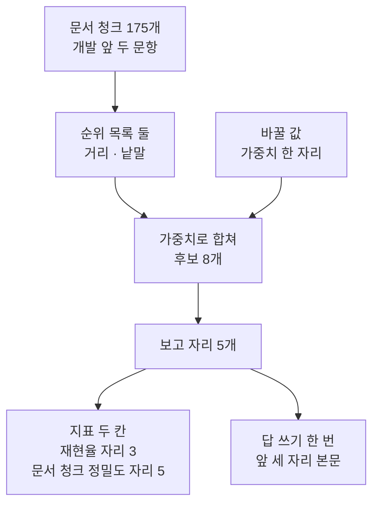
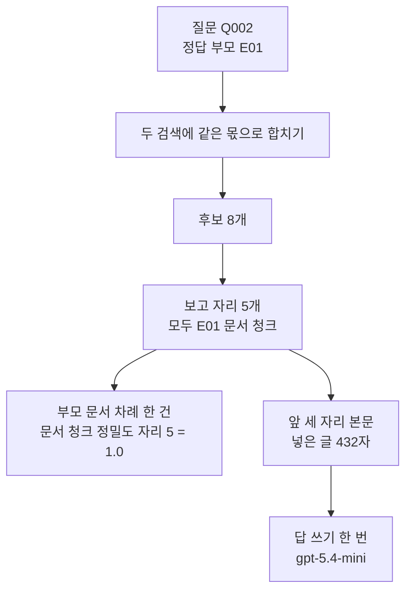
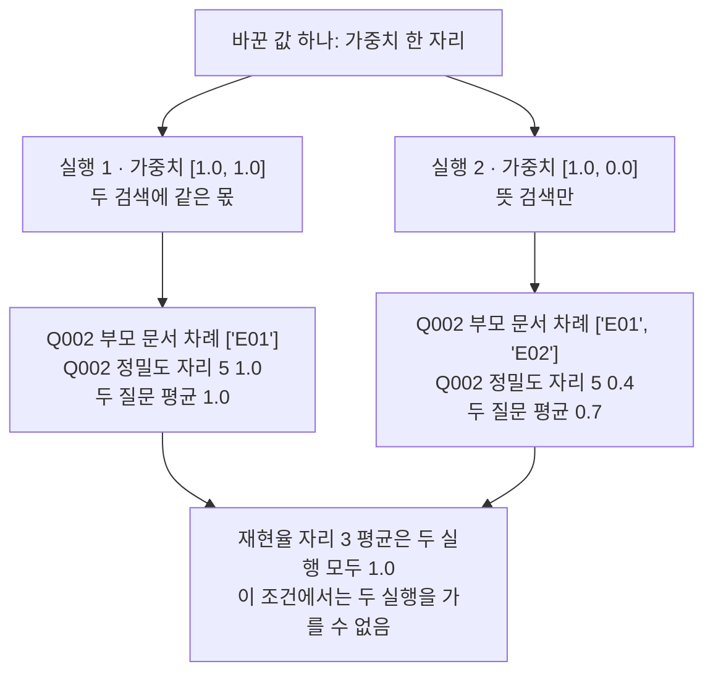

# 13-검색-품질-실습

## _src 본문 (HTML 원본)

```html
<!--meta: 실습 30분 | 코드 notebooks/13-검색-품질-실습.ipynb | 새 용어 0 -->

<h2 id="b1"><span class="no">1</span>학습 목표</h2>
<div class="goal"><ul>
<li>이 절을 마치면 순위 둘을 합쳐 보고 자리를 내는 차례를 한 함수로 이을 수 있습니다.</li>
<li>이 절을 마치면 가중치 한 자리만 바꿔 같은 질문을 다시 잴 수 있습니다.</li>
<li>이 절을 마치면 보고 자리가 달라질 때 넣는 글과 답이 함께 달라지는 것을 볼 수 있습니다.</li>
<li>이 절을 마치면 천장에 닿은 지표와 값이 갈리는 지표를 나누어 읽을 수 있습니다.</li>
</ul></div>

<h2 id="b2"><span class="no">2</span>이 내용을 배우는 이유</h2>
<p>01절부터 12절까지 검색의 단계를 하나씩 따로 익혔습니다. 거리로 줄을 세우고, 낱말 겹침으로 줄을 세우고, 두 줄을 합치고, 앞자리 본문을 모델에 넣었습니다.</p>
<p>실제로 설정을 손볼 때는 이 단계가 한 번에 이어집니다. 값 하나를 바꾸고 같은 계산을 다시 한 뒤, 두 결과를 같은 칸 순서로 놓고 견줍니다.</p>
<p>이 실습에서 바꾸는 값은 06절 가중치입니다. 뜻 검색과 낱말 검색이 차지하는 몫을 정하는 값이고 12절 손잡이 두 개 가운데 하나입니다.</p>
<p>이번 절은 이 챕터의 실습입니다. 01~12절에서 쓴 이름과 문법만 쓰고, 따로 내는 과제는 없습니다. 강사와 함께 노트북 셀을 차례로 실행합니다.</p>
<p><strong>이 절의 질문</strong> — 같은 질문과 같은 문서에서 가중치 한 자리만 바꾸면, 보고 자리와 답은 어떻게 달라질까요?</p>

<h2 id="b3"><span class="no">3</span>앞에서 배운 내용</h2>
<p>이번 실습은 아래 절에서 배운 것을 그대로 가져옵니다.</p>
<table><thead><tr><th>절</th><th>배운 것</th><th>실습에서 쓰는 곳</th></tr></thead><tbody>
<tr><td>01절</td><td>코사인 거리와 <code>cosine_distance()</code></td><td>4절 거리 함수</td></tr>
<tr><td>04절</td><td>Kiwi 형태소와 <code>kiwi_terms()</code>, 남길 품사 표시 아홉 개</td><td>4절 낱말 만들기, 5절 BM25 모델</td></tr>
<tr><td>05절</td><td>순위 목록 <code>rank_by_distance()</code>와 <code>rank_by_bm25()</code></td><td>5절 순위 목록 둘</td></tr>
<tr><td>06절</td><td>순위 합치기 <code>fuse_scores()</code>와 <code>fuse_rank()</code>, 순위 상수 60</td><td>7절 조립 함수</td></tr>
<tr><td>07절</td><td>후보 목록과 <code>unique_chunk_ids()</code>·<code>parent_ids_of()</code></td><td>5절 순위 목록, 7절 부모 문서 차례</td></tr>
<tr><td>08절</td><td>후보 수 8과 보고 자리 5, <code>chunk_precision_at()</code></td><td>7절 지표, 8~10절 표</td></tr>
<tr><td>12절</td><td>찾은 글로 답 쓰기와 출처 표시 <code>[문서ID p.쪽]</code></td><td>6절 넣을 글, 8·9절 답</td></tr>
<tr><td>Ch 11 02절</td><td>재현율 <code>recall_at()</code>와 개발 15문항 약속</td><td>5절 질문 고르기, 7절 지표</td></tr>
</tbody></table>
<p>읽는 파일도 07~12절과 같습니다. 부모 문서 6건에서 만든 문서 청크 175개와 질문 30개입니다. 이번 실습에서 새로 만든 데이터는 없습니다.</p>
<p>새로 정의하는 함수는 다섯 개입니다. 표를 적는 <code>print_rows()</code>와 질문 평균을 내는 <code>column_mean()</code>이 기록 장치입니다. 넣을 글을 만드는 <code>context_of()</code>와 한 질문을 재는 <code>score_row()</code>가 그다음입니다. 가중치 한 벌을 두 질문에 적용하는 <code>run_weights()</code>가 마지막입니다.</p>
<p>12절이 <code>runs</code> 폴더에 남긴 기록 세 개는 이번 실습에서 읽지도 쓰지도 않습니다. 이 노트북은 파일을 만들거나 고치지 않습니다.</p>

<h2 id="b4"><span class="no">4</span>핵심 개념</h2>
<h3>비유로 시작하기</h3>
<p>깔때기 하나에 짧은 관 두 개가 비스듬히 걸쳐 있다고 생각해 봅니다. 두 관에서 굴러 나온 구슬이 깔때기를 지나 아래 다섯 칸 쟁반에 차례로 담깁니다.</p>
<p>한쪽 관 입구에 마개를 꽂으면 그 관의 구슬은 내려오지 않습니다. 쟁반의 칸 수는 그대로지만 담기는 구슬은 한 가지 색만 남습니다.</p>
{{img:13-4-두-관과-깔때기|나무 탁자 위에 놓인 회색 깔때기의 넓은 입구에 짧은 관 두 개가 비스듬히 걸쳐 있고 왼쪽 주황색 관은 입구가 열려 있어 파란 구슬이 굴러 나오며 오른쪽 연두색 관은 깔때기 쪽 입구에 갈색 마개가 꽂혀 있어 아무것도 나오지 않고 깔때기의 좁은 주둥이 바로 아래 탁자 위에 한 줄로 다섯 칸이 난 얕은 나무 쟁반이 있어 다섯 칸마다 파란 구슬이 하나씩 들어 있으며 쟁반 오른쪽 탁자 위에 초록 구슬 두 개가 놓여 있는 삽화|한쪽 관 입구를 마개로 막으면 다섯 칸 쟁반이 파란 구슬로만 찹니다}}
<p class="look"><b>그림 읽기</b> — 먼저 깔때기 입구에 걸친 관 두 개를 봅니다. 왼쪽 주황색 관은 입구가 열려 있고 파란 구슬이 굴러 나옵니다. 오른쪽 연두색 관은 깔때기 쪽 입구에 갈색 마개가 꽂혀 있어 아무것도 나오지 않습니다.</p>
<p class="look">다음으로 깔때기 아래 쟁반을 봅니다. 한 줄로 난 다섯 칸에 파란 구슬이 하나씩 들어 있습니다. 쟁반 오른쪽 탁자 위에는 초록 구슬 두 개가 남아 있습니다.</p>
<p class="look">관 두 개는 이 챕터의 두 검색입니다. 마개는 가중치 <code>0.0</code>이고, 쟁반 다섯 칸은 보고 자리 다섯 개입니다. 쟁반 밖 초록 구슬은 몫을 받지 못해 앞자리에 오르지 못한 문서 청크입니다.</p>

<h3>실습 조립의 구성</h3>
{{mermaid:13-1-조립도|위에서 아래로 내려가는 흐름도로 맨 위 초록 상자 문서 청크 175개와 개발 앞 두 문항이 파란 상자 순위 목록 둘 거리와 낱말로 내려가고 옆의 파란 상자 바꿀 값 가중치 한 자리와 함께 파란 상자 가중치로 합쳐 후보 8개로 모이며 그 아래 파란 상자 보고 자리 5개에서 노란 상자 지표 두 칸과 보라 상자 답 쓰기 한 번으로 갈라지는 그림|실습 조립 순서. 문서 청크와 질문 두 개로 순위 목록 둘을 만들고 가중치로 합쳐 보고 자리를 낸 뒤 지표와 답으로 갈라집니다}}
<p class="look"><b>도식 읽기</b> — 위에서 아래로 읽습니다. 맨 위 초록 상자는 노트북 3·5절에서 만드는 재료입니다. 문서 청크는 175개이고 질문은 개발 묶음 앞 두 문항입니다.</p>
<p class="look">파란 상자 네 개는 05~08절에서 배운 단계입니다. 그 가운데 「바꿀 값」 상자가 이번 실습에서 손대는 자리이고, 나머지 셋은 두 실행에서 같습니다.</p>
<p class="look">맨 아래에서 길이 둘로 갈라집니다. 왼쪽 노란 상자는 출력으로 확인하는 지표 두 칸이고, 오른쪽 보라 상자는 답을 쓰는 모델입니다. 두 길 모두 보고 자리 다섯 개에서 나옵니다.</p>
<table><thead><tr><th>함수</th><th>하는 일</th><th>가져온 곳</th></tr></thead><tbody>
<tr><td><code>rank_chunks_by_distance()</code>·<code>rank_chunks_by_bm25()</code></td><td>문서 청크를 거리 순서와 점수 순서로 줄 세움</td><td>01·04절 순위 함수의 문서 청크 판(도구 파일)</td></tr>
<tr><td><code>fuse_rank()</code></td><td>순위 목록 둘을 가중치로 합침</td><td>06절(도구 파일)</td></tr>
<tr><td><code>unique_chunk_ids()</code>·<code>parent_ids_of()</code></td><td>중복을 뺀 문서 청크 목록과 부모 문서 차례를 냄</td><td>Ch 11 01절·07절(도구 파일)</td></tr>
<tr><td><code>recall_at()</code>·<code>chunk_precision_at()</code></td><td>부모 문서 재현율과 문서 청크 정밀도를 냄</td><td>Ch 11 02절·08절(도구 파일)</td></tr>
<tr><td><code>print_rows()</code>·<code>column_mean()</code></td><td>질문별 줄을 라벨 줄 아래 적고 질문 평균을 냄</td><td>08절 표 모양(새로 정의)</td></tr>
<tr><td><code>context_of()</code></td><td>앞 세 자리의 출처 표시와 본문을 이어 붙임</td><td>12절 모양(새로 정의)</td></tr>
<tr><td><code>score_row()</code></td><td>질문 하나를 가중치대로 검색해 한 줄로 만듦</td><td>06·07·08절 함수를 묶음(새로 정의)</td></tr>
<tr><td><code>run_weights()</code></td><td>가중치 한 벌을 질문 두 개에 적용함</td><td>새로 정의</td></tr>
</tbody></table>

<h3>두 번의 실행</h3>
<p>실행 1은 06절 기본 가중치 <code>[1.0, 1.0]</code>입니다. 앞 숫자가 뜻 검색 몫이고 뒤 숫자가 낱말 검색 몫입니다.</p>
<p>실행 2는 뒤 숫자만 <code>0.0</code>으로 내립니다. 그러면 후보는 뜻 검색 순위만으로 정해집니다.</p>
<p>질문 두 개와 문서 청크 175개, 후보 수 8, 보고 자리 5, 넣을 자리 3, 모델은 두 실행에서 같게 둔 조건입니다. 두 실행은 5절에서 만들어 둔 같은 순위 목록을 다시 씁니다.</p>
<p>질문은 개발 묶음 앞 두 문항입니다. 요청을 다섯 번으로 줄이려고 15문항 대신 두 문항만 골랐습니다. 두 문항은 모두 난이도 <code>easy</code>이고 정답 부모 문서가 <code>E01</code> 하나입니다.</p>

<h2 id="b5"><span class="no">5</span>실행 예제</h2>
<p>노트북은 먼저 값을 정하고 문서 청크 175개를 벡터로 바꿉니다. 그다음 BM25 모델과 질문 두 개를 준비합니다. 01~12절 함수 여덟 개는 준비 셀에서 실습 폴더의 도구 파일 <code>notebooks/rag_tools.py</code>로부터 가져옵니다. 마지막으로 기록 장치와 조립 함수를 만든 뒤 실행 1, 실행 2, 두 실행 비교를 차례로 합니다.</p>
<p>함수를 만드는 셀은 네 개이고 모두 이 절에서 처음 만드는 함수입니다. 3·5절의 재료와 8~10절의 표와 답을 강사와 함께 읽습니다.</p>
<p>실제 OpenAI 모델을 부릅니다. 이 페이지의 출력은 2026-09-21에 실행한 결과입니다. 서비스 요청은 모두 다섯 번이고 임베딩 세 번과 답을 쓰는 모델 두 번입니다. 예상 비용은 다섯 번을 합쳐 미화 0.01달러 아래입니다.</p>
{{notebook:13-검색-품질-실습}}
<p class="look"><b>확인할 점</b> — 5절 출력에서 질문 두 개의 ID와 순위 목록 1위를 봅니다. 8·9절 출력에서 질문별 표 두 줄과 고른 문서 청크 다섯 개를 견줍니다. 두 답이 어떻게 달라졌는지 읽고, 10절 표에서 평균 두 칸을 봅니다.</p>

<h3>실행 1의 실제 순서</h3>
{{mermaid:13-2-실행1-순서|위에서 아래로 내려가는 흐름도로 초록 상자 질문 Q002와 정답 부모 E01에서 파란 상자 두 검색에 같은 몫으로 합치기와 파란 상자 후보 8개와 파란 상자 보고 자리 5개 모두 E01 문서 청크로 내려간 뒤 노란 상자 부모 문서 차례 한 건과 문서 청크 정밀도 1.0과 파란 상자 앞 세 자리 본문 넣은 글 432자로 갈라지고 그 아래 보라 상자 답 쓰기 한 번으로 이어지는 그림|실행 1에서 질문 하나가 후보 8개와 보고 자리 5개를 지나 지표 한 칸과 답 한 번으로 이어지는 차례}}
<p class="look"><b>도식 읽기</b> — 위에서 아래로 읽습니다. 맨 위 초록 상자가 답을 쓸 질문이고 정답 부모 문서는 한 건입니다.</p>
<p class="look">위쪽 파란 상자 세 개가 합치기와 후보 자르기와 보고 자리 남기기입니다. 보고 자리 다섯 개가 모두 <code>E01</code>의 문서 청크였습니다.</p>
<p class="look">보고 자리 상자에서 화살표가 둘로 갈라집니다. 왼쪽 노란 상자가 지표이고, 오른쪽 파란 상자를 지나 맨 아래 보라 상자에서 답을 한 번 씁니다. 이 흐름에는 새 임베딩 요청이 없습니다.</p>

<h2 id="b6"><span class="no">6</span>실험 결과 해석</h2>
<p>실행 1에서는 두 질문의 보고 자리가 모두 정답 부모 문서의 문서 청크였습니다. 부모 문서 차례는 두 줄 모두 한 건이었고 문서 청크 정밀도 자리 5는 두 줄 모두 <code>1.0</code>이었습니다.</p>
<p>실행 2에서는 가중치 뒤 숫자만 <code>0.0</code>으로 내렸습니다. 질문 <code>Q001</code>의 줄은 그대로였고 질문 <code>Q002</code>의 줄만 달라졌습니다.</p>
<table><thead><tr><th>실행</th><th>가중치</th><th><code>Q001</code> 정밀도 자리 5</th><th><code>Q002</code> 정밀도 자리 5</th><th>질문 평균</th></tr></thead><tbody>
<tr><td>실행 1</td><td>1.0, 1.0</td><td>1.0</td><td>1.0</td><td>1.0</td></tr>
<tr><td>실행 2</td><td>1.0, 0.0</td><td>1.0</td><td>0.4</td><td>0.7</td></tr>
</tbody></table>
<p>갈린 자리는 질문 <code>Q002</code>의 보고 자리입니다. 실행 2에서는 다섯 자리 가운데 세 자리가 다른 부모 문서 <code>E02</code>의 문서 청크였습니다. 부모 문서 차례도 한 건에서 두 건으로 늘었습니다.</p>
<p>부모 문서 재현율 자리 3은 네 줄이 모두 <code>1.0</code>이었습니다. 정답 부모 문서가 두 실행 모두 차례의 첫 자리에 있었기 때문입니다. 07~12절에서 본 천장이 질문 두 개에서도 그대로여서 이 칸으로는 두 실행을 가를 수 없습니다.</p>
{{mermaid:13-3-두-실행-비교|위에서 아래로 내려가는 비교 그림으로 맨 위 파란 상자 바꾼 값 하나 가중치 한 자리에서 왼쪽 파란 상자 실행 1 가중치 1.0과 1.0 두 검색에 같은 몫과 오른쪽 파란 상자 실행 2 가중치 1.0과 0.0 뜻 검색만으로 갈라지고 그 아래 왼쪽 노란 상자 Q002 부모 문서 차례 E01 한 건과 Q002 정밀도 자리 5 1.0과 두 질문 평균 1.0 오른쪽 노란 상자 Q002 부모 문서 차례 E01과 E02 두 건과 Q002 정밀도 자리 5 0.4와 두 질문 평균 0.7이 놓이며 두 노란 상자에서 나온 화살표가 맨 아래 회색 상자 재현율 자리 3 평균은 두 실행 모두 1.0으로 모이는 그림|가중치 한 자리만 바꾼 두 실행. Q002의 문서 청크 정밀도 자리 5가 1.0에서 0.4로 내려갔고 두 질문 평균은 1.0에서 0.7이 되었습니다.}}
<p class="look"><b>도식 읽기</b> — 맨 위 파란 상자가 이번에 바꾼 자리입니다. 바꾼 값은 가중치 한 자리뿐입니다.</p>
<p class="look">왼쪽 줄기가 실행 1이고 오른쪽 줄기가 실행 2입니다. 줄기마다 위 파란 상자에 쓴 가중치가 있고 아래 노란 상자에 출력으로 확인한 값이 있습니다. 노란 상자의 앞 두 줄은 질문 <code>Q002</code> 하나의 값이고 마지막 줄은 두 질문 평균입니다.</p>
<p class="look">맨 아래 회색 상자는 두 줄기에서 모두 확인한 값입니다. 한 실행의 결과가 아니라서 어느 줄기에도 넣지 않았습니다.</p>
<p>답도 함께 달라졌습니다. 실행 1은 넣은 글에 대출 권수와 기간이 모두 있어 두 값을 적은 답이 나왔습니다. 실행 2는 넣은 세 자리에 그 내용이 없어 자료에서 찾지 못했다는 답이 나왔습니다.</p>
<p>넣은 글의 길이도 <code>432</code>에서 <code>302</code>로 줄었습니다. 문서 청크마다 본문 길이가 달라서 앞 세 자리가 바뀌면 길이도 바뀝니다.</p>
<p>결론은 이렇습니다. 가중치 한 자리를 바꾸면 보고 자리의 문서 청크가 바뀌고, 모델에 넣는 글이 바뀌며, 그 질문에 대한 답도 바뀝니다. 이 결과는 질문 두 개·문서 청크 175개·가중치 두 벌·한 번의 실행 범위입니다.</p>

<h2 id="b7"><span class="no">7</span>주의할 점과 실무 메모</h2>
<ul>
<li><strong>질문을 두 문항으로 줄였습니다.</strong> 07~12절은 개발 15문항을 썼고 임베딩 요청이 절마다 열여섯 번이었습니다. 실습 절은 요청을 다섯 번으로 잡아 앞 두 문항만 골랐습니다.</li>
<li><strong>그래서 값을 12절 표와 나란히 놓지 않습니다.</strong> 12절 손잡이별 평균은 개발 15문항 값이고, 이 절 평균은 두 문항 값입니다. 두 문항은 모두 난이도 <code>easy</code>이고 정답 부모가 <code>E01</code> 하나여서 값이 더 높게 나옵니다.</li>
<li><strong>어느 가중치가 낫다고 정하지 않았습니다.</strong> 질문 두 개에서 한 질문만 달라졌고, 12절에서는 낱말 검색만 쓴 가중치가 nDCG 자리 5에서 가장 높았습니다. 설정은 무엇을 보고 싶은지와 어떤 질문 묶음으로 재는지에 따라 달라집니다.</li>
<li><strong>재현율 자리 3은 이 조건에서 설정을 가르지 못합니다.</strong> 네 줄이 모두 <code>1.0</code>이었습니다. 천장에 닿은 칸은 값 그대로 싣되 설정을 고르는 근거로 쓰지 않습니다.</li>
<li><strong>답 두 개는 한 번씩만 본 결과입니다.</strong> 모델 문장은 실행마다 달라질 수 있어 낱말을 확인 줄로 보지 않았고 그림 라벨에도 넣지 않았습니다. 실행 2의 답 끝에 출처 표시가 붙은 것도 이 한 번에서만 확인했습니다.</li>
<li><strong>답이 맞는지는 재지 않았습니다.</strong> 답의 근거와 출처 표기를 판정하는 일은 Ch 15에서 따로 봅니다.</li>
<li><strong>이 실습은 파일을 쓰지 않습니다.</strong> 12절이 <code>runs</code> 폴더에 남긴 기록 세 개와 앞 챕터 기록은 읽지도 고치지도 않았습니다. 결과는 화면에만 냈습니다. 파일로 남기는 방법은 12절 6절과 9절에 있습니다.</li>
<li><strong>리랭커와 MMR은 쓰지 않았습니다.</strong> 07·08절 리랭커는 모델 파일을 올리는 데 메모리와 시간이 들어 30분 실습에 넣지 않았습니다. 10절 MMR을 빼서 보고 자리는 합친 순위의 앞자리를 그대로 썼습니다.</li>
<li><strong>pgvector도 쓰지 않았습니다.</strong> 01~03절 실습에는 Docker가 필요합니다. 이 실습은 04~12절 재료만으로 구성해 준비물을 줄였습니다.</li>
<li><strong>질문 두 개는 탐색 실행 뒤 고른 예입니다.</strong> 개발 묶음 앞자리부터 차례로 확인해 두 문항이면 흐름이 보인다는 것을 알고 정했습니다. 실제 설정을 고를 때는 12절처럼 개발 15문항을 모두 씁니다.</li>
<li><strong>교재 출력은 Linux의 Python 3.12.13으로 만들었습니다.</strong> 패키지는 langchain 1.4.0과 langchain-openai 1.6.1, kiwipiepy 0.23.2입니다. 패키지 rank-bm25는 0.2.2이고 python-dotenv는 1.2.3입니다. 다른 판과 Windows·macOS에서는 이번에 실행하지 않았습니다.</li>
</ul>

<h2 id="b8"><span class="no">8</span>정리와 다음 절</h2>
<ul>
<li>05절 순위 둘과 06절 합치기, 08절 보고 자리와 두 지표, 12절 답 쓰기를 <code>score_row()</code> 하나로 이었습니다.</li>
<li>질문 두 개의 순위 목록을 한 번만 만들어 두어 실행이 두 번이어도 임베딩 요청이 세 번이었습니다.</li>
<li>가중치 <code>[1.0, 1.0]</code>인 실행 1은 두 질문의 문서 청크 정밀도 자리 5가 모두 <code>1.0</code>이었습니다.</li>
<li>가중치를 <code>[1.0, 0.0]</code>으로 바꾼 실행 2는 질문 <code>Q002</code>에서 <code>0.4</code>가 되었고 평균이 <code>0.7</code>로 내려갔습니다.</li>
<li>넣은 글이 달라지자 같은 질문에 대한 답도 달라졌고, 재현율 자리 3은 네 줄이 모두 <code>1.0</code>이었습니다.</li>
</ul>
<p><strong>다음 학습과 이어지는 지점</strong> — 이 절로 Ch 12가 끝납니다. Ch 13은 12절이 남긴 통합 기록에서 질문과 찾은 자리를 읽어 흐름도로 잇습니다. Ch 15는 12절 기록 서른여섯 줄과 시험 기록을 읽어 nDCG가 1보다 작은 줄을 따로 봅니다.</p>
<p>이 실습에서 바꾼 값은 검색 쪽 설정이고 답 품질은 재지 않았습니다. 답이 맞는지, 근거가 있는지, 출처 표기가 옳은지를 판정하는 일은 Ch 15 몫입니다.</p>

<h2 id="b9"><span class="no">9</span>복습 문제</h2>
<details class="quiz" open><summary>문제 5개 · 해설 포함</summary>
<p class="quiz-q">1. [하] 두 실행에서 바꾼 값은 무엇입니까?</p>
<p class="quiz-a">06절 가중치입니다. 실행 1은 <code>[1.0, 1.0]</code>이고 실행 2는 <code>[1.0, 0.0]</code>입니다. 질문 두 개와 문서 청크, 후보 수 8, 보고 자리 5, 모델은 같게 두었습니다.</p>
<p class="quiz-q">2. [중] 실행을 두 번 했는데 임베딩 요청이 세 번인 까닭은 무엇입니까?</p>
<p class="quiz-a">순위 목록을 한 번만 만들었기 때문입니다. 문서 청크 한 벌에 한 번, 질문 두 개에 두 번을 보냈고 두 실행은 그 목록을 다시 썼습니다. 가중치는 이미 만든 순위의 자리 몫을 정하는 값이라 새 요청이 필요하지 않습니다.</p>
<p class="quiz-q">3. [중] 실행 2에서 질문 <code>Q002</code>의 문서 청크 정밀도가 <code>0.4</code>로 내려간 까닭은 무엇입니까?</p>
<p class="quiz-a">보고 자리 다섯 가운데 세 자리가 다른 부모 문서 <code>E02</code>의 문서 청크로 바뀌었기 때문입니다. 낱말 검색 몫을 <code>0.0</code>으로 내려 낱말이 겹치던 문서 청크가 앞자리에서 밀려났습니다.</p>
<p class="quiz-q">4. [중] 재현율 자리 3으로 두 실행을 가르지 못한 까닭은 무엇입니까?</p>
<p class="quiz-a">네 줄이 모두 <code>1.0</code>이었기 때문입니다. 정답 부모 문서가 두 실행 모두 부모 문서 차례의 첫 자리에 있었습니다. 07~12절에서 본 천장이 질문 두 개에서도 그대로였습니다.</p>
<p class="quiz-q">5. [상] 동료가 「이 실습을 보니 두 검색에 같은 몫을 주는 설정이 가장 좋다」라고 적었습니다. 이 절 출력으로 무엇이라고 답하나요?</p>
<p class="quiz-a">질문 두 개에서 한 질문만 달라진 결과라고 답합니다. 두 문항은 모두 난이도 <code>easy</code>이고 정답 부모가 <code>E01</code> 하나입니다. 12절에서 개발 15문항으로 재었을 때는 낱말 검색만 쓴 가중치가 nDCG 자리 5 평균에서 가장 높았습니다.</p>
</details>

<h2 id="b10"><span class="no">10</span>참고 자료</h2>
<ul>
<li><div><a href="https://www.elastic.co/docs/reference/elasticsearch/rest-apis/reciprocal-rank-fusion">Elasticsearch Reciprocal Rank Fusion</a></div>확인 2026-09-19 · 이 실습이 가중치를 붙여 쓴 순위 합치기의 식과 순위 상수 설명.</li>
<li><div><a href="https://developers.openai.com/api/docs/models/text-embedding-3-small">OpenAI text-embedding-3-small 모델 안내</a></div>확인 2026-09-19 · 문서 청크와 질문을 벡터로 바꿀 때 쓴 모델과 차원 수 설정.</li>
<li><div><a href="https://docs.langchain.com/oss/python/concepts/providers-and-models">LangChain 모델과 provider</a></div>확인 2026-09-19 · LangChain 1.4 기준 · 답을 쓰는 모델을 준비하는 방법.</li>
<li>06절 RRF 하이브리드 검색 — 이 실습이 바꾼 가중치와 순위 상수를 정한 자리.</li>
<li>12절 종합 튜닝과 실험 로그 — 개발 15문항으로 손잡이 두 개를 견주고 기록을 파일로 남긴 자리.</li>
<li>기준 버전은 langchain 1.4.0과 langchain-openai 1.6.1, kiwipiepy 0.23.2입니다. 패키지 rank-bm25는 0.2.2이고 python-dotenv는 1.2.3입니다. 교재 출력은 Linux의 Python 3.12.13으로 만들었습니다.</li>
</ul>
```

## 노트북 셀 (순서대로)

### [0] markdown {'html': 'skip'}

# 검색 품질 실습: 가중치 하나를 바꿔 답까지 보기

**이 노트북에서 할 일**

1. 05절 순위 두 개를 06절 가중치로 합쳐 개발 질문 두 개의 보고 자리를 만듭니다.
2. 08절 두 지표를 재고 앞 세 자리 본문으로 답을 씁니다.
3. 가중치 하나만 바꿔 다시 실행하고 두 결과를 나란히 견줍니다.

**준비물** — 프로젝트 맨 위 폴더의 `.env`에 `OPENAI_API_KEY`가 있어야 합니다.
서비스 요청은 모두 다섯 번입니다.
임베딩은 문서 청크 한 번과 질문 두 번이고 답을 쓰는 모델은 실행마다 한 번씩입니다.
예상 비용은 다섯 번을 합쳐 미화 0.01달러 아래입니다.
실행 시간은 패키지 설치를 빼면 1분 안팎입니다.

두 실행은 5절에서 만들어 둔 같은 순위 목록을 다시 씁니다.
그래서 실행이 두 번이어도 임베딩 요청은 늘지 않습니다.

**데이터** — 읽는 파일은 07~12절과 같고 둘 다 실습 묶음에 들어 있습니다.

- 문서 `labs/part3/ch12-retrieval-tuning/data/advanced-documents.json`(부모 6건·문서 청크 175개)
- 질문 `labs/part3/ch12-retrieval-tuning/data/advanced-queries.json`(30개)

**이 노트북은 파일을 쓰지 않습니다** — 12절이 `runs` 폴더에 남긴 기록 세 개는 읽지도 고치지도 않습니다.
이번 결과는 화면에만 냅니다.
파일로 남기는 방법은 12절 6절과 9절에서 보았습니다.

**강의와 실습 범위** — 이 절은 이 챕터의 실습입니다.
강사와 함께 첫 셀부터 차례로 실행하고 따로 내는 과제는 없습니다.
함수를 만드는 셀은 네 개이고 모두 이 절에서 처음 만드는 함수입니다.
01~12절 함수는 도구 파일에서 가져옵니다.
7~9절의 표와 답 두 개를 함께 읽습니다.

**기준 버전** — 첫 셀에서 여섯 패키지를 고정한 판으로 설치합니다.
교재 출력은 Linux의 Python 3.12.13으로 만들었습니다.
다른 판과 Windows·macOS에서는 이번에 실행하지 않았습니다.

실습 폴더 `labs/part3/ch12-retrieval-tuning`에서 `uv sync --locked`를 실행합니다.
그다음 이 폴더의 `.venv` 커널을 고르고 첫 셀부터 순서대로 실행합니다.

### [1] markdown {'html': 'skip'}

## 오늘 볼 그림


위에서 아래로 읽습니다. 맨 위 초록 상자는 노트북 3·5절에서 만드는 재료입니다.

파란 상자 네 개는 05~08절에서 배운 검색 단계이고 이 노트북은 그 함수를 도구 파일에서 가져옵니다.
그 가운데 「바꿀 값」 상자가 이번 실습에서 손대는 자리입니다.
맨 아래 왼쪽 노란 상자는 지표 두 칸이고 오른쪽 보라 상자는 답을 쓰는 모델입니다.

### [2] markdown {}

## 1. 준비

첫 셀은 패키지 여섯 개를 설치하고 설치된 버전을 출력합니다.
11·12절과 같은 여섯 개입니다.

### [3] code {'execution': {'iopub.execute_input': '2026-09-21T08:20:29.601081Z', 'iopub.status.busy': '2026-09-21T08:20:29.600884Z', 'iopub.status.idle': '2026-09-21T08:20:30.120857Z', 'shell.execute_reply': '2026-09-21T08:20:30.120232Z'}, 'lesson_role': 'setup'}

```python
# 이 절에서 쓰는 패키지를 설치하고 버전을 확인합니다
%pip install -q "langchain==1.4.0" "langchain-openai==1.6.1" "python-dotenv==1.2.3" "kiwipiepy==0.23.2" "rank-bm25==0.2.2" "numpy==2.5.3"
from importlib.metadata import version

print("langchain:", version("langchain"))
print("langchain-openai:", version("langchain-openai"))
print("python-dotenv:", version("python-dotenv"))
print("kiwipiepy:", version("kiwipiepy"))
print("rank-bm25:", version("rank-bm25"))
print("numpy:", version("numpy"))
```

출력:
```
Note: you may need to restart the kernel to use updated packages.
langchain: 1.4.0
langchain-openai: 1.6.1
python-dotenv: 1.2.3
kiwipiepy: 0.23.2
rank-bm25: 0.2.2
numpy: 2.5.3

```

### [4] markdown {}

**결과 읽기** — 설치가 끝나면 `langchain: 1.4.0`과 `rank-bm25: 0.2.2`가 보입니다.
마지막 줄 `numpy: 2.5.3`은 도구 파일이 벡터 계산에 쓰는 패키지입니다. 여섯 줄이 모두 보이면 다음 셀로 넘어갑니다.

다음 셀은 이 절에서 쓸 이름 여섯 개를 불러옵니다.

앞에서 배운 함수는 `rag_tools.py`에 모아 두었습니다. 파일을 열면 코드를 볼 수 있습니다. 노트북과 같은 폴더(`notebooks/`)에 있는 파일입니다.

이 노트북은 04·06·07·08절 함수 네 개와 Ch 11 `recall_at()`을 가져옵니다.
04절 `kiwi_terms()`, 06절 `fuse_rank()`, 07절 `parent_ids_of()`, 08절 `chunk_precision_at()`입니다.
07~12절과 같은 문서 청크 판 순위 함수 세 개도 함께 가져옵니다.
인자 모양은 4절에서 정리합니다.

### [5] code {'execution': {'iopub.execute_input': '2026-09-21T08:20:30.122305Z', 'iopub.status.busy': '2026-09-21T08:20:30.122176Z', 'iopub.status.idle': '2026-09-21T08:20:31.132860Z', 'shell.execute_reply': '2026-09-21T08:20:31.132699Z'}, 'lesson_role': 'setup'}

```python
# 자료 읽기·경로 확인과 이 절에서 쓸 검색 도구를 불러옵니다
import json
import os

from kiwipiepy import Kiwi
from langchain.chat_models import init_chat_model
from langchain_openai import OpenAIEmbeddings
from rank_bm25 import BM25Okapi
# 04·06·07·08절과 Ch 11 함수, 문서 청크 판 순위 함수 여덟 개를 도구 파일에서 가져옵니다
from rag_tools import chunk_precision_at, fuse_rank, kiwi_terms, parent_ids_of
from rag_tools import rank_chunks_by_bm25, rank_chunks_by_distance, recall_at, unique_chunk_ids

print("불러온 이름:", "json", "os", "Kiwi", "init_chat_model", "OpenAIEmbeddings", "BM25Okapi")
```

출력:
```
불러온 이름: json os Kiwi init_chat_model OpenAIEmbeddings BM25Okapi

```

### [6] markdown {}

**결과 읽기** — 출력 줄은 `불러온 이름:` 뒤에 이름 여섯 개가 붙은 한 줄입니다.
12절이 쓰던 `hashlib`과 `time`은 부르지 않습니다.
이 절은 지문을 만들지 않고 파일도 쓰지 않기 때문입니다.
도구 파일에서 가져온 함수 여덟 개는 출력하지 않습니다.

### [7] markdown {}

API 키가 있는지 확인합니다. `True` 값이 나오면 다음으로 넘어갑니다.

### [8] code {'execution': {'iopub.execute_input': '2026-09-21T08:20:31.135754Z', 'iopub.status.busy': '2026-09-21T08:20:31.135647Z', 'iopub.status.idle': '2026-09-21T08:20:31.139470Z', 'shell.execute_reply': '2026-09-21T08:20:31.139241Z'}, 'lesson_role': 'setup'}

```python
# .env 파일에서 OpenAI API 키를 읽습니다(키 값은 출력하지 않습니다)
import os
from dotenv import find_dotenv, load_dotenv

env_path = find_dotenv(usecwd=True)
load_dotenv(env_path)
has_key = os.getenv("OPENAI_API_KEY") is not None
print("OPENAI_API_KEY 설정 여부:", has_key)
assert has_key, "프로젝트 폴더의 .env 파일에 OPENAI_API_KEY를 적어 주세요."
```

출력:
```
OPENAI_API_KEY 설정 여부: True

```

### [9] markdown {}

실습에 쓸 모델을 준비합니다.
temperature 값을 0으로 두어 매번 비슷한 문장을 고르게 합니다.
설정 `reasoning_effort="none"`은 답을 쓰기 전에 따로 생각하는 단계를 두지 않게 합니다.

### [10] code {'execution': {'iopub.execute_input': '2026-09-21T08:20:31.139978Z', 'iopub.status.busy': '2026-09-21T08:20:31.139933Z', 'iopub.status.idle': '2026-09-21T08:20:31.557659Z', 'shell.execute_reply': '2026-09-21T08:20:31.557154Z'}}

```python
# 실습에 쓸 모델을 준비합니다
model = init_chat_model(
    "openai:gpt-5.4-mini",
    temperature=0,
    reasoning_effort="none",
)
print("모델 이름:", model.model_name)
print("temperature:", model.temperature)
```

출력:
```
모델 이름: gpt-5.4-mini
temperature: 0.0

```

### [11] markdown {}

**결과 읽기** — 모델 이름 `gpt-5.4-mini`, temperature `0.0`이 보이면 준비가 끝났습니다.
이 노트북의 출력은 2026-09-21에 이 모델로 실행한 결과입니다.

### [12] markdown {}

다음 셀은 프로젝트 맨 위 폴더를 찾습니다. 01~12절과 같은 코드입니다.

### [13] code {'execution': {'iopub.execute_input': '2026-09-21T08:20:31.558619Z', 'iopub.status.busy': '2026-09-21T08:20:31.558553Z', 'iopub.status.idle': '2026-09-21T08:20:31.561271Z', 'shell.execute_reply': '2026-09-21T08:20:31.560855Z'}, 'lesson_role': 'setup'}

```python
# 노트북을 어느 폴더에서 열어도 프로젝트 맨 위를 찾게 후보 세 개를 차례로 봅니다
candidates = [".", "../../..", "../../../.."]
root_path = None
for candidate in candidates:
    if os.path.exists(candidate + "/labs/part3/ch12-retrieval-tuning/data"):
        root_path = candidate
        break
print("고른 경로:", root_path)
assert root_path is not None, "notebooks 폴더나 실습 폴더 맨 위에서 노트북을 열어 주세요."
```

출력:
```
고른 경로: .

```

### [14] markdown {}

**결과 읽기** — 출력 줄은 `고른 경로: .`입니다. 확인 줄도 통과했습니다.

다음 셀은 07~12절과 같은 자료 두 벌을 읽습니다.

### [15] code {'execution': {'iopub.execute_input': '2026-09-21T08:20:31.562224Z', 'iopub.status.busy': '2026-09-21T08:20:31.562157Z', 'iopub.status.idle': '2026-09-21T08:20:31.566314Z', 'shell.execute_reply': '2026-09-21T08:20:31.565918Z'}, 'lesson_role': 'setup'}

```python
# 07~12절과 같은 파일 두 벌을 읽습니다
data_path = root_path + "/labs/part3/ch12-retrieval-tuning/data"
with open(data_path + "/advanced-documents.json", encoding="utf-8") as file:
    documents = json.loads(file.read())
with open(data_path + "/advanced-queries.json", encoding="utf-8") as file:
    queries = json.loads(file.read())
parents = documents["parents"]
chunks = documents["chunks"]
print("부모 문서 수:", len(parents))
print("문서 청크 수:", len(chunks))
print("질문 수:", len(queries))
```

출력:
```
부모 문서 수: 6
문서 청크 수: 175
질문 수: 30

```

### [16] markdown {}

**결과 읽기** — `부모 문서 수: 6`과 `문서 청크 수: 175`, `질문 수: 30`이 보입니다.
07~12절과 같은 파일이라 세 값도 같습니다.

## 2. 실습 주제 — 가중치 하나를 바꿔 답까지 보기

작은 안내 창구의 검색기를 손보는 일을 맡았다고 봅니다.
06절에서 뜻 검색 순위와 낱말 검색 순위를 가중치로 합쳤고, 08절에서 보고 자리를 다섯으로 정했습니다.
12절에서는 그 보고 자리의 본문을 모델에 넣어 답을 한 번 썼습니다.

이번 실습은 그 단계를 한 줄기로 잇고 **가중치 한 자리만** 바꿉니다.
실행 1은 두 검색에 같은 몫을 주고, 실행 2는 낱말 검색 쪽 몫을 0으로 내립니다.
바뀌는 값은 그 하나뿐이고 질문·문서·후보 수·보고 자리·모델은 모두 같게 둡니다.

## 3. 재료 만들기 — 값과 문서 청크 벡터

먼저 01~12절에서 쓴 값을 그대로 다시 정합니다.

### [17] code {'execution': {'iopub.execute_input': '2026-09-21T08:20:31.567182Z', 'iopub.status.busy': '2026-09-21T08:20:31.567113Z', 'iopub.status.idle': '2026-09-21T08:20:31.569643Z', 'shell.execute_reply': '2026-09-21T08:20:31.569253Z'}}

```python
# 01~12절에서 쓴 값을 그대로 다시 정하고 이번에 바꿔 볼 가중치 두 벌을 적습니다
keep_tags = ["NNG", "NNP", "NNB", "NR", "VV", "VA", "MAG", "SN", "SL"]
rank_constant = 60
candidate_count = 8
recall_place = 3
report_place = 5
context_count = 3
question_take = 2
equal_weights = [1.0, 1.0]
dense_only_weights = [1.0, 0.0]
print("순위 상수:", rank_constant, "| 후보 수:", candidate_count, "| 보고 자리:", report_place)
print("재현율을 재는 자리:", recall_place, "| 모델에 넣을 자리 수:", context_count)
print("실행 1 가중치:", equal_weights, "| 실행 2 가중치:", dense_only_weights)
```

출력:
```
순위 상수: 60 | 후보 수: 8 | 보고 자리: 5
재현율을 재는 자리: 3 | 모델에 넣을 자리 수: 3
실행 1 가중치: [1.0, 1.0] | 실행 2 가중치: [1.0, 0.0]

```

### [18] markdown {}

**결과 읽기** — 줄 `순위 상수: 60 | 후보 수: 8 | 보고 자리: 5`는 06~12절과 같은 값입니다.
줄 `실행 1 가중치: [1.0, 1.0] | 실행 2 가중치: [1.0, 0.0]`이 이번에 바꿀 자리입니다.
앞 숫자가 뜻 검색 몫이고 뒤 숫자가 낱말 검색 몫입니다.

다음 셀은 문서 청크마다 제목과 본문을 이어 붙입니다.

### [19] code {'execution': {'iopub.execute_input': '2026-09-21T08:20:31.570452Z', 'iopub.status.busy': '2026-09-21T08:20:31.570387Z', 'iopub.status.idle': '2026-09-21T08:20:31.572533Z', 'shell.execute_reply': '2026-09-21T08:20:31.572265Z'}}

```python
# 문서 청크마다 제목과 본문을 이어 붙여 글 하나로 만듭니다(07~12절과 같은 코드)
chunk_texts = []
chunk_ids = []
for chunk in chunks:
    chunk_text = chunk["title"] + " " + chunk["text"]
    chunk_texts.append(chunk_text)
    chunk_ids.append(chunk["chunk_id"])
all_chunk_count = len(chunk_ids)
print("이어 붙인 글 수:", len(chunk_texts))
print("첫 문서 청크 ID:", chunk_ids[0])
```

출력:
```
이어 붙인 글 수: 175
첫 문서 청크 ID: E01-P01-C01

```

### [20] markdown {}

**결과 읽기** — `이어 붙인 글 수: 175`가 보입니다.
줄 `첫 문서 청크 ID: E01-P01-C01`의 이름 앞머리가 그 문서 청크의 부모 문서 ID입니다.

다음 셀은 문서 청크 ID로 부모와 쪽과 본문을 바로 찾을 수 있게 짝을 만듭니다.

### [21] code {'execution': {'iopub.execute_input': '2026-09-21T08:20:31.573190Z', 'iopub.status.busy': '2026-09-21T08:20:31.573127Z', 'iopub.status.idle': '2026-09-21T08:20:31.575517Z', 'shell.execute_reply': '2026-09-21T08:20:31.575162Z'}}

```python
# 문서 청크 ID로 부모 문서 ID와 쪽 번호와 본문을 바로 찾게 짝을 만듭니다(12절과 같은 코드)
parent_by_chunk = {}
page_by_chunk = {}
text_by_chunk = {}
for i in range(len(chunks)):
    chunk_id = chunk_ids[i]
    parent_by_chunk[chunk_id] = chunks[i]["parent_id"]
    page_by_chunk[chunk_id] = chunks[i]["page"]
    text_by_chunk[chunk_id] = chunk_texts[i]
print("짝지은 문서 청크 수:", len(parent_by_chunk))
print("첫 문서 청크의 부모 문서 ID:", parent_by_chunk[chunk_ids[0]])
print("첫 문서 청크의 쪽 번호:", page_by_chunk[chunk_ids[0]])
```

출력:
```
짝지은 문서 청크 수: 175
첫 문서 청크의 부모 문서 ID: E01
첫 문서 청크의 쪽 번호: 1

```

### [22] markdown {}

**결과 읽기** — `짝지은 문서 청크 수: 175`가 보입니다.
줄 `첫 문서 청크의 부모 문서 ID: E01`과 `첫 문서 청크의 쪽 번호: 1`은 출처 표시에 쓸 값입니다.

다음 셀은 문서 청크를 벡터로 바꿉니다. 01~12절과 같은 모델과 같은 차원 수입니다.

### [23] code {'execution': {'iopub.execute_input': '2026-09-21T08:20:31.576236Z', 'iopub.status.busy': '2026-09-21T08:20:31.576167Z', 'iopub.status.idle': '2026-09-21T08:20:31.944048Z', 'shell.execute_reply': '2026-09-21T08:20:31.943254Z'}}

```python
# 01~12절과 같은 모델로 문서 청크를 벡터로 바꿉니다(임베딩 요청 1번)
embedding_model_name = "text-embedding-3-small"
vector_dimensions = 256
embedding_model = OpenAIEmbeddings(model=embedding_model_name, dimensions=vector_dimensions)
chunk_vectors = embedding_model.embed_documents(chunk_texts)
print("임베딩 모델 이름:", embedding_model.model)
print("벡터의 숫자 개수 설정:", embedding_model.dimensions)
print("문서 청크 벡터 수:", len(chunk_vectors))
```

출력:
```
임베딩 모델 이름: text-embedding-3-small
벡터의 숫자 개수 설정: 256
문서 청크 벡터 수: 175

```

### [24] markdown {}

**결과 읽기** — `벡터의 숫자 개수 설정: 256`과 `문서 청크 벡터 수: 175`가 보입니다.
여기까지 임베딩 요청은 한 번입니다.

## 4. 앞 절 함수의 인자 확인하기

앞 절 함수는 준비 셀에서 도구 파일로부터 가져왔습니다.
두 순위는 07~12절과 같은 문서 청크 판 `rank_chunks_by_distance()`와 `rank_chunks_by_bm25()`가 만듭니다.
06절 `fuse_rank()`는 순위 상수를 셋째 인자로 받습니다.
07절 `parent_ids_of()`와 08절 `chunk_precision_at()`은 짝 사전 `parent_by_chunk`를 인자로 받습니다.

리랭커와 MMR은 이 실습에서 쓰지 않아 가져오지 않았습니다.
보고 자리 다섯 개는 합친 순위의 앞자리를 그대로 씁니다.

## 5. 검색 재료 마무리 — BM25 모델과 질문 두 개

다음 셀은 문서 청크의 검색 낱말 목록으로 BM25 모델을 만듭니다.
분석기를 만드는 줄 `kiwi = Kiwi()`는 1초 안팎 걸립니다.

### [25] code {'execution': {'iopub.execute_input': '2026-09-21T08:20:31.945793Z', 'iopub.status.busy': '2026-09-21T08:20:31.945660Z', 'iopub.status.idle': '2026-09-21T08:20:33.304351Z', 'shell.execute_reply': '2026-09-21T08:20:33.303841Z'}}

```python
# 04~12절과 같은 형태소 분석기로 문서 청크마다 검색 낱말 목록을 만들고 BM25 모델을 만듭니다
kiwi = Kiwi()
kiwi_corpus = []
for text_value in chunk_texts:
    kiwi_corpus.append(kiwi_terms(kiwi, text_value, keep_tags))
bm25_model = BM25Okapi(kiwi_corpus)
print("검색 낱말 목록 수:", len(kiwi_corpus))
print("BM25 모델이 본 문서 청크 수:", bm25_model.corpus_size)
print("문서 청크 하나의 평균 검색 낱말 수:", round(bm25_model.avgdl, 2))
```

출력:
```
검색 낱말 목록 수: 175
BM25 모델이 본 문서 청크 수: 175
문서 청크 하나의 평균 검색 낱말 수: 44.01

```

### [26] markdown {}

**결과 읽기** — `검색 낱말 목록 수: 175`와 `BM25 모델이 본 문서 청크 수: 175`가 보입니다.
줄 `문서 청크 하나의 평균 검색 낱말 수: 44.01`은 07~12절과 같은 값입니다.

다음 셀은 개발 묶음에서 앞 두 문항만 고릅니다.
Ch 11이 정한 약속대로 시험 15문항은 이 절에서도 열지 않습니다.
질문을 둘로 줄인 까닭은 요청을 다섯 번 안으로 두기 위해서입니다.

### [27] code {'execution': {'iopub.execute_input': '2026-09-21T08:20:33.305068Z', 'iopub.status.busy': '2026-09-21T08:20:33.304986Z', 'iopub.status.idle': '2026-09-21T08:20:33.307317Z', 'shell.execute_reply': '2026-09-21T08:20:33.306978Z'}}

```python
# 개발 묶음에서 앞 두 문항만 골라 질문 글과 정답 부모 문서 ID를 짝지어 둡니다
dev_queries = []
for query in queries:
    if query["split"] == "dev":
        dev_queries.append(query)
practice_items = dev_queries[:question_take]
question_ids = []
gold_by_qid = {}
question_by_qid = {}
for item in practice_items:
    question_ids.append(item["qid"])
    gold_by_qid[item["qid"]] = item["gold_doc_ids"]
    question_by_qid[item["qid"]] = item["question"]
print("개발 질문 수:", len(dev_queries), "| 이번에 쓸 질문 수:", len(question_ids))
print("고른 질문 ID:", question_ids)
```

출력:
```
개발 질문 수: 15 | 이번에 쓸 질문 수: 2
고른 질문 ID: ['Q001', 'Q002']

```

### [28] markdown {}

**결과 읽기** — `개발 질문 수: 15 | 이번에 쓸 질문 수: 2`가 보입니다.
줄 `고른 질문 ID: ['Q001', 'Q002']`가 이번 실습의 질문 두 개입니다.
두 질문은 07~12절에서도 쓰던 개발 묶음 앞자리 문항입니다.

다음 셀은 질문마다 벡터와 순위 목록 두 개를 미리 만듭니다.
가중치가 바뀌어도 이 두 목록은 그대로라 한 번만 만들면 됩니다.

### [29] code {'execution': {'iopub.execute_input': '2026-09-21T08:20:33.307859Z', 'iopub.status.busy': '2026-09-21T08:20:33.307806Z', 'iopub.status.idle': '2026-09-21T08:20:33.686755Z', 'shell.execute_reply': '2026-09-21T08:20:33.686354Z'}}

```python
# 고른 질문마다 벡터와 순위 목록 두 개를 미리 만듭니다(임베딩 요청 2번)
lists_by_qid = {}
for question_id in question_ids:
    question = question_by_qid[question_id]
    question_vector = embedding_model.embed_query(question)
    distance_hits = rank_chunks_by_distance(question_vector, chunk_vectors, chunk_ids, all_chunk_count)
    question_terms = kiwi_terms(kiwi, question, keep_tags)
    score_hits = rank_chunks_by_bm25(bm25_model, question_terms, chunk_ids, all_chunk_count)
    lists_by_qid[question_id] = [unique_chunk_ids(distance_hits), unique_chunk_ids(score_hits)]
first_id = question_ids[0]
print("질문 하나의 순위 목록 수:", len(lists_by_qid[first_id]))
print("순위 목록 하나의 문서 청크 수:", len(lists_by_qid[first_id][0]))
print("거리 순위 1위 문서 청크:", lists_by_qid[first_id][0][0])
print("낱말 순위 1위 문서 청크:", lists_by_qid[first_id][1][0])
```

출력:
```
질문 하나의 순위 목록 수: 2
순위 목록 하나의 문서 청크 수: 175
거리 순위 1위 문서 청크: E01-P02-C04
낱말 순위 1위 문서 청크: E01-P02-C04

```

### [30] markdown {}

**결과 읽기** — `질문 하나의 순위 목록 수: 2`와 `순위 목록 하나의 문서 청크 수: 175`가 보입니다.
두 줄 아래 `거리 순위 1위 문서 청크: E01-P02-C04`와 `낱말 순위 1위 문서 청크: E01-P02-C04`는 첫 질문 값입니다.
첫 질문에서는 두 순위의 1위가 같았습니다.
여기까지 임베딩 요청은 세 번입니다.

## 6. 결과를 볼 기록 장치

실행마다 무엇을 볼지 먼저 정합니다.
질문별로 부모 문서 차례와 지표 두 칸을 한 줄씩 적고, 그 아래에 질문 평균을 냅니다.

### [31] code {'execution': {'iopub.execute_input': '2026-09-21T08:20:33.687551Z', 'iopub.status.busy': '2026-09-21T08:20:33.687486Z', 'iopub.status.idle': '2026-09-21T08:20:33.689655Z', 'shell.execute_reply': '2026-09-21T08:20:33.689332Z'}, 'upgrade_allow': ['multiple_defs_in_cell']}

```python
# 질문별 줄을 라벨 줄 아래에 한 줄씩 적고 지표 칸의 질문 평균을 냅니다
def print_rows(rows):
    print("질문 | 부모 문서 차례 | 재현율 자리 3 | 문서 청크 정밀도 자리 5")
    for row in rows:
        print(row["질문"], "|", row["부모 문서 차례"], "|", row["재현율 자리 3"], "|", row["문서 청크 정밀도 자리 5"])


def column_mean(rows, name):
    total = 0.0
    for row in rows:
        total = total + row[name]
    return round(total / len(rows), 2)
```

출력:
```

```

### [32] markdown {}

정의 셀이라 출력이 없습니다.
첫 함수는 라벨 줄을 먼저 내고 질문마다 한 줄씩 적습니다.
둘째 함수는 줄 목록에서 지표 칸만 모아 질문 평균을 소수 둘째 자리까지 냅니다.

다음 셀은 고른 문서 청크를 모델에 넣을 글로 바꾸는 함수입니다.
출처 표시는 Ch 8과 12절에서 쓴 `[문서ID p.쪽]` 모양 그대로입니다.

### [33] code {'execution': {'iopub.execute_input': '2026-09-21T08:20:33.690356Z', 'iopub.status.busy': '2026-09-21T08:20:33.690298Z', 'iopub.status.idle': '2026-09-21T08:20:33.692282Z', 'shell.execute_reply': '2026-09-21T08:20:33.691921Z'}}

```python
# 고른 문서 청크의 앞자리 본문과 출처 표시를 이어 붙여 모델에 넣을 글을 만듭니다(12절과 같은 모양)
def context_of(picked_ids):
    context_ids = picked_ids[:context_count]
    context_text = ""
    for chunk_id in context_ids:
        source_label = "[" + parent_by_chunk[chunk_id] + " p." + str(page_by_chunk[chunk_id]) + "]"
        context_text = context_text + source_label + "\n" + text_by_chunk[chunk_id] + "\n\n"
    return context_text
```

출력:
```

```

### [34] markdown {}

정의 셀이라 출력이 없습니다.
앞 세 자리만 넣습니다. 보고 자리는 다섯이지만 수업 시간에 눈으로 읽을 만큼만 넣습니다.
자리마다 출처 표시 한 줄과 본문 한 줄을 붙이고 빈 줄로 나눕니다.

## 7. 조립 — 배운 단계를 한 함수로 잇기

다음 셀이 이 실습의 조립 함수입니다.
주석에 어느 절에서 배운 단계인지 적었습니다.

### [35] code {'execution': {'iopub.execute_input': '2026-09-21T08:20:33.692959Z', 'iopub.status.busy': '2026-09-21T08:20:33.692906Z', 'iopub.status.idle': '2026-09-21T08:20:33.695025Z', 'shell.execute_reply': '2026-09-21T08:20:33.694670Z'}}

```python
# 질문 하나를 가중치대로 검색해 고른 자리와 지표 두 개를 한 줄로 만듭니다
def score_row(question_id, weight_list):
    # 06절: 순위 목록 두 개를 가중치로 합쳐 앞자리 여덟 개를 후보로 자릅니다
    fused_ids = fuse_rank(lists_by_qid[question_id], weight_list, rank_constant)
    found_ids = fused_ids[:candidate_count]
    # 08절: 후보 앞에서 보고 자리 다섯 개만 남깁니다
    picked_ids = found_ids[:report_place]
    # 07절: 고른 문서 청크를 부모 문서 차례로 바꿉니다
    parent_ids = parent_ids_of(picked_ids, parent_by_chunk)
    gold_ids = gold_by_qid[question_id]
    row = {"질문": question_id, "고른 문서 청크": picked_ids, "부모 문서 차례": parent_ids}
    # Ch 11 02절 재현율과 08절 문서 청크 정밀도
    row["재현율 자리 3"] = recall_at(parent_ids, gold_ids, recall_place)
    row["문서 청크 정밀도 자리 5"] = chunk_precision_at(picked_ids, gold_ids, report_place, parent_by_chunk)
    return row
```

출력:
```

```

### [36] markdown {}

정의 셀이라 출력이 없습니다.
차례는 네 단계입니다. 순위 합치기, 후보 자르기, 보고 자리 남기기, 지표 두 칸 재기입니다.
07~12절에서 하나씩 배운 단계를 한 줄씩 이어 붙인 것입니다.

다음 셀은 가중치 한 벌을 질문 두 개 모두에 적용합니다.

### [37] code {'execution': {'iopub.execute_input': '2026-09-21T08:20:33.695740Z', 'iopub.status.busy': '2026-09-21T08:20:33.695692Z', 'iopub.status.idle': '2026-09-21T08:20:33.697614Z', 'shell.execute_reply': '2026-09-21T08:20:33.697205Z'}}

```python
# 가중치 한 벌을 고른 질문 모두에 적용해 줄 목록을 냅니다
def run_weights(weight_list):
    rows = []
    for question_id in question_ids:
        rows.append(score_row(question_id, weight_list))
    return rows
```

출력:
```

```

### [38] markdown {}

정의 셀이라 출력이 없습니다.
받는 값은 가중치 목록 하나뿐입니다. 질문 묶음과 나머지 설정은 바깥에 정해 둔 값을 씁니다.
그래서 두 실행이 가중치 말고는 같은 조건이 됩니다.

## 8. 실행 1 — 두 검색에 같은 몫

첫 실행은 06절 기본 가중치입니다. 뜻 검색과 낱말 검색에 같은 몫을 줍니다.

실행 전에 예상합니다. 두 질문 모두 정답 부모가 `E01` 하나라 부모 문서 차례가 짧을 것입니다.

### [39] code {'execution': {'iopub.execute_input': '2026-09-21T08:20:33.698271Z', 'iopub.status.busy': '2026-09-21T08:20:33.698217Z', 'iopub.status.idle': '2026-09-21T08:20:33.700315Z', 'shell.execute_reply': '2026-09-21T08:20:33.700053Z'}}

```python
# 실행 1: 06절 기본 가중치로 두 질문을 재고 표로 봅니다
run1_rows = run_weights(equal_weights)
print_rows(run1_rows)
print("실행 1 재현율 자리 3 평균:", column_mean(run1_rows, "재현율 자리 3"))
print("실행 1 문서 청크 정밀도 자리 5 평균:", column_mean(run1_rows, "문서 청크 정밀도 자리 5"))
print("실행 1이 Q002에서 고른 문서 청크:", run1_rows[1]["고른 문서 청크"])
```

출력:
```
질문 | 부모 문서 차례 | 재현율 자리 3 | 문서 청크 정밀도 자리 5
Q001 | ['E01'] | 1.0 | 1.0
Q002 | ['E01'] | 1.0 | 1.0
실행 1 재현율 자리 3 평균: 1.0
실행 1 문서 청크 정밀도 자리 5 평균: 1.0
실행 1이 Q002에서 고른 문서 청크: ['E01-P03-C02', 'E01-P04-C06', 'E01-P03-C01', 'E01-P03-C08', 'E01-P03-C04']

```

### [40] markdown {}

**결과 읽기** — 라벨 줄 아래 두 줄이 나옵니다.
줄 `Q001 | ['E01'] | 1.0 | 1.0`과 `Q002 | ['E01'] | 1.0 | 1.0`입니다.
두 질문 모두 보고 자리 다섯 개가 전부 정답 부모의 문서 청크였습니다.

평균 두 줄도 `1.0`입니다.
맨 아래 줄 `실행 1이 Q002에서 고른 문서 청크:` 뒤 다섯 개가 모두 `E01`로 시작합니다.

다음 셀은 두 실행에서 똑같이 쓸 부탁 글과 답을 쓸 질문을 정합니다.

### [41] code {'execution': {'iopub.execute_input': '2026-09-21T08:20:33.700923Z', 'iopub.status.busy': '2026-09-21T08:20:33.700873Z', 'iopub.status.idle': '2026-09-21T08:20:33.702517Z', 'shell.execute_reply': '2026-09-21T08:20:33.702236Z'}}

```python
# 두 실행에서 똑같이 쓸 부탁 글과 답을 쓸 질문을 정합니다
prompt_head = "아래 자료만 보고 질문에 한국어로 답하세요.\n"
prompt_head = prompt_head + "답 끝에 [문서ID p.쪽] 모양으로 출처를 적으세요.\n\n"
answer_qid = question_ids[1]
answer_question = question_by_qid[answer_qid]
print("답을 쓸 질문:", answer_qid, "|", answer_question)
print("그 질문의 정답 부모 문서 ID:", gold_by_qid[answer_qid])
```

출력:
```
답을 쓸 질문: Q002 | 도서는 한 번에 몇 권까지, 며칠 동안 빌릴 수 있나요?
그 질문의 정답 부모 문서 ID: ['E01']

```

### [42] markdown {}

**결과 읽기** — 줄 `답을 쓸 질문: Q002 | 도서는 한 번에 몇 권까지, 며칠 동안 빌릴 수 있나요?`가 보입니다.
줄 `그 질문의 정답 부모 문서 ID: ['E01']`도 함께 나옵니다.
부탁 글은 「넣은 자료만 보고 답하고 끝에 출처를 적으라」는 두 문장입니다.

다음 셀이 실행 1의 답을 씁니다. 이 챕터에서 답을 쓰는 모델을 부르는 자리입니다.

### [43] code {'execution': {'iopub.execute_input': '2026-09-21T08:20:33.703042Z', 'iopub.status.busy': '2026-09-21T08:20:33.702986Z', 'iopub.status.idle': '2026-09-21T08:20:34.411869Z', 'shell.execute_reply': '2026-09-21T08:20:34.411052Z'}}

```python
# 실행 1이 고른 앞 세 자리 본문으로 답을 씁니다(모델 요청 1번)
run1_context = context_of(run1_rows[1]["고른 문서 청크"])
run1_prompt = prompt_head + "질문: " + answer_question + "\n\n자료:\n" + run1_context
run1_answer = model.invoke(run1_prompt)
run1_text = run1_answer.text.strip()
print("넣은 글의 길이:", len(run1_context))
print("실행 1의 답:", run1_text)
```

출력:
```
넣은 글의 길이: 432
실행 1의 답: 도서는 한 번에 7권까지 빌릴 수 있고, 대출 기간은 14일입니다. [E01 p.3]

```

### [44] markdown {}

**결과 읽기** — 줄 `넣은 글의 길이: 432`는 모델에 넣은 글의 글자 수입니다.
줄 `실행 1의 답:` 뒤에 한 문장과 출처 표시가 나옵니다.
답에 적힌 출처가 넣은 자리 안에 있는지 눈으로 확인합니다.
모델이 쓴 문장은 실행마다 달라질 수 있어 낱말을 확인 줄로 보지 않았습니다.

## 9. 실행 2 — 낱말 검색 몫을 0으로

이제 값 하나만 바꿉니다. 가중치를 `[1.0, 0.0]`으로 두어 뜻 검색 순위만 씁니다.
질문 묶음과 문서, 후보 수 8, 보고 자리 5, 모델은 실행 1과 같습니다.

실행 전에 예상합니다. 낱말이 그대로 겹치던 문서 청크가 앞에서 밀려나 정밀도가 내려갈 것입니다.

### [45] code {'execution': {'iopub.execute_input': '2026-09-21T08:20:34.413349Z', 'iopub.status.busy': '2026-09-21T08:20:34.413229Z', 'iopub.status.idle': '2026-09-21T08:20:34.416734Z', 'shell.execute_reply': '2026-09-21T08:20:34.416121Z'}}

```python
# 실행 2: 가중치만 [1.0, 0.0]으로 바꿔 같은 순위 목록을 다시 씁니다
run2_rows = run_weights(dense_only_weights)
print_rows(run2_rows)
print("실행 2 재현율 자리 3 평균:", column_mean(run2_rows, "재현율 자리 3"))
print("실행 2 문서 청크 정밀도 자리 5 평균:", column_mean(run2_rows, "문서 청크 정밀도 자리 5"))
print("실행 2가 Q002에서 고른 문서 청크:", run2_rows[1]["고른 문서 청크"])
```

출력:
```
질문 | 부모 문서 차례 | 재현율 자리 3 | 문서 청크 정밀도 자리 5
Q001 | ['E01'] | 1.0 | 1.0
Q002 | ['E01', 'E02'] | 1.0 | 0.4
실행 2 재현율 자리 3 평균: 1.0
실행 2 문서 청크 정밀도 자리 5 평균: 0.7
실행 2가 Q002에서 고른 문서 청크: ['E01-P04-C06', 'E01-P03-C08', 'E02-P05-C01', 'E02-P03-C02', 'E02-P03-C04']

```

### [46] markdown {}

**결과 읽기** — 라벨 줄 아래 첫 줄 `Q001 | ['E01'] | 1.0 | 1.0`은 실행 1과 같습니다.
둘째 줄은 `Q002 | ['E01', 'E02'] | 1.0 | 0.4`로 바뀌었습니다.
질문 `Q002`의 보고 자리 다섯 가운데 세 자리가 다른 부모 문서 `E02`의 문서 청크입니다.

줄 `실행 2 문서 청크 정밀도 자리 5 평균: 0.7`이 실행 1보다 낮습니다.
재현율 자리 3 평균은 두 실행 모두 `1.0`입니다.

다음 셀이 실행 2가 고른 자리로 같은 질문에 답을 씁니다.

### [47] code {'execution': {'iopub.execute_input': '2026-09-21T08:20:34.417933Z', 'iopub.status.busy': '2026-09-21T08:20:34.417811Z', 'iopub.status.idle': '2026-09-21T08:20:35.342250Z', 'shell.execute_reply': '2026-09-21T08:20:35.338963Z'}}

```python
# 실행 2가 고른 앞 세 자리 본문으로 같은 질문에 답을 씁니다(모델 요청 1번)
run2_context = context_of(run2_rows[1]["고른 문서 청크"])
run2_prompt = prompt_head + "질문: " + answer_question + "\n\n자료:\n" + run2_context
run2_answer = model.invoke(run2_prompt)
run2_text = run2_answer.text.strip()
print("넣은 글의 길이:", len(run2_context))
print("실행 2의 답:", run2_text)
```

출력:
```
넣은 글의 길이: 302
실행 2의 답: 제공된 자료에는 도서의 대출 권수나 대출 기간에 대한 정보가 없습니다. 따라서 몇 권까지, 며칠 동안 빌릴 수 있는지 확인할 수 없습니다. [E01 p.3]

```

### [48] markdown {}

**결과 읽기** — 줄 `넣은 글의 길이: 302`는 실행 1보다 짧습니다.
줄 `실행 2의 답:` 뒤 문장은 자료에서 권수와 기간을 찾지 못했다는 내용입니다.
넣은 세 자리 가운데 대출 권수와 기간이 적힌 자리가 없었기 때문입니다.
답 끝에는 출처 표시가 그대로 붙어 있습니다. 이 한 번만 본 모습입니다.

## 10. 두 실행 비교

마지막으로 두 실행의 질문 평균을 한 표로 모읍니다.

실행 전에 예상합니다. 재현율은 같고 문서 청크 정밀도만 갈릴 것입니다.

### [49] code {'execution': {'iopub.execute_input': '2026-09-21T08:20:35.344748Z', 'iopub.status.busy': '2026-09-21T08:20:35.344582Z', 'iopub.status.idle': '2026-09-21T08:20:35.348331Z', 'shell.execute_reply': '2026-09-21T08:20:35.347610Z'}}

```python
# 두 실행의 질문 평균을 한 표로 모아 나란히 봅니다
compare_rows = [["실행 1", equal_weights, run1_rows], ["실행 2", dense_only_weights, run2_rows]]
print("실행 | 가중치 | 재현율 자리 3 평균 | 문서 청크 정밀도 자리 5 평균")
for entry in compare_rows:
    recall_mean = column_mean(entry[2], "재현율 자리 3")
    chunk_mean = column_mean(entry[2], "문서 청크 정밀도 자리 5")
    print(entry[0], "|", entry[1], "|", recall_mean, "|", chunk_mean)
```

출력:
```
실행 | 가중치 | 재현율 자리 3 평균 | 문서 청크 정밀도 자리 5 평균
실행 1 | [1.0, 1.0] | 1.0 | 1.0
실행 2 | [1.0, 0.0] | 1.0 | 0.7

```

### [50] markdown {}

**결과 읽기** — 라벨 줄 아래 두 줄이 나옵니다.
위 줄은 `실행 1 | [1.0, 1.0] | 1.0 | 1.0`이고 아래 줄은 `실행 2 | [1.0, 0.0] | 1.0 | 0.7`입니다.
가중치 한 자리를 바꾸자 문서 청크 정밀도 평균만 내려갔습니다.

재현율 자리 3은 두 줄이 모두 `1.0`이라 이 조건에서는 두 실행을 가르지 못합니다.
07~12절에서 본 천장이 질문 두 개에서도 그대로였습니다.

## 정리

1. 순위 합치기와 보고 자리와 지표와 답 쓰기를 한 함수 줄기로 이었습니다.
2. 가중치 한 자리만 바꾸자 `Q002`의 보고 자리 다섯 가운데 세 자리가 다른 부모 문서로 바뀌었습니다.
3. 넣은 자료가 달라지자 같은 질문에 대한 답도 달라졌습니다.

이 절로 Ch 12가 끝납니다. Ch 13에서는 이 챕터가 남긴 통합 기록을 읽어 흐름도로 잇습니다.

## 그림

### 13-1-조립도.mmd



실습 조립 순서. 문서 청크 175개와 질문 두 개로 순위 목록 둘을 만들고 가중치로 합쳐 보고 자리 5개를 낸 뒤 지표와 답으로 갈라집니다.

### 13-2-실행1-순서.mmd



실행 1에서 질문 Q002가 후보 8개와 보고 자리 5개를 지나 지표 한 칸과 답 한 번으로 이어지는 차례입니다.

### 13-3-두-실행-비교.mmd



가중치 한 자리만 바꾼 두 실행. Q002의 문서 청크 정밀도 자리 5가 1.0에서 0.4로 내려갔고 두 질문 평균은 1.0에서 0.7이 되었습니다.

### 13-4-두-관과-깔때기.prompt.md

# 13-4 두 관과 깔때기 (Higgsfield 삽화)

상태: **2차 채택** · 2026-09-19 · `nano_banana_pro`(응답 모델 이름 `nano_banana_2`) · 16:9 · 2k · `use_unlim: false`
2차 job `4292baa0-747b-4279-87db-f2fa4fba2e46` 채택 · 1차 job `eb37a634-2beb-4096-bf15-2eee6ee6dd17` 탈락 · 4크레딧 · 생성 전 잔액 2711
1차 탈락 사유: 쟁반 다섯 칸에 담긴 것이 둥근 구슬이 아니라 네모난 덩어리로 나와 쟁반 밖 초록 구슬과 같은 물건으로 읽히지 않았고, 깔때기가 탁자에서 떠 있었습니다.
원본 2752×1536 sha256 `c4918eeb151c539f90bb7eb2e921a87782cca1e0a72a4f0986d43148671eb91f`
저장본(폭 1100px) 1100×614 sha256 `53e37a5bf15773103de6453b509a43be823ae9b2ab0daae04e868a31e782ac43`
교재 파일은 폭 1100px로 줄여 저장했고 채택 job 결과를 같은 폭으로 줄인 그림과 픽셀이 모두 같습니다(`ImageChops.difference`의 `getbbox()`가 `None`, 규격 §5-4).

설명 대상 문장(본문 b4 비유 단락): 한쪽 관 입구에 마개를 꽂으면 그 관의 구슬은 내려오지 않고, 쟁반의 칸 수는 그대로지만 담기는 구슬은 한 가지 색만 남습니다.

구성 요소와 배치(저장한 그림 기준): 나무 탁자 위에 회색 깔때기가 놓여 있고 좁은 주둥이가 쟁반 바로 위에서 끝납니다. 깔때기의 넓은 입구에 짧은 관 두 개가 비스듬히 걸쳐 있습니다. 왼쪽 주황색 관은 입구가 열려 있어 파란 구슬이 굴러 나오고(= 가중치 1.0을 받은 검색), 오른쪽 연두색 관은 깔때기 쪽 입구에 갈색 마개가 꽂혀 있어 아무것도 나오지 않습니다(= 가중치 0.0). 깔때기 아래 얕은 나무 쟁반에는 한 줄로 난 다섯 칸이 있고 칸마다 파란 구슬이 하나씩 들어 있습니다(= 보고 자리 다섯 개). 쟁반 오른쪽 탁자 위에는 초록 구슬 두 개가 남아 있습니다(= 몫을 받지 못해 앞자리에 오르지 못한 문서 청크).

시선 순서: 왼쪽 열린 관 → 오른쪽 막힌 관 → 깔때기 → 다섯 칸 쟁반 → 쟁반 밖 초록 구슬.

검수 기준과 판정: 「그림만 보고 한쪽 입구가 막혀서 쟁반에 한 가지 색만 담겼다가 읽히는가」 → 읽힙니다. 오른쪽 관은 위쪽 끝에도 마개가 하나 더 그려졌지만 깔때기 쪽 입구의 마개가 크게 보여 관계를 가리지 않습니다.

프롬프트(2차, 채택):

```text
Simple flat educational illustration, white background, limited soft palette,
clean outlines, plain everyday objects, no text, no letters, no numbers, no logos.
On a plain wooden table stands a wide-mouthed funnel whose narrow spout ends just above
a shallow wooden tray. Two short tubes lean into the funnel's wide mouth, one from the left
and one from the right. The left tube is open and three round blue marbles roll out of it
down into the funnel. The right tube has a round cork plug clearly sticking halfway out of
its opening, and nothing comes out of that tube. The shallow tray under the spout has five
square slots in one row, and each slot holds one round blue marble. Two round green marbles
of the same size lie on the table outside the tray to the right. Every marble in the picture
is a plain round ball. No monitors, no screens, no paper, no labels.
```

프롬프트(1차, 탈락): 2차와 같고 「On a plain wooden table stands a wide-mouthed funnel whose narrow spout ends just above a shallow wooden tray」 대신 「A wide-mouthed funnel stands on a plain wooden table」였으며, 「each slot holds one round blue marble」·「Every marble in the picture is a plain round ball」 문장이 없었습니다.

