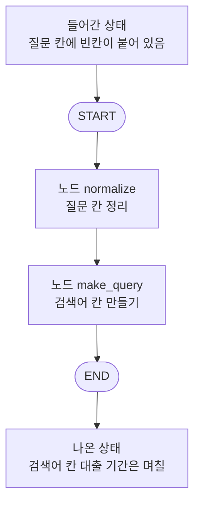
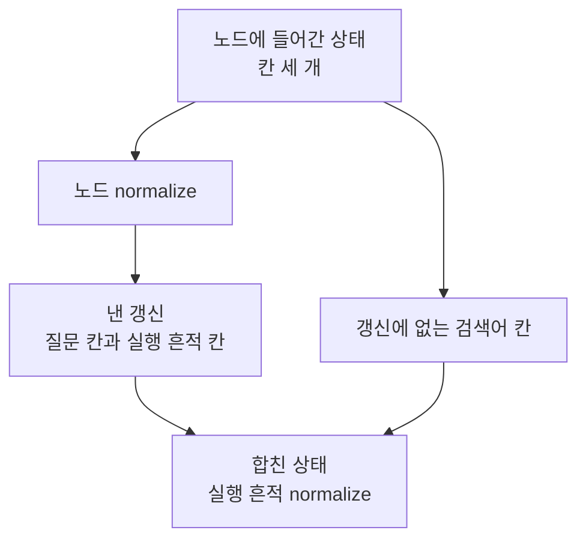
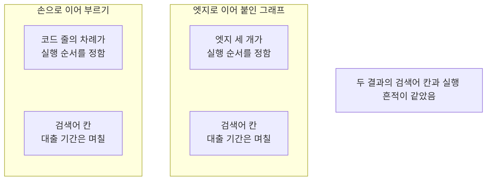
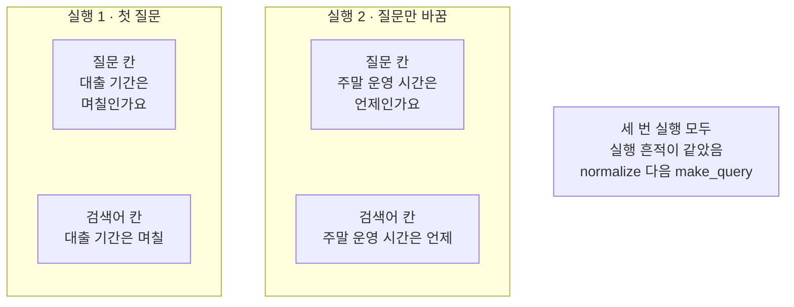

# 01-StateGraph와-노드-엣지

## _src 본문 (HTML 원본)

```html
<!--meta: 강의 1h | 실습 1h | 코드 notebooks/01-StateGraph와-노드-엣지.ipynb | 새 용어 7 -->
<h2 id="b1"><span class="no">1</span>학습 목표</h2><div class="goal"><ul><li>이 절을 마치면 상태와 노드와 엣지를 코드에서 가려낼 수 있습니다.</li><li>가상 시작점과 가상 끝점을 잇는 순차 그래프를 컴파일해 실행할 수 있습니다.</li><li>실행 흔적과 그래프가 그린 구조를 읽어 실제 실행 순서를 확인할 수 있습니다.</li></ul></div>
<h2 id="b2"><span class="no">2</span>이 내용을 배우는 이유</h2><p>Part 3에서 만든 검색은 함수 여러 개를 차례로 불렀습니다. 단계가 두세 개일 때는 부르는 줄만 봐도 순서가 보입니다. 조건에 따라 건너뛰거나 되돌아가는 단계가 생기면 그 순서가 여러 곳에 흩어집니다. 흩어진 순서는 고치기도 어렵고 어디를 지났는지 남기기도 어렵습니다.</p><p>라이브러리 LangGraph는 상태와 실행 순서를 그래프 하나로 적어 이 문제를 다룹니다. 이번 절의 질문은 「파이썬 함수 나열을 상태 그래프로 옮기면 실행 순서를 어떻게 읽을 수 있을까요?」입니다. 같은 두 함수를 손으로 이어 부른 결과와 그래프로 옮긴 결과를 견주어 답합니다.</p>
<h2 id="b3"><span class="no">3</span>앞에서 배운 내용</h2><p>Ch 12에서는 질문 하나로 문서 청크를 찾고 두 순위를 합쳐 답까지 이었습니다. 그 흐름은 함수 여러 개를 차례로 부르는 코드였습니다. 이 절은 그 가운데 검색과 모델 호출을 빼고 함수 두 개만 남깁니다. 질문을 다듬는 함수와 검색어를 만드는 함수입니다.</p><p>앞 노트북의 변수나 파일을 쓰지 않습니다. 각 노트북은 Python 3.12 새 커널에서 첫 셀부터 혼자 실행됩니다. 이 절은 파일을 새로 쓰지도 않습니다.</p><p>Ch 2 06절에서 <code>class</code> 문으로 형식을 적는 법을 배웠습니다. Part 2와 Part 3에서는 그 문법을 한 번도 쓰지 않았습니다. 이 절은 라이브러리가 상태 형식을 요구해 필드만 적은 형식 하나를 만듭니다. 타입힌트 <code>str</code>과 <code>list[str]</code>도 그 자리에서 처음 씁니다.</p><p>Ch 9~12에서 쓴 말 「칸」을 이 절에서도 씁니다. 표나 딕셔너리의 키 자리를 가리키는 말입니다. 말 「조각」은 Ch 5의 토큰 뜻으로만 쓰고 이 절에는 나오지 않습니다.</p>
<h2 id="b4"><span class="no">4</span>핵심 개념</h2><h3>비유로 시작하기</h3><p>나무로 만든 한 갈래 길 위에 작은 작업대 두 개가 놓여 있습니다. 칸이 셋인 나무 상자 하나가 그 길을 따라 지나갑니다. 작업대를 하나 지날 때마다 상자의 칸이 하나씩 채워집니다. 길을 바꾸지 않는 한 상자는 늘 같은 차례로 두 작업대를 지납니다.</p>
{{img:01-5-한-상자가-지나는-두-작업대|나무 가로대 두 줄이 한 갈래 길을 이루고 그 위에 똑같이 생긴 작은 나무 작업대 두 개가 걸터앉아 있으며 칸이 셋인 열린 나무 상자가 길 위 세 자리에 놓여 왼쪽 끝 상자는 세 칸이 모두 비어 있고 가운데 상자는 첫째 칸에 파란 블록 하나가 있으며 오른쪽 끝 상자는 첫째 칸에 파란 블록과 둘째 칸에 초록 블록이 있고 셋째 칸은 비어 있는 그림|칸이 셋인 상자 하나가 한 갈래 길을 따라 작업대 두 곳을 지나며 칸이 하나씩 채워집니다.}}
<p class="look"><b>그림 읽기</b> — 왼쪽 끝 상자는 세 칸이 모두 비어 있습니다. 가운데 상자는 첫 작업대를 지나 첫째 칸이 찼습니다. 오른쪽 끝 상자는 둘째 작업대까지 지나 둘째 칸도 찼습니다. 상자가 상태이고 작업대가 노드이며 두 작업대를 잇는 길이 엣지입니다. 셋째 칸은 이 길에서 아무 작업대도 채우지 않은 칸입니다.</p>
<table><thead><tr><th>말</th><th>뜻</th></tr></thead><tbody><tr><td>상태(state)</td><td>그래프가 도는 동안 노드들이 함께 읽고 고치는 값입니다. 이 절의 상태에는 칸이 셋 있습니다.</td></tr><tr><td>노드(node)</td><td>상태를 받아 바꿀 칸만 딕셔너리에 담아 내놓는 함수입니다.</td></tr><tr><td>엣지(edge)</td><td>한 노드 다음에 어느 노드를 실행할지 적어 둔 이동 한 칸입니다.</td></tr><tr><td>상태 그래프(StateGraph)</td><td>상태 형식과 노드와 엣지를 모아 두는 설계 객체입니다.</td></tr><tr><td>가상 시작점·가상 끝점(START·END)</td><td>입력이 들어오는 자리와 더 실행할 노드가 없는 자리입니다. 우리가 등록한 노드가 아닙니다.</td></tr><tr><td>컴파일(compile)</td><td>적어 둔 구조를 확인해 실행할 수 있는 객체로 만드는 일입니다.</td></tr><tr><td>실행 흔적</td><td>지나간 노드 이름을 차례로 담은 칸입니다. 이 절에서는 <code>trace</code> 칸입니다.</td></tr></tbody></table>
{{mermaid:01-1-상태-노드-엣지-한눈에|위에서 아래로 내려가는 흐름도로 맨 위 초록 상자 들어간 상태 질문 칸에 빈칸이 붙어 있음에서 회색 둥근 상자 START를 지나 파란 상자 노드 normalize 질문 칸 정리와 파란 상자 노드 make_query 검색어 칸 만들기를 차례로 지나고 회색 둥근 상자 END를 거쳐 맨 아래 노란 상자 나온 상태 검색어 칸 대출 기간은 며칠로 이어지는 그림|상태 하나가 START에서 들어가 노드 두 개를 지나 END로 나오고 검색어 칸이 채워집니다.}}
<p class="look"><b>도식 읽기</b> — 맨 위 초록 상자가 그래프에 넣은 상태입니다. 위에서 아래로 읽습니다. 회색 둥근 상자 두 개는 라이브러리가 두는 가상 지점입니다. 가운데 파란 상자 두 개가 우리가 만든 노드입니다. 맨 아래 노란 상자는 노트북 출력으로 확인한 결과입니다.</p>
<h3>노드가 내놓는 것</h3><p>노드는 상태 전체를 다시 만들지 않습니다. 자기가 바꾸는 칸만 딕셔너리에 담아 내놓습니다. 함수 <code>normalize()</code>가 낸 갱신에는 칸이 둘뿐이었습니다. 질문 칸과 실행 흔적 칸이고 검색어 칸은 빠져 있었습니다. 갱신에 없는 칸은 앞 값을 그대로 지닙니다.</p>
<h3>순서를 어디에 적는가</h3><p>함수를 손으로 이어 부르면 코드 줄의 차례가 실행 순서입니다. 그래프에서는 엣지가 실행 순서를 적는 자리입니다. 노드를 등록하는 일과 순서를 적는 일이 서로 따로 있습니다. 그래서 등록 차례를 바꿔도 엣지가 그대로면 실행 순서가 같습니다. 이 절 노트북은 그 두 그래프를 모두 실행해 확인했습니다.</p>
<h2 id="b5"><span class="no">5</span>실행 예제</h2><p>이 절은 모델을 한 번도 부르지 않습니다. 읽어 오는 자료 파일도 없고 새로 쓰는 파일도 없습니다. 상태 칸 세 개와 함수 두 개만으로 그래프를 만듭니다.</p><p>먼저 같은 두 함수를 그래프 없이 손으로 이어 부릅니다. 그다음 같은 두 함수를 노드로 등록하고 엣지 세 개를 적습니다. 마지막으로 질문 하나와 등록 차례 하나를 따로따로 바꿔 다시 실행합니다.</p>
{{mermaid:01-2-한-노드가-낸-갱신|위에서 아래로 내려가는 흐름도로 맨 위 초록 상자 노드에 들어간 상태 칸 세 개에서 두 갈래로 갈려 한 갈래는 파란 상자 노드 normalize를 지나 노란 상자 낸 갱신 질문 칸과 실행 흔적 칸으로 가고 다른 갈래는 초록 상자 갱신에 없는 검색어 칸으로 간 뒤 두 갈래가 맨 아래 노란 상자 합친 상태 실행 흔적 normalize로 모이는 그림|노드는 바꿀 칸만 갱신으로 내고 갱신에 없는 칸은 그대로 합친 상태에 남습니다.}}
<p class="look"><b>도식 읽기</b> — 맨 위 초록 상자가 노드에 들어간 상태입니다. 거기서 두 갈래로 갈립니다. 한 갈래는 파란 상자 노드를 지나 노란 상자 낸 갱신으로 갑니다. 다른 갈래는 갱신에 없는 검색어 칸이고 초록 그대로 내려갑니다. 맨 아래 노란 상자가 두 갈래를 합친 상태입니다.</p>
{{notebook:01-StateGraph와-노드-엣지}}
{{mermaid:01-3-손으로-잇기와-엣지로-잇기|나란히 놓인 두 칸의 흐름도로 칸 제목 손으로 이어 부르기 아래에는 파란 상자 코드 줄의 차례가 실행 순서를 정함과 노란 상자 검색어 칸 대출 기간은 며칠이 있고 칸 제목 엣지로 이어 붙인 그래프 아래에는 파란 상자 엣지 세 개가 실행 순서를 정함과 노란 상자 검색어 칸 대출 기간은 며칠이 있으며 오른쪽에 회색 상자 두 결과의 검색어 칸과 실행 흔적이 같았음이 놓인 그림|같은 두 함수를 손으로 이어 부르든 엣지로 이어 붙이든 검색어 칸이 같았습니다.}}
<p class="look"><b>도식 읽기</b> — 칸 두 개의 제목이 같은 두 함수를 잇는 두 가지 방법입니다. 칸 제목 「손으로 이어 부르기」 아래 파란 상자가 순서를 정한 자리입니다. 칸 제목 「엣지로 이어 붙인 그래프」 아래 파란 상자도 그 자리를 가리킵니다. 두 칸의 노란 상자에 적힌 검색어 칸 값이 같습니다. 오른쪽 회색 상자는 두 칸에 모두 해당하는 사실입니다.</p>
<p class="look"><b>확인할 점</b> — 함수 <code>normalize()</code>가 낸 갱신은 칸이 둘이었고 검색어 칸은 빠져 있었습니다. 손으로 이어 부른 결과의 검색어 칸은 <code>대출 기간은 며칠</code>이었습니다. 그래프 실행 1도 같은 값을 냈고 출력 줄 <code>검색어 칸이 같은가: True</code>가 나왔습니다. 그래프가 그린 구조에는 <code>normalize --&gt; make_query;</code> 줄이 있었습니다.</p>
<h2 id="b6"><span class="no">6</span>실험 결과 해석</h2><p>질문만 바꾼 두 실행에서 검색어 칸은 달라졌고 실행 흔적 칸은 같았습니다. 실행 1의 검색어 칸은 <code>대출 기간은 며칠</code>이고 실행 2는 <code>주말 운영 시간은 언제</code>입니다. 두 실행의 실행 흔적 칸은 모두 <code>['normalize', 'make_query']</code>였습니다.</p>
{{mermaid:01-4-두-실행의-결과|나란히 놓인 두 칸의 흐름도로 칸 제목 실행 1 첫 질문 아래에는 초록 상자 질문 칸 대출 기간은 며칠인가요와 노란 상자 검색어 칸 대출 기간은 며칠이 있고 칸 제목 실행 2 질문만 바꿈 아래에는 초록 상자 질문 칸 주말 운영 시간은 언제인가요와 노란 상자 검색어 칸 주말 운영 시간은 언제가 있으며 오른쪽에 회색 상자 세 번 실행 모두 실행 흔적이 같았음 normalize 다음 make_query가 놓인 그림|질문을 바꾸면 검색어 칸이 달라지고 세 번 실행의 실행 흔적은 모두 같았습니다.}}
<p class="look"><b>도식 읽기</b> — 왼쪽 칸이 실행 1이고 가운데 칸이 질문만 바꾼 실행 2입니다. 칸마다 위 초록 상자가 넣은 질문 칸이고 아래 노란 상자가 나온 검색어 칸입니다. 두 칸의 검색어 칸 값이 서로 다릅니다. 오른쪽 회색 상자는 세 번 실행에 모두 해당하는 사실입니다. 등록 차례를 바꾼 실행이 그 세 번째입니다.</p>
<p>노드를 등록하는 차례만 바꾼 그래프도 같은 실행 흔적을 냈습니다. 그 그래프는 <code>make_query</code>를 먼저 등록했고 엣지 세 개는 글자까지 같습니다. 출력 줄 <code>실행 1과 실행 흔적이 같은가: True</code>가 그 결과입니다. 이번 실행에서는 실행 순서를 엣지가 정했습니다.</p><p>여기서 확인한 것은 노드 두 개를 엣지로 고정한 그래프입니다. 노드가 셋 이상이거나 갈래가 있는 그래프는 이번에 실행하지 않았습니다. 걸린 시간도 이번에 재지 않았습니다.</p>
<h2 id="b7"><span class="no">7</span>주의할 점과 실무 메모</h2><ul><li>노드는 상태 전체를 다시 만들지 않고 바꿀 칸만 내놓습니다. 갱신에 없는 칸은 앞 값을 그대로 지닙니다.</li><li>이 절 두 노드는 실행 흔적 칸을 코드에서 직접 이어 붙였습니다. 칸마다 합치는 규칙을 상태에 적어 두는 방법은 02절에서 배웁니다.</li><li>컴파일 전 객체와 컴파일 결과는 종류 이름이 다릅니다. 출력에서 <code>StateGraph</code>와 <code>CompiledStateGraph</code>로 갈립니다.</li><li>이름 <code>__start__</code>와 <code>__end__</code>는 라이브러리가 붙인 가상 지점 이름입니다. 우리가 등록한 노드가 아닙니다.</li><li>그래프가 그린 구조 문자열은 라이브러리가 만든 것입니다. 색과 모양이 이 페이지의 도식과 다릅니다.</li><li>이 절은 모델을 한 번도 부르지 않았습니다. 경로를 정한 것은 코드에 적은 엣지입니다.</li><li>등록 차례를 바꾼 그래프는 노드 두 개로 한 번만 실행했습니다. 더 큰 그래프에서도 같은지는 이번에 확인하지 않았습니다.</li><li>이 절은 걸린 시간을 재지 않았습니다. 그래프로 옮겨서 빨라졌는지 느려졌는지 적지 않습니다.</li><li>준비물에 LangGraph 1.2.11을 적었습니다. 다른 판과 Windows·macOS에서는 이번에 실행하지 않았습니다.</li><li>이 절은 파일을 쓰지 않습니다. Ch 12가 남긴 기록 파일도 읽지 않습니다.</li></ul>
<h2 id="b8"><span class="no">8</span>정리와 다음 절</h2><ul><li>노드는 상태를 받아 바꿀 칸만 내놓는 보통 함수였습니다.</li><li>손으로 이어 부른 결과와 그래프 실행 1 결과의 검색어 칸이 같았습니다.</li><li>질문을 바꾸거나 등록 차례를 바꿔도 실행 흔적 칸은 <code>['normalize', 'make_query']</code>였습니다.</li></ul><p><strong>다음 학습과 이어지는 지점</strong> — 02절에서는 같은 칸에 갱신이 여러 번 모일 때 합치는 규칙을 상태에 적어 둡니다. 이 절에서 코드로 직접 이어 붙인 실행 흔적을 그 규칙으로 옮깁니다.</p>
<h2 id="b9"><span class="no">9</span>복습 문제</h2><details class="quiz" open><summary>문제 4개 · 해설 포함</summary><p class="quiz-q">1. 노드가 상태 전체가 아니라 일부 칸만 내놓아도 되는 까닭은 무엇입니까?</p><p class="quiz-a">갱신에 없는 칸은 앞 값을 그대로 지니기 때문입니다. 틀렸다면 「노드가 내놓는 것」을 다시 읽습니다.</p><p class="quiz-q">2. 컴파일하기 전 객체와 컴파일 결과는 무엇이 다릅니까?</p><p class="quiz-a">앞의 것은 적어 둔 설계도이고 뒤의 것이 실행하는 객체입니다. 틀렸다면 「핵심 개념」의 용어 표를 다시 읽습니다.</p><p class="quiz-q">3. 노드를 등록한 차례가 실행 순서를 정합니까?</p><p class="quiz-a">아닙니다. 이번 실행에서는 엣지가 실행 순서를 정했습니다. 틀렸다면 「실험 결과 해석」을 다시 읽습니다.</p><p class="quiz-q">4. 질문을 바꾸면 실행 흔적 칸도 달라집니까?</p><p class="quiz-a">이번 두 실행에서는 달라지지 않았습니다. 틀렸다면 「실험 결과 해석」을 다시 읽습니다.</p></details>
<h2 id="b10"><span class="no">10</span>참고 자료</h2><ul><li><div><a href="https://docs.langchain.com/oss/python/langgraph/graph-api">LangGraph Graph API 안내</a></div>상태와 노드와 엣지 개념 설명 · 1.2.11 · 확인 2026-09-10</li><li><div><a href="https://docs.langchain.com/oss/python/langgraph/use-graph-api">LangGraph Graph API 사용법</a></div>노드 등록과 엣지 연결과 컴파일 사용법 · 1.2.11 · 확인 2026-09-10</li><li><div><a href="https://reference.langchain.com/python/langgraph/graph/state/StateGraph">StateGraph API</a></div>설계 객체의 메서드 목록 · 1.2.11 · 확인 2026-09-10</li></ul>
```

## 노트북 셀 (순서대로)

### [0] markdown {'html': 'skip'}

# StateGraph와 노드·엣지

**이 노트북에서 할 일**

1. 상태 칸 세 개를 적고 노드로 쓸 함수 두 개를 만듭니다.
2. 두 함수를 손으로 이어 부른 뒤 같은 일을 그래프로 옮깁니다.
3. 질문 하나만 바꿔 다시 실행하고 두 실행을 기록으로 견줍니다.
4. 노드를 등록한 차례만 바꿔 실행 순서가 달라지는지 봅니다.

**준비물** — 이 절은 OpenAI API 키를 쓰지 않습니다.
모델 요청이 0번이라 드는 비용이 없습니다.
읽어 오는 자료 파일도 없고 새로 쓰는 파일도 없습니다.
실행 시간은 1분 안팎이고 첫 셀의 설치가 가장 오래 걸립니다.

**기준 버전** — 첫 셀에서 LangGraph 1.2.11을 설치합니다.
실습 폴더 잠금 파일은 LangChain 1.4.0도 함께 고정하지만 이 절은 부르지 않습니다.
교재 출력은 Linux의 Python 3.12.13으로 만들었습니다.
다른 판과 Windows·macOS에서는 이번에 실행하지 않았습니다.

**강의와 실습 범위** — 강의 시간에는 3~6절과 11~14절을 읽습니다.
상태 칸을 적고 노드 함수를 만든 뒤 그래프로 옮기는 자리입니다.
7~10절은 같은 두 함수를 손으로 이어 부르는 자리이고 15~17절은 값 바꿔 보기입니다.
18~21절과 22~24절은 함께 실행하고 실습 시간에 다시 읽습니다.

실습 폴더 `labs/part4/ch13-langgraph-basics`에서 `uv sync --locked`를 실행합니다.
그다음 이 폴더의 `.venv` 커널을 고르고 첫 셀부터 순서대로 실행합니다.

### [1] markdown {'html': 'skip'}

## 오늘 볼 그림


맨 위 초록 상자가 그래프에 넣은 상태입니다.
가운데 파란 상자 두 개가 우리가 만든 노드이고 위에서 아래로 읽습니다.
회색 둥근 상자 두 개는 LangGraph가 두는 가상 지점입니다.
맨 아래 노란 상자는 이 노트북의 출력으로 확인한 결과입니다.

### [2] markdown {}

## 1. 준비

첫 셀은 패키지 하나를 설치하고 설치된 판 번호를 출력합니다.
설치에는 몇십 초가 걸릴 수 있습니다.

### [3] code {'execution': {'iopub.execute_input': '2026-09-19T03:53:37.769235Z', 'iopub.status.busy': '2026-09-19T03:53:37.769047Z', 'iopub.status.idle': '2026-09-19T03:53:38.192925Z', 'shell.execute_reply': '2026-09-19T03:53:38.192369Z'}, 'lesson_role': 'setup'}

```python
# 이 절에서 쓰는 패키지를 설치하고 버전을 확인합니다
%pip install -q "langgraph==1.2.11"
from importlib.metadata import version

print("langgraph:", version("langgraph"))
```

출력:
```
Note: you may need to restart the kernel to use updated packages.
langgraph: 1.2.11

```

### [4] markdown {}

**결과 읽기** — 설치가 끝나면 `langgraph: 1.2.11`이 보입니다.
이 노트북의 출력은 2026-09-19에 이 판으로 실행한 결과입니다.

다음 셀은 이 절에서 쓸 이름 네 개를 불러옵니다.

### [5] code {'execution': {'iopub.execute_input': '2026-09-19T03:53:38.193953Z', 'iopub.status.busy': '2026-09-19T03:53:38.193864Z', 'iopub.status.idle': '2026-09-19T03:53:38.712610Z', 'shell.execute_reply': '2026-09-19T03:53:38.712250Z'}, 'lesson_role': 'setup'}

```python
# 상태 형식과 그래프 만들기에 쓸 이름 네 개를 불러옵니다
from typing_extensions import TypedDict
from langgraph.graph import StateGraph, START, END

print("불러온 이름:", "TypedDict", "StateGraph", "START", "END")
```

출력:
```
불러온 이름: TypedDict StateGraph START END

```

### [6] markdown {}

**결과 읽기** — 출력 줄은 `불러온 이름: TypedDict StateGraph START END` 하나입니다.
형식 `TypedDict`는 어떤 칸에 어떤 값이 들어가는지 적어 두는 딕셔너리 형식입니다.
설계 객체 `StateGraph`는 노드와 엣지를 모아 그래프를 만드는 이름입니다.
이름 `START`와 `END`는 LangGraph가 두는 가상 시작점과 가상 끝점입니다.

## 2. 이 절에서 쓸 질문 정하기

질문 두 개를 미리 정해 둡니다.
앞뒤에 빈칸을 일부러 넣어 첫 노드가 할 일을 만듭니다.

### [7] code {'execution': {'iopub.execute_input': '2026-09-19T03:53:38.713418Z', 'iopub.status.busy': '2026-09-19T03:53:38.713357Z', 'iopub.status.idle': '2026-09-19T03:53:38.715209Z', 'shell.execute_reply': '2026-09-19T03:53:38.714897Z'}}

```python
# 이 절에서 쓸 질문 두 개를 정합니다(앞뒤에 빈칸을 일부러 넣었습니다)
first_question = "  대출 기간은 며칠인가요?  "
second_question = "  주말 운영 시간은 언제인가요?  "
print("첫 질문:", first_question)
print("첫 질문의 글자 수:", len(first_question))
print("바꿔 볼 질문:", second_question)
```

출력:
```
첫 질문:   대출 기간은 며칠인가요?  
첫 질문의 글자 수: 17
바꿔 볼 질문:   주말 운영 시간은 언제인가요?  

```

### [8] markdown {}

**결과 읽기** — 출력 줄 `첫 질문의 글자 수: 17`에서 앞뒤 빈칸 네 개가 함께 세어졌습니다.
질문 자체는 열세 글자이고 나머지 네 글자가 빈칸입니다.
빈칸은 화면에서 잘 보이지 않으므로 글자 수로 확인합니다.

## 3. 상태 칸 적기

상태는 그래프가 도는 동안 노드들이 함께 읽고 고치는 값입니다.
공용 게시판에 칸이 셋 있고 사람마다 맡은 칸에만 적는 모습과 같습니다.
다음 셀은 그 칸 세 개의 이름과 값 갈래를 적습니다.
Ch 2 06절에서 배운 `class` 문을 Part 2·3에서는 쓰지 않았습니다.
여기서는 라이브러리가 상태 형식을 요구해 필드만 적은 형식 하나를 만듭니다.

### [9] code {'execution': {'iopub.execute_input': '2026-09-19T03:53:38.715745Z', 'iopub.status.busy': '2026-09-19T03:53:38.715692Z', 'iopub.status.idle': '2026-09-19T03:53:38.717440Z', 'shell.execute_reply': '2026-09-19T03:53:38.717146Z'}}

```python
# 그래프가 도는 동안 노드들이 함께 읽고 고칠 칸 세 개를 적습니다
class FlowState(TypedDict):
    question: str
    query: str
    trace: list[str]
```

출력:
```

```

### [10] markdown {}

**결과 읽기** — 정의 셀이라 출력이 없습니다.
칸 이름 뒤 `: str`은 그 칸에 문자열이 들어간다는 표시입니다.
표시 `list[str]`은 문자열을 담은 목록이라는 뜻입니다.
칸 `trace`에는 지나간 노드 이름을 차례로 담아 실행 흔적으로 씁니다.

다음 셀은 상태를 칸별로 출력하는 함수입니다.

### [11] code {'execution': {'iopub.execute_input': '2026-09-19T03:53:38.718005Z', 'iopub.status.busy': '2026-09-19T03:53:38.717957Z', 'iopub.status.idle': '2026-09-19T03:53:38.719442Z', 'shell.execute_reply': '2026-09-19T03:53:38.719180Z'}}

```python
# 상태의 칸 세 개를 라벨 줄 아래에 한 줄씩 출력합니다
def print_state(label, state):
    print(label)
    print("질문 칸 |", state["question"])
    print("검색어 칸 |", state["query"])
    print("실행 흔적 칸 |", state["trace"])
```

출력:
```

```

### [12] markdown {}

**결과 읽기** — 정의 셀이라 출력이 없습니다.
라벨 줄을 따로 출력하고 그 아래에 칸을 한 줄씩 적습니다.

## 4. 노드로 쓸 함수 두 개 만들기

노드는 상태를 받아 바꿀 칸만 딕셔너리로 내놓는 함수입니다.
먼저 질문 칸을 정리하는 함수를 만듭니다.

### [13] code {'execution': {'iopub.execute_input': '2026-09-19T03:53:38.719971Z', 'iopub.status.busy': '2026-09-19T03:53:38.719916Z', 'iopub.status.idle': '2026-09-19T03:53:38.721501Z', 'shell.execute_reply': '2026-09-19T03:53:38.721189Z'}}

```python
# 질문 칸의 앞뒤 빈칸을 없애고 이 노드가 지난 자취를 실행 흔적에 붙입니다
def normalize(state):
    clean_question = state["question"].strip()
    new_trace = state["trace"] + ["normalize"]
    return {"question": clean_question, "trace": new_trace}
```

출력:
```

```

### [14] markdown {}

**결과 읽기** — 정의 셀이라 출력이 없습니다.
메서드 `strip()`은 글 앞뒤의 빈칸을 없앱니다.
실행 흔적 칸에는 기존 목록 뒤에 이름 하나를 붙여 새 목록을 만듭니다.
칸마다 합치는 규칙을 상태에 적어 두는 방법은 02절에서 배웁니다.

다음 셀은 그 함수를 그래프 없이 직접 불러 봅니다.

### [15] code {'execution': {'iopub.execute_input': '2026-09-19T03:53:38.722053Z', 'iopub.status.busy': '2026-09-19T03:53:38.722005Z', 'iopub.status.idle': '2026-09-19T03:53:38.723784Z', 'shell.execute_reply': '2026-09-19T03:53:38.723442Z'}}

```python
# 노드 함수도 보통 함수입니다. 그래프 없이 직접 불러 봅니다
hand_state = {"question": first_question, "query": "", "trace": []}
first_update = normalize(hand_state)
print("normalize가 낸 갱신:", first_update)
print("갱신에 든 칸 수:", len(first_update))
```

출력:
```
normalize가 낸 갱신: {'question': '대출 기간은 며칠인가요?', 'trace': ['normalize']}
갱신에 든 칸 수: 2

```

### [16] markdown {}

**결과 읽기** — 출력 줄에 `{'question': '대출 기간은 며칠인가요?', 'trace': ['normalize']}`가 보입니다.
앞뒤 빈칸이 사라졌고 실행 흔적에 이름 하나가 담겼습니다.
출력 줄 `갱신에 든 칸 수: 2`에서 검색어 칸이 빠진 것을 확인합니다.
노드는 자기가 바꾸는 칸만 내놓습니다.

다음 셀은 검색어 칸을 만드는 함수입니다.

### [17] code {'execution': {'iopub.execute_input': '2026-09-19T03:53:38.724404Z', 'iopub.status.busy': '2026-09-19T03:53:38.724359Z', 'iopub.status.idle': '2026-09-19T03:53:38.726090Z', 'shell.execute_reply': '2026-09-19T03:53:38.725779Z'}}

```python
# 물음표와 맺음말을 지워 검색어 칸에 넣을 말을 만듭니다
def make_query(state):
    without_mark = state["question"].replace("?", "")
    plain = without_mark.replace("인가요", "")
    new_trace = state["trace"] + ["make_query"]
    return {"query": plain.strip(), "trace": new_trace}
```

출력:
```

```

### [18] markdown {}

**결과 읽기** — 정의 셀이라 출력이 없습니다.
메서드 `replace()`는 글에서 찾은 말을 다른 말로 바꿉니다.
여기서는 물음표와 맺음말 `인가요`를 빈 글로 바꿔 지웁니다.

다음 셀은 앞 갱신을 상태에 합친 뒤 이 함수를 불러 봅니다.

### [19] code {'execution': {'iopub.execute_input': '2026-09-19T03:53:38.726626Z', 'iopub.status.busy': '2026-09-19T03:53:38.726585Z', 'iopub.status.idle': '2026-09-19T03:53:38.728512Z', 'shell.execute_reply': '2026-09-19T03:53:38.728130Z'}}

```python
# 앞 갱신을 상태에 합친 뒤 두 번째 노드 함수를 불러 봅니다
hand_state.update(first_update)
second_update = make_query(hand_state)
print("make_query가 낸 갱신:", second_update)
print("갱신에 든 칸 수:", len(second_update))
```

출력:
```
make_query가 낸 갱신: {'query': '대출 기간은 며칠', 'trace': ['normalize', 'make_query']}
갱신에 든 칸 수: 2

```

### [20] markdown {}

**결과 읽기** — 출력 줄에 `{'query': '대출 기간은 며칠', 'trace': ['normalize', 'make_query']}`가 보입니다.
검색어 칸에 물음표와 맺음말이 빠진 말이 담겼습니다.
실행 흔적에는 이름 두 개가 차례로 쌓였습니다.

## 5. 손으로 이어 부른 결과 보기

메서드 `update()`는 딕셔너리에 다른 딕셔너리의 칸을 덮어 씁니다.
갱신을 상태에 합치는 일을 손으로 한 셈입니다.

### [21] code {'execution': {'iopub.execute_input': '2026-09-19T03:53:38.729154Z', 'iopub.status.busy': '2026-09-19T03:53:38.729110Z', 'iopub.status.idle': '2026-09-19T03:53:38.730703Z', 'shell.execute_reply': '2026-09-19T03:53:38.730405Z'}}

```python
# 두 번째 갱신까지 합쳐 손으로 이어 부른 결과를 봅니다
hand_state.update(second_update)
print_state("손으로 이어 부른 결과", hand_state)
```

출력:
```
손으로 이어 부른 결과
질문 칸 | 대출 기간은 며칠인가요?
검색어 칸 | 대출 기간은 며칠
실행 흔적 칸 | ['normalize', 'make_query']

```

### [22] markdown {}

**결과 읽기** — 라벨 줄 `손으로 이어 부른 결과` 아래 세 줄이 나옵니다.
줄 `검색어 칸 | 대출 기간은 며칠`이 두 함수를 지난 결과입니다.
줄 `실행 흔적 칸 | ['normalize', 'make_query']`에 지나온 차례가 남았습니다.
여기까지는 그래프를 쓰지 않았고 부르는 차례를 코드 줄이 정했습니다.

## 6. 같은 일을 그래프로 옮기기

이제 같은 두 함수를 그래프에 등록합니다.
등록은 함수를 부르는 것이 아니라 이름과 함수를 짝지어 적어 두는 일입니다.

### [23] code {'execution': {'iopub.execute_input': '2026-09-19T03:53:38.731209Z', 'iopub.status.busy': '2026-09-19T03:53:38.731164Z', 'iopub.status.idle': '2026-09-19T03:53:38.733293Z', 'shell.execute_reply': '2026-09-19T03:53:38.732979Z'}}

```python
# 노드 두 개를 그래프에서 쓸 이름과 함께 설계 객체에 등록합니다
builder = StateGraph(FlowState)
builder.add_node("normalize", normalize)
builder.add_node("make_query", make_query)
print("등록한 노드 수:", len(builder.nodes))
print("등록한 노드 이름:")
for node_name in builder.nodes:
    print(node_name)
```

출력:
```
등록한 노드 수: 2
등록한 노드 이름:
normalize
make_query

```

### [24] markdown {}

**결과 읽기** — 출력 줄 `등록한 노드 수: 2`가 보입니다.
라벨 줄 `등록한 노드 이름:` 아래 두 줄은 `normalize`와 `make_query`입니다.
등록만 했을 뿐 아직 함수 본문은 실행되지 않았습니다.

다음 셀은 실행 순서를 엣지로 적습니다.

### [25] code {'execution': {'iopub.execute_input': '2026-09-19T03:53:38.733763Z', 'iopub.status.busy': '2026-09-19T03:53:38.733720Z', 'iopub.status.idle': '2026-09-19T03:53:38.735482Z', 'shell.execute_reply': '2026-09-19T03:53:38.735107Z'}}

```python
# START부터 END까지 실행 순서를 엣지 세 개로 적습니다
builder.add_edge(START, "normalize")
builder.add_edge("normalize", "make_query")
builder.add_edge("make_query", END)
edge_order = ["START", "normalize", "make_query", "END"]
print("엣지로 적은 실행 순서:", edge_order)
```

출력:
```
엣지로 적은 실행 순서: ['START', 'normalize', 'make_query', 'END']

```

### [26] markdown {}

**결과 읽기** — 출력 줄 `엣지로 적은 실행 순서: ['START', 'normalize', 'make_query', 'END']`가 보입니다.
엣지 하나가 「이 노드 다음에는 저 노드」라는 이동 한 칸입니다.
가상 시작점에서 첫 노드로, 마지막 노드에서 가상 끝점으로 가는 엣지도 적습니다.

다음 셀은 적어 둔 구조를 실행할 수 있는 그래프로 만듭니다.

### [27] code {'execution': {'iopub.execute_input': '2026-09-19T03:53:38.736005Z', 'iopub.status.busy': '2026-09-19T03:53:38.735965Z', 'iopub.status.idle': '2026-09-19T03:53:38.738136Z', 'shell.execute_reply': '2026-09-19T03:53:38.737847Z'}}

```python
# 선언한 구조를 확인해 실행할 수 있는 그래프로 만듭니다
graph = builder.compile()
print("설계 객체의 종류:", type(builder))
print("컴파일 결과의 종류:", type(graph))
```

출력:
```
설계 객체의 종류: <class 'langgraph.graph.state.StateGraph'>
컴파일 결과의 종류: <class 'langgraph.graph.state.CompiledStateGraph'>

```

### [28] markdown {}

**결과 읽기** — 출력 줄 두 개의 종류 이름이 서로 다릅니다.
설계 객체는 `StateGraph`이고 컴파일 결과는 `CompiledStateGraph`입니다.
컴파일하기 전 객체는 적어 둔 설계도이고 컴파일 결과가 실행하는 객체입니다.

## 7. 실행 1 — 첫 질문

실행 전에 예상해 봅니다.
검색어 칸에는 손으로 이어 부른 결과와 같은 말이 담길 것입니다.

### [29] code {'execution': {'iopub.execute_input': '2026-09-19T03:53:38.738604Z', 'iopub.status.busy': '2026-09-19T03:53:38.738561Z', 'iopub.status.idle': '2026-09-19T03:53:38.743288Z', 'shell.execute_reply': '2026-09-19T03:53:38.742995Z'}}

```python
# 컴파일한 그래프에 첫 상태를 넣어 실행합니다
first_state = {"question": first_question, "query": "", "trace": []}
first_result = graph.invoke(first_state)
print_state("그래프 실행 1 결과", first_result)
```

출력:
```
그래프 실행 1 결과
질문 칸 | 대출 기간은 며칠인가요?
검색어 칸 | 대출 기간은 며칠
실행 흔적 칸 | ['normalize', 'make_query']

```

### [30] markdown {}

**결과 읽기** — 라벨 줄 `그래프 실행 1 결과` 아래 세 줄이 나옵니다.
줄 `검색어 칸 | 대출 기간은 며칠`과 줄 `실행 흔적 칸 | ['normalize', 'make_query']`가 보입니다.
빈 글로 넣은 검색어 칸이 둘째 노드에서 채워졌습니다.

다음 셀은 손으로 이어 부른 결과와 칸별로 견줍니다.

### [31] code {'execution': {'iopub.execute_input': '2026-09-19T03:53:38.743778Z', 'iopub.status.busy': '2026-09-19T03:53:38.743729Z', 'iopub.status.idle': '2026-09-19T03:53:38.745346Z', 'shell.execute_reply': '2026-09-19T03:53:38.745100Z'}}

```python
# 손으로 이어 부른 결과와 그래프가 낸 결과를 칸별로 견줍니다
print("검색어 칸이 같은가:", hand_state["query"] == first_result["query"])
print("실행 흔적이 같은가:", hand_state["trace"] == first_result["trace"])
assert first_result["trace"] == ["normalize", "make_query"]
```

출력:
```
검색어 칸이 같은가: True
실행 흔적이 같은가: True

```

### [32] markdown {}

**결과 읽기** — 출력 줄 `검색어 칸이 같은가: True`와 `실행 흔적이 같은가: True`가 보입니다.
같은 두 함수를 썼으니 결과가 같습니다.
달라진 것은 실행 순서를 어디에 적었는가입니다.
손으로 부를 때는 코드 줄의 차례가, 그래프에서는 엣지가 순서를 정했습니다.

## 8. 값 바꿔 보기 — 질문 하나만 바꾸기

바꿀 값은 질문 하나입니다.
그래프와 처음 칸 값은 그대로 둡니다.
실행 전에 예상해 봅니다. 검색어 칸은 달라지고 실행 흔적은 같을 것입니다.

### [33] code {'execution': {'iopub.execute_input': '2026-09-19T03:53:38.745854Z', 'iopub.status.busy': '2026-09-19T03:53:38.745798Z', 'iopub.status.idle': '2026-09-19T03:53:38.747933Z', 'shell.execute_reply': '2026-09-19T03:53:38.747580Z'}}

```python
# 질문만 바꾸고 그래프와 처음 칸 값은 그대로 두어 다시 실행합니다
second_state = {"question": second_question, "query": "", "trace": []}
second_result = graph.invoke(second_state)
print_state("그래프 실행 2 결과", second_result)
```

출력:
```
그래프 실행 2 결과
질문 칸 | 주말 운영 시간은 언제인가요?
검색어 칸 | 주말 운영 시간은 언제
실행 흔적 칸 | ['normalize', 'make_query']

```

### [34] markdown {}

**결과 읽기** — 줄 `검색어 칸 | 주말 운영 시간은 언제`로 값이 달라졌습니다.
줄 `실행 흔적 칸 | ['normalize', 'make_query']`는 실행 1과 같습니다.
엣지로 고정한 순서라 질문 내용이 순서를 바꾸지 못했습니다.

## 9. 두 실행을 기록 한 줄씩으로

실행 한 번을 기록 한 줄로 만들어 담아 둡니다.
Ch 9~12에서 쓴 기록 한 줄과 같은 모양입니다.

### [35] code {'execution': {'iopub.execute_input': '2026-09-19T03:53:38.748476Z', 'iopub.status.busy': '2026-09-19T03:53:38.748434Z', 'iopub.status.idle': '2026-09-19T03:53:38.750134Z', 'shell.execute_reply': '2026-09-19T03:53:38.749839Z'}}

```python
# 실행 한 번을 기록 한 줄로 만듭니다
def run_row(run_name, state):
    row = {"실행": run_name}
    row["검색어 칸"] = state["query"]
    row["실행 흔적"] = state["trace"]
    return row
```

출력:
```

```

### [36] markdown {}

**결과 읽기** — 정의 셀이라 출력이 없습니다.

다음 셀은 두 실행의 기록을 목록에 담습니다.

### [37] code {'execution': {'iopub.execute_input': '2026-09-19T03:53:38.750694Z', 'iopub.status.busy': '2026-09-19T03:53:38.750651Z', 'iopub.status.idle': '2026-09-19T03:53:38.752440Z', 'shell.execute_reply': '2026-09-19T03:53:38.752102Z'}}

```python
# 두 실행의 기록을 목록에 담습니다
run_rows = []
run_rows.append(run_row("실행 1", first_result))
run_rows.append(run_row("실행 2", second_result))
print("담은 기록 줄 수:", len(run_rows))
```

출력:
```
담은 기록 줄 수: 2

```

### [38] markdown {}

**결과 읽기** — 출력 줄 `담은 기록 줄 수: 2`가 보입니다.

다음 셀은 담은 줄을 표로 출력합니다.

### [39] code {'execution': {'iopub.execute_input': '2026-09-19T03:53:38.752920Z', 'iopub.status.busy': '2026-09-19T03:53:38.752872Z', 'iopub.status.idle': '2026-09-19T03:53:38.754332Z', 'shell.execute_reply': '2026-09-19T03:53:38.754009Z'}}

```python
# 실행·검색어 칸·실행 흔적을 라벨 줄 아래에 차례로 출력합니다
print("실행 | 검색어 칸 | 실행 흔적")
for row in run_rows:
    print(row["실행"], "|", row["검색어 칸"], "|", row["실행 흔적"])
```

출력:
```
실행 | 검색어 칸 | 실행 흔적
실행 1 | 대출 기간은 며칠 | ['normalize', 'make_query']
실행 2 | 주말 운영 시간은 언제 | ['normalize', 'make_query']

```

### [40] markdown {}

**결과 읽기** — 라벨 줄 아래 두 줄이 나옵니다.
줄 `실행 1 | 대출 기간은 며칠 | ['normalize', 'make_query']`가 첫 실행입니다.
줄 `실행 2 | 주말 운영 시간은 언제 | ['normalize', 'make_query']`가 질문만 바꾼 실행입니다.
검색어 칸만 달라지고 실행 흔적 칸은 같습니다.

## 10. 그래프가 그린 구조 보기

그래프는 자기 구조를 문자열로 그려 줍니다.
우리가 적은 엣지가 그대로 있는지 확인합니다.

### [41] code {'execution': {'iopub.execute_input': '2026-09-19T03:53:38.754884Z', 'iopub.status.busy': '2026-09-19T03:53:38.754833Z', 'iopub.status.idle': '2026-09-19T03:53:38.770880Z', 'shell.execute_reply': '2026-09-19T03:53:38.770601Z'}}

```python
# 컴파일한 그래프가 스스로 그린 구조 문자열을 받아 옵니다
mermaid_text = graph.get_graph().draw_mermaid()
print("그래프가 그린 구조:")
print(mermaid_text)
```

출력:
```
그래프가 그린 구조:
---
config:
  flowchart:
    curve: linear
---
graph TD;
	__start__([<p>__start__</p>]):::first
	normalize(normalize)
	make_query(make_query)
	__end__([<p>__end__</p>]):::last
	__start__ --> normalize;
	normalize --> make_query;
	make_query --> __end__;
	classDef default fill:#f2f0ff,line-height:1.2
	classDef first fill-opacity:0
	classDef last fill:#bfb6fc


```

### [42] markdown {}

**결과 읽기** — 라벨 줄 `그래프가 그린 구조:` 아래에 여러 줄이 나옵니다.
줄 `normalize --> make_query;`가 우리가 적은 둘째 엣지입니다.
줄 `__start__ --> normalize;`와 `make_query --> __end__;`도 보입니다.
이 문자열은 LangGraph가 만든 것이라 색과 모양이 교재 도식과 다릅니다.

다음 셀은 그래프에 남은 노드 이름을 한 줄씩 봅니다.

### [43] code {'execution': {'iopub.execute_input': '2026-09-19T03:53:38.771432Z', 'iopub.status.busy': '2026-09-19T03:53:38.771386Z', 'iopub.status.idle': '2026-09-19T03:53:38.773285Z', 'shell.execute_reply': '2026-09-19T03:53:38.773042Z'}}

```python
# 그래프에 남은 노드 이름을 한 줄씩 출력해 우리가 적은 이름과 맞춰 봅니다
graph_nodes = graph.get_graph().nodes
print("그래프에 있는 노드 이름:")
for node_name in graph_nodes:
    print(node_name)
```

출력:
```
그래프에 있는 노드 이름:
__start__
normalize
make_query
__end__

```

### [44] markdown {}

**결과 읽기** — 라벨 줄 아래 네 줄이 나옵니다.
이름 `__start__`와 `__end__`는 라이브러리가 붙인 가상 지점 이름입니다.
가운데 두 줄이 우리가 등록한 `normalize`와 `make_query`입니다.

## 11. 값 바꿔 보기 — 등록 차례만 바꾸기

이번에 바꿀 값은 노드를 등록하는 차례 하나입니다.
엣지 세 개와 질문은 그대로 둡니다.
실행 전에 예상해 봅니다. 실행 흔적은 실행 1과 같을 것입니다.

### [45] code {'execution': {'iopub.execute_input': '2026-09-19T03:53:38.773801Z', 'iopub.status.busy': '2026-09-19T03:53:38.773754Z', 'iopub.status.idle': '2026-09-19T03:53:38.775300Z', 'shell.execute_reply': '2026-09-19T03:53:38.775102Z'}}

```python
# 노드를 등록하는 차례만 바꿔 설계 객체를 하나 더 만듭니다
swapped = StateGraph(FlowState)
swapped.add_node("make_query", make_query)
swapped.add_node("normalize", normalize)
print("등록한 차례:")
for node_name in swapped.nodes:
    print(node_name)
```

출력:
```
등록한 차례:
make_query
normalize

```

### [46] markdown {}

**결과 읽기** — 라벨 줄 `등록한 차례:` 아래 첫 줄이 `make_query`입니다.
실행 1에 쓴 그래프와 등록 차례가 뒤바뀌었습니다.

다음 셀은 엣지를 똑같이 적고 컴파일합니다.

### [47] code {'execution': {'iopub.execute_input': '2026-09-19T03:53:38.775854Z', 'iopub.status.busy': '2026-09-19T03:53:38.775792Z', 'iopub.status.idle': '2026-09-19T03:53:38.778053Z', 'shell.execute_reply': '2026-09-19T03:53:38.777736Z'}}

```python
# 엣지 세 개는 실행 1에 쓴 그래프와 똑같이 적고 컴파일합니다
swapped.add_edge(START, "normalize")
swapped.add_edge("normalize", "make_query")
swapped.add_edge("make_query", END)
swapped_graph = swapped.compile()
print("컴파일 결과의 종류:", type(swapped_graph))
```

출력:
```
컴파일 결과의 종류: <class 'langgraph.graph.state.CompiledStateGraph'>

```

### [48] markdown {}

**결과 읽기** — 출력 줄의 종류 이름이 `CompiledStateGraph`로 실행 1의 그래프와 같습니다.
엣지 세 개도 실행 1에 쓴 그래프와 글자까지 같습니다.

다음 셀은 같은 첫 질문으로 이 그래프를 실행합니다.

### [49] code {'execution': {'iopub.execute_input': '2026-09-19T03:53:38.778506Z', 'iopub.status.busy': '2026-09-19T03:53:38.778461Z', 'iopub.status.idle': '2026-09-19T03:53:38.780655Z', 'shell.execute_reply': '2026-09-19T03:53:38.780382Z'}}

```python
# 같은 첫 질문으로 등록 차례를 바꾼 그래프를 실행합니다
swapped_state = {"question": first_question, "query": "", "trace": []}
swapped_result = swapped_graph.invoke(swapped_state)
print_state("등록 차례를 바꾼 그래프 결과", swapped_result)
print("실행 1과 실행 흔적이 같은가:", swapped_result["trace"] == first_result["trace"])
```

출력:
```
등록 차례를 바꾼 그래프 결과
질문 칸 | 대출 기간은 며칠인가요?
검색어 칸 | 대출 기간은 며칠
실행 흔적 칸 | ['normalize', 'make_query']
실행 1과 실행 흔적이 같은가: True

```

### [50] markdown {}

**결과 읽기** — 줄 `실행 흔적 칸 | ['normalize', 'make_query']`가 보입니다.
출력 줄 `실행 1과 실행 흔적이 같은가: True`로 두 실행이 같음을 확인했습니다.
등록 차례를 바꿔도 실행 순서는 엣지가 정했습니다.
노드가 셋 이상이거나 갈래가 있는 그래프는 이번에 실행하지 않았습니다.

## 정리

1. 노드는 상태를 받아 바꿀 칸만 내놓는 보통 함수였습니다.
2. 같은 두 함수를 손으로 이어 부른 결과와 그래프 실행 1 결과가 같았습니다.
3. 질문을 바꾸거나 등록 차례를 바꿔도 실행 흔적은 `['normalize', 'make_query']`였습니다.

02절에서는 같은 칸에 갱신이 여러 번 모일 때 합치는 규칙을 상태에 적어 둡니다.
이 절에서 코드로 직접 이어 붙인 실행 흔적을 그 규칙으로 옮깁니다.

## 그림

### 01-1-상태-노드-엣지-한눈에.mmd



상태 하나가 START에서 들어가 노드 두 개를 지나 END로 나오고 검색어 칸이 채워집니다.

### 01-2-한-노드가-낸-갱신.mmd



노드는 바꿀 칸만 갱신으로 내고 갱신에 없는 칸은 그대로 합친 상태에 남습니다.

### 01-3-손으로-잇기와-엣지로-잇기.mmd



같은 두 함수를 손으로 이어 부르든 엣지로 이어 붙이든 검색어 칸이 같았습니다.

### 01-4-두-실행의-결과.mmd



질문을 바꾸면 검색어 칸이 달라지고 세 번 실행의 실행 흔적은 모두 같았습니다.

### 01-5-한-상자가-지나는-두-작업대.prompt.md

# 01-5-한-상자가-지나는-두-작업대 (Higgsfield 삽화)

설명 대상 문장(본문 b4 비유 단락): 칸이 셋인 나무 상자 하나가 레일을 따라 작업대 두 곳을 차례로 지나고, 작업대를 하나 지날 때마다 상자의 칸이 하나씩 채워집니다.

구성 요소와 배치: 흰 바탕 가운데를 가로지르는 곧은 나무 레일 하나가 끊기지 않고 왼쪽 끝에서 오른쪽 끝까지 이어집니다(= 엣지). 레일 위 3분의 1 자리와 3분의 2 자리에 똑같이 생긴 작은 나무 작업대가 하나씩 서 있습니다(= 노드 두 개). 칸이 셋인 열린 나무 상자 하나가 레일 위 세 자리에 나옵니다(= 같은 상태 하나가 지나가는 세 시점): 두 작업대 앞인 왼쪽 끝, 두 작업대 사이인 가운데, 두 작업대 뒤인 오른쪽 끝입니다. 왼쪽 상자는 세 칸이 모두 비어 있고, 가운데 상자는 첫째 칸에 작은 파란 블록 하나가 있으며, 오른쪽 상자는 첫째 칸에 파란 블록, 둘째 칸에 초록 블록이 있고 셋째 칸은 비어 있습니다.

시선 순서: 왼쪽 끝의 빈 상자 → 첫 작업대 → 가운데 상자의 파란 블록 → 둘째 작업대 → 오른쪽 끝 상자의 파란·초록 블록.

검수 기준: 그림만 보고 「같은 상자 하나가 한 레일을 따라가며 작업대를 지날 때마다 칸이 하나씩 채워진다」가 읽히는가.

Ch 9~Ch 12 비유 계열과의 관계: 카드(Ch 9 문서 청크)·봉투(Ch 10 출처 기록)·서랍(Ch 10 벡터 캐시)·쟁반(Ch 11·12 후보 목록)·끈(Ch 12 색인 이웃)·단추(Ch 12 검색 낱말)·관과 깔때기(Ch 12 13절)는 뜻이 정해져 있어 쓰지 않았습니다. 레일·작업대·칸이 셋인 상자는 이 절에서 처음 쓰는 물건이고 각각 엣지·노드·상태를 가리킵니다. 「조각」은 Ch 5 토큰 뜻 전용이라 이 그림에서도 쓰지 않습니다.

## 프롬프트 (1차, 채택)

```text
Simple flat educational illustration, white background, limited soft palette,
clean outlines, plain everyday objects, no text, no letters, no numbers, no logos.

One straight wooden rail runs left to right across the middle of the white background,
continuous and unbroken from edge to edge. Two identical small wooden work stations
stand on the rail, one at one third of its length and one at two thirds. The same open
wooden box with three equal compartments is shown three times sitting on the rail: at
the far left before both stations, between the two stations, and at the far right after
both stations. In the left box all three compartments are empty. In the middle box one
small blue block sits in the first compartment and the other two compartments are empty.
In the right box one small blue block sits in the first compartment, one small green
block sits in the second compartment, and the third compartment is empty. Side view at
eye level. No hands, no people, no monitors, no screens, no arrows, no signage.
```

## 상태

- 2026-09-19 · `nano_banana_pro`(응답 모델 이름 `nano_banana_2`) · 16:9 · 2k · `use_unlim: false` · 장당 2크레딧 · 1회 생성 2크레딧 · 생성 전 잔액 2707.
- 1차 job `a4d78b83-1315-47ee-9810-4729a78713f7` **채택**: 검수 기준의 관계가 읽힙니다. 원본 해시 `f6724447a8c2c0695f28234823ced8ad8b7f585a65e99ef27e51452ccc0edc6e`(2752 × 1536).
- **프롬프트와 그림이 다른 점(그림 읽기에 반영)**: 프롬프트는 레일을 하나로 적었지만 저장한 그림에는 나란한 나무 가로대 두 줄이 한 길을 이룹니다. 그래서 alt·캡션·「그림 읽기」에서 「레일 한 줄」이라고 쓰지 않고 「한 갈래 길」로 적었습니다. 작업대는 레일에 걸터앉은 나무 받침 모양으로 그려졌습니다.
- 저장: 폭 1100px로 줄여 `figures/01-5-한-상자가-지나는-두-작업대.png`(1100 × 614). 원본 2752px는 저장하지 않았습니다. 저장 PNG를 채택 job 결과에서 같은 폭으로 줄인 그림과 픽셀 단위로 대조해 차이가 없음을 확인했습니다(`ImageChops.difference` bbox `None`, 세 칸 extrema 모두 `(0, 0)`, 규격 §5-4).

