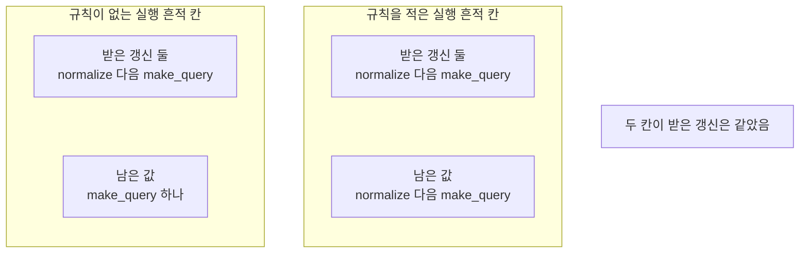
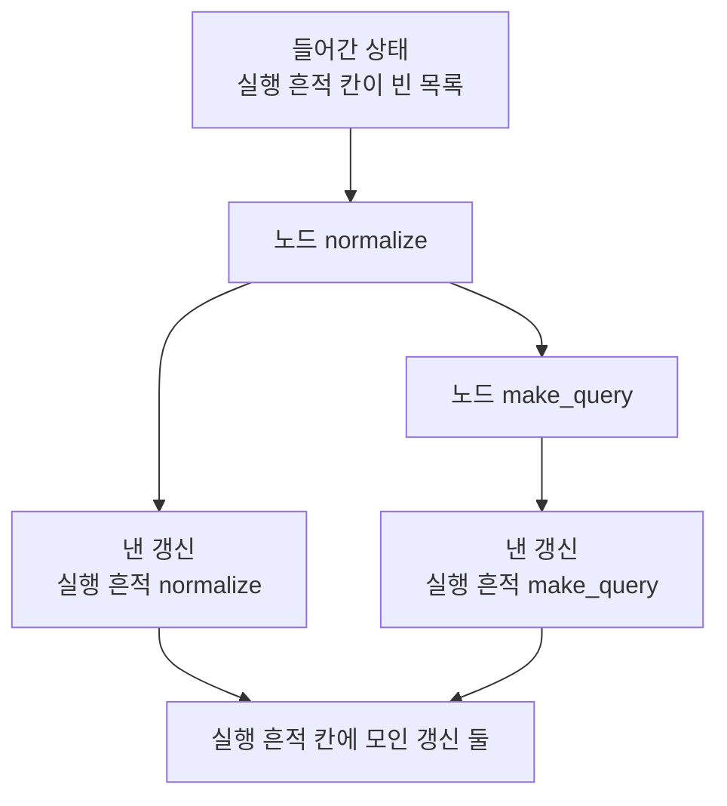
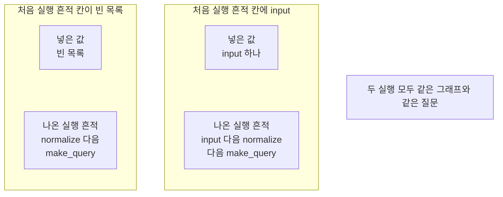
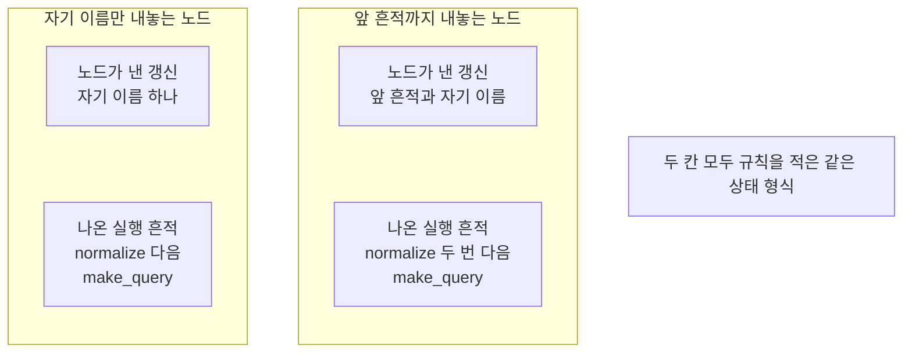

# 02-State-갱신

## _src 본문 (HTML 원본)

```html
<!--meta: 강의 1h | 실습 1h | 코드 notebooks/02-State-갱신.ipynb | 새 용어 4 -->
<h2 id="b1"><span class="no">1</span>학습 목표</h2><div class="goal"><ul><li>같은 칸에 갱신이 여러 번 모일 때 무엇이 값을 정하는지 설명할 수 있습니다.</li><li>칸 하나에 이어 붙이기 규칙을 적고 덮어쓰기와 결과를 견줄 수 있습니다.</li><li>규칙을 적은 칸에서 노드가 무엇을 내놓아야 하는지 고를 수 있습니다.</li></ul></div>
<h2 id="b2"><span class="no">2</span>이 내용을 배우는 이유</h2><p>01절 두 노드는 실행 흔적 칸에 값을 낼 때 앞 값을 코드에서 직접 이어 붙였습니다. 노드가 둘일 때는 그 줄을 두 곳에만 적으면 됩니다. 노드가 늘면 같은 줄을 노드마다 적어야 합니다. 한 노드에서 빠뜨리면 그 자리에서 앞 값이 사라집니다.</p><p>라이브러리 LangGraph는 칸마다 합치는 규칙을 상태 형식에 적어 두게 합니다. 이번 절의 질문은 「노드가 같은 칸에 갱신을 여러 번 내면 값은 덮어쓸까요, 이어 붙일까요?」입니다. 같은 두 노드를 규칙이 없는 칸과 규칙을 적은 칸에서 각각 실행해 답합니다.</p>
<h2 id="b3"><span class="no">3</span>앞에서 배운 내용</h2><p>01절에서 상태와 노드와 엣지를 코드로 적고 컴파일해 실행했습니다. 상태 형식 이름은 <code>FlowState</code>였고 칸은 <code>question</code>·<code>query</code>·<code>trace</code> 셋이었습니다. 노드 <code>normalize</code>는 질문 칸을 다듬었고 노드 <code>make_query</code>는 검색어 칸을 만들었습니다. 이 절도 같은 이름과 같은 질문을 그대로 씁니다.</p><p>01절 출력 함수 <code>print_state()</code>는 다시 적지 않습니다. 실습 폴더의 도구 파일 <code>notebooks/rag_tools.py</code>에서 한 줄로 가져옵니다. 도구 파일에는 앞 절에서 배운 함수를 모아 두었고 파일을 열면 코드를 볼 수 있습니다.</p><p>01절 두 노드는 실행 흔적을 낼 때 <code>state["trace"] + ["이름"]</code>으로 앞 값을 함께 담았습니다. 그 자리에 칸마다 합치는 규칙을 상태에 적어 두는 방법은 02절에서 배운다고 적었습니다. 이 절은 그 약속을 받아 같은 두 노드를 규칙 판으로 옮깁니다.</p><p>이 절에서 처음 쓰는 이름이 둘 있습니다. 표시 <code>Annotated</code>와 함수 <code>operator.add</code>는 Part 1~3에서 한 번도 나오지 않았습니다. 형식 <code>TypedDict</code>와 타입힌트 <code>str</code>·<code>list[str]</code>은 01절에서 이미 풀었으므로 되풀이하지 않습니다.</p><p>Ch 9~12에서 쓴 말 「칸」을 이 절에서도 씁니다. 말 「조각」은 Ch 5의 토큰 뜻으로만 쓰고 이 절에는 나오지 않습니다. 앞 노트북의 변수나 자료 파일을 쓰지 않고 파일을 새로 쓰지도 않습니다.</p>
<h2 id="b4"><span class="no">4</span>핵심 개념</h2><h3>비유로 시작하기</h3><p>01절에서 쓴 칸이 셋인 나무 상자를 그대로 씁니다. 같은 상자 두 개를 나란히 놓고 셋째 칸의 모양만 다르게 합니다. 한 상자의 셋째 칸은 블록 하나 크기라 새 블록이 오면 먼저 있던 블록이 자리를 내줍니다. 다른 상자의 셋째 칸은 가로로 길어 새 블록이 먼저 있던 블록 옆에 나란히 놓입니다. 칸의 모양이 그 칸에 값이 쌓이는 방법을 정합니다.</p>
{{img:02-5-칸-모양이-다른-두-상자|나란히 놓인 나무 상자 두 개로 왼쪽 상자는 짧고 칸이 셋이며 첫째 칸에 파란 블록 둘째 칸에 초록 블록 셋째 칸에 그 칸을 가득 채운 노란 블록 하나가 있고 오른쪽 상자는 더 길며 첫째 칸에 파란 블록 둘째 칸에 초록 블록이 있고 셋째 칸은 가로로 긴 한 칸이라 노란 블록 세 개가 나란히 놓이고 그 뒤에 빈자리가 남아 있는 그림|칸이 셋인 나무 상자 두 개가 셋째 칸의 모양만 다릅니다.}}
<p class="look"><b>그림 읽기</b> — 두 상자의 첫째 칸과 둘째 칸은 같고 셋째 칸의 모양만 다릅니다. 왼쪽 상자의 셋째 칸은 블록 하나 크기라 노란 블록이 하나뿐입니다. 오른쪽 상자의 셋째 칸은 가로로 길어 노란 블록 세 개가 나란히 놓였습니다. 그 뒤에 빈자리가 남아 블록이 더 놓일 수 있습니다. 상자가 상태이고 칸의 모양이 그 칸에 적은 규칙입니다.</p>
<table><thead><tr><th>말</th><th>뜻</th></tr></thead><tbody><tr><td>리듀서(reducer)</td><td>칸의 지금 값과 새 갱신을 받아 그 칸의 다음 값을 만드는 함수입니다. 칸마다 따로 정합니다.</td></tr><tr><td>덮어쓰기</td><td>규칙을 적지 않은 칸에서 마지막에 온 갱신으로 값을 바꾸는 처리입니다.</td></tr><tr><td>이어 붙이기</td><td>목록 두 개를 앞뒤로 붙여 목록 하나로 만드는 처리입니다. 이 절에서는 함수 <code>operator.add</code>가 맡습니다.</td></tr><tr><td>표시 <code>Annotated</code></td><td>값 갈래 옆에 함께 쓸 정보를 적어 두는 표시입니다. 이 절에서는 그 자리에 리듀서를 적습니다.</td></tr></tbody></table>
{{mermaid:02-1-칸에-적은-규칙|왼쪽부터 오른쪽으로 놓인 칸 두 개와 회색 상자 하나로 왼쪽 칸 제목은 규칙이 없는 실행 흔적 칸이고 그 안에 파란 상자 받은 갱신 둘 normalize 다음 make_query와 노란 상자 남은 값 make_query 하나가 있으며 가운데 칸 제목은 규칙을 적은 실행 흔적 칸이고 그 안에 파란 상자 받은 갱신 둘 normalize 다음 make_query와 노란 상자 남은 값 normalize 다음 make_query가 있고 오른쪽에 회색 상자 두 칸이 받은 갱신은 같았음이 놓인 그림|같은 갱신 두 개를 받아도 칸에 적은 규칙에 따라 남는 값이 달라집니다.}}
<p class="look"><b>도식 읽기</b> — 왼쪽 칸과 가운데 칸의 위 파란 상자가 같습니다. 두 칸이 받은 갱신이 같다는 뜻입니다. 아래 노란 상자의 값이 서로 다릅니다. 왼쪽 칸에는 나중 갱신 하나만 남았고 가운데 칸에는 두 이름이 차례로 남았습니다. 오른쪽 회색 상자는 두 칸에 모두 해당하는 사실입니다.</p>
<h3>규칙을 어디에 적는가</h3><p>01절에서는 앞 값을 이어 붙이는 일을 노드 코드가 했습니다. 이 절에서는 그 일을 상태 형식의 칸이 합니다. 규칙을 한 곳에만 적으면 그 칸에 갱신을 내는 노드가 몇이든 같은 방법으로 합쳐집니다. 규칙을 적지 않은 칸은 그대로 두어 마지막 갱신만 남게 합니다.</p>
<h3>규칙을 적은 칸에서 노드가 내놓는 것</h3><p>규칙을 적은 칸에 노드가 앞 값까지 함께 내면 그 값이 두 번 들어갑니다. 이 절 노트북은 그 경우를 실제로 만들어 이름 하나가 겹치는 것을 확인했습니다. 규칙을 적은 칸에는 새 기록만 내야 합니다.</p>
<h2 id="b5"><span class="no">5</span>실행 예제</h2><p>이 절은 모델을 한 번도 부르지 않습니다. 읽어 오는 자료 파일도 없고 새로 쓰는 파일도 없습니다. 노드 두 개와 엣지 세 개는 01절과 같고 상태 형식만 바꿉니다.</p><p>먼저 규칙을 적지 않은 칸으로 한 번 실행합니다. 그다음 실행 흔적 칸에만 규칙을 적고 같은 질문으로 다시 실행합니다. 마지막으로 처음 실행 흔적과 노드가 내놓는 모양을 하나씩 바꿔 두 번 더 실행합니다.</p>
{{mermaid:02-2-두-갱신이-한-칸에-모임|위에서 아래로 내려가는 흐름도로 맨 위 초록 상자 들어간 상태 실행 흔적 칸이 빈 목록에서 파란 상자 노드 normalize로 내려가고 거기서 왼쪽 아래 파란 상자 낸 갱신 실행 흔적 normalize와 오른쪽 아래 파란 상자 노드 make_query로 갈리며 그 노드 아래 파란 상자 낸 갱신 실행 흔적 make_query가 있고 낸 갱신 상자 두 개가 맨 아래 초록 상자 실행 흔적 칸에 모인 갱신 둘로 이어지는 그림|노드 두 개가 자기 이름만 갱신으로 내고 그 갱신 둘이 실행 흔적 칸 하나에 모입니다.}}
<p class="look"><b>도식 읽기</b> — 맨 위 초록 상자가 그래프에 넣은 상태입니다. 위에서 아래로 읽습니다. 파란 상자 「노드 normalize」와 「노드 make_query」가 차례로 실행되는 노드입니다. 노드마다 그 아래에 파란 상자가 하나씩 붙어 있고 그것이 노드가 낸 갱신입니다. 맨 아래 초록 상자가 두 갱신이 모이는 실행 흔적 칸입니다.</p>
{{notebook:02-State-갱신}}
{{mermaid:02-3-처음-흔적을-넣은-실행|왼쪽부터 오른쪽으로 놓인 칸 두 개와 회색 상자 하나로 왼쪽 칸 제목은 처음 실행 흔적 칸이 빈 목록이고 그 안에 초록 상자 넣은 값 빈 목록과 노란 상자 나온 실행 흔적 normalize 다음 make_query가 있으며 가운데 칸 제목은 처음 실행 흔적 칸에 input이고 그 안에 초록 상자 넣은 값 input 하나와 노란 상자 나온 실행 흔적 input 다음 normalize 다음 make_query가 있고 오른쪽에 회색 상자 두 실행 모두 같은 그래프와 같은 질문이 놓인 그림|처음 실행 흔적 칸에 넣은 값도 규칙을 지나 맨 앞에 그대로 남습니다.}}
<p class="look"><b>도식 읽기</b> — 왼쪽 칸이 처음 실행 흔적 칸을 빈 목록으로 둔 실행입니다. 가운데 칸이 그 자리에 값 하나를 넣은 실행입니다. 칸마다 위 초록 상자가 넣은 값이고 아래 노란 상자가 나온 실행 흔적입니다. 가운데 칸의 노란 상자에만 맨 앞에 <code>input</code>이 남았습니다. 오른쪽 회색 상자는 두 칸에 모두 해당하는 사실입니다.</p>
<p class="look"><b>확인할 점</b> — 규칙을 적지 않은 칸의 실행 흔적은 <code>['make_query']</code> 하나였습니다. 규칙을 적은 칸의 실행 흔적은 <code>['normalize', 'make_query']</code>였습니다. 두 실행의 질문 칸과 검색어 칸은 같았고 출력 줄 <code>실행 흔적 칸이 같은가: False</code>만 달랐습니다. 처음 실행 흔적에 <code>['input']</code>을 넣은 실행은 <code>['input', 'normalize', 'make_query']</code>를 냈습니다.</p>
<h2 id="b6"><span class="no">6</span>실험 결과 해석</h2><p>바꾼 것이 상태 형식 하나일 때 실행 흔적 칸의 값이 달라졌습니다. 규칙이 없는 칸에는 마지막 갱신만 남아 길이가 1이었습니다. 규칙을 적은 칸에는 두 이름이 차례로 쌓여 길이가 2였습니다. 같은 실행에서 질문 칸과 검색어 칸은 두 번 모두 같은 값이었습니다.</p>
{{mermaid:02-4-노드가-내놓는-모양|왼쪽부터 오른쪽으로 놓인 칸 두 개와 회색 상자 하나로 왼쪽 칸 제목은 자기 이름만 내놓는 노드이고 그 안에 파란 상자 노드가 낸 갱신 자기 이름 하나와 노란 상자 나온 실행 흔적 normalize 다음 make_query가 있으며 가운데 칸 제목은 앞 흔적까지 내놓는 노드이고 그 안에 파란 상자 노드가 낸 갱신 앞 흔적과 자기 이름과 노란 상자 나온 실행 흔적 normalize 두 번 다음 make_query가 있고 오른쪽에 회색 상자 두 칸 모두 규칙을 적은 같은 상태 형식이 놓인 그림|규칙을 적은 칸에 앞 흔적까지 내놓으면 이름 하나가 겹쳐 쌓입니다.}}
<p class="look"><b>도식 읽기</b> — 왼쪽 칸이 자기 이름만 내놓는 노드로 실행한 결과입니다. 가운데 칸이 앞 흔적까지 내놓는 노드로 실행한 결과입니다. 칸마다 위 파란 상자가 노드가 낸 갱신이고 아래 노란 상자가 나온 실행 흔적입니다. 가운데 칸의 노란 상자에서 이름 <code>normalize</code>가 두 번 나옵니다. 오른쪽 회색 상자는 두 칸에 모두 해당하는 사실입니다.</p>
<p>처음 실행 흔적 칸에 값을 넣은 실행에서는 그 값이 맨 앞에 남았습니다. 규칙은 노드가 낸 갱신뿐 아니라 처음 넣은 값에도 같은 방법으로 쓰였습니다. 결과는 <code>['input', 'normalize', 'make_query']</code>로 길이가 3이었습니다.</p><p>01절 노드처럼 앞 흔적까지 내놓는 판을 규칙 적은 칸에 쓴 실행도 길이가 3이었습니다. 담긴 이름은 <code>['normalize', 'normalize', 'make_query']</code>로 앞의 실행과 다릅니다. 길이만 보고 두 실행을 같다고 읽지 않습니다.</p><p>여기서 확인한 것은 노드 두 개를 엣지로 고정한 그래프입니다. 여러 노드가 같은 칸에 한꺼번에 갱신을 내는 경우는 이번에 실행하지 않았습니다. 걸린 시간도 이번에 재지 않았습니다.</p>
<h2 id="b7"><span class="no">7</span>주의할 점과 실무 메모</h2><ul><li>리듀서는 상태 전체가 아니라 규칙을 적은 칸 하나에 쓰입니다.</li><li>규칙을 적지 않은 칸은 마지막에 온 갱신으로 값을 바꿉니다. 이 절에서는 그 값이 <code>['make_query']</code>였습니다.</li><li>규칙을 적은 칸에 노드가 앞 값까지 내면 이름이 겹칩니다. 그 칸에는 새 기록만 내야 합니다.</li><li>처음 상태에 넣은 값도 규칙을 지납니다. 빈 목록을 넣으면 아무것도 붙지 않은 것과 같습니다.</li><li>표시 <code>Annotated</code>의 첫 자리는 값 갈래이고 둘째 자리가 합칠 함수입니다.</li><li>함수 <code>operator.add</code>는 목록을 앞뒤로 잇기만 합니다. 같은 값을 걸러 내거나 새 값을 고르지 않습니다.</li><li>다른 규칙이 필요하면 그 일을 하는 함수를 따로 만들어 적습니다. 이 절에서는 만들지 않았습니다.</li><li>이 절은 모델을 한 번도 부르지 않았습니다. 값을 정한 것은 칸에 적은 규칙과 노드 코드입니다.</li><li>여러 노드가 같은 칸에 한꺼번에 갱신을 내는 경우는 이번에 실행하지 않았습니다.</li><li>이 절은 걸린 시간을 재지 않았습니다. 규칙을 적어서 빨라졌는지 느려졌는지 적지 않습니다.</li><li>준비물에 LangGraph 1.2.11을 적었습니다. 다른 판과 Windows·macOS에서는 이번에 실행하지 않았습니다.</li><li>이 절은 파일을 쓰지 않습니다. Ch 12가 남긴 기록 파일도 읽지 않습니다.</li></ul>
<h2 id="b8"><span class="no">8</span>정리와 다음 절</h2><ul><li>규칙을 적지 않은 칸은 마지막에 온 갱신으로 값을 바꿨습니다.</li><li>실행 흔적 칸에 이어 붙이기 규칙을 적자 같은 두 노드가 낸 이름이 차례로 쌓였습니다.</li><li>규칙을 적은 칸에 앞 값까지 함께 내면 이름 하나가 겹쳤습니다.</li></ul><p><strong>다음 학습과 이어지는 지점</strong> — 03절에서는 상태의 값을 읽어 다음 노드를 고르는 조건부 엣지를 만듭니다. 이 절까지는 엣지가 정해 둔 한 갈래 길만 지났습니다.</p>
<h2 id="b9"><span class="no">9</span>복습 문제</h2><details class="quiz" open><summary>문제 4개 · 해설 포함</summary><p class="quiz-q">1. 규칙을 적지 않은 칸에 갱신이 두 번 모이면 무엇이 남습니까?</p><p class="quiz-a">마지막에 온 갱신만 남습니다. 틀렸다면 「실험 결과 해석」을 다시 읽습니다.</p><p class="quiz-q">2. 리듀서는 무엇을 받아 무엇을 만듭니까?</p><p class="quiz-a">칸의 지금 값과 새 갱신을 받아 그 칸의 다음 값을 만듭니다. 틀렸다면 「핵심 개념」의 용어 표를 다시 읽습니다.</p><p class="quiz-q">3. 규칙을 적은 칸에 노드가 앞 값까지 내면 어떻게 됩니까?</p><p class="quiz-a">앞 값이 두 번 들어가 이름 하나가 겹칩니다. 틀렸다면 「규칙을 적은 칸에서 노드가 내놓는 것」을 다시 읽습니다.</p><p class="quiz-q">4. 처음 상태에 넣은 실행 흔적도 규칙을 지납니까?</p><p class="quiz-a">이번 실행에서는 맨 앞에 그대로 남았습니다. 틀렸다면 「실험 결과 해석」을 다시 읽습니다.</p></details>
<h2 id="b10"><span class="no">10</span>참고 자료</h2><ul><li><div><a href="https://docs.langchain.com/oss/python/langgraph/graph-api">LangGraph Graph API 안내</a></div>상태와 노드와 엣지 개념 설명 · 1.2.11 · 확인 2026-09-10</li><li><div><a href="https://docs.langchain.com/oss/python/langgraph/use-graph-api">LangGraph Graph API 사용법</a></div>노드 등록과 엣지 연결과 컴파일 사용법 · 1.2.11 · 확인 2026-09-10</li><li><div><a href="https://reference.langchain.com/python/langgraph/graph/state/StateGraph">StateGraph API</a></div>설계 객체의 메서드 목록 · 1.2.11 · 확인 2026-09-10</li></ul>
```

## 노트북 셀 (순서대로)

### [0] markdown {'html': 'skip'}

# 상태 갱신

**이 노트북에서 할 일**

1. 01절 상태 형식을 다시 적고 노드 두 개가 자기 이름만 내놓도록 바꿉니다.
2. 규칙이 없는 칸에 갱신 두 개가 모이면 무엇이 남는지 봅니다.
3. 실행 흔적 칸에 이어 붙이기 규칙을 적고 같은 두 노드로 다시 실행합니다.
4. 처음 실행 흔적과 노드가 내놓는 모양을 하나씩 바꿔 네 실행을 견줍니다.

**준비물** — 이 절은 OpenAI API 키를 쓰지 않습니다.
모델 요청이 0번이라 드는 비용이 없습니다.
읽어 오는 자료 파일도 없고 새로 쓰는 파일도 없습니다.
실행 시간은 1분 안팎이고 첫 셀의 설치가 가장 오래 걸립니다.

**기준 버전** — 첫 셀에서 LangGraph 1.2.11과 도구 파일이 쓰는 numpy 2.5.3을 설치합니다.
실습 폴더 잠금 파일은 LangChain 1.4.0도 함께 고정하지만 이 절은 부르지 않습니다.
교재 출력은 Linux의 Python 3.12.13으로 만들었습니다.
다른 판과 Windows·macOS에서는 이번에 실행하지 않았습니다.

**강의와 실습 범위** — 강의 시간에는 3~7절을 읽습니다.
상태 형식에 규칙을 적고 같은 두 노드로 두 번 실행하는 자리입니다.
8절과 9절은 값을 하나씩 바꿔 보는 자리입니다.
10절은 네 실행을 기록 한 줄씩으로 만들어 표로 견주는 자리입니다.
준비부터 끝까지 함께 실행하고 실습 시간에 다시 읽습니다.

실습 폴더 `labs/part4/ch13-langgraph-basics`에서 `uv sync --locked`를 실행합니다.
그다음 이 폴더의 `.venv` 커널을 고르고 첫 셀부터 순서대로 실행합니다.

### [1] markdown {'html': 'skip'}

## 오늘 볼 그림


왼쪽 칸과 가운데 칸의 위 파란 상자가 같습니다.
두 칸이 받은 갱신이 같다는 뜻입니다.
아래 노란 상자의 값이 서로 다릅니다.
칸에 적은 규칙이 남는 값을 갈랐습니다.

### [2] markdown {}

## 1. 준비

첫 셀은 패키지 두 개를 설치하고 설치된 판 번호를 출력합니다.
설치에는 몇십 초가 걸릴 수 있습니다.

### [3] code {'execution': {'iopub.execute_input': '2026-09-21T09:06:02.651876Z', 'iopub.status.busy': '2026-09-21T09:06:02.651678Z', 'iopub.status.idle': '2026-09-21T09:06:03.100492Z', 'shell.execute_reply': '2026-09-21T09:06:03.099997Z'}, 'lesson_role': 'setup'}

```python
# 이 절에서 쓰는 패키지를 설치하고 버전을 확인합니다
%pip install -q "langgraph==1.2.11" "numpy==2.5.3"
from importlib.metadata import version

print("langgraph:", version("langgraph"))
print("numpy:", version("numpy"))
```

출력:
```
Note: you may need to restart the kernel to use updated packages.
langgraph: 1.2.11
numpy: 2.5.3

```

### [4] markdown {}

**결과 읽기** — 설치가 끝나면 `langgraph: 1.2.11`과 `numpy: 2.5.3`이 보입니다.
패키지 `numpy`는 이 절이 직접 쓰지 않지만 도구 파일을 불러올 때 필요합니다.
이 노트북의 출력은 2026-09-21에 이 판으로 실행한 결과입니다.

다음 셀은 이름 여섯 개를 불러옵니다.
앞의 네 개는 01절에서 쓴 이름이고 뒤의 두 개가 이 절에서 처음 쓰는 이름입니다.

앞에서 배운 함수는 `rag_tools.py`에 모아 두었습니다. 파일을 열면 코드를 볼 수 있습니다. 노트북과 같은 폴더(`notebooks/`)에 있는 파일입니다.

이 노트북은 01절 출력 함수 `print_state()`를 가져옵니다.
라벨 줄을 따로 출력하고 그 아래에 칸 셋을 한 줄씩 적는 함수입니다.

### [5] code {'execution': {'iopub.execute_input': '2026-09-21T09:06:03.101598Z', 'iopub.status.busy': '2026-09-21T09:06:03.101505Z', 'iopub.status.idle': '2026-09-21T09:06:03.692063Z', 'shell.execute_reply': '2026-09-21T09:06:03.688937Z'}, 'lesson_role': 'setup'}

```python
# 01절에서 쓴 이름 네 개에 규칙을 적는 데 쓸 이름 두 개를 더해 불러옵니다
import operator
from typing import Annotated
from typing_extensions import TypedDict
from langgraph.graph import StateGraph, START, END
# 01절에서 만든 출력 함수를 도구 파일에서 가져옵니다
from rag_tools import print_state

print("불러온 이름:", "operator", "Annotated", "TypedDict", "StateGraph", "START", "END")
```

출력:
```
불러온 이름: operator Annotated TypedDict StateGraph START END

```

### [6] markdown {}

**결과 읽기** — 출력 줄은 `불러온 이름: operator Annotated TypedDict StateGraph START END` 하나입니다.
꾸러미 `operator`에는 더하기 같은 기본 연산을 함수로 담아 둔 이름이 들어 있습니다.
표시 `Annotated`는 값 갈래 옆에 함께 쓸 정보를 적어 두는 표시입니다.
두 이름을 쓰는 자리는 6절과 7절입니다.
도구 파일에서 가져온 함수는 출력하지 않습니다.

## 2. 이 절에서 쓸 값 정하기

01절에서 쓴 첫 질문을 글자까지 같게 씁니다.
나중에 처음 실행 흔적으로 넣어 볼 목록도 미리 만들어 둡니다.

### [7] code {'execution': {'iopub.execute_input': '2026-09-21T09:06:03.693985Z', 'iopub.status.busy': '2026-09-21T09:06:03.693846Z', 'iopub.status.idle': '2026-09-21T09:06:03.696189Z', 'shell.execute_reply': '2026-09-21T09:06:03.695751Z'}}

```python
# 01절에서 쓴 첫 질문과 이 절에서 넣어 볼 처음 실행 흔적을 정합니다
first_question = "  대출 기간은 며칠인가요?  "
started_trace = ["input"]
print("첫 질문:", first_question)
print("첫 질문의 글자 수:", len(first_question))
print("나중에 넣어 볼 처음 실행 흔적:", started_trace)
```

출력:
```
첫 질문:   대출 기간은 며칠인가요?  
첫 질문의 글자 수: 17
나중에 넣어 볼 처음 실행 흔적: ['input']

```

### [8] markdown {}

**결과 읽기** — 출력 줄 `첫 질문의 글자 수: 17`은 01절과 같은 값입니다.
앞뒤 빈칸 네 개가 함께 세어진 수입니다.
출력 줄 `나중에 넣어 볼 처음 실행 흔적: ['input']`의 목록은 8절에서 씁니다.

## 3. 01절 상태 형식 다시 적기

01절 상태 형식에는 칸이 셋 있었고 어느 칸에도 규칙을 적지 않았습니다.
이 절에서도 그 형식으로 먼저 실행합니다.
이 절은 여기에 규칙 한 줄을 더하는 자리입니다.

### [9] code {'execution': {'iopub.execute_input': '2026-09-21T09:06:03.696803Z', 'iopub.status.busy': '2026-09-21T09:06:03.696736Z', 'iopub.status.idle': '2026-09-21T09:06:03.698347Z', 'shell.execute_reply': '2026-09-21T09:06:03.697998Z'}}

```python
# 01절에서 적은 규칙 없는 상태 형식을 이 절에서도 먼저 씁니다
class FlowState(TypedDict):
    question: str
    query: str
    trace: list[str]
```

출력:
```

```

### [10] markdown {}

**결과 읽기** — 정의 셀이라 출력이 없습니다.
칸 이름 뒤에 값 갈래만 적혀 있습니다.
칸 `trace`에는 지나간 노드 이름을 차례로 담습니다.
출력 함수 `print_state()`는 준비 셀에서 가져온 01절 판을 그대로 씁니다.

## 4. 노드 두 개 — 자기 이름만 내놓기

01절 두 노드는 실행 흔적을 낼 때 `state["trace"] + ["이름"]`으로 앞 값을 함께 담았습니다.
이번에는 두 노드 모두 자기 이름 하나만 담아 냅니다.
앞 값을 어떻게 이어 붙일지는 노드가 아니라 칸이 정하게 할 참입니다.

### [11] code {'execution': {'iopub.execute_input': '2026-09-21T09:06:03.698963Z', 'iopub.status.busy': '2026-09-21T09:06:03.698898Z', 'iopub.status.idle': '2026-09-21T09:06:03.703210Z', 'shell.execute_reply': '2026-09-21T09:06:03.702856Z'}}

```python
# 질문 칸의 앞뒤 빈칸을 없애고 실행 흔적에는 자기 이름만 담아 냅니다
def normalize(state):
    clean_question = state["question"].strip()
    return {"question": clean_question, "trace": ["normalize"]}
```

출력:
```

```

### [12] markdown {}

**결과 읽기** — 정의 셀이라 출력이 없습니다.
메서드 `strip()`은 글 앞뒤의 빈칸을 없앱니다.
실행 흔적 칸에 담아 내는 목록에는 이름 하나만 들어 있습니다.

다음 셀은 검색어 칸을 만드는 노드입니다.

### [13] code {'execution': {'iopub.execute_input': '2026-09-21T09:06:03.703756Z', 'iopub.status.busy': '2026-09-21T09:06:03.703707Z', 'iopub.status.idle': '2026-09-21T09:06:03.705330Z', 'shell.execute_reply': '2026-09-21T09:06:03.705020Z'}}

```python
# 물음표와 맺음말을 지워 검색어를 만들고 실행 흔적에는 자기 이름만 담아 냅니다
def make_query(state):
    without_mark = state["question"].replace("?", "")
    plain = without_mark.replace("인가요", "")
    return {"query": plain.strip(), "trace": ["make_query"]}
```

출력:
```

```

### [14] markdown {}

**결과 읽기** — 정의 셀이라 출력이 없습니다.
메서드 `replace()`는 글에서 찾은 말을 다른 말로 바꿉니다.
여기서는 물음표와 맺음말 `인가요`를 빈 글로 바꿔 지웁니다.

## 5. 실행 1 — 규칙이 없는 칸

먼저 규칙을 적지 않은 상태 형식으로 그래프를 만듭니다.
노드 두 개와 엣지 세 개는 01절과 같습니다.

### [15] code {'execution': {'iopub.execute_input': '2026-09-21T09:06:03.705917Z', 'iopub.status.busy': '2026-09-21T09:06:03.705863Z', 'iopub.status.idle': '2026-09-21T09:06:03.708915Z', 'shell.execute_reply': '2026-09-21T09:06:03.708584Z'}}

```python
# 규칙이 없는 상태 형식으로 노드 두 개와 엣지 세 개를 적어 컴파일합니다
plain_builder = StateGraph(FlowState)
plain_builder.add_node("normalize", normalize)
plain_builder.add_node("make_query", make_query)
plain_builder.add_edge(START, "normalize")
plain_builder.add_edge("normalize", "make_query")
plain_builder.add_edge("make_query", END)
plain_graph = plain_builder.compile()
print("등록한 노드 수:", len(plain_builder.nodes))
print("컴파일 결과의 종류:", type(plain_graph))
```

출력:
```
등록한 노드 수: 2
컴파일 결과의 종류: <class 'langgraph.graph.state.CompiledStateGraph'>

```

### [16] markdown {}

**결과 읽기** — 출력 줄 `등록한 노드 수: 2`와 종류 이름 `CompiledStateGraph`가 보입니다.
01절에서 만든 그래프와 같은 모양입니다.

실행 전에 예상해 봅니다.
두 노드가 실행 흔적 칸에 갱신을 하나씩 내니 이름 두 개가 남을 것도 같습니다.

### [17] code {'execution': {'iopub.execute_input': '2026-09-21T09:06:03.709566Z', 'iopub.status.busy': '2026-09-21T09:06:03.709511Z', 'iopub.status.idle': '2026-09-21T09:06:03.714346Z', 'shell.execute_reply': '2026-09-21T09:06:03.713961Z'}}

```python
# 규칙이 없는 상태 형식의 그래프에 첫 질문을 넣어 실행합니다
plain_state = {"question": first_question, "query": "", "trace": []}
plain_result = plain_graph.invoke(plain_state)
print_state("규칙이 없는 칸 결과", plain_result)
print("실행 흔적 칸의 길이:", len(plain_result["trace"]))
```

출력:
```
규칙이 없는 칸 결과
질문 칸 | 대출 기간은 며칠인가요?
검색어 칸 | 대출 기간은 며칠
실행 흔적 칸 | ['make_query']
실행 흔적 칸의 길이: 1

```

### [18] markdown {}

**결과 읽기** — 줄 `실행 흔적 칸 | ['make_query']`에 이름이 하나뿐입니다.
출력 줄 `실행 흔적 칸의 길이: 1`이 그 수입니다.
먼저 온 갱신 `['normalize']`는 남지 않았습니다.
규칙을 적지 않은 칸은 마지막에 온 갱신으로 값을 바꿉니다.
줄 `검색어 칸 | 대출 기간은 며칠`은 01절과 같은 값입니다.

## 6. 칸에 적을 규칙 읽어 보기

리듀서(reducer)는 칸의 지금 값과 새 갱신을 받아 그 칸의 다음 값을 만드는 함수입니다.
공용 게시판의 칸마다 「새 쪽지로 바꾸기」와 「아래에 덧붙이기」 중 하나를 미리 정해 둔 것과 같습니다.
이 절에서는 목록 두 개를 이어 붙이는 함수 하나를 리듀서로 씁니다.
다음 셀은 그 함수를 그래프 없이 직접 불러 봅니다.

### [19] code {'execution': {'iopub.execute_input': '2026-09-21T09:06:03.714885Z', 'iopub.status.busy': '2026-09-21T09:06:03.714830Z', 'iopub.status.idle': '2026-09-21T09:06:03.716481Z', 'shell.execute_reply': '2026-09-21T09:06:03.716246Z'}}

```python
# 규칙으로 적을 operator.add가 목록 두 개에 무엇을 하는지 먼저 봅니다
left_trace = ["input"]
right_trace = ["normalize"]
joined_trace = operator.add(left_trace, right_trace)
print("왼쪽 목록:", left_trace)
print("오른쪽 목록:", right_trace)
print("operator.add가 만든 목록:", joined_trace)
```

출력:
```
왼쪽 목록: ['input']
오른쪽 목록: ['normalize']
operator.add가 만든 목록: ['input', 'normalize']

```

### [20] markdown {}

**결과 읽기** — 출력 줄 `operator.add가 만든 목록: ['input', 'normalize']`가 보입니다.
함수 `operator.add`는 값 두 개를 받아 더하기 기호와 같은 방법으로 합칩니다.
숫자 둘이면 더한 수가 되고 목록 둘이면 앞뒤로 이어 붙인 목록이 됩니다.
왼쪽 목록과 오른쪽 목록은 그대로 있고 새 목록이 따로 만들어졌습니다.

다음 셀은 그 함수를 실행 흔적 칸의 규칙으로 적습니다.
표시 `Annotated`는 값 갈래 옆에 함께 쓸 정보를 적어 두는 표시입니다.
짐 상자에 「깨지기 쉬움」처럼 다루는 방법을 함께 붙여 두는 것과 같습니다.
표시 `Annotated[list[str], operator.add]`는 「문자열 목록인데 합칠 때는 이 함수로」라는 뜻입니다.

### [21] code {'execution': {'iopub.execute_input': '2026-09-21T09:06:03.717062Z', 'iopub.status.busy': '2026-09-21T09:06:03.717012Z', 'iopub.status.idle': '2026-09-21T09:06:03.718623Z', 'shell.execute_reply': '2026-09-21T09:06:03.718334Z'}}

```python
# 실행 흔적 칸에만 이어 붙이기 규칙을 적은 상태 형식을 만듭니다
class RuleState(TypedDict):
    question: str
    query: str
    trace: Annotated[list[str], operator.add]
```

출력:
```

```

### [22] markdown {}

**결과 읽기** — 정의 셀이라 출력이 없습니다.
칸 `question`과 칸 `query`에는 규칙을 적지 않았습니다.
칸 `trace`에만 규칙을 적었습니다.
칸마다 규칙을 따로 정할 수 있습니다.

## 7. 실행 2 — 규칙을 적은 칸

바꾼 것은 상태 형식 하나입니다.
노드 두 개와 엣지 세 개와 질문은 그대로 둡니다.
실행 전에 예상해 봅니다. 실행 흔적 칸에 이름 두 개가 남을 것입니다.

### [23] code {'execution': {'iopub.execute_input': '2026-09-21T09:06:03.719242Z', 'iopub.status.busy': '2026-09-21T09:06:03.719192Z', 'iopub.status.idle': '2026-09-21T09:06:03.721514Z', 'shell.execute_reply': '2026-09-21T09:06:03.721283Z'}}

```python
# 같은 노드 두 개와 같은 엣지 세 개를 규칙 적은 상태 형식으로 다시 적습니다
rule_builder = StateGraph(RuleState)
rule_builder.add_node("normalize", normalize)
rule_builder.add_node("make_query", make_query)
rule_builder.add_edge(START, "normalize")
rule_builder.add_edge("normalize", "make_query")
rule_builder.add_edge("make_query", END)
rule_graph = rule_builder.compile()
print("노드 수가 앞 그래프와 같은가:", len(rule_builder.nodes) == len(plain_builder.nodes))
print("컴파일 결과의 종류:", type(rule_graph))
```

출력:
```
노드 수가 앞 그래프와 같은가: True
컴파일 결과의 종류: <class 'langgraph.graph.state.CompiledStateGraph'>

```

### [24] markdown {}

**결과 읽기** — 출력 줄 `노드 수가 앞 그래프와 같은가: True`가 보입니다.
종류 이름도 `CompiledStateGraph`로 앞 그래프와 같습니다.

다음 셀은 같은 첫 질문을 넣어 실행합니다.

### [25] code {'execution': {'iopub.execute_input': '2026-09-21T09:06:03.722079Z', 'iopub.status.busy': '2026-09-21T09:06:03.722029Z', 'iopub.status.idle': '2026-09-21T09:06:03.724315Z', 'shell.execute_reply': '2026-09-21T09:06:03.723995Z'}}

```python
# 규칙을 적은 상태 형식의 그래프에 같은 첫 질문을 넣어 실행합니다
rule_state = {"question": first_question, "query": "", "trace": []}
rule_result = rule_graph.invoke(rule_state)
print_state("규칙을 적은 칸 결과", rule_result)
print("실행 흔적 칸의 길이:", len(rule_result["trace"]))
```

출력:
```
규칙을 적은 칸 결과
질문 칸 | 대출 기간은 며칠인가요?
검색어 칸 | 대출 기간은 며칠
실행 흔적 칸 | ['normalize', 'make_query']
실행 흔적 칸의 길이: 2

```

### [26] markdown {}

**결과 읽기** — 줄 `실행 흔적 칸 | ['normalize', 'make_query']`에 이름 두 개가 차례로 남았습니다.
출력 줄 `실행 흔적 칸의 길이: 2`가 그 수입니다.
노드는 자기 이름 하나만 냈는데 칸에 적은 규칙이 앞 값과 이어 붙였습니다.

다음 셀은 두 실행을 칸별로 견줍니다.

### [27] code {'execution': {'iopub.execute_input': '2026-09-21T09:06:03.724900Z', 'iopub.status.busy': '2026-09-21T09:06:03.724847Z', 'iopub.status.idle': '2026-09-21T09:06:03.726759Z', 'shell.execute_reply': '2026-09-21T09:06:03.726383Z'}}

```python
# 두 실행의 결과를 칸별로 견줍니다
print("질문 칸이 같은가:", plain_result["question"] == rule_result["question"])
print("검색어 칸이 같은가:", plain_result["query"] == rule_result["query"])
print("실행 흔적 칸이 같은가:", plain_result["trace"] == rule_result["trace"])
assert rule_result["trace"] == ["normalize", "make_query"]
```

출력:
```
질문 칸이 같은가: True
검색어 칸이 같은가: True
실행 흔적 칸이 같은가: False

```

### [28] markdown {}

**결과 읽기** — 출력 줄 `질문 칸이 같은가: True`와 `검색어 칸이 같은가: True`가 보입니다.
출력 줄 `실행 흔적 칸이 같은가: False`만 다릅니다.
규칙을 적은 칸에서만 값이 달라졌습니다.
규칙을 적지 않은 칸 두 개는 앞 실행과 같은 값을 냈습니다.

## 8. 값 바꿔 보기 ① 처음 실행 흔적 칸

바꿀 값은 처음 상태의 실행 흔적 칸 하나입니다.
빈 목록 대신 `['input']`을 넣습니다.
그래프와 질문은 실행 2와 그대로 같습니다.
실행 전에 예상해 봅니다. 처음 값 뒤에 이름 두 개가 붙을 것입니다.

### [29] code {'execution': {'iopub.execute_input': '2026-09-21T09:06:03.727336Z', 'iopub.status.busy': '2026-09-21T09:06:03.727293Z', 'iopub.status.idle': '2026-09-21T09:06:03.729370Z', 'shell.execute_reply': '2026-09-21T09:06:03.729012Z'}}

```python
# 처음 실행 흔적 칸만 바꾸고 같은 그래프에 같은 질문을 넣습니다
started_state = {"question": first_question, "query": "", "trace": started_trace}
started_result = rule_graph.invoke(started_state)
print_state("처음 흔적을 넣은 결과", started_result)
print("실행 흔적 칸의 길이:", len(started_result["trace"]))
```

출력:
```
처음 흔적을 넣은 결과
질문 칸 | 대출 기간은 며칠인가요?
검색어 칸 | 대출 기간은 며칠
실행 흔적 칸 | ['input', 'normalize', 'make_query']
실행 흔적 칸의 길이: 3

```

### [30] markdown {}

**결과 읽기** — 줄 `실행 흔적 칸 | ['input', 'normalize', 'make_query']`가 보입니다.
출력 줄 `실행 흔적 칸의 길이: 3`이 그 수입니다.
처음에 넣은 값이 지워지지 않고 맨 앞에 남았습니다.
규칙은 노드가 낸 갱신뿐 아니라 처음 넣은 값에도 같은 방법으로 쓰입니다.

## 9. 값 바꿔 보기 ② 노드가 내놓는 모양

바꿀 값은 노드가 실행 흔적 칸에 담아 내는 목록 하나입니다.
01절처럼 앞 실행 흔적까지 함께 담아 내는 노드 두 개를 새로 만듭니다.
상태 형식은 규칙을 적은 것을 그대로 씁니다.
실행 전에 예상해 봅니다. 앞 값이 두 번 들어가 이름 하나가 겹칠 것입니다.

### [31] code {'execution': {'iopub.execute_input': '2026-09-21T09:06:03.729992Z', 'iopub.status.busy': '2026-09-21T09:06:03.729950Z', 'iopub.status.idle': '2026-09-21T09:06:03.731377Z', 'shell.execute_reply': '2026-09-21T09:06:03.731077Z'}}

```python
# 01절처럼 앞 실행 흔적까지 함께 담아 내는 판을 만듭니다
def normalize_whole(state):
    clean_question = state["question"].strip()
    new_trace = state["trace"] + ["normalize"]
    return {"question": clean_question, "trace": new_trace}
```

출력:
```

```

### [32] markdown {}

**결과 읽기** — 정의 셀이라 출력이 없습니다.
줄 `state["trace"] + ["normalize"]`가 01절 노드와 같은 모양입니다.

다음 셀은 검색어 칸을 만드는 노드도 같은 모양으로 만듭니다.

### [33] code {'execution': {'iopub.execute_input': '2026-09-21T09:06:03.731987Z', 'iopub.status.busy': '2026-09-21T09:06:03.731931Z', 'iopub.status.idle': '2026-09-21T09:06:03.733704Z', 'shell.execute_reply': '2026-09-21T09:06:03.733366Z'}}

```python
# 검색어를 만드는 노드도 앞 실행 흔적까지 함께 담아 내는 판으로 만듭니다
def make_query_whole(state):
    without_mark = state["question"].replace("?", "")
    plain = without_mark.replace("인가요", "")
    new_trace = state["trace"] + ["make_query"]
    return {"query": plain.strip(), "trace": new_trace}
```

출력:
```

```

### [34] markdown {}

**결과 읽기** — 정의 셀이라 출력이 없습니다.
검색어를 만드는 부분은 앞의 노드와 같고 실행 흔적을 담는 줄만 다릅니다.

다음 셀은 이 노드 두 개로 그래프를 하나 더 만듭니다.

### [35] code {'execution': {'iopub.execute_input': '2026-09-21T09:06:03.734296Z', 'iopub.status.busy': '2026-09-21T09:06:03.734253Z', 'iopub.status.idle': '2026-09-21T09:06:03.736572Z', 'shell.execute_reply': '2026-09-21T09:06:03.736217Z'}}

```python
# 규칙을 적은 같은 상태 형식에 방금 만든 노드 두 개를 등록합니다
whole_builder = StateGraph(RuleState)
whole_builder.add_node("normalize", normalize_whole)
whole_builder.add_node("make_query", make_query_whole)
whole_builder.add_edge(START, "normalize")
whole_builder.add_edge("normalize", "make_query")
whole_builder.add_edge("make_query", END)
whole_graph = whole_builder.compile()
print("등록한 노드 이름:")
for node_name in whole_builder.nodes:
    print(node_name)
```

출력:
```
등록한 노드 이름:
normalize
make_query

```

### [36] markdown {}

**결과 읽기** — 라벨 줄 `등록한 노드 이름:` 아래 두 줄은 `normalize`와 `make_query`입니다.
등록한 이름은 앞 그래프와 같고 짝지은 함수만 다릅니다.

다음 셀은 같은 첫 질문으로 이 그래프를 실행합니다.

### [37] code {'execution': {'iopub.execute_input': '2026-09-21T09:06:03.737274Z', 'iopub.status.busy': '2026-09-21T09:06:03.737231Z', 'iopub.status.idle': '2026-09-21T09:06:03.739369Z', 'shell.execute_reply': '2026-09-21T09:06:03.739069Z'}}

```python
# 같은 첫 질문으로 이 그래프를 실행합니다
whole_state = {"question": first_question, "query": "", "trace": []}
whole_result = whole_graph.invoke(whole_state)
print_state("앞 흔적까지 내놓은 결과", whole_result)
print("실행 흔적 칸의 길이:", len(whole_result["trace"]))
```

출력:
```
앞 흔적까지 내놓은 결과
질문 칸 | 대출 기간은 며칠인가요?
검색어 칸 | 대출 기간은 며칠
실행 흔적 칸 | ['normalize', 'normalize', 'make_query']
실행 흔적 칸의 길이: 3

```

### [38] markdown {}

**결과 읽기** — 줄 `실행 흔적 칸 | ['normalize', 'normalize', 'make_query']`가 보입니다.
출력 줄 `실행 흔적 칸의 길이: 3`이 그 수입니다.
이름 `normalize`가 두 번 들어갔습니다.
노드가 앞 값을 함께 냈고 칸의 규칙이 거기에 앞 값을 한 번 더 이어 붙였습니다.
규칙을 적은 칸에는 노드가 새 기록만 내야 합니다.

## 10. 네 실행을 기록 한 줄씩으로

실행 한 번을 기록 한 줄로 만들어 담아 둡니다.
Ch 9~12와 01절에서 쓴 기록 한 줄과 같은 모양입니다.

### [39] code {'execution': {'iopub.execute_input': '2026-09-21T09:06:03.739910Z', 'iopub.status.busy': '2026-09-21T09:06:03.739857Z', 'iopub.status.idle': '2026-09-21T09:06:03.741309Z', 'shell.execute_reply': '2026-09-21T09:06:03.740979Z'}}

```python
# 실행 한 번을 기록 한 줄로 만듭니다
def run_row(run_name, state):
    row = {"실행": run_name}
    row["실행 흔적"] = state["trace"]
    row["흔적 길이"] = len(state["trace"])
    return row
```

출력:
```

```

### [40] markdown {}

**결과 읽기** — 정의 셀이라 출력이 없습니다.

다음 셀은 네 실행의 기록을 목록에 담습니다.

### [41] code {'execution': {'iopub.execute_input': '2026-09-21T09:06:03.741967Z', 'iopub.status.busy': '2026-09-21T09:06:03.741916Z', 'iopub.status.idle': '2026-09-21T09:06:03.743492Z', 'shell.execute_reply': '2026-09-21T09:06:03.743231Z'}}

```python
# 네 실행의 기록을 목록에 담습니다
run_rows = []
run_rows.append(run_row("규칙 없음", plain_result))
run_rows.append(run_row("규칙 적음", rule_result))
run_rows.append(run_row("처음 흔적 넣음", started_result))
run_rows.append(run_row("앞 흔적까지 내놓음", whole_result))
print("담은 기록 줄 수:", len(run_rows))
```

출력:
```
담은 기록 줄 수: 4

```

### [42] markdown {}

**결과 읽기** — 출력 줄 `담은 기록 줄 수: 4`가 보입니다.

다음 셀은 담은 줄을 표로 출력합니다.

### [43] code {'execution': {'iopub.execute_input': '2026-09-21T09:06:03.744023Z', 'iopub.status.busy': '2026-09-21T09:06:03.743979Z', 'iopub.status.idle': '2026-09-21T09:06:03.745615Z', 'shell.execute_reply': '2026-09-21T09:06:03.745303Z'}}

```python
# 실행·실행 흔적·흔적 길이를 라벨 줄 아래에 차례로 출력합니다
print("실행 | 실행 흔적 | 흔적 길이")
for row in run_rows:
    print(row["실행"], "|", row["실행 흔적"], "|", row["흔적 길이"])
```

출력:
```
실행 | 실행 흔적 | 흔적 길이
규칙 없음 | ['make_query'] | 1
규칙 적음 | ['normalize', 'make_query'] | 2
처음 흔적 넣음 | ['input', 'normalize', 'make_query'] | 3
앞 흔적까지 내놓음 | ['normalize', 'normalize', 'make_query'] | 3

```

### [44] markdown {}

**결과 읽기** — 라벨 줄 아래 네 줄이 나옵니다.
줄 `규칙 없음 | ['make_query'] | 1`이 규칙을 적지 않은 칸의 결과입니다.
줄 `규칙 적음 | ['normalize', 'make_query'] | 2`가 규칙을 적은 칸의 결과입니다.
아래 두 줄은 길이가 모두 3이지만 담긴 이름이 다릅니다.
한 줄은 처음 값을 지켰고 다른 한 줄은 이름 하나가 겹쳤습니다.

## 정리

1. 규칙을 적지 않은 칸은 마지막에 온 갱신으로 값을 바꿨습니다.
2. 실행 흔적 칸에 이어 붙이기 규칙을 적자 같은 두 노드가 낸 이름이 차례로 쌓였습니다.
3. 규칙을 적은 칸에 앞 값까지 함께 내면 이름 하나가 겹쳤습니다.

03절에서는 상태의 값을 읽어 다음 노드를 고르는 조건부 엣지를 만듭니다.
이 절까지는 엣지가 정해 둔 한 갈래 길만 지났습니다.

## 그림

### 02-1-칸에-적은-규칙.mmd



같은 갱신 두 개를 받아도 칸에 적은 규칙에 따라 남는 값이 달라집니다.

### 02-2-두-갱신이-한-칸에-모임.mmd



노드 두 개가 자기 이름만 갱신으로 내고 그 갱신 둘이 실행 흔적 칸 하나에 모입니다.

### 02-3-처음-흔적을-넣은-실행.mmd



처음 실행 흔적 칸에 넣은 값도 규칙을 지나 맨 앞에 그대로 남습니다.

### 02-4-노드가-내놓는-모양.mmd



규칙을 적은 칸에 앞 흔적까지 내놓으면 이름 하나가 겹쳐 쌓입니다.

### 02-5-칸-모양이-다른-두-상자.prompt.md

# 02-5-칸-모양이-다른-두-상자 (Higgsfield 삽화)

설명 대상 문장(본문 b4 비유 단락): 칸이 셋인 나무 상자 두 개를 나란히 놓고 셋째 칸의 모양만 다르게 하면, 한 상자에는 노란 블록 하나만 남고 다른 상자에는 노란 블록이 차례로 나란히 놓입니다.

구성 요소와 배치: 흰 바탕에 열린 나무 상자 두 개가 나란히 놓입니다(= 같은 상태 형식 두 벌). 왼쪽 상자는 짧고 칸이 셋이며 세 칸의 크기가 같습니다. 오른쪽 상자는 더 길고 첫째·둘째 칸은 왼쪽 상자와 같은 작은 칸이지만 셋째 칸이 가로로 긴 한 칸입니다(= 이어 붙이기 규칙을 적은 칸). 두 상자의 첫째 칸에 파란 블록 하나, 둘째 칸에 초록 블록 하나가 같게 들어 있습니다(= 규칙을 적지 않은 질문 칸과 검색어 칸). 왼쪽 상자의 셋째 칸에는 그 칸을 가득 채운 노란 블록 하나가 있고, 오른쪽 상자의 긴 셋째 칸에는 노란 블록 세 개가 맞닿아 나란히 놓이며 그 뒤에 빈자리가 남습니다.

시선 순서: 왼쪽 상자의 첫째·둘째 칸 → 왼쪽 상자 셋째 칸의 노란 블록 하나 → 오른쪽 상자의 같은 첫째·둘째 칸 → 오른쪽 상자 긴 셋째 칸에 나란히 놓인 노란 블록 세 개.

검수 기준: 그림만 보고 「첫째·둘째 칸은 같은데 셋째 칸의 모양이 달라 한쪽은 블록 하나만 들어가고 다른 쪽은 블록이 차례로 나란히 쌓인다」가 읽히는가.

01절 비유와의 관계: 01절 삽화(`01-5`)의 「칸이 셋인 나무 상자」를 그대로 이어 썼습니다. 01절은 같은 상자 하나가 길을 따라가며 칸이 채워지는 모습이고, 이 절은 같은 상자 두 개의 셋째 칸 모양만 갈라 규칙 차이를 보입니다. Ch 9~12가 쓴 카드·봉투·서랍·쟁반·끈·단추·관과 깔때기는 뜻이 정해져 있어 쓰지 않았습니다. 「조각」은 Ch 5 토큰 뜻 전용이라 이 그림에서도 쓰지 않습니다.

## 프롬프트 (1차, 탈락)

```text
Simple flat educational illustration, white background, limited soft palette,
clean outlines, plain everyday objects, no text, no letters, no numbers, no logos.

Two open wooden boxes side by side on a white background, seen from above. Each box
has three compartments in one row. In both boxes the first compartment holds one small
blue cube and the second compartment holds one small green cube. The left box has a
small square third compartment holding exactly one yellow cube that fills it. The right
box has a wide rectangular third compartment holding two yellow cubes side by side in a
row, with empty space left over. No hands, no people, no screens, no arrows, no signage.
```

## 프롬프트 (2차, 채택)

```text
Simple flat educational illustration, white background, limited soft palette,
clean outlines, plain everyday objects, no text, no letters, no numbers, no logos.

Two open wooden boxes lie side by side on a white background, seen straight from above.
The two boxes are clearly different sizes and must not look the same.

The left box is short. It is divided into three equal small square compartments in a row.
The first compartment holds one blue cube. The second compartment holds one green cube.
The third compartment holds exactly one yellow cube and that single cube fills the whole
compartment, leaving no free space.

The right box is much longer, about twice the length of the left box. Its first compartment
is a small square holding one blue cube. Its second compartment is a small square holding
one green cube. Its third compartment is one long narrow channel running all the way to the
far end of the box, and three yellow cubes stand inside it in a single row, touching each
other end to end, with clearly visible empty space remaining after the last cube.

No hands, no people, no screens, no arrows, no signage.
```

## 상태

- 2026-09-19 · `nano_banana_pro`(응답 모델 이름 `nano_banana_2`) · 16:9 · 2k · `use_unlim: false` · 장당 2크레딧.
- **0차 시도** job `c846adca-1315…`(정확히 `c846adca-5bb8-4129-8332-078351e5592e`): 약 17분 뒤 `failed`로 끝났고 **크레딧이 줄지 않았습니다**(생성 전후 모두 2705). 그림이 나오지 않아 검수 대상이 아닙니다.
- **1차 job `685f1306-fa07-46be-8d8d-1d100a90cd15` 탈락**: 두 상자가 거의 같게 그려졌습니다. 셋째 칸이 양쪽 모두 가로로 길고 노란 블록도 양쪽 모두 두 개여서 「한쪽은 하나만 남는다」가 보이지 않았습니다. 크레딧 2크레딧(잔액 2705 → 2703).
- **2차 job `dd55cde4-b7d6-44c6-a5f7-188bab81e958` 채택**: 검수 기준의 관계가 읽힙니다. 원본 해시 `26eaa14d08a2a17103a518046177fa9b8a6257910a5ead7aae46da1444ecdff1`(2752 × 1536). 크레딧 2크레딧(잔액 2703 → 2701).
- **프롬프트와 그림이 다른 점(그림 읽기에 반영)**: 프롬프트는 바로 위에서 내려다본 모습으로 적었지만 저장한 그림은 앞쪽에서 살짝 비스듬히 본 모습이고, 블록은 모서리가 둥근 상자 모양으로 그려졌습니다. 관계에는 영향이 없어 alt·「그림 읽기」에는 「블록」으로만 적었습니다.
- 저장: 폭 1100px로 줄여 `figures/02-5-칸-모양이-다른-두-상자.png`(1100 × 613). 원본 2752px는 저장하지 않았습니다. 저장 PNG를 채택 job 결과에서 같은 폭으로 줄인 그림과 픽셀 단위로 대조해 차이가 없음을 확인했습니다(`ImageChops.difference` bbox `None`, 세 칸 extrema 모두 `(0, 0)`, 규격 §5-4).

