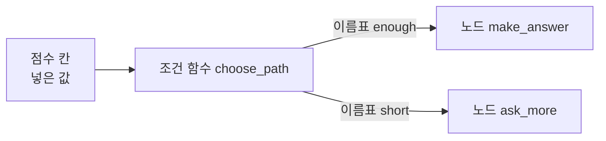
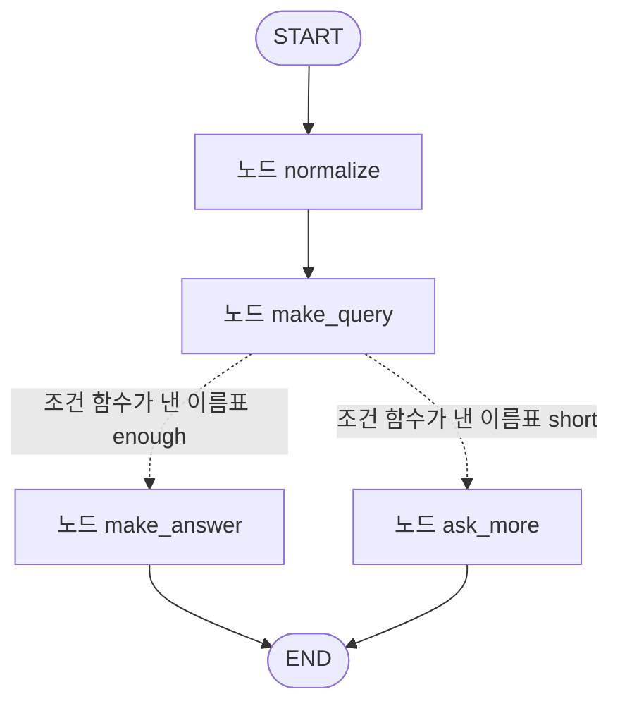
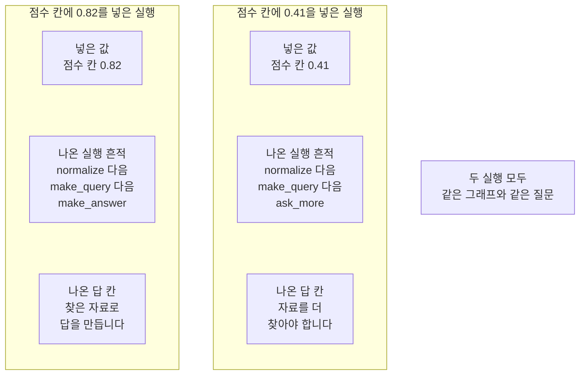
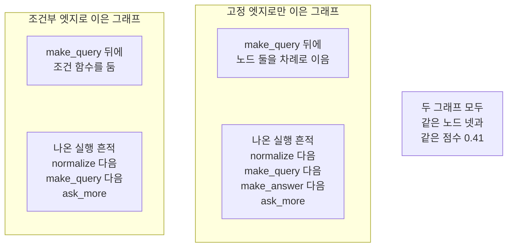

# 03-조건부-엣지

## _src 본문 (HTML 원본)

```html
<!--meta: 강의 1h | 실습 1h | 코드 notebooks/03-조건부-엣지.ipynb | 새 용어 4 -->
<h2 id="b1"><span class="no">1</span>학습 목표</h2><div class="goal"><ul><li>조건 함수가 내놓는 이름표와 실제 노드 이름의 관계를 설명할 수 있습니다.</li><li>메서드 <code>add_conditional_edges</code>로 갈래가 있는 그래프를 만들 수 있습니다.</li><li>값 하나만 바꿔 두 번 실행하고 지난 노드를 견줄 수 있습니다.</li></ul></div>
<h2 id="b2"><span class="no">2</span>이 내용을 배우는 이유</h2><p>01절과 02절에서 만든 그래프는 엣지가 정해 둔 한 갈래 길만 지났습니다. 넣는 값이 달라도 지나는 노드는 언제나 같았습니다. 실제 흐름에는 값에 따라 갈라지는 자리가 있습니다. 찾은 자료가 넉넉하면 답을 만들고 모자라면 자료를 더 찾는 식입니다.</p><p>값을 볼 때마다 <code>if</code> 문을 부르는 쪽에 흩어 두면 갈래가 어디 있는지 한눈에 보이지 않습니다. 라이브러리 LangGraph는 그 갈래를 엣지로 적어 두게 합니다. 이번 절의 질문은 「점수가 기준값을 넘는지에 따라 답 만들기와 자료 더 찾기 가운데 어느 노드로 갈까요?」입니다. 같은 그래프에 점수만 바꿔 넣어 답합니다.</p>
<h2 id="b3"><span class="no">3</span>앞에서 배운 내용</h2><p>01절에서 상태와 노드와 엣지를 코드로 적고 컴파일해 실행했습니다. 02절에서는 실행 흔적 칸에 이어 붙이기 규칙을 적었습니다. 칸 <code>question</code>·<code>query</code>·<code>trace</code>를 이 절에서도 그대로 씁니다. 노드 <code>normalize</code>·<code>make_query</code>는 02절 판을 실습 폴더의 도구 파일 <code>notebooks/rag_tools.py</code>에서 가져옵니다. 첫 질문도 02절과 글자까지 같습니다.</p><p>02절이 정한 약속 하나를 이 절도 지킵니다. 규칙을 적은 칸에는 노드가 자기 기록만 냅니다. 앞 값까지 함께 내면 이름이 겹치는 것을 02절에서 실행으로 확인했습니다. 이 절의 노드 넷도 모두 자기 이름 하나만 담아 냅니다.</p><p>이 절에서 처음 쓰는 것은 메서드 <code>add_conditional_edges</code> 하나입니다. 표시 <code>Annotated</code>와 함수 <code>operator.add</code>는 02절에서 풀었으므로 되풀이하지 않습니다. 형식 <code>TypedDict</code>와 타입힌트는 01절에서 풀었습니다. 불러오는 이름은 02절과 똑같은 여섯 개입니다.</p><p>Ch 9~12에서 쓴 말 「칸」을 이 절에서도 씁니다. 말 「조각」은 Ch 5의 토큰 뜻으로만 쓰고 이 절에는 나오지 않습니다. 앞 노트북의 변수나 자료 파일을 쓰지 않고 파일을 새로 쓰지도 않습니다.</p>
<h2 id="b4"><span class="no">4</span>핵심 개념</h2><h3>비유로 시작하기</h3><p>01절에서 쓴 나무 길과 작업대를 그대로 씁니다. 지금까지 길은 한 갈래였고 상자는 작업대를 차례로 지났습니다. 이 절에서는 두 번째 작업대 뒤에 갈림길이 생깁니다. 갈림길 앞 표지판이 상자를 보고 어느 쪽으로 갈지 말해 줍니다. 상자는 두 갈래 가운데 한쪽만 지납니다.</p>
{{img:03-5-갈림길이-생긴-나무-길|왼쪽에서 들어온 나무 판자 길이 작은 나무 작업대 두 개를 지난 뒤 위아래 두 갈래로 갈라지고 갈라지는 자리 앞에 빈 판을 단 작은 나무 표지판이 서 있으며 칸이 셋인 나무 상자가 위쪽 갈래에만 놓여 있고 아래쪽 갈래에는 아무것도 놓여 있지 않은 그림|갈림길 앞 표지판이 어느 쪽 길로 갈지 정합니다.}}
<p class="look"><b>그림 읽기</b> — 왼쪽에서 들어온 나무 길이 작업대 두 개를 지납니다. 두 번째 작업대 뒤에서 길이 위아래 두 갈래로 갈라집니다. 갈라지는 자리 앞에 빈 판을 단 나무 표지판이 서 있습니다. 칸이 셋인 나무 상자는 위쪽 갈래에만 놓여 있습니다. 아래쪽 갈래에는 아무것도 놓여 있지 않습니다.</p>
<table><thead><tr><th>말</th><th>뜻</th></tr></thead><tbody><tr><td>조건부 엣지(conditional edge)</td><td>한 노드가 끝난 뒤 상태를 읽어 다음 노드를 고르는 이동 한 칸입니다.</td></tr><tr><td>조건 함수</td><td>상태를 받아 다음에 지날 길의 이름표를 내놓는 함수입니다. 칸을 고치지 않습니다.</td></tr><tr><td>이름표 표(<code>path_map</code>)</td><td>조건 함수가 내놓는 이름표를 실제 노드 이름에 잇는 딕셔너리입니다.</td></tr><tr><td>기준값</td><td>길을 가르려고 코드에 적어 둔 값입니다. 이 절에서는 <code>0.7</code>입니다.</td></tr></tbody></table>
{{mermaid:03-1-이름표로-다음-노드-고르기|왼쪽부터 오른쪽으로 놓인 상자 넷으로 맨 왼쪽 초록 상자 점수 칸에 넣은 값에서 화살표가 파란 상자 조건 함수 choose_path로 이어지고 거기서 화살표 두 개가 갈라져 위쪽 화살표에는 이름표 enough가 적혀 파란 상자 노드 make_answer로 가고 아래쪽 화살표에는 이름표 short가 적혀 파란 상자 노드 ask_more로 가는 그림|조건 함수가 점수 칸을 읽어 이름표를 내놓고 그 이름표가 다음 노드를 정합니다.}}
<p class="look"><b>도식 읽기</b> — 왼쪽부터 오른쪽으로 읽습니다. 맨 왼쪽 초록 상자가 그래프에 넣은 점수 칸입니다. 그 오른쪽 파란 상자가 점수 칸을 읽는 조건 함수입니다. 거기서 화살표 두 개가 갈라지고 화살표마다 이름표가 하나씩 적혀 있습니다. 오른쪽 파란 상자 두 개가 그 이름표가 가리키는 노드입니다.</p>
<h3>조건 함수와 노드는 무엇이 다른가</h3><p>노드는 바꿀 칸을 담은 딕셔너리를 내놓습니다. 조건 함수는 칸을 하나도 고치지 않고 이름표 하나만 내놓습니다. 그래서 조건 함수는 <code>add_node</code>로 등록하지 않습니다. 메서드 <code>add_conditional_edges</code>의 둘째 자리에 적습니다.</p>
<h3>이름표 표를 적는 까닭</h3><p>조건 함수가 내놓는 말과 실제 노드 이름은 달라도 됩니다. 이 절에서는 이름표 <code>enough</code>와 <code>short</code>를 노드 <code>make_answer</code>와 <code>ask_more</code>에 이었습니다. 이름표 표를 함께 적으면 그래프가 그리는 구조 문자열에도 갈래 둘이 모두 적힙니다. 이 절 노트북은 그 구조 문자열을 출력해 확인했습니다.</p>
<h3>기준값은 코드가 정한 값</h3><p>점수 <code>0.82</code>와 <code>0.41</code>과 기준값 <code>0.7</code>은 갈래를 보여 주려고 정한 예입니다. 라이브러리가 주는 기본값이 아니고 무엇을 재서 얻은 값도 아닙니다. 실제 서비스에서는 평가 자료로 점수 계산법과 기준값을 따로 확인해야 합니다. 이 절은 그 확인을 하지 않았습니다.</p>
<h2 id="b5"><span class="no">5</span>실행 예제</h2><p>이 절은 모델을 한 번도 부르지 않습니다. 읽어 오는 자료 파일도 없고 새로 쓰는 파일도 없습니다. 노드는 넷이고 엣지는 고정 엣지 넷과 조건부 엣지 하나입니다.</p><p>먼저 조건 함수를 그래프 없이 직접 불러 이름표를 봅니다. 그다음 조건부 엣지로 갈래를 적고 점수만 바꿔 두 번 실행합니다. 마지막으로 기준값과 같은 점수를 넣어 보고 조건부 엣지를 뺀 그래프와 견줍니다.</p>
{{mermaid:03-2-갈래가-있는-그래프|위에서 아래로 놓인 상자 여섯으로 맨 위 회색 둥근 상자 START에서 파란 상자 노드 normalize와 파란 상자 노드 make_query를 차례로 지나고 노드 make_query 아래에서 점선 화살표 두 개가 갈라져 왼쪽 아래 점선에는 조건 함수가 낸 이름표 enough가 적혀 파란 상자 노드 make_answer로 가고 오른쪽 아래 점선에는 조건 함수가 낸 이름표 short가 적혀 파란 상자 노드 ask_more로 가며 두 노드가 모두 맨 아래 회색 둥근 상자 END로 이어지는 그림|노드 make_query를 지난 뒤 점선 두 갈래로 나뉘고 어느 쪽이든 끝으로 이어집니다.}}
<p class="look"><b>도식 읽기</b> — 위에서 아래로 읽습니다. 맨 위와 맨 아래 회색 둥근 상자 <code>START</code>와 <code>END</code>는 라이브러리가 주는 자리입니다. 파란 상자 넷이 <code>add_node</code>로 등록한 노드입니다. 노드 <code>make_query</code> 아래에서 점선 두 개가 갈라지고 점선마다 조건 함수가 낸 이름표가 적혀 있습니다. 점선은 값에 따라 골라지는 갈래이고 어느 쪽을 지나든 <code>END</code>로 이어집니다.</p>
{{notebook:03-조건부-엣지}}
{{mermaid:03-3-두-점수의-두-경로|왼쪽부터 오른쪽으로 놓인 칸 두 개와 회색 상자 하나로 왼쪽 칸 제목은 점수 칸에 0.82를 넣은 실행이고 그 안에 초록 상자 넣은 값 점수 칸 0.82와 노란 상자 나온 실행 흔적 normalize 다음 make_query 다음 make_answer와 노란 상자 나온 답 칸 찾은 자료로 답을 만듭니다가 있으며 가운데 칸 제목은 점수 칸에 0.41을 넣은 실행이고 그 안에 초록 상자 넣은 값 점수 칸 0.41과 노란 상자 나온 실행 흔적 normalize 다음 make_query 다음 ask_more와 노란 상자 나온 답 칸 자료를 더 찾아야 합니다가 있고 오른쪽에 회색 상자 두 실행 모두 같은 그래프와 같은 질문이 놓인 그림|점수 칸 하나만 바꾸자 지난 노드의 셋째 이름과 답 칸이 함께 갈렸습니다.}}
<p class="look"><b>도식 읽기</b> — 왼쪽 칸이 점수 칸에 <code>0.82</code>를 넣은 실행입니다. 가운데 칸이 같은 자리에 <code>0.41</code>을 넣은 실행입니다. 칸마다 맨 위 초록 상자가 넣은 값이고 그 아래 노란 상자 두 개가 나온 값입니다. 두 칸의 실행 흔적은 셋째 이름만 다르고 답 칸도 함께 달라졌습니다. 오른쪽 회색 상자는 두 칸에 모두 해당하는 사실입니다.</p>
<p class="look"><b>확인할 점</b> — 점수 <code>0.82</code>를 넣은 실행의 실행 흔적 칸은 <code>['normalize', 'make_query', 'make_answer']</code>였습니다. 점수 <code>0.41</code>을 넣은 실행은 <code>['normalize', 'make_query', 'ask_more']</code>였습니다. 두 실행의 질문 칸과 검색어 칸은 같았고 출력 줄 <code>답 칸이 같은가: False</code>와 <code>실행 흔적 칸이 같은가: False</code>만 달랐습니다. 기준값과 똑같은 <code>0.7</code>을 넣은 실행은 노드 <code>make_answer</code> 쪽이었습니다.</p>
<h2 id="b6"><span class="no">6</span>실험 결과 해석</h2><p>바꾼 것이 점수 칸 하나일 때 지난 노드와 답 칸이 함께 달라졌습니다. 앞의 두 노드는 두 실행에서 같은 일을 했습니다. 갈래 끝 노드는 한 실행에 하나만 지났습니다. 실행 흔적 칸에 남은 이름은 두 실행 모두 셋이었습니다.</p><p>기준값과 똑같은 <code>0.7</code>을 넣은 실행은 노드 <code>make_answer</code> 쪽으로 갔습니다. 조건 함수를 비교 <code>&gt;=</code>로 적었기 때문입니다. 비교를 <code>&gt;</code>로 적었을 때 어디로 가는지는 이번에 실행하지 않았습니다.</p>
{{mermaid:03-4-조건부-엣지를-뺀-그래프|왼쪽부터 오른쪽으로 놓인 칸 두 개와 회색 상자 하나로 왼쪽 칸 제목은 조건부 엣지로 이은 그래프이고 그 안에 파란 상자 make_query 뒤에 조건 함수를 둠과 노란 상자 나온 실행 흔적 normalize 다음 make_query 다음 ask_more가 있으며 가운데 칸 제목은 고정 엣지로만 이은 그래프이고 그 안에 파란 상자 make_query 뒤에 노드 둘을 차례로 이음과 노란 상자 나온 실행 흔적 normalize 다음 make_query 다음 make_answer 다음 ask_more가 있고 오른쪽에 회색 상자 두 그래프 모두 같은 노드 넷과 같은 점수 0.41이 놓인 그림|같은 노드 넷이라도 조건부 엣지를 빼면 갈래 끝 노드 두 개가 모두 지납니다.}}
<p class="look"><b>도식 읽기</b> — 왼쪽 칸이 조건부 엣지로 이은 그래프의 결과입니다. 가운데 칸이 같은 노드 넷을 고정 엣지로만 이은 그래프의 결과입니다. 칸마다 위 파란 상자가 엣지를 적은 방법이고 아래 노란 상자가 나온 실행 흔적입니다. 가운데 칸의 노란 상자에만 이름 넷이 들어 있습니다. 오른쪽 회색 상자는 두 칸에 모두 해당하는 사실입니다.</p>
<p>같은 노드 넷을 고정 엣지로만 이은 그래프도 실행했습니다. 그 실행의 실행 흔적 칸은 <code>['normalize', 'make_query', 'make_answer', 'ask_more']</code>로 길이가 4였습니다. 답 칸에는 마지막에 지난 노드가 적은 값만 남았습니다. 답 칸에 규칙을 적지 않아 앞 노드가 적은 값이 덮였습니다.</p><p>여기서 확인한 것은 갈래가 한 자리에만 있는 그래프입니다. 갈래가 두 자리 이상이거나 조건 함수가 이름표를 여러 개 내놓는 경우는 이번에 실행하지 않았습니다. 걸린 시간도 이번에 재지 않았습니다.</p>
<h2 id="b7"><span class="no">7</span>주의할 점과 실무 메모</h2><ul><li>조건 함수는 칸을 고치지 않습니다. 이름표 하나만 내놓습니다.</li><li>조건 함수는 <code>add_node</code>로 등록하지 않습니다. 메서드 <code>add_conditional_edges</code>의 둘째 자리에 적습니다.</li><li>이름표 표를 적으면 조건 함수가 내놓는 말과 노드 이름이 달라도 됩니다.</li><li>이 절 조건 함수는 비교 <code>&gt;=</code>로 적었습니다. 기준값과 같은 값은 넉넉한 쪽으로 갑니다.</li><li>점수 <code>0.82</code>·<code>0.41</code>과 기준값 <code>0.7</code>은 갈래를 보여 주려고 정한 예입니다. 무엇을 재서 얻은 값이 아닙니다.</li><li>갈래 끝 노드 두 개는 한 실행에 하나만 지났습니다. 두 노드를 모두 <code>END</code>로 이었기 때문입니다.</li><li>답 칸에는 규칙을 적지 않았습니다. 여러 노드가 적으면 마지막 값만 남습니다.</li><li>실행 흔적 칸의 규칙은 02절에서 적은 것 그대로입니다. 노드는 자기 이름만 냅니다.</li><li>이 절은 모델을 한 번도 부르지 않았습니다. 길을 정한 것은 조건 함수와 기준값입니다.</li><li>이 절은 걸린 시간을 재지 않았습니다. 갈래를 나눠서 빨라졌는지 느려졌는지 적지 않습니다.</li><li>준비물에 LangGraph 1.2.11을 적었습니다. 다른 판과 Windows·macOS에서는 이번에 실행하지 않았습니다.</li><li>이 절은 파일을 쓰지 않습니다. Ch 12가 남긴 기록 파일도 읽지 않습니다.</li></ul>
<h2 id="b8"><span class="no">8</span>정리와 다음 절</h2><ul><li>조건 함수가 점수 칸을 읽어 이름표를 내놓고 이름표 표가 그 이름표를 노드 이름에 이었습니다.</li><li>점수 칸 하나만 바꾸자 지난 노드와 답 칸이 함께 달라졌습니다.</li><li>조건부 엣지를 빼고 고정 엣지로만 이으면 네 노드가 모두 지났습니다.</li></ul><p><strong>다음 학습과 이어지는 지점</strong> — 04절에서는 사람과 모델의 말을 상태에 쌓는 리듀서 <code>add_messages</code>를 씁니다. 이 절까지 상태에 담은 값은 글과 수와 이름 목록뿐이었습니다.</p>
<h2 id="b9"><span class="no">9</span>복습 문제</h2><details class="quiz" open><summary>문제 4개 · 해설 포함</summary><p class="quiz-q">1. 조건 함수는 무엇을 내놓습니까?</p><p class="quiz-a">다음에 지날 길의 이름표 하나를 내놓습니다. 칸은 고치지 않습니다. 틀렸다면 「핵심 개념」의 용어 표를 다시 읽습니다.</p><p class="quiz-q">2. 이름표 표는 무엇과 무엇을 잇습니까?</p><p class="quiz-a">조건 함수가 내놓는 이름표와 실제 노드 이름을 잇습니다. 틀렸다면 「이름표 표를 적는 까닭」을 다시 읽습니다.</p><p class="quiz-q">3. 이 절에서 두 실행이 갈린 까닭은 무엇입니까?</p><p class="quiz-a">점수 칸에 넣은 값 하나가 달랐고 조건 함수가 그 값을 기준값과 견줬습니다. 틀렸다면 「실험 결과 해석」을 다시 읽습니다.</p><p class="quiz-q">4. 같은 노드 넷을 고정 엣지로만 이으면 무엇이 달라집니까?</p><p class="quiz-a">이번 실행에서는 갈래 끝 노드 두 개가 모두 지났고 답 칸에 마지막 값만 남았습니다. 틀렸다면 「실험 결과 해석」을 다시 읽습니다.</p></details>
<h2 id="b10"><span class="no">10</span>참고 자료</h2><ul><li><div><a href="https://docs.langchain.com/oss/python/langgraph/graph-api">LangGraph Graph API 안내</a></div>상태와 노드와 엣지 개념 설명 · 1.2.11 · 확인 2026-09-10</li><li><div><a href="https://docs.langchain.com/oss/python/langgraph/use-graph-api">LangGraph Graph API 사용법</a></div>조건부 엣지 등록과 이름표 표 사용법 · 1.2.11 · 확인 2026-09-10</li><li><div><a href="https://reference.langchain.com/python/langgraph/graph/state/StateGraph">StateGraph API</a></div>설계 객체의 메서드 목록 · 1.2.11 · 확인 2026-09-10</li></ul>
```

## 노트북 셀 (순서대로)

### [0] markdown {'html': 'skip'}

# 조건부 엣지

**이 노트북에서 할 일**

1. 02절 상태 형식에 점수 칸과 답 칸을 더하고 노드를 넷으로 늘립니다.
2. 점수 칸을 읽어 이름표를 내놓는 조건 함수를 만들어 그래프 없이 먼저 불러 봅니다.
3. 조건부 엣지로 갈래를 적고 점수 하나만 바꿔 두 경로를 실행합니다.
4. 기준값과 같은 점수를 넣어 보고 조건부 엣지를 뺀 그래프와도 견줍니다.

**준비물** — 이 절은 OpenAI API 키를 쓰지 않습니다.
모델 요청이 0번이라 드는 비용이 없습니다.
읽어 오는 자료 파일도 없고 새로 쓰는 파일도 없습니다.
실행 시간은 1분 안팎이고 첫 셀의 설치가 가장 오래 걸립니다.

**기준 버전** — 첫 셀에서 LangGraph 1.2.11과 도구 파일이 쓰는 numpy 2.5.3을 설치합니다.
실습 폴더 잠금 파일은 LangChain 1.4.0도 함께 고정하지만 이 절은 부르지 않습니다.
교재 출력은 Linux의 Python 3.12.13으로 만들었습니다.
다른 판과 Windows·macOS에서는 이번에 실행하지 않았습니다.

**강의와 실습 범위** — 강의 시간에는 4~8절을 읽습니다.
조건 함수를 만들어 조건부 엣지로 붙이고 점수 하나만 바꿔 두 번 실행하는 자리입니다.
9절과 10절은 값을 하나씩 바꿔 보는 자리입니다.
11절은 네 실행을 기록 한 줄씩으로 만들어 표로 견주는 자리입니다.
준비부터 끝까지 함께 실행하고 실습 시간에 다시 읽습니다.

실습 폴더 `labs/part4/ch13-langgraph-basics`에서 `uv sync --locked`를 실행합니다.
그다음 이 폴더의 `.venv` 커널을 고르고 첫 셀부터 순서대로 실행합니다.

### [1] markdown {'html': 'skip'}

## 오늘 볼 그림


맨 왼쪽 초록 상자가 그래프에 넣은 점수 칸입니다.
가운데 파란 상자가 그 값을 읽는 조건 함수입니다.
거기서 화살표 두 개가 갈라지고 화살표마다 이름표가 하나씩 적혀 있습니다.
이름표가 오른쪽 두 노드 가운데 하나를 가리킵니다.

### [2] markdown {}

## 1. 준비

첫 셀은 패키지 두 개를 설치하고 설치된 판 번호를 출력합니다.
설치에는 몇십 초가 걸릴 수 있습니다.

### [3] code {'execution': {'iopub.execute_input': '2026-09-21T09:06:05.034169Z', 'iopub.status.busy': '2026-09-21T09:06:05.034008Z', 'iopub.status.idle': '2026-09-21T09:06:05.484029Z', 'shell.execute_reply': '2026-09-21T09:06:05.483358Z'}, 'lesson_role': 'setup'}

```python
# 이 절에서 쓰는 패키지를 설치하고 버전을 확인합니다
%pip install -q "langgraph==1.2.11" "numpy==2.5.3"
from importlib.metadata import version

print("langgraph:", version("langgraph"))
print("numpy:", version("numpy"))
```

출력:
```
Note: you may need to restart the kernel to use updated packages.
langgraph: 1.2.11
numpy: 2.5.3

```

### [4] markdown {}

**결과 읽기** — 설치가 끝나면 `langgraph: 1.2.11`과 `numpy: 2.5.3`이 보입니다.
패키지 `numpy`는 이 절이 직접 쓰지 않지만 도구 파일을 불러올 때 필요합니다.
이 노트북의 출력은 2026-09-21에 이 판으로 실행한 결과입니다.

다음 셀은 이름 여섯 개를 불러옵니다.
02절에서 불러온 것과 같은 여섯 개입니다.
이 절에서 새로 쓰는 것은 불러오는 이름이 아니라 설계 객체의 메서드 하나입니다.

앞에서 배운 함수는 `rag_tools.py`에 모아 두었습니다. 파일을 열면 코드를 볼 수 있습니다. 노트북과 같은 폴더(`notebooks/`)에 있는 파일입니다.

이 노트북은 02절 노드 `normalize`와 `make_query`를 가져옵니다.

### [5] code {'execution': {'iopub.execute_input': '2026-09-21T09:06:05.485140Z', 'iopub.status.busy': '2026-09-21T09:06:05.485047Z', 'iopub.status.idle': '2026-09-21T09:06:06.031094Z', 'shell.execute_reply': '2026-09-21T09:06:06.030919Z'}, 'lesson_role': 'setup'}

```python
# 02절에서 쓴 이름 여섯 개를 그대로 불러옵니다
import operator
from typing import Annotated
from typing_extensions import TypedDict
from langgraph.graph import StateGraph, START, END
# 02절에서 만든 노드 두 개를 도구 파일에서 가져옵니다
from rag_tools import make_query, normalize

print("불러온 이름:", "operator", "Annotated", "TypedDict", "StateGraph", "START", "END")
```

출력:
```
불러온 이름: operator Annotated TypedDict StateGraph START END

```

### [6] markdown {}

**결과 읽기** — 출력 줄은 `불러온 이름: operator Annotated TypedDict StateGraph START END` 하나입니다.
02절과 같은 줄입니다.
이 절이 새로 쓰는 메서드 `add_conditional_edges`는 설계 객체에 이미 들어 있어 따로 불러오지 않습니다.
도구 파일에서 가져온 노드 둘은 출력하지 않습니다.

## 2. 이 절에서 쓸 값 정하기

01절과 02절에서 쓴 첫 질문을 글자까지 같게 씁니다.
길을 가르는 데 쓸 점수 두 개와 기준값 하나를 함께 정합니다.

### [7] code {'execution': {'iopub.execute_input': '2026-09-21T09:06:06.033020Z', 'iopub.status.busy': '2026-09-21T09:06:06.032929Z', 'iopub.status.idle': '2026-09-21T09:06:06.034874Z', 'shell.execute_reply': '2026-09-21T09:06:06.034700Z'}}

```python
# 01절 질문과 이 절에서 넣어 볼 점수 두 개와 길을 가르는 기준값을 정합니다
first_question = "  대출 기간은 며칠인가요?  "
high_score = 0.82
low_score = 0.41
enough_score = 0.7
print("첫 질문:", first_question)
print("첫 질문의 글자 수:", len(first_question))
print("높은 점수:", high_score)
print("낮은 점수:", low_score)
print("길을 가르는 기준값:", enough_score)
```

출력:
```
첫 질문:   대출 기간은 며칠인가요?  
첫 질문의 글자 수: 17
높은 점수: 0.82
낮은 점수: 0.41
길을 가르는 기준값: 0.7

```

### [8] markdown {}

**결과 읽기** — 출력 줄 `첫 질문의 글자 수: 17`은 01절·02절과 같은 값입니다.
출력 줄 `높은 점수: 0.82`와 `낮은 점수: 0.41`이 이 절에서 견줄 두 값입니다.
출력 줄 `길을 가르는 기준값: 0.7`이 두 값을 가르는 자리입니다.
세 값은 모두 사람이 정한 예이고 무엇을 재서 얻은 값이 아닙니다.

## 3. 상태 형식 넓히기

02절 상태 형식에는 칸이 셋 있었고 실행 흔적 칸에만 이어 붙이기 규칙을 적었습니다.
이 절은 그 셋에 점수 칸과 답 칸을 더해 다섯으로 넓힙니다.
칸 `score`에는 길을 가를 값을 미리 넣어 두고 칸 `answer`에는 고른 노드가 값을 적습니다.

### [9] code {'execution': {'iopub.execute_input': '2026-09-21T09:06:06.035559Z', 'iopub.status.busy': '2026-09-21T09:06:06.035511Z', 'iopub.status.idle': '2026-09-21T09:06:06.037254Z', 'shell.execute_reply': '2026-09-21T09:06:06.036954Z'}}

```python
# 02절 상태 형식에 점수 칸과 답 칸을 더한 상태 형식을 만듭니다
class RouteState(TypedDict):
    question: str
    query: str
    score: float
    answer: str
    trace: Annotated[list[str], operator.add]
```

출력:
```

```

### [10] markdown {}

**결과 읽기** — 정의 셀이라 출력이 없습니다.
칸 `score`의 값 갈래 `float`는 소수점이 있는 수를 뜻합니다.
칸 `trace`의 규칙은 02절에서 적은 것과 글자까지 같습니다.
새로 더한 칸 두 개에는 규칙을 적지 않아 마지막 갱신이 값을 바꿉니다.

다음 셀은 01절·02절에서 쓴 출력 함수에 줄 두 개를 더한 판입니다.

### [11] code {'execution': {'iopub.execute_input': '2026-09-21T09:06:06.037726Z', 'iopub.status.busy': '2026-09-21T09:06:06.037674Z', 'iopub.status.idle': '2026-09-21T09:06:06.039209Z', 'shell.execute_reply': '2026-09-21T09:06:06.039015Z'}}

```python
# 상태의 칸 다섯 개를 라벨 줄 아래에 한 줄씩 출력합니다
def print_state(label, state):
    print(label)
    print("질문 칸 |", state["question"])
    print("검색어 칸 |", state["query"])
    print("점수 칸 |", state["score"])
    print("답 칸 |", state["answer"])
    print("실행 흔적 칸 |", state["trace"])
```

출력:
```

```

### [12] markdown {}

**결과 읽기** — 정의 셀이라 출력이 없습니다.
라벨 줄을 따로 출력하고 그 아래에 칸을 한 줄씩 적습니다.
02절 판과 견주면 `점수 칸 |`과 `답 칸 |` 두 줄이 늘었습니다.

다음 셀은 점수 칸만 다른 처음 상태를 만들어 내는 함수입니다.
이 절은 같은 그래프에 처음 상태를 네 번 넣으므로 만드는 자리를 한곳에 모읍니다.

### [13] code {'execution': {'iopub.execute_input': '2026-09-21T09:06:06.039604Z', 'iopub.status.busy': '2026-09-21T09:06:06.039557Z', 'iopub.status.idle': '2026-09-21T09:06:06.041069Z', 'shell.execute_reply': '2026-09-21T09:06:06.040930Z'}}

```python
# 점수 칸만 다른 처음 상태를 만들어 냅니다
def new_state(score):
    state = {}
    state["question"] = first_question
    state["query"] = ""
    state["score"] = score
    state["answer"] = ""
    state["trace"] = []
    return state
```

출력:
```

```

### [14] markdown {}

**결과 읽기** — 정의 셀이라 출력이 없습니다.
함수 `new_state`는 앞 셀에서 정한 이름 `first_question`을 그대로 읽습니다.
받는 값은 점수 하나뿐이고 나머지 칸 넷은 언제나 같게 채웁니다.

## 4. 노드 네 개

앞의 두 노드 `normalize`와 `make_query`는 준비 셀에서 도구 파일로부터 가져왔습니다.
02절에서 만든 노드로 질문 칸의 앞뒤 빈칸을 없애고 검색어 칸을 만듭니다.
뒤의 두 노드가 이 절에서 새로 만드는 갈래 끝 노드입니다.
네 노드 모두 실행 흔적 칸에는 자기 이름 하나만 담아 냅니다.

다음 셀은 점수가 넉넉할 때 지날 노드입니다.

### [15] code {'execution': {'iopub.execute_input': '2026-09-21T09:06:06.041557Z', 'iopub.status.busy': '2026-09-21T09:06:06.041510Z', 'iopub.status.idle': '2026-09-21T09:06:06.043081Z', 'shell.execute_reply': '2026-09-21T09:06:06.042869Z'}}

```python
# 점수가 기준값 위일 때 지날 노드로 답 칸과 자기 이름을 담아 냅니다
def make_answer(state):
    return {"answer": "찾은 자료로 답을 만듭니다", "trace": ["make_answer"]}
```

출력:
```

```

### [16] markdown {}

**결과 읽기** — 정의 셀이라 출력이 없습니다.
이 노드는 답 칸에 적을 글 하나와 자기 이름을 담아 냅니다.
실제로 자료를 찾거나 모델을 부르지는 않습니다.

다음 셀은 점수가 모자랄 때 지날 노드입니다.

### [17] code {'execution': {'iopub.execute_input': '2026-09-21T09:06:06.043590Z', 'iopub.status.busy': '2026-09-21T09:06:06.043546Z', 'iopub.status.idle': '2026-09-21T09:06:06.045015Z', 'shell.execute_reply': '2026-09-21T09:06:06.044821Z'}}

```python
# 점수가 기준값 아래일 때 지날 노드로 답 칸과 자기 이름을 담아 냅니다
def ask_more(state):
    return {"answer": "자료를 더 찾아야 합니다", "trace": ["ask_more"]}
```

출력:
```

```

### [18] markdown {}

**결과 읽기** — 정의 셀이라 출력이 없습니다.
앞 노드와 모양은 같고 답 칸에 적는 글과 자기 이름만 다릅니다.

## 5. 조건 함수 — 이름표를 내놓기

조건 함수는 상태를 받아 다음에 지날 길의 이름표를 내놓는 함수입니다.
갈림길 앞에서 표지판을 보고 왼쪽인지 오른쪽인지 말하는 사람과 같습니다.
이 함수는 칸을 하나도 고치지 않고 이름표 한 개만 내놓습니다.
노드가 딕셔너리를 내놓는 것과 내놓는 모양부터 다릅니다.

### [19] code {'execution': {'iopub.execute_input': '2026-09-21T09:06:06.045404Z', 'iopub.status.busy': '2026-09-21T09:06:06.045364Z', 'iopub.status.idle': '2026-09-21T09:06:06.047863Z', 'shell.execute_reply': '2026-09-21T09:06:06.047669Z'}}

```python
# 점수 칸을 읽어 다음에 지날 길의 이름표를 내놓습니다
def choose_path(state):
    if state["score"] >= enough_score:
        return "enough"
    return "short"
```

출력:
```

```

### [20] markdown {}

**결과 읽기** — 정의 셀이라 출력이 없습니다.
함수 `choose_path`는 앞 셀에서 정한 이름 `enough_score`를 그대로 읽습니다.
비교 `>=`는 기준값과 같은 값도 넉넉한 쪽으로 봅니다.
내놓는 값 `enough`와 `short`는 노드 이름이 아니라 우리가 지은 이름표입니다.

다음 셀은 그래프 없이 이 함수만 직접 불러 봅니다.
점수 칸만 든 작은 딕셔너리를 넣어도 이 함수는 점수 칸만 읽습니다.

### [21] code {'execution': {'iopub.execute_input': '2026-09-21T09:06:06.048315Z', 'iopub.status.busy': '2026-09-21T09:06:06.048272Z', 'iopub.status.idle': '2026-09-21T09:06:06.049885Z', 'shell.execute_reply': '2026-09-21T09:06:06.049691Z'}}

```python
# 그래프 없이 조건 함수만 직접 불러 두 점수의 이름표를 봅니다
high_only = {"score": high_score}
low_only = {"score": low_score}
print("높은 점수의 이름표:", choose_path(high_only))
print("낮은 점수의 이름표:", choose_path(low_only))
```

출력:
```
높은 점수의 이름표: enough
낮은 점수의 이름표: short

```

### [22] markdown {}

**결과 읽기** — 출력 줄 `높은 점수의 이름표: enough`와 `낮은 점수의 이름표: short`가 보입니다.
점수 하나가 이름표 하나로 바뀌었습니다.
이 함수는 노드를 실행하지 않고 어느 길로 갈지만 말합니다.

## 6. 조립 — 조건부 엣지 붙이기

먼저 설계 객체를 만들고 노드 네 개를 등록합니다.
01절·02절에서는 노드가 둘이었습니다.

### [23] code {'execution': {'iopub.execute_input': '2026-09-21T09:06:06.050277Z', 'iopub.status.busy': '2026-09-21T09:06:06.050233Z', 'iopub.status.idle': '2026-09-21T09:06:06.052185Z', 'shell.execute_reply': '2026-09-21T09:06:06.051983Z'}}

```python
# 설계 객체를 만들고 노드 네 개를 등록합니다
builder = StateGraph(RouteState)
builder.add_node("normalize", normalize)
builder.add_node("make_query", make_query)
builder.add_node("make_answer", make_answer)
builder.add_node("ask_more", ask_more)
print("등록한 노드 수:", len(builder.nodes))
```

출력:
```
등록한 노드 수: 4

```

### [24] markdown {}

**결과 읽기** — 출력 줄 `등록한 노드 수: 4`가 보입니다.
갈래 끝 노드 두 개가 늘어 01절·02절의 두 배입니다.

다음 셀은 이름표를 실제 노드 이름에 잇는 표를 만듭니다.
이 표를 이름표 표(`path_map`)라고 부릅니다.

### [25] code {'execution': {'iopub.execute_input': '2026-09-21T09:06:06.053343Z', 'iopub.status.busy': '2026-09-21T09:06:06.053298Z', 'iopub.status.idle': '2026-09-21T09:06:06.056968Z', 'shell.execute_reply': '2026-09-21T09:06:06.056746Z'}}

```python
# 조건 함수가 내놓는 이름표를 실제 노드 이름에 잇는 표를 만듭니다
path_map = {"enough": "make_answer", "short": "ask_more"}
print("이름표와 노드 이름을 이은 표:")
for label in path_map:
    print(label, "->", path_map[label])
```

출력:
```
이름표와 노드 이름을 이은 표:
enough -> make_answer
short -> ask_more

```

### [26] markdown {}

**결과 읽기** — 라벨 줄 `이름표와 노드 이름을 이은 표:` 아래 두 줄이 나옵니다.
줄 `enough -> make_answer`와 줄 `short -> ask_more`입니다.
왼쪽이 조건 함수가 내놓는 이름표이고 오른쪽이 실제 노드 이름입니다.

다음 셀은 엣지를 적고 컴파일합니다.
메서드 `add_conditional_edges(앞 노드, 조건 함수, 이름표 표)`는 앞 노드가 끝난 뒤 조건 함수를 부릅니다.
그 함수가 내놓은 이름표를 이름표 표에서 찾아 실제 노드로 잇습니다.

### [27] code {'execution': {'iopub.execute_input': '2026-09-21T09:06:06.057382Z', 'iopub.status.busy': '2026-09-21T09:06:06.057346Z', 'iopub.status.idle': '2026-09-21T09:06:06.060036Z', 'shell.execute_reply': '2026-09-21T09:06:06.059863Z'}}

```python
# 고정 엣지 네 개와 조건부 엣지 한 개를 적고 컴파일합니다
builder.add_edge(START, "normalize")
builder.add_edge("normalize", "make_query")
builder.add_conditional_edges("make_query", choose_path, path_map)
builder.add_edge("make_answer", END)
builder.add_edge("ask_more", END)
graph = builder.compile()
print("고정 엣지로 적은 수:", len(builder.edges))
print("컴파일 결과의 종류:", type(graph))
```

출력:
```
고정 엣지로 적은 수: 4
컴파일 결과의 종류: <class 'langgraph.graph.state.CompiledStateGraph'>

```

### [28] markdown {}

**결과 읽기** — 출력 줄 `고정 엣지로 적은 수: 4`가 보입니다.
조건부 엣지는 이 수에 들어 있지 않고 따로 적힙니다.
출력 줄의 종류 이름 `CompiledStateGraph`는 01절·02절과 같습니다.

다음 셀은 컴파일한 그래프가 스스로 그린 구조 문자열을 받아 옵니다.
01절에서 한 번 본 출력입니다.

### [29] code {'execution': {'iopub.execute_input': '2026-09-21T09:06:06.060415Z', 'iopub.status.busy': '2026-09-21T09:06:06.060376Z', 'iopub.status.idle': '2026-09-21T09:06:06.075621Z', 'shell.execute_reply': '2026-09-21T09:06:06.075412Z'}}

```python
# 컴파일한 그래프가 스스로 그린 구조 문자열을 받아 옵니다
structure_text = graph.get_graph().draw_mermaid()
print("그래프가 그린 구조:")
print(structure_text)
```

출력:
```
그래프가 그린 구조:
---
config:
  flowchart:
    curve: linear
---
graph TD;
	__start__([<p>__start__</p>]):::first
	normalize(normalize)
	make_query(make_query)
	make_answer(make_answer)
	ask_more(ask_more)
	__end__([<p>__end__</p>]):::last
	__start__ --> normalize;
	make_query -. &nbsp;short&nbsp; .-> ask_more;
	make_query -. &nbsp;enough&nbsp; .-> make_answer;
	normalize --> make_query;
	ask_more --> __end__;
	make_answer --> __end__;
	classDef default fill:#f2f0ff,line-height:1.2
	classDef first fill-opacity:0
	classDef last fill:#bfb6fc


```

### [30] markdown {}

**결과 읽기** — 라벨 줄 `그래프가 그린 구조:` 아래에 여러 줄이 나옵니다.
이름 `make_query`로 시작하는 줄이 두 개입니다.
두 줄 모두 점선 표시 `-.`와 `.->` 사이에 이름표가 적혀 있습니다.
한 줄은 이름표 `enough`로 `make_answer`를 가리킵니다.
다른 줄은 이름표 `short`로 `ask_more`를 가리킵니다.

구조에는 갈래 둘이 모두 적혀 있습니다.
실행 한 번이 어느 쪽으로 갈지는 아직 정해지지 않았습니다.

## 7. 실행 1 — 높은 점수

실행 전에 예상해 봅니다.
점수 `0.82`는 기준값보다 크니 이름표 `enough`를 지나 노드 `make_answer`로 갈 것입니다.

### [31] code {'execution': {'iopub.execute_input': '2026-09-21T09:06:06.076249Z', 'iopub.status.busy': '2026-09-21T09:06:06.076195Z', 'iopub.status.idle': '2026-09-21T09:06:06.079210Z', 'shell.execute_reply': '2026-09-21T09:06:06.078999Z'}}

```python
# 점수 칸에 높은 점수를 넣고 그래프를 실행합니다
high_state = new_state(high_score)
high_result = graph.invoke(high_state)
print_state("높은 점수 결과", high_result)
```

출력:
```
높은 점수 결과
질문 칸 | 대출 기간은 며칠인가요?
검색어 칸 | 대출 기간은 며칠
점수 칸 | 0.82
답 칸 | 찾은 자료로 답을 만듭니다
실행 흔적 칸 | ['normalize', 'make_query', 'make_answer']

```

### [32] markdown {}

**결과 읽기** — 줄 `실행 흔적 칸 | ['normalize', 'make_query', 'make_answer']`에 이름 셋이 남았습니다.
줄 `답 칸 | 찾은 자료로 답을 만듭니다`가 노드 `make_answer`가 적은 값입니다.
이름 `ask_more`는 실행 흔적 칸에 없습니다.
줄 `검색어 칸 | 대출 기간은 며칠`은 01절·02절과 같은 값입니다.

## 8. 실행 2 — 낮은 점수

바꿀 값은 점수 칸 하나입니다.
그래프와 질문은 실행 1과 그대로 같습니다.
실행 전에 예상해 봅니다. 이름표 `short`를 지나 노드 `ask_more`로 갈 것입니다.

### [33] code {'execution': {'iopub.execute_input': '2026-09-21T09:06:06.079635Z', 'iopub.status.busy': '2026-09-21T09:06:06.079590Z', 'iopub.status.idle': '2026-09-21T09:06:06.081944Z', 'shell.execute_reply': '2026-09-21T09:06:06.081713Z'}}

```python
# 점수 칸에 낮은 점수를 넣고 같은 그래프를 실행합니다
low_state = new_state(low_score)
low_result = graph.invoke(low_state)
print_state("낮은 점수 결과", low_result)
```

출력:
```
낮은 점수 결과
질문 칸 | 대출 기간은 며칠인가요?
검색어 칸 | 대출 기간은 며칠
점수 칸 | 0.41
답 칸 | 자료를 더 찾아야 합니다
실행 흔적 칸 | ['normalize', 'make_query', 'ask_more']

```

### [34] markdown {}

**결과 읽기** — 줄 `실행 흔적 칸 | ['normalize', 'make_query', 'ask_more']`에 이름 셋이 남았습니다.
셋째 이름만 실행 1과 다릅니다.
줄 `답 칸 | 자료를 더 찾아야 합니다`가 노드 `ask_more`가 적은 값입니다.

다음 셀은 두 실행을 칸별로 견줍니다.

### [35] code {'execution': {'iopub.execute_input': '2026-09-21T09:06:06.082380Z', 'iopub.status.busy': '2026-09-21T09:06:06.082339Z', 'iopub.status.idle': '2026-09-21T09:06:06.084231Z', 'shell.execute_reply': '2026-09-21T09:06:06.084006Z'}}

```python
# 두 실행의 결과를 칸별로 견줍니다
print("질문 칸이 같은가:", high_result["question"] == low_result["question"])
print("검색어 칸이 같은가:", high_result["query"] == low_result["query"])
print("답 칸이 같은가:", high_result["answer"] == low_result["answer"])
print("실행 흔적 칸이 같은가:", high_result["trace"] == low_result["trace"])
assert high_result["trace"] == ["normalize", "make_query", "make_answer"]
assert low_result["trace"] == ["normalize", "make_query", "ask_more"]
```

출력:
```
질문 칸이 같은가: True
검색어 칸이 같은가: True
답 칸이 같은가: False
실행 흔적 칸이 같은가: False

```

### [36] markdown {}

**결과 읽기** — 출력 줄 `질문 칸이 같은가: True`와 `검색어 칸이 같은가: True`가 보입니다.
앞 노드 두 개는 두 실행에서 같은 일을 했습니다.
출력 줄 `답 칸이 같은가: False`와 `실행 흔적 칸이 같은가: False`가 갈린 자리입니다.
점수 칸 하나를 바꾸자 지난 노드와 답 칸이 함께 달라졌습니다.

## 9. 값 바꿔 보기 ① 기준값과 똑같은 점수

바꿀 값은 점수 칸 하나입니다.
기준값과 똑같은 `0.7`을 넣습니다.
조건 함수는 비교 `>=`로 적혀 있습니다.
실행 전에 예상해 봅니다. 같은 값도 넉넉한 쪽으로 보아 노드 `make_answer`로 갈 것입니다.

### [37] code {'execution': {'iopub.execute_input': '2026-09-21T09:06:06.084645Z', 'iopub.status.busy': '2026-09-21T09:06:06.084603Z', 'iopub.status.idle': '2026-09-21T09:06:06.086694Z', 'shell.execute_reply': '2026-09-21T09:06:06.086338Z'}}

```python
# 점수 칸에 기준값과 똑같은 값을 넣어 어느 길로 가는지 봅니다
same_state = new_state(enough_score)
same_result = graph.invoke(same_state)
print_state("기준값과 같은 점수 결과", same_result)
```

출력:
```
기준값과 같은 점수 결과
질문 칸 | 대출 기간은 며칠인가요?
검색어 칸 | 대출 기간은 며칠
점수 칸 | 0.7
답 칸 | 찾은 자료로 답을 만듭니다
실행 흔적 칸 | ['normalize', 'make_query', 'make_answer']

```

### [38] markdown {}

**결과 읽기** — 줄 `점수 칸 | 0.7`이 기준값과 같은 값입니다.
줄 `실행 흔적 칸 | ['normalize', 'make_query', 'make_answer']`는 실행 1과 같습니다.
비교 `>=`는 기준값과 같은 값을 넉넉한 쪽으로 보냅니다.
비교를 `>`로 적었다면 다른 쪽으로 갔겠지만 이번에 실행하지는 않았습니다.

## 10. 값 바꿔 보기 ② 조건부 엣지를 빼면

바꿀 것은 엣지를 적는 방법 하나입니다.
같은 노드 네 개를 조건 없이 고정 엣지로만 차례로 잇습니다.
실행 전에 예상해 봅니다. 갈래가 없으니 네 노드가 모두 지날 것입니다.

### [39] code {'execution': {'iopub.execute_input': '2026-09-21T09:06:06.087258Z', 'iopub.status.busy': '2026-09-21T09:06:06.087208Z', 'iopub.status.idle': '2026-09-21T09:06:06.089414Z', 'shell.execute_reply': '2026-09-21T09:06:06.089009Z'}}

```python
# 같은 노드 네 개를 새 설계 객체에 등록합니다
fixed_builder = StateGraph(RouteState)
fixed_builder.add_node("normalize", normalize)
fixed_builder.add_node("make_query", make_query)
fixed_builder.add_node("make_answer", make_answer)
fixed_builder.add_node("ask_more", ask_more)
print("등록한 노드 수:", len(fixed_builder.nodes))
```

출력:
```
등록한 노드 수: 4

```

### [40] markdown {}

**결과 읽기** — 출력 줄 `등록한 노드 수: 4`가 앞 그래프와 같습니다.
짝지은 함수도 앞 그래프와 같습니다.

다음 셀은 엣지만 다르게 적어 컴파일합니다.

### [41] code {'execution': {'iopub.execute_input': '2026-09-21T09:06:06.089955Z', 'iopub.status.busy': '2026-09-21T09:06:06.089905Z', 'iopub.status.idle': '2026-09-21T09:06:06.092329Z', 'shell.execute_reply': '2026-09-21T09:06:06.092001Z'}}

```python
# 조건부 엣지 없이 고정 엣지 다섯 개로만 이어 컴파일합니다
fixed_builder.add_edge(START, "normalize")
fixed_builder.add_edge("normalize", "make_query")
fixed_builder.add_edge("make_query", "make_answer")
fixed_builder.add_edge("make_answer", "ask_more")
fixed_builder.add_edge("ask_more", END)
fixed_graph = fixed_builder.compile()
print("고정 엣지로 적은 수:", len(fixed_builder.edges))
```

출력:
```
고정 엣지로 적은 수: 5

```

### [42] markdown {}

**결과 읽기** — 출력 줄 `고정 엣지로 적은 수: 5`가 보입니다.
앞 그래프보다 고정 엣지가 하나 많습니다.
이 그래프에는 조건부 엣지가 하나도 없습니다.

다음 셀은 실행 2와 같은 낮은 점수를 넣어 실행합니다.

### [43] code {'execution': {'iopub.execute_input': '2026-09-21T09:06:06.092993Z', 'iopub.status.busy': '2026-09-21T09:06:06.092923Z', 'iopub.status.idle': '2026-09-21T09:06:06.095374Z', 'shell.execute_reply': '2026-09-21T09:06:06.095055Z'}}

```python
# 같은 낮은 점수를 넣고 고정 엣지 그래프를 실행합니다
fixed_state = new_state(low_score)
fixed_result = fixed_graph.invoke(fixed_state)
print_state("고정 엣지 결과", fixed_result)
print("실행 흔적 칸의 길이:", len(fixed_result["trace"]))
```

출력:
```
고정 엣지 결과
질문 칸 | 대출 기간은 며칠인가요?
검색어 칸 | 대출 기간은 며칠
점수 칸 | 0.41
답 칸 | 자료를 더 찾아야 합니다
실행 흔적 칸 | ['normalize', 'make_query', 'make_answer', 'ask_more']
실행 흔적 칸의 길이: 4

```

### [44] markdown {}

**결과 읽기** — 줄 `실행 흔적 칸 | ['normalize', 'make_query', 'make_answer', 'ask_more']`가 보입니다.
출력 줄 `실행 흔적 칸의 길이: 4`가 그 수입니다.
갈래 끝 노드 두 개가 모두 지났습니다.
줄 `답 칸 | 자료를 더 찾아야 합니다`는 마지막에 지난 노드가 적은 값입니다.
답 칸에는 규칙을 적지 않아 앞 노드가 적은 값이 덮였습니다.

## 11. 네 실행을 기록 한 줄씩으로

실행 한 번을 기록 한 줄로 만들어 담아 둡니다.
Ch 9~12와 01절·02절에서 쓴 기록 한 줄과 같은 모양입니다.

### [45] code {'execution': {'iopub.execute_input': '2026-09-21T09:06:06.095909Z', 'iopub.status.busy': '2026-09-21T09:06:06.095854Z', 'iopub.status.idle': '2026-09-21T09:06:06.097349Z', 'shell.execute_reply': '2026-09-21T09:06:06.097008Z'}}

```python
# 실행 한 번을 기록 한 줄로 만듭니다
def run_row(run_name, state):
    row = {"실행": run_name}
    row["점수 칸"] = state["score"]
    row["지난 노드"] = state["trace"]
    row["답 칸"] = state["answer"]
    return row
```

출력:
```

```

### [46] markdown {}

**결과 읽기** — 정의 셀이라 출력이 없습니다.
02절 판과 견주면 담는 칸이 점수 칸과 지난 노드와 답 칸으로 바뀌었습니다.

다음 셀은 네 실행의 기록을 목록에 담습니다.

### [47] code {'execution': {'iopub.execute_input': '2026-09-21T09:06:06.097874Z', 'iopub.status.busy': '2026-09-21T09:06:06.097829Z', 'iopub.status.idle': '2026-09-21T09:06:06.099435Z', 'shell.execute_reply': '2026-09-21T09:06:06.099128Z'}}

```python
# 네 실행의 기록을 목록에 담습니다
run_rows = []
run_rows.append(run_row("높은 점수", high_result))
run_rows.append(run_row("낮은 점수", low_result))
run_rows.append(run_row("기준값과 같은 점수", same_result))
run_rows.append(run_row("고정 엣지", fixed_result))
print("담은 기록 줄 수:", len(run_rows))
```

출력:
```
담은 기록 줄 수: 4

```

### [48] markdown {}

**결과 읽기** — 출력 줄 `담은 기록 줄 수: 4`가 보입니다.

다음 셀은 담은 줄을 표로 출력합니다.

### [49] code {'execution': {'iopub.execute_input': '2026-09-21T09:06:06.099938Z', 'iopub.status.busy': '2026-09-21T09:06:06.099896Z', 'iopub.status.idle': '2026-09-21T09:06:06.101570Z', 'shell.execute_reply': '2026-09-21T09:06:06.101246Z'}}

```python
# 실행과 점수 칸과 지난 노드와 답 칸을 라벨 줄 아래에 차례로 출력합니다
print("실행 | 점수 칸 | 지난 노드 | 답 칸")
for row in run_rows:
    print(row["실행"], "|", row["점수 칸"], "|", row["지난 노드"], "|", row["답 칸"])
```

출력:
```
실행 | 점수 칸 | 지난 노드 | 답 칸
높은 점수 | 0.82 | ['normalize', 'make_query', 'make_answer'] | 찾은 자료로 답을 만듭니다
낮은 점수 | 0.41 | ['normalize', 'make_query', 'ask_more'] | 자료를 더 찾아야 합니다
기준값과 같은 점수 | 0.7 | ['normalize', 'make_query', 'make_answer'] | 찾은 자료로 답을 만듭니다
고정 엣지 | 0.41 | ['normalize', 'make_query', 'make_answer', 'ask_more'] | 자료를 더 찾아야 합니다

```

### [50] markdown {}

**결과 읽기** — 라벨 줄 아래 네 줄이 나옵니다.
위 두 줄은 점수 칸만 다르고 지난 노드의 셋째 이름과 답 칸이 갈렸습니다.
셋째 줄은 점수 칸이 `0.7`인데 지난 노드가 첫 줄과 같습니다.
넷째 줄만 지난 노드가 넷이고 그 줄이 조건부 엣지를 뺀 그래프의 결과입니다.

## 정리

1. 조건 함수가 점수 칸을 읽어 이름표를 내놓고 이름표 표가 그 이름표를 노드 이름에 이었습니다.
2. 점수 칸 하나만 바꾸자 지난 노드와 답 칸이 함께 달라졌습니다.
3. 조건부 엣지를 빼고 고정 엣지로만 이으면 네 노드가 모두 지났습니다.

04절에서는 사람과 모델의 말을 상태에 쌓는 리듀서 `add_messages`를 씁니다.
이 절까지 상태에 담은 값은 글과 수와 이름 목록뿐이었습니다.

## 그림

### 03-1-이름표로-다음-노드-고르기.mmd



조건 함수가 점수 칸을 읽어 이름표를 내놓고 그 이름표가 다음 노드를 정합니다.

### 03-2-갈래가-있는-그래프.mmd



노드 make_query를 지난 뒤 점선 두 갈래로 나뉘고 어느 쪽이든 끝으로 이어집니다.

### 03-3-두-점수의-두-경로.mmd



점수 칸 하나만 바꾸자 지난 노드의 셋째 이름과 답 칸이 함께 갈렸습니다.

### 03-4-조건부-엣지를-뺀-그래프.mmd



같은 노드 넷이라도 조건부 엣지를 빼면 갈래 끝 노드 두 개가 모두 지납니다.

### 03-5-갈림길이-생긴-나무-길.prompt.md

# 03-5-갈림길이-생긴-나무-길 (Higgsfield 삽화)

설명 대상 문장(본문 b4 비유 단락): 두 번째 작업대 뒤에 갈림길이 생기고, 갈림길 앞 표지판이 상자를 보고 어느 쪽으로 갈지 말해 주며, 상자는 두 갈래 가운데 한쪽만 지납니다.

구성 요소와 배치: 흰 바탕에 나무 판자 길 하나가 왼쪽에서 들어옵니다(= 01절 한 갈래 길). 길 위에 작은 나무 작업대가 둘 놓입니다(= 노드 normalize와 make_query). 두 번째 작업대 뒤에서 길이 위아래 두 갈래로 뚜렷하게 갈라집니다(= 조건부 엣지). 갈림길 자리에 빈 판을 단 작은 나무 표지판이 서 있습니다(= 조건 함수). 칸이 셋인 나무 상자는 위쪽 갈래에만 놓여 갈림길에서 멀어집니다(= 한 실행이 지난 한 갈래). 아래쪽 갈래에는 아무것도 놓이지 않습니다(= 이번 실행에서 지나지 않은 갈래).

시선 순서: 왼쪽에서 들어오는 길 → 작업대 둘 → 갈라지는 자리와 표지판 → 위쪽 갈래의 나무 상자 → 비어 있는 아래쪽 갈래.

검수 기준: 그림만 보고 「길이 두 갈래로 갈라지고 표지판이 그 자리에 서 있으며 상자는 한쪽 갈래로만 갔다」가 읽히는가.

01·02절 비유와의 관계: 01절 삽화(`01-5`)의 「한 갈래 나무 길 · 작업대 두 개 · 칸이 셋인 나무 상자」를 그대로 이어 썼습니다. 01절은 한 갈래 길이었고 02절(`02-5`)은 같은 상자 두 개의 셋째 칸 모양만 갈랐습니다. 이 절은 그 길에 갈림길 하나를 더합니다. Ch 9~12가 쓴 카드·봉투·서랍·쟁반·끈·단추·관과 깔때기는 뜻이 정해져 있어 쓰지 않았습니다. 「조각」은 Ch 5 토큰 뜻 전용이라 이 그림에서도 쓰지 않습니다.

## 프롬프트 (1차, 채택)

```text
Simple flat educational illustration, white background, limited soft palette,
clean outlines, plain everyday objects, no text, no letters, no numbers, no logos.

A single wooden plank path runs from the left side of the frame. It passes one small
wooden workbench, then a second small wooden workbench. Just after the second workbench
the path splits into exactly two separate branches that clearly move apart, one going up
to the right and one going down to the right. A small plain wooden signpost with a blank
board stands in the middle of the fork. One closed wooden box with three compartments
sits on the upper branch, already past the fork and moving away from it. The lower branch
is completely empty with nothing on it.

No hands, no people, no screens, no monitors, no arrows, no written signs.
```

## 상태

- 2026-09-19 · `nano_banana_pro`(응답 모델 이름 `nano_banana_2`) · 16:9 · 2k · `use_unlim: false` · 장당 2크레딧.
- **1차 job `426e9a61-5cb7-48ce-9888-9d0c9e11b024` 채택**: 검수 기준의 관계가 읽힙니다. 원본 해시 `1104fdefd52c04166824ab46e1654a5c31dd948de4e5965ac38765f0f94402d9`(2752 × 1536). 잔액 2701 → 2699.
- 02절 메모대로 프롬프트를 짧게 유지했더니 한 번에 끝났습니다. 생성에서 결과까지 3분이 걸리지 않았습니다.
- **프롬프트와 그림이 다른 점(그림 읽기에 반영)**: 첫 작업대가 왼쪽 화면 가장자리에 걸려 일부만 보입니다. 표지판은 갈라지는 자리보다 조금 왼쪽 위에 서 있습니다. 상자는 닫힌 상자가 아니라 위가 열려 칸 셋이 보이는 모양으로 그려졌고, 01절·02절 상자와 같은 모양이라 그대로 두었습니다. 갈림길·표지판·한쪽 갈래에만 놓인 상자라는 관계에는 영향이 없습니다.
- 저장: 폭 1100px로 줄여 `figures/03-5-갈림길이-생긴-나무-길.png`(1100 × 614). 원본 2752px는 저장하지 않았습니다. 저장 PNG를 채택 job 결과에서 같은 폭으로 줄인 그림과 픽셀 단위로 대조해 차이가 없음을 확인했습니다(`ImageChops.difference` bbox `None`, 세 칸 extrema 모두 `(0, 0)`, 규격 §5-4).

