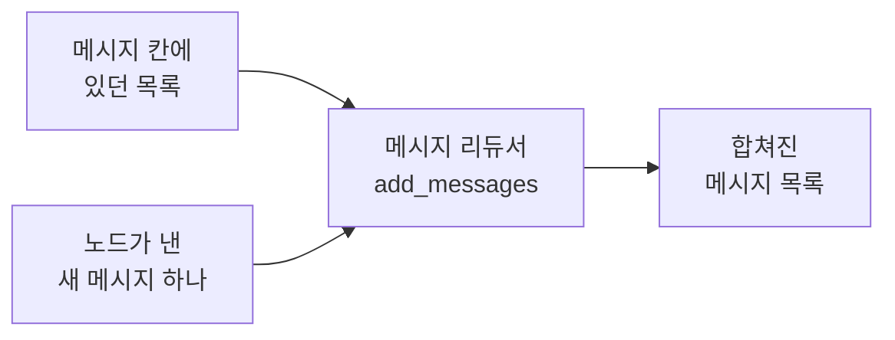
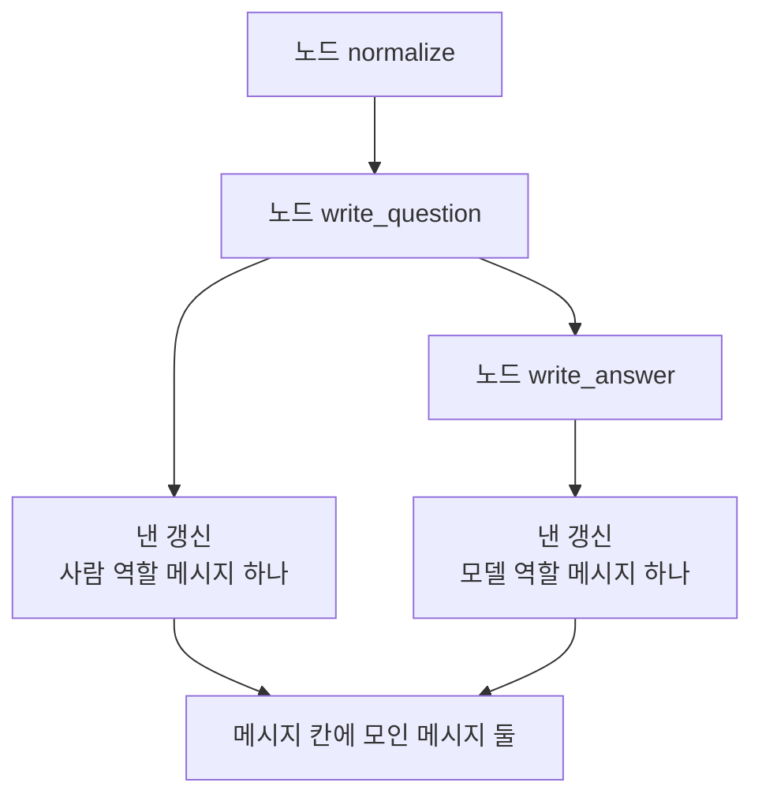
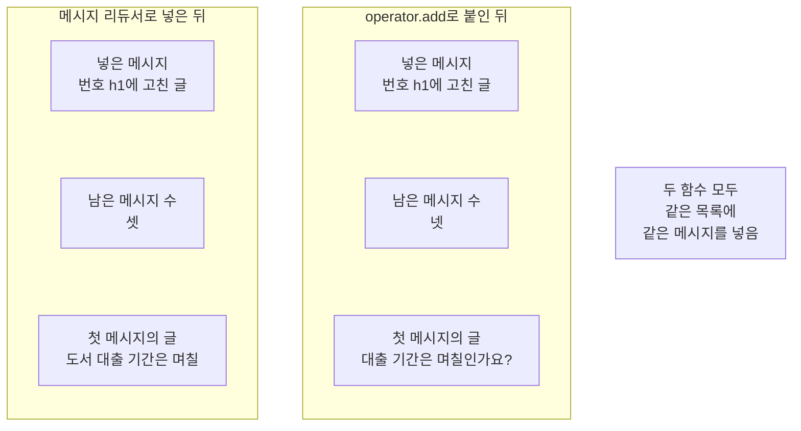
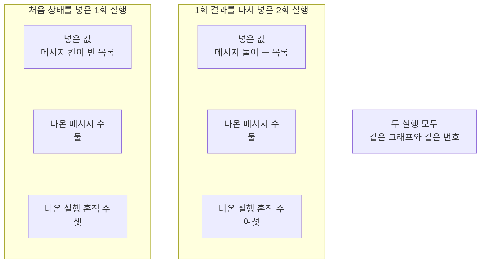

# 04-add_messages-리듀서

## _src 본문 (HTML 원본)

```html
<!--meta: 강의 1h | 실습 1h | 코드 notebooks/04-add_messages-리듀서.ipynb | 새 용어 4 -->
<h2 id="b1"><span class="no">1</span>학습 목표</h2><div class="goal"><ul><li>메시지 리듀서가 새 번호와 같은 번호를 어떻게 다르게 다루는지 설명할 수 있습니다.</li><li>메시지 칸을 둔 상태 형식을 만들고 노드가 메시지 하나만 내게 할 수 있습니다.</li><li>02절 함수 <code>operator.add</code>와 견줘 남는 메시지 수의 차이를 읽을 수 있습니다.</li></ul></div>
<h2 id="b2"><span class="no">2</span>이 내용을 배우는 이유</h2><p>01절부터 03절까지 상태 칸에 담은 값은 글과 수와 이름 목록뿐이었습니다. 대화를 이어 가려면 누가 한 말인지도 함께 남아야 합니다. 글만 이어 붙이면 말한 쪽과 번호가 사라집니다.</p><p>목록에 그냥 덧붙이면 같은 말을 고쳤을 때 두 벌이 남습니다. 라이브러리 LangGraph는 메시지 목록 칸에 쓰는 리듀서를 따로 줍니다. 이번 절의 질문은 「한 칸에 말을 쌓을 때 번호가 같은 말은 어떻게 될까요?」입니다. 같은 목록에 같은 메시지를 두 방법으로 넣어 답합니다.</p>
<h2 id="b3"><span class="no">3</span>앞에서 배운 내용</h2><p>01절에서 상태와 노드와 엣지를 코드로 적고 컴파일해 실행했습니다. 02절에서는 칸에 리듀서를 적어 갱신 여러 개를 합쳤습니다. 03절에서는 상태의 값을 읽어 다음 노드를 고르는 조건부 엣지를 만들었습니다. 첫 질문은 이 절에서도 글자까지 같게 씁니다. 노드 <code>normalize</code>는 02절 판을 실습 폴더의 도구 파일 <code>notebooks/rag_tools.py</code>에서 가져옵니다.</p><p>02절이 정한 약속 하나를 이 절도 지킵니다. 규칙을 적은 칸에는 노드가 자기 몫만 냅니다. 이 절 노드 둘도 메시지 목록 전체가 아니라 새 메시지 하나만 담아 냅니다.</p><p>메시지 객체와 역할 이름은 Ch 6 02절에서 이미 배웠습니다. 그때는 튜플 대신 메시지 객체로 질문을 보냈고 속성 <code>type</code>에 <code>human</code>이 적히는 것을 확인했습니다. 이 절은 그 메시지 객체에 번호를 하나 붙여 상태 칸에 쌓습니다. 표시 <code>Annotated</code>와 함수 <code>operator.add</code>는 02절에서, 형식 <code>TypedDict</code>와 타입힌트는 01절에서 풀었으므로 되풀이하지 않습니다.</p><p>이 절의 모델 역할 메시지는 우리가 손으로 만든 것입니다. 모델을 한 번도 부르지 않았으므로 그 글은 모델이 쓴 답이 아닙니다. Ch 9~12에서 쓴 말 「칸」을 이 절에서도 씁니다. 말 「조각」은 Ch 5의 토큰 뜻으로만 쓰고 이 절에는 나오지 않습니다.</p>
<h2 id="b4"><span class="no">4</span>핵심 개념</h2><h3>비유로 시작하기</h3><p>01절부터 쓴 칸이 셋인 나무 상자를 그대로 씁니다. 이번에는 상자의 가운데 칸에 쪽지를 세워 꽂습니다. 번호가 새로운 쪽지는 뒤에 한 장 더 꽂힙니다. 번호가 같은 쪽지는 그 자리 쪽지의 글만 바꿉니다. 같은 쪽지를 넣었는데 한 상자에는 셋, 다른 상자에는 넷이 꽂혀 있으면 넣는 규칙이 달랐던 것입니다.</p>
{{img:04-5-쪽지가-쌓인-칸-두-개|흰 바탕에 똑같이 생긴 나무 상자 두 개가 나란히 놓여 있고 상자마다 칸이 셋이며 왼쪽 상자의 가운데 칸에는 모양이 서로 다른 쪽지 세 장이 세워져 꽂혀 있고 오른쪽 상자의 가운데 칸에는 쪽지 네 장이 세워져 꽂혀 있으며 양쪽 끝 칸은 두 상자 모두 비어 있는 그림|같은 나무 상자의 가운데 칸에 쪽지가 꽂히고 넣는 규칙에 따라 꽂힌 수가 달라집니다.}}
<p class="look"><b>그림 읽기</b> — 나무 상자 두 개가 나란히 놓여 있고 상자마다 칸이 셋입니다. 두 상자 모두 가운데 칸에만 쪽지가 꽂혀 있습니다. 왼쪽 상자의 가운데 칸에는 쪽지가 셋 꽂혀 있습니다. 오른쪽 상자의 가운데 칸에는 쪽지가 넷 꽂혀 있습니다. 양쪽 끝 칸은 두 상자 모두 비어 있습니다.</p>
<table><thead><tr><th>말</th><th>뜻</th></tr></thead><tbody><tr><td>메시지 리듀서(<code>add_messages</code>)</td><td>메시지 목록 칸에 적는 리듀서입니다. 라이브러리가 함수로 줍니다.</td></tr><tr><td>메시지 번호(<code>id</code>)</td><td>메시지마다 붙는 이름표입니다. 적지 않으면 라이브러리가 자동으로 붙입니다.</td></tr><tr><td>바꿔 넣기</td><td>번호가 같은 메시지가 들어오면 그 자리 메시지의 글만 바뀌는 일입니다.</td></tr><tr><td>공통 형식(<code>AnyMessage</code>)</td><td>역할이 다른 메시지를 한 목록에 담을 때 쓰는 형식 이름입니다.</td></tr></tbody></table>
{{mermaid:04-1-메시지-리듀서가-하는-일|왼쪽부터 오른쪽으로 놓인 상자 넷으로 왼쪽 위 초록 상자 메시지 칸에 있던 목록과 왼쪽 아래 파란 상자 노드가 낸 새 메시지 하나에서 화살표가 각각 가운데 회색 상자 메시지 리듀서 add_messages로 모이고 거기서 화살표 하나가 오른쪽 초록 상자 합쳐진 메시지 목록으로 가는 그림|칸에 있던 목록과 노드가 낸 메시지 하나가 메시지 리듀서를 지나 한 목록이 됩니다.}}
<p class="look"><b>도식 읽기</b> — 왼쪽부터 오른쪽으로 읽습니다. 왼쪽 위 초록 상자가 메시지 칸에 이미 있던 목록입니다. 왼쪽 아래 파란 상자가 노드 하나가 낸 새 메시지입니다. 가운데 회색 상자가 라이브러리가 주는 메시지 리듀서입니다. 오른쪽 초록 상자가 리듀서를 지난 뒤 칸에 남는 목록입니다.</p>
<h3>리듀서가 보는 것은 번호</h3><p>02절 리듀서는 목록 두 개를 그냥 이어 붙였습니다. 메시지 리듀서는 먼저 새 메시지의 번호를 봅니다. 목록에 없던 번호면 뒤에 한 개 더 붙입니다. 이미 있는 번호면 그 자리 메시지를 새 메시지로 바꿉니다. 그래서 같은 메시지를 넣어도 남는 개수가 달라집니다.</p>
<h3>노드는 메시지 하나만 냅니다</h3><p>이 절 노드 둘은 메시지 목록 전체를 담아 내지 않습니다. 새로 만든 메시지 하나만 담아 냅니다. 목록을 합치는 일은 칸에 적은 리듀서가 합니다. 02절에서 실행 흔적 칸에 자기 이름만 냈던 것과 같은 모양입니다.</p>
<h3>손으로 만든 모델 역할 메시지</h3><p>이 절은 모델을 한 번도 부르지 않습니다. 모델 역할 메시지도 우리가 글을 적어 손으로 만듭니다. 그래서 그 글은 모델이 쓴 답이 아니라 자리를 채우려고 적은 예입니다. 상태에 쌓는 규칙만 보려고 이렇게 했습니다. 이 챕터에서 모델을 부르는 절은 07절과 08절입니다.</p>
<h2 id="b5"><span class="no">5</span>실행 예제</h2><p>이 절은 모델을 한 번도 부르지 않습니다. 읽어 오는 자료 파일도 없고 새로 쓰는 파일도 없습니다. 노드는 셋이고 엣지는 고정 엣지 넷입니다. 갈래가 없어 03절과 달리 조건부 엣지는 쓰지 않습니다.</p><p>먼저 메시지 객체를 손으로 만들고 리듀서를 그래프 없이 직접 불러 봅니다. 그다음 02절 함수 <code>operator.add</code>로 똑같은 일을 해 견줍니다. 마지막으로 메시지 칸을 둔 그래프를 실행하고 그 결과를 다시 넣어 한 번 더 실행합니다.</p>
{{mermaid:04-2-메시지-칸에-모이는-메시지|위에서 아래로 놓인 상자 여섯으로 맨 위 파란 상자 노드 normalize에서 화살표가 파란 상자 노드 write_question으로 이어지고 거기서 화살표 두 개가 갈라져 왼쪽 아래 파란 상자 낸 갱신 사람 역할 메시지 하나와 오른쪽 아래 파란 상자 노드 write_answer로 가며 그 노드에서 다시 파란 상자 낸 갱신 모델 역할 메시지 하나로 이어지고 두 갱신 상자에서 화살표가 맨 아래 초록 상자 메시지 칸에 모인 메시지 둘로 모이는 그림|노드 두 개가 메시지를 하나씩만 내고 그 둘이 메시지 칸 하나에 모입니다.}}
<p class="look"><b>도식 읽기</b> — 위에서 아래로 읽습니다. 맨 위 파란 상자가 01절부터 쓴 노드입니다. 그 아래 파란 상자 둘이 이 절에서 새로 만든 노드입니다. 노드마다 낸 갱신이 파란 상자로 하나씩 붙어 있습니다. 맨 아래 초록 상자가 두 갱신이 모인 메시지 칸입니다.</p>
{{notebook:04-add_messages-리듀서}}
{{mermaid:04-3-같은-번호를-넣은-두-함수|왼쪽부터 오른쪽으로 놓인 칸 두 개와 회색 상자 하나로 왼쪽 칸 제목은 메시지 리듀서로 넣은 뒤이고 그 안에 초록 상자 넣은 메시지 번호 h1에 고친 글과 노란 상자 남은 메시지 수 셋과 노란 상자 첫 메시지의 글 도서 대출 기간은 며칠이 있으며 가운데 칸 제목은 operator.add로 붙인 뒤이고 그 안에 초록 상자 넣은 메시지 번호 h1에 고친 글과 노란 상자 남은 메시지 수 넷과 노란 상자 첫 메시지의 글 대출 기간은 며칠인가요?가 있고 오른쪽에 회색 상자 두 함수 모두 같은 목록에 같은 메시지를 넣음이 놓인 그림|같은 목록에 같은 메시지를 넣어도 리듀서를 바꾸면 남는 메시지 수와 첫 글이 달라집니다.}}
<p class="look"><b>도식 읽기</b> — 왼쪽 칸이 메시지 리듀서로 넣은 결과입니다. 가운데 칸이 같은 목록에 같은 메시지를 <code>operator.add</code>로 넣은 결과입니다. 칸마다 맨 위 초록 상자가 넣은 메시지이고 그 아래 노란 상자 두 개가 나온 값입니다. 남은 메시지 수는 셋과 넷으로 갈렸고 첫 메시지의 글도 함께 달라졌습니다. 오른쪽 회색 상자는 두 칸에 모두 해당하는 사실입니다.</p>
<p class="look"><b>확인할 점</b> — 번호 <code>h1</code>인 메시지를 다시 넣었을 때 메시지 리듀서 쪽 출력은 <code>메시지 수: 3</code>이었습니다. 같은 목록에 <code>operator.add</code>를 쓴 쪽은 <code>메시지 수: 4</code>였습니다. 리듀서 쪽 첫 메시지의 글은 <code>도서 대출 기간은 며칠</code>로 바뀌었고 이어 붙인 쪽은 <code>대출 기간은 며칠인가요?</code> 그대로였습니다. 그래프를 실행한 뒤 메시지 칸에는 <code>human | h1 |</code>로 시작하는 줄과 <code>ai | a1 |</code>로 시작하는 줄이 하나씩 남았습니다.</p>
<h2 id="b6"><span class="no">6</span>실험 결과 해석</h2><p>같은 목록에 같은 메시지를 넣었는데 남는 값이 달라졌습니다. 메시지 리듀서는 번호를 보고 같은 자리 메시지의 글을 바꿨습니다. 02절 함수 <code>operator.add</code>는 번호를 보지 않고 뒤에 붙였습니다. 칸에 어느 리듀서를 적었는지가 이 차이를 만듭니다.</p>
{{mermaid:04-4-결과를-다시-넣은-실행|왼쪽부터 오른쪽으로 놓인 칸 두 개와 회색 상자 하나로 왼쪽 칸 제목은 처음 상태를 넣은 1회 실행이고 그 안에 초록 상자 넣은 값 메시지 칸이 빈 목록과 노란 상자 나온 메시지 수 둘과 노란 상자 나온 실행 흔적 수 셋이 있으며 가운데 칸 제목은 1회 결과를 다시 넣은 2회 실행이고 그 안에 초록 상자 넣은 값 메시지 둘이 든 목록과 노란 상자 나온 메시지 수 둘과 노란 상자 나온 실행 흔적 수 여섯이 있고 오른쪽에 회색 상자 두 실행 모두 같은 그래프와 같은 번호가 놓인 그림|같은 그래프를 두 번 지나도 메시지 수는 둘 그대로이고 실행 흔적만 늘어납니다.}}
<p class="look"><b>도식 읽기</b> — 왼쪽 칸이 처음 상태를 넣은 1회 실행입니다. 가운데 칸이 그 결과를 그대로 다시 넣은 2회 실행입니다. 칸마다 맨 위 초록 상자가 넣은 값이고 그 아래 노란 상자 두 개가 나온 값입니다. 두 칸의 메시지 수는 둘로 같고 실행 흔적 수만 셋과 여섯으로 갈렸습니다. 오른쪽 회색 상자는 두 칸에 모두 해당하는 사실입니다.</p>
<p>1회 실행 결과를 그대로 다시 넣어 같은 그래프를 한 번 더 실행했습니다. 메시지 칸의 메시지 수는 둘 그대로였고 실행 흔적 칸의 길이는 <code>6</code>이 됐습니다. 한 상태 안에서 칸마다 적은 리듀서가 달라 남는 모양도 달라졌습니다. 메시지 칸은 번호를 보고 자리에서 바꿨고 실행 흔적 칸은 이름을 그대로 이어 붙였습니다.</p><p>번호를 적지 않은 메시지도 한 번 더해 봤습니다. 그 메시지에는 글자 수 <code>36</code>짜리 번호가 자동으로 붙었고 목록 뒤에 그대로 붙었습니다. 그 번호는 실행할 때마다 달라지므로 값 자체는 본문에 인용하지 않습니다.</p><p>여기서 확인한 것은 메시지가 둘에서 넷인 짧은 목록입니다. 메시지가 아주 많은 목록은 이번에 만들지 않았습니다. 여러 노드가 같은 칸에 한꺼번에 메시지를 내는 경우도 이번에 실행하지 않았습니다. 걸린 시간도 이번에 재지 않았습니다.</p>
<h2 id="b7"><span class="no">7</span>주의할 점과 실무 메모</h2><ul><li>메시지 리듀서는 번호가 같은 메시지를 그 자리에서 바꿉니다. 목록 뒤에 붙이지 않습니다.</li><li>번호를 적지 않으면 라이브러리가 글자 수 36짜리 번호를 붙입니다. 그러면 바꿔 넣기가 일어나지 않습니다.</li><li>노드는 메시지 목록 전체가 아니라 새 메시지 하나만 담아 냅니다. 합치는 일은 칸에 적은 리듀서가 합니다.</li><li>02절 함수 <code>operator.add</code>는 번호를 보지 않습니다. 메시지 목록 칸에 적으면 같은 번호가 두 번 남습니다.</li><li>이 절의 모델 역할 메시지는 우리가 손으로 만든 것입니다. 모델이 쓴 답이 아닙니다.</li><li>이 절은 모델을 한 번도 부르지 않았습니다. 요청 수도 비용도 0입니다.</li><li>한 상태에 칸마다 다른 리듀서를 적을 수 있습니다. 이 절은 메시지 칸과 실행 흔적 칸에 다른 규칙을 적었습니다.</li><li>속성 <code>text</code>는 메시지 안의 글만 꺼냅니다. 역할 이름은 속성 <code>type</code>에 있습니다.</li><li>자동으로 붙는 번호는 실행마다 달라집니다. 본문과 그림에 그 값을 인용하지 않았습니다.</li><li>여러 노드가 같은 칸에 한꺼번에 메시지를 내는 경우는 이번에 실행하지 않았습니다.</li><li>이 절은 걸린 시간을 재지 않았습니다. 리듀서를 바꿔서 빨라졌는지 느려졌는지 적지 않습니다.</li><li>준비물에 LangGraph 1.2.11과 LangChain 1.4.0을 적었습니다. 다른 판과 Windows·macOS에서는 이번에 실행하지 않았습니다.</li><li>이 절은 파일을 쓰지 않습니다. Ch 12가 남긴 기록 파일도 읽지 않습니다.</li></ul>
<h2 id="b8"><span class="no">8</span>정리와 다음 절</h2><ul><li>메시지 칸에 메시지 리듀서를 적으니 노드가 낸 메시지 하나가 목록 뒤에 붙었습니다.</li><li>번호가 같은 메시지는 자리에서 글만 바뀌었고 <code>operator.add</code>는 번호를 보지 않아 개수가 늘었습니다.</li><li>1회 결과를 다시 넣어 실행해도 메시지 수는 둘 그대로였고 실행 흔적만 여섯으로 늘었습니다.</li></ul><p><strong>다음 학습과 이어지는 지점</strong> — 05절에서는 입력 수만큼 같은 노드를 여러 번 실행하는 <code>Send</code>를 씁니다. 이 절까지 그래프는 노드를 한 번씩만 지났습니다.</p>
<h2 id="b9"><span class="no">9</span>복습 문제</h2><details class="quiz" open><summary>문제 4개 · 해설 포함</summary><p class="quiz-q">1. 메시지 리듀서는 번호가 같은 메시지를 어떻게 다룹니까?</p><p class="quiz-a">그 자리 메시지의 글을 바꿉니다. 목록 뒤에 붙이지 않습니다. 틀렸다면 「핵심 개념」의 용어 표를 다시 읽습니다.</p><p class="quiz-q">2. 노드는 메시지 칸에 무엇을 담아 냅니까?</p><p class="quiz-a">목록 전체가 아니라 새 메시지 하나만 담아 냅니다. 틀렸다면 「노드는 메시지 하나만 냅니다」를 다시 읽습니다.</p><p class="quiz-q">3. 같은 목록에 같은 메시지를 넣었을 때 두 함수의 결과는 어떻게 달랐습니까?</p><p class="quiz-a">메시지 리듀서 쪽은 셋이 남았고 <code>operator.add</code> 쪽은 넷이 남았습니다. 틀렸다면 「실험 결과 해석」을 다시 읽습니다.</p><p class="quiz-q">4. 이 절의 모델 역할 메시지는 모델이 쓴 답입니까?</p><p class="quiz-a">아닙니다. 모델을 한 번도 부르지 않고 손으로 만든 메시지입니다. 틀렸다면 「손으로 만든 모델 역할 메시지」를 다시 읽습니다.</p></details>
<h2 id="b10"><span class="no">10</span>참고 자료</h2><ul><li><div><a href="https://reference.langchain.com/python/langgraph/graph/message/add_messages">add_messages API</a></div>메시지 목록 칸에 쓰는 리듀서 설명 · 1.2.11 · 확인 2026-09-10</li><li><div><a href="https://docs.langchain.com/oss/python/langgraph/graph-api">LangGraph Graph API 안내</a></div>상태 칸과 리듀서를 적는 방법 설명 · 1.2.11 · 확인 2026-09-10</li><li><div><a href="https://docs.langchain.com/oss/python/langchain/messages">LangChain 메시지 안내</a></div>메시지 객체와 역할 이름 설명 · 1.4.0 · 확인 2026-09-10</li></ul>
```

## 노트북 셀 (순서대로)

### [0] markdown {'html': 'skip'}

# add_messages 리듀서

**이 노트북에서 할 일**

1. 사람 역할 메시지와 모델 역할 메시지를 손으로 하나씩 만들어 봅니다.
2. 메시지 리듀서를 그래프 없이 불러 새 번호와 같은 번호를 견줍니다.
3. 02절 함수 `operator.add`로 똑같은 일을 해 보고 남는 메시지 수를 견줍니다.
4. 메시지 칸을 둔 그래프를 실행하고 그 결과를 다시 넣어 한 번 더 실행합니다.

**준비물** — 이 절은 OpenAI API 키를 쓰지 않습니다.
모델 요청이 0번이라 드는 비용이 없습니다.
이 절의 모델 역할 메시지는 우리가 손으로 만든 것이고 모델이 쓴 답이 아닙니다.
읽어 오는 자료 파일도 없고 새로 쓰는 파일도 없습니다.
실행 시간은 1분 안팎이고 첫 셀의 설치가 가장 오래 걸립니다.

**기준 버전** — 첫 셀에서 LangGraph 1.2.11과 LangChain 1.4.0을 설치합니다.
도구 파일이 쓰는 numpy 2.5.3도 함께 설치합니다.
메시지 클래스가 LangChain 쪽에 있어 03절보다 패키지가 하나 늘었습니다.
교재 출력은 Linux의 Python 3.12.13으로 만들었습니다.
다른 판과 Windows·macOS에서는 이번에 실행하지 않았습니다.

**강의와 실습 범위** — 강의 시간에는 3~7절을 읽습니다.
메시지를 손으로 만들고 리듀서를 그래프 없이 불러 본 뒤 그래프에 붙이는 자리입니다.
8절과 9절은 값을 하나씩 바꿔 보는 자리입니다.
10절은 여섯 목록을 기록 한 줄씩으로 만들어 표로 견주는 자리입니다.
준비부터 끝까지 함께 실행하고 실습 시간에 다시 읽습니다.

실습 폴더 `labs/part4/ch13-langgraph-basics`에서 `uv sync --locked`를 실행합니다.
그다음 이 폴더의 `.venv` 커널을 고르고 첫 셀부터 순서대로 실행합니다.

### [1] markdown {'html': 'skip'}

## 오늘 볼 그림


왼쪽 위 초록 상자가 메시지 칸에 이미 있던 목록입니다.
왼쪽 아래 파란 상자가 노드 하나가 낸 새 메시지입니다.
가운데 회색 상자가 라이브러리가 주는 메시지 리듀서입니다.
오른쪽 초록 상자가 리듀서를 지난 뒤 칸에 남는 목록입니다.

### [2] markdown {}

## 1. 준비

첫 셀은 패키지 세 개를 설치하고 설치된 판 번호를 출력합니다.
설치에는 몇십 초가 걸릴 수 있습니다.

### [3] code {'execution': {'iopub.execute_input': '2026-09-21T10:40:19.658279Z', 'iopub.status.busy': '2026-09-21T10:40:19.658121Z', 'iopub.status.idle': '2026-09-21T10:40:20.105949Z', 'shell.execute_reply': '2026-09-21T10:40:20.105299Z'}, 'lesson_role': 'setup'}

```python
# 이 절에서 쓰는 패키지를 설치하고 버전을 확인합니다
%pip install -q "langgraph==1.2.11" "langchain==1.4.0" "numpy==2.5.3"
from importlib.metadata import version

print("langgraph:", version("langgraph"))
print("langchain:", version("langchain"))
print("numpy:", version("numpy"))
```

출력:
```
Note: you may need to restart the kernel to use updated packages.
langgraph: 1.2.11
langchain: 1.4.0
numpy: 2.5.3

```

### [4] markdown {}

**결과 읽기** — 설치가 끝나면 `langgraph: 1.2.11`과 `langchain: 1.4.0`과 `numpy: 2.5.3`이 보입니다.
패키지 `numpy`는 이 절이 직접 쓰지 않지만 도구 파일을 불러올 때 필요합니다.
이 노트북의 출력은 2026-09-21에 이 판으로 실행한 결과입니다.

다음 셀은 이름 아홉 개를 불러옵니다.
앞의 다섯은 02절에서 불러온 것과 같습니다.
뒤의 넷이 이 절에서 처음 쓰는 메시지 이름입니다.

앞에서 배운 함수는 `rag_tools.py`에 모아 두었습니다. 파일을 열면 코드를 볼 수 있습니다. 노트북과 같은 폴더(`notebooks/`)에 있는 파일입니다.

이 노트북은 02절 노드 `normalize`를 가져옵니다.

### [5] code {'execution': {'iopub.execute_input': '2026-09-21T10:40:20.107189Z', 'iopub.status.busy': '2026-09-21T10:40:20.107087Z', 'iopub.status.idle': '2026-09-21T10:40:20.647004Z', 'shell.execute_reply': '2026-09-21T10:40:20.646809Z'}, 'lesson_role': 'setup'}

```python
# 02절 이름 다섯 개에 메시지 이름 넷을 더해 불러옵니다
import operator
from typing import Annotated
from typing_extensions import TypedDict
from langchain.messages import AnyMessage, HumanMessage, AIMessage
from langgraph.graph import StateGraph, START, END
from langgraph.graph.message import add_messages
# 02절에서 만든 노드 하나를 도구 파일에서 가져옵니다
from rag_tools import normalize

print("메시지 이름 넷:", "AnyMessage", "HumanMessage", "AIMessage", "add_messages")
```

출력:
```
메시지 이름 넷: AnyMessage HumanMessage AIMessage add_messages

```

### [6] markdown {}

**결과 읽기** — 출력 줄 `메시지 이름 넷: AnyMessage HumanMessage AIMessage add_messages`가 보입니다.
앞의 셋은 메시지 클래스이고 Ch 6 02절에서 이미 만들어 본 이름입니다.
마지막 `add_messages`가 이 절에서 처음 쓰는 리듀서입니다.
도구 파일에서 가져온 노드 `normalize`는 출력하지 않습니다.

## 2. 이 절에서 쓸 값 정하기

01절부터 쓴 첫 질문을 글자까지 같게 씁니다.
메시지마다 붙일 번호 두 개와 모델 역할 자리에 적어 둘 글도 함께 정합니다.

### [7] code {'execution': {'iopub.execute_input': '2026-09-21T10:40:20.649529Z', 'iopub.status.busy': '2026-09-21T10:40:20.649397Z', 'iopub.status.idle': '2026-09-21T10:40:20.651268Z', 'shell.execute_reply': '2026-09-21T10:40:20.651109Z'}}

```python
# 01절 질문과 이 절 메시지에 붙일 번호 두 개와 적어 둘 글을 정합니다
first_question = "  대출 기간은 며칠인가요?  "
question_id = "h1"
answer_id = "a1"
answer_text = "찾은 자료로 답을 만듭니다"
print("첫 질문:", first_question)
print("첫 질문의 글자 수:", len(first_question))
print("사람 역할 메시지의 번호:", question_id)
print("모델 역할 메시지의 번호:", answer_id)
print("모델 역할 자리에 적어 둘 글:", answer_text)
```

출력:
```
첫 질문:   대출 기간은 며칠인가요?  
첫 질문의 글자 수: 17
사람 역할 메시지의 번호: h1
모델 역할 메시지의 번호: a1
모델 역할 자리에 적어 둘 글: 찾은 자료로 답을 만듭니다

```

### [8] markdown {}

**결과 읽기** — 출력 줄 `첫 질문의 글자 수: 17`은 01절부터 이어지는 같은 값입니다.
출력 줄 `사람 역할 메시지의 번호: h1`과 `모델 역할 메시지의 번호: a1`이 이 절에서 쓸 번호입니다.
번호는 라이브러리가 정해 준 값이 아니라 우리가 지은 이름표입니다.
출력 줄의 글 `찾은 자료로 답을 만듭니다`는 03절 답 칸에 적었던 글과 같습니다.

## 3. 메시지 객체 만들기

메시지 객체는 역할을 클래스 이름으로 드러낸 메시지입니다.
Ch 6 02절에서 튜플 대신 메시지 객체로 질문을 보내 본 적이 있습니다.
여기서는 그때와 같은 클래스에 번호를 하나 더 붙입니다.

### [9] code {'execution': {'iopub.execute_input': '2026-09-21T10:40:20.653884Z', 'iopub.status.busy': '2026-09-21T10:40:20.653804Z', 'iopub.status.idle': '2026-09-21T10:40:20.655958Z', 'shell.execute_reply': '2026-09-21T10:40:20.655825Z'}}

```python
# 앞뒤 빈칸을 없앤 질문으로 사람 역할 메시지 하나를 만듭니다
clean_question = first_question.strip()
question_message = HumanMessage(content=clean_question, id=question_id)
print("역할 이름:", question_message.type)
print("메시지 번호:", question_message.id)
print("메시지의 글:", question_message.text)
```

출력:
```
역할 이름: human
메시지 번호: h1
메시지의 글: 대출 기간은 며칠인가요?

```

### [10] markdown {}

**결과 읽기** — 출력 줄 `역할 이름: human`이 이 메시지의 역할입니다.
출력 줄 `메시지 번호: h1`이 우리가 붙인 번호입니다.
출력 줄 `메시지의 글: 대출 기간은 며칠인가요?`에는 앞뒤 빈칸이 없습니다.
속성 `text`는 메시지 안의 글만 꺼내 줍니다.

다음 셀은 모델 역할 메시지를 손으로 만듭니다.
모델을 부르지 않으므로 이 메시지의 글은 모델이 쓴 답이 아닙니다.

### [11] code {'execution': {'iopub.execute_input': '2026-09-21T10:40:20.656356Z', 'iopub.status.busy': '2026-09-21T10:40:20.656289Z', 'iopub.status.idle': '2026-09-21T10:40:20.657933Z', 'shell.execute_reply': '2026-09-21T10:40:20.657763Z'}}

```python
# 모델을 부르지 않고 모델 역할 메시지 하나를 손으로 만듭니다
answer_message = AIMessage(content=answer_text, id=answer_id)
print("역할 이름:", answer_message.type)
print("메시지 번호:", answer_message.id)
print("메시지의 글:", answer_message.text)
```

출력:
```
역할 이름: ai
메시지 번호: a1
메시지의 글: 찾은 자료로 답을 만듭니다

```

### [12] markdown {}

**결과 읽기** — 출력 줄 `역할 이름: ai`가 앞 메시지와 다른 자리입니다.
출력 줄 `메시지 번호: a1`이 이 메시지의 번호입니다.
출력 줄 `메시지의 글: 찾은 자료로 답을 만듭니다`는 우리가 적어 둔 글입니다.
모델이 만든 문장이 아니라 자리를 채우려고 적은 글입니다.

다음 셀은 메시지 목록을 한 줄씩 출력하는 함수입니다.
01절부터 쓴 `print_state`처럼 라벨 줄을 따로 두고 그 아래에 한 줄씩 적습니다.

### [13] code {'execution': {'iopub.execute_input': '2026-09-21T10:40:20.658328Z', 'iopub.status.busy': '2026-09-21T10:40:20.658239Z', 'iopub.status.idle': '2026-09-21T10:40:20.659770Z', 'shell.execute_reply': '2026-09-21T10:40:20.659604Z'}}

```python
# 메시지 목록을 라벨 줄 아래에 한 줄씩 출력합니다
def print_messages(label, messages):
    print(label)
    for message in messages:
        print(message.type, "|", message.id, "|", message.text)
```

출력:
```

```

### [14] markdown {}

**결과 읽기** — 정의 셀이라 출력이 없습니다.
한 줄에 역할 이름과 번호와 글을 막대 기호로 나눠 적습니다.
메시지가 여러 개면 줄도 여러 개가 나옵니다.

다음 셀은 앞에서 만든 메시지 두 개를 한 목록에 담습니다.

### [15] code {'execution': {'iopub.execute_input': '2026-09-21T10:40:20.660102Z', 'iopub.status.busy': '2026-09-21T10:40:20.660063Z', 'iopub.status.idle': '2026-09-21T10:40:20.661639Z', 'shell.execute_reply': '2026-09-21T10:40:20.661463Z'}}

```python
# 앞에서 만든 메시지 두 개를 한 목록에 담아 출력합니다
first_list = [question_message, answer_message]
print_messages("손으로 담은 메시지 목록", first_list)
print("메시지 수:", len(first_list))
```

출력:
```
손으로 담은 메시지 목록
human | h1 | 대출 기간은 며칠인가요?
ai | a1 | 찾은 자료로 답을 만듭니다
메시지 수: 2

```

### [16] markdown {}

**결과 읽기** — 라벨 줄 `손으로 담은 메시지 목록` 아래 두 줄이 나옵니다.
첫 줄은 `human | h1 |`로 시작하고 둘째 줄은 `ai | a1 |`로 시작합니다.
출력 줄 `메시지 수: 2`가 담은 개수입니다.
여기까지는 리듀서를 한 번도 부르지 않고 목록에 손으로 담기만 했습니다.

## 4. 메시지 리듀서를 그래프 없이 불러 보기

메시지 리듀서 `add_messages`는 목록 두 개를 받아 하나로 합치는 함수입니다.
02절 `operator.add`와 자리는 같지만 합치는 방법이 다릅니다.
먼저 그래프 없이 직접 불러 봅니다.
바뀌는 값은 넣는 메시지의 번호 하나뿐입니다.

### [17] code {'execution': {'iopub.execute_input': '2026-09-21T10:40:20.662028Z', 'iopub.status.busy': '2026-09-21T10:40:20.661949Z', 'iopub.status.idle': '2026-09-21T10:40:20.665935Z', 'shell.execute_reply': '2026-09-21T10:40:20.665819Z'}}

```python
# 번호가 새로운 메시지 하나를 메시지 리듀서로 더해 봅니다
more_message = HumanMessage(content="반납은 어디서 하나요", id="h2")
added = add_messages(first_list, [more_message])
print_messages("새 번호를 더한 뒤", added)
print("메시지 수:", len(added))
```

출력:
```
새 번호를 더한 뒤
human | h1 | 대출 기간은 며칠인가요?
ai | a1 | 찾은 자료로 답을 만듭니다
human | h2 | 반납은 어디서 하나요
메시지 수: 3

```

### [18] markdown {}

**결과 읽기** — 라벨 줄 `새 번호를 더한 뒤` 아래 세 줄이 나옵니다.
셋째 줄이 `human | h2 |`로 시작하는 새 메시지입니다.
출력 줄 `메시지 수: 3`으로 하나 늘었습니다.
번호가 목록에 없던 값이라 뒤에 붙었습니다.

다음 셀은 이미 목록에 있는 번호 `h1`을 다시 넣습니다.
실행 전에 예상해 봅니다. 번호가 같으니 개수는 셋 그대로일 것입니다.

### [19] code {'execution': {'iopub.execute_input': '2026-09-21T10:40:20.666323Z', 'iopub.status.busy': '2026-09-21T10:40:20.666284Z', 'iopub.status.idle': '2026-09-21T10:40:20.667917Z', 'shell.execute_reply': '2026-09-21T10:40:20.667767Z'}}

```python
# 번호가 같은 메시지를 넣어 같은 목록에 다시 더해 봅니다
fixed_question = HumanMessage(content="도서 대출 기간은 며칠", id=question_id)
replaced = add_messages(added, [fixed_question])
print_messages("같은 번호를 넣은 뒤", replaced)
print("메시지 수:", len(replaced))
```

출력:
```
같은 번호를 넣은 뒤
human | h1 | 도서 대출 기간은 며칠
ai | a1 | 찾은 자료로 답을 만듭니다
human | h2 | 반납은 어디서 하나요
메시지 수: 3

```

### [20] markdown {}

**결과 읽기** — 라벨 줄 `같은 번호를 넣은 뒤` 아래 세 줄이 나옵니다.
첫 줄의 글이 `도서 대출 기간은 며칠`로 바뀌었습니다.
출력 줄 `메시지 수: 3`은 앞 셀과 같습니다.
새 메시지가 뒤에 붙지 않고 첫 자리 메시지의 글만 바뀌었습니다.
이렇게 같은 자리에서 글이 바뀌는 일을 이 절에서는 바꿔 넣기라고 부릅니다.

## 5. 02절 함수와 견주기

같은 목록에 같은 메시지를 02절 함수 `operator.add`로 넣어 봅니다.
실행 전에 예상해 봅니다. 번호를 보지 않으므로 뒤에 그냥 붙을 것입니다.

### [21] code {'execution': {'iopub.execute_input': '2026-09-21T10:40:20.668224Z', 'iopub.status.busy': '2026-09-21T10:40:20.668187Z', 'iopub.status.idle': '2026-09-21T10:40:20.669716Z', 'shell.execute_reply': '2026-09-21T10:40:20.669601Z'}}

```python
# 02절에서 쓴 operator.add로 똑같은 일을 해 봅니다
plain = operator.add(added, [fixed_question])
print_messages("operator.add로 이어 붙인 뒤", plain)
print("메시지 수:", len(plain))
```

출력:
```
operator.add로 이어 붙인 뒤
human | h1 | 대출 기간은 며칠인가요?
ai | a1 | 찾은 자료로 답을 만듭니다
human | h2 | 반납은 어디서 하나요
human | h1 | 도서 대출 기간은 며칠
메시지 수: 4

```

### [22] markdown {}

**결과 읽기** — 라벨 줄 `operator.add로 이어 붙인 뒤` 아래 네 줄이 나옵니다.
첫 줄과 넷째 줄의 번호가 모두 `h1`입니다.
출력 줄 `메시지 수: 4`로 하나 늘었습니다.
첫 줄의 글은 바뀌지 않고 그대로입니다.

다음 셀은 두 함수가 만든 목록을 나란히 견줍니다.

### [23] code {'execution': {'iopub.execute_input': '2026-09-21T10:40:20.670051Z', 'iopub.status.busy': '2026-09-21T10:40:20.670014Z', 'iopub.status.idle': '2026-09-21T10:40:20.671825Z', 'shell.execute_reply': '2026-09-21T10:40:20.671665Z'}}

```python
# 두 함수가 만든 목록을 견줍니다
print("메시지 리듀서가 만든 수:", len(replaced))
print("operator.add가 만든 수:", len(plain))
print("첫 메시지의 글이 같은가:", replaced[0].text == plain[0].text)
print("리듀서 판 첫 메시지의 글:", replaced[0].text)
print("이어 붙인 판 첫 메시지의 글:", plain[0].text)
assert len(replaced) == 3
assert len(plain) == 4
```

출력:
```
메시지 리듀서가 만든 수: 3
operator.add가 만든 수: 4
첫 메시지의 글이 같은가: False
리듀서 판 첫 메시지의 글: 도서 대출 기간은 며칠
이어 붙인 판 첫 메시지의 글: 대출 기간은 며칠인가요?

```

### [24] markdown {}

**결과 읽기** — 출력 줄 `메시지 리듀서가 만든 수: 3`과 `operator.add가 만든 수: 4`가 갈린 자리입니다.
출력 줄 `첫 메시지의 글이 같은가: False`도 함께 갈렸습니다.
리듀서 판 첫 메시지의 글은 `도서 대출 기간은 며칠`이고 이어 붙인 판은 `대출 기간은 며칠인가요?`입니다.
같은 목록에 같은 메시지를 넣었는데 남는 값이 달라졌습니다.
칸에 어느 리듀서를 적었는지가 이 차이를 만듭니다.

## 6. 상태 형식과 노드

이제 메시지 칸을 둔 상태 형식을 만듭니다.
칸은 질문 칸과 메시지 칸과 실행 흔적 칸 셋입니다.
메시지 칸에는 메시지 리듀서를 적고 실행 흔적 칸에는 02절 규칙을 그대로 적습니다.

### [25] code {'execution': {'iopub.execute_input': '2026-09-21T10:40:20.672173Z', 'iopub.status.busy': '2026-09-21T10:40:20.672096Z', 'iopub.status.idle': '2026-09-21T10:40:20.673659Z', 'shell.execute_reply': '2026-09-21T10:40:20.673497Z'}}

```python
# 메시지 칸에 메시지 리듀서를 적은 상태 형식을 만듭니다
class ChatState(TypedDict):
    question: str
    messages: Annotated[list[AnyMessage], add_messages]
    trace: Annotated[list[str], operator.add]
```

출력:
```

```

### [26] markdown {}

**결과 읽기** — 정의 셀이라 출력이 없습니다.
형식 이름 `AnyMessage`는 역할이 다른 메시지를 한 목록에 담을 때 쓰는 공통 형식입니다.
표시 `Annotated`의 둘째 자리에 적은 함수가 그 칸의 규칙입니다.
메시지 칸과 실행 흔적 칸에 서로 다른 규칙을 적었습니다.

다음 셀은 01절부터 쓴 출력 함수를 이 절 칸에 맞춘 판입니다.

### [27] code {'execution': {'iopub.execute_input': '2026-09-21T10:40:20.674003Z', 'iopub.status.busy': '2026-09-21T10:40:20.673965Z', 'iopub.status.idle': '2026-09-21T10:40:20.675392Z', 'shell.execute_reply': '2026-09-21T10:40:20.675243Z'}}

```python
# 상태의 칸 세 개를 라벨 줄 아래에 한 줄씩 출력합니다
def print_state(label, state):
    print(label)
    print("질문 칸 |", state["question"])
    print("메시지 칸의 메시지 수 |", len(state["messages"]))
    print("실행 흔적 칸 |", state["trace"])
```

출력:
```

```

### [28] markdown {}

**결과 읽기** — 정의 셀이라 출력이 없습니다.
메시지 칸은 줄이 여러 개라 여기서는 개수만 적고 내용은 `print_messages`로 따로 봅니다.
03절 판과 견주면 점수 칸과 답 칸 줄이 빠지고 메시지 칸 줄이 들어왔습니다.

첫 노드 `normalize`는 준비 셀에서 도구 파일로부터 가져왔습니다.
02절에서 만든 노드로 질문 칸의 앞뒤 빈칸을 없앱니다.
이 노드는 메시지 칸을 건드리지 않습니다.

다음 셀은 질문 칸의 글로 사람 역할 메시지를 만드는 노드입니다.

### [29] code {'execution': {'iopub.execute_input': '2026-09-21T10:40:20.675729Z', 'iopub.status.busy': '2026-09-21T10:40:20.675667Z', 'iopub.status.idle': '2026-09-21T10:40:20.676897Z', 'shell.execute_reply': '2026-09-21T10:40:20.676749Z'}}

```python
# 질문 칸의 글로 사람 역할 메시지 하나만 담아 냅니다
def write_question(state):
    message = HumanMessage(content=state["question"], id=question_id)
    return {"messages": [message], "trace": ["write_question"]}
```

출력:
```

```

### [30] markdown {}

**결과 읽기** — 정의 셀이라 출력이 없습니다.
이 노드는 메시지 목록 전체가 아니라 새 메시지 하나만 담아 냅니다.
목록을 합치는 일은 칸에 적은 리듀서가 합니다.
02절이 정한 약속과 같은 모양입니다.

다음 셀은 모델 역할 메시지를 만드는 노드입니다.

### [31] code {'execution': {'iopub.execute_input': '2026-09-21T10:40:20.677248Z', 'iopub.status.busy': '2026-09-21T10:40:20.677172Z', 'iopub.status.idle': '2026-09-21T10:40:20.678609Z', 'shell.execute_reply': '2026-09-21T10:40:20.678459Z'}}

```python
# 모델을 부르지 않고 모델 역할 메시지 하나만 담아 냅니다
def write_answer(state):
    message = AIMessage(content=answer_text, id=answer_id)
    return {"messages": [message], "trace": ["write_answer"]}
```

출력:
```

```

### [32] markdown {}

**결과 읽기** — 정의 셀이라 출력이 없습니다.
이 노드도 모델을 부르지 않고 앞에서 정한 글을 그대로 담습니다.
그래서 이 메시지의 글은 모델이 쓴 답이 아닙니다.

## 7. 조립과 1회 실행

설계 객체를 만들고 노드 세 개를 등록합니다.
갈래가 없으므로 03절과 달리 조건부 엣지는 쓰지 않습니다.

### [33] code {'execution': {'iopub.execute_input': '2026-09-21T10:40:20.678948Z', 'iopub.status.busy': '2026-09-21T10:40:20.678911Z', 'iopub.status.idle': '2026-09-21T10:40:20.680890Z', 'shell.execute_reply': '2026-09-21T10:40:20.680786Z'}}

```python
# 설계 객체를 만들고 노드 세 개를 등록합니다
builder = StateGraph(ChatState)
builder.add_node("normalize", normalize)
builder.add_node("write_question", write_question)
builder.add_node("write_answer", write_answer)
print("등록한 노드 수:", len(builder.nodes))
```

출력:
```
등록한 노드 수: 3

```

### [34] markdown {}

**결과 읽기** — 출력 줄 `등록한 노드 수: 3`이 보입니다.
03절은 넷이었고 01절·02절은 둘이었습니다.

다음 셀은 고정 엣지 네 개를 적고 컴파일합니다.

### [35] code {'execution': {'iopub.execute_input': '2026-09-21T10:40:20.681290Z', 'iopub.status.busy': '2026-09-21T10:40:20.681205Z', 'iopub.status.idle': '2026-09-21T10:40:20.683909Z', 'shell.execute_reply': '2026-09-21T10:40:20.683758Z'}}

```python
# 고정 엣지 네 개로 한 갈래 길을 적고 컴파일합니다
builder.add_edge(START, "normalize")
builder.add_edge("normalize", "write_question")
builder.add_edge("write_question", "write_answer")
builder.add_edge("write_answer", END)
graph = builder.compile()
print("고정 엣지로 적은 수:", len(builder.edges))
print("컴파일 결과의 종류:", type(graph))
```

출력:
```
고정 엣지로 적은 수: 4
컴파일 결과의 종류: <class 'langgraph.graph.state.CompiledStateGraph'>

```

### [36] markdown {}

**결과 읽기** — 출력 줄 `고정 엣지로 적은 수: 4`가 보입니다.
이 그래프에는 조건부 엣지가 하나도 없습니다.
출력 줄의 종류 이름 `CompiledStateGraph`는 01절부터 같습니다.

다음 셀은 메시지 칸을 빈 목록으로 두고 실행합니다.
실행 전에 예상해 봅니다. 노드 둘이 메시지를 하나씩 내니 메시지 칸에는 둘이 남을 것입니다.

### [37] code {'execution': {'iopub.execute_input': '2026-09-21T10:40:20.684243Z', 'iopub.status.busy': '2026-09-21T10:40:20.684206Z', 'iopub.status.idle': '2026-09-21T10:40:20.687914Z', 'shell.execute_reply': '2026-09-21T10:40:20.687793Z'}}

```python
# 메시지 칸을 빈 목록으로 두고 그래프를 실행합니다
start_state = {"question": first_question, "messages": [], "trace": []}
first_result = graph.invoke(start_state)
print_state("1회 실행 결과", first_result)
```

출력:
```
1회 실행 결과
질문 칸 | 대출 기간은 며칠인가요?
메시지 칸의 메시지 수 | 2
실행 흔적 칸 | ['normalize', 'write_question', 'write_answer']

```

### [38] markdown {}

**결과 읽기** — 줄 `메시지 칸의 메시지 수 | 2`가 남은 개수입니다.
줄 `실행 흔적 칸 | ['normalize', 'write_question', 'write_answer']`에 이름 셋이 남았습니다.
줄 `질문 칸 | 대출 기간은 며칠인가요?`는 01절부터 같은 값입니다.

다음 셀은 그 메시지 칸을 한 줄씩 펼쳐 봅니다.

### [39] code {'execution': {'iopub.execute_input': '2026-09-21T10:40:20.688346Z', 'iopub.status.busy': '2026-09-21T10:40:20.688290Z', 'iopub.status.idle': '2026-09-21T10:40:20.689855Z', 'shell.execute_reply': '2026-09-21T10:40:20.689682Z'}}

```python
# 1회 실행 결과의 메시지 칸을 한 줄씩 출력합니다
print_messages("1회 실행 결과의 메시지 칸", first_result["messages"])
print("메시지 수:", len(first_result["messages"]))
```

출력:
```
1회 실행 결과의 메시지 칸
human | h1 | 대출 기간은 며칠인가요?
ai | a1 | 찾은 자료로 답을 만듭니다
메시지 수: 2

```

### [40] markdown {}

**결과 읽기** — 라벨 줄 `1회 실행 결과의 메시지 칸` 아래 두 줄이 나옵니다.
첫 줄은 `human | h1 | 대출 기간은 며칠인가요?`입니다.
둘째 줄은 `ai | a1 | 찾은 자료로 답을 만듭니다`입니다.
노드는 메시지를 하나씩만 냈는데 칸에는 둘이 모였습니다.

다음 셀은 목록의 마지막 자리에서 글만 꺼냅니다.
자리 번호 `-1`은 목록의 마지막 자리를 뜻합니다.

### [41] code {'execution': {'iopub.execute_input': '2026-09-21T10:40:20.690220Z', 'iopub.status.busy': '2026-09-21T10:40:20.690147Z', 'iopub.status.idle': '2026-09-21T10:40:20.691768Z', 'shell.execute_reply': '2026-09-21T10:40:20.691591Z'}}

```python
# 메시지 칸의 마지막 메시지에서 글만 읽어 봅니다
last_message = first_result["messages"][-1]
print("마지막 메시지의 역할 이름:", last_message.type)
print("마지막 메시지의 번호:", last_message.id)
print("마지막 메시지의 글:", last_message.text)
```

출력:
```
마지막 메시지의 역할 이름: ai
마지막 메시지의 번호: a1
마지막 메시지의 글: 찾은 자료로 답을 만듭니다

```

### [42] markdown {}

**결과 읽기** — 출력 줄 `마지막 메시지의 역할 이름: ai`가 보입니다.
출력 줄 `마지막 메시지의 번호: a1`이 그 메시지의 번호입니다.
출력 줄 `마지막 메시지의 글: 찾은 자료로 답을 만듭니다`가 속성 `text`로 꺼낸 값입니다.
이 글은 노드 `write_answer`가 적어 둔 것이고 모델이 쓴 답이 아닙니다.

## 8. 값 바꿔 보기 ① 결과를 다시 넣기

바꿀 값은 그래프에 넣는 처음 상태 하나입니다.
1회 실행 결과를 그대로 다시 넣습니다.
실행 전에 예상해 봅니다.
번호 `h1`과 `a1`이 이미 있으니 메시지 수는 둘 그대로일 것입니다.

### [43] code {'execution': {'iopub.execute_input': '2026-09-21T10:40:20.692107Z', 'iopub.status.busy': '2026-09-21T10:40:20.692074Z', 'iopub.status.idle': '2026-09-21T10:40:20.693977Z', 'shell.execute_reply': '2026-09-21T10:40:20.693844Z'}}

```python
# 1회 실행 결과를 그대로 다시 넣어 같은 그래프를 실행합니다
second_result = graph.invoke(first_result)
print_state("2회 실행 결과", second_result)
print("실행 흔적 칸의 길이:", len(second_result["trace"]))
```

출력:
```
2회 실행 결과
질문 칸 | 대출 기간은 며칠인가요?
메시지 칸의 메시지 수 | 2
실행 흔적 칸 | ['normalize', 'write_question', 'write_answer', 'normalize', 'write_question', 'write_answer']
실행 흔적 칸의 길이: 6

```

### [44] markdown {}

**결과 읽기** — 줄 `메시지 칸의 메시지 수 | 2`가 1회 실행과 같습니다.
출력 줄 `실행 흔적 칸의 길이: 6`은 셋에서 여섯으로 늘었습니다.
한 상태 안에서 메시지 칸은 그대로고 실행 흔적 칸만 늘었습니다.
칸마다 적은 리듀서가 달라서 생긴 차이입니다.

다음 셀은 2회 실행 결과의 메시지 칸을 펼쳐 봅니다.

### [45] code {'execution': {'iopub.execute_input': '2026-09-21T10:40:20.694320Z', 'iopub.status.busy': '2026-09-21T10:40:20.694248Z', 'iopub.status.idle': '2026-09-21T10:40:20.695814Z', 'shell.execute_reply': '2026-09-21T10:40:20.695640Z'}}

```python
# 2회 실행 결과의 메시지 칸을 한 줄씩 출력합니다
print_messages("2회 실행 결과의 메시지 칸", second_result["messages"])
assert len(second_result["messages"]) == 2
```

출력:
```
2회 실행 결과의 메시지 칸
human | h1 | 대출 기간은 며칠인가요?
ai | a1 | 찾은 자료로 답을 만듭니다

```

### [46] markdown {}

**결과 읽기** — 라벨 줄 `2회 실행 결과의 메시지 칸` 아래 두 줄이 나옵니다.
번호도 글도 1회 실행과 같습니다.
같은 번호 메시지가 같은 자리에서 다시 쓰였습니다.

## 9. 값 바꿔 보기 ② 번호를 붙이지 않으면

바꿀 값은 넣는 메시지의 번호 하나입니다.
이번에는 번호를 아예 적지 않고 만듭니다.
실행 전에 예상해 봅니다.
바꿔 넣을 자리를 찾을 수 없으니 뒤에 붙을 것입니다.

### [47] code {'execution': {'iopub.execute_input': '2026-09-21T10:40:20.696266Z', 'iopub.status.busy': '2026-09-21T10:40:20.696212Z', 'iopub.status.idle': '2026-09-21T10:40:20.698076Z', 'shell.execute_reply': '2026-09-21T10:40:20.697870Z'}}

```python
# 번호를 적지 않은 메시지를 1회 실행 결과에 더해 봅니다
no_id_message = HumanMessage(content="연체하면 어떻게 되나요")
grown = add_messages(first_result["messages"], [no_id_message])
print("메시지 수:", len(grown))
print("자동으로 붙은 번호의 글자 수:", len(grown[-1].id))
print("앞 메시지와 번호가 같은가:", grown[0].id == grown[-1].id)
```

출력:
```
메시지 수: 3
자동으로 붙은 번호의 글자 수: 36
앞 메시지와 번호가 같은가: False

```

### [48] markdown {}

**결과 읽기** — 출력 줄 `메시지 수: 3`으로 하나 늘었습니다.
출력 줄 `자동으로 붙은 번호의 글자 수: 36`이 라이브러리가 붙인 번호의 길이입니다.
그 번호는 실행할 때마다 달라지므로 값 자체는 인용하지 않습니다.
출력 줄 `앞 메시지와 번호가 같은가: False`라서 바꿔 넣기가 일어나지 않았습니다.

## 10. 여섯 목록을 기록 한 줄씩으로

목록 하나를 기록 한 줄로 만들어 담아 둡니다.
Ch 9~12와 01~03절에서 쓴 기록 한 줄과 같은 모양입니다.

### [49] code {'execution': {'iopub.execute_input': '2026-09-21T10:40:20.698517Z', 'iopub.status.busy': '2026-09-21T10:40:20.698480Z', 'iopub.status.idle': '2026-09-21T10:40:20.700192Z', 'shell.execute_reply': '2026-09-21T10:40:20.699867Z'}}

```python
# 목록 하나를 기록 한 줄로 만듭니다
def run_row(list_name, messages):
    row = {"목록": list_name}
    row["메시지 수"] = len(messages)
    row["첫 메시지의 글"] = messages[0].text
    row["마지막 메시지의 역할"] = messages[-1].type
    return row
```

출력:
```

```

### [50] markdown {}

**결과 읽기** — 정의 셀이라 출력이 없습니다.
03절 판과 견주면 담는 칸이 메시지 수와 첫 메시지의 글과 마지막 역할로 바뀌었습니다.
이 절이 견주는 값이 목록의 길이와 첫 자리 글이기 때문입니다.

다음 셀은 여섯 목록의 기록을 한 목록에 담습니다.

### [51] code {'execution': {'iopub.execute_input': '2026-09-21T10:40:20.700734Z', 'iopub.status.busy': '2026-09-21T10:40:20.700688Z', 'iopub.status.idle': '2026-09-21T10:40:20.702585Z', 'shell.execute_reply': '2026-09-21T10:40:20.702330Z'}}

```python
# 여섯 목록의 기록을 한 목록에 담습니다
run_rows = []
run_rows.append(run_row("새 번호를 더한 뒤", added))
run_rows.append(run_row("같은 번호를 넣은 뒤", replaced))
run_rows.append(run_row("operator.add로 이어 붙인 뒤", plain))
run_rows.append(run_row("그래프 1회 실행", first_result["messages"]))
run_rows.append(run_row("그래프 2회 실행", second_result["messages"]))
run_rows.append(run_row("번호 없는 메시지를 더한 뒤", grown))
print("담은 기록 줄 수:", len(run_rows))
```

출력:
```
담은 기록 줄 수: 6

```

### [52] markdown {}

**결과 읽기** — 출력 줄 `담은 기록 줄 수: 6`이 보입니다.

다음 셀은 담은 줄을 표로 출력합니다.

### [53] code {'execution': {'iopub.execute_input': '2026-09-21T10:40:20.703130Z', 'iopub.status.busy': '2026-09-21T10:40:20.703080Z', 'iopub.status.idle': '2026-09-21T10:40:20.704980Z', 'shell.execute_reply': '2026-09-21T10:40:20.704698Z'}}

```python
# 목록과 메시지 수와 첫 메시지의 글과 마지막 역할을 라벨 줄 아래에 출력합니다
print("목록 | 메시지 수 | 첫 메시지의 글 | 마지막 메시지의 역할")
for row in run_rows:
    print(row["목록"], "|", row["메시지 수"], "|", row["첫 메시지의 글"], "|", row["마지막 메시지의 역할"])
```

출력:
```
목록 | 메시지 수 | 첫 메시지의 글 | 마지막 메시지의 역할
새 번호를 더한 뒤 | 3 | 대출 기간은 며칠인가요? | human
같은 번호를 넣은 뒤 | 3 | 도서 대출 기간은 며칠 | human
operator.add로 이어 붙인 뒤 | 4 | 대출 기간은 며칠인가요? | human
그래프 1회 실행 | 2 | 대출 기간은 며칠인가요? | ai
그래프 2회 실행 | 2 | 대출 기간은 며칠인가요? | ai
번호 없는 메시지를 더한 뒤 | 3 | 대출 기간은 며칠인가요? | human

```

### [54] markdown {}

**결과 읽기** — 라벨 줄 아래 여섯 줄이 나옵니다.
첫 줄과 둘째 줄은 메시지 수가 같고 첫 메시지의 글만 다릅니다.
셋째 줄만 메시지 수가 넷이고 그 줄이 `operator.add`로 이어 붙인 결과입니다.
넷째 줄과 다섯째 줄은 메시지 수도 첫 글도 같습니다.
여섯째 줄은 번호를 붙이지 않아 메시지 수가 셋입니다.

## 정리

1. 메시지 칸에 메시지 리듀서를 적으니 노드가 낸 메시지 하나가 목록 뒤에 붙었습니다.
2. 같은 번호 메시지는 자리에서 글만 바뀌었고 `operator.add`는 번호를 보지 않아 개수가 늘었습니다.
3. 1회 결과를 다시 넣어 실행해도 메시지 수는 둘 그대로였고 실행 흔적만 여섯으로 늘었습니다.

05절에서는 입력 수만큼 같은 노드를 여러 번 실행하는 `Send`를 씁니다.
이 절까지 그래프는 노드를 한 번씩만 지났습니다.

## 그림

### 04-1-메시지-리듀서가-하는-일.mmd



칸에 있던 목록과 노드가 낸 메시지 하나가 메시지 리듀서를 지나 한 목록이 됩니다.

### 04-2-메시지-칸에-모이는-메시지.mmd



노드 두 개가 메시지를 하나씩만 내고 그 둘이 메시지 칸 하나에 모입니다.

### 04-3-같은-번호를-넣은-두-함수.mmd



같은 목록에 같은 메시지를 넣어도 리듀서를 바꾸면 남는 메시지 수와 첫 글이 달라집니다.

### 04-4-결과를-다시-넣은-실행.mmd



같은 그래프를 두 번 지나도 메시지 수는 둘 그대로이고 실행 흔적만 늘어납니다.

### 04-5-쪽지가-쌓인-칸-두-개.prompt.md

# 04-5-쪽지가-쌓인-칸-두-개 (Higgsfield 삽화)

설명 대상 문장(본문 b4 비유 단락): 상자의 가운데 칸에 쪽지를 차례로 꽂는데, 번호가 새로우면 한 장이 더 꽂히고 번호가 같으면 그 자리 쪽지의 글만 바뀝니다. 같은 쪽지를 넣었는데 한 상자에는 셋, 다른 상자에는 넷이 꽂혀 있으면 넣는 규칙이 달랐던 것입니다.

구성 요소와 배치: 흰 바탕에 똑같이 생긴 나무 상자 두 개가 나란히 놓입니다(= 01~03절 「칸이 셋인 나무 상자」를 이어 씀). 상자마다 칸이 셋이고 가운데 칸에만 쪽지가 세워져 꽂힙니다(= 메시지 칸). 왼쪽 상자에는 쪽지가 셋 꽂히고 모양이 모두 다릅니다(= 메시지 리듀서로 넣은 결과). 오른쪽 상자에는 쪽지가 넷 꽂힙니다(= operator.add로 이어 붙인 결과). 양쪽 끝 칸은 두 상자 모두 비어 있습니다(= 질문 칸과 실행 흔적 칸은 이 비유에서 다루지 않음).

시선 순서: 왼쪽 상자의 가운데 칸 → 거기 꽂힌 쪽지 셋 → 오른쪽 상자의 가운데 칸 → 거기 꽂힌 쪽지 넷.

검수 기준: 그림만 보고 「같은 상자 두 개인데 가운데 칸에 꽂힌 쪽지 수가 셋과 넷으로 다르다」가 읽히는가.

01~03절 비유와의 관계: 01절 삽화(`01-5`)의 「칸이 셋인 나무 상자」를 그대로 이어 썼습니다. 02절(`02-5`)은 같은 상자 두 개의 셋째 칸 모양만 갈랐고, 03절(`03-5`)은 길에 갈림길을 더했습니다. 이 절은 상자 두 개의 **가운데 칸에 꽂힌 쪽지 수**를 갈랐습니다. Ch 9~12가 쓴 카드·봉투·서랍·쟁반·끈·단추·관과 깔때기는 뜻이 정해져 있어 쓰지 않았습니다. 「조각」은 Ch 5 토큰 뜻 전용이라 이 그림에서도 쓰지 않습니다.

## 프롬프트 (1차, 채택)

```text
Simple flat educational illustration, white background, limited soft palette,
clean outlines, plain everyday objects, no text, no letters, no numbers, no logos.

Two identical open wooden boxes stand side by side, each box divided into three
compartments. The middle compartment of each box holds small paper slips standing
upright like files in a drawer. The left box holds exactly three slips and each slip
has a different shape: one rounded, one square, one with a cut corner. The right box
holds exactly four slips and two of them share the same rounded shape, so the right
box clearly holds one more slip than the left box. The two boxes must not look the same.

No hands, no people, no screens, no monitors, no arrows, no written signs.
```

## 상태

- 2026-09-19 · `nano_banana_pro`(응답 모델 이름 `nano_banana_2`) · 16:9 · 2k · `use_unlim: false` · 장당 2크레딧.
- **1차 job `0726f190-03c8-4b34-926c-557aee21fa0d` 채택**: 검수 기준의 관계가 읽힙니다. 원본 해시 `42051201969838fd73e2e05e23b1697ac8abe5141a348987f0ee7180c724a6aa`(2752 × 1536). 잔액 2699 → 2697.
- 02절·03절 메모대로 프롬프트를 짧게 유지했더니 한 번에 끝났습니다. 생성에서 결과까지 3분이 걸리지 않았습니다.
- **프롬프트와 그림이 다른 점(그림 읽기에 반영)**: 오른쪽 상자의 쪽지 넷 가운데 **두 장이 같은 모양으로 보이지는 않습니다**. 넷 모두 모양과 색이 조금씩 다릅니다. 그래서 「그림 읽기」는 같은 모양 쪽지를 말하지 않고 **꽂힌 쪽지 수가 셋과 넷으로 다르다는 것**만 짚습니다. 쪽지는 칸 위로 올라와 상자 가장자리 위쪽까지 보입니다.
- 저장: 폭 1100px로 줄여 `figures/04-5-쪽지가-쌓인-칸-두-개.png`(1100 × 614). 원본 2752px는 저장하지 않았습니다. 저장 PNG를 채택 job 결과에서 같은 폭으로 줄인 그림과 픽셀 단위로 대조해 차이가 없음을 확인했습니다(`ImageChops.difference` bbox `None`, 세 칸 extrema 모두 `(0, 0)`, 규격 §5-4).

