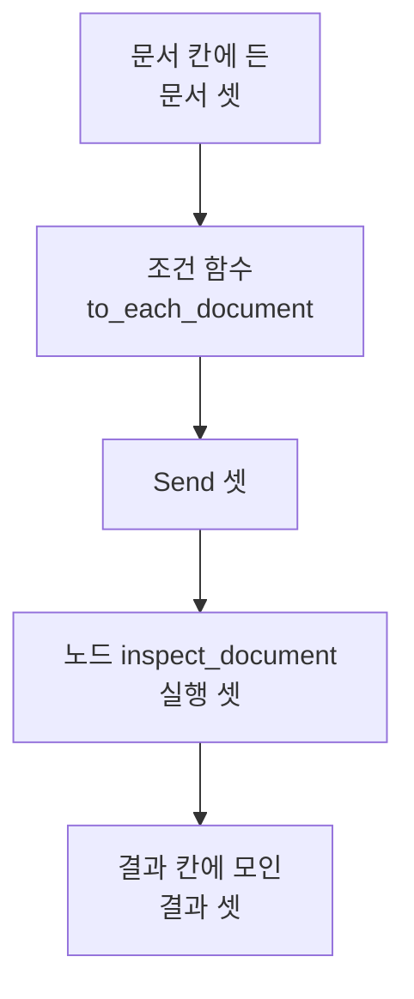
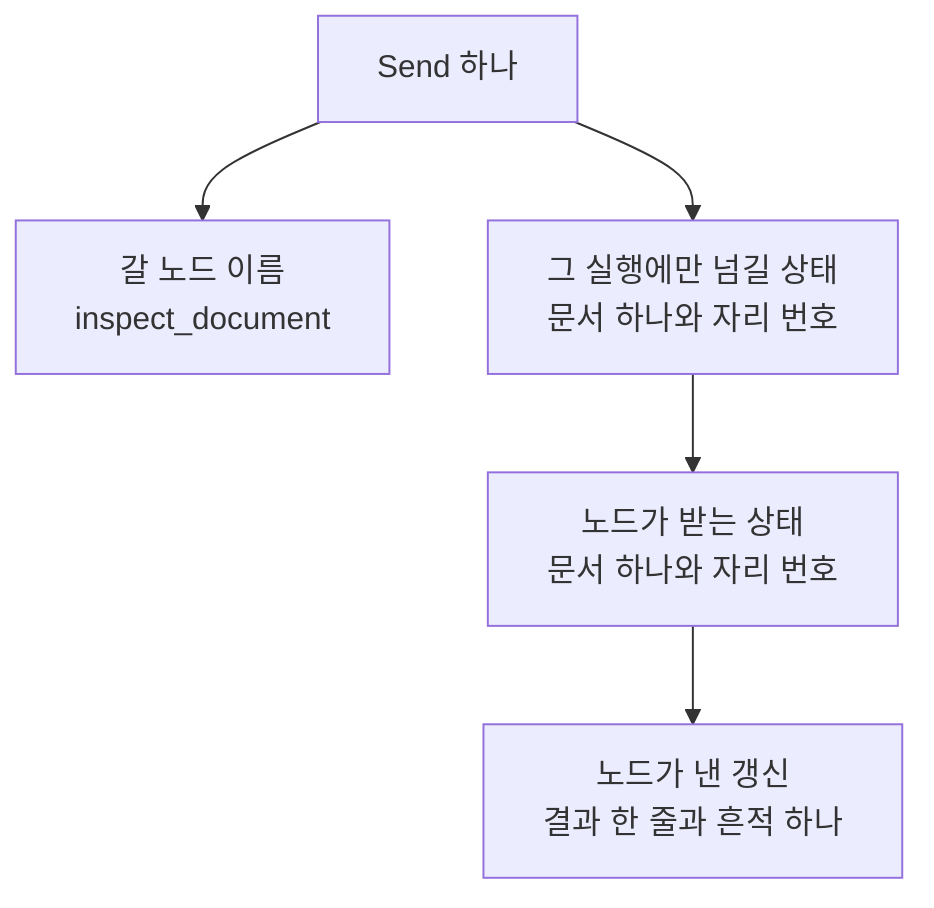
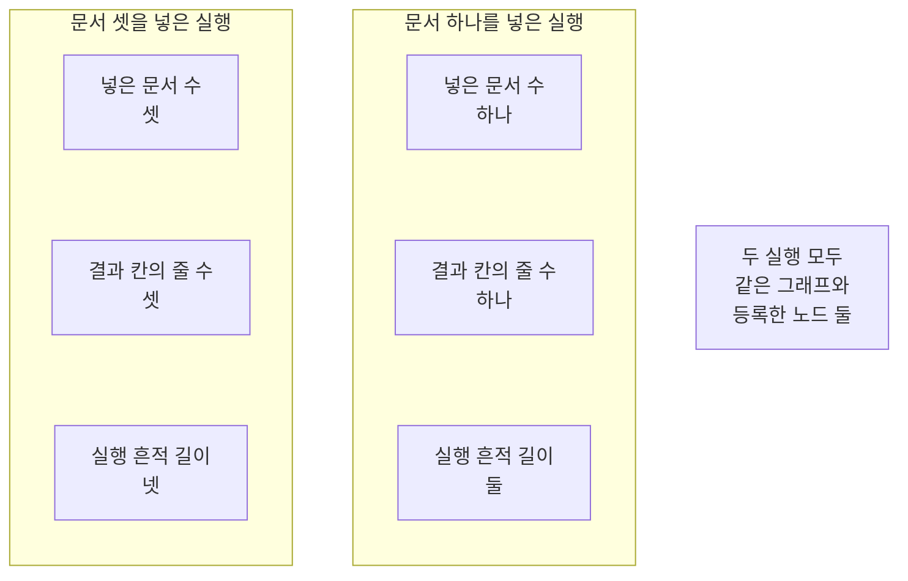
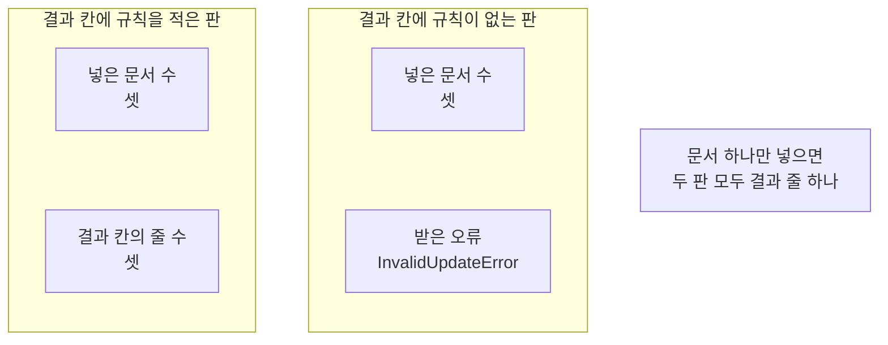

# 05-Send-동적-팬아웃

## _src 본문 (HTML 원본)

```html
<!--meta: 강의 1h | 실습 1h | 코드 notebooks/05-Send-동적-팬아웃.ipynb | 새 용어 4 -->
<h2 id="b1"><span class="no">1</span>학습 목표</h2><div class="goal"><ul><li>조건 함수가 낸 <code>Send</code> 목록의 길이만큼 같은 노드가 실행된다는 것을 설명할 수 있습니다.</li><li>넣는 문서 수에 따라 결과 줄 수가 달라지는 그래프를 만들 수 있습니다.</li><li>여러 갈래가 같은 칸에 갱신을 낼 때 규칙이 왜 있어야 하는지 읽을 수 있습니다.</li></ul></div>
<h2 id="b2"><span class="no">2</span>이 내용을 배우는 이유</h2><p>01절부터 04절까지 그래프는 노드를 한 번씩만 지났습니다. 그런데 살펴볼 문서가 세 건일 때도 있고 한 건일 때도 있습니다. 문서 수만큼 노드를 미리 등록해 둘 수는 없습니다.</p><p>라이브러리 LangGraph는 실행하는 동안 갈래를 만드는 방법을 줍니다. 이번 절의 질문은 「넣는 문서 수가 달라도 같은 노드로 보내 결과를 모을 수 있을까요?」입니다. 문서 수를 바꿔 두 번 실행하고 결과 줄 수를 견줘 답합니다.</p>
<h2 id="b3"><span class="no">3</span>앞에서 배운 내용</h2><p>01절에서 상태와 노드와 엣지를 코드로 적고 컴파일해 실행했습니다. 02절에서는 칸에 리듀서를 적어 갱신 여러 개를 합쳤습니다. 03절에서는 상태의 값을 읽어 다음 노드를 고르는 조건부 엣지를 만들었습니다. 04절에서는 메시지 칸에 메시지 리듀서를 적었습니다.</p><p>첫 질문은 04절과 같습니다. 노드 <code>normalize</code>도 04절처럼 02절 판을 도구 파일에서 가져옵니다.</p><p>02절이 정한 약속 하나도 그대로 지킵니다. 규칙을 적은 칸에는 노드가 자기 몫만 냅니다. 이 절 노드도 결과 칸에 줄 하나만 담아 냅니다.</p><p>03절 조건 함수는 이름표 하나를 내놓았습니다. 이 절 조건 함수는 목적지와 상태를 담은 객체 여러 개를 목록으로 내놓습니다. 표시 <code>Annotated</code>와 함수 <code>operator.add</code>는 02절에서, 형식 <code>TypedDict</code>와 타입힌트는 01절에서 풀었으므로 되풀이하지 않습니다.</p><p>이 절은 모델을 한 번도 부르지 않습니다. 이 챕터에서 모델을 부르는 절은 07절과 08절입니다. Ch 9~12에서 쓴 말 「칸」과 03절에서 쓴 말 「갈래」를 이 절에서도 씁니다. 말 「조각」은 Ch 5의 토큰 뜻으로만 쓰고 이 절에는 나오지 않습니다.</p>
<h2 id="b4"><span class="no">4</span>핵심 개념</h2><h3>비유로 시작하기</h3><p>01절부터 쓴 나무 길을 그대로 씁니다. 03절에서는 그 길에 갈림길 하나를 더해 한쪽으로만 갔습니다. 이번에는 한 길이 세 갈래로 갈라졌다가 다시 하나로 모입니다. 갈래마다 같은 모양 작업대가 하나씩 놓여 있습니다. 세 갈래를 지난 결과는 마지막에 상자 하나에 모입니다.</p>
{{img:05-5-세-갈래로-펼쳐진-길|흰 바탕에 왼쪽에서 시작한 나무 길 하나가 가운데에서 나란한 세 갈래로 갈라지고 갈래마다 같은 모양 작업대가 하나씩 놓여 있으며 세 갈래가 오른쪽에서 다시 한 길로 모여 칸이 나뉜 나무 상자 하나로 이어지는 그림|한 길이 세 갈래로 갈라져 같은 작업대를 셋 지난 뒤 다시 한 상자로 모입니다.}}
<p class="look"><b>그림 읽기</b> — 왼쪽에서 시작한 나무 길이 하나입니다. 그 길이 가운데에서 나란한 세 갈래로 갈라집니다. 갈래마다 같은 모양 작업대가 하나씩 놓여 있습니다. 오른쪽에서 세 갈래가 다시 한 길로 모입니다. 그 길 끝에 칸이 나뉜 나무 상자 하나가 놓여 있습니다.</p>
<table><thead><tr><th>말</th><th>뜻</th></tr></thead><tbody><tr><td>팬아웃(fan out)</td><td>한 흐름을 입력 수만큼 여러 갈래로 펼치는 일입니다.</td></tr><tr><td><code>Send</code></td><td>갈 노드 이름과 그 실행에만 넘길 상태를 함께 담는 객체입니다. 라이브러리가 줍니다.</td></tr><tr><td>갈래별 상태</td><td><code>Send</code>의 둘째 자리에 넣은 딕셔너리입니다. 그 실행 하나만 읽습니다.</td></tr><tr><td>한꺼번에 낸 갱신</td><td>같은 단계에서 여러 갈래가 같은 칸에 내는 갱신입니다. 규칙이 없는 칸에서는 오류가 납니다.</td></tr></tbody></table>
{{mermaid:05-1-한-흐름이-세-갈래로|위에서 아래로 놓인 상자 다섯으로 맨 위 초록 상자 문서 칸에 든 문서 셋에서 화살표가 파란 상자 조건 함수 to_each_document로 이어지고 거기서 회색 상자 Send 셋으로 이어지며 다시 파란 상자 노드 inspect_document 실행 셋으로 이어지고 마지막으로 맨 아래 초록 상자 결과 칸에 모인 결과 셋으로 이어지는 그림|문서 칸에 든 문서 셋이 Send 셋이 되고 같은 노드가 셋으로 실행돼 결과 칸 하나에 모입니다.}}
<p class="look"><b>도식 읽기</b> — 위에서 아래로 읽습니다. 맨 위 초록 상자가 문서 칸에 넣은 문서 셋입니다. 그 아래 파란 상자가 우리가 만든 조건 함수입니다. 가운데 회색 상자가 라이브러리가 주는 <code>Send</code> 셋입니다. 그 아래 파란 상자가 같은 노드의 실행 셋이고 맨 아래 초록 상자가 결과가 모이는 칸입니다.</p>
<h3>Send가 담는 두 가지</h3><p>객체 <code>Send</code>의 첫 자리에는 갈 노드 이름을 적습니다. 둘째 자리에는 그 실행에만 넘길 상태를 딕셔너리로 적습니다. 둘째 자리에 적은 딕셔너리가 그대로 그 실행의 상태가 됩니다. 전체 상태와 합쳐지지 않으므로 그 노드가 읽을 칸을 빠짐없이 담아야 합니다.</p>
<h3>노드는 한 번만 등록합니다</h3><p>같은 노드를 세 번 지나도 설계 객체에는 한 번만 등록합니다. 실행 횟수를 정하는 것은 조건 함수가 낸 목록의 길이입니다. 그래서 등록한 노드 수는 그대로인데 지나간 횟수만 달라집니다. 03절은 조건 함수에 이름표 표를 함께 적었지만 이 절은 적지 않습니다. 목적지가 <code>Send</code> 안에 이미 들어 있기 때문입니다.</p>
<h3>같은 칸에 한꺼번에 들어오면</h3><p>갈래가 여럿이면 같은 단계에서 같은 칸에 갱신이 여럿 들어옵니다. 02절에서 본 대로 규칙이 없는 칸은 덮어쓰기가 됩니다. 그런데 한 단계에 값이 여럿이면 어느 것을 남길지 정할 수 없습니다. 그래서 갈래가 여럿인 칸에는 합칠 규칙이 있어야 합니다.</p>
<h2 id="b5"><span class="no">5</span>실행 예제</h2><p>이 절은 모델을 한 번도 부르지 않습니다. 읽어 오는 자료 파일도 없고 새로 쓰는 파일도 없습니다. 노드는 둘이고 고정 엣지는 둘이며 조건부 엣지가 하나입니다.</p><p>먼저 문서 하나를 보는 노드와 <code>Send</code> 목록을 만드는 조건 함수를 그래프 없이 직접 불러 봅니다. 그다음 그 조건 함수를 붙인 그래프에 문서 세 건을 넣습니다. 마지막으로 문서를 한 건으로 줄이고 결과 칸의 규칙도 빼 두 가지를 견줍니다.</p>
{{mermaid:05-2-Send-하나가-담는-것|위에서 아래로 놓인 상자 다섯으로 맨 위 회색 상자 Send 하나에서 화살표 두 개가 갈라져 왼쪽 아래 회색 상자 갈 노드 이름 inspect_document와 오른쪽 아래 초록 상자 그 실행에만 넘길 상태 문서 하나와 자리 번호로 가고 그 초록 상자에서 화살표가 아래 초록 상자 노드가 받는 상태 문서 하나와 자리 번호로 이어지며 다시 맨 아래 파란 상자 노드가 낸 갱신 결과 한 줄과 흔적 하나로 이어지는 그림|Send 하나에 담은 목적지와 상태 가운데 상태 쪽이 그대로 그 실행의 상태가 됩니다.}}
<p class="look"><b>도식 읽기</b> — 위에서 아래로 읽습니다. 맨 위 회색 상자가 <code>Send</code> 하나입니다. 그 아래 왼쪽 회색 상자가 갈 노드 이름이고 오른쪽 초록 상자가 넘길 상태입니다. 오른쪽 줄기를 따라 내려가면 노드가 받는 상태가 그 상태와 같습니다. 맨 아래 파란 상자가 그 노드 하나가 낸 갱신입니다.</p>
{{notebook:05-Send-동적-팬아웃}}
{{mermaid:05-3-문서-수만-바꾼-두-실행|왼쪽부터 오른쪽으로 놓인 칸 두 개와 회색 상자 하나로 왼쪽 칸 제목은 문서 셋을 넣은 실행이고 그 안에 초록 상자 넣은 문서 수 셋과 노란 상자 결과 칸의 줄 수 셋과 노란 상자 실행 흔적 길이 넷이 있으며 가운데 칸 제목은 문서 하나를 넣은 실행이고 그 안에 초록 상자 넣은 문서 수 하나와 노란 상자 결과 칸의 줄 수 하나와 노란 상자 실행 흔적 길이 둘이 있고 오른쪽에 회색 상자 두 실행 모두 같은 그래프와 등록한 노드 둘이 놓인 그림|넣은 문서 수만 바꿨더니 결과 칸의 줄 수와 실행 흔적 길이가 함께 달라집니다.}}
<p class="look"><b>도식 읽기</b> — 왼쪽 칸이 문서 셋을 넣은 실행입니다. 가운데 칸이 문서 하나를 넣은 실행입니다. 칸마다 맨 위 초록 상자가 넣은 값이고 그 아래 노란 상자 두 개가 나온 값입니다. 결과 칸의 줄 수는 셋과 하나로 갈렸고 실행 흔적 길이도 넷과 둘로 갈렸습니다. 오른쪽 회색 상자는 두 칸에 모두 해당하는 사실입니다.</p>
<p class="look"><b>확인할 점</b> — 문서 세 건을 넣은 실행의 출력은 <code>결과 칸의 줄 수 | 3</code>이었습니다. 같은 그래프에 문서 한 건만 넣으면 <code>결과 칸의 줄 수 | 1</code>이었습니다. 실행 흔적 칸에는 각각 이름 넷과 이름 둘이 남았습니다. 두 실행 모두 출력 줄 <code>등록한 노드 수는 그대로: 2</code>로 같았습니다.</p>
<h2 id="b6"><span class="no">6</span>실험 결과 해석</h2><p>넣는 문서 수만 바꿨는데 지나간 횟수가 달라졌습니다. 문서 세 건을 넣으면 실행 흔적 칸에 <code>normalize</code> 하나와 <code>inspect_document</code> 셋이 남았습니다. 문서 한 건을 넣으면 이름이 둘만 남았습니다. 등록한 노드 수는 두 실행 모두 <code>2</code>였습니다.</p>
{{mermaid:05-4-규칙이-있는-칸과-없는-칸|왼쪽부터 오른쪽으로 놓인 칸 두 개와 회색 상자 하나로 왼쪽 칸 제목은 결과 칸에 규칙을 적은 판이고 그 안에 초록 상자 넣은 문서 수 셋과 노란 상자 결과 칸의 줄 수 셋이 있으며 가운데 칸 제목은 결과 칸에 규칙이 없는 판이고 그 안에 초록 상자 넣은 문서 수 셋과 노란 상자 받은 오류 InvalidUpdateError가 있고 오른쪽에 회색 상자 문서 하나만 넣으면 두 판 모두 결과 줄 하나가 놓인 그림|같은 문서 셋을 넣어도 결과 칸에 규칙이 없으면 실행이 끝나지 않고 오류가 나옵니다.}}
<p class="look"><b>도식 읽기</b> — 왼쪽 칸이 결과 칸에 규칙을 적은 판입니다. 가운데 칸이 그 규칙만 뺀 판입니다. 칸마다 맨 위 초록 상자가 넣은 값이고 그 아래 노란 상자가 나온 값입니다. 왼쪽은 결과 줄 셋이 나왔고 가운데는 오류 하나를 받았습니다. 오른쪽 회색 상자는 두 칸에 모두 해당하는 사실입니다.</p>
<p>결과 칸의 규칙만 빼고 같은 문서 셋을 넣었더니 <code>InvalidUpdateError</code>를 받았습니다. 오류 글의 첫 줄은 한 단계에 값 하나만 받을 수 있다고 알려 주었습니다. 같은 안내가 표시 <code>Annotated</code>를 쓴 칸을 쓰라고 이어 적혀 있었습니다. 같은 판에 문서 한 건만 넣으면 갈래가 하나라 끝까지 지났습니다.</p><p>결과 칸에 모인 줄의 차례도 함께 보았습니다. 이번 실행에서는 <code>0 | D01 | 24</code>가 첫 줄이었고 <code>2 | D03 | 16</code>이 마지막 줄이었습니다. 다만 어느 갈래가 먼저 끝나는지는 우리가 정하지 않습니다. 그래서 결과에 자리 번호를 함께 담아 두고 마지막에 그 번호로 차례를 맞췄습니다.</p><p>여기서 확인한 것은 문서가 하나에서 셋까지인 짧은 목록입니다. 문서가 아주 많은 목록은 이번에 만들지 않았습니다. 갈래를 나눠서 빨라졌는지는 이번에 재지 않았으므로 적지 않습니다. 걸린 시간을 재는 코드가 이 절에 없습니다.</p>
<h2 id="b7"><span class="no">7</span>주의할 점과 실무 메모</h2><ul><li>객체 <code>Send</code>의 둘째 자리 딕셔너리가 그대로 그 실행의 상태가 됩니다. 전체 상태와 합쳐지지 않습니다.</li><li>그래서 그 노드가 읽는 칸을 둘째 자리에 빠짐없이 담아야 합니다. 이 절은 문서 하나와 자리 번호를 담았습니다.</li><li>같은 노드를 여러 번 지나도 설계 객체에는 한 번만 등록합니다.</li><li>조건 함수가 <code>Send</code> 목록을 내놓으면 <code>add_conditional_edges</code>의 셋째 자리를 적지 않아도 됩니다. 목적지가 <code>Send</code> 안에 있기 때문입니다.</li><li>갈래가 여럿인 칸에는 합칠 규칙이 있어야 합니다. 규칙이 없으면 <code>InvalidUpdateError</code>가 납니다.</li><li>갈래가 하나뿐이면 규칙이 없는 칸도 덮어쓰기로 끝납니다. 이 절에서 문서 한 건으로 그 경우를 보았습니다.</li><li>결과가 모이는 차례는 우리가 정하지 않습니다. 차례가 필요하면 자리 번호를 함께 보내고 마지막에 맞춥니다.</li><li>이 절은 모델을 한 번도 부르지 않았습니다. 요청 수도 비용도 0입니다.</li><li>이 절은 걸린 시간을 재지 않았습니다. 갈래를 나눠서 빨라졌는지 느려졌는지 적지 않습니다.</li><li>준비물에 LangGraph 1.2.11을 적었습니다. 다른 판과 Windows·macOS에서는 이번에 실행하지 않았습니다.</li><li>이 절은 파일을 쓰지 않습니다. Ch 12가 남긴 기록 파일도 읽지 않습니다.</li></ul>
<h2 id="b8"><span class="no">8</span>정리와 다음 절</h2><ul><li>조건 함수가 낸 <code>Send</code> 목록의 길이만큼 같은 노드가 한 실행에서 여러 번 지났습니다.</li><li>등록한 노드 수는 둘 그대로였고 넣은 문서 수에 따라 결과 줄 수만 달라졌습니다.</li><li>결과 칸의 규칙을 빼자 문서 셋에서 <code>InvalidUpdateError</code>를 받았습니다.</li></ul><p><strong>다음 학습과 이어지는 지점</strong> — 06절에서는 노드가 상태 갱신과 다음 목적지를 함께 내놓는 <code>Command</code>를 씁니다. 이 절까지 다음에 갈 노드는 엣지나 조건 함수가 정했습니다.</p>
<h2 id="b9"><span class="no">9</span>복습 문제</h2><details class="quiz" open><summary>문제 4개 · 해설 포함</summary><p class="quiz-q">1. 같은 노드를 지나는 횟수는 무엇이 정합니까?</p><p class="quiz-a">조건 함수가 낸 <code>Send</code> 목록의 길이가 정합니다. 틀렸다면 「노드는 한 번만 등록합니다」를 다시 읽습니다.</p><p class="quiz-q">2. 객체 <code>Send</code>의 둘째 자리에 적은 딕셔너리는 무엇이 됩니까?</p><p class="quiz-a">그 실행 하나만 읽는 상태가 됩니다. 전체 상태와 합쳐지지 않습니다. 틀렸다면 「핵심 개념」의 용어 표를 다시 읽습니다.</p><p class="quiz-q">3. 결과 칸의 규칙을 빼고 문서 셋을 넣으면 어떻게 됐습니까?</p><p class="quiz-a">오류 <code>InvalidUpdateError</code>를 받았습니다. 틀렸다면 「실험 결과 해석」을 다시 읽습니다.</p><p class="quiz-q">4. 결과가 모이는 차례를 맞추려면 무엇을 함께 보냈습니까?</p><p class="quiz-a">자리 번호를 함께 보내고 마지막에 그 번호로 차례를 맞췄습니다. 틀렸다면 노트북 7절을 다시 읽습니다.</p></details>
<h2 id="b10"><span class="no">10</span>참고 자료</h2><ul><li><div><a href="https://reference.langchain.com/python/langgraph/types/Send">Send API</a></div>갈 노드 이름과 넘길 상태를 담는 객체 설명 · 1.2.11 · 확인 2026-09-10</li><li><div><a href="https://docs.langchain.com/oss/python/langgraph/graph-api">LangGraph Graph API 안내</a></div>조건부 엣지와 상태 칸을 적는 방법 설명 · 1.2.11 · 확인 2026-09-10</li><li><div><a href="https://docs.langchain.com/oss/python/langgraph/errors/INVALID_CONCURRENT_GRAPH_UPDATE">한 단계에 갱신이 여럿일 때의 오류 안내</a></div>설치판 오류 글이 알려 준 주소 · 1.2.11 · 확인 2026-09-19</li></ul>
```

## 노트북 셀 (순서대로)

### [0] markdown {'html': 'skip'}

# Send와 동적 팬아웃

**이 노트북에서 할 일**

1. 문서 하나를 받아 글자 수를 세는 노드를 그래프 없이 먼저 불러 봅니다.
2. 문서 수만큼 `Send`를 만드는 조건 함수를 만들어 그 목록을 살펴봅니다.
3. 그 조건 함수를 붙인 그래프를 실행해 같은 노드가 몇 번 지나는지 봅니다.
4. 넣는 문서 수를 바꾸고 결과 칸의 규칙도 없애 두 가지를 견줍니다.

**준비물** — 이 절은 OpenAI API 키를 쓰지 않습니다.
모델 요청이 0번이라 드는 비용이 없습니다.
읽어 오는 자료 파일도 없고 새로 쓰는 파일도 없습니다.
실행 시간은 1분 안팎이고 첫 셀의 설치가 가장 오래 걸립니다.

**기준 버전** — 첫 셀에서 LangGraph 1.2.11과 도구 파일이 쓰는 numpy 2.5.3을 설치합니다.
메시지 클래스를 쓰지 않아 04절보다 설치할 패키지가 하나 줄었습니다.
교재 출력은 Linux의 Python 3.12.13으로 만들었습니다.
다른 판과 Windows·macOS에서는 이번에 실행하지 않았습니다.

**강의와 실습 범위** — 강의 시간에는 3~7절을 읽습니다.
노드와 조건 함수를 그래프 없이 먼저 부른 뒤 그래프에 붙이는 자리입니다.
8절과 9절은 값을 하나씩 바꿔 보는 자리입니다.
10절은 세 실행을 기록 한 줄씩으로 만들어 표로 견주는 자리입니다.
준비부터 끝까지 함께 실행하고 실습 시간에 다시 읽습니다.

실습 폴더 `labs/part4/ch13-langgraph-basics`에서 `uv sync --locked`를 실행합니다.
그다음 이 폴더의 `.venv` 커널을 고르고 첫 셀부터 순서대로 실행합니다.

### [1] markdown {'html': 'skip'}

## 오늘 볼 그림


맨 위 초록 상자가 문서 칸에 넣은 문서 셋입니다.
그 아래 파란 상자가 우리가 만든 조건 함수입니다.
가운데 회색 상자가 라이브러리가 주는 `Send` 셋입니다.
그 아래 파란 상자가 같은 노드의 실행 셋입니다.
맨 아래 초록 상자가 결과가 모이는 칸입니다.

### [2] markdown {}

## 1. 준비

첫 셀은 패키지 두 개를 설치하고 설치된 판 번호를 출력합니다.
설치에는 몇십 초가 걸릴 수 있습니다.

### [3] code {'execution': {'iopub.execute_input': '2026-09-21T10:40:21.998099Z', 'iopub.status.busy': '2026-09-21T10:40:21.997959Z', 'iopub.status.idle': '2026-09-21T10:40:22.470611Z', 'shell.execute_reply': '2026-09-21T10:40:22.469975Z'}, 'lesson_role': 'setup'}

```python
# 이 절에서 쓰는 패키지를 설치하고 버전을 확인합니다
%pip install -q "langgraph==1.2.11" "numpy==2.5.3"
from importlib.metadata import version

print("langgraph:", version("langgraph"))
print("numpy:", version("numpy"))
```

출력:
```
Note: you may need to restart the kernel to use updated packages.
langgraph: 1.2.11
numpy: 2.5.3

```

### [4] markdown {}

**결과 읽기** — 설치가 끝나면 `langgraph: 1.2.11`과 `numpy: 2.5.3`이 보입니다.
패키지 `numpy`는 이 절이 직접 쓰지 않지만 도구 파일을 불러올 때 필요합니다.
이 노트북의 출력은 2026-09-21에 이 판으로 실행한 결과입니다.

다음 셀은 이름 일곱 개를 불러옵니다.
앞의 다섯은 02절에서 불러온 것과 같습니다.
뒤의 둘이 이 절에서 처음 쓰는 이름입니다.

앞에서 배운 함수는 `rag_tools.py`에 모아 두었습니다. 파일을 열면 코드를 볼 수 있습니다. 노트북과 같은 폴더(`notebooks/`)에 있는 파일입니다.

이 노트북은 04절처럼 02절 노드 `normalize`를 가져옵니다.

### [5] code {'execution': {'iopub.execute_input': '2026-09-21T10:40:22.471966Z', 'iopub.status.busy': '2026-09-21T10:40:22.471854Z', 'iopub.status.idle': '2026-09-21T10:40:22.998907Z', 'shell.execute_reply': '2026-09-21T10:40:22.998732Z'}, 'lesson_role': 'setup'}

```python
# 02절 이름 다섯 개에 이 절 이름 두 개를 더해 불러옵니다
import operator
from typing import Annotated
from typing_extensions import TypedDict
from langgraph.graph import StateGraph, START, END
from langgraph.types import Send
from langgraph.errors import InvalidUpdateError
# 02절에서 만든 노드 하나를 도구 파일에서 가져옵니다
from rag_tools import normalize

print("이 절에서 처음 쓰는 이름:", "Send")
```

출력:
```
이 절에서 처음 쓰는 이름: Send

```

### [6] markdown {}

**결과 읽기** — 출력 줄 `이 절에서 처음 쓰는 이름: Send`가 보입니다.
객체 `Send`는 갈 노드 이름과 그 실행에만 넘길 상태를 함께 담습니다.
함께 불러온 `InvalidUpdateError`는 9절에서 오류를 받을 때 씁니다.
도구 파일에서 가져온 노드 `normalize`는 출력하지 않습니다.

## 2. 이 절에서 쓸 값 정하기

01절부터 쓴 첫 질문을 글자까지 같게 씁니다.
그리고 이 절에서 나눠 보낼 짧은 안내 문서 세 건을 정합니다.
문서 하나는 번호 하나와 글 하나를 담은 딕셔너리입니다.

### [7] code {'execution': {'iopub.execute_input': '2026-09-21T10:40:23.002121Z', 'iopub.status.busy': '2026-09-21T10:40:23.002016Z', 'iopub.status.idle': '2026-09-21T10:40:23.004021Z', 'shell.execute_reply': '2026-09-21T10:40:23.003830Z'}}

```python
# 01절 질문과 이 절에서 나눠 보낼 안내 문서 세 건을 정합니다
first_question = "  대출 기간은 며칠인가요?  "
documents = [
    {"번호": "D01", "글": "대출은 한 번에 일곱 권까지 할 수 있습니다"},
    {"번호": "D02", "글": "대출 기간은 열나흘입니다"},
    {"번호": "D03", "글": "반납함은 출입구 옆에 있습니다"},
]
print("첫 질문:", first_question)
print("첫 질문의 글자 수:", len(first_question))
print("문서 수:", len(documents))
```

출력:
```
첫 질문:   대출 기간은 며칠인가요?  
첫 질문의 글자 수: 17
문서 수: 3

```

### [8] markdown {}

**결과 읽기** — 출력 줄 `첫 질문의 글자 수: 17`은 01절부터 이어지는 같은 값입니다.
출력 줄 `문서 수: 3`이 이 절에서 나눠 보낼 문서 수입니다.
문서 수는 뒤에서 한 건으로 줄여 다시 실행해 봅니다.

다음 셀은 문서 목록을 한 줄씩 펼쳐 봅니다.

### [9] code {'execution': {'iopub.execute_input': '2026-09-21T10:40:23.004476Z', 'iopub.status.busy': '2026-09-21T10:40:23.004433Z', 'iopub.status.idle': '2026-09-21T10:40:23.006052Z', 'shell.execute_reply': '2026-09-21T10:40:23.005818Z'}}

```python
# 문서 목록을 라벨 줄 아래에 한 줄씩 출력합니다
print("문서 칸에 넣을 문서 목록")
for document in documents:
    print(document["번호"], "|", document["글"])
```

출력:
```
문서 칸에 넣을 문서 목록
D01 | 대출은 한 번에 일곱 권까지 할 수 있습니다
D02 | 대출 기간은 열나흘입니다
D03 | 반납함은 출입구 옆에 있습니다

```

### [10] markdown {}

**결과 읽기** — 라벨 줄 `문서 칸에 넣을 문서 목록` 아래 세 줄이 나옵니다.
첫 줄은 `D01 |`로 시작하고 마지막 줄은 `D03 |`으로 시작합니다.
글의 길이는 문서마다 다릅니다.

## 3. 상태 형식과 출력 함수

이 절 상태에는 문서 칸과 결과 칸이 더 필요합니다.
결과 칸에는 갈래마다 결과 한 줄이 들어오므로 02절 규칙을 적습니다.
칸 구성이 04절과 달라 형식 이름도 새로 붙입니다.

### [11] code {'execution': {'iopub.execute_input': '2026-09-21T10:40:23.006437Z', 'iopub.status.busy': '2026-09-21T10:40:23.006396Z', 'iopub.status.idle': '2026-09-21T10:40:23.008011Z', 'shell.execute_reply': '2026-09-21T10:40:23.007814Z'}}

```python
# 02절 규칙을 쓴 문서 칸과 결과 칸을 둔 상태 형식을 만듭니다
class FanState(TypedDict):
    question: str
    documents: list[dict]
    results: Annotated[list[dict], operator.add]
    trace: Annotated[list[str], operator.add]
```

출력:
```

```

### [12] markdown {}

**결과 읽기** — 정의 셀이라 출력이 없습니다.
문서 칸에는 규칙을 적지 않았습니다. 넣은 값을 그대로 읽기만 하기 때문입니다.
결과 칸과 실행 흔적 칸에는 02절에서 쓴 같은 규칙을 적었습니다.
표시 `Annotated`의 둘째 자리에 적은 함수가 그 칸의 규칙입니다.

다음 셀은 01절부터 쓴 출력 함수를 이 절 칸에 맞춘 판입니다.

### [13] code {'execution': {'iopub.execute_input': '2026-09-21T10:40:23.008386Z', 'iopub.status.busy': '2026-09-21T10:40:23.008344Z', 'iopub.status.idle': '2026-09-21T10:40:23.009948Z', 'shell.execute_reply': '2026-09-21T10:40:23.009746Z'}}

```python
# 상태의 칸 네 개를 라벨 줄 아래에 한 줄씩 출력합니다
def print_state(label, state):
    print(label)
    print("질문 칸 |", state["question"])
    print("문서 칸의 문서 수 |", len(state["documents"]))
    print("결과 칸의 줄 수 |", len(state["results"]))
    print("실행 흔적 칸 |", state["trace"])
```

출력:
```

```

### [14] markdown {}

**결과 읽기** — 정의 셀이라 출력이 없습니다.
문서 칸과 결과 칸은 줄이 여러 개라 여기서는 개수만 적습니다.
04절 판과 견주면 메시지 칸 줄이 빠지고 문서 칸과 결과 칸 줄이 들어왔습니다.

## 4. 문서 하나를 보는 노드

첫 노드 `normalize`는 준비 셀에서 도구 파일로부터 가져왔습니다.
02절에서 만든 노드로 질문 칸의 앞뒤 빈칸을 없앱니다.
이 노드는 문서 칸과 결과 칸을 건드리지 않습니다.

다음 셀이 이 절의 새 노드입니다.
이 노드는 전체 상태가 아니라 문서 하나만 담은 상태를 받습니다.

### [15] code {'execution': {'iopub.execute_input': '2026-09-21T10:40:23.010289Z', 'iopub.status.busy': '2026-09-21T10:40:23.010250Z', 'iopub.status.idle': '2026-09-21T10:40:23.011809Z', 'shell.execute_reply': '2026-09-21T10:40:23.011627Z'}}

```python
# 문서 하나를 받아 글자 수를 세고 결과 한 줄만 담아 냅니다
def inspect_document(state):
    document = state["document"]
    row = {"번호": document["번호"]}
    row["글자 수"] = len(document["글"])
    row["자리"] = state["place"]
    return {"results": [row], "trace": ["inspect_document"]}
```

출력:
```

```

### [16] markdown {}

**결과 읽기** — 정의 셀이라 출력이 없습니다.
이 노드는 결과 칸에 줄 하나만 담아 냅니다.
줄에는 문서 번호와 글자 수와 자리 번호를 적습니다.
자리 번호는 몇 번째 문서였는지 나중에 맞추려고 함께 담습니다.

다음 셀은 그래프 없이 이 노드를 직접 불러 봅니다.

### [17] code {'execution': {'iopub.execute_input': '2026-09-21T10:40:23.013739Z', 'iopub.status.busy': '2026-09-21T10:40:23.013700Z', 'iopub.status.idle': '2026-09-21T10:40:23.015089Z', 'shell.execute_reply': '2026-09-21T10:40:23.014947Z'}}

```python
# 그래프 없이 노드 하나에 문서 하나만 넣어 불러 봅니다
one_input = {"document": documents[0], "place": 0}
one_update = inspect_document(one_input)
print("노드가 낸 결과 한 줄:", one_update["results"][0])
print("노드가 낸 실행 흔적:", one_update["trace"])
```

출력:
```
노드가 낸 결과 한 줄: {'번호': 'D01', '글자 수': 24, '자리': 0}
노드가 낸 실행 흔적: ['inspect_document']

```

### [18] markdown {}

**결과 읽기** — 출력 줄 `노드가 낸 결과 한 줄: {'번호': 'D01', '글자 수': 24, '자리': 0}`이 보입니다.
칸 이름 `results`에 들어갈 줄 하나가 이런 모양입니다.
출력 줄 `노드가 낸 실행 흔적: ['inspect_document']`도 자기 이름 하나뿐입니다.
02절이 정한 약속을 이 노드도 지킵니다.

## 5. Send 목록을 만드는 조건 함수

03절 조건 함수는 이름표 하나를 내놓았습니다.
이 절 조건 함수는 `Send` 여러 개를 담은 목록을 내놓습니다.
목록의 길이가 곧 그 노드를 지나는 횟수입니다.
빈 목록을 만들고 `for`와 `append`로 하나씩 채웁니다.

### [19] code {'execution': {'iopub.execute_input': '2026-09-21T10:40:23.015491Z', 'iopub.status.busy': '2026-09-21T10:40:23.015453Z', 'iopub.status.idle': '2026-09-21T10:40:23.017025Z', 'shell.execute_reply': '2026-09-21T10:40:23.016812Z'}}

```python
# 문서 하나마다 Send 하나를 만들어 목록에 담아 냅니다
def to_each_document(state):
    sends = []
    place = 0
    for document in state["documents"]:
        sends.append(Send("inspect_document", {"document": document, "place": place}))
        place = place + 1
    return sends
```

출력:
```

```

### [20] markdown {}

**결과 읽기** — 정의 셀이라 출력이 없습니다.
객체 `Send`의 첫 자리에 갈 노드 이름을 적습니다.
둘째 자리에는 그 실행에만 넘길 상태를 딕셔너리로 적습니다.
변수 `place`는 몇 번째 문서인지 세는 번호이고 한 바퀴마다 하나씩 늘어납니다.

다음 셀은 그래프 없이 이 조건 함수만 불러 봅니다.

### [21] code {'execution': {'iopub.execute_input': '2026-09-21T10:40:23.017373Z', 'iopub.status.busy': '2026-09-21T10:40:23.017334Z', 'iopub.status.idle': '2026-09-21T10:40:23.019014Z', 'shell.execute_reply': '2026-09-21T10:40:23.018803Z'}}

```python
# 그래프 없이 조건 함수만 불러 만들어진 Send를 봅니다
made = to_each_document({"documents": documents})
print("만든 Send 수:", len(made))
print("첫 Send가 갈 노드 이름:", made[0].node)
print("첫 Send가 넘길 문서의 번호:", made[0].arg["document"]["번호"])
print("첫 Send가 넘길 자리 번호:", made[0].arg["place"])
print("셋째 Send가 넘길 문서의 번호:", made[2].arg["document"]["번호"])
```

출력:
```
만든 Send 수: 3
첫 Send가 갈 노드 이름: inspect_document
첫 Send가 넘길 문서의 번호: D01
첫 Send가 넘길 자리 번호: 0
셋째 Send가 넘길 문서의 번호: D03

```

### [22] markdown {}

**결과 읽기** — 출력 줄 `만든 Send 수: 3`이 문서 수와 같습니다.
출력 줄 `첫 Send가 갈 노드 이름: inspect_document`가 목적지입니다.
출력 줄 `첫 Send가 넘길 문서의 번호: D01`과 `첫 Send가 넘길 자리 번호: 0`이 그 실행 몫입니다.
출력 줄 `셋째 Send가 넘길 문서의 번호: D03`은 다른 문서를 가리킵니다.
세 `Send`는 목적지가 같고 넘길 상태만 서로 다릅니다.

## 6. 조립과 실행

설계 객체를 만들고 노드 두 개를 등록합니다.
같은 노드를 여러 번 지나도 등록은 한 번만 합니다.

### [23] code {'execution': {'iopub.execute_input': '2026-09-21T10:40:23.019358Z', 'iopub.status.busy': '2026-09-21T10:40:23.019319Z', 'iopub.status.idle': '2026-09-21T10:40:23.020941Z', 'shell.execute_reply': '2026-09-21T10:40:23.020739Z'}}

```python
# 설계 객체를 만들고 노드 두 개를 등록합니다
builder = StateGraph(FanState)
builder.add_node("normalize", normalize)
builder.add_node("inspect_document", inspect_document)
print("등록한 노드 수:", len(builder.nodes))
```

출력:
```
등록한 노드 수: 2

```

### [24] markdown {}

**결과 읽기** — 출력 줄 `등록한 노드 수: 2`가 보입니다.
01절·02절은 둘이었고 03절은 넷, 04절은 셋이었습니다.

다음 셀은 엣지를 적고 컴파일합니다.
03절은 `add_conditional_edges`의 셋째 자리에 이름표 표를 적었습니다.
이 절은 목적지가 `Send` 안에 들어 있어 그 자리를 적지 않습니다.

### [25] code {'execution': {'iopub.execute_input': '2026-09-21T10:40:23.021309Z', 'iopub.status.busy': '2026-09-21T10:40:23.021270Z', 'iopub.status.idle': '2026-09-21T10:40:23.023801Z', 'shell.execute_reply': '2026-09-21T10:40:23.023630Z'}}

```python
# 고정 엣지 두 개와 조건부 엣지 하나를 적고 컴파일합니다
builder.add_edge(START, "normalize")
builder.add_conditional_edges("normalize", to_each_document)
builder.add_edge("inspect_document", END)
graph = builder.compile()
print("고정 엣지로 적은 수:", len(builder.edges))
print("컴파일 결과의 종류:", type(graph))
```

출력:
```
고정 엣지로 적은 수: 2
컴파일 결과의 종류: <class 'langgraph.graph.state.CompiledStateGraph'>

```

### [26] markdown {}

**결과 읽기** — 출력 줄 `고정 엣지로 적은 수: 2`가 보입니다.
조건부 엣지는 이 수에 들어가지 않습니다.
출력 줄의 종류 이름 `CompiledStateGraph`는 01절부터 같습니다.

다음 셀은 문서 세 건을 넣고 실행합니다.
실행 전에 예상해 봅니다.
문서가 셋이니 결과 칸에도 줄이 셋 모일 것입니다.

### [27] code {'execution': {'iopub.execute_input': '2026-09-21T10:40:23.024181Z', 'iopub.status.busy': '2026-09-21T10:40:23.024142Z', 'iopub.status.idle': '2026-09-21T10:40:23.028400Z', 'shell.execute_reply': '2026-09-21T10:40:23.028187Z'}}

```python
# 문서 세 건을 넣고 그래프를 실행합니다
start_state = {"question": first_question, "documents": documents}
start_state["results"] = []
start_state["trace"] = []
three_result = graph.invoke(start_state)
print_state("문서 셋을 넣은 실행", three_result)
assert len(three_result["results"]) == 3
```

출력:
```
문서 셋을 넣은 실행
질문 칸 | 대출 기간은 며칠인가요?
문서 칸의 문서 수 | 3
결과 칸의 줄 수 | 3
실행 흔적 칸 | ['normalize', 'inspect_document', 'inspect_document', 'inspect_document']

```

### [28] markdown {}

**결과 읽기** — 줄 `결과 칸의 줄 수 | 3`이 모인 줄 수입니다.
줄 `실행 흔적 칸 |` 뒤에 이름이 넷 남았고 그 가운데 셋이 `inspect_document`입니다.
같은 노드를 한 번만 등록했는데 한 실행에서 세 번 지났습니다.
줄 `질문 칸 | 대출 기간은 며칠인가요?`는 01절부터 같은 값입니다.

다음 셀은 결과 칸을 모인 차례 그대로 펼쳐 봅니다.

### [29] code {'execution': {'iopub.execute_input': '2026-09-21T10:40:23.028836Z', 'iopub.status.busy': '2026-09-21T10:40:23.028794Z', 'iopub.status.idle': '2026-09-21T10:40:23.030309Z', 'shell.execute_reply': '2026-09-21T10:40:23.030114Z'}}

```python
# 결과 칸에 모인 줄을 모인 차례 그대로 출력합니다
print("결과 칸에 모인 차례")
for row in three_result["results"]:
    print(row["자리"], "|", row["번호"], "|", row["글자 수"])
```

출력:
```
결과 칸에 모인 차례
0 | D01 | 24
1 | D02 | 13
2 | D03 | 16

```

### [30] markdown {}

**결과 읽기** — 라벨 줄 `결과 칸에 모인 차례` 아래 세 줄이 나옵니다.
이번 실행에서는 `0 | D01 | 24`·`1 | D02 | 13`·`2 | D03 | 16` 차례로 나왔습니다.
모인 차례는 이번 실행에서 본 것이고 라이브러리가 약속한 것이 아닙니다.
그래서 아래 7절에서 자리 번호로 차례를 맞춰 봅니다.

## 7. 입력 차례대로 맞추기

갈래가 여러 개면 어느 갈래가 먼저 끝나는지 우리가 정하지 않습니다.
그래서 결과에 자리 번호를 함께 담아 두었습니다.
자리 번호를 0부터 세면서 그 번호를 가진 줄을 찾아 다시 담습니다.

### [31] code {'execution': {'iopub.execute_input': '2026-09-21T10:40:23.030682Z', 'iopub.status.busy': '2026-09-21T10:40:23.030644Z', 'iopub.status.idle': '2026-09-21T10:40:23.031856Z', 'shell.execute_reply': '2026-09-21T10:40:23.031747Z'}}

```python
# 자리 번호를 보고 입력 차례대로 다시 담습니다
def order_rows(rows):
    ordered = []
    for place in range(len(rows)):
        for row in rows:
            if row["자리"] == place:
                ordered.append(row)
    return ordered
```

출력:
```

```

### [32] markdown {}

**결과 읽기** — 정의 셀이라 출력이 없습니다.
바깥 `for`가 자리 번호를 0부터 하나씩 셉니다.
안쪽 `for`가 그 번호를 가진 줄을 찾아 새 목록에 담습니다.
이렇게 하면 모인 차례가 달라져도 결과 차례는 같습니다.

다음 셀은 그 함수를 불러 결과를 다시 출력합니다.

### [33] code {'execution': {'iopub.execute_input': '2026-09-21T10:40:23.032885Z', 'iopub.status.busy': '2026-09-21T10:40:23.032813Z', 'iopub.status.idle': '2026-09-21T10:40:23.034347Z', 'shell.execute_reply': '2026-09-21T10:40:23.034171Z'}}

```python
# 입력 차례대로 맞춘 결과를 라벨 줄 아래에 출력합니다
ordered_rows = order_rows(three_result["results"])
print("입력 차례대로 맞춘 결과")
for row in ordered_rows:
    print(row["자리"], "|", row["번호"], "|", row["글자 수"])
```

출력:
```
입력 차례대로 맞춘 결과
0 | D01 | 24
1 | D02 | 13
2 | D03 | 16

```

### [34] markdown {}

**결과 읽기** — 라벨 줄 `입력 차례대로 맞춘 결과` 아래 세 줄이 나옵니다.
첫 줄은 `0 | D01 | 24`이고 마지막 줄은 `2 | D03 | 16`입니다.
자리 번호가 0부터 차례로 올라갑니다.
넣은 문서 차례와 읽는 차례가 같아졌습니다.

## 8. 값 바꿔 보기 ① 넣는 문서 수를 하나로

바꿀 값은 문서 목록 하나입니다.
그래프도 노드도 그대로 두고 문서를 한 건만 넣습니다.
실행 전에 예상해 봅니다.
객체 `Send`가 하나만 만들어지니 결과 줄도 하나일 것입니다.

### [35] code {'execution': {'iopub.execute_input': '2026-09-21T10:40:23.034690Z', 'iopub.status.busy': '2026-09-21T10:40:23.034653Z', 'iopub.status.idle': '2026-09-21T10:40:23.036894Z', 'shell.execute_reply': '2026-09-21T10:40:23.036701Z'}}

```python
# 문서 목록만 한 건으로 줄여 같은 그래프를 실행합니다
one_state = {"question": first_question, "documents": documents[:1]}
one_state["results"] = []
one_state["trace"] = []
one_result = graph.invoke(one_state)
print_state("문서 하나를 넣은 실행", one_result)
assert len(one_result["results"]) == 1
```

출력:
```
문서 하나를 넣은 실행
질문 칸 | 대출 기간은 며칠인가요?
문서 칸의 문서 수 | 1
결과 칸의 줄 수 | 1
실행 흔적 칸 | ['normalize', 'inspect_document']

```

### [36] markdown {}

**결과 읽기** — 줄 `문서 칸의 문서 수 | 1`이 줄인 뒤의 문서 수입니다.
줄 `결과 칸의 줄 수 | 1`로 결과도 하나만 남았습니다.
줄 `실행 흔적 칸 | ['normalize', 'inspect_document']`에 이름이 둘뿐입니다.
같은 그래프인데 지나간 횟수가 달라졌습니다.

다음 셀은 두 실행을 나란히 견줍니다.

### [37] code {'execution': {'iopub.execute_input': '2026-09-21T10:40:23.037279Z', 'iopub.status.busy': '2026-09-21T10:40:23.037240Z', 'iopub.status.idle': '2026-09-21T10:40:23.038896Z', 'shell.execute_reply': '2026-09-21T10:40:23.038730Z'}}

```python
# 두 실행의 결과 줄 수와 실행 흔적 길이를 견줍니다
print("문서 셋을 넣은 실행의 결과 줄 수:", len(three_result["results"]))
print("문서 하나를 넣은 실행의 결과 줄 수:", len(one_result["results"]))
print("문서 셋을 넣은 실행의 실행 흔적 길이:", len(three_result["trace"]))
print("문서 하나를 넣은 실행의 실행 흔적 길이:", len(one_result["trace"]))
print("등록한 노드 수는 그대로:", len(builder.nodes))
```

출력:
```
문서 셋을 넣은 실행의 결과 줄 수: 3
문서 하나를 넣은 실행의 결과 줄 수: 1
문서 셋을 넣은 실행의 실행 흔적 길이: 4
문서 하나를 넣은 실행의 실행 흔적 길이: 2
등록한 노드 수는 그대로: 2

```

### [38] markdown {}

**결과 읽기** — 출력 줄 `문서 셋을 넣은 실행의 결과 줄 수: 3`과 `문서 하나를 넣은 실행의 결과 줄 수: 1`이 갈린 자리입니다.
출력 줄 `문서 셋을 넣은 실행의 실행 흔적 길이: 4`와 `문서 하나를 넣은 실행의 실행 흔적 길이: 2`도 함께 갈렸습니다.
출력 줄 `등록한 노드 수는 그대로: 2`는 두 실행에서 같습니다.
등록한 노드 수는 그대로인데 지나간 횟수만 입력 수를 따라갔습니다.

## 9. 값 바꿔 보기 ② 결과 칸의 규칙을 없애면

바꿀 값은 결과 칸에 적은 규칙 하나입니다.
같은 노드와 같은 엣지로 판을 하나 더 만들되 결과 칸의 규칙만 뺍니다.
실행 전에 예상해 봅니다.
여러 갈래가 한꺼번에 같은 칸에 갱신을 내면 합칠 방법이 없습니다.

### [39] code {'execution': {'iopub.execute_input': '2026-09-21T10:40:23.039280Z', 'iopub.status.busy': '2026-09-21T10:40:23.039243Z', 'iopub.status.idle': '2026-09-21T10:40:23.040773Z', 'shell.execute_reply': '2026-09-21T10:40:23.040572Z'}}

```python
# 결과 칸에만 규칙을 적지 않은 상태 형식을 하나 더 만듭니다
class NoRuleState(TypedDict):
    question: str
    documents: list[dict]
    results: list[dict]
    trace: Annotated[list[str], operator.add]
```

출력:
```

```

### [40] markdown {}

**결과 읽기** — 정의 셀이라 출력이 없습니다.
결과 칸에만 표시 `Annotated`를 쓰지 않았습니다.
실행 흔적 칸에는 규칙을 그대로 두었습니다.
02절에서 본 대로 규칙이 없는 칸은 덮어쓰기가 됩니다.

다음 셀은 이 형식으로 판을 하나 더 만듭니다.

### [41] code {'execution': {'iopub.execute_input': '2026-09-21T10:40:23.041101Z', 'iopub.status.busy': '2026-09-21T10:40:23.041064Z', 'iopub.status.idle': '2026-09-21T10:40:23.043188Z', 'shell.execute_reply': '2026-09-21T10:40:23.043028Z'}}

```python
# 같은 노드와 같은 엣지로 규칙 없는 판을 하나 더 만듭니다
plain_builder = StateGraph(NoRuleState)
plain_builder.add_node("normalize", normalize)
plain_builder.add_node("inspect_document", inspect_document)
plain_builder.add_edge(START, "normalize")
plain_builder.add_conditional_edges("normalize", to_each_document)
plain_builder.add_edge("inspect_document", END)
plain_graph = plain_builder.compile()
print("규칙 없는 판의 노드 수:", len(plain_builder.nodes))
```

출력:
```
규칙 없는 판의 노드 수: 2

```

### [42] markdown {}

**결과 읽기** — 출력 줄 `규칙 없는 판의 노드 수: 2`가 앞 그래프와 같습니다.
노드도 엣지도 앞 그래프와 같은 것을 씁니다.
다른 것은 상태 형식 하나뿐입니다.

다음 셀은 이 판에 문서 하나만 넣어 봅니다.

### [43] code {'execution': {'iopub.execute_input': '2026-09-21T10:40:23.043692Z', 'iopub.status.busy': '2026-09-21T10:40:23.043645Z', 'iopub.status.idle': '2026-09-21T10:40:23.045863Z', 'shell.execute_reply': '2026-09-21T10:40:23.045570Z'}}

```python
# 규칙 없는 판에 문서 하나만 넣어 실행합니다
plain_one = {"question": first_question, "documents": documents[:1]}
plain_one["results"] = []
plain_one["trace"] = []
plain_one_result = plain_graph.invoke(plain_one)
print("결과 칸의 줄 수:", len(plain_one_result["results"]))
```

출력:
```
결과 칸의 줄 수: 1

```

### [44] markdown {}

**결과 읽기** — 출력 줄 `결과 칸의 줄 수: 1`로 끝까지 지났습니다.
갈래가 하나면 같은 칸에 갱신이 하나만 들어옵니다.
규칙이 없어도 덮어쓰기로 끝나므로 오류가 나지 않습니다.

다음 셀은 같은 판에 문서 셋을 넣습니다.
오류가 날 수 있으므로 오류 이름을 적어 받아 둡니다.

### [45] code {'execution': {'iopub.execute_input': '2026-09-21T10:40:23.046334Z', 'iopub.status.busy': '2026-09-21T10:40:23.046281Z', 'iopub.status.idle': '2026-09-21T10:40:23.048986Z', 'shell.execute_reply': '2026-09-21T10:40:23.048836Z'}}

```python
# 규칙 없는 판에 문서 셋을 넣어 실행하고 오류를 받아 출력합니다
plain_three = {"question": first_question, "documents": documents}
plain_three["results"] = []
plain_three["trace"] = []
try:
    plain_graph.invoke(plain_three)
except InvalidUpdateError as error:
    message = str(error)
    print("받은 오류 이름: InvalidUpdateError")
    print("오류 글의 첫 줄:", message.split("\n")[0])
```

출력:
```
받은 오류 이름: InvalidUpdateError
오류 글의 첫 줄: At key 'results': Can receive only one value per step. Use an Annotated key to handle multiple values.

```

### [46] markdown {}

**결과 읽기** — 출력 줄 `받은 오류 이름: InvalidUpdateError`가 받은 오류입니다.
출력 줄 `오류 글의 첫 줄:` 뒤에 한 단계에 값 하나만 받을 수 있다는 안내가 붙습니다.
같은 안내가 표시 `Annotated`를 쓴 칸을 쓰라고 알려 줍니다.
셀은 오류를 받아 끝까지 실행됐고 그래프 실행만 멈췄습니다.
갈래가 여럿인 칸에는 합칠 규칙이 있어야 한다는 뜻입니다.

## 10. 세 실행을 기록 한 줄씩으로

끝까지 지난 실행 하나를 기록 한 줄로 만들어 담아 둡니다.
Ch 9~12와 01~04절에서 쓴 기록 한 줄과 같은 모양입니다.

### [47] code {'execution': {'iopub.execute_input': '2026-09-21T10:40:23.049415Z', 'iopub.status.busy': '2026-09-21T10:40:23.049377Z', 'iopub.status.idle': '2026-09-21T10:40:23.051260Z', 'shell.execute_reply': '2026-09-21T10:40:23.050876Z'}}

```python
# 실행 한 번을 기록 한 줄로 만듭니다
def run_row(run_name, state):
    row = {"실행": run_name}
    row["넣은 문서 수"] = len(state["documents"])
    row["결과 줄 수"] = len(state["results"])
    row["실행 흔적 길이"] = len(state["trace"])
    return row
```

출력:
```

```

### [48] markdown {}

**결과 읽기** — 정의 셀이라 출력이 없습니다.
04절 판과 견주면 담는 칸이 문서 수와 결과 줄 수와 실행 흔적 길이로 바뀌었습니다.
이 절이 견주는 값이 그 셋이기 때문입니다.

다음 셀은 세 실행의 기록을 한 목록에 담습니다.
오류가 난 실행은 상태가 남지 않아 담지 않습니다.

### [49] code {'execution': {'iopub.execute_input': '2026-09-21T10:40:23.051841Z', 'iopub.status.busy': '2026-09-21T10:40:23.051798Z', 'iopub.status.idle': '2026-09-21T10:40:23.053496Z', 'shell.execute_reply': '2026-09-21T10:40:23.053177Z'}}

```python
# 끝까지 지난 세 실행의 기록을 한 목록에 담습니다
run_rows = []
run_rows.append(run_row("문서 셋 · 규칙 있는 판", three_result))
run_rows.append(run_row("문서 하나 · 규칙 있는 판", one_result))
run_rows.append(run_row("문서 하나 · 규칙 없는 판", plain_one_result))
print("담은 기록 줄 수:", len(run_rows))
```

출력:
```
담은 기록 줄 수: 3

```

### [50] markdown {}

**결과 읽기** — 출력 줄 `담은 기록 줄 수: 3`이 보입니다.

다음 셀은 담은 줄을 표로 출력합니다.

### [51] code {'execution': {'iopub.execute_input': '2026-09-21T10:40:23.054022Z', 'iopub.status.busy': '2026-09-21T10:40:23.053980Z', 'iopub.status.idle': '2026-09-21T10:40:23.055881Z', 'shell.execute_reply': '2026-09-21T10:40:23.055522Z'}}

```python
# 실행과 넣은 문서 수와 결과 줄 수와 실행 흔적 길이를 라벨 줄 아래에 출력합니다
print("실행 | 넣은 문서 수 | 결과 줄 수 | 실행 흔적 길이")
for row in run_rows:
    print(row["실행"], "|", row["넣은 문서 수"], "|", row["결과 줄 수"], "|", row["실행 흔적 길이"])
```

출력:
```
실행 | 넣은 문서 수 | 결과 줄 수 | 실행 흔적 길이
문서 셋 · 규칙 있는 판 | 3 | 3 | 4
문서 하나 · 규칙 있는 판 | 1 | 1 | 2
문서 하나 · 규칙 없는 판 | 1 | 1 | 2

```

### [52] markdown {}

**결과 읽기** — 라벨 줄 아래 세 줄이 나옵니다.
첫 줄 `문서 셋 · 규칙 있는 판 | 3 | 3 | 4`만 넣은 문서 수가 셋입니다.
둘째 줄과 셋째 줄은 넣은 문서 수가 하나라 세 값이 모두 같습니다.
줄 `문서 하나 · 규칙 없는 판 | 1 | 1 | 2`는 바로 위 줄과 값이 같습니다.
규칙이 있는 판과 없는 판의 차이는 문서가 하나일 때 드러나지 않았습니다.

## 정리

1. 조건 함수가 낸 `Send` 목록의 길이만큼 같은 노드가 한 실행에서 여러 번 지났습니다.
2. 등록한 노드 수는 둘 그대로였고 넣은 문서 수에 따라 결과 줄 수만 달라졌습니다.
3. 결과 칸의 규칙을 빼자 문서 셋에서 `InvalidUpdateError`를 받았습니다.

06절에서는 노드가 상태 갱신과 다음 목적지를 함께 내놓는 `Command`를 씁니다.
이 절까지 다음에 갈 노드는 엣지나 조건 함수가 정했습니다.

## 그림

### 05-1-한-흐름이-세-갈래로.mmd



문서 칸에 든 문서 셋이 Send 셋이 되고 같은 노드가 셋으로 실행돼 결과 칸 하나에 모입니다.

### 05-2-Send-하나가-담는-것.mmd



Send 하나에 담은 목적지와 상태 가운데 상태 쪽이 그대로 그 실행의 상태가 됩니다.

### 05-3-문서-수만-바꾼-두-실행.mmd



넣은 문서 수만 바꿨더니 결과 칸의 줄 수와 실행 흔적 길이가 함께 달라집니다.

### 05-4-규칙이-있는-칸과-없는-칸.mmd



같은 문서 셋을 넣어도 결과 칸에 규칙이 없으면 실행이 끝나지 않고 오류가 나옵니다.

### 05-5-세-갈래로-펼쳐진-길.prompt.md

# 05-5-세-갈래로-펼쳐진-길 (Higgsfield 삽화)

설명 대상 문장(본문 b4 비유 단락): 한 길이 세 갈래로 갈라졌다가 다시 하나로 모입니다. 갈래마다 같은 모양 작업대가 하나씩 놓여 있고, 세 갈래를 지난 결과는 마지막에 상자 하나에 모입니다.

구성 요소와 배치: 흰 바탕에 왼쪽에서 시작한 나무 길 하나가 가운데에서 나란한 세 갈래로 갈라집니다(= 조건 함수가 낸 `Send` 셋). 갈래마다 같은 모양 작업대가 하나씩 놓입니다(= 같은 노드 `inspect_document`의 실행 셋). 오른쪽에서 세 갈래가 다시 한 길로 모이고 그 끝에 칸이 나뉜 나무 상자 하나가 놓입니다(= 결과가 모이는 결과 칸).

시선 순서: 왼쪽 한 길 → 가운데 세 갈래 → 갈래마다 놓인 같은 작업대 → 오른쪽에서 다시 모인 한 길 → 끝의 나무 상자.

검수 기준: 그림만 보고 「한 길이 셋으로 갈라졌다가 다시 하나로 모여 상자 하나로 들어간다」와 「작업대 셋이 모두 같은 모양이다」가 읽히는가.

01~04절 비유와의 관계: 01절 삽화(`01-5`)의 나무 길과 작업대, 03절 삽화(`03-5`)의 갈림길을 이어 썼습니다. 01·03절 길은 갈래가 둘이고 한쪽으로만 갔는데 이 절은 셋으로 갈라졌다가 다시 모입니다. 작업대를 서로 다르게 그리지 않고 **같은 모양 셋**으로 둔 것이 이 절의 핵심(같은 노드가 여러 번)입니다. 04절 삽화의 나무 상자는 「칸이 셋인 상자」였고 이 절 상자는 결과가 모이는 자리로만 씁니다. Ch 9~12가 쓴 카드·봉투·서랍·쟁반·끈·단추·관과 깔때기는 뜻이 정해져 있어 쓰지 않았습니다. 「조각」은 Ch 5 토큰 뜻 전용이라 이 그림에서도 쓰지 않습니다.

## 프롬프트 (1차, 채택)

```text
Simple flat educational illustration, white background, limited soft palette,
clean outlines, plain everyday objects, no text, no letters, no numbers, no logos.

A single wooden path starts at the left, splits into exactly three parallel wooden
paths in the middle, and the three paths merge back into one single path on the right.
Each of the three middle paths carries one identical small workbench, so there are
exactly three identical workbenches. The single path on the right ends at one open
wooden box divided into compartments, and that box is clearly larger than a workbench.

No hands, no people, no screens, no monitors, no arrows, no signs.
```

## 상태

- 2026-09-19 · `nano_banana_pro`(응답 모델 이름 `nano_banana_2`) · 16:9 · 2k · `use_unlim: false` · 장당 2크레딧.
- **1차 job `56af192a-4ce1-4ff7-82a2-57a793b98666` 채택**: 검수 기준의 두 가지가 모두 읽힙니다. 원본 해시 `06be463c58cf2b46714ff3cb4d6fd13b6c32b3645183f0e19ec52985338d258d`(2752 × 1536). 잔액 2697 → 2695.
- 02~04절 메모대로 프롬프트를 짧게 유지했더니 한 번에 끝났습니다. 생성에서 결과까지 3분이 걸리지 않았습니다.
- **그림에서 확인한 것(그림 읽기에 반영)**: 작업대 셋은 뒤판까지 같은 모양이고 위아래로 나란히 놓였습니다. 나무 상자는 뚜껑이 열린 채 오른쪽 끝에 있고 안이 세 칸으로 나뉘어 보입니다. 작업대 뒤판에 망치·렌치·자 모양이 작게 그려져 있으나 글자는 없습니다.
- 저장: 폭 1100px로 줄여 `figures/05-5-세-갈래로-펼쳐진-길.png`(1100 × 614). 원본 2752px는 저장하지 않았습니다. 저장 PNG를 채택 job 결과에서 같은 폭으로 줄인 그림과 픽셀 단위로 대조해 차이가 없음을 확인했습니다(`ImageChops.difference` bbox `None`, 세 칸 extrema 모두 `(0, 0)`, 규격 §5-4).

