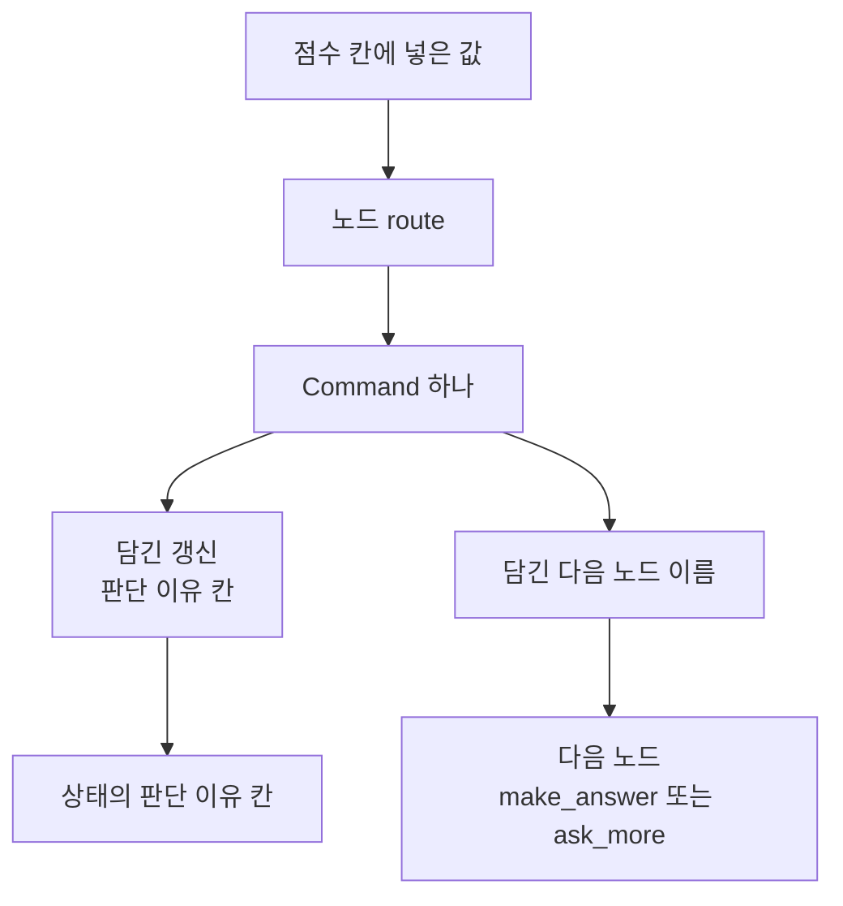
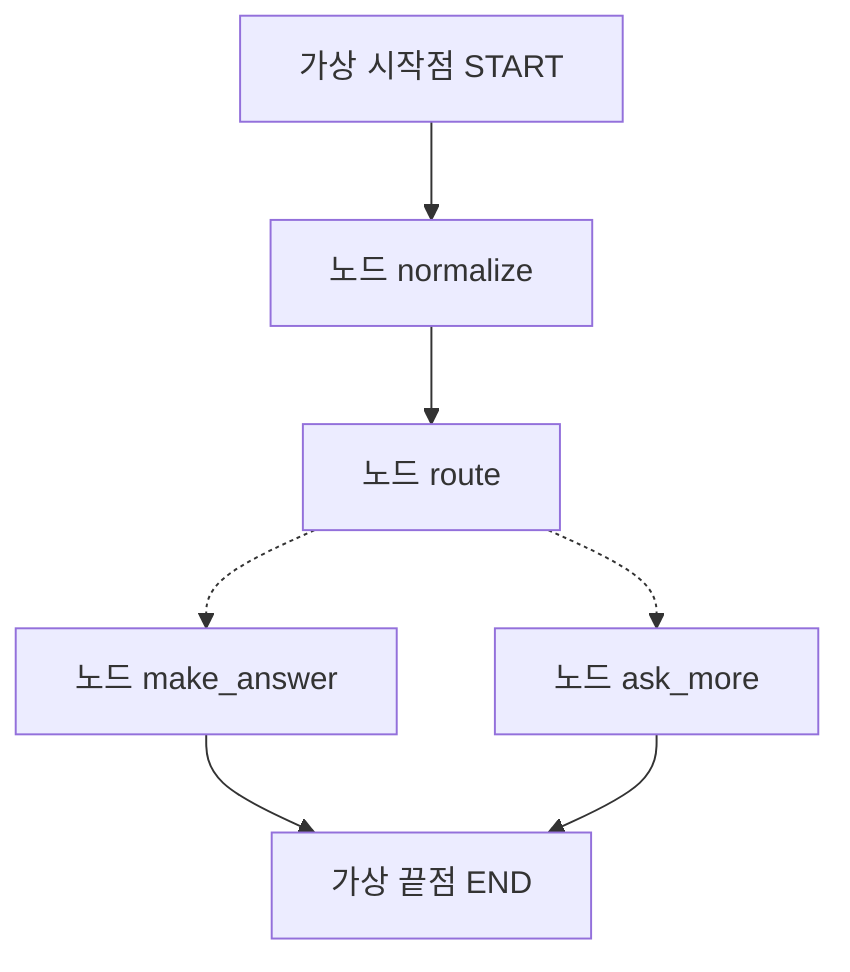
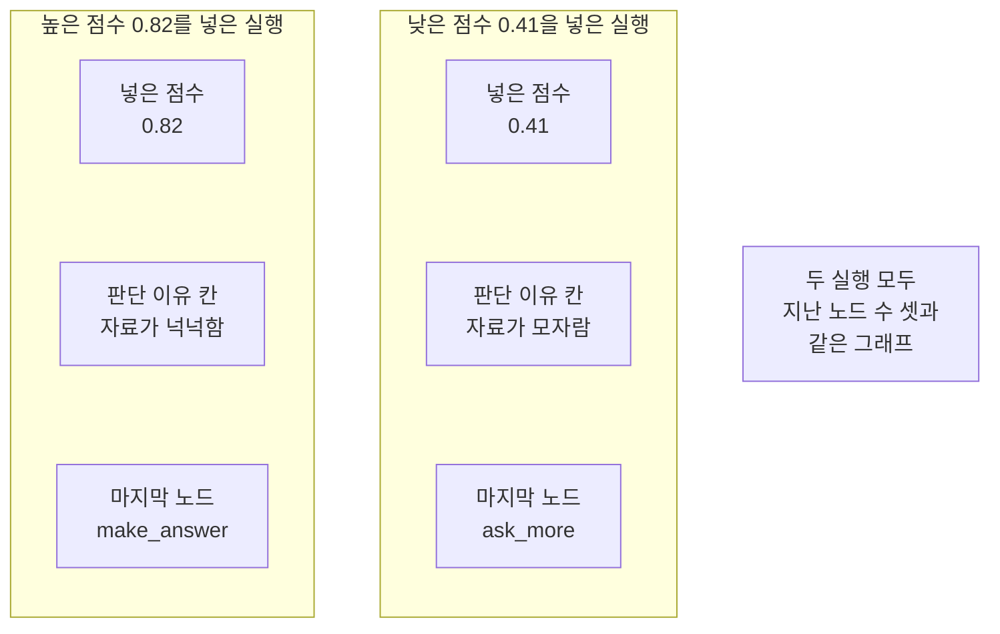
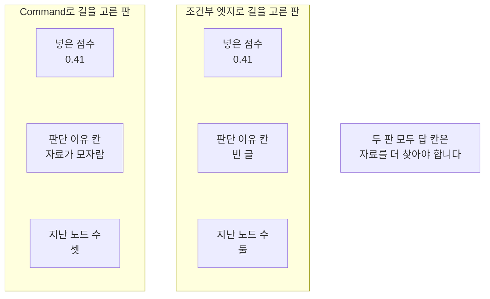

# 06-Command-갱신과-이동

## _src 본문 (HTML 원본)

```html
<!--meta: 강의 1h | 실습 1h | 코드 notebooks/06-Command-갱신과-이동.ipynb | 새 용어 4 -->
<h2 id="b1"><span class="no">1</span>학습 목표</h2><div class="goal"><ul><li>객체 <code>Command</code>에 담기는 갱신과 다음 노드 이름을 구분할 수 있습니다.</li><li>노드 하나가 갱신과 이동을 함께 내놓는 그래프를 만들 수 있습니다.</li><li>조건부 엣지로 길을 고른 판과 무엇이 다른지 출력으로 견줄 수 있습니다.</li></ul></div>
<h2 id="b2"><span class="no">2</span>이 내용을 배우는 이유</h2><p>03절에서는 조건 함수가 점수 칸을 읽어 길을 골랐습니다. 그런데 조건 함수는 칸을 고치지 못합니다. 그래서 어떤 까닭으로 그 길을 골랐는지 상태에 남지 않았습니다. 실행이 끝난 뒤 결과만 보면 왜 그 길이었는지 알 수 없습니다.</p><p>라이브러리 LangGraph는 노드가 갱신과 다음 노드 이름을 함께 내놓는 길을 줍니다. 이번 절의 질문은 「한 노드가 고른 까닭을 상태에 적으면서 다음 노드까지 정할 수 있을까요?」입니다. 같은 점수로 판을 둘 만들어 결과를 견줘 답합니다.</p>
<h2 id="b3"><span class="no">3</span>앞에서 배운 내용</h2><p>01절에서 상태와 노드와 엣지를 코드로 적고 컴파일해 실행했습니다. 02절에서는 칸에 리듀서를 적어 갱신 여러 개를 합쳤습니다. 03절에서는 점수 칸을 읽어 다음 노드를 고르는 조건부 엣지를 만들었습니다. 04절에서는 메시지 칸에 메시지 리듀서를 적었고 05절에서는 <code>Send</code>로 갈래를 펼쳤습니다.</p><p>이 절은 03절 값을 글자까지 같게 씁니다. 첫 질문은 01절부터 같고 점수 <code>0.82</code>와 <code>0.41</code>, 기준값 <code>0.7</code>도 03절 그대로입니다. 노드 <code>normalize</code>는 02절 판, 길 끝 노드 <code>make_answer</code>와 <code>ask_more</code>는 03절 판을 씁니다. 세 노드는 실습 폴더의 도구 파일 <code>notebooks/rag_tools.py</code>에서 가져옵니다. 같은 값과 같은 노드를 써야 두 절의 결과를 나란히 볼 수 있습니다.</p><p>02절이 정한 약속 하나도 그대로 지킵니다. 규칙을 적은 칸에는 노드가 자기 몫만 냅니다. 이 절 노드가 내놓는 갱신도 실행 흔적 칸에 자기 이름 하나만 담습니다. 표시 <code>Annotated</code>와 함수 <code>operator.add</code>는 02절에서, 형식 <code>TypedDict</code>와 타입힌트는 01절에서 풀었으므로 되풀이하지 않습니다.</p><p>이 절은 모델을 한 번도 부르지 않습니다. 이 챕터에서 모델을 부르는 절은 07절과 08절입니다. Ch 9~12에서 쓴 말 「칸」과 03절에서 쓴 말 「갈래」·「기준값」을 이 절에서도 씁니다. 말 「조각」은 Ch 5의 토큰 뜻으로만 쓰고 이 절에는 나오지 않습니다.</p>
<h2 id="b4"><span class="no">4</span>핵심 개념</h2><h3>비유로 시작하기</h3><p>01절부터 쓴 나무 길과 작업대를 그대로 씁니다. 03절에서는 갈림길 앞에 표지판이 따로 서 있었습니다. 이번에는 그 표지판이 작업대 위로 올라옵니다. 작업대가 일을 마치면서 남길 글도 적고 갈 길도 함께 고릅니다.</p>
{{img:06-5-작업대-위로-옮긴-표지판|흰 바탕에 왼쪽에서 들어온 나무 길이 작업대 하나에 닿고 그 작업대 상판 위에 빈 판을 단 작은 표지판이 서 있으며 작업대 뒤에서 굽은 길 두 갈래가 오른쪽 위와 오른쪽 아래로 나가고 작업대 옆에 여섯 칸으로 나뉜 열린 나무 상자와 그 오른쪽 아래 칸에 놓인 작은 빈 나무 판이 보이는 그림|표지판이 길가가 아니라 작업대 위에 놓여 그 작업대에서 길이 두 갈래로 갈라집니다.}}
<p class="look"><b>그림 읽기</b> — 왼쪽에서 들어온 나무 길이 작업대 하나에 닿습니다. 그 작업대 상판 위에 빈 판을 단 작은 표지판이 서 있습니다. 작업대 뒤에서 굽은 길 두 갈래가 오른쪽 위와 오른쪽 아래로 나갑니다. 작업대 옆에는 여섯 칸으로 나뉜 열린 나무 상자가 있습니다. 그 오른쪽 아래 칸에 작은 나무 판 한 장이 놓여 있습니다.</p>
<table><thead><tr><th>말</th><th>뜻</th></tr></thead><tbody><tr><td><code>Command</code></td><td>상태에 넣을 갱신과 다음에 지날 노드 이름을 함께 담는 객체입니다. 라이브러리가 줍니다.</td></tr><tr><td>담긴 갱신(<code>update</code>)</td><td>그 객체에 담은 딕셔너리입니다. 일반 노드가 내놓는 갱신과 같은 자리입니다.</td></tr><tr><td>담긴 다음 노드 이름(<code>goto</code>)</td><td>그 실행에서 이어 지날 노드 하나입니다.</td></tr><tr><td>적어 둔 목적지(<code>destinations</code>)</td><td>노드를 등록할 때 함께 적는 목적지 목록입니다. 구조 그림에만 쓰입니다.</td></tr></tbody></table>
{{mermaid:06-1-갱신과-이동을-함께|위에서 아래로 놓인 상자 일곱으로 맨 위 초록 상자 점수 칸에 넣은 값에서 화살표가 파란 상자 노드 route로 이어지고 거기서 회색 상자 Command 하나로 이어지며 그 아래에서 화살표 두 개가 갈라져 왼쪽 파란 상자 담긴 갱신 판단 이유 칸과 오른쪽 파란 상자 담긴 다음 노드 이름으로 가고 왼쪽 줄기는 초록 상자 상태의 판단 이유 칸으로 오른쪽 줄기는 파란 상자 다음 노드로 이어지는 그림|노드 하나가 낸 Command에 갱신과 다음 노드 이름이 함께 담겨 각각 상태와 이동으로 갑니다.}}
<p class="look"><b>도식 읽기</b> — 위에서 아래로 읽습니다. 맨 위 초록 상자가 그래프에 넣은 점수 칸입니다. 그 아래 파란 상자가 점수 칸을 읽는 우리 노드입니다. 가운데 회색 상자가 라이브러리가 주는 <code>Command</code> 하나이고 거기서 줄기가 둘로 갈라집니다. 왼쪽 줄기는 상태의 판단 이유 칸으로 가고 오른쪽 줄기는 다음 노드로 갑니다.</p>
<h3>갱신과 이동을 한 번에</h3><p>01절부터 노드는 바꿀 칸을 담은 딕셔너리 하나를 내놓았습니다. 이 절 노드는 그 딕셔너리를 객체 <code>Command</code> 안에 넣고 다음 노드 이름을 함께 적습니다. 자리 <code>update</code>에 넣은 딕셔너리는 일반 노드 갱신과 같은 자리입니다. 그래서 칸에 적어 둔 규칙을 그대로 받습니다. 자리 <code>goto</code>에 적은 이름이 그 실행에서 이어 지날 노드입니다.</p>
<h3>목적지는 구조 그림에만 쓰입니다</h3><p>다음 노드를 노드 안에서 정하면 설계 객체에는 그 이동이 적히지 않습니다. 그래서 그래프가 스스로 그리는 구조 그림에 그 갈래가 빠집니다. 노드를 등록할 때 인자 <code>destinations</code>에 갈 수 있는 곳을 적어 두면 구조 그림에 점선으로 나타납니다. 이 인자는 실행을 바꾸지 않습니다. 노트북 8절에서 그 사실을 출력으로 확인합니다.</p>
<h3>조건부 엣지와 무엇이 다른가</h3><p>03절 조건 함수는 이름표 하나만 내놓고 칸을 고치지 못했습니다. 이 절 노드는 칸도 고치고 다음 노드도 정합니다. 그래서 고른 까닭이 상태에 남습니다. 대신 길을 고르는 일을 맡은 노드가 하나 늘어 지나간 노드 수도 하나 늘어납니다. 노트북 9절에서 같은 점수로 두 판을 실행해 견줍니다.</p>
<h2 id="b5"><span class="no">5</span>실행 예제</h2><p>이 절은 모델을 한 번도 부르지 않습니다. 읽어 오는 자료 파일도 없고 새로 쓰는 파일도 없습니다. 노드는 넷이고 고정 엣지는 넷이며 조건부 엣지는 없습니다.</p><p>먼저 점수 칸을 읽어 <code>Command</code>를 내놓는 노드를 그래프 없이 직접 불러 봅니다. 그다음 그 노드를 붙인 그래프에 점수 하나만 바꿔 두 번 실행합니다. 마지막으로 목적지를 적지 않은 판과 03절 모양 판을 차례로 만들어 견줍니다.</p>
{{mermaid:06-2-이-절-그래프의-이동|위에서 아래로 놓인 상자 여섯으로 맨 위 회색 상자 가상 시작점 START에서 실선 화살표가 파란 상자 노드 normalize로 이어지고 다시 실선 화살표가 파란 상자 노드 route로 이어지며 거기서 점선 화살표 두 개가 갈라져 왼쪽 아래 파란 상자 노드 make_answer와 오른쪽 아래 파란 상자 노드 ask_more로 가고 두 상자에서 실선 화살표가 맨 아래 회색 상자 가상 끝점 END로 모이는 그림|고정 엣지는 실선이고 Command가 정하는 이동 두 갈래는 점선으로 그려집니다.}}
<p class="look"><b>도식 읽기</b> — 위에서 아래로 읽습니다. 맨 위 회색 상자가 입력이 들어오는 자리입니다. 실선 화살표 두 개가 우리가 적은 고정 엣지입니다. 가운데 파란 상자 아래의 점선 화살표 두 개가 <code>Command</code>가 정하는 이동입니다. 맨 아래 회색 상자로 두 갈래가 다시 모입니다.</p>
{{notebook:06-Command-갱신과-이동}}
{{mermaid:06-3-점수-하나만-바꾼-두-실행|왼쪽부터 오른쪽으로 놓인 칸 두 개와 회색 상자 하나로 왼쪽 칸 제목은 높은 점수 0.82를 넣은 실행이고 그 안에 초록 상자 넣은 점수 0.82와 노란 상자 판단 이유 칸 자료가 넉넉함과 노란 상자 마지막 노드 make_answer가 있으며 가운데 칸 제목은 낮은 점수 0.41을 넣은 실행이고 그 안에 초록 상자 넣은 점수 0.41과 노란 상자 판단 이유 칸 자료가 모자람과 노란 상자 마지막 노드 ask_more가 있고 오른쪽에 회색 상자 두 실행 모두 지난 노드 수 셋과 같은 그래프가 놓인 그림|점수 하나만 바꿨더니 판단 이유 칸과 마지막 노드가 함께 달라집니다.}}
<p class="look"><b>도식 읽기</b> — 왼쪽 칸이 높은 점수를 넣은 실행입니다. 가운데 칸이 낮은 점수를 넣은 실행입니다. 칸마다 맨 위 초록 상자가 넣은 값이고 그 아래 노란 상자 두 개가 나온 값입니다. 판단 이유 칸과 마지막 노드가 두 칸에서 갈렸습니다. 오른쪽 회색 상자는 두 칸에 모두 해당하는 사실입니다.</p>
<p class="look"><b>확인할 점</b> — 높은 점수를 넣은 실행의 출력은 <code>판단 이유 칸 | 자료가 넉넉함</code>이었습니다. 같은 그래프에 낮은 점수를 넣으면 <code>판단 이유 칸 | 자료가 모자람</code>이었습니다. 실행 흔적 칸에는 각각 <code>['normalize', 'route', 'make_answer']</code>와 <code>['normalize', 'route', 'ask_more']</code>가 남았습니다. 두 실행 모두 출력 줄 <code>지난 노드 수가 같은가: True</code>로 셋이었습니다.</p>
<h2 id="b6"><span class="no">6</span>실험 결과 해석</h2><p>점수 하나만 바꿨는데 판단과 길이 함께 달라졌습니다. 판단 이유 칸과 답 칸과 마지막 노드가 모두 갈렸습니다. 판단을 적은 자리와 길을 고른 자리가 같은 노드입니다. 그래서 둘이 어긋날 자리가 없습니다.</p><p>목적지를 적지 않은 판도 만들어 보았습니다. 구조 문자열에서 노드 이름이 든 줄이 넷에서 셋으로 줄고 <code>route --> __end__;</code> 한 줄만 남았습니다. 그래도 실행 결과는 같았고 출력 줄 <code>목적지를 적어 둔 판의 결과와 같은가: True</code>였습니다. 적어 둔 목적지는 구조 그림에만 쓰입니다.</p>
{{mermaid:06-4-까닭이-남는-판과-남지-않는-판|왼쪽부터 오른쪽으로 놓인 칸 두 개와 회색 상자 하나로 왼쪽 칸 제목은 Command로 길을 고른 판이고 그 안에 초록 상자 넣은 점수 0.41과 노란 상자 판단 이유 칸 자료가 모자람과 노란 상자 지난 노드 수 셋이 있으며 가운데 칸 제목은 조건부 엣지로 길을 고른 판이고 그 안에 초록 상자 넣은 점수 0.41과 노란 상자 판단 이유 칸 빈 글과 노란 상자 지난 노드 수 둘이 있고 오른쪽에 회색 상자 두 판 모두 답 칸은 자료를 더 찾아야 합니다가 놓인 그림|같은 점수로 같은 답에 닿았지만 판단 이유 칸이 남은 쪽은 Command로 길을 고른 판입니다.}}
<p class="look"><b>도식 읽기</b> — 왼쪽 칸이 <code>Command</code>로 길을 고른 판입니다. 가운데 칸이 03절 모양으로 조건부 엣지를 쓴 판입니다. 칸마다 맨 위 초록 상자가 넣은 값이고 그 아래 노란 상자 두 개가 나온 값입니다. 판단 이유 칸과 지난 노드 수가 두 칸에서 갈렸습니다. 오른쪽 회색 상자는 두 칸에 모두 해당하는 사실입니다.</p>
<p>같은 낮은 점수를 넣었을 때 두 판의 답 칸은 같았습니다. 다만 조건부 엣지 판의 판단 이유 칸은 빈 글 그대로였습니다. 지난 노드 수도 셋과 둘로 갈렸습니다. 길을 고르는 일을 노드가 맡으면 노드가 하나 늘고 고른 까닭이 남습니다.</p><p>여기서 확인한 것은 갈래가 둘이고 점수가 하나인 짧은 흐름입니다. 갈래가 더 많거나 노드가 자기 자신으로 다시 가는 경우는 이번에 만들지 않았습니다. 어느 쪽이 더 낫다고 적지 않습니다. 걸린 시간도 이번에 재지 않았습니다.</p>
<h2 id="b7"><span class="no">7</span>주의할 점과 실무 메모</h2><ul><li>객체 <code>Command</code>의 자리 <code>update</code>에 넣는 딕셔너리는 일반 노드 갱신과 같은 자리입니다. 칸에 적은 규칙을 그대로 받습니다.</li><li>자리 <code>goto</code>에 적는 것은 노드 이름입니다. 함수가 아니라 등록할 때 쓴 이름을 글로 적습니다.</li><li>객체 <code>Command</code>를 내놓는 노드 뒤에는 고정 엣지를 적지 않습니다. 다음 노드를 노드가 정하기 때문입니다.</li><li>그러면 그래프가 그리는 구조 그림에 그 갈래가 빠집니다. 등록할 때 인자 <code>destinations</code>에 적어 두면 점선으로 나타납니다.</li><li>인자 <code>destinations</code>는 구조 그림에만 쓰입니다. 이 절 실행에서는 적은 판과 적지 않은 판의 결과가 같았습니다.</li><li>03절 조건 함수는 칸을 고치지 못합니다. 고른 까닭을 남기려면 이 절처럼 노드가 갱신을 함께 내야 합니다.</li><li>길을 고르는 노드가 하나 늘면 실행 흔적 칸에 이름도 하나 더 남습니다. 이 절에서 셋과 둘로 갈렸습니다.</li><li>이동만 있으면 되고 남길 까닭이 없으면 03절 조건부 엣지가 그대로 좋습니다. 이 절은 어느 쪽이 낫다고 재지 않았습니다.</li><li>객체 <code>Command</code>로 다른 그래프로 건너뛰는 일은 이번에 실행하지 않았습니다. 이 챕터에는 그래프가 하나뿐입니다.</li><li>이 절은 모델을 한 번도 부르지 않았습니다. 요청 수도 비용도 0입니다.</li><li>이 절은 걸린 시간을 재지 않았습니다. 노드가 길을 골라서 빨라졌는지 느려졌는지 적지 않습니다.</li><li>준비물에 LangGraph 1.2.11을 적었습니다. 다른 판과 Windows·macOS에서는 이번에 실행하지 않았습니다.</li><li>이 절은 파일을 쓰지 않습니다. Ch 12가 남긴 기록 파일도 읽지 않습니다.</li></ul>
<h2 id="b8"><span class="no">8</span>정리와 다음 절</h2><ul><li>노드가 낸 <code>Command</code> 하나가 판단 이유 칸 갱신과 다음 노드 이름을 함께 날랐습니다.</li><li>점수 하나만 바꾸자 판단 이유 칸과 답 칸과 마지막 노드가 함께 달라졌습니다.</li><li>03절 모양으로 같은 점수를 넣으면 답은 같았지만 판단 이유 칸이 빈 글로 남았습니다.</li></ul><p><strong>다음 학습과 이어지는 지점</strong> — 07절에서는 Ch 12에서 만든 검색과 답 만들기를 그래프로 잇습니다.</p>
<h2 id="b9"><span class="no">9</span>복습 문제</h2><details class="quiz" open><summary>문제 4개 · 해설 포함</summary><p class="quiz-q">1. 객체 <code>Command</code>에는 무엇과 무엇이 함께 담깁니까?</p><p class="quiz-a">상태에 넣을 갱신과 다음에 지날 노드 이름이 함께 담깁니다. 틀렸다면 「핵심 개념」의 용어 표를 다시 읽습니다.</p><p class="quiz-q">2. 인자 <code>destinations</code>는 무엇을 바꿉니까?</p><p class="quiz-a">구조 그림만 바꿉니다. 실행 결과는 적은 판과 적지 않은 판이 같았습니다. 틀렸다면 「목적지는 구조 그림에만 쓰입니다」를 다시 읽습니다.</p><p class="quiz-q">3. 같은 낮은 점수를 넣었을 때 03절 모양 판의 판단 이유 칸은 어떻게 됐습니까?</p><p class="quiz-a">빈 글 그대로였습니다. 조건 함수는 칸을 고치지 못하기 때문입니다. 틀렸다면 「실험 결과 해석」을 다시 읽습니다.</p><p class="quiz-q">4. 두 판에서 지난 노드 수가 갈린 까닭은 무엇입니까?</p><p class="quiz-a">길을 고르는 일을 맡은 노드가 하나 늘었기 때문입니다. 틀렸다면 「조건부 엣지와 무엇이 다른가」를 다시 읽습니다.</p></details>
<h2 id="b10"><span class="no">10</span>참고 자료</h2><ul><li><div><a href="https://reference.langchain.com/python/langgraph/types/Command">Command API</a></div>갱신과 다음 노드 이름을 담는 객체 설명 · 1.2.11 · 확인 2026-09-10</li><li><div><a href="https://reference.langchain.com/python/langgraph/graph/state/StateGraph">StateGraph API</a></div>노드를 등록할 때 쓰는 인자 목록 · 1.2.11 · 확인 2026-09-10</li><li><div><a href="https://docs.langchain.com/oss/python/langgraph/use-graph-api">LangGraph Graph API 사용법</a></div>노드가 이동을 정하는 방법 설명 · 1.2.11 · 확인 2026-09-10</li></ul>
```

## 노트북 셀 (순서대로)

### [0] markdown {'html': 'skip'}

# Command의 갱신과 이동

**이 노트북에서 할 일**

1. 점수 칸을 읽어 갱신과 다음 노드 이름을 함께 담는 노드를 만듭니다.
2. 그 노드를 그래프 없이 먼저 불러 담긴 두 가지를 봅니다.
3. 그 노드를 붙인 그래프에 점수 하나만 바꿔 두 번 실행합니다.
4. 목적지를 적지 않은 판과 03절 조건부 엣지 판을 차례로 견줍니다.

**준비물** — 이 절은 OpenAI API 키를 쓰지 않습니다.
모델 요청이 0번이라 드는 비용이 없습니다.
읽어 오는 자료 파일도 없고 새로 쓰는 파일도 없습니다.
실행 시간은 1분 안팎이고 첫 셀의 설치가 가장 오래 걸립니다.

**기준 버전** — 첫 셀에서 LangGraph 1.2.11과 도구 파일이 쓰는 numpy 2.5.3을 설치합니다.
메시지 클래스를 쓰지 않아 04절에서 설치한 LangChain은 설치하지 않습니다.
교재 출력은 Linux의 Python 3.12.13으로 만들었습니다.
다른 판과 Windows·macOS에서는 이번에 실행하지 않았습니다.

**강의와 실습 범위** — 강의 시간에는 3~7절을 읽습니다.
노드 하나가 갱신과 다음 노드 이름을 함께 내놓게 만들어 붙이는 자리입니다.
8절과 9절은 판을 하나씩 바꿔 보는 자리입니다.
10절은 네 실행을 기록 한 줄씩으로 만들어 표로 견주는 자리입니다.
준비부터 끝까지 함께 실행하고 실습 시간에 다시 읽습니다.

실습 폴더 `labs/part4/ch13-langgraph-basics`에서 `uv sync --locked`를 실행합니다.
그다음 이 폴더의 `.venv` 커널을 고르고 첫 셀부터 순서대로 실행합니다.

### [1] markdown {'html': 'skip'}

## 오늘 볼 그림


맨 위 초록 상자가 그래프에 넣은 점수 칸입니다.
그 아래 파란 상자가 점수 칸을 읽는 우리 노드입니다.
가운데 회색 상자가 라이브러리가 주는 `Command` 하나입니다.
거기서 갈라진 왼쪽 줄기가 상태에 넣을 갱신입니다.
오른쪽 줄기가 이어서 지날 노드 이름입니다.

### [2] markdown {}

## 1. 준비

첫 셀은 패키지 두 개를 설치하고 설치된 판 번호를 출력합니다.
설치에는 몇십 초가 걸릴 수 있습니다.

### [3] code {'execution': {'iopub.execute_input': '2026-09-21T09:06:07.381717Z', 'iopub.status.busy': '2026-09-21T09:06:07.381538Z', 'iopub.status.idle': '2026-09-21T09:06:07.813328Z', 'shell.execute_reply': '2026-09-21T09:06:07.812770Z'}, 'lesson_role': 'setup'}

```python
# 이 절에서 쓰는 패키지를 설치하고 버전을 확인합니다
%pip install -q "langgraph==1.2.11" "numpy==2.5.3"
from importlib.metadata import version

print("langgraph:", version("langgraph"))
print("numpy:", version("numpy"))
```

출력:
```
Note: you may need to restart the kernel to use updated packages.
langgraph: 1.2.11
numpy: 2.5.3

```

### [4] markdown {}

**결과 읽기** — 설치가 끝나면 `langgraph: 1.2.11`과 `numpy: 2.5.3`이 보입니다.
패키지 `numpy`는 이 절이 직접 쓰지 않지만 도구 파일을 불러올 때 필요합니다.
이 노트북의 출력은 2026-09-21에 이 판으로 실행한 결과입니다.

다음 셀은 이름 여섯 개를 불러옵니다.
앞의 다섯은 02절에서 불러온 것과 같습니다.
마지막 하나가 이 절에서 처음 쓰는 이름입니다.

앞에서 배운 함수는 `rag_tools.py`에 모아 두었습니다. 파일을 열면 코드를 볼 수 있습니다. 노트북과 같은 폴더(`notebooks/`)에 있는 파일입니다.

이 노트북은 02절 노드 `normalize`와 03절 길 끝 노드 `make_answer`·`ask_more`를 가져옵니다.

### [5] code {'execution': {'iopub.execute_input': '2026-09-21T09:06:07.814388Z', 'iopub.status.busy': '2026-09-21T09:06:07.814304Z', 'iopub.status.idle': '2026-09-21T09:06:08.356065Z', 'shell.execute_reply': '2026-09-21T09:06:08.355843Z'}, 'lesson_role': 'setup'}

```python
# 02절 이름 다섯 개에 이 절 이름 하나를 더해 불러옵니다
import operator
from typing import Annotated
from typing_extensions import TypedDict
from langgraph.graph import StateGraph, START, END
from langgraph.types import Command
# 02절 노드 normalize와 03절 길 끝 노드 둘을 도구 파일에서 가져옵니다
from rag_tools import ask_more, make_answer, normalize

print("이 절에서 처음 쓰는 이름:", "Command")
```

출력:
```
이 절에서 처음 쓰는 이름: Command

```

### [6] markdown {}

**결과 읽기** — 출력 줄 `이 절에서 처음 쓰는 이름: Command`가 보입니다.
객체 `Command`는 상태에 넣을 갱신과 다음에 지날 노드 이름을 함께 담습니다.
05절에서 쓴 `Send`와 같은 자리에서 가져옵니다.
도구 파일에서 가져온 노드 셋은 출력하지 않습니다.

## 2. 이 절에서 쓸 값 정하기

01절부터 쓴 첫 질문을 글자까지 같게 씁니다.
길을 가를 점수 두 개와 기준값도 03절 값을 그대로 씁니다.
같은 값을 써야 03절 결과와 이 절 결과를 나란히 볼 수 있습니다.

### [7] code {'execution': {'iopub.execute_input': '2026-09-21T09:06:08.357991Z', 'iopub.status.busy': '2026-09-21T09:06:08.357849Z', 'iopub.status.idle': '2026-09-21T09:06:08.359909Z', 'shell.execute_reply': '2026-09-21T09:06:08.359667Z'}}

```python
# 01절 질문과 03절에서 쓴 점수 두 개와 기준값을 그대로 씁니다
first_question = "  대출 기간은 며칠인가요?  "
high_score = 0.82
low_score = 0.41
enough_score = 0.7
print("첫 질문:", first_question)
print("첫 질문의 글자 수:", len(first_question))
print("높은 점수:", high_score)
print("낮은 점수:", low_score)
print("길을 가르는 기준값:", enough_score)
```

출력:
```
첫 질문:   대출 기간은 며칠인가요?  
첫 질문의 글자 수: 17
높은 점수: 0.82
낮은 점수: 0.41
길을 가르는 기준값: 0.7

```

### [8] markdown {}

**결과 읽기** — 출력 줄 `첫 질문의 글자 수: 17`은 01절부터 이어지는 같은 값입니다.
출력 줄 `높은 점수: 0.82`와 `낮은 점수: 0.41`이 길을 가를 두 값입니다.
출력 줄 `길을 가르는 기준값: 0.7`이 그 둘을 가르는 값입니다.
점수가 기준값과 같거나 크면 자료가 넉넉하다고 봅니다.

## 3. 상태 형식과 출력 함수

이 절 상태에는 판단 이유를 적을 칸이 하나 더 필요합니다.
대신 03절에서 쓴 검색어 칸은 이 절에서 쓰지 않아 뺍니다.
칸 구성이 03절과 달라 형식 이름도 새로 붙입니다.

### [9] code {'execution': {'iopub.execute_input': '2026-09-21T09:06:08.360410Z', 'iopub.status.busy': '2026-09-21T09:06:08.360368Z', 'iopub.status.idle': '2026-09-21T09:06:08.361935Z', 'shell.execute_reply': '2026-09-21T09:06:08.361778Z'}}

```python
# 03절 상태 형식에서 검색어 칸을 빼고 판단 이유 칸을 더한 상태 형식을 만듭니다
class DecisionState(TypedDict):
    question: str
    score: float
    decision: str
    answer: str
    trace: Annotated[list[str], operator.add]
```

출력:
```

```

### [10] markdown {}

**결과 읽기** — 정의 셀이라 출력이 없습니다.
칸 `decision`이 이 절에서 새로 더한 판단 이유 칸입니다.
실행 흔적 칸에는 02절에서 쓴 같은 규칙을 적었습니다.
나머지 세 칸에는 규칙을 적지 않아 덮어쓰기가 됩니다.

다음 셀은 01절부터 쓴 출력 함수를 이 절 칸에 맞춘 판입니다.

### [11] code {'execution': {'iopub.execute_input': '2026-09-21T09:06:08.362433Z', 'iopub.status.busy': '2026-09-21T09:06:08.362276Z', 'iopub.status.idle': '2026-09-21T09:06:08.364091Z', 'shell.execute_reply': '2026-09-21T09:06:08.363921Z'}}

```python
# 상태의 칸 다섯 개를 라벨 줄 아래에 한 줄씩 출력합니다
def print_state(label, state):
    print(label)
    print("질문 칸 |", state["question"])
    print("점수 칸 |", state["score"])
    print("판단 이유 칸 |", state["decision"])
    print("답 칸 |", state["answer"])
    print("실행 흔적 칸 |", state["trace"])
```

출력:
```

```

### [12] markdown {}

**결과 읽기** — 정의 셀이라 출력이 없습니다.
03절 판과 견주면 검색어 칸 줄이 빠지고 판단 이유 칸 줄이 들어왔습니다.
다섯 칸 모두 한 줄로 나오는 값이라 개수만 적지 않고 값을 그대로 출력합니다.

다음 셀은 점수만 바꿔 처음 상태를 만드는 함수입니다.
03절에서 쓴 함수에 판단 이유 칸 한 줄을 더했습니다.

### [13] code {'execution': {'iopub.execute_input': '2026-09-21T09:06:08.364533Z', 'iopub.status.busy': '2026-09-21T09:06:08.364460Z', 'iopub.status.idle': '2026-09-21T09:06:08.365981Z', 'shell.execute_reply': '2026-09-21T09:06:08.365841Z'}}

```python
# 점수 칸만 다른 처음 상태를 만들어 냅니다
def new_state(score):
    state = {}
    state["question"] = first_question
    state["score"] = score
    state["decision"] = ""
    state["answer"] = ""
    state["trace"] = []
    return state
```

출력:
```

```

### [14] markdown {}

**결과 읽기** — 정의 셀이라 출력이 없습니다.
판단 이유 칸과 답 칸은 빈 글로 두고 실행이 채우게 합니다.
실행 흔적 칸은 빈 목록으로 두고 노드마다 이름 하나씩 이어 붙입니다.

## 4. 길 끝에서 답을 적는 노드 셋

노드 셋은 준비 셀에서 도구 파일로부터 가져왔습니다.
노드 `normalize`는 02절 판이고 질문 칸의 앞뒤 빈칸만 없앱니다.
길 끝 노드 `make_answer`와 `ask_more`는 03절에서 만든 노드입니다.
앞 노드는 자료가 넉넉할 때, 뒤 노드는 모자랄 때 지나는 길 끝입니다.
세 노드 모두 자기 칸과 자기 이름만 담아 내고 점수 칸과 판단 이유 칸은 건드리지 않습니다.

## 5. 갱신과 이동을 함께 내놓는 노드

03절에서는 조건 함수가 이름표만 내놓고 칸은 고치지 못했습니다.
그래서 어떤 까닭으로 그 길을 골랐는지 상태에 남지 않았습니다.
이 절 노드는 객체 `Command` 하나에 갱신과 다음 노드 이름을 함께 담습니다.
자리 `update`에는 일반 노드가 내놓는 것과 같은 딕셔너리를 적습니다.
자리 `goto`에는 이어서 지날 노드 이름을 적습니다.

### [15] code {'execution': {'iopub.execute_input': '2026-09-21T09:06:08.366318Z', 'iopub.status.busy': '2026-09-21T09:06:08.366281Z', 'iopub.status.idle': '2026-09-21T09:06:08.367791Z', 'shell.execute_reply': '2026-09-21T09:06:08.367654Z'}}

```python
# 점수 칸을 읽어 판단 이유 칸 갱신과 다음 노드 이름을 함께 담아 냅니다
def route(state):
    if state["score"] >= enough_score:
        return Command(update={"decision": "자료가 넉넉함", "trace": ["route"]}, goto="make_answer")
    return Command(update={"decision": "자료가 모자람", "trace": ["route"]}, goto="ask_more")
```

출력:
```

```

### [16] markdown {}

**결과 읽기** — 정의 셀이라 출력이 없습니다.
점수가 기준값과 같거나 크면 자료가 넉넉하다고 적고 답 만들기 쪽으로 보냅니다.
그렇지 않으면 자료가 모자라다고 적고 자료 더 찾기 쪽으로 보냅니다.
실행 흔적 칸에는 이 노드도 자기 이름 하나만 담습니다.

다음 셀은 그래프 없이 이 노드만 두 점수로 불러 봅니다.

### [17] code {'execution': {'iopub.execute_input': '2026-09-21T09:06:08.368135Z', 'iopub.status.busy': '2026-09-21T09:06:08.368069Z', 'iopub.status.idle': '2026-09-21T09:06:08.369657Z', 'shell.execute_reply': '2026-09-21T09:06:08.369514Z'}}

```python
# 그래프 없이 이 노드만 두 점수로 불러 담긴 두 가지를 봅니다
high_command = route({"score": high_score})
low_command = route({"score": low_score})
print("높은 점수로 낸 것의 종류:", type(high_command))
print("높은 점수로 낸 갱신:", high_command.update)
print("높은 점수로 정한 다음 노드:", high_command.goto)
print("낮은 점수로 낸 갱신:", low_command.update)
print("낮은 점수로 정한 다음 노드:", low_command.goto)
```

출력:
```
높은 점수로 낸 것의 종류: <class 'langgraph.types.Command'>
높은 점수로 낸 갱신: {'decision': '자료가 넉넉함', 'trace': ['route']}
높은 점수로 정한 다음 노드: make_answer
낮은 점수로 낸 갱신: {'decision': '자료가 모자람', 'trace': ['route']}
낮은 점수로 정한 다음 노드: ask_more

```

### [18] markdown {}

**결과 읽기** — 출력 줄 `높은 점수로 낸 갱신: {'decision': '자료가 넉넉함', 'trace': ['route']}`이 담긴 갱신입니다.
출력 줄 `높은 점수로 정한 다음 노드: make_answer`가 담긴 노드 이름입니다.
낮은 점수에서는 갱신과 노드 이름이 모두 달라졌습니다.
출력 줄 `낮은 점수로 정한 다음 노드: ask_more`가 그 자리입니다.
갱신 쪽 모양은 01절부터 본 노드 갱신과 같습니다.

## 6. 조립과 실행

설계 객체를 만들고 노드 넷을 등록합니다.
노드 `route`를 등록할 때 갈 수 있는 목적지를 함께 적습니다.
인자 `destinations`는 실행이 아니라 구조 그림에만 쓰입니다.
8절에서 이 인자를 빼고 무엇이 달라지는지 봅니다.

### [19] code {'execution': {'iopub.execute_input': '2026-09-21T09:06:08.370108Z', 'iopub.status.busy': '2026-09-21T09:06:08.370040Z', 'iopub.status.idle': '2026-09-21T09:06:08.371956Z', 'shell.execute_reply': '2026-09-21T09:06:08.371813Z'}}

```python
# 설계 객체를 만들고 노드 네 개를 등록하면서 route의 목적지를 함께 적습니다
builder = StateGraph(DecisionState)
builder.add_node("normalize", normalize)
builder.add_node("route", route, destinations=("make_answer", "ask_more"))
builder.add_node("make_answer", make_answer)
builder.add_node("ask_more", ask_more)
print("등록한 노드 수:", len(builder.nodes))
```

출력:
```
등록한 노드 수: 4

```

### [20] markdown {}

**결과 읽기** — 출력 줄 `등록한 노드 수: 4`가 보입니다.
01절·02절은 둘, 03절은 넷, 04절은 셋, 05절은 둘이었습니다.

다음 셀은 고정 엣지만 적고 컴파일합니다.
03절은 갈래를 조건부 엣지로 적었지만 이 절은 적지 않습니다.
갈래를 정하는 일을 노드가 맡았기 때문입니다.

### [21] code {'execution': {'iopub.execute_input': '2026-09-21T09:06:08.372336Z', 'iopub.status.busy': '2026-09-21T09:06:08.372269Z', 'iopub.status.idle': '2026-09-21T09:06:08.375135Z', 'shell.execute_reply': '2026-09-21T09:06:08.374984Z'}}

```python
# 고정 엣지 네 개만 적고 컴파일합니다
builder.add_edge(START, "normalize")
builder.add_edge("normalize", "route")
builder.add_edge("make_answer", END)
builder.add_edge("ask_more", END)
graph = builder.compile()
print("고정 엣지로 적은 수:", len(builder.edges))
print("컴파일 결과의 종류:", type(graph))
```

출력:
```
고정 엣지로 적은 수: 4
컴파일 결과의 종류: <class 'langgraph.graph.state.CompiledStateGraph'>

```

### [22] markdown {}

**결과 읽기** — 출력 줄 `고정 엣지로 적은 수: 4`가 보입니다.
03절은 고정 엣지 넷에 조건부 엣지 하나를 더 적었습니다.
출력 줄의 종류 이름 `CompiledStateGraph`는 01절부터 같습니다.

다음 셀은 그래프가 스스로 그린 구조 문자열을 봅니다.
줄이 많아 노드 이름이 든 줄만 골라 출력합니다.

### [23] code {'execution': {'iopub.execute_input': '2026-09-21T09:06:08.375569Z', 'iopub.status.busy': '2026-09-21T09:06:08.375492Z', 'iopub.status.idle': '2026-09-21T09:06:08.388620Z', 'shell.execute_reply': '2026-09-21T09:06:08.388442Z'}}

```python
# 그래프가 스스로 그린 구조 문자열에서 route가 나오는 줄만 골라 출력합니다
structure_text = graph.get_graph().draw_mermaid()
print("구조 문자열에서 route가 나오는 줄")
for line in structure_text.split("\n"):
    if "route" in line:
        print(line.strip())
```

출력:
```
구조 문자열에서 route가 나오는 줄
route(route)
normalize --> route;
route -.-> ask_more;
route -.-> make_answer;

```

### [24] markdown {}

**결과 읽기** — 라벨 줄 `구조 문자열에서 route가 나오는 줄` 아래 네 줄이 나옵니다.
줄 `normalize --> route;`는 우리가 적은 고정 엣지입니다.
줄 `route -.-> ask_more;`와 `route -.-> make_answer;`는 점선으로 그려집니다.
등록할 때 적어 둔 목적지 둘이 이 두 줄이 됐습니다.

다음 셀은 점수 칸에 높은 점수를 넣고 실행합니다.
실행 전에 예상해 봅니다.
점수가 기준값보다 크니 답 만들기 쪽으로 갈 것입니다.

### [25] code {'execution': {'iopub.execute_input': '2026-09-21T09:06:08.389122Z', 'iopub.status.busy': '2026-09-21T09:06:08.389059Z', 'iopub.status.idle': '2026-09-21T09:06:08.392703Z', 'shell.execute_reply': '2026-09-21T09:06:08.392554Z'}}

```python
# 점수 칸에 높은 점수를 넣고 그래프를 실행합니다
high_state = new_state(high_score)
high_result = graph.invoke(high_state)
print_state("높은 점수 결과", high_result)
assert high_result["trace"] == ["normalize", "route", "make_answer"]
```

출력:
```
높은 점수 결과
질문 칸 | 대출 기간은 며칠인가요?
점수 칸 | 0.82
판단 이유 칸 | 자료가 넉넉함
답 칸 | 찾은 자료로 답을 만듭니다
실행 흔적 칸 | ['normalize', 'route', 'make_answer']

```

### [26] markdown {}

**결과 읽기** — 줄 `판단 이유 칸 | 자료가 넉넉함`이 노드가 남긴 판단입니다.
줄 `답 칸 | 찾은 자료로 답을 만듭니다`가 길 끝 노드가 적은 답입니다.
줄 `실행 흔적 칸 | ['normalize', 'route', 'make_answer']`에 이름이 셋 남았습니다.
판단을 적은 자리와 길을 고른 자리가 같은 노드입니다.

## 7. 점수 하나만 바꿔 다시 실행

바꿀 값은 점수 하나입니다.
그래프도 노드도 그대로 두고 낮은 점수를 넣습니다.
실행 전에 예상해 봅니다.
점수가 기준값보다 작으니 자료 더 찾기 쪽으로 갈 것입니다.

### [27] code {'execution': {'iopub.execute_input': '2026-09-21T09:06:08.393112Z', 'iopub.status.busy': '2026-09-21T09:06:08.393039Z', 'iopub.status.idle': '2026-09-21T09:06:08.395131Z', 'shell.execute_reply': '2026-09-21T09:06:08.394984Z'}}

```python
# 점수 칸에 낮은 점수를 넣고 같은 그래프를 실행합니다
low_state = new_state(low_score)
low_result = graph.invoke(low_state)
print_state("낮은 점수 결과", low_result)
assert low_result["trace"] == ["normalize", "route", "ask_more"]
```

출력:
```
낮은 점수 결과
질문 칸 | 대출 기간은 며칠인가요?
점수 칸 | 0.41
판단 이유 칸 | 자료가 모자람
답 칸 | 자료를 더 찾아야 합니다
실행 흔적 칸 | ['normalize', 'route', 'ask_more']

```

### [28] markdown {}

**결과 읽기** — 줄 `판단 이유 칸 | 자료가 모자람`으로 판단이 바뀌었습니다.
줄 `답 칸 | 자료를 더 찾아야 합니다`로 답도 바뀌었습니다.
줄 `실행 흔적 칸 | ['normalize', 'route', 'ask_more']`에서 마지막 이름만 달라졌습니다.
점수 하나만 바꿨는데 판단과 길이 함께 달라졌습니다.

다음 셀은 두 실행을 칸별로 견줍니다.

### [29] code {'execution': {'iopub.execute_input': '2026-09-21T09:06:08.397501Z', 'iopub.status.busy': '2026-09-21T09:06:08.397465Z', 'iopub.status.idle': '2026-09-21T09:06:08.399116Z', 'shell.execute_reply': '2026-09-21T09:06:08.398970Z'}}

```python
# 두 실행의 결과를 칸별로 견줍니다
print("판단 이유 칸이 같은가:", high_result["decision"] == low_result["decision"])
print("답 칸이 같은가:", high_result["answer"] == low_result["answer"])
print("실행 흔적 칸이 같은가:", high_result["trace"] == low_result["trace"])
print("지난 노드 수가 같은가:", len(high_result["trace"]) == len(low_result["trace"]))
```

출력:
```
판단 이유 칸이 같은가: False
답 칸이 같은가: False
실행 흔적 칸이 같은가: False
지난 노드 수가 같은가: True

```

### [30] markdown {}

**결과 읽기** — 출력 줄 `판단 이유 칸이 같은가: False`와 `답 칸이 같은가: False`가 갈린 자리입니다.
출력 줄 `실행 흔적 칸이 같은가: False`도 마지막 이름에서 갈렸습니다.
출력 줄 `지난 노드 수가 같은가: True`는 두 실행이 셋으로 같았습니다.
길은 갈렸지만 지나간 노드 수는 같습니다.

## 8. 값 바꿔 보기 ① 목적지를 적지 않으면

바꿀 값은 등록할 때 적은 목적지 하나입니다.
같은 노드와 같은 엣지로 판을 하나 더 만들되 그 인자만 뺍니다.
실행 전에 예상해 봅니다.
객체 `Command`가 실행 때 목적지를 정하므로 결과는 같을 것입니다.

### [31] code {'execution': {'iopub.execute_input': '2026-09-21T09:06:08.399489Z', 'iopub.status.busy': '2026-09-21T09:06:08.399426Z', 'iopub.status.idle': '2026-09-21T09:06:08.401949Z', 'shell.execute_reply': '2026-09-21T09:06:08.401751Z'}}

```python
# 같은 노드와 같은 엣지로 목적지만 적지 않은 판을 하나 더 만듭니다
plain_builder = StateGraph(DecisionState)
plain_builder.add_node("normalize", normalize)
plain_builder.add_node("route", route)
plain_builder.add_node("make_answer", make_answer)
plain_builder.add_node("ask_more", ask_more)
plain_builder.add_edge(START, "normalize")
plain_builder.add_edge("normalize", "route")
plain_builder.add_edge("make_answer", END)
plain_builder.add_edge("ask_more", END)
plain_graph = plain_builder.compile()
print("목적지를 적지 않은 판의 노드 수:", len(plain_builder.nodes))
```

출력:
```
목적지를 적지 않은 판의 노드 수: 4

```

### [32] markdown {}

**결과 읽기** — 출력 줄 `목적지를 적지 않은 판의 노드 수: 4`가 앞 그래프와 같습니다.
노드도 엣지도 앞 그래프와 같은 것을 씁니다.
다른 것은 등록할 때 적은 목적지 하나뿐입니다.

다음 셀은 이 판의 구조 문자열을 같은 방법으로 봅니다.

### [33] code {'execution': {'iopub.execute_input': '2026-09-21T09:06:08.402412Z', 'iopub.status.busy': '2026-09-21T09:06:08.402358Z', 'iopub.status.idle': '2026-09-21T09:06:08.404160Z', 'shell.execute_reply': '2026-09-21T09:06:08.404026Z'}}

```python
# 목적지를 적지 않은 판의 구조 문자열에서도 route가 나오는 줄만 봅니다
plain_text = plain_graph.get_graph().draw_mermaid()
print("목적지를 적지 않은 판에서 route가 나오는 줄")
for line in plain_text.split("\n"):
    if "route" in line:
        print(line.strip())
```

출력:
```
목적지를 적지 않은 판에서 route가 나오는 줄
route(route)
normalize --> route;
route --> __end__;

```

### [34] markdown {}

**결과 읽기** — 라벨 줄 아래 세 줄만 나옵니다.
줄 `route --> __end__;`가 목적지 두 줄 대신 들어왔습니다.
갈 수 있는 곳을 적어 두지 않아 구조 그림이 실제 이동과 다릅니다.
구조 그림을 남에게 보일 때는 목적지를 적어 두는 편이 낫습니다.

다음 셀은 이 판에 같은 낮은 점수를 넣어 실행합니다.

### [35] code {'execution': {'iopub.execute_input': '2026-09-21T09:06:08.404568Z', 'iopub.status.busy': '2026-09-21T09:06:08.404503Z', 'iopub.status.idle': '2026-09-21T09:06:08.406300Z', 'shell.execute_reply': '2026-09-21T09:06:08.406166Z'}}

```python
# 목적지를 적지 않은 판에 낮은 점수를 넣어 실행합니다
plain_result = plain_graph.invoke(new_state(low_score))
print_state("목적지를 적지 않은 판 · 낮은 점수", plain_result)
print("목적지를 적어 둔 판의 결과와 같은가:", plain_result == low_result)
```

출력:
```
목적지를 적지 않은 판 · 낮은 점수
질문 칸 | 대출 기간은 며칠인가요?
점수 칸 | 0.41
판단 이유 칸 | 자료가 모자람
답 칸 | 자료를 더 찾아야 합니다
실행 흔적 칸 | ['normalize', 'route', 'ask_more']
목적지를 적어 둔 판의 결과와 같은가: True

```

### [36] markdown {}

**결과 읽기** — 줄 `판단 이유 칸 | 자료가 모자람`으로 앞 실행과 같습니다.
줄 `실행 흔적 칸 | ['normalize', 'route', 'ask_more']`도 같습니다.
출력 줄 `목적지를 적어 둔 판의 결과와 같은가: True`가 그 사실을 한 줄로 보여 줍니다.
적어 둔 목적지는 구조 그림에만 쓰이고 실행은 바꾸지 않았습니다.

## 9. 값 바꿔 보기 ② 03절 조건부 엣지 판과 견주기

바꿀 것은 길을 고르는 자리 하나입니다.
같은 점수와 같은 길 끝 노드를 쓰되 03절 모양으로 판을 하나 더 만듭니다.
실행 전에 예상해 봅니다.
조건 함수는 칸을 고치지 못하니 판단 이유 칸이 빈 글로 남을 것입니다.

### [37] code {'execution': {'iopub.execute_input': '2026-09-21T09:06:08.406688Z', 'iopub.status.busy': '2026-09-21T09:06:08.406622Z', 'iopub.status.idle': '2026-09-21T09:06:08.408086Z', 'shell.execute_reply': '2026-09-21T09:06:08.407924Z'}}

```python
# 점수 칸을 기준값과 견줘 이름표 하나를 내놓는 03절 조건 함수를 적습니다
def choose_path(state):
    if state["score"] >= enough_score:
        return "enough"
    return "short"
```

출력:
```

```

### [38] markdown {}

**결과 읽기** — 정의 셀이라 출력이 없습니다.
이 함수는 03절에서 만든 조건 함수입니다.
노트북에서 정한 기준값을 읽으므로 도구 파일에 두지 않고 여기 적었습니다.
이름표 `enough`와 `short` 가운데 하나를 내놓습니다.
칸을 고치는 자리가 없다는 점이 이 절 노드와 다릅니다.

다음 셀은 이 조건 함수로 03절 모양 판을 만듭니다.

### [39] code {'execution': {'iopub.execute_input': '2026-09-21T09:06:08.408445Z', 'iopub.status.busy': '2026-09-21T09:06:08.408382Z', 'iopub.status.idle': '2026-09-21T09:06:08.410653Z', 'shell.execute_reply': '2026-09-21T09:06:08.410482Z'}}

```python
# route 노드 없이 03절 모양으로 조건부 엣지 판을 만듭니다
edge_builder = StateGraph(DecisionState)
edge_builder.add_node("normalize", normalize)
edge_builder.add_node("make_answer", make_answer)
edge_builder.add_node("ask_more", ask_more)
path_map = {"enough": "make_answer", "short": "ask_more"}
edge_builder.add_edge(START, "normalize")
edge_builder.add_conditional_edges("normalize", choose_path, path_map)
edge_builder.add_edge("make_answer", END)
edge_builder.add_edge("ask_more", END)
edge_graph = edge_builder.compile()
print("조건부 엣지 판의 노드 수:", len(edge_builder.nodes))
print("조건부 엣지 판의 고정 엣지 수:", len(edge_builder.edges))
```

출력:
```
조건부 엣지 판의 노드 수: 3
조건부 엣지 판의 고정 엣지 수: 3

```

### [40] markdown {}

**결과 읽기** — 출력 줄 `조건부 엣지 판의 노드 수: 3`으로 노드가 하나 적습니다.
길을 고르는 일을 노드가 아니라 조건 함수가 맡기 때문입니다.
출력 줄 `조건부 엣지 판의 고정 엣지 수: 3`이고 조건부 엣지는 이 수에 들어가지 않습니다.

다음 셀은 이 판에 같은 낮은 점수를 넣어 실행합니다.

### [41] code {'execution': {'iopub.execute_input': '2026-09-21T09:06:08.411034Z', 'iopub.status.busy': '2026-09-21T09:06:08.411000Z', 'iopub.status.idle': '2026-09-21T09:06:08.413440Z', 'shell.execute_reply': '2026-09-21T09:06:08.413069Z'}}

```python
# 조건부 엣지 판에 같은 낮은 점수를 넣어 실행합니다
edge_result = edge_graph.invoke(new_state(low_score))
print_state("조건부 엣지 판 · 낮은 점수", edge_result)
```

출력:
```
조건부 엣지 판 · 낮은 점수
질문 칸 | 대출 기간은 며칠인가요?
점수 칸 | 0.41
판단 이유 칸 | 
답 칸 | 자료를 더 찾아야 합니다
실행 흔적 칸 | ['normalize', 'ask_more']

```

### [42] markdown {}

**결과 읽기** — 줄 `답 칸 | 자료를 더 찾아야 합니다`로 답은 앞 판과 같습니다.
줄 `판단 이유 칸 |` 뒤에는 아무 글도 없습니다.
줄 `실행 흔적 칸 | ['normalize', 'ask_more']`에 이름이 둘뿐입니다.
같은 길로 갔지만 고른 까닭이 상태에 남지 않았습니다.

다음 셀은 두 판을 나란히 견줍니다.

### [43] code {'execution': {'iopub.execute_input': '2026-09-21T09:06:08.414023Z', 'iopub.status.busy': '2026-09-21T09:06:08.413970Z', 'iopub.status.idle': '2026-09-21T09:06:08.416081Z', 'shell.execute_reply': '2026-09-21T09:06:08.415677Z'}}

```python
# 두 판의 답 칸과 판단 이유 칸과 지난 노드 수를 견줍니다
print("두 판의 답 칸이 같은가:", edge_result["answer"] == low_result["answer"])
print("Command 판의 판단 이유 칸:", low_result["decision"])
print("조건부 엣지 판의 판단 이유 칸이 빈 글인가:", edge_result["decision"] == "")
print("Command 판의 지난 노드 수:", len(low_result["trace"]))
print("조건부 엣지 판의 지난 노드 수:", len(edge_result["trace"]))
```

출력:
```
두 판의 답 칸이 같은가: True
Command 판의 판단 이유 칸: 자료가 모자람
조건부 엣지 판의 판단 이유 칸이 빈 글인가: True
Command 판의 지난 노드 수: 3
조건부 엣지 판의 지난 노드 수: 2

```

### [44] markdown {}

**결과 읽기** — 출력 줄 `두 판의 답 칸이 같은가: True`로 닿은 곳은 같습니다.
출력 줄 `Command 판의 판단 이유 칸: 자료가 모자람`과 `조건부 엣지 판의 판단 이유 칸이 빈 글인가: True`가 갈린 자리입니다.
출력 줄 `Command 판의 지난 노드 수: 3`과 `조건부 엣지 판의 지난 노드 수: 2`도 함께 갈렸습니다.
갱신과 이동을 한 노드가 맡으면 노드가 하나 늘고 고른 까닭이 남습니다.

## 10. 네 실행을 기록 한 줄씩으로

끝까지 지난 실행 하나를 기록 한 줄로 만들어 담아 둡니다.
Ch 9~12와 01~05절에서 쓴 기록 한 줄과 같은 모양입니다.

### [45] code {'execution': {'iopub.execute_input': '2026-09-21T09:06:08.416568Z', 'iopub.status.busy': '2026-09-21T09:06:08.416524Z', 'iopub.status.idle': '2026-09-21T09:06:08.418286Z', 'shell.execute_reply': '2026-09-21T09:06:08.417991Z'}}

```python
# 실행 한 번을 기록 한 줄로 만듭니다
def run_row(run_name, state):
    row = {"실행": run_name}
    row["점수 칸"] = state["score"]
    row["판단 이유 칸"] = state["decision"]
    row["지난 노드 수"] = len(state["trace"])
    row["답 칸"] = state["answer"]
    return row
```

출력:
```

```

### [46] markdown {}

**결과 읽기** — 정의 셀이라 출력이 없습니다.
03절 판과 견주면 담는 칸에 판단 이유 칸과 지난 노드 수가 들어왔습니다.
이 절이 견주는 값이 그 둘이기 때문입니다.

다음 셀은 네 실행의 기록을 한 목록에 담습니다.

### [47] code {'execution': {'iopub.execute_input': '2026-09-21T09:06:08.418846Z', 'iopub.status.busy': '2026-09-21T09:06:08.418792Z', 'iopub.status.idle': '2026-09-21T09:06:08.420559Z', 'shell.execute_reply': '2026-09-21T09:06:08.420198Z'}}

```python
# 네 실행의 기록을 한 목록에 담습니다
run_rows = []
run_rows.append(run_row("Command 판 · 높은 점수", high_result))
run_rows.append(run_row("Command 판 · 낮은 점수", low_result))
run_rows.append(run_row("목적지를 적지 않은 판 · 낮은 점수", plain_result))
run_rows.append(run_row("조건부 엣지 판 · 낮은 점수", edge_result))
print("담은 기록 줄 수:", len(run_rows))
```

출력:
```
담은 기록 줄 수: 4

```

### [48] markdown {}

**결과 읽기** — 출력 줄 `담은 기록 줄 수: 4`가 보입니다.

다음 셀은 담은 줄을 표로 출력합니다.

### [49] code {'execution': {'iopub.execute_input': '2026-09-21T09:06:08.421148Z', 'iopub.status.busy': '2026-09-21T09:06:08.421105Z', 'iopub.status.idle': '2026-09-21T09:06:08.422940Z', 'shell.execute_reply': '2026-09-21T09:06:08.422583Z'}}

```python
# 실행과 점수 칸과 판단 이유 칸과 지난 노드 수와 답 칸을 라벨 줄 아래에 출력합니다
print("실행 | 점수 칸 | 판단 이유 칸 | 지난 노드 수 | 답 칸")
for row in run_rows:
    print(row["실행"], "|", row["점수 칸"], "|", row["판단 이유 칸"], "|", row["지난 노드 수"], "|", row["답 칸"])
```

출력:
```
실행 | 점수 칸 | 판단 이유 칸 | 지난 노드 수 | 답 칸
Command 판 · 높은 점수 | 0.82 | 자료가 넉넉함 | 3 | 찾은 자료로 답을 만듭니다
Command 판 · 낮은 점수 | 0.41 | 자료가 모자람 | 3 | 자료를 더 찾아야 합니다
목적지를 적지 않은 판 · 낮은 점수 | 0.41 | 자료가 모자람 | 3 | 자료를 더 찾아야 합니다
조건부 엣지 판 · 낮은 점수 | 0.41 |  | 2 | 자료를 더 찾아야 합니다

```

### [50] markdown {}

**결과 읽기** — 라벨 줄 아래 네 줄이 나옵니다.
첫 줄과 둘째 줄은 점수만 다르고 판단 이유 칸과 답 칸이 갈렸습니다.
셋째 줄 `목적지를 적지 않은 판 · 낮은 점수 | 0.41 | 자료가 모자람 | 3` 뒤 값까지 둘째 줄과 같습니다.
넷째 줄만 판단 이유 칸 자리가 비어 있고 지난 노드 수가 `2`입니다.
네 줄 모두 답 칸은 점수에 맞는 글이 들어 있습니다.

## 정리

1. 노드가 낸 `Command` 하나가 판단 이유 칸 갱신과 다음 노드 이름을 함께 날랐습니다.
2. 점수 하나만 바꾸자 판단 이유 칸과 답 칸과 마지막 노드가 함께 달라졌습니다.
3. 03절 모양으로 같은 점수를 넣으면 답은 같았지만 판단 이유 칸이 빈 글로 남았습니다.

07절에서는 Ch 12에서 만든 검색과 답 만들기를 그래프로 잇습니다.

## 그림

### 06-1-갱신과-이동을-함께.mmd



노드 하나가 낸 Command에 갱신과 다음 노드 이름이 함께 담겨 각각 상태와 이동으로 갑니다.

### 06-2-이-절-그래프의-이동.mmd



고정 엣지는 실선이고 Command가 정하는 이동 두 갈래는 점선으로 그려집니다.

### 06-3-점수-하나만-바꾼-두-실행.mmd



점수 하나만 바꿨더니 판단 이유 칸과 마지막 노드가 함께 달라집니다.

### 06-4-까닭이-남는-판과-남지-않는-판.mmd



같은 점수로 같은 답에 닿았지만 판단 이유 칸이 남은 쪽은 Command로 길을 고른 판입니다.

### 06-5-작업대-위로-옮긴-표지판.prompt.md

# 06-5-작업대-위로-옮긴-표지판 (Higgsfield 삽화)

설명 대상 문장(본문 b4 비유 단락): 03절에서는 갈림길 앞에 표지판이 따로 서 있었습니다. 이번에는 그 표지판이 작업대 위로 올라옵니다. 작업대가 일을 마치면서 남길 글도 적고 갈 길도 함께 고릅니다.

구성 요소와 배치: 흰 바탕에 왼쪽에서 들어온 나무 길 하나가 작업대 하나에 닿습니다(= 노드 `route`). 그 작업대 **위에** 빈 판을 단 작은 표지판 하나가 놓여 있습니다(= 노드가 스스로 정하는 다음 노드 이름). 작업대 바로 뒤에서 길이 위아래 두 갈래로 갈라집니다(= `make_answer`와 `ask_more`). 작업대 옆에 칸이 나뉜 나무 상자 하나가 있고 그 안에 작은 빈 나무 판 한 장이 들어 있습니다(= 판단 이유 칸에 남은 갱신).

시선 순서: 왼쪽 한 길 → 작업대 → 작업대 위 표지판 → 뒤에서 갈라지는 두 갈래 → 옆에 놓인 상자와 그 안의 나무 판.

검수 기준: 그림만 보고 「표지판이 길가가 아니라 작업대 위에 있다」와 「그 작업대 뒤에서 길이 둘로 갈라진다」와 「상자 안에 판 한 장이 들어 있다」가 읽히는가.

01~05절 비유와의 관계: 01절 삽화(`01-5`)의 나무 길과 작업대, 03절 삽화(`03-5`)의 갈림길과 빈 판 표지판을 이어 씁니다. 03절은 표지판이 길가에 따로 서 있었고 이 절은 작업대 위에 올라와 있습니다. 그 자리 하나가 이 절의 핵심입니다. 04절 상자는 칸에 쪽지를 꽂았고 05절 상자는 결과가 모이는 자리였는데, 이 절 상자는 판단 이유가 남는 자리로 씁니다. Ch 9~12가 쓴 카드·봉투·서랍·쟁반·끈·단추·관과 깔때기는 뜻이 정해져 있어 쓰지 않았습니다. 「조각」은 Ch 5 토큰 뜻 전용이라 이 그림에서도 쓰지 않습니다.

## 프롬프트 (1차)

```text
Simple flat educational illustration, white background, limited soft palette,
clean outlines, plain everyday objects, no text, no letters, no numbers, no logos.

A single wooden path comes from the left and reaches one small wooden workbench.
One small signpost with a blank board stands on top of that workbench, not beside
the path. Just behind the workbench the path splits into exactly two wooden paths,
one going up and one going down. One open wooden box divided into compartments
sits beside the workbench, and one small blank wooden tag lies clearly inside the box.

No hands, no people, no screens, no monitors, no arrows.
```

## 상태

- 2026-09-19 · `nano_banana_pro`(응답 모델 이름 `nano_banana_2`) · 16:9 · 2k · `use_unlim: false` · 장당 2크레딧.
- **1차 job `008657f6-733c-42dc-8c56-31ac0b5b6fa5` 채택**: 검수 기준 세 가지가 모두 읽힙니다. 원본 해시 `fa28b391a73d85a14edd31369a6fb282e3343ce14a72c1cd1b45c3f2e5b6c938`(2752 × 1536). 잔액 2695 → 2693.
- 02~05절 메모대로 프롬프트를 짧게 유지했더니 한 번에 끝났습니다. 생성에서 결과까지 3분이 걸리지 않았습니다.
- **그림에서 확인한 것(그림 읽기에 반영)**: 표지판은 기둥 하나에 빈 판을 달아 작업대 상판 위에 서 있습니다. 왼쪽에서 온 길이 작업대에 닿고 작업대 뒤에서 굽은 길 두 갈래가 오른쪽 위와 오른쪽 아래로 나갑니다. 상자는 여섯 칸으로 나뉘어 열려 있고 작은 나무 판 한 장이 오른쪽 아래 칸에 걸쳐 놓여 있습니다. 글자·숫자는 없습니다.
- 저장: 폭 1100px로 줄여 `figures/06-5-작업대-위로-옮긴-표지판.png`(1100 × 614). 원본 2752px는 저장하지 않았습니다. 저장 PNG를 채택 job 결과에서 같은 폭으로 줄인 그림과 픽셀 단위로 대조해 차이가 없음을 확인했습니다(`ImageChops.difference` bbox `None`, 세 칸 extrema 모두 `(0, 0)`, 규격 §5-4).

