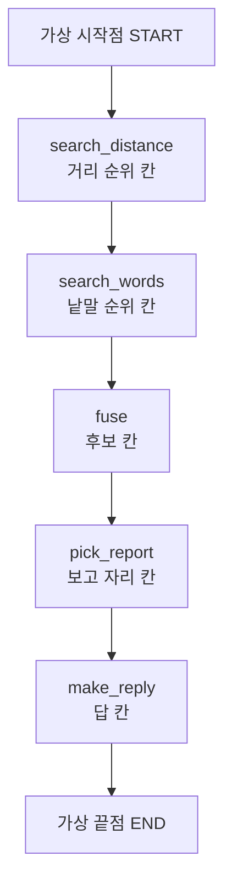
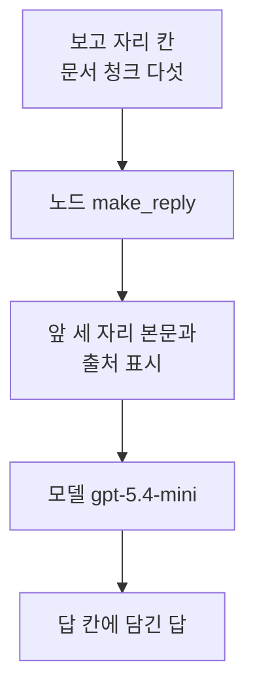
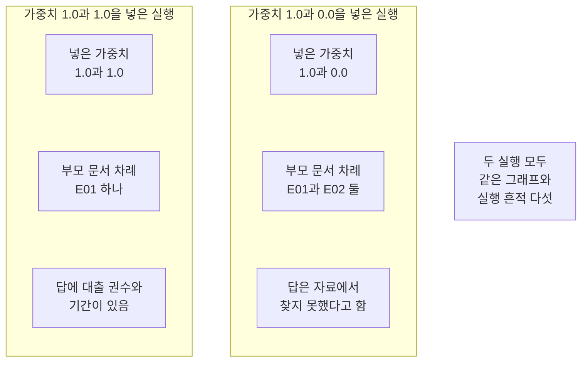
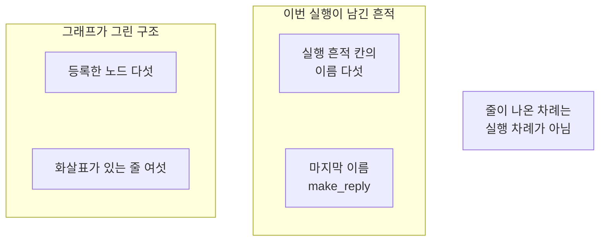

# 07-RAG-통합과-시각화

## _src 본문 (HTML 원본)

```html
<!--meta: 강의 2h | 실습 2h | 코드 notebooks/07-RAG-통합과-시각화.ipynb | 새 용어 1 -->
<h2 id="b1"><span class="no">1</span>학습 목표</h2><div class="goal"><ul><li>Ch 12에서 만든 검색 부품을 노드 하나씩으로 나눠 그래프에 붙일 수 있습니다.</li><li>그래프가 그린 구조와 실행 흔적 칸을 견줘 선언한 이동과 지난 차례를 확인할 수 있습니다.</li><li>설정을 상태의 칸에 담아 같은 그래프에 값 하나만 바꿔 다시 실행할 수 있습니다.</li></ul></div>
<h2 id="b2"><span class="no">2</span>이 내용을 배우는 이유</h2><p>01절부터 06절까지는 작은 값으로 그래프 부품을 하나씩 확인했습니다. 상태와 노드와 엣지를 적었고 규칙과 갈래와 이동까지 만들었습니다. 그런데 그 노드들이 한 일은 글자를 다듬거나 정해 둔 글을 적는 일이었습니다. 실제 자료를 다루는 처리가 노드 안에 들어가면 무엇이 달라지는지는 아직 보지 않았습니다.</p><p>이번 절의 질문은 「Ch 12에서 만든 검색과 답 만들기를 노드로 나눠 한 그래프로 이을 수 있을까요?」입니다. 부품을 붙인 뒤 구조와 실행 흔적을 견주고 설정 하나를 바꿔 답합니다.</p>
<h2 id="b3"><span class="no">3</span>앞에서 배운 내용</h2><p>01절에서 상태와 노드와 엣지를 코드로 적고 컴파일해 실행했습니다. 02절에서는 칸에 리듀서를 적어 갱신 여러 개를 합쳤습니다. 03절에서는 조건부 엣지로 갈래를 만들었고 04절에서는 메시지 칸을 다뤘습니다. 05절에서는 <code>Send</code>로 갈래를 펼쳤고 06절에서는 <code>Command</code>로 갱신과 이동을 함께 냈습니다. 이 절은 그 가운데 01절 문법과 02절 규칙만 씁니다.</p><p>Ch 12가 남긴 통합 기록 파일에는 질문 번호 <code>Q002</code>와 정답 부모 문서 ID <code>['E01']</code>이 있습니다. 그 기록이 모델에 넣은 문서 청크는 <code>E01-P03-C02</code>와 <code>E01-P03-C01</code>과 <code>E01-P03-C06</code> 세 건이고 부모가 모두 <code>E01</code>입니다. 설정 칸 <code>reranker</code>의 값은 <code>None</code>이라 Ch 12는 리랭킹을 쓰지 않았습니다. 설정 칸 <code>context_selection</code>의 값은 <code>matched-chunk-text</code>라 모델에 넣은 것은 쪽 전체가 아니라 문서 청크 본문입니다.</p><p>이 절은 그 기록에서 질문과 정답 부모 문서 ID만 가져옵니다. 저장된 답은 쓰지 않고 검색부터 답까지 이 그래프로 다시 실행합니다. 문서 청크 175개는 Ch 12 문서 파일에서 그대로 읽습니다. 두 파일 모두 읽기만 하고 고치지 않습니다.</p><p>노트북은 Ch 12 함수 여섯 개를 실습 폴더의 도구 파일 <code>notebooks/rag_tools.py</code>에서 한 줄로 가져옵니다. 낱말 고르기 <code>kiwi_terms()</code>는 Ch 12 04절, 순위 합치기 <code>fuse_rank()</code>는 06절 함수입니다. 문서 청크 모으기 <code>unique_chunk_ids()</code>와 부모 바꾸기 <code>parent_ids_of()</code>는 07절 함수입니다. 거리 순위와 낱말 순위는 Ch 12 07~13절이 쓴 문서 청크 판 두 개를 가져옵니다.</p><p>도구 파일의 함수는 Ch 12 도구 파일과 본문이 같고 벡터 계산은 NumPy로 합니다. 노트북에서 만든 값은 함수 안에서 읽지 않고 인자로 넘깁니다. 값도 같아서 순위 상수 60과 후보 수 8과 보고 자리 5를 그대로 씁니다.</p><p>01절부터 쓴 노드 <code>normalize</code>는 이 절에 넣지 않았습니다. 이 절 질문은 Ch 12 기록에서 읽은 글이라 앞뒤에 빈칸이 없기 때문입니다. 말 「칸」과 「갱신」과 「실행 흔적」은 01절 뜻 그대로입니다. 말 「조각」은 Ch 5의 토큰 뜻으로만 쓰고 문서 조각은 「문서 청크」라고 적습니다.</p>
<h2 id="b4"><span class="no">4</span>핵심 개념</h2><h3>비유로 시작하기</h3><p>01절부터 쓴 나무 길과 작업대를 그대로 씁니다. 01절 길에는 작업대가 둘이었고 03절과 06절에서는 길이 갈라졌습니다. 이번 길은 갈라지지 않고 작업대 다섯을 차례로 지납니다. 작업대마다 맡은 일이 하나씩이고 길 끝에 칸이 나뉜 상자가 놓입니다. 상자의 칸 수는 이 절 상태의 칸 수와 맞추지 않았습니다.</p>
{{img:07-5-한-줄로-이어진-작업대-다섯|흰 바탕에 왼쪽에서 오른쪽으로 곧게 뻗은 나무 널판 길 하나가 한 줄로 늘어선 같은 모양 나무 작업대 다섯을 차례로 지나고 길 오른쪽 끝 마지막 작업대 뒤에 여러 칸으로 나뉜 열린 나무 상자 하나가 길 위에 놓인 그림|한 갈래 길이 작업대 다섯을 차례로 지나고 길 끝에서 칸이 나뉜 상자에 닿습니다.}}
<p class="look"><b>그림 읽기</b> — 널판을 이어 붙인 길 하나가 왼쪽에서 오른쪽으로 곧게 뻗어 있습니다. 그 길 위에 같은 모양 작업대 다섯이 한 줄로 놓여 있습니다. 갈림길은 없고 길은 끝까지 한 갈래입니다. 길 오른쪽 끝에는 여러 칸으로 나뉜 열린 나무 상자가 놓여 있습니다.</p>
<table><thead><tr><th>말</th><th>뜻</th></tr></thead><tbody><tr><td>설정 칸</td><td>결과가 아니라 그 실행의 설정을 담아 두는 상태의 칸입니다. 이 절에서는 가중치 칸이 그 자리입니다.</td></tr></tbody></table>
<p>아래 네 말은 Ch 12에서 쓰던 뜻 그대로 이어 씁니다.</p>
<table><thead><tr><th>말</th><th>뜻</th></tr></thead><tbody><tr><td>1차 검색</td><td>두 순위를 합쳐 앞자리 여덟 개를 남긴 후보 목록입니다(Ch 12 07절).</td></tr><tr><td>보고 자리</td><td>후보 앞에서 결과로 보고할 자리 수입니다. 이 절에서도 다섯입니다(Ch 12 08절).</td></tr><tr><td>순위 합치기</td><td>자리마다 몫을 나눠 더해 두 순위를 한 차례로 만드는 일입니다(Ch 12 06절).</td></tr><tr><td>부모 문서</td><td>문서 청크가 잘려 나온 원래 문서 하나입니다(Ch 12 07절).</td></tr></tbody></table>
{{mermaid:07-1-부품-다섯을-한-줄기로|위에서 아래로 놓인 상자 일곱으로 맨 위 회색 상자 가상 시작점 START에서 화살표가 파란 상자 노드 search_distance 거리 순위 칸으로 이어지고 차례로 파란 상자 노드 search_words 낱말 순위 칸과 파란 상자 노드 fuse 후보 칸과 파란 상자 노드 pick_report 보고 자리 칸과 파란 상자 노드 make_reply 답 칸을 지나 맨 아래 회색 상자 가상 끝점 END로 이어지는 그림|Ch 12 검색 부품 다섯이 노드 다섯이 되어 한 줄기로 이어지고 노드마다 채우는 칸이 다릅니다.}}
<p class="look"><b>도식 읽기</b> — 위에서 아래로 읽습니다. 맨 위 회색 상자가 입력이 들어오는 자리입니다. 그 아래 파란 상자 다섯이 우리가 만든 노드입니다. 상자마다 그 노드가 채우는 칸 이름이 함께 적혀 있습니다. 맨 아래 회색 상자에서 한 줄기가 끝납니다.</p>
<h3>부품 하나가 노드 하나</h3><p>Ch 12에서는 함수를 차례로 불러 검색을 이었습니다. 이 절에서는 그 차례를 엣지로 적고 중간 값을 상태의 칸에 둡니다. 노드는 자기가 채울 칸과 실행 흔적 칸에만 값을 담아 냅니다. 02절이 정한 약속을 다섯 노드가 모두 지킵니다.</p>
<h3>중간 값이 칸에 남습니다</h3><p>함수를 이어 부르면 중간 값은 변수에만 남습니다. 노드로 나누면 중간 값이 상태의 칸에 그대로 남습니다. 실행이 끝난 뒤 거리 순위와 낱말 순위와 후보 목록을 모두 열어 볼 수 있습니다. 어느 자리에서 값이 갈렸는지 뒤에서 되짚기 좋습니다.</p>
<h3>설정을 칸에 담으면</h3><p>합칠 때 쓰는 가중치를 노드 안에 적으면 설정을 바꿀 때마다 노드를 고쳐야 합니다. 이 절은 그 값을 상태의 칸에 담습니다. 그래서 그래프를 그대로 두고 넣는 값만 바꿔 다시 실행할 수 있습니다. 노트북 10절에서 그 자리를 실제로 바꿔 봅니다.</p>
<h2 id="b5"><span class="no">5</span>실행 예제</h2><p>노드는 다섯이고 고정 엣지는 여섯입니다. 갈래가 없어 조건 함수도 <code>Send</code>도 <code>Command</code>도 쓰지 않습니다. 서비스 요청은 다섯 번이고 예상 비용은 미화 0.01달러 아래입니다. 임베딩 세 번과 답을 쓰는 모델 두 번입니다.</p><p>먼저 Ch 12 파일 두 개를 읽고 도구 파일에서 함수를 가져옵니다. 그다음 노드 다섯을 만들어 붙이고 구조 문자열을 봅니다. 마지막으로 가중치 한 자리만 바꿔 두 번 실행합니다.</p>
{{mermaid:07-2-답을-쓰는-노드|위에서 아래로 놓인 상자 다섯으로 맨 위 초록 상자 보고 자리 칸 문서 청크 다섯에서 화살표가 파란 상자 노드 make_reply로 이어지고 다시 초록 상자 앞 세 자리 본문과 출처 표시로 이어진 뒤 보라 상자 모델 gpt-5.4-mini를 지나 맨 아래 노란 상자 답 칸에 담긴 답으로 가는 그림|답을 쓰는 노드는 보고 자리 앞 세 자리 본문만 모델에 넣고 받은 답을 답 칸에 담습니다.}}
<p class="look"><b>도식 읽기</b> — 위에서 아래로 읽습니다. 맨 위 초록 상자가 앞 노드가 남긴 보고 자리 칸입니다. 그 아래 파란 상자가 답을 쓰는 우리 노드이고 그 아래 초록 상자가 모델에 넣을 글입니다. 넷째 보라 상자가 이 챕터에서 처음 부르는 모델입니다. 맨 아래 노란 상자가 출력으로 확인한 답입니다.</p>
{{notebook:07-RAG-통합과-시각화}}
{{mermaid:07-3-가중치-하나만-바꾼-두-실행|왼쪽부터 오른쪽으로 놓인 칸 두 개와 회색 상자 하나로 왼쪽 칸 제목은 가중치 1.0과 1.0을 넣은 실행이고 그 안에 초록 상자 넣은 가중치와 노란 상자 부모 문서 차례 E01 하나와 노란 상자 답에 대출 권수와 기간이 있음이 있으며 가운데 칸 제목은 가중치 1.0과 0.0을 넣은 실행이고 그 안에 초록 상자 넣은 가중치와 노란 상자 부모 문서 차례 E01과 E02 둘과 노란 상자 답은 자료에서 찾지 못했다고 함이 있고 오른쪽에 회색 상자 두 실행 모두 같은 그래프와 실행 흔적 다섯이 놓인 그림|가중치 한 자리만 바꿨더니 보고 자리의 부모 문서 차례와 답이 함께 달라집니다.}}
<p class="look"><b>도식 읽기</b> — 왼쪽 칸이 두 몫을 같게 둔 실행입니다. 가운데 칸이 낱말 순위 몫을 0으로 둔 실행입니다. 칸마다 맨 위 초록 상자가 넣은 값이고 그 아래 노란 상자 둘이 나온 값입니다. 부모 문서 차례와 답이 두 칸에서 갈렸습니다. 오른쪽 회색 상자는 두 칸에 모두 해당하는 사실입니다.</p>
<p class="look"><b>확인할 점</b> — 실행 1의 출력 줄은 <code>보고 자리의 부모 문서 차례: ['E01']</code>이었습니다. 같은 그래프에 가중치만 바꾼 실행 2에서는 <code>보고 자리의 부모 문서 차례: ['E01', 'E02']</code>였습니다. 두 실행 모두 출력 줄 <code>실행 흔적 칸 | ['search_distance', 'search_words', 'fuse', 'pick_report', 'make_reply']</code>로 같은 노드를 지났습니다. 표 아래 줄 <code>두 실행의 보고 자리 칸이 같은가: False</code>가 갈린 자리입니다.</p>
<h2 id="b6"><span class="no">6</span>실험 결과 해석</h2><p>가중치 한 자리만 바꿨는데 보고 자리와 답이 함께 달라졌습니다. 실행 1의 보고 자리 다섯은 부모가 모두 <code>E01</code>이었고 답에 대출 권수와 기간이 들어 있었습니다. 실행 2의 보고 자리에는 <code>E02</code> 문서 청크가 섞였고 답은 자료에서 찾지 못했다고 했습니다. 지나간 노드는 두 실행이 같았고 노드가 쓴 값만 달라졌습니다.</p><p>그래프가 그린 구조에서는 화살표가 있는 줄이 여섯 나왔습니다. 노드 이름 다섯이 모두 있고 가상 시작점과 가상 끝점도 한 줄씩 있습니다. 다만 줄이 나온 차례는 실행 차례가 아니었습니다. 실제로 지난 차례는 실행 흔적 칸에서 읽습니다.</p>
{{mermaid:07-4-선언한-구조와-실행-흔적|왼쪽부터 오른쪽으로 놓인 칸 두 개와 회색 상자 하나로 왼쪽 칸 제목은 그래프가 그린 구조이고 그 안에 파란 상자 등록한 노드 다섯과 파란 상자 화살표가 있는 줄 여섯이 있으며 가운데 칸 제목은 이번 실행이 남긴 흔적이고 그 안에 노란 상자 실행 흔적 칸의 이름 다섯과 노란 상자 마지막 이름 make_reply가 있고 오른쪽에 회색 상자 줄이 나온 차례는 실행 차례가 아님이 놓인 그림|선언한 구조의 이름과 실행 흔적 칸의 이름이 맞지만 줄이 나온 차례는 실행 차례가 아닙니다.}}
<p class="look"><b>도식 읽기</b> — 왼쪽 칸이 코드로 적어 둔 구조입니다. 가운데 칸이 이번 실행이 남긴 흔적입니다. 칸마다 파란 상자는 우리가 적은 것이고 노란 상자는 출력으로 확인한 값입니다. 오른쪽 회색 상자는 두 칸을 함께 읽을 때 주의할 점입니다.</p>
<p>여기서 확인한 것은 질문 하나와 설정 두 벌입니다. 다른 질문이나 다른 가중치에서도 같은 차이가 나는지는 이번에 보지 않았습니다. 어느 설정이 더 낫다고 적지 않습니다. 검색 품질과 답 품질을 재는 일은 Ch 11과 Ch 15 몫입니다.</p>
<h2 id="b7"><span class="no">7</span>주의할 점과 실무 메모</h2><ul><li>노드가 많아져도 규칙은 02절 그대로입니다. 규칙을 적은 칸에는 노드가 자기 몫만 냅니다.</li><li>중간 값을 칸에 두면 실행이 끝난 뒤에도 남습니다. 대신 상태가 커지므로 여러 줄로 나오는 칸은 개수만 출력합니다.</li><li>설정을 노드 안에 적지 않고 칸에 담으면 그래프를 고치지 않고 값만 바꿀 수 있습니다.</li><li>그래프가 그린 구조는 적어 둔 이동을 보여 줍니다. 줄이 나온 차례는 실행 차례가 아니므로 실행 흔적 칸과 함께 읽습니다.</li><li>이 절은 Ch 12 리랭커를 부르지 않습니다. 모델 파일이 약 2.2GB이고 실행 중 메모리가 약 3GB까지 올라가기 때문입니다.</li><li>Ch 12 12절이 고른 설정도 리랭커 없는 설정이었습니다. 통합 기록의 설정 칸 <code>reranker</code>의 값이 <code>None</code>입니다.</li><li>이 절은 Ch 12 문서 청크를 그대로 씁니다. PDF 파일을 다시 읽어 문서 청크를 새로 만들면 Ch 12와 다른 ID가 생깁니다.</li><li>임베딩 값은 호출마다 아주 조금씩 달라집니다. 소수 자리까지 같다고 보지 말고 차례만 읽습니다.</li><li>모델 답은 실행할 때마다 문장이 달라질 수 있습니다. 답 문장에 <code>assert</code>를 걸지 않았습니다.</li><li>실행 2의 답 끝에도 출처 표시가 붙었습니다. 그 표시는 그 실행이 넣은 자료 세 곳 가운데 하나입니다.</li><li>이 절은 걸린 시간을 재지 않았습니다. 노드로 나눠서 빨라졌는지 느려졌는지 적지 않습니다.</li><li>이 절은 파일을 쓰지 않습니다. Ch 12 파일 두 개는 읽기만 합니다.</li><li>준비물에 LangGraph 1.2.11과 LangChain 1.4.0을 적었습니다. 다른 판과 Windows·macOS에서는 이번에 실행하지 않았습니다.</li></ul>
<h2 id="b8"><span class="no">8</span>정리와 다음 절</h2><ul><li>Ch 12 검색 부품을 노드 다섯으로 나눠 고정 엣지 여섯으로 이었습니다.</li><li>그래프가 그린 구조의 이름과 실행 흔적 칸의 이름이 서로 맞았습니다.</li><li>설정을 상태의 칸에 담아 두어 같은 그래프에 값 하나만 바꿔 다시 실행했습니다.</li></ul><p><strong>다음 학습과 이어지는 지점</strong> — 08절은 이 챕터의 실습입니다. 이 절에서 만든 검색 노드에 06절 이동과 04절 메시지 칸을 함께 붙입니다. 뒤 챕터로 이어지는 안내는 그 절 끝에 있습니다.</p>
<h2 id="b9"><span class="no">9</span>복습 문제</h2><details class="quiz" open><summary>문제 4개 · 해설 포함</summary><p class="quiz-q">1. 이 절 그래프의 노드 다섯은 각각 무엇을 맡습니까?</p><p class="quiz-a">거리 검색과 낱말 검색과 순위 합치기와 보고 자리 고르기와 답 쓰기를 하나씩 맡습니다. 틀렸다면 「핵심 개념」의 도식을 다시 읽습니다.</p><p class="quiz-q">2. 가중치를 상태의 칸에 담아 둔 까닭은 무엇입니까?</p><p class="quiz-a">그래프와 노드를 고치지 않고 넣는 값만 바꿔 다시 실행하려는 것입니다. 틀렸다면 「설정을 칸에 담으면」을 다시 읽습니다.</p><p class="quiz-q">3. 그래프가 그린 구조의 줄 차례를 실행 차례로 읽어도 됩니까?</p><p class="quiz-a">안 됩니다. 줄이 나온 차례는 실행 차례가 아니라서 실행 흔적 칸과 함께 읽습니다. 틀렸다면 「실험 결과 해석」을 다시 읽습니다.</p><p class="quiz-q">4. 가중치 한 자리를 0으로 바꿨을 때 무엇이 달라졌습니까?</p><p class="quiz-a">보고 자리의 부모 문서 차례가 달라졌고 답도 함께 달라졌습니다. 지나간 노드는 같았습니다. 틀렸다면 「실행 예제」의 확인할 점을 다시 읽습니다.</p></details>
<h2 id="b10"><span class="no">10</span>참고 자료</h2><ul><li><div><a href="https://docs.langchain.com/oss/python/langgraph/use-graph-api">LangGraph Graph API 사용법</a></div>노드와 엣지를 적어 그래프를 만드는 방법 · 1.2.11 · 확인 2026-09-19</li><li><div><a href="https://reference.langchain.com/python/langgraph/graph/state/CompiledStateGraph">CompiledStateGraph API</a></div>컴파일한 그래프가 구조를 그려 내놓는 자리 설명 · 1.2.11 · 확인 2026-09-19</li><li><div><a href="https://docs.langchain.com/oss/python/concepts/providers-and-models">LangChain 모델 초기화</a></div>답을 쓸 모델을 준비하는 방법 설명 · 1.4.0 · 확인 2026-09-19</li></ul>
```

## 노트북 셀 (순서대로)

### [0] markdown {'html': 'skip'}

# Ch 12 검색을 그래프로 잇기

**이 노트북에서 할 일**

1. Ch 12가 남긴 문서 청크와 통합 기록에서 질문 하나를 가져옵니다.
2. 거리 검색과 낱말 검색과 순위 합치기와 답 쓰기를 노드 다섯으로 나눠 잇습니다.
3. 그래프가 그린 구조와 실행 흔적 칸을 견줍니다.
4. 가중치 한 자리만 바꿔 다시 실행하고 두 결과를 나란히 봅니다.

**준비물** — 이 절은 프로젝트 맨 위 폴더의 `.env`에 적어 둔 `OPENAI_API_KEY`를 씁니다.
서비스 요청은 다섯 번입니다(임베딩 세 번과 답을 쓰는 모델 두 번).
예상 비용은 미화 0.01달러 아래입니다.
읽어 오는 파일은 Ch 12 파일 두 개이고 새로 쓰는 파일은 없습니다.
실행 시간은 2분 안팎이고 첫 셀의 설치가 가장 오래 걸립니다.

**기준 버전** — 첫 셀에서 LangGraph 1.2.11과 LangChain 1.4.0을 설치합니다.
Ch 12 임베딩에 쓰는 langchain-openai 1.6.1과 도구 파일이 쓰는 numpy 2.5.3도 설치합니다.
낱말 검색에 쓰는 kiwipiepy 0.23.2와 rank-bm25 0.2.2도 설치합니다.
교재 출력은 Linux의 Python 3.12.13으로 만들었습니다.
다른 판과 Windows·macOS에서는 이번에 실행하지 않았습니다.

**강의와 실습 범위** — 강의 시간에는 3~8절을 읽습니다.
Ch 12 자료를 읽고 검색 재료를 만든 뒤 노드 다섯을 만들어 붙이는 자리입니다.
9절과 10절은 같은 그래프에 넣는 값 하나만 바꿔 보는 자리입니다.
11절은 두 실행을 기록 한 줄씩으로 만들어 표로 견주는 자리입니다.
준비부터 끝까지 함께 실행하고 실습 시간에 다시 읽습니다.

실습 폴더 `labs/part4/ch13-langgraph-basics`에서 `uv sync --locked`를 실행합니다.
그다음 이 폴더의 `.venv` 커널을 고르고 첫 셀부터 순서대로 실행합니다.

### [1] markdown {'html': 'skip'}

## 오늘 볼 그림


맨 위 회색 상자가 입력이 들어오는 자리입니다.
그 아래 파란 상자 다섯이 이 절에서 만들 노드입니다.
상자마다 그 노드가 채우는 칸 이름이 함께 적혀 있습니다.
맨 아래 회색 상자에서 한 줄기가 끝납니다.

### [2] markdown {}

## 1. 준비

첫 셀은 패키지 일곱 개를 설치하고 설치된 판 번호를 출력합니다.
01~06절보다 설치가 길어 몇 분이 걸릴 수 있습니다.

### [3] code {'execution': {'iopub.execute_input': '2026-09-21T09:06:18.604419Z', 'iopub.status.busy': '2026-09-21T09:06:18.604263Z', 'iopub.status.idle': '2026-09-21T09:06:19.077865Z', 'shell.execute_reply': '2026-09-21T09:06:19.077336Z'}, 'lesson_role': 'setup'}

```python
# 이 절에서 쓰는 패키지를 설치하고 버전을 확인합니다
%pip install -q "langgraph==1.2.11" "langchain==1.4.0" "langchain-openai==1.6.1" "python-dotenv==1.2.3" "kiwipiepy==0.23.2" "rank-bm25==0.2.2" "numpy==2.5.3"
from importlib.metadata import version

print("langgraph:", version("langgraph"))
print("langchain:", version("langchain"))
print("langchain-openai:", version("langchain-openai"))
print("python-dotenv:", version("python-dotenv"))
print("kiwipiepy:", version("kiwipiepy"))
print("rank-bm25:", version("rank-bm25"))
print("numpy:", version("numpy"))
```

출력:
```
Note: you may need to restart the kernel to use updated packages.
langgraph: 1.2.11
langchain: 1.4.0
langchain-openai: 1.6.1
python-dotenv: 1.2.3
kiwipiepy: 0.23.2
rank-bm25: 0.2.2
numpy: 2.5.3

```

### [4] markdown {}

**결과 읽기** — 설치가 끝나면 판 번호 일곱 줄이 보입니다.
마지막 줄 `numpy: 2.5.3`은 도구 파일이 벡터 계산에 쓰는 패키지입니다.
이 노트북의 출력은 2026-09-21에 이 판으로 실행한 결과입니다.

다음 셀은 이름 열두 개를 불러오고 도구 파일에서 함수 여섯 개를 가져옵니다.
그래프 이름 여섯은 01~06절에서 쓴 것과 같습니다.
나머지 여섯은 파일과 경로를 다루는 둘과 Ch 6~12에서 쓴 모델·검색 도구 넷입니다.

앞에서 배운 함수는 `rag_tools.py`에 모아 두었습니다. 파일을 열면 코드를 볼 수 있습니다. 노트북과 같은 폴더(`notebooks/`)에 있는 파일입니다.

이 노트북은 Ch 12 함수 여섯 개를 가져옵니다.
04절 `kiwi_terms()`, 06절 `fuse_rank()`, 07절 `unique_chunk_ids()`·`parent_ids_of()`입니다.
거리 순위와 낱말 순위는 Ch 12 07~13절이 쓴 문서 청크 판 두 개를 가져옵니다.
인자 모양은 5절에서 설명합니다.

### [5] code {'execution': {'iopub.execute_input': '2026-09-21T09:06:19.079016Z', 'iopub.status.busy': '2026-09-21T09:06:19.078930Z', 'iopub.status.idle': '2026-09-21T09:06:20.020424Z', 'shell.execute_reply': '2026-09-21T09:06:20.020111Z'}, 'lesson_role': 'setup'}

```python
# 자료 읽기·경로 확인과 그래프 이름과 Ch 12 검색 도구를 불러옵니다
import json
import operator
import os
from typing import Annotated
from typing_extensions import TypedDict
from langgraph.graph import StateGraph, START, END
from kiwipiepy import Kiwi
from rank_bm25 import BM25Okapi
from langchain_openai import OpenAIEmbeddings
from langchain.chat_models import init_chat_model
# Ch 12 04·06·07절 함수와 순위 함수의 문서 청크 판을 도구 파일에서 가져옵니다
from rag_tools import fuse_rank, kiwi_terms, parent_ids_of, rank_chunks_by_bm25
from rag_tools import rank_chunks_by_distance, unique_chunk_ids

print("이 챕터에서 처음 부르는 이름:", "OpenAIEmbeddings", "BM25Okapi", "Kiwi")
```

출력:
```
이 챕터에서 처음 부르는 이름: OpenAIEmbeddings BM25Okapi Kiwi

```

### [6] markdown {}

**결과 읽기** — 출력 줄에 이 챕터에서 처음 부르는 이름 셋이 보입니다.
임베딩을 만드는 `OpenAIEmbeddings`와 낱말 겹침 점수를 내는 `BM25Okapi`와 형태소 분석기 `Kiwi`입니다.
셋 다 Ch 12에서 쓴 것과 같은 이름입니다.
도구 파일에서 가져온 함수 여섯 개는 출력하지 않습니다.

## 2. 키와 모델 준비

API 키가 있는지 확인합니다.
`True` 값이 나오면 다음으로 넘어갑니다.

### [7] code {'execution': {'iopub.execute_input': '2026-09-21T09:06:20.021400Z', 'iopub.status.busy': '2026-09-21T09:06:20.021285Z', 'iopub.status.idle': '2026-09-21T09:06:20.026259Z', 'shell.execute_reply': '2026-09-21T09:06:20.025816Z'}, 'lesson_role': 'setup'}

```python
# .env 파일에서 OpenAI API 키를 읽습니다(키 값은 출력하지 않습니다)
import os
from dotenv import find_dotenv, load_dotenv

env_path = find_dotenv(usecwd=True)
load_dotenv(env_path)
has_key = os.getenv("OPENAI_API_KEY") is not None
print("OPENAI_API_KEY 설정 여부:", has_key)
assert has_key, "프로젝트 폴더의 .env 파일에 OPENAI_API_KEY를 적어 주세요."
```

출력:
```
OPENAI_API_KEY 설정 여부: True

```

### [8] markdown {}

답을 쓸 모델을 준비합니다.
temperature 값을 0으로 두어 매번 비슷한 답을 고르게 합니다.

### [9] code {'execution': {'iopub.execute_input': '2026-09-21T09:06:20.027160Z', 'iopub.status.busy': '2026-09-21T09:06:20.027094Z', 'iopub.status.idle': '2026-09-21T09:06:20.111212Z', 'shell.execute_reply': '2026-09-21T09:06:20.110807Z'}}

```python
# 실습에 쓸 모델을 준비합니다
model = init_chat_model(
    "openai:gpt-5.4-mini",
    temperature=0,
    reasoning_effort="none",
)
print("모델 이름:", model.model_name)
print("temperature:", model.temperature)
```

출력:
```
모델 이름: gpt-5.4-mini
temperature: 0.0

```

### [10] markdown {}

**결과 읽기** — 출력 줄 `모델 이름: gpt-5.4-mini`와 `temperature: 0.0`이 보이면 준비가 끝났습니다.
이 노트북의 출력은 2026-09-21에 이 모델로 실행한 결과입니다.
temperature 값이 0이어도 답 문장이 매번 같다고 보장하지 않습니다.

## 3. Ch 12 자료 읽기

이 절은 Ch 12가 만든 문서 청크와 통합 기록을 읽습니다.
두 파일 모두 읽기만 하고 고치지 않습니다.
먼저 노트북을 연 자리에서 프로젝트 맨 위를 찾습니다.

### [11] code {'execution': {'iopub.execute_input': '2026-09-21T09:06:20.112050Z', 'iopub.status.busy': '2026-09-21T09:06:20.111979Z', 'iopub.status.idle': '2026-09-21T09:06:20.114263Z', 'shell.execute_reply': '2026-09-21T09:06:20.114021Z'}}

```python
# 노트북을 어느 폴더에서 열어도 프로젝트 맨 위를 찾게 후보 세 개를 차례로 봅니다
candidates = [".", "../../..", "../../../.."]
root_path = None
for candidate in candidates:
    if os.path.exists(candidate + "/labs/part3/ch12-retrieval-tuning/data"):
        root_path = candidate
        break
print("고른 경로:", root_path)
assert root_path is not None, "notebooks 폴더나 실습 폴더 맨 위에서 노트북을 열어 주세요."
```

출력:
```
고른 경로: .

```

### [12] markdown {}

**결과 읽기** — 출력 줄 `고른 경로` 뒤에 점 하나나 위로 올라가는 경로가 보입니다.
Ch 10~12에서 쓴 경로 찾기와 같은 코드입니다.
후보 셋 가운데 Ch 12 자료 폴더가 있는 자리를 고릅니다.

다음 셀은 Ch 12 파일 두 개를 읽습니다.

### [13] code {'execution': {'iopub.execute_input': '2026-09-21T09:06:20.114911Z', 'iopub.status.busy': '2026-09-21T09:06:20.114860Z', 'iopub.status.idle': '2026-09-21T09:06:20.118306Z', 'shell.execute_reply': '2026-09-21T09:06:20.118030Z'}}

```python
# Ch 12가 남긴 문서 파일과 통합 기록 파일을 읽습니다(읽기만 하고 고치지 않습니다)
chapter12_path = root_path + "/labs/part3/ch12-retrieval-tuning"
with open(chapter12_path + "/data/advanced-documents.json", encoding="utf-8") as file:
    documents = json.loads(file.read())
with open(chapter12_path + "/runs/advanced-continuity-integrated-result.json", encoding="utf-8") as file:
    prior_record = json.loads(file.read())
parents = documents["parents"]
chunks = documents["chunks"]
print("부모 문서 수:", len(parents))
print("문서 청크 수:", len(chunks))
```

출력:
```
부모 문서 수: 6
문서 청크 수: 175

```

### [14] markdown {}

**결과 읽기** — 출력 줄 `부모 문서 수: 6`과 `문서 청크 수: 175`가 Ch 12 advanced 벌 그대로입니다.
Ch 12 07~13절이 쓴 자료와 같은 파일입니다.
문서 청크 ID는 부모 문서 ID와 쪽 번호와 차례 번호를 이은 모양입니다.

다음 셀은 통합 기록에서 이 절이 쓸 값을 꺼냅니다.

### [15] code {'execution': {'iopub.execute_input': '2026-09-21T09:06:20.118895Z', 'iopub.status.busy': '2026-09-21T09:06:20.118850Z', 'iopub.status.idle': '2026-09-21T09:06:20.120914Z', 'shell.execute_reply': '2026-09-21T09:06:20.120609Z'}}

```python
# 통합 기록에서 이 절이 쓸 질문과 정답 부모 문서 ID와 앞 실행 설정을 꺼냅니다
question = prior_record["question"]
gold_doc_ids = prior_record["gold_doc_ids"]
prior_chunk_ids = []
for item in prior_record["retrieved"]:
    prior_chunk_ids.append(item["chunk_id"])
print("질문 번호:", prior_record["qid"])
print("질문:", question)
print("정답 부모 문서 ID:", gold_doc_ids)
print("앞 기록이 넣은 문서 청크:", prior_chunk_ids)
print("앞 기록의 리랭커 설정:", prior_record["settings"]["reranker"])
print("앞 기록이 넣은 것:", prior_record["settings"]["context_selection"])
```

출력:
```
질문 번호: Q002
질문: 도서는 한 번에 몇 권까지, 며칠 동안 빌릴 수 있나요?
정답 부모 문서 ID: ['E01']
앞 기록이 넣은 문서 청크: ['E01-P03-C02', 'E01-P03-C01', 'E01-P03-C06']
앞 기록의 리랭커 설정: None
앞 기록이 넣은 것: matched-chunk-text

```

### [16] markdown {}

**결과 읽기** — 출력 줄 `질문 번호: Q002`가 이 절이 쓸 질문 하나입니다.
출력 줄 `정답 부모 문서 ID: ['E01']`이 그 질문의 정답 부모 문서입니다.
출력 줄의 `앞 기록이 넣은 문서 청크: ['E01-P03-C02', 'E01-P03-C01', 'E01-P03-C06']`은 세 건 모두 부모가 `E01`입니다.
출력 줄 `앞 기록의 리랭커 설정: None`은 Ch 12가 리랭커를 쓰지 않았다는 뜻입니다.
출력 줄 `앞 기록이 넣은 것: matched-chunk-text`는 모델에 넣은 것이 쪽이 아니라 문서 청크 본문이라는 뜻입니다.

이 절은 저장된 답을 쓰지 않습니다.
질문과 정답 부모 문서 ID만 가져오고 검색부터 답까지 다시 실행합니다.

## 4. 이 절에서 쓸 값 정하기

Ch 12 04~08절에서 정한 값을 그대로 다시 적습니다.
같은 값을 써야 Ch 12 결과와 이 절 결과를 견줄 수 있습니다.
마지막 두 줄이 이번에 바꿔 볼 가중치 두 벌입니다.

### [17] code {'execution': {'iopub.execute_input': '2026-09-21T09:06:20.121435Z', 'iopub.status.busy': '2026-09-21T09:06:20.121391Z', 'iopub.status.idle': '2026-09-21T09:06:20.123306Z', 'shell.execute_reply': '2026-09-21T09:06:20.123081Z'}}

```python
# Ch 12 04~08절에서 쓴 값을 그대로 다시 정하고 이번에 바꿔 볼 가중치 두 벌을 적습니다
keep_tags = ["NNG", "NNP", "NNB", "NR", "VV", "VA", "MAG", "SN", "SL"]
rank_constant = 60
candidate_count = 8
report_place = 5
context_count = 3
equal_weights = [1.0, 1.0]
distance_only_weights = [1.0, 0.0]
prompt_head = "아래 자료만 보고 질문에 한국어로 답하세요.\n"
prompt_head = prompt_head + "답 끝에 [문서ID p.쪽] 모양으로 출처를 적으세요.\n\n"
print("순위 상수:", rank_constant, "| 후보 수:", candidate_count, "| 보고 자리:", report_place)
print("모델에 넣을 자리 수:", context_count)
print("실행 1 가중치:", equal_weights, "| 실행 2 가중치:", distance_only_weights)
```

출력:
```
순위 상수: 60 | 후보 수: 8 | 보고 자리: 5
모델에 넣을 자리 수: 3
실행 1 가중치: [1.0, 1.0] | 실행 2 가중치: [1.0, 0.0]

```

### [18] markdown {}

**결과 읽기** — 출력 줄 `순위 상수: 60`은 Ch 12 06절에서 정한 값입니다.
같은 줄의 후보 수 8과 보고 자리 5도 Ch 12 07·08절 값입니다.
출력 줄 `모델에 넣을 자리 수: 3`은 보고 자리 앞에서 모델에 넣을 문서 청크 수입니다.
출력 줄의 `실행 1 가중치: [1.0, 1.0]`은 두 순위를 같은 몫으로 합친다는 뜻입니다.
같은 줄의 `실행 2 가중치: [1.0, 0.0]`은 낱말 순위 몫을 0으로 둔다는 뜻입니다.

## 5. 문서 청크 짝과 가져온 함수의 인자

다음 셀은 문서 청크마다 제목과 본문을 이어 붙입니다.
문서 청크 ID로 부모 문서와 쪽과 본문을 찾을 짝도 함께 만듭니다.

### [19] code {'execution': {'iopub.execute_input': '2026-09-21T09:06:20.123811Z', 'iopub.status.busy': '2026-09-21T09:06:20.123757Z', 'iopub.status.idle': '2026-09-21T09:06:20.125773Z', 'shell.execute_reply': '2026-09-21T09:06:20.125468Z'}, 'lesson_role': 'setup'}

```python
# 문서 청크마다 제목과 본문을 이어 붙이고 ID로 부모와 쪽과 본문을 찾을 짝을 만듭니다
chunk_texts = []
chunk_ids = []
parent_by_chunk = {}
page_by_chunk = {}
text_by_chunk = {}
for chunk in chunks:
    chunk_text = chunk["title"] + " " + chunk["text"]
    chunk_texts.append(chunk_text)
    chunk_ids.append(chunk["chunk_id"])
    parent_by_chunk[chunk["chunk_id"]] = chunk["parent_id"]
    page_by_chunk[chunk["chunk_id"]] = chunk["page"]
    text_by_chunk[chunk["chunk_id"]] = chunk_text
all_chunk_count = len(chunk_ids)
print("이어 붙인 글 수:", all_chunk_count)
```

출력:
```
이어 붙인 글 수: 175

```

### [20] markdown {}

**결과 읽기** — 출력 줄 `이어 붙인 글 수: 175`가 문서 청크 수와 같습니다.
짝 셋은 문서 청크 ID로 부모 문서 ID와 쪽 번호와 이어 붙인 글을 찾습니다.

준비 셀에서 가져온 함수는 Ch 12 도구 파일과 같은 판입니다.
노트북에서 만든 값은 함수 안에서 읽지 않고 인자로 넘깁니다.
함수 `kiwi_terms()`는 형태소 분석기, 글, 남길 품사 표시 목록을 받습니다.
함수 `rank_chunks_by_distance()`는 질문 벡터, 문서 청크 벡터 목록, 문서 청크 ID 목록, 남길 개수를 받습니다.
함수 `rank_chunks_by_bm25()`는 BM25 모델, 질문의 검색 낱말 목록, 문서 청크 ID 목록, 남길 개수를 받습니다.

두 순위 함수는 Ch 12 01·04절 순위 함수를 문서 청크에 쓰는 판이고 계산은 같습니다.
함수 `fuse_rank()`는 순위 상수를 셋째 인자로, `parent_ids_of()`는 방금 만든 짝 `parent_by_chunk`를 둘째 인자로 받습니다.

다음 셀은 형태소 분석기를 만들고 문서 청크마다 검색 낱말 목록을 만듭니다.
그 목록으로 낱말 겹침 점수를 낼 BM25 모델을 만듭니다.

### [21] code {'execution': {'iopub.execute_input': '2026-09-21T09:06:20.126265Z', 'iopub.status.busy': '2026-09-21T09:06:20.126219Z', 'iopub.status.idle': '2026-09-21T09:06:21.504634Z', 'shell.execute_reply': '2026-09-21T09:06:21.504192Z'}}

```python
# 형태소 분석기를 만들고 문서 청크마다 검색 낱말 목록을 만들어 BM25 모델을 만듭니다
kiwi = Kiwi()
kiwi_corpus = []
for text_value in chunk_texts:
    kiwi_corpus.append(kiwi_terms(kiwi, text_value, keep_tags))
bm25_model = BM25Okapi(kiwi_corpus)
print("검색 낱말 목록 수:", len(kiwi_corpus))
print("BM25 모델이 본 문서 청크 수:", bm25_model.corpus_size)
```

출력:
```
검색 낱말 목록 수: 175
BM25 모델이 본 문서 청크 수: 175

```

### [22] markdown {}

**결과 읽기** — 출력 줄 `BM25 모델이 본 문서 청크 수: 175`가 문서 청크 수와 같습니다.
문서 청크 하나마다 검색 낱말 목록 하나를 만들었습니다.
이 셀은 서비스 요청을 보내지 않습니다.

다음 셀은 문서 청크를 벡터로 바꿉니다.
이 절에서 서비스에 보내는 첫 요청입니다.

### [23] code {'execution': {'iopub.execute_input': '2026-09-21T09:06:21.505361Z', 'iopub.status.busy': '2026-09-21T09:06:21.505301Z', 'iopub.status.idle': '2026-09-21T09:06:21.848965Z', 'shell.execute_reply': '2026-09-21T09:06:21.848092Z'}}

```python
# Ch 12와 같은 모델로 문서 청크를 벡터로 바꿉니다(임베딩 요청 1번)
embedding_model_name = "text-embedding-3-small"
vector_dimensions = 256
embedding_model = OpenAIEmbeddings(model=embedding_model_name, dimensions=vector_dimensions)
chunk_vectors = embedding_model.embed_documents(chunk_texts)
print("임베딩 모델 이름:", embedding_model.model)
print("벡터의 숫자 개수 설정:", embedding_model.dimensions)
print("문서 청크 벡터 수:", len(chunk_vectors))
```

출력:
```
임베딩 모델 이름: text-embedding-3-small
벡터의 숫자 개수 설정: 256
문서 청크 벡터 수: 175

```

### [24] markdown {}

**결과 읽기** — 출력 줄 `임베딩 모델 이름: text-embedding-3-small`은 Ch 9~12가 쓴 모델과 같습니다.
출력 줄 `벡터의 숫자 개수 설정: 256`도 Ch 10~12와 같은 값입니다.
출력 줄 `문서 청크 벡터 수: 175`로 문서 청크마다 벡터 하나를 받았습니다.
벡터 안의 숫자는 호출마다 아주 조금씩 달라져 소수 자리까지 같다고 보지 않습니다.

## 6. 상태 형식과 출력 함수

이 절 상태에는 검색 중간 결과를 담을 칸이 여럿 필요합니다.
칸 구성이 01~06절과 달라 형식 이름도 새로 붙입니다.
실행 흔적 칸에는 02절에서 쓴 규칙을 그대로 적습니다.

### [25] code {'execution': {'iopub.execute_input': '2026-09-21T09:06:21.850400Z', 'iopub.status.busy': '2026-09-21T09:06:21.850282Z', 'iopub.status.idle': '2026-09-21T09:06:21.853298Z', 'shell.execute_reply': '2026-09-21T09:06:21.852782Z'}}

```python
# 이 절 그래프가 쓸 상태 형식을 칸 여덟 개로 적습니다
class RagState(TypedDict):
    question: str
    weights: list[float]
    distance_ids: list[str]
    word_ids: list[str]
    candidate_ids: list[str]
    picked_ids: list[str]
    answer: str
    trace: Annotated[list[str], operator.add]
```

출력:
```

```

### [26] markdown {}

**결과 읽기** — 정의 셀이라 출력이 없습니다.
칸 `weights`가 이 절에서 바꿔 볼 설정 자리입니다.
칸 `distance_ids`와 `word_ids`는 검색 두 가지가 각각 채웁니다.
칸 `trace`에만 규칙을 적었고 나머지 일곱 칸은 덮어쓰기가 됩니다.

다음 셀은 01절부터 쓴 출력 함수를 이 절 칸에 맞춘 판입니다.

### [27] code {'execution': {'iopub.execute_input': '2026-09-21T09:06:21.854355Z', 'iopub.status.busy': '2026-09-21T09:06:21.854254Z', 'iopub.status.idle': '2026-09-21T09:06:21.857113Z', 'shell.execute_reply': '2026-09-21T09:06:21.856549Z'}}

```python
# 상태의 칸 여덟 개를 라벨 줄 아래에 적고 여러 줄로 나오는 값은 개수만 적습니다
def print_state(label, state):
    print(label)
    print("질문 칸 |", state["question"])
    print("가중치 칸 |", state["weights"])
    print("거리 순위 칸의 문서 청크 수 |", len(state["distance_ids"]))
    print("낱말 순위 칸의 문서 청크 수 |", len(state["word_ids"]))
    print("후보 칸 |", state["candidate_ids"])
    print("보고 자리 칸 |", state["picked_ids"])
    print("답 칸의 글자 수 |", len(state["answer"]))
    print("실행 흔적 칸 |", state["trace"])
```

출력:
```

```

### [28] markdown {}

**결과 읽기** — 정의 셀이라 출력이 없습니다.
순위 두 칸은 문서 청크 175개가 들어 있어 값 대신 개수만 적습니다.
답 칸도 여러 줄로 나올 수 있어 글자 수만 적고 따로 출력합니다.
후보 칸과 보고 자리 칸은 한 줄로 나와 값을 그대로 적습니다.

다음 셀은 가중치만 바꿔 처음 상태를 만드는 함수입니다.

### [29] code {'execution': {'iopub.execute_input': '2026-09-21T09:06:21.858023Z', 'iopub.status.busy': '2026-09-21T09:06:21.857944Z', 'iopub.status.idle': '2026-09-21T09:06:21.860371Z', 'shell.execute_reply': '2026-09-21T09:06:21.859875Z'}}

```python
# 가중치 칸만 다른 처음 상태를 만들어 냅니다
def new_state(weight_list):
    state = {"question": question, "weights": weight_list}
    state["distance_ids"] = []
    state["word_ids"] = []
    state["candidate_ids"] = []
    state["picked_ids"] = []
    state["answer"] = ""
    state["trace"] = []
    return state
```

출력:
```

```

### [30] markdown {}

**결과 읽기** — 정의 셀이라 출력이 없습니다.
질문 칸에는 Ch 12 기록에서 꺼낸 질문을 넣습니다.
나머지 칸은 빈 목록과 빈 글로 두고 노드가 채우게 합니다.
03절과 06절에서 쓴 처음 상태 함수와 같은 모양입니다.

## 7. 노드 다섯 만들기

부품 하나를 노드 하나로 옮깁니다.
노드마다 자기가 채울 칸과 실행 흔적 칸에 자기 이름만 담아 냅니다.
02절이 정한 약속을 다섯 노드가 모두 지킵니다.
첫 노드는 질문을 벡터로 바꿔 거리 순위를 만듭니다.

### [31] code {'execution': {'iopub.execute_input': '2026-09-21T09:06:21.861515Z', 'iopub.status.busy': '2026-09-21T09:06:21.861414Z', 'iopub.status.idle': '2026-09-21T09:06:21.863933Z', 'shell.execute_reply': '2026-09-21T09:06:21.863410Z'}}

```python
# 질문을 벡터로 바꿔 거리가 가까운 차례로 문서 청크 ID 목록을 냅니다(임베딩 요청 1번)
def search_distance(state):
    question_vector = embedding_model.embed_query(state["question"])
    hit_list = rank_chunks_by_distance(question_vector, chunk_vectors, chunk_ids, all_chunk_count)
    return {"distance_ids": unique_chunk_ids(hit_list), "trace": ["search_distance"]}
```

출력:
```

```

### [32] markdown {}

**결과 읽기** — 정의 셀이라 출력이 없습니다.
이 노드 안에서 질문 하나를 벡터로 바꾸는 요청이 한 번 나갑니다.
가져온 함수 `rank_chunks_by_distance()`로 문서 청크 175개 모두의 차례를 매깁니다.
받은 순위 목록에서 문서 청크 ID만 뽑아 칸에 담습니다.

다음 노드는 낱말 겹침 점수로 순위를 만듭니다.

### [33] code {'execution': {'iopub.execute_input': '2026-09-21T09:06:21.864873Z', 'iopub.status.busy': '2026-09-21T09:06:21.864766Z', 'iopub.status.idle': '2026-09-21T09:06:21.867237Z', 'shell.execute_reply': '2026-09-21T09:06:21.866719Z'}}

```python
# 질문의 검색 낱말로 겹침 점수가 큰 차례로 문서 청크 ID 목록을 냅니다
def search_words(state):
    question_terms = kiwi_terms(kiwi, state["question"], keep_tags)
    hit_list = rank_chunks_by_bm25(bm25_model, question_terms, chunk_ids, all_chunk_count)
    return {"word_ids": unique_chunk_ids(hit_list), "trace": ["search_words"]}
```

출력:
```

```

### [34] markdown {}

**결과 읽기** — 정의 셀이라 출력이 없습니다.
이 노드는 서비스 요청을 보내지 않습니다.
질문의 검색 낱말은 노드 안에서 `kiwi_terms()`로 만듭니다.
그 낱말로 5절에서 만든 BM25 모델이 점수를 냅니다.
두 노드가 서로 다른 칸에 담으므로 값이 섞이지 않습니다.

다음 노드는 두 순위를 가중치대로 합칩니다.

### [35] code {'execution': {'iopub.execute_input': '2026-09-21T09:06:21.868114Z', 'iopub.status.busy': '2026-09-21T09:06:21.868030Z', 'iopub.status.idle': '2026-09-21T09:06:21.870453Z', 'shell.execute_reply': '2026-09-21T09:06:21.869988Z'}}

```python
# 두 순위 목록을 가중치 칸대로 합쳐 앞자리 여덟 개를 후보로 남깁니다
def fuse(state):
    ranking_list = [state["distance_ids"], state["word_ids"]]
    fused_ids = fuse_rank(ranking_list, state["weights"], rank_constant)
    return {"candidate_ids": fused_ids[:candidate_count], "trace": ["fuse"]}
```

출력:
```

```

### [36] markdown {}

**결과 읽기** — 정의 셀이라 출력이 없습니다.
합칠 때 쓰는 가중치를 상태의 칸에서 읽습니다.
그래서 그래프를 다시 만들지 않고 넣는 값만 바꿀 수 있습니다.
Ch 12 07~13절 약속대로 앞자리 여덟 개까지만 후보로 남깁니다.

다음 노드는 후보에서 보고 자리만 남깁니다.

### [37] code {'execution': {'iopub.execute_input': '2026-09-21T09:06:21.871292Z', 'iopub.status.busy': '2026-09-21T09:06:21.871217Z', 'iopub.status.idle': '2026-09-21T09:06:21.873660Z', 'shell.execute_reply': '2026-09-21T09:06:21.873049Z'}}

```python
# 후보 앞에서 보고 자리 다섯 개만 남깁니다
def pick_report(state):
    picked_ids = state["candidate_ids"][:report_place]
    return {"picked_ids": picked_ids, "trace": ["pick_report"]}
```

출력:
```

```

### [38] markdown {}

**결과 읽기** — 정의 셀이라 출력이 없습니다.
Ch 12 08절에서 정한 보고 자리 다섯 개를 그대로 씁니다.
자르는 자리를 노드 하나로 떼어 두면 그 자리만 바꿔 보기 좋습니다.

마지막 노드가 모델에게 답을 받습니다.

### [39] code {'execution': {'iopub.execute_input': '2026-09-21T09:06:21.874698Z', 'iopub.status.busy': '2026-09-21T09:06:21.874615Z', 'iopub.status.idle': '2026-09-21T09:06:21.877270Z', 'shell.execute_reply': '2026-09-21T09:06:21.876869Z'}}

```python
# 보고 자리 앞 세 개의 본문과 출처 표시를 넣어 모델에게 답을 받습니다(모델 요청 1번)
def make_reply(state):
    context_text = ""
    for chunk_id in state["picked_ids"][:context_count]:
        source_label = "[" + parent_by_chunk[chunk_id] + " p." + str(page_by_chunk[chunk_id]) + "]"
        context_text = context_text + source_label + "\n" + text_by_chunk[chunk_id] + "\n\n"
    prompt_text = prompt_head + "질문: " + state["question"] + "\n\n자료:\n" + context_text
    reply = model.invoke(prompt_text)
    return {"answer": reply.text.strip(), "trace": ["make_reply"]}
```

출력:
```

```

### [40] markdown {}

**결과 읽기** — 정의 셀이라 출력이 없습니다.
보고 자리 앞 세 개의 본문과 출처 표시를 이어 붙여 넣습니다.
넣는 것은 쪽 전체가 아니라 문서 청크 본문입니다.
이 노드 안에서 답을 쓰는 요청이 한 번 나갑니다.

## 8. 조립과 구조 확인

설계 객체를 만들고 노드 다섯을 등록합니다.
이 절에는 갈래가 없어 조건 함수도 `Send`도 `Command`도 쓰지 않습니다.

### [41] code {'execution': {'iopub.execute_input': '2026-09-21T09:06:21.878200Z', 'iopub.status.busy': '2026-09-21T09:06:21.878129Z', 'iopub.status.idle': '2026-09-21T09:06:21.881117Z', 'shell.execute_reply': '2026-09-21T09:06:21.880631Z'}}

```python
# 설계 객체를 만들고 노드 다섯 개를 등록합니다
builder = StateGraph(RagState)
builder.add_node("search_distance", search_distance)
builder.add_node("search_words", search_words)
builder.add_node("fuse", fuse)
builder.add_node("pick_report", pick_report)
builder.add_node("make_reply", make_reply)
print("등록한 노드 수:", len(builder.nodes))
```

출력:
```
등록한 노드 수: 5

```

### [42] markdown {}

**결과 읽기** — 출력 줄 `등록한 노드 수: 5`가 보입니다.
01·02절은 둘, 03·06절은 넷, 04절은 셋, 05절은 둘이었습니다.
이 절이 이 챕터에서 노드가 가장 많은 그래프입니다.

다음 셀은 고정 엣지만 적고 컴파일합니다.

### [43] code {'execution': {'iopub.execute_input': '2026-09-21T09:06:21.882024Z', 'iopub.status.busy': '2026-09-21T09:06:21.881948Z', 'iopub.status.idle': '2026-09-21T09:06:21.887258Z', 'shell.execute_reply': '2026-09-21T09:06:21.886800Z'}}

```python
# 고정 엣지 여섯 개로 노드 다섯을 한 줄기로 잇고 컴파일합니다
builder.add_edge(START, "search_distance")
builder.add_edge("search_distance", "search_words")
builder.add_edge("search_words", "fuse")
builder.add_edge("fuse", "pick_report")
builder.add_edge("pick_report", "make_reply")
builder.add_edge("make_reply", END)
graph = builder.compile()
print("고정 엣지로 적은 수:", len(builder.edges))
print("컴파일 결과의 종류:", type(graph))
```

출력:
```
고정 엣지로 적은 수: 6
컴파일 결과의 종류: <class 'langgraph.graph.state.CompiledStateGraph'>

```

### [44] markdown {}

**결과 읽기** — 출력 줄 `고정 엣지로 적은 수: 6`이 보입니다.
노드 다섯을 한 줄기로 이으면 가상 시작점과 가상 끝점까지 엣지가 여섯입니다.
출력 줄의 종류 이름 `CompiledStateGraph`는 01절부터 같습니다.

다음 셀은 그래프가 스스로 그린 구조 문자열을 봅니다.
줄이 많아 화살표가 있는 줄만 골라 출력합니다.

### [45] code {'execution': {'iopub.execute_input': '2026-09-21T09:06:21.888215Z', 'iopub.status.busy': '2026-09-21T09:06:21.888141Z', 'iopub.status.idle': '2026-09-21T09:06:21.893385Z', 'shell.execute_reply': '2026-09-21T09:06:21.892942Z'}}

```python
# 그래프가 스스로 그린 구조 문자열에서 화살표가 있는 줄만 골라 출력합니다
structure_text = graph.get_graph().draw_mermaid()
print("구조 문자열에서 화살표가 있는 줄")
for line in structure_text.split("\n"):
    if "-->" in line:
        print(line.strip())
```

출력:
```
구조 문자열에서 화살표가 있는 줄
__start__ --> search_distance;
fuse --> pick_report;
pick_report --> make_reply;
search_distance --> search_words;
search_words --> fuse;
make_reply --> __end__;

```

### [46] markdown {}

**결과 읽기** — 라벨 줄 아래 여섯 줄이 나옵니다.
줄 `__start__ --> search_distance;`가 가상 시작점에서 첫 노드로 가는 엣지입니다.
줄 `make_reply --> __end__;`가 마지막 노드에서 가상 끝점으로 가는 엣지입니다.
여섯 줄이 모두 있지만 줄이 나온 차례는 실행 차례가 아닙니다.
실제로 지난 차례는 아래 실행의 실행 흔적 칸에서 봅니다.

## 9. 실행 1 · 두 몫을 같게

실행 전에 예상해 봅니다.
낱말 순위가 정답 문서 청크를 앞에 두므로 보고 자리가 `E01`로 채워질 것입니다.
그러면 답에 대출 권수와 기간이 들어갈 것입니다.

### [47] code {'execution': {'iopub.execute_input': '2026-09-21T09:06:21.894108Z', 'iopub.status.busy': '2026-09-21T09:06:21.894045Z', 'iopub.status.idle': '2026-09-21T09:06:22.695081Z', 'shell.execute_reply': '2026-09-21T09:06:22.694114Z'}}

```python
# 가중치 두 개가 모두 1.0인 설정을 넣고 그래프를 실행합니다(임베딩 1번·모델 1번)
run1_state = new_state(equal_weights)
run1_result = graph.invoke(run1_state)
print_state("실행 1 결과", run1_result)
run1_parents = parent_ids_of(run1_result["picked_ids"], parent_by_chunk)
print("보고 자리의 부모 문서 차례:", run1_parents)
print("실행 1의 답:")
print(run1_result["answer"])
```

출력:
```
실행 1 결과
질문 칸 | 도서는 한 번에 몇 권까지, 며칠 동안 빌릴 수 있나요?
가중치 칸 | [1.0, 1.0]
거리 순위 칸의 문서 청크 수 | 175
낱말 순위 칸의 문서 청크 수 | 175
후보 칸 | ['E01-P03-C02', 'E01-P04-C06', 'E01-P03-C01', 'E01-P03-C08', 'E01-P03-C04', 'E01-P03-C06', 'E02-P02-C05', 'E02-P03-C02']
보고 자리 칸 | ['E01-P03-C02', 'E01-P04-C06', 'E01-P03-C01', 'E01-P03-C08', 'E01-P03-C04']
답 칸의 글자 수 | 47
실행 흔적 칸 | ['search_distance', 'search_words', 'fuse', 'pick_report', 'make_reply']
보고 자리의 부모 문서 차례: ['E01']
실행 1의 답:
도서는 한 번에 7권까지 빌릴 수 있고, 대출 기간은 14일입니다. [E01 p.3]

```

### [48] markdown {}

**결과 읽기** — 줄 `거리 순위 칸의 문서 청크 수 | 175`와 낱말 순위 칸 줄이 같은 수입니다.
줄 `실행 흔적 칸 | ['search_distance', 'search_words', 'fuse', 'pick_report', 'make_reply']`에 이름이 다섯 남았습니다.
출력 줄 `보고 자리의 부모 문서 차례: ['E01']`로 보고 자리 다섯이 모두 한 부모에서 왔습니다.
라벨 줄 `실행 1의 답:` 아래에 모델이 쓴 답과 출처 표시가 있습니다.
답에는 대출 권수와 기간이 들어 있고 끝에 출처 표시가 붙었습니다.

## 10. 값 바꿔 보기 · 낱말 순위 몫을 0으로

바꿀 값은 가중치 한 자리입니다.
그래프도 노드도 그대로 두고 상태의 가중치 칸만 바꿉니다.
실행 전에 예상해 봅니다.
낱말 순위 몫이 사라지면 거리 순위만 남아 보고 자리가 달라질 것입니다.

### [49] code {'execution': {'iopub.execute_input': '2026-09-21T09:06:22.696641Z', 'iopub.status.busy': '2026-09-21T09:06:22.696518Z', 'iopub.status.idle': '2026-09-21T09:06:23.695020Z', 'shell.execute_reply': '2026-09-21T09:06:23.694019Z'}}

```python
# 가중치 한 자리만 0.0으로 바꿔 같은 그래프를 다시 실행합니다(임베딩 1번·모델 1번)
run2_state = new_state(distance_only_weights)
run2_result = graph.invoke(run2_state)
print_state("실행 2 결과", run2_result)
run2_parents = parent_ids_of(run2_result["picked_ids"], parent_by_chunk)
print("보고 자리의 부모 문서 차례:", run2_parents)
print("실행 2의 답:")
print(run2_result["answer"])
```

출력:
```
실행 2 결과
질문 칸 | 도서는 한 번에 몇 권까지, 며칠 동안 빌릴 수 있나요?
가중치 칸 | [1.0, 0.0]
거리 순위 칸의 문서 청크 수 | 175
낱말 순위 칸의 문서 청크 수 | 175
후보 칸 | ['E01-P04-C06', 'E01-P03-C08', 'E02-P05-C01', 'E02-P03-C02', 'E02-P03-C04', 'E01-P02-C03', 'E02-P04-C04', 'E01-P03-C02']
보고 자리 칸 | ['E01-P04-C06', 'E01-P03-C08', 'E02-P05-C01', 'E02-P03-C02', 'E02-P03-C04']
답 칸의 글자 수 | 89
실행 흔적 칸 | ['search_distance', 'search_words', 'fuse', 'pick_report', 'make_reply']
보고 자리의 부모 문서 차례: ['E01', 'E02']
실행 2의 답:
제공된 자료에는 도서 대출 권수나 대출 기간에 대한 정보가 없습니다. 따라서 한 번에 몇 권까지, 며칠 동안 빌릴 수 있는지 알 수 없습니다. [E01 p.3]

```

### [50] markdown {}

**결과 읽기** — 줄 `실행 흔적 칸 | ['search_distance', 'search_words', 'fuse', 'pick_report', 'make_reply']`은 실행 1과 같습니다.
지나간 노드는 같고 노드가 쓴 값만 달라졌습니다.
출력 줄 `보고 자리의 부모 문서 차례: ['E01', 'E02']`로 다른 부모 문서가 섞였습니다.
라벨 줄 `실행 2의 답:` 아래 답은 자료에서 찾지 못했다는 뜻입니다.
넣은 문서 청크가 달라지자 답도 달라졌습니다.

## 11. 두 실행을 기록 한 줄씩으로

실행 하나를 기록 한 줄로 만들어 담아 둡니다.
Ch 9~12와 01~06절에서 쓴 기록 한 줄과 같은 모양입니다.

### [51] code {'execution': {'iopub.execute_input': '2026-09-21T09:06:23.697439Z', 'iopub.status.busy': '2026-09-21T09:06:23.697250Z', 'iopub.status.idle': '2026-09-21T09:06:23.700836Z', 'shell.execute_reply': '2026-09-21T09:06:23.699995Z'}}

```python
# 실행 한 번을 기록 한 줄로 만듭니다
def run_row(run_name, state, parent_ids):
    row = {"실행": run_name}
    row["가중치"] = state["weights"]
    row["부모 문서 차례"] = parent_ids
    row["보고 자리 수"] = len(state["picked_ids"])
    row["답의 글자 수"] = len(state["answer"])
    return row
```

출력:
```

```

### [52] markdown {}

**결과 읽기** — 정의 셀이라 출력이 없습니다.
06절 판과 견주면 담는 칸에 가중치와 부모 문서 차례가 들어왔습니다.
이 절이 견주는 값이 그 둘이기 때문입니다.

다음 셀은 두 실행의 기록을 표로 출력합니다.

### [53] code {'execution': {'iopub.execute_input': '2026-09-21T09:06:23.702488Z', 'iopub.status.busy': '2026-09-21T09:06:23.702345Z', 'iopub.status.idle': '2026-09-21T09:06:23.706320Z', 'shell.execute_reply': '2026-09-21T09:06:23.705733Z'}}

```python
# 두 실행의 기록을 담아 라벨 줄 아래에 한 줄씩 출력합니다
run_rows = []
run_rows.append(run_row("실행 1", run1_result, run1_parents))
run_rows.append(run_row("실행 2", run2_result, run2_parents))
print("실행 | 가중치 | 부모 문서 차례 | 보고 자리 수 | 답의 글자 수")
for row in run_rows:
    print(row["실행"], "|", row["가중치"], "|", row["부모 문서 차례"], "|", row["보고 자리 수"], "|", row["답의 글자 수"])
print("두 실행의 보고 자리 칸이 같은가:", run1_result["picked_ids"] == run2_result["picked_ids"])
print("두 실행의 실행 흔적 칸이 같은가:", run1_result["trace"] == run2_result["trace"])
```

출력:
```
실행 | 가중치 | 부모 문서 차례 | 보고 자리 수 | 답의 글자 수
실행 1 | [1.0, 1.0] | ['E01'] | 5 | 47
실행 2 | [1.0, 0.0] | ['E01', 'E02'] | 5 | 89
두 실행의 보고 자리 칸이 같은가: False
두 실행의 실행 흔적 칸이 같은가: True

```

### [54] markdown {}

**결과 읽기** — 라벨 줄 아래 두 줄이 나옵니다.
두 줄의 보고 자리 수는 같고 가중치와 부모 문서 차례가 갈렸습니다.
출력 줄 `두 실행의 보고 자리 칸이 같은가: False`가 갈린 자리입니다.
출력 줄 `두 실행의 실행 흔적 칸이 같은가: True`는 같은 그래프를 지났다는 뜻입니다.

## 정리

1. Ch 12 검색 부품을 노드 다섯으로 나눠 고정 엣지 여섯으로 이었습니다.
2. 그래프가 그린 구조의 여섯 줄과 실행 흔적 칸의 이름 다섯이 서로 맞았습니다.
3. 설정을 상태의 칸에 담아 두어 같은 그래프에 값 하나만 바꿔 다시 실행했습니다.

08절은 이 챕터의 실습입니다.
이 절에서 만든 검색 노드에 06절 이동과 04절 메시지 칸을 함께 붙입니다.

## 그림

### 07-1-부품-다섯을-한-줄기로.mmd



Ch 12 검색 부품 다섯이 노드 다섯이 되어 한 줄기로 이어지고 노드마다 채우는 칸이 다릅니다.

### 07-2-답을-쓰는-노드.mmd



답을 쓰는 노드는 보고 자리 앞 세 자리 본문만 모델에 넣고 받은 답을 답 칸에 담습니다.

### 07-3-가중치-하나만-바꾼-두-실행.mmd



가중치 한 자리만 바꿨더니 보고 자리의 부모 문서 차례와 답이 함께 달라집니다.

### 07-4-선언한-구조와-실행-흔적.mmd



선언한 구조의 이름과 실행 흔적 칸의 이름이 맞지만 줄이 나온 차례는 실행 차례가 아닙니다.

### 07-5-한-줄로-이어진-작업대-다섯.prompt.md

# 07-5-한-줄로-이어진-작업대-다섯 (Higgsfield 삽화)

설명 대상 문장(본문 b4 비유 단락): 01절 길에는 작업대가 둘이었고 03절과 06절에서는 길이 갈라졌습니다. 이번 길은 갈라지지 않고 작업대 다섯을 차례로 지납니다. 작업대마다 맡은 일이 하나씩이고 길 끝에 칸이 나뉜 상자가 놓입니다.

구성 요소와 배치: 흰 바탕에 왼쪽에서 오른쪽으로 곧게 뻗은 나무 널판 길 하나가 있습니다(= 고정 엣지 여섯으로 이은 한 줄기). 그 길을 따라 똑같이 생긴 작은 작업대 **다섯**이 한 줄로 놓입니다(= 노드 다섯). 갈림길은 없습니다(= 조건 함수도 `Send`도 `Command`도 쓰지 않음). 길 오른쪽 끝 마지막 작업대 뒤에 칸이 나뉜 열린 나무 상자 하나가 놓입니다(= 칸이 여럿인 상태).

시선 순서: 왼쪽 길 시작 → 작업대 다섯을 왼쪽에서 오른쪽으로 → 길 끝의 칸 나뉜 상자.

검수 기준: 그림만 보고 「길이 끝까지 한 갈래다」와 「같은 작업대가 다섯 개 한 줄로 있다」와 「길 끝에 칸이 나뉜 상자가 있다」가 읽히는가.

01~06절 비유와의 관계: 01절 삽화(`01-5`)의 나무 길과 작업대와 칸 나뉜 상자를 이어 씁니다. 03절은 갈림길 하나, 05절은 세 갈래, 06절은 작업대 위 표지판이었고 이 절은 다시 한 갈래이되 작업대가 다섯으로 늘었습니다. Ch 9~12가 쓴 카드·봉투·서랍·쟁반·끈·단추·관과 깔때기는 뜻이 정해져 있어 쓰지 않았습니다. 「조각」은 Ch 5 토큰 뜻 전용이라 이 그림에서도 쓰지 않습니다.

## 프롬프트 (1차)

```text
Simple flat educational illustration, white background, limited soft palette,
clean outlines, plain everyday objects, no text, no letters, no numbers, no logos.

One straight wooden path runs from left to right and passes exactly five small
wooden workbenches standing in a single row along it. One open wooden box divided
into eight small compartments sits at the right end of the path, just after the
last workbench.

No hands, no people, no screens, no monitors, no arrows.
```

## 상태

- 2026-09-19 · `nano_banana_pro`(응답 모델 이름 `nano_banana_2`) · 16:9 · 2k · `use_unlim: false` · 장당 2크레딧.
- **1차 job `d7735964-c264-4072-ab5f-11383b0ccb04` 채택**: 검수 기준 세 가지가 모두 읽힙니다. 원본 해시 `658d6f865427001943c81939e57afa708bc8e947dcb0f7946d26152e57e19a04`(2752 × 1536). 잔액 2693 → 2691.
- 02~06절 메모대로 프롬프트를 짧게 유지했더니 한 번에 끝났습니다. 생성에서 결과까지 3분이 걸리지 않았습니다.
- **그림에서 확인한 것(그림 읽기·alt·캡션에 반영)**: 널판을 이어 붙인 길 하나가 왼쪽에서 오른쪽으로 곧게 뻗어 있고 갈림길이 없습니다. 같은 모양 작업대 **다섯**이 길 위에 한 줄로 놓여 있습니다. 길 오른쪽 끝에는 열린 나무 상자 하나가 길 위에 놓여 있고 안이 **여섯 칸**(위 세 칸·아래 세 칸)으로 나뉘어 있습니다. 프롬프트에는 여덟 칸을 적었지만 그림은 여섯 칸으로 나왔습니다(04절 메모와 같은 사례). 상태의 칸 수와 상자 칸 수를 잇지 않고 「칸이 나뉜 상자」로만 적었습니다. 글자·숫자는 없습니다.
- 저장: 폭 1100px로 줄여 `figures/07-5-한-줄로-이어진-작업대-다섯.png`(1100 × 614). 원본 2752px는 저장하지 않았습니다. 저장 PNG를 채택 job 결과에서 같은 폭으로 줄인 그림과 픽셀 단위로 대조해 차이가 없음을 확인했습니다(`ImageChops.difference` bbox `None`, 세 칸 extrema 모두 `(0, 0)`, 규격 §5-4).

