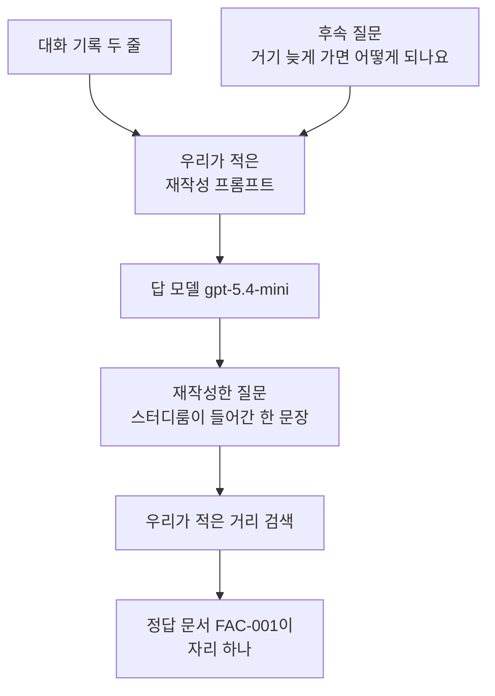
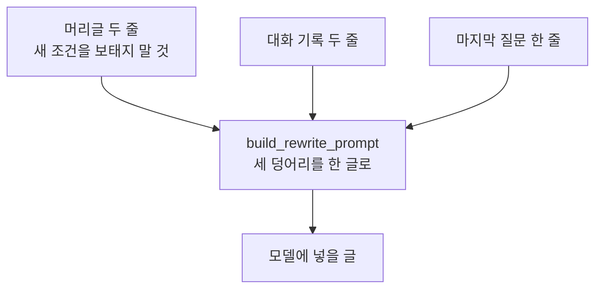
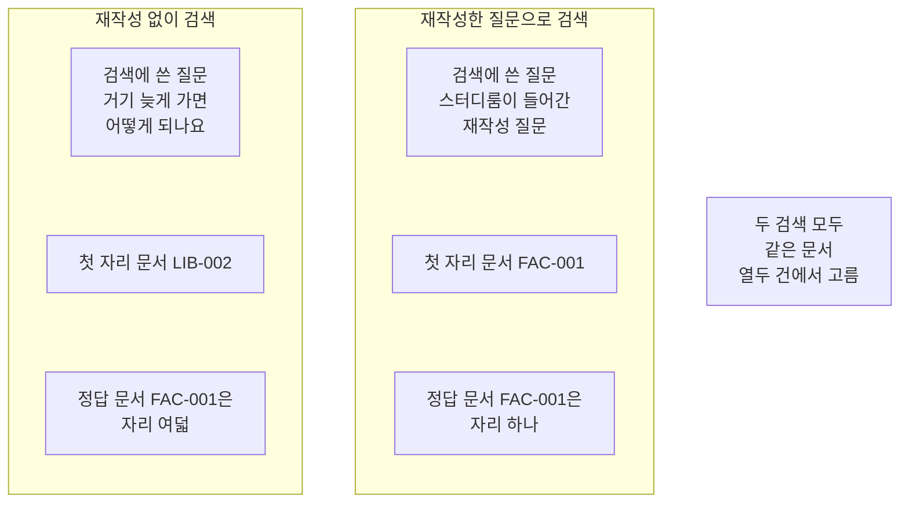
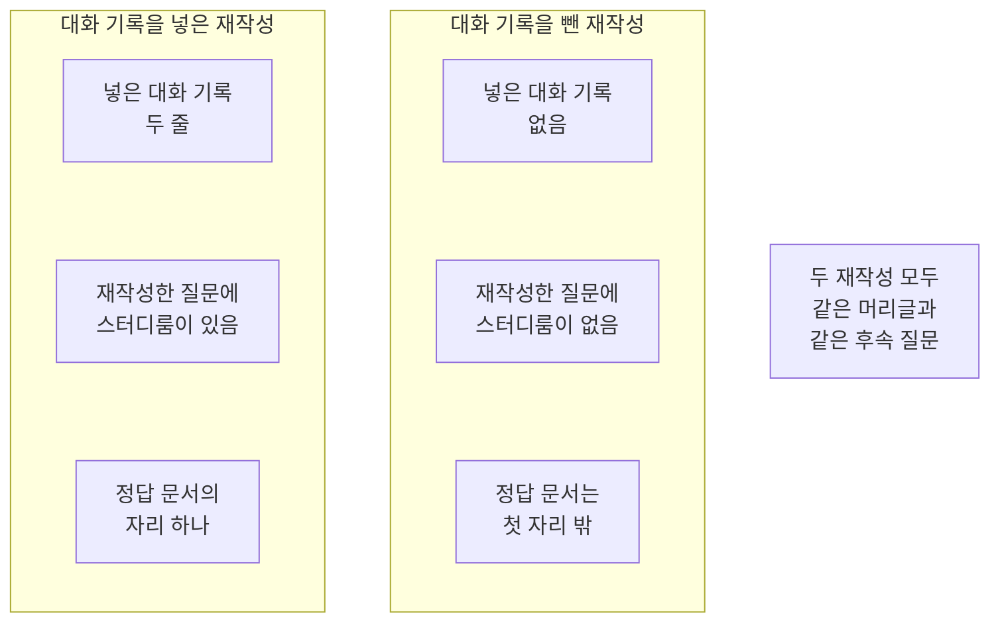

# 01-대화-히스토리와-질문-재작성

## _src 본문 (HTML 원본)

```html
<!--meta: 강의 1h | 실습 2h | 코드 notebooks/01-대화-히스토리와-질문-재작성.ipynb | 새 용어 3 -->
<style>html,body{overflow-x:hidden}.notebook,.nb-cell,.nb-main,.nb-input,.nb-result{min-width:0;max-width:100%}.nb-input pre,.nb-output{box-sizing:border-box;max-width:100%;overflow-x:auto}code.nb-source{display:block!important;width:100%!important;min-width:0!important;overflow-x:auto!important;padding:0!important}</style>
<h2 id="b1"><span class="no">1</span>학습 목표</h2><div class="goal"><ul>
<li>대상이 빠진 후속 질문을 대화 기록과 함께 넣어 혼자서도 뜻이 통하는 질문으로 바꿀 수 있습니다.</li>
<li>재작성 전과 뒤의 검색 결과를 정답 문서의 자리로 견줄 수 있습니다.</li>
<li>재작성한 질문에 대상 낱말이 남았는지 코드로 확인할 수 있습니다.</li>
</ul></div>
<h2 id="b2"><span class="no">2</span>이 내용을 배우는 이유</h2><p>사람은 앞에서 말한 대상을 다시 적지 않습니다. 「거기 늦게 가면 어떻게 되나요?」처럼 묻습니다. 이 문장을 그대로 검색하면 「거기」가 어디인지 알 수 없습니다. 대화 기록에서 대상을 채워야 뒤 질문도 혼자 검색할 수 있습니다.</p><p>Ch 9의 기본 RAG는 검색 한 번과 답 한 번이었습니다. 이 챕터는 그 앞뒤에 단계를 하나씩 붙입니다. 이 절이 붙이는 단계는 검색 앞에서 질문을 바꾸는 일입니다. 붙일 단계와 개수는 우리가 코드에 적은 규칙으로 정합니다. 모델이 다음 할 일을 스스로 정하는 방식은 아직 쓰지 않습니다.</p>
<h2 id="b3"><span class="no">3</span>앞에서 배운 내용</h2><p>Ch 11에서 정답 문서 ID와 자리별 재현율을 나눠 기록했습니다. Ch 12에서는 문서 열두 건과 질문 여덟 개로 검색 설정을 견줬습니다. 이 챕터는 그 문서와 질문의 사본을 그대로 씁니다. 실습 폴더의 파일 두 개는 Ch 12 core 벌 파일과 바이트가 같습니다.</p><p>거리 순위 함수는 Ch 12 01절에서, 순위 표 출력 함수는 05절에서 배웠습니다. 문서 ID를 모으는 함수와 정답 자리를 세는 함수는 Ch 11 01절에서 배웠습니다. 이 네 함수는 실습 폴더의 도구 파일 <code>notebooks/rag_tools.py</code>에 모아 두고 노트북에서 한 줄로 가져옵니다. 거리 계산은 도구 파일 안에서 Ch 5 02절의 NumPy로 합니다. 값도 같아서 벡터의 숫자 개수 설정 <code>256</code>과 답 모델을 이어 씁니다.</p><p>Ch 13에서는 흐름을 그래프로 적어 노드와 엣지로 이었습니다. 이 챕터는 그래프를 쓰지 않고 검색 앞뒤에 붙이는 패턴을 코드로 적습니다. 말 「칸」과 「기준값」은 Ch 13에서 쓰던 뜻 그대로입니다. 말 「조각」은 Ch 5의 토큰 뜻으로만 씁니다. 이 절은 문서 열두 건을 통째로 쓰므로 자른 문서 청크가 없습니다.</p>
<h2 id="b4"><span class="no">4</span>핵심 개념</h2><h3>비유로 시작하기</h3><p>나무판 하나에 둥근 구멍이 뚫려 있다고 생각해 봅니다. 구멍이 뚫린 판은 대상이 빠진 후속 질문입니다. 앞선 대화 자리에 놓여 있던 둥근 마개를 가져와 구멍에 끼웁니다. 구멍이 채워진 판이 혼자서도 뜻이 통하는 질문입니다.</p>
{{img:01-5-구멍에-마개를-끼운-나무판|흰 바탕에 왼쪽에는 나무판 두 장이 포개져 있고 그 위에 둥근 나무 마개 하나가 놓여 있으며 가운데에는 둥근 구멍이 비어 있는 나무판 한 장이 있고 오른쪽에는 같은 나무판의 구멍에 둥근 마개가 끼워져 판이 메워진 그림|왼쪽 판 위의 둥근 마개가 가운데 판의 빈 구멍으로 옮겨 가 오른쪽에서 판을 메웁니다.}}
<p class="look"><b>그림 읽기</b> — 왼쪽에 나무판 두 장이 포개져 있고 그 위에 둥근 마개 하나가 놓여 있습니다. 가운데 판에는 같은 크기의 구멍이 비어 있습니다. 오른쪽 판에서는 그 구멍이 마개로 메워져 판이 이어집니다. 세 자리를 왼쪽부터 오른쪽으로 읽으면 빠진 자리가 채워지는 차례가 보입니다.</p>
<table><thead><tr><th>말</th><th>뜻</th></tr></thead><tbody><tr><td>대화 기록</td><td>앞서 주고받은 말을 줄 단위로 담아 둔 목록입니다. 이 절에서는 두 줄입니다.</td></tr><tr><td>후속 질문</td><td>앞 대화를 봐야 뜻이 정해지는 말이 남아 있는 다음 질문입니다.</td></tr><tr><td>질문 재작성</td><td>대화 기록을 함께 넣어 혼자서도 뜻이 통하는 검색 질문으로 바꾸는 일입니다.</td></tr></tbody></table>
<p>아래 세 말은 Ch 11·Ch 12에서 쓰던 뜻 그대로 이어 씁니다.</p>
<table><thead><tr><th>말</th><th>뜻</th></tr></thead><tbody><tr><td>정답 문서 ID</td><td>그 질문의 답이 있는 문서 하나의 번호입니다(Ch 11 01절).</td></tr><tr><td>정답 자리</td><td>순위 목록에서 정답 문서가 몇째 자리인지 센 값입니다(Ch 11 01절).</td></tr><tr><td>코사인 거리</td><td>값이 작을수록 질문과 문서가 가까운 자입니다(Ch 12 01절).</td></tr></tbody></table>
{{mermaid:01-1-빠진-대상을-채워-검색하기|위에서 아래로 놓인 상자 일곱으로 맨 위에 초록 상자 대화 기록 두 줄과 초록 상자 후속 질문 거기 늦게 가면 어떻게 되나요가 나란히 있고 둘 다 파란 상자 우리가 적은 재작성 프롬프트로 이어지며 그 아래 보라 상자 답 모델 gpt-5.4-mini를 지나 노란 상자 재작성한 질문 스터디룸이 들어간 한 문장과 파란 상자 우리가 적은 거리 검색을 거쳐 맨 아래 노란 상자 정답 문서 FAC-001이 자리 하나로 이어지는 그림|대화 기록에서 빠진 대상을 채운 질문으로 검색하면 정답 문서가 자리 하나로 올라옵니다.}}
<p class="look"><b>도식 읽기</b> — 위에서 아래로 읽습니다. 맨 위 초록 상자 둘이 모델에 넣을 자료입니다. 그 아래 파란 상자가 우리가 적는 글이고 보라 상자가 이번에 부른 모델입니다. 노란 상자 둘은 출력으로 확인한 값입니다. 파란 상자 거리 검색은 Ch 12 05절 함수를 그대로 부르는 자리입니다.</p>
<h3>재작성은 검색 입력만 바꿉니다</h3><p>바꾼 질문은 검색에 넣는 글입니다. 사람이 적은 원래 질문을 지우지 않습니다. 두 질문을 함께 적어 두면 어떤 말이 보태지거나 빠졌는지 뒤에서 대조할 수 있습니다.</p>
<h3>없던 조건을 보태지 않습니다</h3><p>머리글에 새 조건을 보태지 말라는 줄을 넣었습니다. 없던 날짜나 이름이 붙으면 검색은 또렷해져도 사람의 뜻이 달라집니다. 그래서 재작성 뒤에도 대상 낱말이 남았는지 코드로 봅니다.</p>
<h3>다른 상황에 적용</h3><p>쇼핑 상담에도 같은 자리가 있습니다. 「그건 반품돼요?」는 앞 대화를 봐야 대상이 정해집니다. 앞 대화의 상품 이름을 채워 넣으면 검색이 그 상품 문서를 찾습니다.</p>
<h2 id="b5"><span class="no">5</span>실행 예제</h2><p>노트북은 문서 열두 건을 벡터로 바꾼 뒤 같은 물음을 세 가지 질문으로 검색합니다. 서비스 요청은 여덟 번이고 임베딩 다섯 번과 답 모델 세 번입니다. 예상 비용은 미화 0.01달러 아래입니다. 새로 쓰는 파일은 없습니다.</p><p>먼저 Ch 12 05절 질문 하나로 검색 부품이 같게 움직이는지 봅니다. 그다음 후속 질문을 그대로 검색하고 정답 자리를 셉니다. 이어서 대화 기록을 넣어 질문을 바꾸고 다시 셉니다. 마지막으로 대화 기록만 빼고 같은 자리를 다시 셉니다.</p>
{{mermaid:01-2-재작성-프롬프트를-만드는-자리|위에서 아래로 놓인 상자 다섯으로 맨 위 왼쪽 파란 상자 머리글 두 줄과 가운데 초록 상자 대화 기록 두 줄과 오른쪽 초록 상자 마지막 질문 한 줄이 모두 그 아래 파란 상자 build_rewrite_prompt 세 덩어리를 한 글로 이어지고 다시 그 아래 파란 상자 모델에 넣을 글로 이어지는 그림|머리글과 대화 기록과 마지막 질문 세 덩어리를 한 글로 이어 모델에 넣습니다.}}
<p class="look"><b>도식 읽기</b> — 위에서 아래로 읽습니다. 맨 윗줄 상자 셋이 한 글로 이어 붙일 재료입니다. 그 가운데 파란 상자 하나가 우리가 적은 머리글이고 초록 상자 둘은 이번 대화에서 받은 자료입니다. 가운데 파란 상자가 셋을 잇는 함수이고 맨 아래 파란 상자가 모델에 넣을 글입니다.</p>
{{notebook:01-대화-히스토리와-질문-재작성}}
<p class="look"><b>확인할 점</b> — 질문 <code>C01</code> 순위 표의 세 문서가 Ch 12 05절과 같은지 봅니다. 후속 질문을 그대로 검색한 출력 줄은 <code>재작성 전 정답 문서의 자리: 8</code>이었습니다. 대화 기록을 넣어 바꾼 뒤에는 <code>재작성 뒤 정답 문서의 자리: 1</code>이었습니다. 검사 줄 <code>재작성한 질문에 있는가: True</code>로 대상 낱말이 남았는지 함께 봅니다.</p>
<h2 id="b6"><span class="no">6</span>실험 결과 해석</h2><p>질문 <code>C01</code>을 같은 조건으로 재니 <code>LIB-004</code>와 <code>LIB-001</code>과 <code>LIB-003</code>이 차례로 나왔습니다. 거리 값은 <code>0.43</code>과 <code>0.56</code>과 <code>0.62</code>로 Ch 12 05절 값과 같았습니다. 검색 부품이 Ch 12와 같게 움직인다는 뜻입니다.</p><p>후속 질문을 그대로 검색하니 첫 자리가 <code>LIB-002</code>였습니다. 연체를 다룬 문서이고 이 질문의 정답 문서가 아닙니다. 정답 문서 <code>FAC-001</code>은 여덟째 자리였습니다. 질문에 「늦게」만 있고 대상이 없었기 때문입니다.</p>
{{mermaid:01-3-재작성-전후-검색-결과|왼쪽부터 오른쪽으로 놓인 칸 두 개와 회색 상자 하나로 왼쪽 칸 제목은 재작성 없이 검색이고 그 안에 초록 상자 검색에 쓴 질문 거기 늦게 가면 어떻게 되나요와 노란 상자 첫 자리 문서 LIB-002와 노란 상자 정답 문서 FAC-001은 자리 여덟이 있으며 가운데 칸 제목은 재작성한 질문으로 검색이고 그 안에 초록 상자 검색에 쓴 질문 스터디룸이 들어간 재작성 질문과 노란 상자 첫 자리 문서 FAC-001과 노란 상자 정답 문서 FAC-001은 자리 하나가 있고 오른쪽에 회색 상자 두 검색 모두 같은 문서 열두 건에서 고름이 놓인 그림|같은 문서 열두 건에서 재작성 전에는 정답 문서가 자리 여덟이고 재작성 뒤에는 자리 하나입니다.}}
<p class="look"><b>도식 읽기</b> — 왼쪽 칸이 질문을 바꾸지 않은 검색입니다. 가운데 칸이 대화 기록을 넣어 바꾼 질문으로 한 검색입니다. 칸마다 맨 위 초록 상자가 넣은 질문이고 그 아래 노란 상자 둘이 나온 값입니다. 오른쪽 회색 상자는 두 칸에 모두 해당하는 사실입니다.</p>
<p>대화 기록을 넣어 바꾼 질문에는 대상 「스터디룸」이 들어갔습니다. 그 질문으로 검색하니 <code>FAC-001</code>이 첫 자리였습니다. 그 문서 세 건을 넣어 받은 답에는 출처 표시 <code>[FAC-001]</code>이 붙었습니다. 답 문장은 실행마다 달라질 수 있어 문장 속 낱말을 결론으로 삼지 않습니다.</p>
{{mermaid:01-4-대화-기록을-넣을-때와-뺄-때|왼쪽부터 오른쪽으로 놓인 칸 두 개와 회색 상자 하나로 왼쪽 칸 제목은 대화 기록을 넣은 재작성이고 그 안에 초록 상자 넣은 대화 기록 두 줄과 노란 상자 재작성한 질문에 스터디룸이 있음과 노란 상자 정답 문서의 자리 하나가 있으며 가운데 칸 제목은 대화 기록을 뺀 재작성이고 그 안에 초록 상자 넣은 대화 기록 없음과 노란 상자 재작성한 질문에 스터디룸이 없음과 노란 상자 정답 문서는 첫 자리 밖이 있고 오른쪽에 회색 상자 두 재작성 모두 같은 머리글과 같은 후속 질문이 놓인 그림|대화 기록을 빼면 재작성한 질문에 대상이 채워지지 않고 정답 문서도 첫 자리 밖에 남습니다.}}
<p class="look"><b>도식 읽기</b> — 왼쪽 칸이 대화 기록을 넣은 재작성입니다. 가운데 칸이 기록만 뺀 재작성입니다. 칸마다 맨 위 초록 상자가 바꾼 값이고 그 아래 노란 상자 둘이 출력으로 확인한 값입니다. 오른쪽 회색 상자는 두 칸에서 같게 둔 것입니다. 기록을 뺀 칸의 정답 자리는 문장에 따라 달라질 수 있어 자리 번호를 적지 않았습니다.</p>
<p>대화 기록만 빼고 다시 바꾸니 대상이 채워지지 않았습니다. 첫 자리 문서는 <code>LIB-002</code> 그대로였고 정답 문서는 첫 자리 밖이었습니다. 재작성 단계를 지나도 채울 자료가 없으면 검색 입력이 달라지지 않습니다.</p><p>여기서 본 것은 대화 한 벌과 물음 하나입니다. 다른 대화나 긴 기록에서도 같은 차이가 나는지는 이번에 보지 않았습니다. 여러 질문으로 검색 품질을 재는 일은 Ch 11과 Ch 12 몫입니다. 답이 맞는지 판정하는 일은 Ch 15 몫입니다.</p>
<h2 id="b7"><span class="no">7</span>주의할 점과 실무 메모</h2><ul><li>대화 두 줄과 후속 질문은 흐름을 보여 주려고 고른 예입니다. 무엇을 재서 얻은 값이 아닙니다.</li><li>대화가 길어지면 어느 줄까지 넣을지 정해야 합니다. 이 절은 두 줄을 모두 넣었습니다.</li><li>원래 질문과 바꾼 질문을 함께 적어 두면 어떤 조건이 보태지거나 빠졌는지 대조할 수 있습니다.</li><li>모델이 만든 질문은 검색에 넣는 글일 뿐이라 출처로 쓰지 않습니다. 출처는 찾은 문서의 ID와 원문입니다.</li><li>검사 함수 <code>keeps_word</code>는 낱말이 있는지만 봅니다. 답이 맞는지 재는 함수가 아닙니다.</li><li>답 문장은 실행마다 달라질 수 있어 문장 속 낱말에 <code>assert</code>를 걸지 않았습니다.</li><li>거리 값은 셋째 자리 아래가 호출마다 조금씩 달라집니다. 본문과 그림에는 자리 번호와 문서 ID만 적었습니다.</li><li>새 커널로 두 번 실행했을 때 기록을 넣은 재작성 문장의 조사 하나가 「스터디룸에」와 「스터디룸은」으로 갈렸습니다. 정답 자리는 두 실행에서 같았습니다. temperature 값이 0이어도 문장이 같다고 보장하지 않습니다.</li><li>기록 없는 재작성의 정답 자리는 문장이 조금만 달라져도 함께 바뀌는 값이라 그림 라벨과 정리에 넣지 않았습니다. 두 실행 모두 대상이 채워지지 않았고 정답 문서가 첫 자리 밖이라는 것만 적었습니다.</li><li>재작성을 붙이면 요청이 한 번 늘어납니다. 이 절은 걸린 시간을 재지 않았으므로 빨라졌는지 느려졌는지 적지 않습니다.</li><li>이 절은 파일을 쓰지 않습니다. 문서 파일과 질문 파일은 읽기만 합니다.</li><li>준비물에 LangChain 1.4.0과 langchain-openai 1.6.1과 numpy 2.5.3을 적었습니다. 다른 판과 Windows·macOS에서는 이번에 실행하지 않았습니다.</li></ul>
<h2 id="b8"><span class="no">8</span>정리와 다음 절</h2><ul><li>대상이 빠진 후속 질문을 그대로 검색하니 정답 문서가 여덟째 자리였습니다.</li><li>대화 기록을 넣어 대상을 채운 질문으로 검색하니 정답 문서가 첫 자리였습니다.</li><li>대화 기록을 빼고 재작성하면 대상이 채워지지 않아 정답 문서가 첫 자리 밖이었습니다.</li></ul><p><strong>다음 학습과 이어지는 지점</strong> — 02절에서는 질문 하나를 여러 개로 늘려 검색합니다. 혼자서도 뜻이 통하는 질문 하나가 그 절의 입력입니다.</p>
<h2 id="b9"><span class="no">9</span>복습 문제</h2><details class="quiz" open><summary>문제 4개 · 해설 포함</summary><p class="quiz-q">1. 질문 재작성의 입력과 출력은 무엇입니까?</p><p class="quiz-a">대화 기록과 후속 질문을 넣으면 혼자서도 뜻이 통하는 검색 질문 하나가 나옵니다. 틀렸다면 「핵심 개념」의 용어 표를 다시 읽습니다.</p><p class="quiz-q">2. 재작성 전과 뒤에 무엇이 달라졌습니까?</p><p class="quiz-a">정답 문서 <code>FAC-001</code>의 자리가 여덟에서 하나로 올라왔습니다. 첫 자리 문서도 <code>LIB-002</code>에서 <code>FAC-001</code>로 바뀌었습니다. 틀렸다면 「실험 결과 해석」의 첫 비교 도식을 다시 읽습니다.</p><p class="quiz-q">3. 대화 기록을 빼고 재작성하면 왜 대상이 채워지지 않습니까?</p><p class="quiz-a">대상을 찾을 자료가 없기 때문입니다. 머리글과 후속 질문이 같아도 넣은 기록이 없으면 채울 말이 없습니다. 틀렸다면 「실험 결과 해석」의 둘째 비교 도식을 다시 읽습니다.</p><p class="quiz-q">4. 모델이 만든 재작성 질문을 답의 출처로 쓰면 안 되는 까닭은 무엇입니까?</p><p class="quiz-a">그 문장은 자료에서 확인한 사실이 아니라 검색에 넣으려고 만든 글이기 때문입니다. 출처로는 찾은 문서의 ID와 원문만 씁니다. 틀렸다면 「주의할 점과 실무 메모」를 다시 읽습니다.</p></details>
<h2 id="b10"><span class="no">10</span>참고 자료</h2><ul><li><div><a href="https://docs.langchain.com/oss/python/concepts/providers-and-models">LangChain 모델과 provider</a></div>확인 2026-09-19 · LangChain 1.4 기준 · 질문을 바꾸고 답을 쓰는 모델을 준비하는 방법.</li><li><div><a href="https://developers.openai.com/api/docs/models/text-embedding-3-small">OpenAI text-embedding-3-small 모델 안내</a></div>확인 2026-09-19 · 문서와 질문을 벡터로 바꿀 때 쓴 모델과 차원 수 설정.</li><li><div><a href="https://docs.langchain.com/oss/python/langchain/retrieval">LangChain 검색 안내</a></div>확인 2026-09-19 · 검색 앞에 질문을 바꾸는 단계를 두는 자리 설명.</li><li>Ch 12 05절 dense와 sparse 비교 — 이 절이 이어 쓴 거리 순위 함수와 질문 <code>C01</code> 값이 있는 자리.</li></ul>
```

## 노트북 셀 (순서대로)

### [0] markdown {'html': 'skip'}

# 대화 히스토리와 질문 재작성

이 절은 앞서 주고받은 말을 「대화 기록」이라고 부릅니다.

**이 노트북에서 할 일**

1. Ch 12에서 쓰던 문서 열두 건과 질문 여덟 개를 그대로 읽습니다.
2. 대상이 빠진 후속 질문을 그대로 검색해 정답 문서의 자리를 봅니다.
3. 대화 기록을 함께 넣어 혼자서도 뜻이 통하는 질문으로 바꿉니다.
4. 바꾼 질문으로 다시 검색하고 찾은 원문만 넣어 답을 받습니다.
5. 대화 기록만 빼고 같은 자리를 다시 재어 견줍니다.

**준비물** — 이 절은 프로젝트 맨 위 폴더의 `.env`에 적어 둔 `OPENAI_API_KEY`를 씁니다.
서비스 요청은 여덟 번입니다(임베딩 다섯 번과 답 모델 세 번).
예상 비용은 미화 0.01달러 아래입니다.
읽어 오는 파일은 이 챕터 폴더의 문서 파일과 질문 파일 둘이고 새로 쓰는 파일은 없습니다.
실행 시간은 2분 안팎이고 첫 셀의 설치가 가장 오래 걸립니다.

**기준 버전** — 첫 셀에서 LangChain 1.4.0과 langchain-openai 1.6.1을 설치합니다.
키를 읽는 python-dotenv 1.2.3과 도구 파일이 쓰는 numpy 2.5.3도 함께 설치합니다.
교재 출력은 Linux의 Python 3.12.13으로 만들었습니다.
다른 판과 Windows·macOS에서는 이번에 실행하지 않았습니다.

**강의와 실습 범위** — 강의 시간에는 3~8절을 읽습니다.
Ch 12 검색 부품을 준비하고 후속 질문을 그대로 검색해 보는 자리입니다.
9절부터 12절은 대화 기록을 넣어 질문을 바꾸고 다시 검색해 답까지 받는 자리입니다.
13절과 14절은 대화 기록만 빼고 같은 자리를 다시 재어 견주는 자리입니다.

실습 폴더 `labs/part4/ch14-rag-patterns`에서 `uv sync --locked`를 실행합니다.
그다음 이 폴더의 `.venv` 커널을 고르고 첫 셀부터 순서대로 실행합니다.

### [1] markdown {'html': 'skip'}

## 오늘 볼 그림


위에서 아래로 읽습니다.
맨 위 초록 상자 둘이 모델에 넣을 자료입니다.
가운데 파란 상자가 우리가 적는 글이고 보라 상자가 모델입니다.
맨 아래 노란 상자 둘이 출력으로 확인한 값입니다.

### [2] markdown {}

## 1. 준비

첫 셀은 패키지 네 개를 설치하고 설치된 판 번호를 출력합니다.
설치에는 몇십 초가 걸릴 수 있습니다.

### [3] code {'execution': {'iopub.execute_input': '2026-09-21T09:39:14.175523Z', 'iopub.status.busy': '2026-09-21T09:39:14.175361Z', 'iopub.status.idle': '2026-09-21T09:39:14.609561Z', 'shell.execute_reply': '2026-09-21T09:39:14.608970Z'}, 'lesson_role': 'setup'}

```python
# 이 절에서 쓰는 패키지를 설치하고 버전을 확인합니다
%pip install -q "langchain==1.4.0" "langchain-openai==1.6.1" "python-dotenv==1.2.3" "numpy==2.5.3"
from importlib.metadata import version

print("langchain:", version("langchain"))
print("langchain-openai:", version("langchain-openai"))
print("python-dotenv:", version("python-dotenv"))
print("numpy:", version("numpy"))
```

출력:
```
Note: you may need to restart the kernel to use updated packages.
langchain: 1.4.0
langchain-openai: 1.6.1
python-dotenv: 1.2.3
numpy: 2.5.3

```

### [4] markdown {}

**결과 읽기** — 설치가 끝나면 판 번호 네 줄이 보입니다.
마지막 줄 `numpy: 2.5.3`은 도구 파일이 벡터 계산에 쓰는 패키지입니다.
이 노트북의 출력은 2026-09-21에 이 판으로 실행한 결과입니다.

다음 셀은 이름 네 개를 불러오고 도구 파일에서 함수 네 개를 가져옵니다.
앞의 둘은 자료 읽기와 자리 확인에 씁니다.
뒤의 둘은 Ch 9~13에서 쓴 임베딩과 답 모델 이름입니다.

앞에서 배운 함수는 `rag_tools.py`에 모아 두었습니다. 파일을 열면 코드를 볼 수 있습니다. 노트북과 같은 폴더(`notebooks/`)에 있는 파일입니다.

이 노트북은 Ch 12 01절 `rank_by_distance()`와 05절 `print_ranked()`를 가져옵니다.
Ch 11 01절 `unique_doc_ids()`와 `find_gold_rank()`도 함께 가져옵니다.
거리 순위 함수는 질문 벡터와 문서 벡터 목록과 문서 ID 목록과 개수를 받습니다.
거리 계산은 도구 파일 안에서 Ch 5 02절의 NumPy로 합니다.

### [5] code {'execution': {'iopub.execute_input': '2026-09-21T09:39:14.610709Z', 'iopub.status.busy': '2026-09-21T09:39:14.610610Z', 'iopub.status.idle': '2026-09-21T09:39:15.365887Z', 'shell.execute_reply': '2026-09-21T09:39:15.365746Z'}, 'lesson_role': 'setup'}

```python
# 자료 읽기·자리 확인과 임베딩·답 모델 이름을 불러옵니다
import json
import os

from langchain_openai import OpenAIEmbeddings
from langchain.chat_models import init_chat_model
# Ch 12 01·05절과 Ch 11 01절에서 배운 함수 넷을 도구 파일에서 가져옵니다
from rag_tools import find_gold_rank, print_ranked, rank_by_distance, unique_doc_ids

print("불러온 이름:", "json", "os", "OpenAIEmbeddings", "init_chat_model")
```

출력:
```
불러온 이름: json os OpenAIEmbeddings init_chat_model

```

### [6] markdown {}

**결과 읽기** — 출력 줄에 불러온 이름 네 개가 보입니다.
이름 `OpenAIEmbeddings`와 `init_chat_model`은 Ch 12·13에서 쓴 것과 같습니다.
도구 파일에서 가져온 함수 네 개는 출력하지 않습니다.

## 2. 키와 모델 준비

### [7] markdown {}

API 키가 있는지 확인합니다. `True` 값이 나오면 다음으로 넘어갑니다.

### [8] code {'execution': {'iopub.execute_input': '2026-09-21T09:39:15.368445Z', 'iopub.status.busy': '2026-09-21T09:39:15.368355Z', 'iopub.status.idle': '2026-09-21T09:39:15.371958Z', 'shell.execute_reply': '2026-09-21T09:39:15.371731Z'}, 'lesson_role': 'setup'}

```python
# .env 파일에서 OpenAI API 키를 읽습니다(키 값은 출력하지 않습니다)
import os
from dotenv import find_dotenv, load_dotenv

env_path = find_dotenv(usecwd=True)
load_dotenv(env_path)
has_key = os.getenv("OPENAI_API_KEY") is not None
print("OPENAI_API_KEY 설정 여부:", has_key)
assert has_key, "프로젝트 폴더의 .env 파일에 OPENAI_API_KEY를 적어 주세요."
```

출력:
```
OPENAI_API_KEY 설정 여부: True

```

### [9] markdown {}

실습에 쓸 모델을 준비합니다.
temperature 값을 0으로 두어 매번 비슷한 답을 고르게 합니다.

### [10] code {'execution': {'iopub.execute_input': '2026-09-21T09:39:15.372445Z', 'iopub.status.busy': '2026-09-21T09:39:15.372399Z', 'iopub.status.idle': '2026-09-21T09:39:15.417246Z', 'shell.execute_reply': '2026-09-21T09:39:15.416859Z'}}

```python
# 실습에 쓸 모델을 준비합니다
model = init_chat_model(
    "openai:gpt-5.4-mini",
    temperature=0,
    reasoning_effort="none",
)
print("모델 이름:", model.model_name)
print("temperature:", model.temperature)
```

출력:
```
모델 이름: gpt-5.4-mini
temperature: 0.0

```

### [11] markdown {}

**결과 읽기** — 모델 이름 `gpt-5.4-mini`, temperature `0.0`이 보이면 준비가 끝났습니다.
이 노트북의 출력은 2026-09-21에 이 모델로 실행한 결과입니다.

### [12] markdown {}

## 3. 문서와 질문 읽기

이 절은 이 챕터 폴더의 문서 파일과 질문 파일을 읽습니다.
두 파일은 Ch 12 core 벌 파일과 바이트가 같은 사본입니다.
먼저 노트북을 연 자리에서 프로젝트 맨 위를 찾습니다.

### [13] code {'execution': {'iopub.execute_input': '2026-09-21T09:39:15.417919Z', 'iopub.status.busy': '2026-09-21T09:39:15.417856Z', 'iopub.status.idle': '2026-09-21T09:39:15.420094Z', 'shell.execute_reply': '2026-09-21T09:39:15.419752Z'}}

```python
# 노트북을 어느 폴더에서 열어도 프로젝트 맨 위를 찾게 후보 세 개를 차례로 봅니다
candidates = [".", "../../..", "../../../.."]
root_path = None
for candidate in candidates:
    if os.path.exists(candidate + "/labs/part4/ch14-rag-patterns/data"):
        root_path = candidate
        break
print("고른 경로:", root_path)
assert root_path is not None, "notebooks 폴더나 실습 폴더 맨 위에서 노트북을 열어 주세요."
```

출력:
```
고른 경로: .

```

### [14] markdown {}

**결과 읽기** — 출력 줄 `고른 경로` 뒤에 점 하나나 위로 올라가는 자리가 보입니다.
Ch 10~13에서 쓴 자리 찾기와 같은 방법입니다.
후보 셋 가운데 이 챕터 자료 폴더가 있는 자리를 고릅니다.

다음 셀은 문서 파일과 질문 파일을 읽습니다.

### [15] code {'execution': {'iopub.execute_input': '2026-09-21T09:39:15.420622Z', 'iopub.status.busy': '2026-09-21T09:39:15.420569Z', 'iopub.status.idle': '2026-09-21T09:39:15.422991Z', 'shell.execute_reply': '2026-09-21T09:39:15.422752Z'}}

```python
# 이 챕터 폴더의 문서 파일과 질문 파일을 읽습니다(읽기만 하고 고치지 않습니다)
data_path = root_path + "/labs/part4/ch14-rag-patterns/data"
with open(data_path + "/documents.json", encoding="utf-8") as file:
    docs = json.loads(file.read())
with open(data_path + "/queries.json", encoding="utf-8") as file:
    queries = json.loads(file.read())
print("문서 수:", len(docs))
print("질문 수:", len(queries))
```

출력:
```
문서 수: 12
질문 수: 8

```

### [16] markdown {}

**결과 읽기** — 출력 줄 `문서 수: 12`와 `질문 수: 8`이 Ch 12 core 벌 그대로입니다.
문서는 도서관 안내 열두 건입니다.

질문 번호는 C01부터 C08까지이고 질문 파일에 적혀 있습니다.
이 절은 그 가운데 질문 하나만 Ch 12 값과 맞춰 보는 데 씁니다.

## 4. 이 절에서 쓸 값 정하기

Ch 12 01~06절에서 정한 값을 그대로 다시 적습니다.
같은 값을 써야 Ch 12 결과와 이 절 결과를 견줄 수 있습니다.

### [17] code {'execution': {'iopub.execute_input': '2026-09-21T09:39:15.423477Z', 'iopub.status.busy': '2026-09-21T09:39:15.423429Z', 'iopub.status.idle': '2026-09-21T09:39:15.424979Z', 'shell.execute_reply': '2026-09-21T09:39:15.424751Z'}}

```python
# Ch 12 01~06절에서 쓴 값을 그대로 다시 정합니다
top_three = 3
top_all = 12
print("나란히 볼 상위 문서 수:", top_three)
print("자리를 셀 때 재는 문서 수:", top_all)
```

출력:
```
나란히 볼 상위 문서 수: 3
자리를 셀 때 재는 문서 수: 12

```

### [18] markdown {}

**결과 읽기** — 출력 줄 `나란히 볼 상위 문서 수: 3`은 표로 볼 자리 수입니다.
출력 줄 `자리를 셀 때 재는 문서 수: 12`는 정답 자리를 끝까지 세려고 둔 값입니다.

## 5. Ch 12 검색 부품 준비

다음 두 셀은 검색에 넣을 문서 글을 준비합니다.
문서마다 제목과 본문을 이어 붙이고 문서 ID로 그 글을 찾을 짝도 만듭니다.
읽지 말고 실행만 하고 넘어가도 됩니다.
거리 순위와 자리 세기와 출력 함수는 준비 셀에서 도구 파일로 가져왔습니다.

### [19] code {'execution': {'iopub.execute_input': '2026-09-21T09:39:15.425489Z', 'iopub.status.busy': '2026-09-21T09:39:15.425439Z', 'iopub.status.idle': '2026-09-21T09:39:15.427291Z', 'shell.execute_reply': '2026-09-21T09:39:15.427030Z'}, 'lesson_role': 'setup'}

```python
# 문서 12개의 제목과 본문을 이어 붙이고 문서 ID 목록도 만듭니다(Ch 12와 같은 제목 + 본문 모양)
doc_texts = []
doc_ids = []
for doc in docs:
    doc_texts.append(doc["title"] + " " + doc["text"])
    doc_ids.append(doc["doc_id"])
print("이어 붙인 글 수:", len(doc_texts))
print("첫 문서 글:", doc_texts[0])
print("문서 ID 목록:")
print(doc_ids)
```

출력:
```
이어 붙인 글 수: 12
첫 문서 글: 도서 대출 기간 일반 도서는 14일 동안 대출할 수 있습니다. 예약자가 없으면 한 번 연장할 수 있습니다.
문서 ID 목록:
['LIB-001', 'LIB-002', 'LIB-003', 'LIB-004', 'FAC-001', 'FAC-002', 'FAC-003', 'FAC-004', 'ACC-001', 'ACC-002', 'ACC-003', 'ACC-004']

```

### [20] code {'execution': {'iopub.execute_input': '2026-09-21T09:39:15.427757Z', 'iopub.status.busy': '2026-09-21T09:39:15.427715Z', 'iopub.status.idle': '2026-09-21T09:39:15.429192Z', 'shell.execute_reply': '2026-09-21T09:39:15.428901Z'}, 'lesson_role': 'setup'}

```python
# 문서 ID로 그 문서의 글을 찾을 짝을 만듭니다(답을 만들 때 원문을 넣으려고 씁니다)
text_by_doc = {}
for i in range(len(doc_ids)):
    text_by_doc[doc_ids[i]] = doc_texts[i]
print("짝의 수:", len(text_by_doc))
```

출력:
```
짝의 수: 12

```

### [21] markdown {}

준비 셀 두 개를 지났습니다.
다음 셀은 문서 열두 건을 벡터로 바꿉니다.
이 절에서 서비스에 보내는 첫 요청입니다.

### [22] code {'execution': {'iopub.execute_input': '2026-09-21T09:39:15.429729Z', 'iopub.status.busy': '2026-09-21T09:39:15.429679Z', 'iopub.status.idle': '2026-09-21T09:39:15.974923Z', 'shell.execute_reply': '2026-09-21T09:39:15.969765Z'}}

```python
# Ch 12와 같은 모델로 문서 12개를 벡터로 바꿉니다(임베딩 요청 1번)
embedding_model_name = "text-embedding-3-small"
vector_dimensions = 256
embedding_model = OpenAIEmbeddings(model=embedding_model_name, dimensions=vector_dimensions)
doc_vectors = embedding_model.embed_documents(doc_texts)
print("임베딩 모델 이름:", embedding_model.model)
print("벡터의 숫자 개수 설정:", embedding_model.dimensions)
print("문서 벡터 수:", len(doc_vectors))
```

출력:
```
임베딩 모델 이름: text-embedding-3-small
벡터의 숫자 개수 설정: 256
문서 벡터 수: 12

```

### [23] markdown {}

**결과 읽기** — 출력 줄 `임베딩 모델 이름: text-embedding-3-small`은 Ch 9~13이 쓴 모델과 같습니다.
출력 줄 `벡터의 숫자 개수 설정: 256`도 Ch 10~13과 같은 값입니다.
출력 줄 `문서 벡터 수: 12`로 문서마다 벡터 하나를 받았습니다.
벡터 안의 숫자는 호출마다 아주 조금씩 달라져 소수 자리까지 같다고 보지 않습니다.

## 6. Ch 12와 같은 조건인지 확인

검색 부품이 Ch 12와 같게 움직이는지 먼저 봅니다.
질문 `C01`을 같은 조건으로 재면 Ch 12 05절과 같은 세 문서가 나와야 합니다.

### [24] code {'execution': {'iopub.execute_input': '2026-09-21T09:39:15.994983Z', 'iopub.status.busy': '2026-09-21T09:39:15.994704Z', 'iopub.status.idle': '2026-09-21T09:39:16.334869Z', 'shell.execute_reply': '2026-09-21T09:39:16.332838Z'}}

```python
# Ch 12 05절이 쓴 첫 질문을 같은 조건으로 재어 봅니다(임베딩 요청 1번)
first_query = queries[0]
first_vector = embedding_model.embed_query(first_query["question"])
first_hits = rank_by_distance(first_vector, doc_vectors, doc_ids, top_three)
print("고른 질문:", first_query["qid"], "|", first_query["question"])
print("그 질문의 정답 문서 ID:", first_query["gold_doc_id"])
print_ranked(first_hits, "거리")
```

출력:
```
고른 질문: C01 | 책을 빌릴 수 있는 기간은 며칠인가요?
그 질문의 정답 문서 ID: LIB-001
순위 | 문서 ID | 거리
1 | LIB-004 | 0.43
2 | LIB-001 | 0.56
3 | LIB-003 | 0.62

```

### [25] markdown {}

**결과 읽기** — 출력 줄 `고른 질문: C01` 아래 순위 표가 있습니다.
표의 차례는 `LIB-004`와 `LIB-001`과 `LIB-003`이고 Ch 12 05절과 같습니다.
표의 정답 문서 `LIB-001`은 둘째 자리입니다.

거리 값은 소수 둘째 자리까지만 읽습니다.
셋째 자리 아래는 호출마다 조금씩 달라져 본문과 그림에 넣지 않았습니다.

## 7. 대화 기록과 후속 질문 정하기

이제 대화 두 줄과 그 뒤에 이어지는 질문 하나를 정합니다.
후속 질문에는 앞 대화를 봐야 뜻이 정해지는 말 「거기」가 들어 있습니다.
이 질문의 정답 문서와 재작성 뒤에도 남아야 할 낱말도 함께 적어 둡니다.

### [26] code {'execution': {'iopub.execute_input': '2026-09-21T09:39:16.340937Z', 'iopub.status.busy': '2026-09-21T09:39:16.340831Z', 'iopub.status.idle': '2026-09-21T09:39:16.343310Z', 'shell.execute_reply': '2026-09-21T09:39:16.342774Z'}}

```python
# 앞선 대화 두 줄과 대상이 빠진 후속 질문을 정합니다
history_lines = []
history_lines.append("사용자: 스터디룸은 몇 명부터 예약할 수 있나요?")
history_lines.append("도우미: 두 명 이상이면 예약할 수 있습니다.")
follow_up = "거기 늦게 가면 어떻게 되나요?"
gold_doc_id = "FAC-001"
keep_word = "스터디룸"
print("대화 기록 줄 수:", len(history_lines))
print("후속 질문:", follow_up)
print("이 질문의 정답 문서 ID:", gold_doc_id, "| 남아야 할 낱말:", keep_word)
```

출력:
```
대화 기록 줄 수: 2
후속 질문: 거기 늦게 가면 어떻게 되나요?
이 질문의 정답 문서 ID: FAC-001 | 남아야 할 낱말: 스터디룸

```

### [27] markdown {}

**결과 읽기** — 출력 줄 `대화 기록 줄 수: 2`로 앞선 대화가 두 줄입니다.
출력 줄 `후속 질문: 거기 늦게 가면 어떻게 되나요?`에는 스터디룸이라는 말이 없습니다.
출력 줄의 `이 질문의 정답 문서 ID: FAC-001`은 우리가 정한 정답입니다.
같은 줄의 `남아야 할 낱말: 스터디룸`은 재작성 결과를 볼 때 쓸 낱말입니다.

## 8. 재작성 없이 검색하기

실행 전에 예상해 봅니다.
질문에 「늦게」가 있으니 연체를 다룬 문서가 앞으로 올 것입니다.
스터디룸이라는 말이 없어 정답 문서는 뒤로 밀릴 것입니다.

### [28] code {'execution': {'iopub.execute_input': '2026-09-21T09:39:16.344151Z', 'iopub.status.busy': '2026-09-21T09:39:16.344078Z', 'iopub.status.idle': '2026-09-21T09:39:16.485201Z', 'shell.execute_reply': '2026-09-21T09:39:16.484757Z'}}

```python
# 후속 질문을 그대로 재어 정답 문서가 몇째 자리인지 봅니다(임베딩 요청 1번)
before_vector = embedding_model.embed_query(follow_up)
before_hits = rank_by_distance(before_vector, doc_vectors, doc_ids, top_all)
before_ids = unique_doc_ids(before_hits)
before_place = find_gold_rank(before_ids, [gold_doc_id])
print_ranked(before_hits[:top_three], "거리")
print("재작성 전 정답 문서의 자리:", before_place)
```

출력:
```
순위 | 문서 ID | 거리
1 | LIB-002 | 0.75
2 | ACC-001 | 0.82
3 | ACC-002 | 0.84
재작성 전 정답 문서의 자리: 8

```

### [29] markdown {}

**결과 읽기** — 순위 표의 첫 자리는 `LIB-002`이고 연체를 다룬 문서입니다.
출력 줄 `재작성 전 정답 문서의 자리: 8`로 정답 문서는 여덟째 자리였습니다.
질문에 대상이 없으니 검색은 「늦게」라는 말만 보고 문서를 골랐습니다.

## 9. 재작성 프롬프트 만들기

모델에 넣을 머리글 두 개를 먼저 적어 둡니다.
앞의 머리글은 질문을 바꾸는 일에 쓰고 뒤의 머리글은 답을 만드는 일에 씁니다.
새 조건을 보태지 말라는 줄을 넣어 없던 날짜나 이름이 붙는 것을 막습니다.

### [30] code {'execution': {'iopub.execute_input': '2026-09-21T09:39:16.489490Z', 'iopub.status.busy': '2026-09-21T09:39:16.489394Z', 'iopub.status.idle': '2026-09-21T09:39:16.491835Z', 'shell.execute_reply': '2026-09-21T09:39:16.491447Z'}}

```python
# 모델에 넣을 머리글 두 개를 미리 적어 둡니다
rewrite_head = "아래 대화 기록을 보고 마지막 질문을 혼자서도 뜻이 통하는 검색 질문 한 문장으로 바꾸세요.\n"
rewrite_head = rewrite_head + "새 조건을 보태지 말고 질문 한 문장만 적으세요.\n\n"
answer_head = "아래 자료만 보고 질문에 한국어로 한 문장으로 답하세요.\n"
answer_head = answer_head + "답 끝에 [문서ID] 모양으로 출처를 적으세요.\n\n"
print("재작성 머리글:")
print(rewrite_head)
print("답 만들기 머리글:")
print(answer_head)
```

출력:
```
재작성 머리글:
아래 대화 기록을 보고 마지막 질문을 혼자서도 뜻이 통하는 검색 질문 한 문장으로 바꾸세요.
새 조건을 보태지 말고 질문 한 문장만 적으세요.


답 만들기 머리글:
아래 자료만 보고 질문에 한국어로 한 문장으로 답하세요.
답 끝에 [문서ID] 모양으로 출처를 적으세요.


```

### [31] markdown {}

**결과 읽기** — 라벨 줄 `재작성 머리글:` 아래에 두 문장이 있습니다.
라벨 줄 `답 만들기 머리글:` 아래에는 자료만 보고 답하라는 두 문장이 있습니다.
두 머리글 모두 우리가 적은 글이고 모델이 만든 글이 아닙니다.

다음 셀은 머리글과 대화 기록과 마지막 질문을 한 글로 잇는 함수입니다.

### [32] code {'execution': {'iopub.execute_input': '2026-09-21T09:39:16.493113Z', 'iopub.status.busy': '2026-09-21T09:39:16.492983Z', 'iopub.status.idle': '2026-09-21T09:39:16.496052Z', 'shell.execute_reply': '2026-09-21T09:39:16.495624Z'}}

```python
# 머리글과 대화 기록과 마지막 질문을 한 글로 이어 붙입니다
def build_rewrite_prompt(history_lines, question):
    history_text = ""
    for line in history_lines:
        history_text = history_text + line + "\n"
    prompt_text = rewrite_head + "대화 기록:\n" + history_text
    prompt_text = prompt_text + "\n마지막 질문: " + question
    return prompt_text
```

출력:
```

```

### [33] markdown {}

**결과 읽기** — 정의 셀이라 출력이 없습니다.
함수 `build_rewrite_prompt`는 대화 기록 줄을 하나씩 이어 한 덩어리 글로 만듭니다.
그 뒤에 마지막 질문을 붙여 모델에 넣을 글 하나를 만듭니다.
대화 기록이 빈 목록이면 기록 자리가 빈 채로 남습니다.

다음 셀은 그 글을 만들어 모델에 넣습니다.

### [34] code {'execution': {'iopub.execute_input': '2026-09-21T09:39:16.497210Z', 'iopub.status.busy': '2026-09-21T09:39:16.497136Z', 'iopub.status.idle': '2026-09-21T09:39:17.665922Z', 'shell.execute_reply': '2026-09-21T09:39:17.665147Z'}}

```python
# 만든 글을 모델에 넣어 혼자서도 뜻이 통하는 질문을 받습니다(모델 요청 1번)
rewrite_prompt = build_rewrite_prompt(history_lines, follow_up)
print("모델에 넣을 글:")
print(rewrite_prompt)
rewrite_reply = model.invoke(rewrite_prompt)
rewritten = rewrite_reply.text.strip()
print("재작성한 질문:", rewritten)
```

출력:
```
모델에 넣을 글:
아래 대화 기록을 보고 마지막 질문을 혼자서도 뜻이 통하는 검색 질문 한 문장으로 바꾸세요.
새 조건을 보태지 말고 질문 한 문장만 적으세요.

대화 기록:
사용자: 스터디룸은 몇 명부터 예약할 수 있나요?
도우미: 두 명 이상이면 예약할 수 있습니다.

마지막 질문: 거기 늦게 가면 어떻게 되나요?
재작성한 질문: 스터디룸은 늦게 가면 어떻게 되나요?

```

### [35] markdown {}

**결과 읽기** — 라벨 줄 `모델에 넣을 글:` 아래에 머리글과 대화 기록과 마지막 질문이 차례로 있습니다.
출력 줄 `재작성한 질문: 스터디룸은 늦게 가면 어떻게 되나요?`에는 대상이 채워져 있습니다.
모델은 대화 기록에서 「거기」가 가리키는 대상을 찾아 넣었습니다.
답 문장은 실행마다 달라질 수 있어 이 값에 `assert`를 걸지 않았습니다.

새 커널로 두 번 실행했을 때 한 번은 「스터디룸에」, 한 번은 「스터디룸은」으로 조사 하나가 달랐습니다.
두 번 모두 스터디룸이라는 대상이 들어갔고 뒤 검색의 정답 자리도 같았습니다.

## 10. 대상 낱말이 남았는지 보기

재작성은 검색 입력을 고치는 일이라 대상이 빠지면 뜻이 달라집니다.
그래서 낱말 하나가 글에 있는지만 보는 짧은 검사 함수를 만듭니다.

### [36] code {'execution': {'iopub.execute_input': '2026-09-21T09:39:17.667425Z', 'iopub.status.busy': '2026-09-21T09:39:17.667311Z', 'iopub.status.idle': '2026-09-21T09:39:17.670021Z', 'shell.execute_reply': '2026-09-21T09:39:17.669509Z'}}

```python
# 글 안에 찾는 낱말이 있는지만 보는 검사 함수를 만듭니다
def keeps_word(sentence, word):
    found = word in sentence
    return found
```

출력:
```

```

### [37] markdown {}

**결과 읽기** — 정의 셀이라 출력이 없습니다.
함수 `keeps_word`는 낱말이 글 안에 있으면 참을 냅니다.
답이 맞는지 재는 함수가 아니라 낱말이 있는지만 보는 함수입니다.

다음 셀은 후속 질문과 재작성한 질문을 그 함수로 봅니다.

### [38] code {'execution': {'iopub.execute_input': '2026-09-21T09:39:17.671241Z', 'iopub.status.busy': '2026-09-21T09:39:17.671156Z', 'iopub.status.idle': '2026-09-21T09:39:17.673728Z', 'shell.execute_reply': '2026-09-21T09:39:17.673145Z'}}

```python
# 후속 질문과 재작성한 질문에 대상 낱말이 있는지 봅니다
print("찾는 낱말:", keep_word)
print("후속 질문에 있는가:", keeps_word(follow_up, keep_word))
print("재작성한 질문에 있는가:", keeps_word(rewritten, keep_word))
```

출력:
```
찾는 낱말: 스터디룸
후속 질문에 있는가: False
재작성한 질문에 있는가: True

```

### [39] markdown {}

**결과 읽기** — 출력 줄 `후속 질문에 있는가: False`로 처음 질문에는 대상이 없었습니다.
출력 줄 `재작성한 질문에 있는가: True`로 바꾼 질문에는 대상이 들어왔습니다.
두 줄의 차이가 이 절이 보려던 것입니다.

## 11. 재작성한 질문으로 검색하기

실행 전에 예상해 봅니다.
질문에 스터디룸이 들어왔으니 스터디룸 예약 문서가 앞으로 올 것입니다.

### [40] code {'execution': {'iopub.execute_input': '2026-09-21T09:39:17.674806Z', 'iopub.status.busy': '2026-09-21T09:39:17.674727Z', 'iopub.status.idle': '2026-09-21T09:39:17.808447Z', 'shell.execute_reply': '2026-09-21T09:39:17.807703Z'}}

```python
# 재작성한 질문으로 다시 재어 정답 문서의 자리를 봅니다(임베딩 요청 1번)
after_vector = embedding_model.embed_query(rewritten)
after_hits = rank_by_distance(after_vector, doc_vectors, doc_ids, top_all)
after_ids = unique_doc_ids(after_hits)
after_place = find_gold_rank(after_ids, [gold_doc_id])
print_ranked(after_hits[:top_three], "거리")
print("재작성 뒤 정답 문서의 자리:", after_place)
```

출력:
```
순위 | 문서 ID | 거리
1 | FAC-001 | 0.4
2 | FAC-004 | 0.72
3 | ACC-001 | 0.73
재작성 뒤 정답 문서의 자리: 1

```

### [41] markdown {}

**결과 읽기** — 순위 표의 첫 자리가 `FAC-001`로 바뀌었습니다.
출력 줄 `재작성 뒤 정답 문서의 자리: 1`로 정답 문서가 첫 자리에 왔습니다.
같은 문서 열두 건에서 질문만 바꿨는데 고른 문서가 달라졌습니다.

## 12. 찾은 원문으로 답 만들기

검색이 고른 앞자리 세 문서의 원문만 모델에 넣습니다.
모델이 만든 재작성 질문은 검색 입력일 뿐이라 출처로 쓰지 않습니다.
출처로 쓰는 것은 자료에 있는 문서 ID와 그 원문입니다.

### [42] code {'execution': {'iopub.execute_input': '2026-09-21T09:39:17.810531Z', 'iopub.status.busy': '2026-09-21T09:39:17.810306Z', 'iopub.status.idle': '2026-09-21T09:39:17.814200Z', 'shell.execute_reply': '2026-09-21T09:39:17.813523Z'}}

```python
# 앞자리 문서의 원문과 문서 ID를 이어 답 만들기 프롬프트를 만듭니다
def build_answer_prompt(question, hit_list):
    material = ""
    for hit in hit_list:
        doc_id = hit["doc_id"]
        material = material + "[" + doc_id + "] " + text_by_doc[doc_id] + "\n"
    prompt_text = answer_head + "질문: " + question + "\n\n자료:\n" + material
    return prompt_text
```

출력:
```

```

### [43] markdown {}

**결과 읽기** — 정의 셀이라 출력이 없습니다.
함수 `build_answer_prompt`는 문서 ID를 대괄호로 묶고 그 아래 원문을 붙입니다.
그렇게 만든 자료 덩어리를 머리글과 질문 뒤에 이어 붙입니다.

다음 셀은 그 글을 모델에 넣어 답을 받습니다.

### [44] code {'execution': {'iopub.execute_input': '2026-09-21T09:39:17.815345Z', 'iopub.status.busy': '2026-09-21T09:39:17.815273Z', 'iopub.status.idle': '2026-09-21T09:39:18.457620Z', 'shell.execute_reply': '2026-09-21T09:39:18.456594Z'}}

```python
# 찾은 원문 세 건만 넣어 답을 받습니다(모델 요청 1번)
answer_prompt = build_answer_prompt(rewritten, after_hits[:top_three])
answer_reply = model.invoke(answer_prompt)
answer = answer_reply.text.strip()
print("정답 문서 ID:", gold_doc_id)
print("모델이 쓴 답:")
print(answer)
print("답에 정답 문서 ID 표시가 있는가:", keeps_word(answer, gold_doc_id))
```

출력:
```
정답 문서 ID: FAC-001
모델이 쓴 답:
스터디룸은 예약 시작 후 10분 안에 입실하지 않으면 예약이 취소됩니다. [FAC-001]
답에 정답 문서 ID 표시가 있는가: True

```

### [45] markdown {}

**결과 읽기** — 출력 줄 `정답 문서 ID: FAC-001`이 우리가 정한 정답입니다.
라벨 줄 `모델이 쓴 답:` 아래 한 문장에 늦게 입실했을 때의 처리가 적혀 있습니다.
출력 줄 `답에 정답 문서 ID 표시가 있는가: True`로 답 끝에 출처 표시가 붙었습니다.
답 문장은 실행마다 달라질 수 있어 문장 속 낱말에 `assert`를 걸지 않았습니다.

## 13. 값 바꿔 보기 · 대화 기록을 빼고 재작성

바꿀 값은 대화 기록 하나입니다.
머리글도 후속 질문도 그대로 두고 기록만 빈 목록으로 바꿉니다.
실행 전에 예상해 봅니다.
대상을 찾을 자리가 없으니 「거기」가 그대로 남을 것입니다.

### [46] code {'execution': {'iopub.execute_input': '2026-09-21T09:39:18.460089Z', 'iopub.status.busy': '2026-09-21T09:39:18.459897Z', 'iopub.status.idle': '2026-09-21T09:39:19.096415Z', 'shell.execute_reply': '2026-09-21T09:39:19.095437Z'}}

```python
# 대화 기록만 빈 목록으로 바꿔 같은 후속 질문을 다시 재작성합니다(모델 요청 1번)
empty_history = []
empty_prompt = build_rewrite_prompt(empty_history, follow_up)
empty_reply = model.invoke(empty_prompt)
empty_rewritten = empty_reply.text.strip()
print("대화 기록 없이 재작성한 질문:", empty_rewritten)
print("그 질문에 낱말이 있는가:", keeps_word(empty_rewritten, keep_word))
```

출력:
```
대화 기록 없이 재작성한 질문: 거기 늦게 가면 어떻게 되나요?
그 질문에 낱말이 있는가: False

```

### [47] markdown {}

**결과 읽기** — 출력 줄 `그 질문에 낱말이 있는가: False`로 대상이 채워지지 않았습니다.
바꾼 질문에도 앞 대화를 봐야 뜻이 정해지는 말이 그대로 남았습니다.
모델이 게을러서가 아니라 채울 자료를 주지 않았기 때문입니다.

이 자리의 문장은 실행마다 조금씩 달라질 수 있습니다.
이번에 새 커널로 두 번 실행했을 때는 두 번 모두 후속 질문과 같은 문장이 나왔습니다.

다음 셀은 그 질문으로 다시 검색합니다.

### [48] code {'execution': {'iopub.execute_input': '2026-09-21T09:39:19.099347Z', 'iopub.status.busy': '2026-09-21T09:39:19.099162Z', 'iopub.status.idle': '2026-09-21T09:39:19.244275Z', 'shell.execute_reply': '2026-09-21T09:39:19.243140Z'}}

```python
# 대화 기록 없이 재작성한 질문으로 재어 봅니다(임베딩 요청 1번)
empty_vector = embedding_model.embed_query(empty_rewritten)
empty_hits = rank_by_distance(empty_vector, doc_vectors, doc_ids, top_all)
empty_ids = unique_doc_ids(empty_hits)
empty_place = find_gold_rank(empty_ids, [gold_doc_id])
print_ranked(empty_hits[:top_three], "거리")
print("기록 없이 재작성한 질문의 정답 자리:", empty_place)
```

출력:
```
순위 | 문서 ID | 거리
1 | LIB-002 | 0.75
2 | ACC-001 | 0.82
3 | ACC-002 | 0.84
기록 없이 재작성한 질문의 정답 자리: 8

```

### [49] markdown {}

**결과 읽기** — 순위 표의 첫 자리는 8절과 같은 `LIB-002`입니다.
출력 줄 `기록 없이 재작성한 질문의 정답 자리: 8`로 정답 문서는 첫 자리 밖이었습니다.
재작성이라는 단계를 거쳐도 넣을 자료가 없으면 대상이 채워지지 않습니다.

이 자리의 정답 자리는 앞 셀의 문장이 달라지면 함께 달라집니다.
이번 두 실행은 문장이 후속 질문과 같아 8절과 같은 여덟째 자리였습니다.
문장이 조금만 달라져도 이 자리가 바뀔 수 있어 그림 라벨과 정리에는 자리 번호를 넣지 않았습니다.

## 14. 세 실행을 기록 한 줄씩으로

실행 하나를 기록 한 줄로 만들어 담아 둡니다.
Ch 9~13에서 쓴 기록 한 줄과 같은 모양입니다.

### [50] code {'execution': {'iopub.execute_input': '2026-09-21T09:39:19.246767Z', 'iopub.status.busy': '2026-09-21T09:39:19.246588Z', 'iopub.status.idle': '2026-09-21T09:39:19.249784Z', 'shell.execute_reply': '2026-09-21T09:39:19.249057Z'}}

```python
# 실행 한 번을 기록 한 줄로 만듭니다
def run_row(run_name, question_text, found_ids, place):
    row = {"실행": run_name}
    row["검색에 쓴 질문"] = question_text
    row["첫 자리 문서"] = found_ids[0]
    row["정답 자리"] = place
    return row
```

출력:
```

```

### [51] markdown {}

**결과 읽기** — 정의 셀이라 출력이 없습니다.
담는 칸은 실행 이름과 검색에 쓴 질문과 첫 자리 문서와 정답 자리 넷입니다.
이 절이 견주는 값이 그 넷이기 때문입니다.

다음 셀은 세 실행의 기록을 표로 출력합니다.

### [52] code {'execution': {'iopub.execute_input': '2026-09-21T09:39:19.251110Z', 'iopub.status.busy': '2026-09-21T09:39:19.251010Z', 'iopub.status.idle': '2026-09-21T09:39:19.254408Z', 'shell.execute_reply': '2026-09-21T09:39:19.253766Z'}}

```python
# 세 실행의 기록을 담아 라벨 줄 아래에 한 줄씩 출력합니다
run_rows = []
run_rows.append(run_row("재작성 없음", follow_up, before_ids, before_place))
run_rows.append(run_row("기록을 넣은 재작성", rewritten, after_ids, after_place))
run_rows.append(run_row("기록 없는 재작성", empty_rewritten, empty_ids, empty_place))
print("실행 | 검색에 쓴 질문 | 첫 자리 문서 | 정답 자리")
for row in run_rows:
    print(row["실행"], "|", row["검색에 쓴 질문"], "|", row["첫 자리 문서"], "|", row["정답 자리"])
```

출력:
```
실행 | 검색에 쓴 질문 | 첫 자리 문서 | 정답 자리
재작성 없음 | 거기 늦게 가면 어떻게 되나요? | LIB-002 | 8
기록을 넣은 재작성 | 스터디룸은 늦게 가면 어떻게 되나요? | FAC-001 | 1
기록 없는 재작성 | 거기 늦게 가면 어떻게 되나요? | LIB-002 | 8

```

### [53] markdown {}

**결과 읽기** — 라벨 줄 `실행 | 검색에 쓴 질문 | 첫 자리 문서 | 정답 자리` 아래 세 줄이 나옵니다.
기록을 넣은 재작성 줄만 첫 자리 문서가 `FAC-001`이고 정답 자리가 하나입니다.
나머지 두 줄은 첫 자리 문서가 `LIB-002`이고 정답 문서가 첫 자리 밖입니다.

## 정리

1. 대상이 빠진 후속 질문을 그대로 검색하니 정답 문서가 여덟째 자리였습니다.
2. 대화 기록을 넣어 대상을 채운 질문으로 검색하니 정답 문서가 첫 자리였습니다.
3. 대화 기록을 빼고 재작성하면 대상이 채워지지 않아 정답 문서가 첫 자리 밖이었습니다.

02절에서는 질문 하나를 여러 개로 늘려 검색합니다.
혼자서도 뜻이 통하는 질문 하나가 그 절의 입력입니다.

## 그림

### 01-1-빠진-대상을-채워-검색하기.mmd



대화 기록에서 빠진 대상을 채운 질문으로 검색하면 정답 문서가 자리 하나로 올라옵니다.

### 01-2-재작성-프롬프트를-만드는-자리.mmd



머리글과 대화 기록과 마지막 질문 세 덩어리를 한 글로 이어 모델에 넣습니다.

### 01-3-재작성-전후-검색-결과.mmd



같은 문서 열두 건에서 재작성 전에는 정답 문서가 자리 여덟이고 재작성 뒤에는 자리 하나입니다.

### 01-4-대화-기록을-넣을-때와-뺄-때.mmd



대화 기록을 빼면 재작성한 질문에 대상이 채워지지 않고 정답 문서도 첫 자리 밖에 남습니다.

### 01-5-구멍에-마개를-끼운-나무판.prompt.md

# 01-5-구멍에-마개를-끼운-나무판 (Higgsfield 삽화)

설명 대상 문장(본문 b4 비유 단락): 나무판 하나에 둥근 구멍이 뚫려 있다고 생각해 봅니다. 구멍이 뚫린 판은 대상이 빠진 후속 질문입니다. 앞선 대화 자리에 놓여 있던 둥근 마개를 가져와 구멍에 끼웁니다. 구멍이 채워진 판이 혼자서도 뜻이 통하는 질문입니다.

구성 요소와 배치: 흰 바탕에 왼쪽에는 나무판 **두 장**이 포개져 있고 그 위에 둥근 나무 마개 하나가 놓입니다(= 대화 기록 두 줄과 거기서 가져올 대상). 가운데에는 같은 크기의 둥근 구멍이 **비어 있는** 나무판 한 장이 있습니다(= 대상이 빠진 후속 질문). 오른쪽에는 그 구멍에 마개가 끼워져 판이 메워진 모습이 있습니다(= 혼자서도 뜻이 통하는 질문).

시선 순서: 왼쪽 포갠 판과 그 위의 마개 → 가운데 빈 구멍 → 오른쪽 메워진 구멍.

검수 기준: 그림만 보고 「왼쪽에 판이 두 장 포개져 있고 그 위에 마개가 있다」와 「가운데 판의 구멍이 비어 있다」와 「오른쪽 판은 같은 구멍이 메워져 있다」가 읽히는가.

앞 챕터 비유와의 관계: Ch 13은 나무 길·작업대·칸 나뉜 상자를 썼고 그래프 구조를 가리켰습니다. 이 챕터는 그래프를 쓰지 않아 그 계열을 이어 쓰지 않고 **나무판과 둥근 마개**로 새로 잡았습니다. Ch 9~12가 쓴 카드·봉투·서랍·쟁반·끈·단추·관과 깔때기는 뜻이 정해져 있어 쓰지 않았습니다. 말 「조각」은 Ch 5 토큰 뜻 전용이라 이 그림 설명에서도 쓰지 않고 「마개」로 부릅니다.

## 프롬프트 (1차)

```text
Simple flat educational illustration, white background, limited soft palette,
clean outlines, plain everyday objects, no text, no letters, no numbers, no logos.

On the left two stacked wooden boards with one small round wooden plug lying on top
of them. In the middle one wooden board with an empty round hole. On the right the
same wooden board with the round plug fitted into the hole so the board is filled.

No hands, no people, no screens, no monitors, no arrows.
```

## 상태

- 2026-09-19 · `nano_banana_pro`(응답 모델 이름 `nano_banana_2`) · 16:9 · 2k · `use_unlim: false` · 장당 2크레딧.
- **1차 job `06946d71-ab5b-4f99-b321-7e3e089f392e` 채택**: 검수 기준 세 가지가 모두 읽힙니다. 원본 해시 `7ea8f659b7224bda3edfe7fd8bac7c1579ed7c571838f2906e6a1c3e41176820`(2752 × 1536). 잔액 2689 → 2687.
- Ch 13 메모대로 프롬프트를 짧게 유지했더니 한 번에 끝났습니다. 생성에서 결과까지 1분이 걸리지 않았습니다.
- **그림에서 확인한 것(그림 읽기·alt·캡션에 반영)**: 왼쪽에 같은 크기 나무판 두 장이 비스듬히 포개져 있고 위 판 왼쪽 위에 둥근 마개 하나가 놓여 있습니다. 가운데 판 한가운데에는 같은 크기의 구멍이 뚫려 비어 있습니다. 오른쪽 판에는 그 자리에 마개가 끼워져 판이 메워져 있습니다. 세 무리 모두 같은 나무 빛이고 글자·숫자는 없습니다.
- 저장: 폭 1100px로 줄여 `figures/01-5-구멍에-마개를-끼운-나무판.png`(1100 × 614). 원본 2752px는 저장하지 않았습니다. 저장 PNG를 채택 job 결과에서 같은 폭으로 줄인 그림과 픽셀 단위로 대조해 차이가 없음을 확인했습니다(`ImageChops.difference` bbox `None`, 세 칸 extrema 모두 `(0, 0)`, 규격 §5-4).

