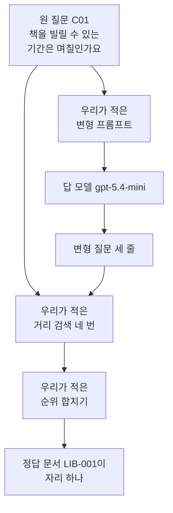
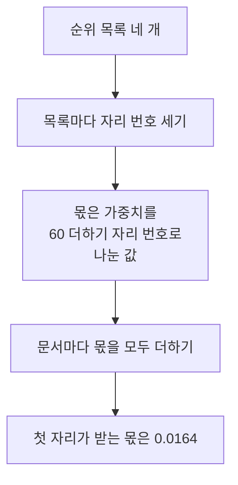
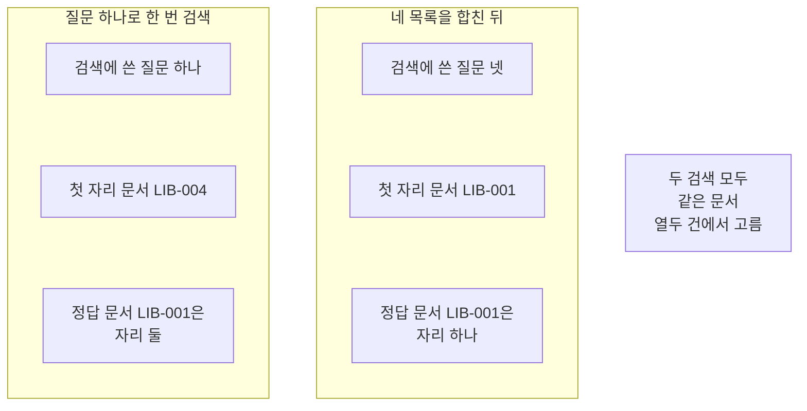
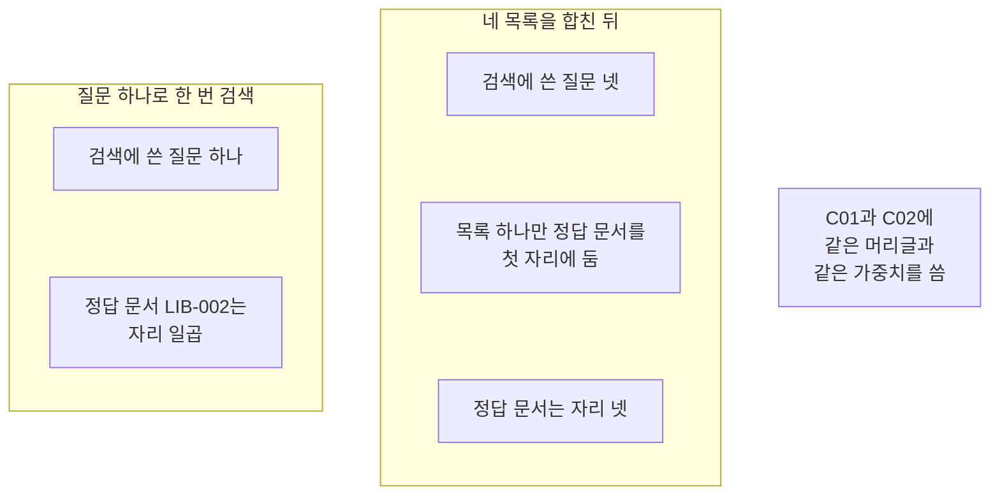

# 02-Multi-Query

## _src 본문 (HTML 원본)

```html
<!--meta: 강의 1h | 실습 2h | 코드 notebooks/02-Multi-Query.ipynb | 새 용어 2 -->
<style>html,body{overflow-x:hidden}.notebook,.nb-cell,.nb-main,.nb-input,.nb-result{min-width:0;max-width:100%}.nb-input pre,.nb-output{box-sizing:border-box;max-width:100%;overflow-x:auto}code.nb-source{display:block!important;width:100%!important;min-width:0!important;overflow-x:auto!important;padding:0!important}</style>
<h2 id="b1"><span class="no">1</span>학습 목표</h2><div class="goal"><ul>
<li>질문 하나를 뜻이 같은 변형 질문 여러 개로 늘릴 수 있습니다.</li>
<li>변형 질문마다 얻은 순위 목록을 Ch 12 순위 합치기로 하나로 만들 수 있습니다.</li>
<li>늘려도 정답 문서가 앞으로 오지 않는 질문이 있다는 것을 자리로 확인할 수 있습니다.</li>
</ul></div>
<h2 id="b2"><span class="no">2</span>이 내용을 배우는 이유</h2><p>같은 일을 사람마다 다른 말로 묻습니다. 어떤 사람은 「대출 기간」이라 적고 어떤 사람은 「며칠 빌리나요」라고 적습니다. 문서에 적힌 말과 질문에 쓴 말이 멀면 그 문서는 뒤로 밀립니다. 질문을 여러 갈래로 늘려 각각 검색하면 그 가운데 하나가 문서의 말과 가까울 수 있습니다.</p><p>Ch 9의 기본 RAG는 검색 한 번과 답 한 번이었습니다. 이 챕터는 그 앞뒤에 단계를 하나씩 붙입니다. 01절은 검색 앞에서 질문을 바꾸는 단계를 붙였습니다. 이 절은 같은 자리에서 질문 하나를 여러 개로 늘립니다. 늘릴 개수는 우리가 코드에 적은 값으로 정합니다.</p>
<h2 id="b3"><span class="no">3</span>앞에서 배운 내용</h2><p>01절은 대화 기록을 넣어 혼자서도 뜻이 통하는 질문을 만들었습니다. 이 절은 그렇게 뜻이 통하는 질문 하나를 입력으로 받습니다. 쓰는 질문은 01절이 Ch 12와 대조할 때 쓴 질문 <code>C01</code>입니다. 문서 열두 건과 질문 여덟 개는 Ch 12 core 벌 사본 그대로입니다.</p><p>거리 순위 함수와 순위 표 출력 함수는 Ch 12 01절과 05절에서 배웠습니다. 문서 ID를 모으는 함수와 정답 자리를 세는 함수는 Ch 11 01절에서 배웠습니다. 01절처럼 이 넷을 도구 파일 <code>notebooks/rag_tools.py</code>에서 가져옵니다. 기록 한 줄을 만드는 01절 함수도 같은 파일에서 가져옵니다. 값도 같아서 벡터의 숫자 개수 설정 <code>256</code>과 답 모델을 이어 씁니다.</p><p>순위 목록 여러 개를 하나로 만드는 일은 Ch 12 06절에서 배웠습니다. 그 절의 순위 합치기 함수도 도구 파일에서 가져오고 순위 상수 <code>60</code>을 그대로 씁니다. 01절은 목록 하나만 다뤄 이 함수를 쓰지 않았습니다. 이 절에서 목록이 넷으로 늘어 처음 씁니다.</p>
<h2 id="b4"><span class="no">4</span>핵심 개념</h2><h3>비유로 시작하기</h3><p>나무판 한 장으로 빈자리를 메운다고 생각해 봅니다. 판 한 장이 안 맞으면 같은 모양 판을 여러 장 만듭니다. 여러 장을 나란히 두고 어느 장이 잘 맞는지 살핍니다. 마지막에는 네 장을 다시 한 묶음으로 포개어 하나로 씁니다.</p>
{{img:02-5-한-장에서-네-장으로-늘린-나무판|흰 바탕에 왼쪽에는 나무판 한 장이 있고 가운데에는 같은 모양 나무판 네 장이 부채처럼 나란히 펼쳐져 있으며 오른쪽에는 그 네 장이 다시 한 묶음으로 가지런히 포개져 있는 그림|왼쪽 판 한 장이 가운데에서 네 장으로 늘었다가 오른쪽에서 다시 한 묶음으로 포개집니다.}}
<p class="look"><b>그림 읽기</b> — 왼쪽에 나무판 한 장이 놓여 있습니다. 가운데에는 같은 모양 판 네 장이 부채처럼 펼쳐져 있습니다. 오른쪽에는 그 네 장이 다시 한 묶음으로 포개져 있습니다. 세 자리를 왼쪽부터 오른쪽으로 읽으면 하나에서 넷으로 늘었다가 다시 하나로 모이는 차례가 보입니다.</p>
<table><thead><tr><th>말</th><th>뜻</th></tr></thead><tbody><tr><td>변형 질문</td><td>원 질문과 같은 것을 묻되 표현을 달리해 만든 검색 질문입니다. 이 절에서는 세 개입니다.</td></tr><tr><td>합친 목록</td><td>순위 목록 여러 개를 자리 몫으로 더해 하나로 만든 목록입니다.</td></tr></tbody></table>
<p>아래 네 말은 Ch 11·Ch 12에서 쓰던 뜻 그대로 이어 씁니다.</p>
<table><thead><tr><th>말</th><th>뜻</th></tr></thead><tbody><tr><td>순위 합치기</td><td>순위 목록 여러 개를 하나로 만드는 일입니다(Ch 12 06절).</td></tr><tr><td>순위 상수</td><td>자리 번호에 더해 몫을 줄이는 값이고 이 절도 <code>60</code>입니다(Ch 12 06절).</td></tr><tr><td>가중치</td><td>목록 하나가 합친 점수에 보태는 몫의 크기입니다(Ch 12 06절).</td></tr><tr><td>정답 자리</td><td>순위 목록에서 정답 문서가 몇째 자리인지 센 값입니다(Ch 11 01절).</td></tr></tbody></table>
{{mermaid:02-1-질문-하나를-여러-갈래로-늘리기|위에서 아래로 놓인 상자 일곱으로 맨 위에 초록 상자 원 질문 C01 책을 빌릴 수 있는 기간은 며칠인가요가 있고 그 아래 파란 상자 우리가 적은 변형 프롬프트와 보라 상자 답 모델 gpt-5.4-mini를 지나 노란 상자 변형 질문 세 줄로 이어지며 원 질문과 변형 질문이 모두 파란 상자 우리가 적은 거리 검색 네 번으로 모여 파란 상자 우리가 적은 순위 합치기를 거쳐 맨 아래 노란 상자 정답 문서 LIB-001이 자리 하나로 이어지는 그림|질문 하나를 변형 질문 셋으로 늘려 네 목록을 합치면 정답 문서가 자리 하나로 올라옵니다.}}
<p class="look"><b>도식 읽기</b> — 위에서 아래로 읽습니다. 맨 위 초록 상자가 사람이 적은 원 질문입니다. 파란 상자 셋은 우리가 적은 글과 처리이고 보라 상자가 이번에 부른 모델입니다. 노란 상자 둘은 출력으로 확인한 값입니다. 원 질문은 변형 프롬프트로도 가고 거리 검색으로도 갑니다.</p>
<h3>원 질문을 지우지 않습니다</h3><p>변형 질문은 검색에 넣는 글입니다. 사람이 적은 원 질문도 목록에 그대로 넣습니다. 원 질문 목록까지 합쳐야 변형이 빗나갔을 때 기댈 자리가 남습니다.</p>
<h3>모델이 만든 질문은 출처가 아닙니다</h3><p>변형 질문은 모델이 쓴 글입니다. 자료에서 확인한 사실이 아니라 검색에 넣으려고 만든 글입니다. 답의 출처로는 찾은 문서의 ID와 원문만 씁니다.</p>
<h3>늘리는 개수를 값으로 적어 둡니다</h3><p>변형 질문 하나마다 임베딩 요청이 한 번씩 늘어납니다. 그래서 개수를 코드에 값으로 적고 머리글도 그 값으로 만듭니다. 값 하나를 바꾸면 머리글과 실제로 쓰는 개수가 함께 바뀝니다.</p>
<h3>다른 상황에 적용</h3><p>고객 문의에도 같은 자리가 있습니다. 「환불되나요」라는 물음을 「반품 규정」과 「결제 취소 절차」로 늘려 봅니다. 늘린 질문마다 찾은 목록을 합치면 한 갈래로 찾지 못한 문서가 앞으로 올 수 있습니다.</p>
<h2 id="b5"><span class="no">5</span>실행 예제</h2><p>노트북은 문서 열두 건을 벡터로 바꾼 뒤 질문 두 개를 각각 네 갈래로 검색합니다. 서비스 요청은 열한 번이고 임베딩 아홉 번과 답 모델 두 번입니다. 예상 비용은 미화 0.01달러 아래입니다. 새로 쓰는 파일은 없습니다.</p><p>먼저 질문 <code>C01</code>을 한 번만 검색해 정답 문서의 자리를 셉니다. 그다음 변형 질문 셋을 만들고 네 목록을 모읍니다. 이어서 네 목록을 순위 합치기로 하나로 만들어 자리를 다시 셉니다. 마지막으로 질문만 <code>C02</code>로 바꾸어 같은 일을 다시 합니다.</p>
{{mermaid:02-2-자리-번호를-몫으로-바꾸기|위에서 아래로 놓인 상자 다섯으로 맨 위 초록 상자 순위 목록 네 개 아래에 파란 상자 목록마다 자리 번호 세기와 파란 상자 몫은 가중치를 60 더하기 자리 번호로 나눈 값과 파란 상자 문서마다 몫을 모두 더하기가 차례로 이어지고 맨 아래 노란 상자 첫 자리가 받는 몫은 0.0164로 이어지는 그림|자리 번호를 몫으로 바꾸어 문서마다 더하면 여러 목록에서 앞자리인 문서가 위로 올라옵니다.}}
<p class="look"><b>도식 읽기</b> — 위에서 아래로 읽습니다. 맨 위 초록 상자가 합칠 순위 목록 넷입니다. 파란 상자 셋은 Ch 12 06절 함수가 하는 일을 차례로 적은 것입니다. 맨 아래 노란 상자는 노트북 6절이 출력한 첫 자리 몫입니다.</p>
{{notebook:02-Multi-Query}}
<p class="look"><b>확인할 점</b> — 질문 <code>C01</code> 순위 표의 세 문서가 01절 표와 같은지 봅니다. 한 번만 검색한 출력 줄은 <code>한 번만 검색했을 때 정답 문서의 자리: 2</code>였습니다. 네 목록을 합친 뒤에는 <code>합친 뒤 정답 문서의 자리: 1</code>이었습니다. 질문을 바꾼 자리에서는 같은 줄이 <code>합친 뒤 정답 문서의 자리: 4</code>였습니다.</p>
<h2 id="b6"><span class="no">6</span>실험 결과 해석</h2><p>질문 <code>C01</code>을 한 번만 검색하니 첫 자리가 <code>LIB-004</code>였습니다. 전자책을 다룬 문서이고 이 질문의 정답 문서가 아닙니다. 정답 문서 <code>LIB-001</code>은 둘째 자리였습니다. 거리 상위 셋은 01절이 Ch 12 05절과 대조한 표와 같았습니다.</p><p>변형 질문 셋을 더해 목록이 넷이 되었습니다. 네 목록을 순위 합치기로 합치니 정답 문서가 첫 자리로 왔습니다. 같은 문서 열두 건에서 질문 수만 늘렸는데 자리가 한 칸 올라왔습니다. 목록마다 정답 문서가 몇째였는지는 실행마다 달라져 여기에 적지 않았습니다.</p>
{{mermaid:02-3-한-번-검색과-합친-목록|왼쪽부터 오른쪽으로 놓인 칸 두 개와 회색 상자 하나로 왼쪽 칸 제목은 질문 하나로 한 번 검색이고 그 안에 초록 상자 검색에 쓴 질문 하나와 노란 상자 첫 자리 문서 LIB-004와 노란 상자 정답 문서 LIB-001은 자리 둘이 있으며 가운데 칸 제목은 네 목록을 합친 뒤이고 그 안에 초록 상자 검색에 쓴 질문 넷과 노란 상자 첫 자리 문서 LIB-001과 노란 상자 정답 문서 LIB-001은 자리 하나가 있고 오른쪽에 회색 상자 두 검색 모두 같은 문서 열두 건에서 고름이 놓인 그림|같은 문서 열두 건에서 질문 하나로 검색하면 정답 문서가 자리 둘이고 네 목록을 합치면 자리 하나입니다.}}
<p class="look"><b>도식 읽기</b> — 왼쪽 칸이 질문 하나로 한 번 검색한 자리입니다. 가운데 칸이 변형 질문을 더해 네 목록을 합친 자리입니다. 칸마다 맨 위 초록 상자가 넣은 질문이고 그 아래 노란 상자 둘이 나온 값입니다. 오른쪽 회색 상자는 두 칸에 모두 해당하는 사실입니다.</p>
<p>질문을 <code>C02</code>로 바꾸면 결과가 달랐습니다. 한 번만 검색했을 때 정답 문서 <code>LIB-002</code>는 일곱째 자리였습니다. 목록 넷 가운데 하나만 그 문서를 첫 자리에 두었습니다.</p><p>네 목록을 같은 방법으로 합쳤더니 정답 문서는 넷째 자리였습니다. 자리는 일곱에서 넷으로 올라왔지만 앞 세 자리 안에는 들지 못했습니다. 순위 합치기는 여러 목록에서 고르게 앞자리인 문서를 위로 올립니다. 한 목록에서만 앞자리인 문서는 몫을 한 번밖에 모으지 못합니다.</p>
{{mermaid:02-4-늘려도-앞으로-오지-않는-질문|왼쪽부터 오른쪽으로 놓인 칸 두 개와 회색 상자 하나로 왼쪽 칸 제목은 질문 하나로 한 번 검색이고 그 안에 초록 상자 검색에 쓴 질문 하나와 노란 상자 정답 문서 LIB-002는 자리 일곱이 있으며 가운데 칸 제목은 네 목록을 합친 뒤이고 그 안에 초록 상자 검색에 쓴 질문 넷과 노란 상자 목록 하나만 정답 문서를 첫 자리에 둠과 노란 상자 정답 문서는 자리 넷이 있고 오른쪽에 회색 상자 C01과 C02에 같은 머리글과 같은 가중치를 씀이 놓인 그림|한 목록에서만 앞자리인 문서는 몫을 한 번밖에 모으지 못해 합친 뒤에도 자리 넷에 머뭅니다.}}
<p class="look"><b>도식 읽기</b> — 왼쪽 칸이 바꾼 질문을 한 번만 검색한 자리입니다. 가운데 칸이 같은 질문을 네 갈래로 늘려 합친 자리입니다. 칸마다 맨 위 초록 상자가 넣은 질문이고 그 아래 노란 상자가 출력으로 확인한 값입니다. 오른쪽 회색 상자는 질문 C01과 C02에서 같게 둔 것입니다.</p>
<p>여기서 본 것은 질문 두 개입니다. 여덟 질문 모두에서 같은 차이가 나는지는 이번에 확인하지 않았습니다. 여러 질문으로 검색 품질을 재는 일은 Ch 11과 Ch 12 몫입니다. 답이 맞는지 판정하는 일은 Ch 15 몫입니다.</p>
<h2 id="b7"><span class="no">7</span>주의할 점과 실무 메모</h2><ul><li>질문 두 개는 흐름을 보여 주려고 고른 예입니다. 여덟 질문을 모두 재어 본 뒤 앞 세 자리 안으로 들어오는 질문과 들어오지 못하는 질문을 하나씩 골랐습니다.</li><li>01절이 만든 독립 질문은 한 번 검색으로도 정답 문서가 첫 자리였습니다. 늘린 효과를 보이려고 01절이 Ch 12와 대조한 질문 <code>C01</code>을 이어 썼습니다.</li><li>변형 질문은 모델이 쓴 글이라 실행마다 문장이 달라집니다. 그 문장에 <code>assert</code>를 걸지 않았습니다.</li><li>새 커널로 두 번 실행하니 변형 질문 문장 셋이 달라졌습니다. 두 질문의 한 번 검색 자리와 합친 뒤 자리는 두 실행에서 같았습니다.</li><li>목록별 첫 자리 문서는 한 줄이 두 실행에서 달랐습니다. 어느 목록이 어떤 문서를 앞에 두었는지는 그림과 정리에 넣지 않았습니다.</li><li>모델이 보낸 글을 줄로 나눌 때 글자를 깎지 않았습니다. 빈 줄만 빼고 앞의 세 줄만 골라 씁니다.</li><li>변형 질문을 셋 만들면 임베딩 요청이 세 번 늘어납니다. 이 절은 걸린 시간을 재지 않았으므로 빨라졌는지 느려졌는지 적지 않습니다.</li><li>늘린 질문이 대상이나 조건을 바꾸면 검색이 다른 문서를 찾습니다. 머리글에 대상과 조건을 그대로 두라는 줄을 넣었습니다.</li><li>모델이 만든 변형 질문은 검색에 넣는 글일 뿐이라 출처로 쓰지 않습니다. 출처는 찾은 문서의 ID와 원문입니다.</li><li>거리 값은 셋째 자리 아래가 호출마다 조금씩 달라집니다. 본문과 그림에는 자리 번호와 문서 ID만 적었습니다.</li><li>이 절은 파일을 쓰지 않습니다. 문서 파일과 질문 파일은 읽기만 합니다.</li><li>준비물에 LangChain 1.4.0과 langchain-openai 1.6.1과 numpy 2.5.3을 적었습니다. 다른 판과 Windows·macOS에서는 이번에 실행하지 않았습니다.</li></ul>
<h2 id="b8"><span class="no">8</span>정리와 다음 절</h2><ul><li>질문 하나만으로 검색하니 질문 <code>C01</code>의 정답 문서는 둘째 자리였습니다.</li><li>변형 질문 셋을 더해 네 목록을 합치니 정답 문서가 첫 자리로 왔습니다.</li><li>질문 <code>C02</code>에서는 같은 방법을 써도 정답 문서가 앞 세 자리 안에 들지 못했습니다.</li></ul><p><strong>다음 학습과 이어지는 지점</strong> — 03절에서는 한 질문 안에 섞인 여러 사실을 하위 질문으로 나눕니다. 이 절의 변형 질문은 같은 것을 묻고 03절의 하위 질문은 다른 것을 묻습니다.</p>
<h2 id="b9"><span class="no">9</span>복습 문제</h2><details class="quiz" open><summary>문제 4개 · 해설 포함</summary><p class="quiz-q">1. 변형 질문의 입력과 출력은 무엇입니까?</p><p class="quiz-a">질문 하나를 넣으면 같은 것을 묻되 표현이 다른 검색 질문 세 개가 나옵니다. 틀렸다면 「핵심 개념」의 용어 표를 다시 읽습니다.</p><p class="quiz-q">2. 질문 <code>C01</code>에서 합치기 전과 뒤에 무엇이 달라졌습니까?</p><p class="quiz-a">정답 문서 <code>LIB-001</code>의 자리가 둘에서 하나로 올라왔습니다. 첫 자리 문서도 <code>LIB-004</code>에서 <code>LIB-001</code>로 바뀌었습니다. 틀렸다면 「실험 결과 해석」의 첫 비교 도식을 다시 읽습니다.</p><p class="quiz-q">3. 질문 <code>C02</code>에서는 왜 정답 문서가 앞 세 자리 안에 들지 못했습니까?</p><p class="quiz-a">목록 넷 가운데 하나만 그 문서를 첫 자리에 두었기 때문입니다. 순위 합치기는 여러 목록에서 고르게 앞자리인 문서를 위로 올립니다. 틀렸다면 「실험 결과 해석」의 둘째 비교 도식을 다시 읽습니다.</p><p class="quiz-q">4. 변형 질문을 늘릴 개수를 코드에 값으로 적어 두는 까닭은 무엇입니까?</p><p class="quiz-a">머리글과 실제로 쓰는 개수를 한 자리에서 맞추고 늘어난 요청 수를 셀 수 있기 때문입니다. 틀렸다면 「핵심 개념」의 마지막 소제목을 다시 읽습니다.</p></details>
<h2 id="b10"><span class="no">10</span>참고 자료</h2><ul><li><div><a href="https://docs.langchain.com/oss/python/concepts/providers-and-models">LangChain 모델과 provider</a></div>확인 2026-09-19 · LangChain 1.4 기준 · 변형 질문을 만드는 모델을 준비하는 방법.</li><li><div><a href="https://developers.openai.com/api/docs/models/text-embedding-3-small">OpenAI text-embedding-3-small 모델 안내</a></div>확인 2026-09-19 · 문서와 질문을 벡터로 바꿀 때 쓴 모델과 차원 수 설정.</li><li><div><a href="https://arxiv.org/abs/2402.03367">RAG-Fusion 논문</a></div>확인 2026-09-19 · 질문을 여러 개로 늘려 검색하고 순위를 합치는 방법의 출처.</li><li>Ch 12 06절 하이브리드 검색 — 이 절이 이어 쓴 순위 합치기 함수 두 개와 순위 상수가 있는 자리.</li></ul>
```

## 노트북 셀 (순서대로)

### [0] markdown {'html': 'skip'}

# Multi Query

**이 노트북에서 할 일**

1. Ch 12에서 쓰던 문서 열두 건과 질문 여덟 개를 그대로 읽습니다.
2. 질문 하나를 한 번만 검색해 정답 문서의 자리를 셉니다.
3. 같은 질문을 변형 질문 세 개로 늘려 각각 검색합니다.
4. 네 목록을 Ch 12 순위 합치기로 하나로 만들어 자리를 다시 셉니다.
5. 질문만 바꾸어 같은 일을 다시 하고 두 결과를 견줍니다.

**준비물** — 이 절은 프로젝트 맨 위 폴더의 `.env`에 적어 둔 `OPENAI_API_KEY`를 씁니다.
서비스 요청은 열한 번입니다(임베딩 아홉 번과 답 모델 두 번).
예상 비용은 미화 0.01달러 아래입니다.
읽어 오는 파일은 이 챕터 폴더의 문서 파일과 질문 파일 둘이고 새로 쓰는 파일은 없습니다.
실행 시간은 2분 안팎이고 첫 셀의 설치가 가장 오래 걸립니다.

**기준 버전** — 첫 셀에서 LangChain 1.4.0과 langchain-openai 1.6.1을 설치합니다.
키를 읽는 python-dotenv 1.2.3과 도구 파일이 쓰는 numpy 2.5.3도 함께 설치합니다.
교재 출력은 Linux의 Python 3.12.13으로 만들었습니다.
다른 판과 Windows·macOS에서는 이번에 실행하지 않았습니다.

**강의와 실습 범위** — 강의 시간에는 3절부터 7절까지 읽습니다.
Ch 12 검색 부품과 순위 합치기 부품을 준비하고 질문 하나를 한 번 검색하는 자리입니다.
8절과 9절은 변형 질문을 만들고 목록 넷을 모으는 자리입니다.
10절부터 12절은 목록을 합치고 질문을 바꾸어 다시 재는 자리입니다.

실습 폴더 `labs/part4/ch14-rag-patterns`에서 `uv sync --locked`를 실행합니다.
그다음 이 폴더의 `.venv` 커널을 고르고 첫 셀부터 순서대로 실행합니다.

### [1] markdown {'html': 'skip'}

## 오늘 볼 그림


위에서 아래로 읽습니다.
맨 위 초록 상자가 사람이 적은 원 질문입니다.
가운데 파란 상자 셋이 우리가 적은 글과 처리이고 보라 상자가 모델입니다.
맨 아래 노란 상자 둘이 출력으로 확인한 값입니다.

### [2] markdown {}

## 1. 준비

첫 셀은 패키지 네 개를 설치하고 설치된 판 번호를 출력합니다.
설치에는 몇십 초가 걸릴 수 있습니다.

### [3] code {'execution': {'iopub.execute_input': '2026-09-21T09:39:20.071436Z', 'iopub.status.busy': '2026-09-21T09:39:20.071259Z', 'iopub.status.idle': '2026-09-21T09:39:20.545754Z', 'shell.execute_reply': '2026-09-21T09:39:20.545100Z'}, 'lesson_role': 'setup'}

```python
# 이 절에서 쓰는 패키지를 설치하고 버전을 확인합니다
%pip install -q "langchain==1.4.0" "langchain-openai==1.6.1" "python-dotenv==1.2.3" "numpy==2.5.3"
from importlib.metadata import version

print("langchain:", version("langchain"))
print("langchain-openai:", version("langchain-openai"))
print("python-dotenv:", version("python-dotenv"))
print("numpy:", version("numpy"))
```

출력:
```
Note: you may need to restart the kernel to use updated packages.
langchain: 1.4.0
langchain-openai: 1.6.1
python-dotenv: 1.2.3
numpy: 2.5.3

```

### [4] markdown {}

**결과 읽기** — 설치가 끝나면 판 번호 네 줄이 보입니다.
마지막 줄 `numpy: 2.5.3`은 도구 파일이 벡터 계산에 쓰는 패키지입니다.
이 노트북의 출력은 2026-09-21에 이 판으로 실행한 결과입니다.

다음 셀은 이름 네 개를 불러오고 도구 파일에서 함수 여섯 개를 가져옵니다.
앞의 둘은 자료 읽기와 폴더 확인에 씁니다.
뒤의 둘은 Ch 9~13에서 쓴 임베딩과 답 모델 이름입니다.

앞에서 배운 함수는 `rag_tools.py`에 모아 두었습니다. 파일을 열면 코드를 볼 수 있습니다. 노트북과 같은 폴더(`notebooks/`)에 있는 파일입니다.

이 노트북은 Ch 12 01절 `rank_by_distance()`와 05절 `print_ranked()`를 가져옵니다.
Ch 11 01절 `unique_doc_ids()`·`find_gold_rank()`와 Ch 12 06절 `fuse_rank()`도 가져옵니다.
기록 한 줄을 만드는 01절 `run_row()`도 함께 가져옵니다.
인자 모양은 쓰는 자리에서 설명합니다.

### [5] code {'execution': {'iopub.execute_input': '2026-09-21T09:39:20.546864Z', 'iopub.status.busy': '2026-09-21T09:39:20.546775Z', 'iopub.status.idle': '2026-09-21T09:39:21.381282Z', 'shell.execute_reply': '2026-09-21T09:39:21.381122Z'}, 'lesson_role': 'setup'}

```python
# 자료 읽기·경로 확인과 임베딩·답 모델 이름을 불러옵니다
import json
import os

from langchain_openai import OpenAIEmbeddings
from langchain.chat_models import init_chat_model
# Ch 12 01·05·06절과 Ch 11 01절 함수, 01절 기록 함수를 도구 파일에서 가져옵니다
from rag_tools import find_gold_rank, fuse_rank, print_ranked, rank_by_distance, run_row
from rag_tools import unique_doc_ids

print("불러온 이름:", "json", "os", "OpenAIEmbeddings", "init_chat_model")
```

출력:
```
불러온 이름: json os OpenAIEmbeddings init_chat_model

```

### [6] markdown {}

**결과 읽기** — 출력 줄에 불러온 이름 네 개가 보입니다.
이름 `OpenAIEmbeddings`와 `init_chat_model`은 01절에서 쓴 것과 같습니다.
도구 파일에서 가져온 함수 여섯 개는 출력하지 않습니다.

## 2. 키와 모델 준비

### [7] markdown {}

API 키가 있는지 확인합니다. `True` 값이 나오면 다음으로 넘어갑니다.

### [8] code {'execution': {'iopub.execute_input': '2026-09-21T09:39:21.383256Z', 'iopub.status.busy': '2026-09-21T09:39:21.383043Z', 'iopub.status.idle': '2026-09-21T09:39:21.386789Z', 'shell.execute_reply': '2026-09-21T09:39:21.386600Z'}, 'lesson_role': 'setup'}

```python
# .env 파일에서 OpenAI API 키를 읽습니다(키 값은 출력하지 않습니다)
import os
from dotenv import find_dotenv, load_dotenv

env_path = find_dotenv(usecwd=True)
load_dotenv(env_path)
has_key = os.getenv("OPENAI_API_KEY") is not None
print("OPENAI_API_KEY 설정 여부:", has_key)
assert has_key, "프로젝트 폴더의 .env 파일에 OPENAI_API_KEY를 적어 주세요."
```

출력:
```
OPENAI_API_KEY 설정 여부: True

```

### [9] markdown {}

실습에 쓸 모델을 준비합니다.
temperature 값을 0으로 두어 매번 비슷한 답을 고르게 합니다.

### [10] code {'execution': {'iopub.execute_input': '2026-09-21T09:39:21.387280Z', 'iopub.status.busy': '2026-09-21T09:39:21.387234Z', 'iopub.status.idle': '2026-09-21T09:39:21.433320Z', 'shell.execute_reply': '2026-09-21T09:39:21.433137Z'}}

```python
# 실습에 쓸 모델을 준비합니다
model = init_chat_model(
    "openai:gpt-5.4-mini",
    temperature=0,
    reasoning_effort="none",
)
print("모델 이름:", model.model_name)
print("temperature:", model.temperature)
```

출력:
```
모델 이름: gpt-5.4-mini
temperature: 0.0

```

### [11] markdown {}

**결과 읽기** — 모델 이름 `gpt-5.4-mini`, temperature `0.0`이 보이면 준비가 끝났습니다.
이 노트북의 출력은 2026-09-21에 이 모델로 실행한 결과입니다.

### [12] markdown {}

## 3. 문서와 질문 읽기

이 절은 01절과 같은 문서 파일과 질문 파일을 읽습니다.
두 파일은 Ch 12 core 벌 파일과 바이트가 같은 사본입니다.
먼저 노트북을 연 자리에서 프로젝트 맨 위를 찾습니다.

### [13] code {'execution': {'iopub.execute_input': '2026-09-21T09:39:21.433937Z', 'iopub.status.busy': '2026-09-21T09:39:21.433881Z', 'iopub.status.idle': '2026-09-21T09:39:21.436039Z', 'shell.execute_reply': '2026-09-21T09:39:21.435700Z'}}

```python
# 노트북을 어느 폴더에서 열어도 프로젝트 맨 위를 찾게 후보 세 개를 차례로 봅니다
candidates = [".", "../../..", "../../../.."]
root_path = None
for candidate in candidates:
    if os.path.exists(candidate + "/labs/part4/ch14-rag-patterns/data"):
        root_path = candidate
        break
print("고른 자리:", root_path)
assert root_path is not None, "notebooks 폴더나 실습 폴더 맨 위에서 노트북을 열어 주세요."
```

출력:
```
고른 자리: .

```

### [14] markdown {}

**결과 읽기** — 출력 줄 `고른 자리` 뒤에 점 하나나 위로 올라가는 표시가 보입니다.
Ch 10~13과 01절에서 쓴 방법과 같습니다.
후보 셋 가운데 이 챕터 자료 폴더가 있는 자리를 고릅니다.

다음 셀은 문서 파일과 질문 파일을 읽습니다.

### [15] code {'execution': {'iopub.execute_input': '2026-09-21T09:39:21.436596Z', 'iopub.status.busy': '2026-09-21T09:39:21.436527Z', 'iopub.status.idle': '2026-09-21T09:39:21.439202Z', 'shell.execute_reply': '2026-09-21T09:39:21.438830Z'}}

```python
# 이 챕터 폴더의 문서 파일과 질문 파일을 읽습니다(읽기만 하고 고치지 않습니다)
data_path = root_path + "/labs/part4/ch14-rag-patterns/data"
with open(data_path + "/documents.json", encoding="utf-8") as file:
    docs = json.loads(file.read())
with open(data_path + "/queries.json", encoding="utf-8") as file:
    queries = json.loads(file.read())
print("문서 수:", len(docs))
print("질문 수:", len(queries))
```

출력:
```
문서 수: 12
질문 수: 8

```

### [16] markdown {}

**결과 읽기** — 출력 줄 `문서 수: 12`와 `질문 수: 8`이 Ch 12 core 벌 그대로입니다.
문서는 도서관 안내 열두 건입니다.

질문 번호는 C01부터 C08까지이고 질문 파일에 적혀 있습니다.
이 절은 그 가운데 둘을 씁니다.

## 4. 이 절에서 쓸 값 정하기

Ch 12와 01절에서 정한 값을 그대로 다시 적습니다.
늘릴 변형 질문 개수도 여기서 못 박아 둡니다.

### [17] code {'execution': {'iopub.execute_input': '2026-09-21T09:39:21.439798Z', 'iopub.status.busy': '2026-09-21T09:39:21.439751Z', 'iopub.status.idle': '2026-09-21T09:39:21.441451Z', 'shell.execute_reply': '2026-09-21T09:39:21.441100Z'}}

```python
# Ch 12에서 쓴 값을 그대로 다시 정하고 늘릴 질문 개수도 못 박습니다
top_three = 3
top_all = 12
variant_count = 3
print("나란히 볼 상위 문서 수:", top_three)
print("자리를 셀 때 재는 문서 수:", top_all)
print("만들 변형 질문 수:", variant_count)
```

출력:
```
나란히 볼 상위 문서 수: 3
자리를 셀 때 재는 문서 수: 12
만들 변형 질문 수: 3

```

### [18] markdown {}

**결과 읽기** — 출력 줄 `나란히 볼 상위 문서 수: 3`은 표로 볼 자리 수입니다.
출력 줄 `자리를 셀 때 재는 문서 수: 12`는 정답 자리를 끝까지 세려고 둔 값입니다.
출력 줄 `만들 변형 질문 수: 3`은 이 절이 늘릴 질문 개수입니다.

개수를 값으로 적어 두면 늘어난 요청 수를 셀 수 있습니다.
변형 질문 하나마다 임베딩 요청이 한 번씩 늘어납니다.

## 5. Ch 12 검색 부품 준비

다음 셀은 01절과 같은 방법으로 문서 열두 건의 제목과 본문을 이어 붙입니다.
읽지 말고 실행만 하고 넘어가도 됩니다.
거리 순위와 자리 세기와 출력 함수는 준비 셀에서 도구 파일로 가져왔습니다.

### [19] code {'execution': {'iopub.execute_input': '2026-09-21T09:39:21.441986Z', 'iopub.status.busy': '2026-09-21T09:39:21.441940Z', 'iopub.status.idle': '2026-09-21T09:39:21.443953Z', 'shell.execute_reply': '2026-09-21T09:39:21.443607Z'}, 'lesson_role': 'setup'}

```python
# 문서 12개의 제목과 본문을 이어 붙이고 문서 ID 목록도 만듭니다(Ch 12와 같은 제목 + 본문 모양)
doc_texts = []
doc_ids = []
for doc in docs:
    doc_texts.append(doc["title"] + " " + doc["text"])
    doc_ids.append(doc["doc_id"])
print("이어 붙인 글 수:", len(doc_texts))
print("첫 문서 글:", doc_texts[0])
print("문서 ID 목록:")
print(doc_ids)
```

출력:
```
이어 붙인 글 수: 12
첫 문서 글: 도서 대출 기간 일반 도서는 14일 동안 대출할 수 있습니다. 예약자가 없으면 한 번 연장할 수 있습니다.
문서 ID 목록:
['LIB-001', 'LIB-002', 'LIB-003', 'LIB-004', 'FAC-001', 'FAC-002', 'FAC-003', 'FAC-004', 'ACC-001', 'ACC-002', 'ACC-003', 'ACC-004']

```

### [20] markdown {}

준비 셀 하나를 지났습니다.
다음 셀은 문서 열두 건을 벡터로 바꿉니다.
이 절에서 서비스에 보내는 첫 요청입니다.

### [21] code {'execution': {'iopub.execute_input': '2026-09-21T09:39:21.444472Z', 'iopub.status.busy': '2026-09-21T09:39:21.444428Z', 'iopub.status.idle': '2026-09-21T09:39:21.679213Z', 'shell.execute_reply': '2026-09-21T09:39:21.678476Z'}}

```python
# Ch 12와 같은 모델로 문서 12개를 벡터로 바꿉니다(임베딩 요청 1번)
embedding_model_name = "text-embedding-3-small"
vector_dimensions = 256
embedding_model = OpenAIEmbeddings(model=embedding_model_name, dimensions=vector_dimensions)
doc_vectors = embedding_model.embed_documents(doc_texts)
print("임베딩 모델 이름:", embedding_model.model)
print("벡터의 숫자 개수 설정:", embedding_model.dimensions)
print("문서 벡터 수:", len(doc_vectors))
```

출력:
```
임베딩 모델 이름: text-embedding-3-small
벡터의 숫자 개수 설정: 256
문서 벡터 수: 12

```

### [22] markdown {}

**결과 읽기** — 출력 줄 `임베딩 모델 이름: text-embedding-3-small`은 01절과 같은 모델입니다.
출력 줄 `벡터의 숫자 개수 설정: 256`도 Ch 10~13과 같은 값입니다.
출력 줄 `문서 벡터 수: 12`로 문서마다 벡터 하나를 받았습니다.
벡터 안의 숫자는 호출마다 아주 조금씩 달라져 소수 자리까지 같다고 보지 않습니다.

## 6. 순위 합치기 부품 준비

이 절은 순위 목록 네 개를 하나로 만들어야 합니다.
그 일은 Ch 12 06절에서 「순위 합치기」로 배웠습니다.
먼저 자리 번호를 몫으로 바꾸는 식에 쓸 값 두 개를 정합니다.

### [23] code {'execution': {'iopub.execute_input': '2026-09-21T09:39:21.680989Z', 'iopub.status.busy': '2026-09-21T09:39:21.680846Z', 'iopub.status.idle': '2026-09-21T09:39:21.684255Z', 'shell.execute_reply': '2026-09-21T09:39:21.683670Z'}}

```python
# 자리 번호를 몫으로 바꾸는 식에 쓸 값을 정하고 앞자리 세 곳의 몫을 봅니다
rank_constant = 60
base_weight = 1.0
print("순위 상수:", rank_constant)
print("목록 하나에 줄 가중치:", base_weight)
print("자리 | 기본 가중치가 주는 몫")
for position in range(top_three):
    share = base_weight / (rank_constant + position + 1)
    print(position + 1, "|", round(share, 4))
```

출력:
```
순위 상수: 60
목록 하나에 줄 가중치: 1.0
자리 | 기본 가중치가 주는 몫
1 | 0.0164
2 | 0.0161
3 | 0.0159

```

### [24] markdown {}

**결과 읽기** — 출력 줄 `순위 상수: 60`은 Ch 12 06절에서 정한 값 그대로입니다.
출력 줄 `목록 하나에 줄 가중치: 1.0`으로 네 목록을 같은 크기로 봅니다.
라벨 줄 `자리 | 기본 가중치가 주는 몫` 아래 세 줄에 앞자리 몫이 있습니다.
첫 자리가 받는 몫은 `0.0164`이고 셋째 자리는 `0.0159`입니다.

앞자리일수록 나누는 수가 작아 몫이 큽니다.
여러 목록에서 고르게 앞자리에 있는 문서가 몫을 많이 모읍니다.

순위 합치기 함수 `fuse_rank()`는 준비 셀에서 도구 파일로 가져왔습니다.
안에서 Ch 12 06절 `fuse_scores()`로 목록마다 자리 몫을 더해 문서별 합친 점수를 냅니다.
그 점수가 큰 순서로 문서 ID 목록을 만듭니다.
도구 파일 판은 순위 상수를 셋째 인자로 받습니다.

## 7. 질문 하나로 한 번 검색하기

먼저 질문 하나를 그대로 검색해 기준이 될 자리를 잽니다.
01절이 Ch 12 05절과 대조할 때 쓴 첫 질문을 그대로 고릅니다.

### [25] code {'execution': {'iopub.execute_input': '2026-09-21T09:39:21.685492Z', 'iopub.status.busy': '2026-09-21T09:39:21.685382Z', 'iopub.status.idle': '2026-09-21T09:39:21.688228Z', 'shell.execute_reply': '2026-09-21T09:39:21.687685Z'}}

```python
# 01절이 Ch 12와 대조할 때 쓴 첫 질문을 그대로 골라 정답 문서 ID도 적어 둡니다
base_query = queries[0]
base_question = base_query["question"]
gold_doc_id = base_query["gold_doc_id"]
print("고른 질문:", base_query["qid"], "|", base_question)
print("그 질문의 정답 문서 ID:", gold_doc_id)
```

출력:
```
고른 질문: C01 | 책을 빌릴 수 있는 기간은 며칠인가요?
그 질문의 정답 문서 ID: LIB-001

```

### [26] markdown {}

**결과 읽기** — 출력 줄 `고른 질문: C01` 뒤에 질문 한 줄이 있습니다.
출력 줄 `그 질문의 정답 문서 ID: LIB-001`은 자료 파일에 적힌 정답입니다.

실행 전에 예상해 봅니다.
질문에 「빌릴 수 있는 기간」이 있으니 대출을 다룬 문서가 앞으로 올 것입니다.

### [27] code {'execution': {'iopub.execute_input': '2026-09-21T09:39:21.689394Z', 'iopub.status.busy': '2026-09-21T09:39:21.689298Z', 'iopub.status.idle': '2026-09-21T09:39:21.845029Z', 'shell.execute_reply': '2026-09-21T09:39:21.844004Z'}}

```python
# 고른 질문을 한 번만 검색해 앞 세 자리와 정답 문서의 자리를 봅니다(임베딩 요청 1번)
base_vector = embedding_model.embed_query(base_question)
base_hits = rank_by_distance(base_vector, doc_vectors, doc_ids, top_all)
base_ids = unique_doc_ids(base_hits)
base_place = find_gold_rank(base_ids, [gold_doc_id])
print_ranked(base_hits[:top_three], "거리")
print("한 번만 검색했을 때 정답 문서의 자리:", base_place)
```

출력:
```
순위 | 문서 ID | 거리
1 | LIB-004 | 0.43
2 | LIB-001 | 0.56
3 | LIB-003 | 0.62
한 번만 검색했을 때 정답 문서의 자리: 2

```

### [28] markdown {}

**결과 읽기** — 순위 표의 차례는 `LIB-004`와 `LIB-001`과 `LIB-003`입니다.
01절이 Ch 12 05절과 대조한 표와 같습니다.
출력 줄 `한 번만 검색했을 때 정답 문서의 자리: 2`로 정답 문서는 둘째 자리였습니다.
전자책 문서가 첫 자리에 오고 일반 도서 대출 문서가 그 뒤에 왔습니다.

거리 값은 소수 둘째 자리까지만 읽습니다.
셋째 자리 아래는 호출마다 조금씩 달라져 본문과 그림에 넣지 않았습니다.

## 8. 변형 질문 만들기

같은 것을 묻는 질문을 표현만 달리해 세 줄 더 만듭니다.
머리글에 개수와 모양을 적어 한 줄에 질문 하나만 오게 합니다.
대상과 조건을 그대로 두라는 줄도 함께 넣습니다.

### [29] code {'execution': {'iopub.execute_input': '2026-09-21T09:39:21.847678Z', 'iopub.status.busy': '2026-09-21T09:39:21.847464Z', 'iopub.status.idle': '2026-09-21T09:39:21.850770Z', 'shell.execute_reply': '2026-09-21T09:39:21.850075Z'}}

```python
# 머리글 세 줄과 원 질문을 한 글로 이어 붙입니다
def build_variant_prompt(question):
    variant_head = "아래 질문과 같은 것을 묻되 표현과 관점을 달리한 검색 질문을 "
    variant_head = variant_head + str(variant_count) + "줄 적으세요.\n"
    variant_head = variant_head + "한 줄에 질문 하나만 적고 번호나 기호를 붙이지 마세요.\n"
    variant_head = variant_head + "질문이 가리키는 대상과 조건은 그대로 두세요.\n\n"
    prompt_text = variant_head + "질문: " + question
    return prompt_text
```

출력:
```

```

### [30] markdown {}

**결과 읽기** — 정의 셀이라 출력이 없습니다.
함수 `build_variant_prompt`는 머리글 세 줄을 이어 붙인 뒤 원 질문을 답니다.
머리글의 개수 자리에는 앞에서 정한 값 `variant_count`가 들어갑니다.
값을 바꾸면 머리글과 실제로 쓰는 개수가 함께 바뀝니다.

다음 셀은 그 글을 만들어 모델에 넣습니다.

### [31] code {'execution': {'iopub.execute_input': '2026-09-21T09:39:21.852163Z', 'iopub.status.busy': '2026-09-21T09:39:21.852056Z', 'iopub.status.idle': '2026-09-21T09:39:22.586321Z', 'shell.execute_reply': '2026-09-21T09:39:22.585570Z'}}

```python
# 만든 글을 모델에 넣어 변형 질문을 받습니다(모델 요청 1번)
variant_prompt = build_variant_prompt(base_question)
print("모델에 넣을 글:")
print(variant_prompt)
variant_reply = model.invoke(variant_prompt)
variant_text = variant_reply.text.strip()
print("모델이 쓴 글:")
print(variant_text)
```

출력:
```
모델에 넣을 글:
아래 질문과 같은 것을 묻되 표현과 관점을 달리한 검색 질문을 3줄 적으세요.
한 줄에 질문 하나만 적고 번호나 기호를 붙이지 마세요.
질문이 가리키는 대상과 조건은 그대로 두세요.

질문: 책을 빌릴 수 있는 기간은 며칠인가요?
모델이 쓴 글:
도서 대출 가능 기간은 몇 일인가요?
책 대여 기간은 며칠로 정해져 있나요?
책을 빌려서 보관할 수 있는 기간이 얼마나 되나요?

```

### [32] markdown {}

**결과 읽기** — 라벨 줄 `모델에 넣을 글:` 아래에 머리글 세 줄과 원 질문이 있습니다.
라벨 줄 `모델이 쓴 글:` 아래에는 질문 세 줄이 있습니다.
세 줄 모두 빌리는 기간을 묻고 표현만 다릅니다.
문장은 실행마다 달라질 수 있어 이 값에 `assert`를 걸지 않았습니다.

## 9. 변형 질문마다 검색하기

모델이 보낸 글은 줄 하나가 질문 하나입니다.
줄로 나눌 때 글자를 깎지 않고 빈 줄만 뺍니다.
먼저 그 일을 하는 함수를 만듭니다.

### [33] code {'execution': {'iopub.execute_input': '2026-09-21T09:39:22.587998Z', 'iopub.status.busy': '2026-09-21T09:39:22.587867Z', 'iopub.status.idle': '2026-09-21T09:39:22.590811Z', 'shell.execute_reply': '2026-09-21T09:39:22.590173Z'}}

```python
# 글을 줄로 나누고 빈 줄을 뺀 목록을 만듭니다
def split_lines(reply_text):
    lines = []
    for line in reply_text.split("\n"):
        clean_line = line.strip()
        if clean_line != "":
            lines.append(clean_line)
    return lines
```

출력:
```

```

### [34] markdown {}

**결과 읽기** — 정의 셀이라 출력이 없습니다.
함수 `split_lines`는 글을 줄 단위로 나눈 뒤 빈 줄을 뺀 목록을 만듭니다.
줄 앞뒤 공백만 없애고 글자는 그대로 둡니다.

다음 셀은 그 목록에서 앞의 세 줄만 고릅니다.

### [35] code {'execution': {'iopub.execute_input': '2026-09-21T09:39:22.592082Z', 'iopub.status.busy': '2026-09-21T09:39:22.591964Z', 'iopub.status.idle': '2026-09-21T09:39:22.594996Z', 'shell.execute_reply': '2026-09-21T09:39:22.594446Z'}}

```python
# 모델이 보낸 글을 줄로 나누고 앞에서 정한 개수만 골라 씁니다
variant_lines = split_lines(variant_text)
variants = variant_lines[:variant_count]
print("모델이 보낸 줄 수:", len(variant_lines))
print("쓸 변형 질문 수:", len(variants))
for variant in variants:
    print("변형 질문:", variant)
```

출력:
```
모델이 보낸 줄 수: 3
쓸 변형 질문 수: 3
변형 질문: 도서 대출 가능 기간은 몇 일인가요?
변형 질문: 책 대여 기간은 며칠로 정해져 있나요?
변형 질문: 책을 빌려서 보관할 수 있는 기간이 얼마나 되나요?

```

### [36] markdown {}

**결과 읽기** — 출력 줄 `모델이 보낸 줄 수: 3`으로 세 줄이 왔습니다.
출력 줄 `쓸 변형 질문 수: 3`은 앞에서 정한 개수와 같습니다.
라벨 줄 `변형 질문:` 세 줄에 실제로 쓸 질문이 있습니다.
받은 줄이 더 많아도 앞의 세 줄만 씁니다.

적게 오면 온 만큼만 씁니다.
그때는 `쓸 변형 질문 수`가 `만들 변형 질문 수`보다 작게 나옵니다.

다음 셀은 검색 한 번을 함수 하나로 묶습니다.

### [37] code {'execution': {'iopub.execute_input': '2026-09-21T09:39:22.596057Z', 'iopub.status.busy': '2026-09-21T09:39:22.595964Z', 'iopub.status.idle': '2026-09-21T09:39:22.598373Z', 'shell.execute_reply': '2026-09-21T09:39:22.597819Z'}}

```python
# 질문 하나를 벡터로 바꿔 문서 ID 순위 목록을 만듭니다(부를 때마다 임베딩 요청 1번)
def search_ids(question):
    question_vector = embedding_model.embed_query(question)
    hit_list = rank_by_distance(question_vector, doc_vectors, doc_ids, top_all)
    found_ids = unique_doc_ids(hit_list)
    return found_ids
```

출력:
```

```

### [38] markdown {}

**결과 읽기** — 정의 셀이라 출력이 없습니다.
함수 `search_ids`는 질문 하나를 벡터로 바꾸고 문서 ID 순위 목록을 만듭니다.
부를 때마다 임베딩 요청이 한 번씩 갑니다.
자리를 끝까지 세려고 문서 열두 건을 모두 담습니다.

다음 셀은 원 질문 목록 뒤에 변형 질문 목록 셋을 붙입니다.

### [39] code {'execution': {'iopub.execute_input': '2026-09-21T09:39:22.599459Z', 'iopub.status.busy': '2026-09-21T09:39:22.599373Z', 'iopub.status.idle': '2026-09-21T09:39:23.120837Z', 'shell.execute_reply': '2026-09-21T09:39:23.119339Z'}}

```python
# 원 질문 목록 뒤에 변형 질문 목록 셋을 이어 붙입니다(임베딩 요청 3번)
ranking_list = []
ranking_list.append(base_ids)
for variant in variants:
    ranking_list.append(search_ids(variant))
print("합칠 목록 수:", len(ranking_list))
print("첫 자리 문서 | 정답 문서의 자리")
for found_ids in ranking_list:
    print(found_ids[0], "|", find_gold_rank(found_ids, [gold_doc_id]))
```

출력:
```
합칠 목록 수: 4
첫 자리 문서 | 정답 문서의 자리
LIB-004 | 2
LIB-001 | 1
LIB-004 | 2
FAC-004 | 2

```

### [40] markdown {}

**결과 읽기** — 출력 줄 `합칠 목록 수: 4`로 목록이 넷입니다.
라벨 줄 `첫 자리 문서 | 정답 문서의 자리` 아래 네 줄이 있습니다.
첫 줄은 원 질문이고 첫 자리 문서가 `LIB-004`이며 정답 자리가 `2`입니다.
아래 세 줄은 변형 질문이고 그 가운데 하나만 첫 자리 문서가 `LIB-001`입니다.

변형 질문 문장은 실행마다 달라질 수 있습니다.
문장이 달라지면 이 표의 자리도 함께 달라집니다.
그래서 목록별 자리는 본문 결론에 넣지 않았습니다.

## 10. 네 목록을 하나로 합치기

이제 목록 넷을 순위 합치기로 하나로 만듭니다.
목록마다 같은 가중치를 주어 어느 한 갈래에 치우치지 않게 합니다.

### [41] code {'execution': {'iopub.execute_input': '2026-09-21T09:39:23.122974Z', 'iopub.status.busy': '2026-09-21T09:39:23.122808Z', 'iopub.status.idle': '2026-09-21T09:39:23.126557Z', 'shell.execute_reply': '2026-09-21T09:39:23.125817Z'}}

```python
# 목록마다 같은 가중치를 주고 자리 몫을 더해 하나로 합칩니다
weight_list = []
for found_ids in ranking_list:
    weight_list.append(base_weight)
fused_ids = fuse_rank(ranking_list, weight_list, rank_constant)
fused_place = find_gold_rank(fused_ids, [gold_doc_id])
print("쓴 가중치:", weight_list)
print("합친 목록의 앞 세 자리:", fused_ids[:top_three])
print("합친 뒤 정답 문서의 자리:", fused_place)
```

출력:
```
쓴 가중치: [1.0, 1.0, 1.0, 1.0]
합친 목록의 앞 세 자리: ['LIB-001', 'LIB-004', 'LIB-003']
합친 뒤 정답 문서의 자리: 1

```

### [42] markdown {}

**결과 읽기** — 출력 줄 `쓴 가중치: [1.0, 1.0, 1.0, 1.0]`으로 네 목록을 같게 봤습니다.
출력 줄 `합친 목록의 앞 세 자리`의 맨 앞은 `LIB-001`입니다.
출력 줄 `합친 뒤 정답 문서의 자리: 1`로 정답 문서가 첫 자리로 왔습니다.
한 번만 검색했을 때의 둘째 자리에서 한 자리 올라왔습니다.

합친 목록의 앞 세 자리는 새 커널로 두 번 실행했을 때 같았습니다.
변형 질문 문장이 달라지면 뒷자리는 달라질 수 있습니다.

## 11. 값 바꿔 보기 · 질문을 바꾸기

바꿀 값은 검색에 쓸 질문 하나입니다.
머리글도 변형 개수도 가중치도 그대로 두고 질문만 `C02`로 바꿉니다.
실행 전에 예상해 봅니다.
질문에 「돈」이 있고 문서에는 그 말이 없어 정답 문서가 뒤로 밀릴 것입니다.

### [43] code {'execution': {'iopub.execute_input': '2026-09-21T09:39:23.128222Z', 'iopub.status.busy': '2026-09-21T09:39:23.128088Z', 'iopub.status.idle': '2026-09-21T09:39:23.289214Z', 'shell.execute_reply': '2026-09-21T09:39:23.288293Z'}}

```python
# 바꿀 값은 검색에 쓸 질문 하나입니다(임베딩 요청 1번)
second_query = queries[1]
second_question = second_query["question"]
second_gold = second_query["gold_doc_id"]
second_ids = search_ids(second_question)
second_place = find_gold_rank(second_ids, [second_gold])
print("바꾼 질문:", second_query["qid"], "|", second_question)
print("그 질문의 정답 문서 ID:", second_gold)
print("한 번만 검색했을 때 정답 문서의 자리:", second_place)
```

출력:
```
바꾼 질문: C02 | 책을 늦게 반납하면 돈을 내나요?
그 질문의 정답 문서 ID: LIB-002
한 번만 검색했을 때 정답 문서의 자리: 7

```

### [44] markdown {}

**결과 읽기** — 출력 줄 `바꾼 질문: C02` 뒤에 질문 한 줄이 있습니다.
출력 줄 `그 질문의 정답 문서 ID: LIB-002`는 연체를 다룬 문서입니다.
출력 줄 `한 번만 검색했을 때 정답 문서의 자리: 7`로 일곱째 자리였습니다.
질문의 말과 문서의 말이 멀어 앞자리에 오지 못했습니다.

다음 셀은 같은 머리글로 변형 질문을 다시 받습니다.

### [45] code {'execution': {'iopub.execute_input': '2026-09-21T09:39:23.291679Z', 'iopub.status.busy': '2026-09-21T09:39:23.291452Z', 'iopub.status.idle': '2026-09-21T09:39:24.195954Z', 'shell.execute_reply': '2026-09-21T09:39:24.195080Z'}}

```python
# 바꾼 질문으로 같은 머리글을 써서 변형 질문을 받습니다(모델 요청 1번)
second_prompt = build_variant_prompt(second_question)
second_reply = model.invoke(second_prompt)
second_text = second_reply.text.strip()
second_lines = split_lines(second_text)
second_variants = second_lines[:variant_count]
print("모델이 보낸 줄 수:", len(second_lines))
for variant in second_variants:
    print("변형 질문:", variant)
```

출력:
```
모델이 보낸 줄 수: 3
변형 질문: 도서관 책을 반납 기한보다 늦게 돌려주면 연체료가 발생하나요?
변형 질문: 책 반납이 늦어지면 추가 비용을 내야 하나요?
변형 질문: 대출한 책을 제때 못 돌려주면 벌금이 붙나요?

```

### [46] markdown {}

**결과 읽기** — 출력 줄 `모델이 보낸 줄 수: 3`으로 이번에도 세 줄이 왔습니다.
라벨 줄 `변형 질문:` 세 줄에 연체료와 벌금과 추가 비용을 묻는 질문이 있습니다.
문장은 실행마다 달라집니다.

다음 셀은 목록 넷을 모아 앞에서 쓴 가중치 그대로 합칩니다.

### [47] code {'execution': {'iopub.execute_input': '2026-09-21T09:39:24.198143Z', 'iopub.status.busy': '2026-09-21T09:39:24.197955Z', 'iopub.status.idle': '2026-09-21T09:39:24.628745Z', 'shell.execute_reply': '2026-09-21T09:39:24.628104Z'}}

```python
# 바꾼 질문도 목록 넷을 모아 앞에서 쓴 가중치 그대로 합칩니다(임베딩 요청 3번)
second_ranking_list = []
second_ranking_list.append(second_ids)
for variant in second_variants:
    second_ranking_list.append(search_ids(variant))
second_fused = fuse_rank(second_ranking_list, weight_list, rank_constant)
second_fused_place = find_gold_rank(second_fused, [second_gold])
print("첫 자리 문서 | 정답 문서의 자리")
for found_ids in second_ranking_list:
    print(found_ids[0], "|", find_gold_rank(found_ids, [second_gold]))
print("합친 뒤 정답 문서의 자리:", second_fused_place)
```

출력:
```
첫 자리 문서 | 정답 문서의 자리
LIB-003 | 7
LIB-002 | 1
LIB-003 | 8
LIB-003 | 4
합친 뒤 정답 문서의 자리: 4

```

### [48] markdown {}

**결과 읽기** — 라벨 줄 `첫 자리 문서 | 정답 문서의 자리` 아래 네 줄이 있습니다.
네 줄 가운데 한 줄만 정답 문서를 첫 자리에 두었습니다.
출력 줄 `합친 뒤 정답 문서의 자리: 4`로 넷째 자리에 그쳤습니다.
자리는 일곱에서 넷으로 올라왔지만 앞 세 자리 안에는 들지 못했습니다.

순위 합치기는 여러 목록에서 고르게 앞자리인 문서를 위로 올립니다.
한 목록에서만 앞자리인 문서는 몫을 한 번밖에 모으지 못합니다.
목록별 첫 자리 문서는 실행마다 달라져 결론에 넣지 않았습니다.

## 12. 네 실행을 기록 한 줄씩으로

실행 하나를 기록 한 줄로 만들어 담아 둡니다.
기록 한 줄은 준비 셀에서 도구 파일로 가져온 01절 `run_row()`로 만듭니다.
담는 칸은 실행 이름과 검색에 쓴 질문과 첫 자리 문서와 정답 자리 넷입니다.
이 절이 견주는 값도 그 넷입니다.

다음 셀은 네 실행의 기록을 표로 출력합니다.

### [49] code {'execution': {'iopub.execute_input': '2026-09-21T09:39:24.630840Z', 'iopub.status.busy': '2026-09-21T09:39:24.630701Z', 'iopub.status.idle': '2026-09-21T09:39:24.635500Z', 'shell.execute_reply': '2026-09-21T09:39:24.634572Z'}}

```python
# 네 실행의 기록을 담아 라벨 줄 아래에 한 줄씩 출력합니다
run_rows = []
run_rows.append(run_row("C01 한 번 검색", base_question, base_ids, base_place))
run_rows.append(run_row("C01 합친 목록", base_question, fused_ids, fused_place))
run_rows.append(run_row("C02 한 번 검색", second_question, second_ids, second_place))
run_rows.append(run_row("C02 합친 목록", second_question, second_fused, second_fused_place))
print("실행 | 검색에 쓴 질문 | 첫 자리 문서 | 정답 자리")
for row in run_rows:
    print(row["실행"], "|", row["검색에 쓴 질문"], "|", row["첫 자리 문서"], "|", row["정답 자리"])
```

출력:
```
실행 | 검색에 쓴 질문 | 첫 자리 문서 | 정답 자리
C01 한 번 검색 | 책을 빌릴 수 있는 기간은 며칠인가요? | LIB-004 | 2
C01 합친 목록 | 책을 빌릴 수 있는 기간은 며칠인가요? | LIB-001 | 1
C02 한 번 검색 | 책을 늦게 반납하면 돈을 내나요? | LIB-003 | 7
C02 합친 목록 | 책을 늦게 반납하면 돈을 내나요? | LIB-003 | 4

```

### [50] markdown {}

**결과 읽기** — 라벨 줄 `실행 | 검색에 쓴 질문 | 첫 자리 문서 | 정답 자리` 아래 네 줄이 나옵니다.
질문 `C01`은 합친 뒤 정답 자리가 `1`로 올라왔습니다.
질문 `C02`는 합친 뒤에도 정답 자리가 `4`였습니다.
같은 방법을 써도 질문에 따라 결과가 달랐습니다.

## 정리

1. 질문 하나만으로 검색하니 질문 `C01`의 정답 문서는 둘째 자리였습니다.
2. 변형 질문 셋을 더해 네 목록을 합치니 정답 문서가 첫 자리로 왔습니다.
3. 질문 `C02`에서는 같은 방법을 써도 정답 문서가 앞 세 자리 안에 들지 못했습니다.

03절에서는 한 질문 안에 섞인 여러 사실을 하위 질문으로 나눕니다.
이 절이 만든 변형 질문은 같은 것을 묻는 질문이고 03절은 다른 것을 묻는 질문을 만듭니다.

## 그림

### 02-1-질문-하나를-여러-갈래로-늘리기.mmd



질문 하나를 변형 질문 셋으로 늘려 네 목록을 합치면 정답 문서가 자리 하나로 올라옵니다.

### 02-2-자리-번호를-몫으로-바꾸기.mmd



자리 번호를 몫으로 바꾸어 문서마다 더하면 여러 목록에서 앞자리인 문서가 위로 올라옵니다.

### 02-3-한-번-검색과-합친-목록.mmd



같은 문서 열두 건에서 질문 하나로 검색하면 정답 문서가 자리 둘이고 네 목록을 합치면 자리 하나입니다.

### 02-4-늘려도-앞으로-오지-않는-질문.mmd



한 목록에서만 앞자리인 문서는 몫을 한 번밖에 모으지 못해 합친 뒤에도 자리 넷에 머뭅니다.

### 02-5-한-장에서-네-장으로-늘린-나무판.prompt.md

# 02-5-한-장에서-네-장으로-늘린-나무판 (Higgsfield 삽화)

설명 대상 문장(본문 b4 비유 단락): 나무판 한 장으로 빈자리를 메운다고 생각해 봅니다. 판 한 장이 안 맞으면 같은 모양 판을 여러 장 만듭니다. 여러 장을 나란히 두고 어느 장이 잘 맞는지 살핍니다. 마지막에는 네 장을 다시 한 묶음으로 포개어 하나로 씁니다.

구성 요소와 배치: 흰 바탕에 왼쪽에는 나무판 **한 장**이 놓입니다(= 원 질문 하나). 가운데에는 같은 모양 나무판 **네 장**이 부채처럼 펼쳐집니다(= 원 질문과 변형 질문 셋으로 늘어난 질문 넷). 오른쪽에는 그 네 장이 다시 **한 묶음**으로 포개집니다(= 순위 합치기로 만든 목록 하나).

시선 순서: 왼쪽 한 장 → 가운데 펼쳐진 네 장 → 오른쪽 포갠 한 묶음.

검수 기준: 그림만 보고 「왼쪽은 한 장이다」와 「가운데는 같은 모양 판이 여러 장으로 늘었다」와 「오른쪽은 그 여러 장이 다시 한 묶음으로 모였다」가 읽히는가.

앞 챕터·앞 절 비유와의 관계: 01절이 연 **나무판** 계열을 그대로 잇습니다. 01절은 구멍과 둥근 마개로 「빠진 자리를 채우기」를 보였고, 02절은 같은 나무판을 여러 장으로 늘렸다가 다시 모으는 쪽입니다(handoff §8). Ch 13의 나무 길·작업대·칸 나뉜 상자는 그래프 계열이라 쓰지 않았고, Ch 9~12의 카드·봉투·서랍·쟁반·끈·단추·관·깔때기도 뜻이 정해져 있어 쓰지 않았습니다. 말 「조각」은 Ch 5 토큰 뜻 전용이라 이 그림 설명에서도 쓰지 않습니다.

## 프롬프트 (1차)

```text
Simple flat educational illustration, white background, limited soft palette,
clean outlines, plain everyday objects, no text, no letters, no numbers, no logos.

On the left one single wooden board lying flat. In the middle four identical wooden
boards of the same shape fanned out side by side. On the right the same four boards
stacked back into one neat pile.

No hands, no people, no screens, no monitors, no arrows.
```

## 상태

- 2026-09-19 · `nano_banana_pro`(응답 모델 이름 `nano_banana_2`) · 16:9 · 2k · `use_unlim: false` · 장당 2크레딧.
- **1차 job `a96d371e-082a-419a-90d4-7fcd67aeaddb` 채택**: 검수 기준 세 가지가 모두 읽힙니다. 원본 해시 `d0b1b31a2bba6de4ef30434e578ffa33b86f19bcc9c4583ed84602c95642c4a5`(2752 × 1536). 잔액 2687 → 2685.
- 01절 메모대로 프롬프트를 짧게 유지했더니 한 번에 끝났습니다. 생성에서 결과까지 1분이 걸리지 않았습니다.
- **그림에서 확인한 것(그림 읽기·alt·캡션에 반영)**: 왼쪽에 모서리가 둥근 나무판 한 장이 비스듬히 놓여 있습니다. 가운데에는 같은 모양 판 네 장이 부채처럼 겹쳐 펼쳐져 있습니다. 오른쪽에는 같은 판 네 장이 가지런히 포개져 한 묶음을 이룹니다. 세 무리 모두 같은 나무 빛이고 글자·숫자는 없습니다.
- 저장: 폭 1100px로 줄여 `figures/02-5-한-장에서-네-장으로-늘린-나무판.png`(1100 × 614). 원본 2752px는 저장하지 않았습니다. 저장 PNG를 채택 job 결과에서 같은 폭으로 줄인 그림과 픽셀 단위로 대조해 차이가 없음을 확인했습니다(`ImageChops.difference` bbox `None`, 세 칸 extrema 모두 `(0, 0)`, 규격 §5-4).

