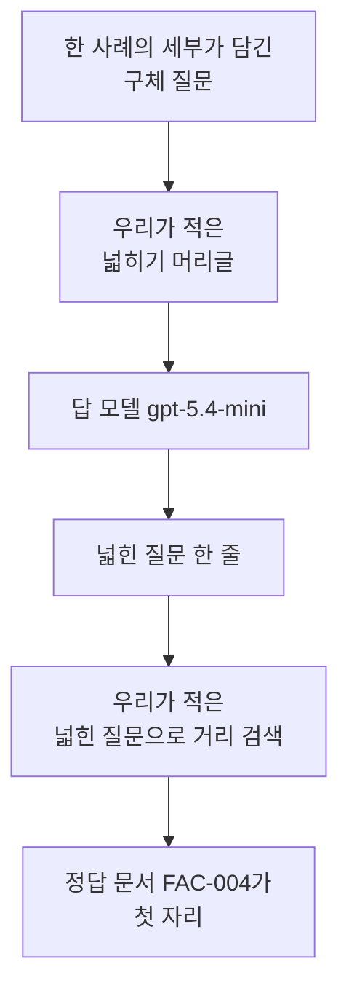
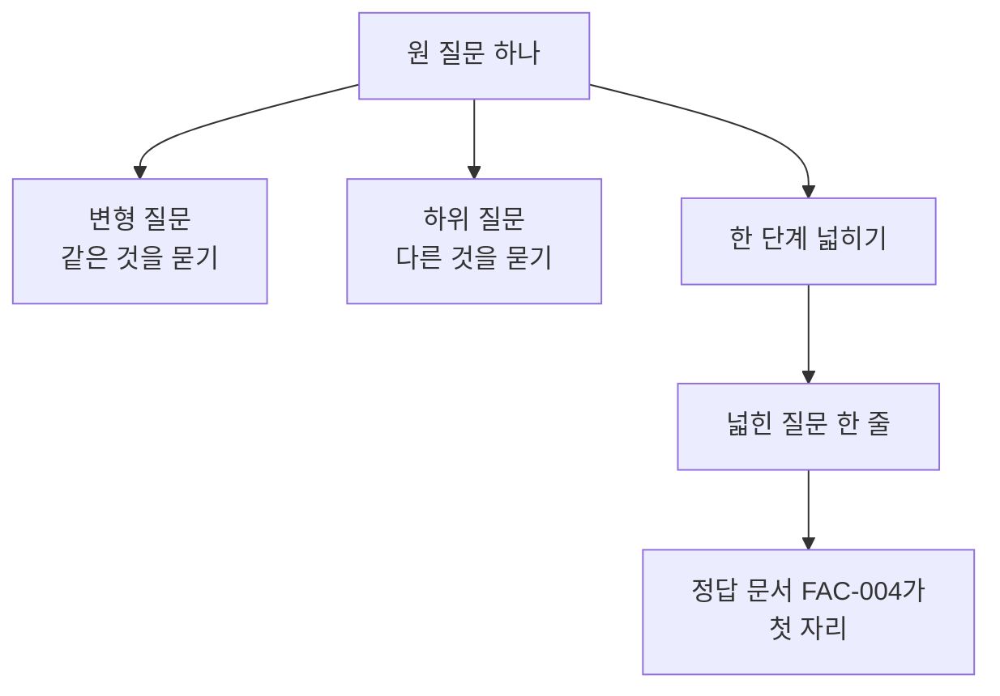
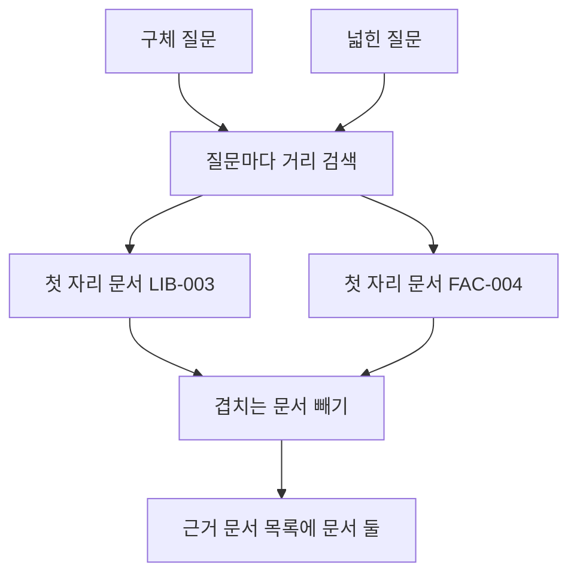
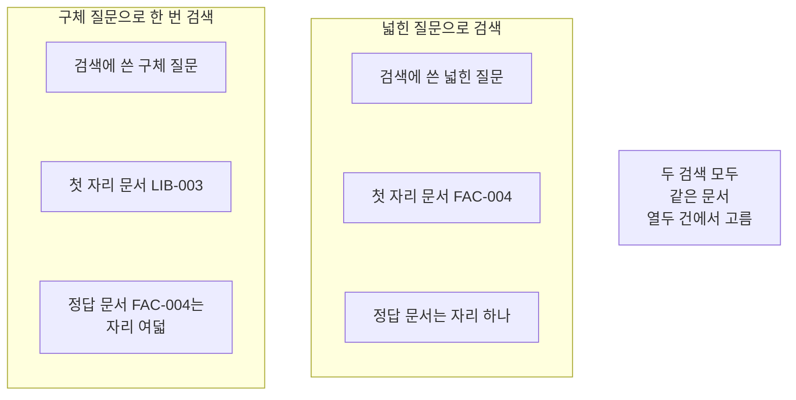

# 04-Step-back

## _src 본문 (HTML 원본)

```html
<!--meta: 강의 1h | 실습 2h | 코드 notebooks/04-Step-back.ipynb | 새 용어 1 -->
<style>html,body{overflow-x:hidden}.notebook,.nb-cell,.nb-main,.nb-input,.nb-result{min-width:0;max-width:100%}.nb-input pre,.nb-output{box-sizing:border-box;max-width:100%;overflow-x:auto}code.nb-source{display:block!important;width:100%!important;min-width:0!important;overflow-x:auto!important;padding:0!important}</style>
<h2 id="b1"><span class="no">1</span>학습 목표</h2><div class="goal"><ul>
<li>한 사례의 세부가 담긴 질문을 한 단계 넓힌 질문으로 바꿀 수 있습니다.</li>
<li>넓힌 질문으로 검색해 정답 문서의 자리가 어떻게 달라지는지 확인할 수 있습니다.</li>
<li>넓혀도 자리가 그대로인 질문이 있다는 것을 같은 코드로 확인할 수 있습니다.</li>
</ul></div>
<h2 id="b2"><span class="no">2</span>이 내용을 배우는 이유</h2><p>사람은 겪은 일을 그대로 묻습니다. 「지난달에 우산을 잃어버렸는데 지금도 찾을 수 있나요」에는 날짜와 물건 이름이 들어 있습니다. 자료에 적힌 규칙 문장에는 그런 말이 없습니다. 그래서 세부가 많은 질문은 규칙 문서와 잘 겹치지 않습니다.</p><p>Ch 9의 기본 RAG는 검색 한 번과 답 한 번이었습니다. 01절은 검색 앞에서 질문을 바꿨고 02절은 질문을 여러 개로 늘렸습니다. 03절은 한 질문을 사실별로 좁게 나눴습니다. 이 절은 같은 자리에서 질문을 한 단계 넓힙니다.</p>
<h2 id="b3"><span class="no">3</span>앞에서 배운 내용</h2><p>03절은 한 질문을 하위 질문 둘로 나눴습니다. 나눈 질문은 원 질문보다 좁았습니다. 이 절은 같은 자리에서 원 질문보다 넓은 질문을 하나 만듭니다. 문서 열두 건과 질문 여덟 개는 Ch 12 core 벌 사본 그대로입니다.</p><p>거리 순위 함수와 순위 표 출력 함수는 Ch 12 01절과 05절에서 배웠습니다. 문서 ID를 모으는 함수와 자리를 세는 함수는 Ch 11 01절에서 배웠습니다. 01~03절처럼 이 넷을 도구 파일 <code>notebooks/rag_tools.py</code>에서 가져옵니다. 벡터의 숫자 개수 설정 <code>256</code>과 답 모델도 이어 씁니다.</p><p>모델이 보낸 글을 줄로 나누는 함수와 검색 한 번을 묶은 함수는 02절에서 만들었고 같은 도구 파일에서 가져옵니다. 이 절은 모델이 보낸 줄 가운데 맨 앞 한 줄만 씁니다. 순위 합치기 함수는 이 절이 목록을 합치지 않아 가져오지 않았습니다.</p>
<h2 id="b4"><span class="no">4</span>핵심 개념</h2><h3>비유로 시작하기</h3><p>나무판에 넓은 구멍이 하나 뚫려 있다고 생각해 봅니다. 손에 든 작은 마개는 그 구멍보다 작아 가운데만 겨우 막습니다. 마개를 아무리 잘 맞춰도 둘레가 비어 있습니다. 구멍보다 큰 판 한 장을 대면 자리 전체가 덮입니다.</p>
{{img:04-5-넓은-구멍을-덮는-큰-판|흰 바탕에 같은 모양의 나무판 두 장이 나란히 놓여 있고 왼쪽 판에는 넓고 둥근 구멍 가운데에 작은 둥근 마개가 놓여 둘레에 빈 자리가 남아 있으며 오른쪽 판에는 구멍보다 큰 네모 나무판 한 장이 위에 놓여 구멍을 다 덮고 있는 그림|작은 마개 하나로는 넓은 구멍에 빈 자리가 남고 더 큰 판 한 장은 그 자리를 다 덮습니다.}}
<p class="look"><b>그림 읽기</b> — 나무판 두 장이 나란히 놓여 있습니다. 둘 다 같은 넓은 구멍이 하나씩 있습니다. 왼쪽 판에는 작은 마개가 구멍 가운데에 있고 둘레에 빈 자리가 남습니다. 오른쪽 판에는 구멍보다 큰 판 한 장이 위에 놓여 자리 전체가 덮였습니다. 판을 더 크게 잡는 쪽이 이 절의 방법입니다.</p>
<table><thead><tr><th>말</th><th>뜻</th></tr></thead><tbody><tr><td>넓힌 질문</td><td>한 사례의 세부를 빼고 판단에 필요한 일반 규칙만 묻도록 만든 검색 질문입니다. 이 절에서는 한 줄입니다.</td></tr></tbody></table>
<p>아래 네 말은 Ch 11·Ch 12와 02·03절에서 쓰던 뜻 그대로 이어 씁니다.</p>
<table><thead><tr><th>말</th><th>뜻</th></tr></thead><tbody><tr><td>변형 질문</td><td>원 질문과 같은 것을 묻되 표현을 달리해 만든 검색 질문입니다(02절).</td></tr><tr><td>하위 질문</td><td>한 질문에 섞인 사실을 하나씩만 묻도록 나눈 검색 질문입니다(03절).</td></tr><tr><td>근거 문서 목록</td><td>검색마다 첫 자리 문서를 하나씩 모으고 겹치는 문서를 뺀 목록입니다(03절).</td></tr><tr><td>정답 문서 ID</td><td>그 물음에 답할 내용이 적힌 문서의 ID입니다(Ch 11 01절).</td></tr></tbody></table>
{{mermaid:04-1-한-사례에서-일반-규칙으로-넓히기|위에서 아래로 놓인 상자 여섯으로 맨 위에 초록 상자 한 사례의 세부가 담긴 구체 질문이 있고 그 아래 파란 상자 우리가 적은 넓히기 머리글과 보라 상자 답 모델 gpt-5.4-mini를 지나 노란 상자 넓힌 질문 한 줄로 이어지며 그 아래 파란 상자 넓힌 질문으로 거리 검색을 거쳐 맨 아래 노란 상자 정답 문서 FAC-004가 첫 자리로 이어지는 그림|한 사례의 세부가 담긴 질문을 한 단계 넓혀 검색하면 규칙을 적은 문서가 앞으로 옵니다.}}
<p class="look"><b>도식 읽기</b> — 위에서 아래로 읽습니다. 맨 위 초록 상자가 사람이 적은 질문입니다. 파란 상자 둘은 우리가 적은 글과 처리이고 보라 상자가 이번에 부른 모델입니다. 노란 상자 둘은 출력으로 확인한 값입니다.</p>
<h3>좁히기와 넓히기</h3><p>02절 변형 질문은 표현만 다르고 묻는 것은 같았습니다. 03절 하위 질문은 원 질문보다 좁게 물었습니다. 이 절 넓힌 질문은 원 질문보다 넓게 묻습니다. 세 방법 모두 검색 앞에 질문을 한 번 바꾸는 자리에 들어갑니다.</p>
{{mermaid:04-2-좁히기와-넓히기|위에서 아래로 놓인 상자 여섯으로 맨 위 초록 상자 원 질문 하나에서 아래로 갈라져 회색 상자 변형 질문 같은 것을 묻기와 회색 상자 하위 질문 다른 것을 묻기와 파란 상자 한 단계 넓히기 셋이 나란히 놓이고 파란 상자 아래에만 노란 상자 넓힌 질문 한 줄과 노란 상자 정답 문서 FAC-004가 첫 자리가 이어지는 그림|같은 자리에서 질문을 같게 묻거나 좁히거나 넓힐 수 있고 이 절은 넓히는 쪽입니다.}}
<p class="look"><b>도식 읽기</b> — 위에서 아래로 읽습니다. 맨 위 초록 상자가 사람이 적은 원 질문입니다. 가운데 세 상자가 질문을 바꾸는 세 갈래입니다. 회색 둘은 앞 절에서 본 갈래이고 이 노트북에서 실행하지 않았습니다. 파란 상자와 그 아래 노란 상자 둘만 이번에 실행한 자리입니다.</p>
<h3>원 질문을 지우지 않습니다</h3><p>넓힌 질문은 검색에 넣는 글입니다. 사람이 적은 원 질문도 목록에 그대로 둡니다. 넓힌 질문에는 날짜와 대상 같은 세부가 남지 않기 때문입니다. 세부 조건을 적은 문서가 따로 있으면 원 질문 목록이 그 문서를 잡아 줄 수 있습니다.</p>
<h3>넓힐 개수를 값으로 적어 둡니다</h3><p>넓힌 질문 하나마다 모델 요청과 임베딩 요청이 한 번씩 늘어납니다. 그래서 개수를 코드에 값으로 적고 머리글도 그 값으로 만듭니다. 값 하나를 바꾸면 머리글과 실제로 쓰는 개수가 함께 바뀝니다.</p>
<h3>모델이 만든 넓힌 질문은 출처가 아닙니다</h3><p>넓힌 질문은 모델이 쓴 글입니다. 자료에서 확인한 사실이 아니라 검색에 넣으려고 만든 글입니다. 답의 출처로는 찾은 문서의 ID와 원문만 씁니다.</p>
<h3>다른 상황에 적용</h3><p>사내 규정 문의에도 같은 자리가 있습니다. 「지난주 출장에서 쓴 택시비를 지금 올려도 되나요」는 한 사례의 물음입니다. 「경비 청구 기한 규정」으로 넓히면 규정 문서를 바로 찾을 수 있습니다.</p>
<h2 id="b5"><span class="no">5</span>실행 예제</h2><p>노트북은 문서 열두 건을 벡터로 바꾼 뒤 질문 둘을 각각 두 갈래로 검색합니다. 서비스 요청은 일곱 번이고 임베딩 다섯 번과 답 모델 두 번입니다. 예상 비용은 미화 0.01달러 아래입니다. 새로 쓰는 파일은 없습니다.</p><p>먼저 한 사례의 세부가 담긴 구체 질문을 손으로 적습니다. 그 질문을 한 번만 검색해 정답 문서의 자리를 셉니다. 그다음 같은 질문을 한 단계 넓혀 다시 검색합니다. 두 검색의 첫 자리 문서를 모아 근거 문서 목록을 만듭니다. 마지막으로 이미 규칙을 묻는 질문으로 바꾸어 같은 일을 다시 합니다.</p>
{{mermaid:04-3-두-목록의-첫-자리-문서를-모으기|위에서 아래로 놓인 상자 일곱으로 맨 위에 초록 상자 구체 질문과 노란 상자 넓힌 질문 둘이 나란히 있고 그 아래 파란 상자 질문마다 거리 검색을 지나 노란 상자 첫 자리 문서 LIB-003과 노란 상자 첫 자리 문서 FAC-004 둘로 갈라졌다가 파란 상자 겹치는 문서 빼기로 다시 모여 맨 아래 노란 상자 근거 문서 목록에 문서 둘로 이어지는 그림|두 검색의 첫 자리 문서를 하나씩 모으고 겹치는 문서를 빼면 근거 문서 목록이 됩니다.}}
<p class="look"><b>도식 읽기</b> — 위에서 아래로 읽습니다. 맨 위 왼쪽 초록 상자가 사람이 적은 질문이고 오른쪽 노란 상자가 모델이 쓴 넓힌 질문입니다. 파란 상자 둘은 우리가 적은 처리입니다. 노란 상자 넷은 노트북 8절과 9절이 출력한 값입니다.</p>
{{notebook:04-Step-back}}
<p class="look"><b>확인할 점</b> — 구체 질문으로 한 번 검색한 출력 줄은 <code>구체 질문으로 한 번 검색했을 때 정답 문서의 자리: 8</code>이었습니다. 넓힌 질문으로 검색한 뒤에는 <code>넓힌 질문으로 검색했을 때 정답 문서의 자리: 1</code>이 나왔습니다. 두 목록을 모은 자리에서는 <code>근거 문서 목록: ['LIB-003', 'FAC-004']</code>였습니다. 질문을 바꾼 자리에서는 <code>근거 문서 목록: ['FAC-004']</code>였습니다.</p>
<h2 id="b6"><span class="no">6</span>실험 결과 해석</h2><p>손으로 적은 구체 질문을 한 번만 검색했습니다. 앞 세 자리는 <code>LIB-003</code>과 <code>FAC-003</code>과 <code>ACC-004</code>였습니다. 세 문서 모두 이 물음의 정답 문서가 아닙니다. 정답 문서 <code>FAC-004</code>는 여덟째 자리였습니다.</p><p>질문에 든 날짜와 물건 이름이 자료의 규칙 문장에는 없습니다. 그래서 세부가 많은 질문은 규칙 문서와 잘 겹치지 않았습니다.</p><p>같은 질문을 한 단계 넓혀 다시 검색했습니다. 넓힌 질문의 첫 자리는 <code>FAC-004</code>였습니다. 정답 문서가 여덟째 자리에서 첫 자리로 왔습니다. 넓힌 질문에는 지난달도 우산도 없습니다. 분실한 물건을 찾는 규칙을 묻는 말만 남았습니다.</p>
{{mermaid:04-4-구체-질문-검색과-넓힌-질문-검색|왼쪽부터 오른쪽으로 놓인 칸 두 개와 회색 상자 하나로 왼쪽 칸 제목은 구체 질문으로 한 번 검색이고 그 안에 초록 상자 검색에 쓴 구체 질문과 노란 상자 첫 자리 문서 LIB-003과 노란 상자 정답 문서 FAC-004는 자리 여덟이 있으며 가운데 칸 제목은 넓힌 질문으로 검색이고 그 안에 노란 상자 검색에 쓴 넓힌 질문과 노란 상자 첫 자리 문서 FAC-004와 노란 상자 정답 문서는 자리 하나가 있고 오른쪽에 회색 상자 두 검색 모두 같은 문서 열두 건에서 고름이 놓인 그림|구체 질문으로 검색하면 정답 문서가 자리 여덟이고 한 단계 넓히면 첫 자리로 옵니다.}}
<p class="look"><b>도식 읽기</b> — 왼쪽 칸이 구체 질문으로 한 번 검색한 자리입니다. 가운데 칸이 넓힌 질문으로 검색한 자리입니다. 왼쪽 칸 맨 위 초록 상자는 사람이 적은 질문이고 가운데 칸 맨 위 노란 상자는 모델이 쓴 질문입니다. 칸마다 아래 노란 상자 둘이 나온 값입니다. 오른쪽 회색 상자는 두 칸에 모두 해당하는 사실입니다.</p>
<p>두 검색의 첫 자리 문서를 모아 근거 문서 목록을 만들었습니다. 목록에는 문서 둘이 담겼습니다. 앞의 문서는 구체 질문이 찾은 <code>LIB-003</code>이고 정답 문서가 아닙니다. 그래도 원 질문 목록을 지우지 않습니다. 세부 조건을 적은 문서가 따로 있을 때 그 문서를 놓치지 않기 위해서입니다.</p><p>이 자료에는 우산 분실을 따로 적은 문서가 없습니다. 그래서 규칙 문서 하나로 이 물음에 답할 수 있습니다. 세부 조건 문서가 함께 있는 자료에서는 목록 둘이 모두 쓰일 수 있습니다. 그런 자료는 이번에 실행하지 않았습니다.</p><p>질문을 바꾸면 결과가 또 달랐습니다. 이미 규칙을 바로 묻는 질문은 한 번 검색으로도 정답 문서가 첫 자리였습니다. 같은 머리글로 넓혀도 자리는 첫 자리 그대로였습니다. 근거 문서 목록에는 문서 하나만 남았습니다. 넓히기가 늘 자리를 올리지는 않습니다.</p><p>여기서 본 것은 질문 두 개입니다. 여덟 질문 모두에서 같은 차이가 나는지는 이번에 확인하지 않았습니다. 여러 질문으로 검색 품질을 재는 일은 Ch 11과 Ch 12 몫입니다. 답이 맞는지 판정하는 일은 Ch 15 몫입니다.</p>
<h2 id="b7"><span class="no">7</span>주의할 점과 실무 메모</h2><ul><li>자료의 여덟 질문은 저마다 규칙을 바로 묻습니다. 그래서 한 사례의 세부가 담긴 질문을 손으로 적었고 그 질문의 정답 문서도 손으로 골랐습니다.</li><li>어느 사례를 쓸지는 탐색 실행으로 정했습니다. 한 번 검색으로 정답 문서가 앞 세 자리 밖으로 밀리는 사례를 골랐습니다.</li><li>값 바꿔 보기에 쓴 질문도 흐름을 보여 주려고 고른 예입니다. 정답 문서는 그대로 두고 질문의 넓이만 바꿨습니다.</li><li>넓힌 질문은 모델이 쓴 글이라 실행마다 문장이 달라질 수 있습니다. 그 문장에 <code>assert</code>를 걸지 않았습니다.</li><li>새 커널로 두 번 실행하니 스무 셀 가운데 열다섯 셀의 출력이 글자까지 같았습니다. 달라진 다섯은 모델이 쓴 넓힌 질문과 거기서 이어지는 순위 표와 기록 표입니다.</li><li>정답 문서의 자리 넷과 첫 자리 문서 넷은 두 실행에서 같았습니다. 결론은 그 값만 씁니다.</li><li>넓힌 질문 검색 순위 표의 둘째·셋째 자리는 두 실행에서 달랐습니다. 본문과 그림 라벨에는 첫 자리 문서만 적었습니다.</li><li>거리 값은 셋째 자리 아래가 호출마다 조금씩 달라집니다. 본문과 그림에는 자리 번호와 문서 ID만 적었습니다.</li><li>넓힌 질문 하나를 만들면 모델 요청 한 번과 임베딩 요청 한 번이 늘어납니다. 이 절은 걸린 시간을 재지 않았으므로 빨라졌는지 느려졌는지 적지 않습니다.</li><li>넓힌 질문만 남기고 원 질문을 지우면 사례의 세부 조건이 사라집니다. 이 자료에서는 규칙 문서 하나로 답할 수 있었지만 세부 조건 문서가 있는 자료에서는 원 질문 목록이 필요합니다.</li><li>넓힌 질문은 검색에 넣으려고 만든 글입니다. 답의 출처로는 찾은 문서의 ID와 원문만 씁니다.</li><li>머리글에 원 질문에 없는 조건을 새로 넣지 말라는 줄을 두었습니다. 없는 조건이 들어가면 다른 문서를 찾습니다.</li><li>이 절은 목록을 하나로 합치지 않습니다. 02절과 03절이 쓴 순위 합치기 함수는 가져오지 않았습니다.</li><li>이 절은 파일을 쓰지 않습니다. 문서 파일과 질문 파일은 읽기만 합니다.</li><li>준비물에 LangChain 1.4.0과 langchain-openai 1.6.1과 numpy 2.5.3을 적었습니다. 다른 판과 Windows·macOS에서는 이번에 실행하지 않았습니다.</li></ul>
<h2 id="b8"><span class="no">8</span>정리와 다음 절</h2><ul><li>한 사례의 세부가 담긴 질문으로 한 번 검색하니 정답 문서가 여덟째 자리였습니다.</li><li>같은 질문을 한 단계 넓히니 정답 문서가 첫 자리로 왔습니다.</li><li>두 검색의 첫 자리 문서를 모으니 근거 문서 목록에 문서 둘이 담겼습니다.</li><li>이미 규칙을 묻는 질문에서는 넓혀도 정답 문서의 자리가 그대로였습니다.</li></ul><p><strong>다음 학습과 이어지는 지점</strong> — 05절에서는 질문 대신 답처럼 보이는 가상 문서를 만들어 그 글로 검색합니다. 이 절은 질문을 넓혔고 05절은 질문을 문서 모양으로 바꿉니다.</p>
<h2 id="b9"><span class="no">9</span>복습 문제</h2><details class="quiz" open><summary>문제 4개 · 해설 포함</summary><p class="quiz-q">1. 넓힌 질문의 입력과 출력은 무엇입니까?</p><p class="quiz-a">한 사례의 세부가 담긴 질문 하나를 넣으면 일반 규칙을 묻는 검색 질문 한 줄이 나옵니다. 틀렸다면 「핵심 개념」의 용어 표를 다시 읽습니다.</p><p class="quiz-q">2. 하위 질문과 넓힌 질문은 무엇이 다릅니까?</p><p class="quiz-a">하위 질문은 원 질문보다 좁게 묻고 넓힌 질문은 원 질문보다 넓게 묻습니다. 틀렸다면 「핵심 개념」의 소제목 「좁히기와 넓히기」를 다시 읽습니다.</p><p class="quiz-q">3. 구체 질문 검색과 넓힌 질문 검색에서 정답 문서의 자리는 각각 몇이었습니까?</p><p class="quiz-a">구체 질문에서는 여덟째 자리였고 넓힌 질문에서는 첫 자리였습니다. 넓힌 질문에 사례의 세부가 없어 규칙을 적은 문서와 가까워졌기 때문입니다. 틀렸다면 「실험 결과 해석」의 둘째 도식을 다시 읽습니다.</p><p class="quiz-q">4. 넓혀도 정답 문서의 자리가 그대로인 경우는 언제입니까?</p><p class="quiz-a">원 질문이 이미 규칙을 바로 묻고 있을 때입니다. 한 번 검색으로도 첫 자리라 넓힐 자리가 남아 있지 않습니다. 틀렸다면 노트북 10절의 결과 읽기를 다시 읽습니다.</p></details>
<h2 id="b10"><span class="no">10</span>참고 자료</h2><ul><li><div><a href="https://arxiv.org/abs/2310.06117">Take a Step Back 논문</a></div>확인 2026-09-19 · 세부 질문에서 한 단계 넓힌 질문을 만드는 방법의 출처.</li><li><div><a href="https://docs.langchain.com/oss/python/concepts/providers-and-models">LangChain 모델과 provider</a></div>확인 2026-09-19 · LangChain 1.4 기준 · 넓힌 질문을 만드는 모델을 준비하는 방법.</li><li><div><a href="https://developers.openai.com/api/docs/models/text-embedding-3-small">OpenAI text-embedding-3-small 모델 안내</a></div>확인 2026-09-19 · 문서와 질문을 벡터로 바꿀 때 쓴 모델과 차원 수 설정.</li><li>Ch 14 03절 질의 분해 — 원 질문보다 좁게 묻는 쪽과 견주어 볼 자리.</li><li>Ch 12 05절 dense와 sparse 비교 — 이 절이 이어 쓴 거리 순위 부품과 출력 함수가 있는 자리.</li></ul>
```

## 노트북 셀 (순서대로)

### [0] markdown {'html': 'skip'}

# Step back

**이 노트북에서 할 일**

1. Ch 12에서 쓰던 문서 열두 건과 질문 여덟 개를 그대로 읽습니다.
2. 한 사례의 세부가 담긴 구체 질문을 하나 정합니다.
3. 그 질문을 한 번만 검색해 정답 문서의 자리를 셉니다.
4. 같은 질문을 한 단계 넓힌 질문으로 바꿔 다시 검색합니다.
5. 두 검색의 첫 자리 문서를 모아 근거 문서 목록을 만듭니다.
6. 질문만 바꾸어 같은 일을 다시 하고 두 결과를 견줍니다.

**준비물** — 이 절은 프로젝트 맨 위 폴더의 `.env`에 적어 둔 `OPENAI_API_KEY`를 씁니다.
서비스 요청은 일곱 번입니다(임베딩 다섯 번과 답 모델 두 번).
예상 비용은 미화 0.01달러 아래입니다.
읽어 오는 파일은 이 챕터 폴더의 문서 파일과 질문 파일 둘이고 새로 쓰는 파일은 없습니다.
실행 시간은 2분 안팎이고 첫 셀의 설치가 가장 오래 걸립니다.

**기준 버전** — 첫 셀에서 LangChain 1.4.0과 langchain-openai 1.6.1을 설치합니다.
키를 읽는 python-dotenv 1.2.3과 도구 파일이 쓰는 numpy 2.5.3도 함께 설치합니다.
교재 출력은 Linux의 Python 3.12.13으로 만들었습니다.
다른 판과 Windows·macOS에서는 이번에 실행하지 않았습니다.

**강의와 실습 범위** — 강의 시간에는 3절부터 7절까지 읽습니다.
Ch 12 검색 부품을 준비하고 한 사례의 세부가 담긴 질문을 고르는 자리입니다.
8절과 9절은 넓힌 질문을 만들어 다시 검색하는 자리입니다.
10절과 11절은 질문을 바꾸어 같은 일을 한 번 더 하고 네 실행을 표로 보는 자리입니다.

실습 폴더 `labs/part4/ch14-rag-patterns`에서 `uv sync --locked`를 실행합니다.
그다음 이 폴더의 `.venv` 커널을 고르고 첫 셀부터 순서대로 실행합니다.

### [1] markdown {'html': 'skip'}

## 오늘 볼 그림


위에서 아래로 읽습니다.
맨 위 초록 상자가 사람이 적은 질문입니다.
가운데 파란 상자 둘이 우리가 적은 글과 처리이고 보라 상자가 모델입니다.
노란 상자 둘이 출력으로 확인한 값입니다.

### [2] markdown {}

## 1. 준비

첫 셀은 패키지 네 개를 설치하고 설치된 판 번호를 출력합니다.
설치에는 몇십 초가 걸릴 수 있습니다.

### [3] code {'execution': {'iopub.execute_input': '2026-09-21T09:39:29.910940Z', 'iopub.status.busy': '2026-09-21T09:39:29.910769Z', 'iopub.status.idle': '2026-09-21T09:39:30.350316Z', 'shell.execute_reply': '2026-09-21T09:39:30.349772Z'}, 'lesson_role': 'setup'}

```python
# 이 절에서 쓰는 패키지를 설치하고 버전을 확인합니다
%pip install -q "langchain==1.4.0" "langchain-openai==1.6.1" "python-dotenv==1.2.3" "numpy==2.5.3"
from importlib.metadata import version

print("langchain:", version("langchain"))
print("langchain-openai:", version("langchain-openai"))
print("python-dotenv:", version("python-dotenv"))
print("numpy:", version("numpy"))
```

출력:
```
Note: you may need to restart the kernel to use updated packages.
langchain: 1.4.0
langchain-openai: 1.6.1
python-dotenv: 1.2.3
numpy: 2.5.3

```

### [4] markdown {}

**결과 읽기** — 설치가 끝나면 판 번호 네 줄이 보입니다.
마지막 줄 `numpy: 2.5.3`은 도구 파일이 벡터 계산에 쓰는 패키지입니다.
이 노트북의 출력은 2026-09-21에 이 판으로 실행한 결과입니다.

다음 셀은 이름 네 개를 불러오고 도구 파일에서 함수 일곱 개를 가져옵니다.
앞의 둘은 자료 읽기와 폴더 확인에 씁니다.
뒤의 둘은 Ch 9~13에서 쓴 임베딩과 답 모델 이름입니다.

앞에서 배운 함수는 `rag_tools.py`에 모아 두었습니다. 파일을 열면 코드를 볼 수 있습니다. 노트북과 같은 폴더(`notebooks/`)에 있는 파일입니다.

이 노트북은 Ch 12 01절 `rank_by_distance()`와 05절 `print_ranked()`를 가져옵니다.
Ch 11 01절 `unique_doc_ids()`·`find_gold_rank()`와 01절 `run_row()`도 가져옵니다.
02절에서 만든 `split_lines()`와 `search_ids()`도 함께 가져옵니다.
인자 모양은 5절에서 설명합니다.

### [5] code {'execution': {'iopub.execute_input': '2026-09-21T09:39:30.351383Z', 'iopub.status.busy': '2026-09-21T09:39:30.351288Z', 'iopub.status.idle': '2026-09-21T09:39:31.136961Z', 'shell.execute_reply': '2026-09-21T09:39:31.136679Z'}, 'lesson_role': 'setup'}

```python
# 자료 읽기·폴더 확인과 임베딩·답 모델 이름을 불러옵니다
import json
import os

from langchain_openai import OpenAIEmbeddings
from langchain.chat_models import init_chat_model
# Ch 12 01·05절·Ch 11 01절 함수와 01·02절 함수를 도구 파일에서 가져옵니다
from rag_tools import find_gold_rank, print_ranked, rank_by_distance, run_row
from rag_tools import search_ids, split_lines, unique_doc_ids

print("불러온 이름:", "json", "os", "OpenAIEmbeddings", "init_chat_model")
```

출력:
```
불러온 이름: json os OpenAIEmbeddings init_chat_model

```

### [6] markdown {}

**결과 읽기** — 출력 줄에 불러온 이름 네 개가 보입니다.
이름 `OpenAIEmbeddings`와 `init_chat_model`은 03절에서 쓴 것과 같습니다.
도구 파일에서 가져온 함수 일곱 개는 출력하지 않습니다.

## 2. 키와 모델 준비

### [7] markdown {}

API 키가 있는지 확인합니다. `True` 값이 나오면 다음으로 넘어갑니다.

### [8] code {'execution': {'iopub.execute_input': '2026-09-21T09:39:31.140827Z', 'iopub.status.busy': '2026-09-21T09:39:31.140731Z', 'iopub.status.idle': '2026-09-21T09:39:31.143921Z', 'shell.execute_reply': '2026-09-21T09:39:31.143751Z'}, 'lesson_role': 'setup'}

```python
# .env 파일에서 OpenAI API 키를 읽습니다(키 값은 출력하지 않습니다)
import os
from dotenv import find_dotenv, load_dotenv

env_path = find_dotenv(usecwd=True)
load_dotenv(env_path)
has_key = os.getenv("OPENAI_API_KEY") is not None
print("OPENAI_API_KEY 설정 여부:", has_key)
assert has_key, "프로젝트 폴더의 .env 파일에 OPENAI_API_KEY를 적어 주세요."
```

출력:
```
OPENAI_API_KEY 설정 여부: True

```

### [9] markdown {}

실습에 쓸 모델을 준비합니다.
temperature 값을 0으로 두어 매번 비슷한 답을 고르게 합니다.

### [10] code {'execution': {'iopub.execute_input': '2026-09-21T09:39:31.144402Z', 'iopub.status.busy': '2026-09-21T09:39:31.144325Z', 'iopub.status.idle': '2026-09-21T09:39:31.191873Z', 'shell.execute_reply': '2026-09-21T09:39:31.191456Z'}}

```python
# 실습에 쓸 모델을 준비합니다
model = init_chat_model(
    "openai:gpt-5.4-mini",
    temperature=0,
    reasoning_effort="none",
)
print("모델 이름:", model.model_name)
print("temperature:", model.temperature)
```

출력:
```
모델 이름: gpt-5.4-mini
temperature: 0.0

```

### [11] markdown {}

**결과 읽기** — 모델 이름 `gpt-5.4-mini`, temperature `0.0`이 보이면 준비가 끝났습니다.
이 노트북의 출력은 2026-09-21에 이 모델로 실행한 결과입니다.

### [12] markdown {}

## 3. 문서와 질문 읽기

이 절은 01~03절과 같은 문서 파일과 질문 파일을 읽습니다.
두 파일은 Ch 12 core 벌 파일과 바이트가 같은 사본입니다.
먼저 노트북을 연 자리에서 프로젝트 맨 위를 찾습니다.

### [13] code {'execution': {'iopub.execute_input': '2026-09-21T09:39:31.192557Z', 'iopub.status.busy': '2026-09-21T09:39:31.192474Z', 'iopub.status.idle': '2026-09-21T09:39:31.194817Z', 'shell.execute_reply': '2026-09-21T09:39:31.194428Z'}}

```python
# 노트북을 어느 폴더에서 열어도 프로젝트 맨 위를 찾게 후보 세 개를 차례로 봅니다
candidates = [".", "../../..", "../../../.."]
root_path = None
for candidate in candidates:
    if os.path.exists(candidate + "/labs/part4/ch14-rag-patterns/data"):
        root_path = candidate
        break
print("고른 자리:", root_path)
assert root_path is not None, "notebooks 폴더나 실습 폴더 맨 위에서 노트북을 열어 주세요."
```

출력:
```
고른 자리: .

```

### [14] markdown {}

**결과 읽기** — 출력 줄 `고른 자리` 뒤에 점 하나나 위로 올라가는 표시가 보입니다.
Ch 10~13과 01~03절에서 쓴 방법과 같습니다.
후보 셋 가운데 이 챕터 자료 폴더가 있는 자리를 고릅니다.

다음 셀은 문서 파일과 질문 파일을 읽습니다.

### [15] code {'execution': {'iopub.execute_input': '2026-09-21T09:39:31.195484Z', 'iopub.status.busy': '2026-09-21T09:39:31.195417Z', 'iopub.status.idle': '2026-09-21T09:39:31.198171Z', 'shell.execute_reply': '2026-09-21T09:39:31.197825Z'}}

```python
# 이 챕터 폴더의 문서 파일과 질문 파일을 읽습니다(읽기만 하고 고치지 않습니다)
data_path = root_path + "/labs/part4/ch14-rag-patterns/data"
with open(data_path + "/documents.json", encoding="utf-8") as file:
    docs = json.loads(file.read())
with open(data_path + "/queries.json", encoding="utf-8") as file:
    queries = json.loads(file.read())
print("문서 수:", len(docs))
print("질문 수:", len(queries))
```

출력:
```
문서 수: 12
질문 수: 8

```

### [16] markdown {}

**결과 읽기** — 출력 줄 `문서 수: 12`와 `질문 수: 8`이 Ch 12 core 벌 그대로입니다.
문서는 도서관 안내 열두 건입니다.

질문 번호는 C01부터 C08까지이고 질문 파일에 적혀 있습니다.
이 절이 쓸 질문은 그 여덟 개에 없어 아래에서 손으로 적습니다.

## 4. 이 절에서 쓸 값 정하기

Ch 12와 01~03절에서 정한 값을 그대로 다시 적습니다.
만들 넓힌 질문 개수도 여기서 못 박아 둡니다.

### [17] code {'execution': {'iopub.execute_input': '2026-09-21T09:39:31.198749Z', 'iopub.status.busy': '2026-09-21T09:39:31.198701Z', 'iopub.status.idle': '2026-09-21T09:39:31.200456Z', 'shell.execute_reply': '2026-09-21T09:39:31.200170Z'}}

```python
# Ch 12에서 쓴 값을 그대로 다시 정하고 만들 넓힌 질문 개수도 못 박습니다
top_three = 3
top_all = 12
broad_count = 1
print("나란히 볼 상위 문서 수:", top_three)
print("자리를 셀 때 재는 문서 수:", top_all)
print("만들 넓힌 질문 수:", broad_count)
```

출력:
```
나란히 볼 상위 문서 수: 3
자리를 셀 때 재는 문서 수: 12
만들 넓힌 질문 수: 1

```

### [18] markdown {}

**결과 읽기** — 출력 줄 `나란히 볼 상위 문서 수: 3`은 표로 볼 자리 수입니다.
출력 줄 `자리를 셀 때 재는 문서 수: 12`는 정답 문서의 자리를 끝까지 세려고 둔 값입니다.
출력 줄 `만들 넓힌 질문 수: 1`은 이 절이 만들 넓힌 질문 개수입니다.

03절은 이 자리에 하위 질문 개수 둘을 두었습니다.
이 절은 한 줄만 받으므로 값이 하나입니다.

## 5. 앞 절 부품 준비

다음 셀은 01~03절과 같은 방법으로 문서 열두 건의 제목과 본문을 이어 붙입니다.
읽지 말고 실행만 하고 넘어가도 됩니다.
함수는 준비 셀에서 도구 파일로 가져왔습니다.
02절 `search_ids()`의 도구 파일 판은 임베딩 모델과 질문과 문서 벡터 목록과 문서 ID 목록과 개수를 받습니다.

### [19] code {'execution': {'iopub.execute_input': '2026-09-21T09:39:31.200965Z', 'iopub.status.busy': '2026-09-21T09:39:31.200916Z', 'iopub.status.idle': '2026-09-21T09:39:31.202790Z', 'shell.execute_reply': '2026-09-21T09:39:31.202574Z'}, 'lesson_role': 'setup'}

```python
# 문서 12개의 제목과 본문을 이어 붙이고 문서 ID 목록도 만듭니다(Ch 12와 같은 제목 + 본문 모양)
doc_texts = []
doc_ids = []
for doc in docs:
    doc_texts.append(doc["title"] + " " + doc["text"])
    doc_ids.append(doc["doc_id"])
print("이어 붙인 글 수:", len(doc_texts))
print("첫 문서 글:", doc_texts[0])
print("문서 ID 목록:")
print(doc_ids)
```

출력:
```
이어 붙인 글 수: 12
첫 문서 글: 도서 대출 기간 일반 도서는 14일 동안 대출할 수 있습니다. 예약자가 없으면 한 번 연장할 수 있습니다.
문서 ID 목록:
['LIB-001', 'LIB-002', 'LIB-003', 'LIB-004', 'FAC-001', 'FAC-002', 'FAC-003', 'FAC-004', 'ACC-001', 'ACC-002', 'ACC-003', 'ACC-004']

```

### [20] markdown {}

준비 셀 하나를 지났습니다.
02·03절이 쓴 순위 합치기 함수는 이 절에서 가져오지 않았습니다.
이 절은 목록 여러 개를 하나로 합치지 않기 때문입니다.

## 6. 문서를 벡터로 바꾸기

다음 셀은 문서 열두 건을 벡터로 바꿉니다.
이 절에서 서비스에 보내는 첫 요청입니다.

### [21] code {'execution': {'iopub.execute_input': '2026-09-21T09:39:31.203387Z', 'iopub.status.busy': '2026-09-21T09:39:31.203341Z', 'iopub.status.idle': '2026-09-21T09:39:31.444951Z', 'shell.execute_reply': '2026-09-21T09:39:31.444112Z'}}

```python
# Ch 12와 같은 모델로 문서 12개를 벡터로 바꿉니다(임베딩 요청 1번)
embedding_model_name = "text-embedding-3-small"
vector_dimensions = 256
embedding_model = OpenAIEmbeddings(model=embedding_model_name, dimensions=vector_dimensions)
doc_vectors = embedding_model.embed_documents(doc_texts)
print("임베딩 모델 이름:", embedding_model.model)
print("벡터의 숫자 개수 설정:", embedding_model.dimensions)
print("문서 벡터 수:", len(doc_vectors))
```

출력:
```
임베딩 모델 이름: text-embedding-3-small
벡터의 숫자 개수 설정: 256
문서 벡터 수: 12

```

### [22] markdown {}

**결과 읽기** — 출력 줄 `임베딩 모델 이름: text-embedding-3-small`은 03절과 같은 모델입니다.
출력 줄 `벡터의 숫자 개수 설정: 256`도 Ch 10~13과 같은 값입니다.
출력 줄 `문서 벡터 수: 12`로 문서마다 벡터 하나를 받았습니다.
벡터 안의 숫자는 호출마다 아주 조금씩 달라져 소수 자리까지 같다고 보지 않습니다.

## 7. 한 사례의 세부가 담긴 질문

자료의 여덟 질문은 저마다 규칙을 바로 묻습니다.
사람이 겪은 일을 그대로 옮긴 질문은 그와 다릅니다.
날짜와 물건 이름 같은 세부가 함께 들어갑니다.
그런 질문을 하나 적고 판단에 쓸 정답 문서도 함께 정합니다.

### [23] code {'execution': {'iopub.execute_input': '2026-09-21T09:39:31.446600Z', 'iopub.status.busy': '2026-09-21T09:39:31.446468Z', 'iopub.status.idle': '2026-09-21T09:39:31.449567Z', 'shell.execute_reply': '2026-09-21T09:39:31.448977Z'}}

```python
# 한 사례의 세부가 담긴 구체 질문과 그 질문의 정답 문서를 정합니다
base_question = "지난달에 도서관에서 우산을 잃어버렸는데 지금도 찾을 수 있나요?"
gold_doc_id = "FAC-004"
gold_title = ""
for doc in docs:
    if doc["doc_id"] == gold_doc_id:
        gold_title = doc["title"]
print("구체 질문:", base_question)
print("이 질문의 정답 문서 ID:", gold_doc_id)
print("그 문서의 제목:", gold_title)
```

출력:
```
구체 질문: 지난달에 도서관에서 우산을 잃어버렸는데 지금도 찾을 수 있나요?
이 질문의 정답 문서 ID: FAC-004
그 문서의 제목: 분실물 보관

```

### [24] markdown {}

**결과 읽기** — 출력 줄 `구체 질문` 뒤에 지난달과 우산이 들어간 물음이 있습니다.
출력 줄 `이 질문의 정답 문서 ID: FAC-004`는 보관 기간을 적은 문서입니다.
출력 줄 `그 문서의 제목: 분실물 보관`으로 제목을 확인했습니다.

실행 전에 예상해 봅니다.
질문에 든 말이 그 문서에 거의 없으니 다른 문서가 먼저 걸릴 것입니다.

### [25] code {'execution': {'iopub.execute_input': '2026-09-21T09:39:31.450611Z', 'iopub.status.busy': '2026-09-21T09:39:31.450494Z', 'iopub.status.idle': '2026-09-21T09:39:31.595886Z', 'shell.execute_reply': '2026-09-21T09:39:31.594815Z'}}

```python
# 구체 질문을 한 번만 검색해 순위 표와 정답 문서의 자리를 봅니다(임베딩 요청 1번)
base_vector = embedding_model.embed_query(base_question)
base_hits = rank_by_distance(base_vector, doc_vectors, doc_ids, top_all)
base_ids = unique_doc_ids(base_hits)
base_place = find_gold_rank(base_ids, [gold_doc_id])
print_ranked(base_hits[:top_three], "거리")
print("구체 질문으로 한 번 검색했을 때 정답 문서의 자리:", base_place)
```

출력:
```
순위 | 문서 ID | 거리
1 | LIB-003 | 0.63
2 | FAC-003 | 0.67
3 | ACC-004 | 0.68
구체 질문으로 한 번 검색했을 때 정답 문서의 자리: 8

```

### [26] markdown {}

**결과 읽기** — 순위 표의 차례는 `LIB-003`과 `FAC-003`과 `ACC-004`입니다.
세 문서 모두 이 물음의 정답 문서가 아닙니다.
출력 줄 `구체 질문으로 한 번 검색했을 때 정답 문서의 자리: 8`로 정답 문서는 여덟째였습니다.

거리 값은 셋째 자리 아래가 호출마다 달라져 본문과 그림에 넣지 않았습니다.
질문에 든 날짜와 물건 이름이 자료의 규칙 문장에는 없습니다.

## 8. 한 단계 넓힌 질문 만들기

이번에는 질문을 잘게 나누지 않습니다.
사례의 세부를 빼고 판단에 필요한 규칙만 묻도록 한 줄을 받습니다.
머리글에 개수와 모양을 적고 없는 조건을 새로 넣지 말라는 줄도 함께 넣습니다.

### [27] code {'execution': {'iopub.execute_input': '2026-09-21T09:39:31.598210Z', 'iopub.status.busy': '2026-09-21T09:39:31.598036Z', 'iopub.status.idle': '2026-09-21T09:39:31.601777Z', 'shell.execute_reply': '2026-09-21T09:39:31.601182Z'}}

```python
# 머리글 네 줄과 원 질문을 한 글로 이어 붙입니다
def build_back_prompt(question):
    back_head = "아래 질문은 한 사례의 세부 상황을 담고 있습니다.\n"
    back_head = back_head + "판단에 필요한 일반 규칙을 찾을 검색 질문을 " + str(broad_count) + "줄 적으세요.\n"
    back_head = back_head + "한 줄만 적고 번호나 따옴표를 붙이지 마세요.\n"
    back_head = back_head + "원 질문에 없는 조건을 새로 넣지 마세요.\n\n"
    prompt_text = back_head + "질문: " + question
    return prompt_text
```

출력:
```

```

### [28] markdown {}

**결과 읽기** — 정의 셀이라 출력이 없습니다.
함수 `build_back_prompt`는 머리글 네 줄을 이어 붙인 뒤 원 질문을 답니다.
머리글의 개수 자리에는 앞에서 정한 값 `broad_count`가 들어갑니다.
03절 머리글과 다른 줄은 첫 줄과 셋째 줄입니다.

다음 셀은 그 글을 만들어 모델에 넣습니다.

### [29] code {'execution': {'iopub.execute_input': '2026-09-21T09:39:31.603264Z', 'iopub.status.busy': '2026-09-21T09:39:31.603141Z', 'iopub.status.idle': '2026-09-21T09:39:32.271458Z', 'shell.execute_reply': '2026-09-21T09:39:32.270715Z'}}

```python
# 만든 글을 모델에 넣어 한 단계 넓힌 질문을 받습니다(모델 요청 1번)
back_prompt = build_back_prompt(base_question)
print("모델에 넣을 글:")
print(back_prompt)
back_reply = model.invoke(back_prompt)
back_text = back_reply.text.strip()
print("모델이 쓴 글:")
print(back_text)
```

출력:
```
모델에 넣을 글:
아래 질문은 한 사례의 세부 상황을 담고 있습니다.
판단에 필요한 일반 규칙을 찾을 검색 질문을 1줄 적으세요.
한 줄만 적고 번호나 따옴표를 붙이지 마세요.
원 질문에 없는 조건을 새로 넣지 마세요.

질문: 지난달에 도서관에서 우산을 잃어버렸는데 지금도 찾을 수 있나요?
모델이 쓴 글:
도서관에서 분실한 물건을 시간이 지난 뒤에도 찾을 수 있는지와 분실물 문의 절차는 어떻게 되나요

```

### [30] markdown {}

**결과 읽기** — 라벨 줄 `모델에 넣을 글:` 아래에 머리글 네 줄과 원 질문이 있습니다.
라벨 줄 `모델이 쓴 글:` 아래에는 질문 한 줄이 있습니다.
그 줄에는 지난달도 우산도 없습니다.
문장은 실행마다 달라질 수 있어 이 값에 `assert`를 걸지 않았습니다.

03절 하위 질문은 원 질문보다 좁았습니다.
이 절 넓힌 질문은 원 질문보다 넓습니다.

## 9. 넓힌 질문으로 검색하기

모델이 보낸 글에서 맨 앞 한 줄만 씁니다.
02절에서 만든 함수로 빈 줄을 빼고 줄 목록을 만듭니다.

### [31] code {'execution': {'iopub.execute_input': '2026-09-21T09:39:32.272965Z', 'iopub.status.busy': '2026-09-21T09:39:32.272862Z', 'iopub.status.idle': '2026-09-21T09:39:32.275783Z', 'shell.execute_reply': '2026-09-21T09:39:32.275156Z'}}

```python
# 모델이 보낸 글을 줄로 나누고 맨 앞 한 줄만 넓힌 질문으로 씁니다
back_lines = split_lines(back_text)
broad_question = back_lines[0]
print("모델이 보낸 줄 수:", len(back_lines))
print("쓸 넓힌 질문 수:", broad_count)
print("넓힌 질문:", broad_question)
```

출력:
```
모델이 보낸 줄 수: 1
쓸 넓힌 질문 수: 1
넓힌 질문: 도서관에서 분실한 물건을 시간이 지난 뒤에도 찾을 수 있는지와 분실물 문의 절차는 어떻게 되나요

```

### [32] markdown {}

**결과 읽기** — 출력 줄 `쓸 넓힌 질문 수: 1`은 앞에서 정한 개수와 같습니다.
출력 줄 `넓힌 질문` 뒤에 실제로 검색에 넣을 한 줄이 있습니다.
받은 줄이 더 많아도 맨 앞 한 줄만 씁니다.

다음 셀은 그 한 줄로 다시 검색합니다.

### [33] code {'execution': {'iopub.execute_input': '2026-09-21T09:39:32.276867Z', 'iopub.status.busy': '2026-09-21T09:39:32.276770Z', 'iopub.status.idle': '2026-09-21T09:39:32.418417Z', 'shell.execute_reply': '2026-09-21T09:39:32.417332Z'}}

```python
# 넓힌 질문으로 다시 검색해 순위 표와 정답 문서의 자리를 봅니다(임베딩 요청 1번)
broad_vector = embedding_model.embed_query(broad_question)
broad_hits = rank_by_distance(broad_vector, doc_vectors, doc_ids, top_all)
broad_ids = unique_doc_ids(broad_hits)
broad_place = find_gold_rank(broad_ids, [gold_doc_id])
print_ranked(broad_hits[:top_three], "거리")
print("넓힌 질문으로 검색했을 때 정답 문서의 자리:", broad_place)
```

출력:
```
순위 | 문서 ID | 거리
1 | FAC-004 | 0.54
2 | LIB-002 | 0.63
3 | FAC-003 | 0.68
넓힌 질문으로 검색했을 때 정답 문서의 자리: 1

```

### [34] markdown {}

**결과 읽기** — 순위 표의 첫 자리는 `FAC-004`입니다.
출력 줄 `넓힌 질문으로 검색했을 때 정답 문서의 자리: 1`로 정답 문서가 맨 앞에 왔습니다.
같은 문서가 구체 질문에서는 여덟째 자리였습니다.

넓힌 질문에는 사례의 세부가 없고 규칙을 묻는 말만 있습니다.
그래서 규칙을 적은 문서와 가까워졌습니다.
순위 표의 둘째 줄과 셋째 줄은 새 커널로 다시 실행하면 달라집니다.
모델이 쓴 문장이 바뀌면 그 아래 차례도 함께 바뀌기 때문입니다.

### [35] code {'execution': {'iopub.execute_input': '2026-09-21T09:39:32.420949Z', 'iopub.status.busy': '2026-09-21T09:39:32.420723Z', 'iopub.status.idle': '2026-09-21T09:39:32.425594Z', 'shell.execute_reply': '2026-09-21T09:39:32.424696Z'}}

```python
# 두 검색의 첫 자리 문서를 모으고 겹치는 문서를 빼 근거 문서 목록을 만듭니다
top_hits = []
top_hits.append({"doc_id": base_ids[0]})
top_hits.append({"doc_id": broad_ids[0]})
evidence_ids = unique_doc_ids(top_hits)
print("구체 질문 첫 자리 문서:", base_ids[0])
print("넓힌 질문 첫 자리 문서:", broad_ids[0])
print("근거 문서 목록:", evidence_ids)
```

출력:
```
구체 질문 첫 자리 문서: LIB-003
넓힌 질문 첫 자리 문서: FAC-004
근거 문서 목록: ['LIB-003', 'FAC-004']

```

### [36] markdown {}

**결과 읽기** — 출력 줄 `근거 문서 목록: ['LIB-003', 'FAC-004']`가 이 절이 얻으려던 값입니다.
앞의 문서는 구체 질문이 찾은 문서이고 정답 문서가 아닙니다.
뒤의 문서는 넓힌 질문이 찾은 정답 문서입니다.

원 질문 목록을 지우지 않는 까닭이 여기 있습니다.
세부 조건을 적은 문서가 따로 있는 자료에서는 그 문서를 놓치지 않아야 합니다.

## 10. 값 바꿔 보기 · 이미 규칙을 묻는 질문

바꿀 값은 검색에 쓸 질문 하나입니다.
머리글도 넓힐 개수도 그대로 두고 질문만 바꿉니다.
정답 문서도 앞과 같은 문서로 둡니다.
실행 전에 예상해 봅니다.
이미 규칙을 바로 묻는 질문이라 넓혀도 자리가 그대로일 것입니다.

### [37] code {'execution': {'iopub.execute_input': '2026-09-21T09:39:32.427403Z', 'iopub.status.busy': '2026-09-21T09:39:32.427256Z', 'iopub.status.idle': '2026-09-21T09:39:32.575495Z', 'shell.execute_reply': '2026-09-21T09:39:32.574399Z'}}

```python
# 바꿀 값은 검색에 쓸 질문 하나이고 이번에는 규칙을 바로 묻는 질문입니다(임베딩 요청 1번)
second_question = "분실물은 얼마 동안 보관하나요?"
second_ids = search_ids(embedding_model, second_question, doc_vectors, doc_ids, top_all)
second_place = find_gold_rank(second_ids, [gold_doc_id])
print("바꾼 질문:", second_question)
print("정답 문서는 앞과 같은 ID:", gold_doc_id)
print("바꾼 질문으로 한 번 검색했을 때 정답 문서의 자리:", second_place)
```

출력:
```
바꾼 질문: 분실물은 얼마 동안 보관하나요?
정답 문서는 앞과 같은 ID: FAC-004
바꾼 질문으로 한 번 검색했을 때 정답 문서의 자리: 1

```

### [38] markdown {}

**결과 읽기** — 출력 줄 `바꾼 질문` 뒤에 보관 기간을 바로 묻는 한 줄이 있습니다.
출력 줄 `정답 문서는 앞과 같은 ID: FAC-004`로 좇는 문서는 그대로입니다.
출력 줄 `바꾼 질문으로 한 번 검색했을 때 정답 문서의 자리: 1`로 첫 자리였습니다.

다음 셀은 같은 머리글로 이 질문도 한 단계 넓힙니다.

### [39] code {'execution': {'iopub.execute_input': '2026-09-21T09:39:32.578222Z', 'iopub.status.busy': '2026-09-21T09:39:32.578026Z', 'iopub.status.idle': '2026-09-21T09:39:33.233177Z', 'shell.execute_reply': '2026-09-21T09:39:33.231934Z'}}

```python
# 같은 머리글로 바꾼 질문도 한 단계 넓혀 봅니다(모델 요청 1번)
second_prompt = build_back_prompt(second_question)
second_reply = model.invoke(second_prompt)
second_text = second_reply.text.strip()
second_lines = split_lines(second_text)
second_broad = second_lines[0]
print("모델이 보낸 줄 수:", len(second_lines))
print("넓힌 질문:", second_broad)
```

출력:
```
모델이 보낸 줄 수: 1
넓힌 질문: 분실물 보관 기간은 법령이나 기관별 규정에 따라 얼마나 되나요?

```

### [40] markdown {}

**결과 읽기** — 라벨 줄 `넓힌 질문:` 아래에 모델이 쓴 한 줄이 있습니다.
이번 질문에는 뺄 세부가 거의 없어 원 질문과 묻는 것이 비슷합니다.
문장은 실행마다 달라질 수 있습니다.

다음 셀은 그 한 줄로 같은 방법으로 검색합니다.

### [41] code {'execution': {'iopub.execute_input': '2026-09-21T09:39:33.236111Z', 'iopub.status.busy': '2026-09-21T09:39:33.235926Z', 'iopub.status.idle': '2026-09-21T09:39:33.388942Z', 'shell.execute_reply': '2026-09-21T09:39:33.388226Z'}}

```python
# 바꾼 질문의 넓힌 질문으로 검색해 같은 방법으로 근거 문서 목록을 만듭니다(임베딩 요청 1번)
second_broad_ids = search_ids(embedding_model, second_broad, doc_vectors, doc_ids, top_all)
second_broad_place = find_gold_rank(second_broad_ids, [gold_doc_id])
second_hits = []
second_hits.append({"doc_id": second_ids[0]})
second_hits.append({"doc_id": second_broad_ids[0]})
second_evidence = unique_doc_ids(second_hits)
print("넓힌 질문으로 검색했을 때 정답 문서의 자리:", second_broad_place)
print("근거 문서 목록:", second_evidence)
```

출력:
```
넓힌 질문으로 검색했을 때 정답 문서의 자리: 1
근거 문서 목록: ['FAC-004']

```

### [42] markdown {}

**결과 읽기** — 출력 줄 `넓힌 질문으로 검색했을 때 정답 문서의 자리: 1`로 자리가 그대로입니다.
출력 줄 `근거 문서 목록: ['FAC-004']`로 근거 문서가 하나입니다.
두 검색이 같은 문서를 첫 자리에 두어 목록에 하나만 남았습니다.
넓히기가 늘 자리를 올리지는 않습니다.

## 11. 네 실행을 기록 한 줄씩으로

실행 하나를 기록 한 줄로 만들어 담아 둡니다.
기록 한 줄은 준비 셀에서 도구 파일로 가져온 01절 `run_row()`로 만듭니다.
담는 칸은 실행 이름과 검색에 쓴 질문과 첫 자리 문서와 정답 자리 넷입니다.
03절만 근거가 둘이라 자리를 둘 담았고 이 절은 좇는 문서가 하나라 01·02절 판을 씁니다.

다음 셀은 네 실행의 기록을 표로 출력합니다.

### [43] code {'execution': {'iopub.execute_input': '2026-09-21T09:39:33.391398Z', 'iopub.status.busy': '2026-09-21T09:39:33.391221Z', 'iopub.status.idle': '2026-09-21T09:39:33.395456Z', 'shell.execute_reply': '2026-09-21T09:39:33.394819Z'}}

```python
# 네 실행의 기록을 담아 라벨 줄 아래에 한 줄씩 출력합니다
run_rows = []
run_rows.append(run_row("구체 질문 한 번 검색", base_question, base_ids, base_place))
run_rows.append(run_row("넓힌 질문 검색", broad_question, broad_ids, broad_place))
run_rows.append(run_row("바꾼 질문 한 번 검색", second_question, second_ids, second_place))
run_rows.append(run_row("바꾼 질문의 넓힌 질문", second_broad, second_broad_ids, second_broad_place))
print("실행 | 검색에 쓴 질문 | 첫 자리 문서 | 정답 자리")
for row in run_rows:
    print(row["실행"], "|", row["검색에 쓴 질문"], "|", row["첫 자리 문서"], "|", row["정답 자리"])
```

출력:
```
실행 | 검색에 쓴 질문 | 첫 자리 문서 | 정답 자리
구체 질문 한 번 검색 | 지난달에 도서관에서 우산을 잃어버렸는데 지금도 찾을 수 있나요? | LIB-003 | 8
넓힌 질문 검색 | 도서관에서 분실한 물건을 시간이 지난 뒤에도 찾을 수 있는지와 분실물 문의 절차는 어떻게 되나요 | FAC-004 | 1
바꾼 질문 한 번 검색 | 분실물은 얼마 동안 보관하나요? | FAC-004 | 1
바꾼 질문의 넓힌 질문 | 분실물 보관 기간은 법령이나 기관별 규정에 따라 얼마나 되나요? | FAC-004 | 1

```

### [44] markdown {}

**결과 읽기** — 라벨 줄 `실행 | 검색에 쓴 질문 | 첫 자리 문서 | 정답 자리` 아래 네 줄이 나옵니다.
첫 줄 `구체 질문 한 번 검색`의 정답 자리는 `8`입니다.
둘째 줄 `넓힌 질문 검색`의 정답 자리는 `1`입니다.
아래 두 줄은 이미 규칙을 묻는 질문이고 둘 다 정답 자리가 `1`입니다.

## 정리

1. 한 사례의 세부가 담긴 질문으로 한 번 검색하니 정답 문서가 여덟째 자리였습니다.
2. 같은 질문을 한 단계 넓히니 정답 문서가 첫 자리로 왔습니다.
3. 두 검색의 첫 자리 문서를 모으니 근거 문서 목록에 문서 둘이 담겼습니다.
4. 이미 규칙을 묻는 질문에서는 넓혀도 정답 문서의 자리가 그대로였습니다.

05절에서는 질문 대신 답처럼 보이는 가상 문서를 만들어 그 글로 검색합니다.
이 절은 질문을 넓혔고 05절은 질문을 문서 모양으로 바꿉니다.

## 그림

### 04-1-한-사례에서-일반-규칙으로-넓히기.mmd



한 사례의 세부가 담긴 질문을 한 단계 넓혀 검색하면 규칙을 적은 문서가 앞으로 옵니다.

### 04-2-좁히기와-넓히기.mmd



같은 자리에서 질문을 같게 묻거나 좁히거나 넓힐 수 있고 이 절은 넓히는 쪽입니다.

### 04-3-두-목록의-첫-자리-문서를-모으기.mmd



두 검색의 첫 자리 문서를 하나씩 모으고 겹치는 문서를 빼면 근거 문서 목록이 됩니다.

### 04-4-구체-질문-검색과-넓힌-질문-검색.mmd



구체 질문으로 검색하면 정답 문서가 자리 여덟이고 한 단계 넓히면 첫 자리로 옵니다.

### 04-5-넓은-구멍을-덮는-큰-판.prompt.md

# 04-5 넓은 구멍을 덮는 큰 판 (Higgsfield 삽화)

- 상태: **채택** · 2026-09-19 · 모델 `nano_banana_pro`(잡 기록 모델 이름은 `nano_banana_2`) · 16:9 · 2k · `use_unlim: false`
- job id `11810810-9f45-4607-9e8b-76c53df8ae26` · **2차 채택**(재생성 1회) · 4크레딧 · 잔액 2683 → 2679
- 1차 job `cee387e7-f829-4b74-abff-d5938c4cefe6` 탈락 — 큰 판이 구멍 위가 아니라 판 옆에 놓여 「덮는다」가 보이지 않았습니다. 작은 마개도 구멍과 크기 차이가 읽히지 않았습니다.
- 원본 2752×1536 · 채택본 원본 sha256 `70d5562b7ca6ebb58d1688f7171deda590b5b0802a21bdb01bb25ef227bcc3f4`
- 저장본 폭 1100px(614 높이). 채택 job 결과를 같은 폭으로 줄여 픽셀 대조한 결과 **다른 픽셀 0개**(규격 §5-4).
- 저장 방법: 기기 셸 `curl` → `uv run --no-project --with pillow`로 폭 1100px. 클라우드 `/mnt/user-data/outputs`는 쓰지 않았습니다.

## 설명 대상 문장 (본문 b4 비유 단락)

나무판에 넓은 구멍이 하나 뚫려 있습니다. 손에 든 작은 마개는 그 구멍보다 작아 가운데만 겨우 막습니다.
마개를 아무리 잘 맞춰도 둘레가 비어 있습니다. 구멍보다 큰 판 한 장을 대면 자리 전체가 덮입니다.
「한 단계 넓힌 질문 하나」의 비유입니다.

## 구성 요소와 배치 · 시선 순서

- 같은 모양의 나무판 두 장을 나란히 둡니다. 판마다 넓고 둥근 구멍이 하나씩 있습니다.
- 왼쪽 판: 구멍 가운데에 작은 둥근 마개가 놓이고 둘레에 빈 자리가 고리 모양으로 남습니다.
- 오른쪽 판: 구멍보다 큰 네모 판 한 장이 위에 놓여 구멍이 보이지 않습니다.
- 왼쪽 → 오른쪽으로 읽으면 「덜 덮임」과 「다 덮임」이 크기 차이로 세어집니다.
- 글자·숫자·화면·연장은 넣지 않았습니다.

## 프롬프트 (영어, 규격 §5-4 공통 스타일 줄 포함)

```text
Simple flat educational illustration, white background, limited soft palette,
clean outlines, plain everyday objects, no text, no letters, no numbers, no logos.
Two identical wooden boards side by side, each with one wide round hole. On the left
board, a small round wooden plug sits in the middle of the hole, much smaller than the
hole, leaving a wide empty gap ring around it. On the right board, one large square
wooden panel lies flat on top of the board, completely hiding the hole and overhanging
its edges on all sides. Nothing else in the scene, no monitors, no screens, no tools.
```

## 검수 메모 (저장한 PNG를 직접 열어 보고 씀)

- 판 두 장, 구멍 둘, 마개 하나, 큰 판 하나가 그대로 보이고 개수가 세어집니다.
- 왼쪽 마개는 구멍보다 뚜렷하게 작아 둘레의 빈 자리가 흰 고리로 남습니다.
- 오른쪽 큰 판은 구멍을 가리고 아래쪽에 구멍의 곡선이 조금 비쳐 「그 자리를 덮었다」가 읽힙니다.
- 01·02·03절 삽화(구멍 하나에 마개 하나 · 한 장에서 네 장으로 · 구멍 둘에 마개 둘)와 견주면 이 장은 크기를 키운 판 하나입니다.
- 판 뒤에 연한 파란 둥근 그림자 모양이 판마다 하나씩 들어갔습니다. 두 판에 똑같이 있어 왼쪽과 오른쪽을 가르는 표시로 읽히지 않습니다.

