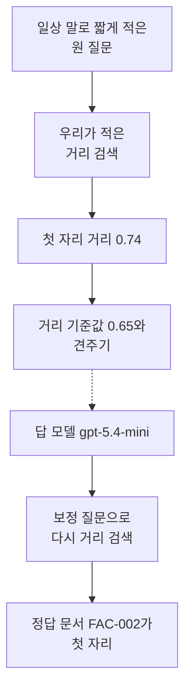
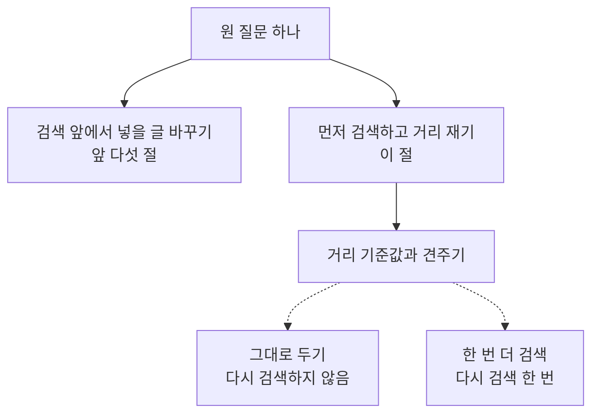
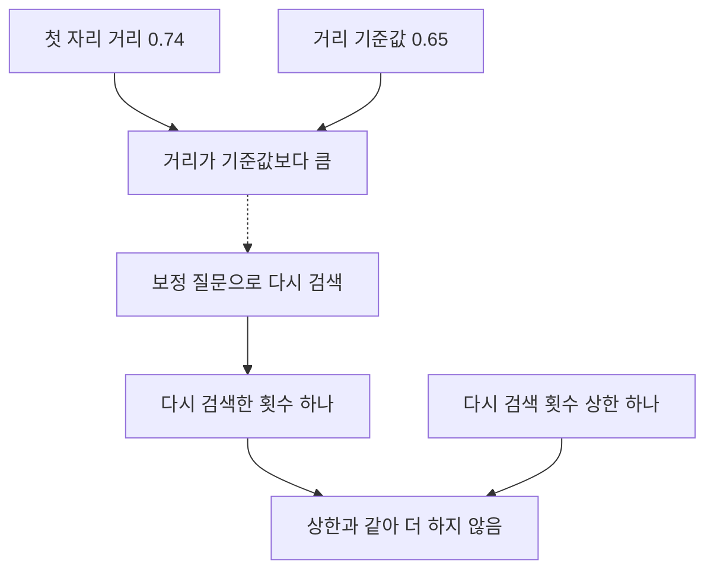
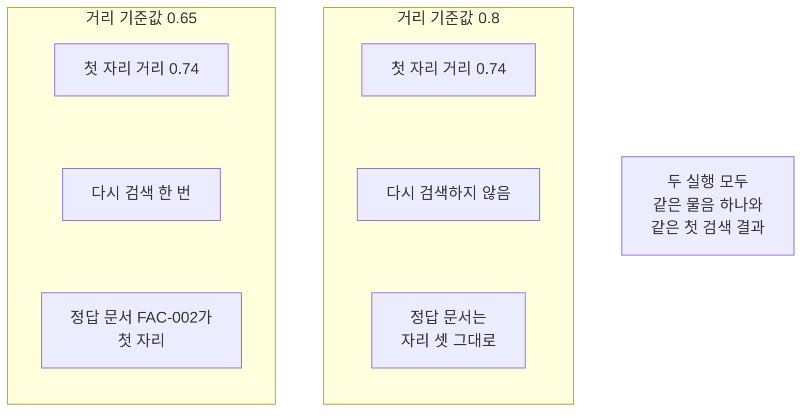

# 06-CRAG

## _src 본문 (HTML 원본)

```html
<!--meta: 강의 1h | 실습 2h | 코드 notebooks/06-CRAG.ipynb | 새 용어 1 -->
<style>html,body{overflow-x:hidden}.notebook,.nb-cell,.nb-main,.nb-input,.nb-result{min-width:0;max-width:100%}.nb-input pre,.nb-output{box-sizing:border-box;max-width:100%;overflow-x:auto}code.nb-source{display:block!important;width:100%!important;min-width:0!important;overflow-x:auto!important;padding:0!important}</style>
<h2 id="b1"><span class="no">1</span>학습 목표</h2><div class="goal"><ul>
<li>첫 검색 결과의 첫 자리 거리를 기준값과 견주어 다시 검색할지 정할 수 있습니다.</li>
<li>다시 검색할 수 있는 횟수를 값으로 적고 실제로 검색한 횟수와 견줄 수 있습니다.</li>
<li>기준값 하나만 늘리면 같은 검색 결과가 다른 갈래로 간다는 것을 확인할 수 있습니다.</li>
</ul></div>
<h2 id="b2"><span class="no">2</span>이 내용을 배우는 이유</h2><p>사람이 묻는 말은 짧고 자료가 쓰는 낱말과 잘 겹치지 않습니다. 그래도 검색은 문서 열두 건의 순위를 끝까지 만들어 냅니다. 물음과 관계가 없는 문서도 첫 자리에 설 수 있습니다. 첫 자리에 선 문서를 그대로 쓸지 코드가 정할 방법이 필요합니다.</p><p>Ch 9의 기본 RAG는 검색 한 번과 답 한 번이었습니다. 01절부터 05절까지는 검색 앞에서 넣을 글을 바꿨습니다. 이 절은 먼저 검색하고 그 결과를 본 뒤 한 번 더 할지 정합니다. 정하는 것은 모델이 아니라 우리가 코드에 적은 규칙입니다.</p>
<h2 id="b3"><span class="no">3</span>앞에서 배운 내용</h2><p>05절은 질문 대신 답처럼 보이는 글을 지어 검색에 넣었습니다. 01절부터 05절까지 바꾼 자리는 모두 검색 앞이었습니다. 이 절은 검색 뒤를 바꿉니다. 문서 열두 건과 질문 여덟 개는 Ch 12 core 벌 사본 그대로입니다.</p><p>거리 순위 함수와 순위 표 출력 함수는 Ch 12 01절과 05절에서 배웠습니다. 문서 ID를 모으는 함수와 자리를 세는 함수는 Ch 11 01절에서 배웠습니다. 01~05절처럼 이 넷을 도구 파일 <code>notebooks/rag_tools.py</code>에서 가져옵니다. 벡터의 숫자 개수 설정 <code>256</code>과 답 모델도 이어 씁니다.</p><p>모델이 보낸 글을 줄로 나누는 함수는 02절에서 만들었고 같은 도구 파일에서 가져옵니다. 02절 검색 묶음 함수는 문서 ID만 내주어 이 절에는 모자랍니다. 이 절은 거리까지 봐야 해서 순위 목록을 그대로 내주는 함수를 새로 만듭니다. 순위 합치기 함수는 04절과 05절에 이어 이 절도 쓰지 않습니다.</p>
<h2 id="b4"><span class="no">4</span>핵심 개념</h2><h3>비유로 시작하기</h3><p>나무판에 둥근 구멍이 하나 있다고 생각해 봅니다. 마개를 하나 끼웠는데 둘레에 틈이 넓게 남았습니다. 틈이 얼마나 되는지 보고 넓으면 다른 마개로 바꿔 끼웁니다. 바꿔 끼우는 일은 한 번까지만 하기로 미리 정해 둡니다.</p>
{{img:06-5-틈이-넓은-마개와-꼭-맞는-마개|흰 바탕에 나무판 두 장이 나란히 놓여 있고 왼쪽 판에는 큰 둥근 구멍 한가운데에 작은 둥근 나무 마개가 놓여 둘레에 흰 바탕이 고리 모양으로 넓게 보이며 오른쪽 판에는 같은 크기의 구멍에 큰 둥근 나무 마개가 빈틈없이 들어가 있는 그림|틈이 넓으면 다른 마개로 한 번 바꿔 끼우고 꼭 맞으면 그대로 둡니다.}}
<p class="look"><b>그림 읽기</b> — 나무판 두 장이 나란히 놓여 있습니다. 둘 다 같은 크기의 둥근 구멍이 하나씩 있습니다. 왼쪽 판의 마개는 작아서 둘레에 흰 바탕이 고리처럼 넓게 보입니다. 오른쪽 판의 마개는 구멍을 빈틈없이 채웁니다. 넓은 틈이 첫 검색의 먼 거리이고 빈틈없는 자리가 보정 뒤의 가까운 거리입니다.</p>
<table><thead><tr><th>말</th><th>뜻</th></tr></thead><tbody><tr><td>보정 검색</td><td>첫 검색의 첫 자리 거리가 기준값보다 클 때 질문을 한 번 고쳐 다시 검색하는 일입니다.</td></tr></tbody></table>
<p>아래 다섯 말은 Ch 11·Ch 12·Ch 13과 04·05절에서 쓰던 뜻 그대로 이어 씁니다.</p>
<table><thead><tr><th>말</th><th>뜻</th></tr></thead><tbody><tr><td>기준값</td><td>어느 갈래로 갈지 가르려고 코드에 미리 적어 두는 값입니다(Ch 13).</td></tr><tr><td>코사인 거리</td><td>두 벡터가 얼마나 먼지를 나타내는 값이고 작을수록 가깝습니다(Ch 12 01절).</td></tr><tr><td>넓힌 질문</td><td>한 사례의 세부를 빼고 일반 규칙만 묻도록 만든 검색 질문입니다(04절).</td></tr><tr><td>가상 문서</td><td>질문에 답할 법한 글을 모델에게 지어 받은 것입니다(05절).</td></tr><tr><td>정답 문서 ID</td><td>그 물음에 답할 내용이 적힌 문서의 ID입니다(Ch 11 01절).</td></tr></tbody></table>
{{mermaid:06-1-검색-뒤에-거리를-보고-다시-검색하기|위에서 아래로 놓인 상자 일곱으로 맨 위에 초록 상자 일상 말로 짧게 적은 원 질문이 있고 그 아래 파란 상자 우리가 적은 거리 검색과 노란 상자 첫 자리 거리 0.74를 지나 파란 상자 거리 기준값 0.65와 견주기로 이어지며 거기에서 점선으로 갈라져 보라 상자 답 모델 gpt-5.4-mini와 파란 상자 보정 질문으로 다시 거리 검색을 거쳐 맨 아래 노란 상자 정답 문서 FAC-002가 첫 자리로 이어지는 그림|첫 자리 거리가 기준값보다 크면 질문을 한 번 고쳐 다시 검색합니다.}}
<p class="look"><b>도식 읽기</b> — 위에서 아래로 읽습니다. 맨 위 초록 상자가 사람이 적은 질문입니다. 파란 상자 셋은 우리가 적은 처리와 판정 규칙이고 보라 상자가 이번에 부른 모델입니다. 노란 상자 둘은 출력으로 확인한 값입니다. 점선은 기준값에 따라 갈라지는 자리입니다.</p>
<h3>검색 앞에서 바꾸기와 검색 뒤에 다시 하기</h3><p>02절 변형 질문과 03절 하위 질문은 검색 앞에서 만들었습니다. 04절 넓힌 질문과 05절 가상 문서도 같은 자리에 있었습니다. 네 절 모두 넣을 글을 바꾼 뒤에는 그대로 검색했습니다. 이 절은 검색을 먼저 하고 나온 거리를 봅니다. 본 뒤에 한 번 더 할지 정합니다.</p>
{{mermaid:06-2-검색-앞에서-바꾸기와-검색-뒤에-다시-하기|위에서 아래로 놓인 상자 여섯으로 맨 위 초록 상자 원 질문 하나에서 아래로 갈라져 왼쪽에 회색 상자 검색 앞에서 넣을 글 바꾸기 앞 다섯 절이 있고 오른쪽에 파란 상자 먼저 검색하고 거리 재기 이 절과 그 아래 파란 상자 거리 기준값과 견주기가 이어지며 거기에서 점선 둘로 갈라져 파란 상자 그대로 두기 다시 검색하지 않음과 파란 상자 한 번 더 검색 다시 검색 한 번으로 나뉘는 그림|앞 다섯 절은 검색 앞에서 글을 바꿨고 이 절은 검색 뒤에 다시 할지 정합니다.}}
<p class="look"><b>도식 읽기</b> — 위에서 아래로 읽습니다. 맨 위 초록 상자가 사람이 적은 원 질문입니다. 왼쪽 회색 상자는 01절부터 05절까지 본 갈래이고 이 노트북에서 실행하지 않았습니다. 오른쪽 파란 상자 넷만 이번에 실행한 자리입니다. 맨 아래 점선 둘이 기준값에 따라 갈라지는 두 갈래입니다.</p>
<h3>거리 기준값으로 정하기</h3><p>기준값은 어느 갈래로 갈지 가르려고 미리 정해 두는 값입니다. 체온이 37.5도를 넘으면 진료를 받으라는 안내가 같은 모양입니다. 이 절 코드에서는 변수 <code>distance_limit</code>가 그 값이고 첫 자리 거리와 견줍니다. 거리는 작을수록 가까우므로 첫 자리 거리가 기준값보다 크면 한 번 더 검색합니다.</p><p>이 절은 기준값으로 문서를 목록에서 빼지 않습니다. 순위 목록은 그대로 두고 다시 검색할지만 정합니다. 기준값을 정할 때는 자료의 질문으로 거리를 먼저 재어 보고 그 눈금 위에서 고릅니다.</p>
<h3>반복 상한을 값으로 적어 둡니다</h3><p>다시 검색할 때마다 모델 요청과 임베딩 요청이 한 번씩 늘어납니다. 상한이 없으면 기준값을 채울 때까지 요청이 계속 늘 수 있습니다. 그래서 <code>retry_limit</code>를 값으로 적고 실제로 다시 검색한 횟수와 나란히 출력합니다. 이 절의 상한은 한 번입니다.</p>
<h3>CRAG 논문과 이 절의 범위</h3><p>CRAG 논문은 학습한 검색 평가기와 웹 검색까지 함께 씁니다. 이 절은 그 둘을 재현하지 않습니다. 거리 기준값 하나로 한 번만 다시 검색하는 자리까지만 코드로 봅니다. 기준값 <code>0.65</code>도 보편 기준이 아니라 이 자료에서 고른 값입니다.</p>
<h3>다른 상황에 적용</h3><p>사내 규정 문의에도 같은 자리가 있습니다. 첫 검색 결과가 물음과 멀면 그대로 쓰지 않고 한 번 더 찾습니다. 몇 번까지 더 찾을지를 값으로 적어 두어야 요청이 끝없이 늘지 않습니다.</p>
<h2 id="b5"><span class="no">5</span>실행 예제</h2><p>노트북은 문서 열두 건을 벡터로 바꾸고 짧게 적은 질문 하나를 두 기준값으로 다룹니다. 서비스 요청은 열두 번이고 임베딩 열한 번과 답 모델 한 번입니다. 예상 비용은 미화 0.01달러 아래입니다. 새로 쓰는 파일은 없습니다.</p><p>먼저 자료의 여덟 질문으로 첫 자리 거리가 어느 범위인지 봅니다. 그 눈금을 보고 거리 기준값과 반복 상한을 정합니다. 그다음 짧게 적은 질문을 한 번만 검색해 첫 자리 거리를 봅니다. 기준값보다 크면 모델에게 보정 질문을 받아 다시 검색합니다. 마지막으로 기준값 하나만 늘려 같은 결과를 다시 판정합니다.</p>
{{mermaid:06-3-기준값-판정과-반복-상한|위에서 아래로 놓인 상자 일곱으로 맨 위 왼쪽에 노란 상자 첫 자리 거리 0.74와 오른쪽에 파란 상자 거리 기준값 0.65가 있고 둘이 노란 상자 거리가 기준값보다 큼으로 모이며 거기에서 점선으로 파란 상자 보정 질문으로 다시 검색이 이어지고 그 아래 노란 상자 다시 검색한 횟수 하나와 파란 상자 다시 검색 횟수 상한 하나가 맨 아래 노란 상자 상한과 같아 더 하지 않음으로 모이는 그림|첫 자리 거리가 기준값보다 커서 한 번 다시 검색했고 상한과 같아 거기서 멈춥니다.}}
<p class="look"><b>도식 읽기</b> — 위에서 아래로 읽습니다. 맨 위 노란 상자는 출력으로 확인한 거리이고 그 옆 파란 상자는 우리가 정한 값입니다. 가운데 점선은 판정에 따라 갈라지는 자리입니다. 맨 아래 노란 상자는 상한과 실제 횟수를 견준 결과입니다.</p>
{{notebook:06-CRAG}}
<p class="look"><b>확인할 점</b> — 첫 검색의 출력 줄은 <code>첫 자리 거리: 0.74</code>와 <code>원 질문으로 검색했을 때 정답 문서의 자리: 3</code>이었습니다. 판정 줄은 <code>거리 기준값: 0.65</code>와 <code>다시 검색하기로 했는가: True</code>였습니다. 보정 검색 뒤에는 <code>보정 질문으로 검색했을 때 정답 문서의 자리: 1</code>이 나왔습니다. 기준값을 늘린 자리에서는 <code>바꾼 기준값에서 다시 검색한 횟수: 0</code>이었습니다.</p>
<h2 id="b6"><span class="no">6</span>실험 결과 해석</h2><p>자료의 여덟 질문으로 첫 자리 거리를 먼저 쟀습니다. 여덟 값은 <code>0.28</code>에서 <code>0.6</code> 사이였습니다. 그보다 조금 큰 <code>0.65</code>를 이 절의 거리 기준값으로 정했습니다. 다시 검색할 수 있는 횟수 상한은 한 번으로 두었습니다.</p><p>일상 말로 짧게 적은 물음을 한 번만 검색했습니다. 앞 세 자리는 <code>ACC-001</code>과 <code>LIB-003</code>과 <code>FAC-002</code>였습니다. 첫 자리 거리는 <code>0.74</code>로 기준값보다 컸습니다. 정답 문서 <code>FAC-002</code>는 셋째 자리였습니다.</p><p>첫 자리에 선 문서는 비밀번호 재설정을 적은 문서입니다. 물어본 인쇄 요금과는 관계가 없습니다. 왜 이 문서가 첫 자리에 섰는지는 이번에 따로 재지 않았습니다.</p><p>거리가 기준값보다 커서 모델에게 보정 질문을 받았습니다. 그 물음으로 다시 검색하니 첫 자리가 <code>FAC-002</code>였습니다. 정답 문서가 셋째 자리에서 첫 자리로 왔습니다. 다시 검색한 횟수는 한 번이고 상한과 같았습니다.</p>
{{mermaid:06-4-기준값-둘을-나란히-보기|왼쪽부터 오른쪽으로 놓인 칸 두 개와 회색 상자 하나로 왼쪽 칸 제목은 거리 기준값 0.65이고 그 안에 노란 상자 첫 자리 거리 0.74와 노란 상자 다시 검색 한 번과 노란 상자 정답 문서 FAC-002가 첫 자리가 있으며 가운데 칸 제목은 거리 기준값 0.8이고 그 안에 노란 상자 첫 자리 거리 0.74와 노란 상자 다시 검색하지 않음과 노란 상자 정답 문서는 자리 셋 그대로가 있고 오른쪽에 회색 상자 두 실행 모두 같은 물음 하나와 같은 첫 검색 결과가 놓인 그림|같은 첫 검색 결과도 기준값에 따라 다시 검색하기도 하고 그대로 두기도 합니다.}}
<p class="look"><b>도식 읽기</b> — 왼쪽 칸이 기준값을 처음 값으로 둔 자리입니다. 가운데 칸이 기준값을 늘린 자리입니다. 두 칸 맨 위 노란 상자의 거리 값은 같습니다. 칸마다 아래 노란 상자 둘이 갈라진 결과입니다. 오른쪽 회색 상자는 두 칸에 모두 해당하는 사실입니다.</p>
<p>기준값 하나만 늘려 같은 첫 검색 결과를 다시 판정했습니다. 같은 거리 <code>0.74</code>가 이번에는 기준값보다 작았습니다. 그래서 다시 검색하지 않았고 모델도 부르지 않았습니다. 정답 문서는 셋째 자리에 그대로 남았습니다.</p><p>기준값을 크게 잡으면 먼 결과도 그대로 쓰게 됩니다. 작게 잡으면 요청이 늘고 상한에 더 자주 닿습니다. 이 자료에서 <code>0.65</code>가 맞았다고 해서 다른 자료에서도 맞지는 않습니다.</p><p>보정 검색의 첫 자리 거리는 모델이 쓴 물음에 따라 달라집니다. 다른 물음이 나오면 검색에 넣는 글도 달라지기 때문입니다. 그래서 본문과 그림 라벨에는 그 값을 넣지 않았습니다. 한 번 더 검색한다고 정답 문서가 늘 앞으로 오지는 않습니다.</p><p>여기서 본 것은 물음 하나와 기준값 둘입니다. 여덟 질문 모두에서 같은 차이가 나는지는 이번에 확인하지 않았습니다. 여러 질문으로 검색 품질을 재는 일은 Ch 11과 Ch 12 몫입니다. 답이 맞는지 판정하는 일은 Ch 15 몫입니다.</p>
<h2 id="b7"><span class="no">7</span>주의할 점과 실무 메모</h2><ul><li>거리 기준값 <code>0.65</code>는 탐색 실행으로 정한 예입니다. 자료의 여덟 질문으로 첫 자리 거리를 먼저 재고 그 눈금보다 조금 큰 값을 골랐습니다.</li><li>그 값은 정답 확률이 아닙니다. 임베딩 모델이나 자료가 바뀌면 다시 재고 다시 정해야 합니다.</li><li>검색에 쓴 물음도 탐색 실행 뒤 고른 예입니다. 첫 자리 거리가 기준값보다 크고 정답 문서가 첫 자리가 아닌 물음을 골랐습니다.</li><li>정답 문서는 01절부터 05절까지 좇지 않은 문서로 골랐습니다. 절마다 다른 문서를 좇아야 결과를 나란히 놓고 보기 좋습니다.</li><li>이 챕터는 코사인 거리를 쓰고 거리는 작을수록 가깝습니다. 기준값보다 큰 쪽이 먼 쪽이라는 것을 코드와 본문에 같게 적었습니다.</li><li>CRAG 논문의 학습한 검색 평가기와 웹 검색은 이 절에서 재현하지 않았습니다. 거리 기준값 하나로 한 번 다시 검색하는 자리까지만 봤습니다.</li><li>다시 검색할 수 있는 횟수를 <code>retry_limit</code>로 적고 실제 횟수와 나란히 출력했습니다. 결과에 건 검사 <code>assert</code>는 그 세 값을 견주는 두 줄뿐입니다.</li><li>모델이 쓴 보정 질문 문장에는 <code>assert</code>를 걸지 않았습니다. 그 문장은 실행마다 달라질 수 있습니다.</li><li>새 커널로 두 번 실행하니 스물네 셀 가운데 스물한 셀의 출력이 글자까지 같았습니다. 달라진 셋은 모델이 쓴 보정 질문과 거기서 이어지는 보정 검색과 기록 표입니다. 첫 자리 문서와 정답 자리와 다시 검색한 횟수는 두 실행에서 같았습니다.</li><li>탐색 실행과 이번 두 실행에서 같은 머리글로 다른 물음이 나왔고 그때마다 보정 검색의 거리도 달랐습니다. 그래서 그 거리 값은 본문과 그림 라벨에 넣지 않았습니다.</li><li>기준값을 늘린 갈래에서는 모델을 부르지 않습니다. 그래서 그 갈래에서는 서비스 요청이 늘지 않았습니다.</li><li>이 절은 기준값으로 문서를 목록에서 빼지 않습니다. 순위 목록은 그대로 두고 다시 검색할지만 정합니다.</li><li>걸린 시간은 이번에 재지 않았습니다. 그래서 빨라졌는지 느려졌는지 적지 않습니다.</li><li>이 절은 파일을 쓰지 않습니다. 문서 파일과 질문 파일은 읽기만 합니다.</li><li>준비물에 LangChain 1.4.0과 langchain-openai 1.6.1과 numpy 2.5.3을 적었습니다. 다른 판과 Windows·macOS에서는 이번에 실행하지 않았습니다.</li></ul>
<h2 id="b8"><span class="no">8</span>정리와 다음 절</h2><ul><li>자료의 여덟 질문으로 첫 자리 거리의 눈금을 보고 기준값을 정했습니다.</li><li>짧게 적은 물음의 첫 자리 거리가 기준값보다 커서 한 번 더 검색했습니다.</li><li>보정 검색에서 정답 문서가 셋째 자리에서 첫 자리로 왔습니다.</li><li>기준값 하나만 늘리자 같은 결과에서 다시 검색하지 않았습니다.</li></ul><p><strong>다음 학습과 이어지는 지점</strong> — 07절에서는 답을 만든 뒤 그 답이 근거와 맞는지 확인합니다. 이 절은 검색 뒤에 다시 검색할지 정했고 07절은 답을 만든 뒤 고칠지 정합니다.</p>
<h2 id="b9"><span class="no">9</span>복습 문제</h2><details class="quiz" open><summary>문제 4개 · 해설 포함</summary><p class="quiz-q">1. 보정 검색의 입력과 출력은 무엇입니까?</p><p class="quiz-a">첫 자리 거리와 기준값을 넣으면 그대로 두기나 한 번 더 검색하기 가운데 하나가 나옵니다. 틀렸다면 「핵심 개념」의 용어 표를 다시 읽습니다.</p><p class="quiz-q">2. 첫 자리 거리가 기준값보다 클 때와 작을 때 코드는 무엇을 다르게 합니까?</p><p class="quiz-a">클 때만 모델에게 보정 질문을 받아 다시 검색하고 작을 때는 첫 결과를 그대로 둡니다. 거리는 작을수록 가깝기 때문입니다. 틀렸다면 「핵심 개념」의 소제목 「거리 기준값으로 정하기」를 다시 읽습니다.</p><p class="quiz-q">3. 원 질문 검색과 보정 검색에서 정답 문서의 자리는 각각 몇이었습니까?</p><p class="quiz-a">원 질문에서는 셋째 자리였고 보정 검색에서는 첫 자리였습니다. 틀렸다면 「실험 결과 해석」의 도식을 다시 읽습니다.</p><p class="quiz-q">4. 이 절이 CRAG 논문 전체를 재현하지 않는다고 적은 까닭은 무엇입니까?</p><p class="quiz-a">논문은 학습한 검색 평가기와 웹 검색까지 쓰지만 이 절은 거리 기준값 하나로 한 번만 다시 검색합니다. 틀렸다면 「핵심 개념」의 소제목 「CRAG 논문과 이 절의 범위」를 다시 읽습니다.</p></details>
<h2 id="b10"><span class="no">10</span>참고 자료</h2><ul><li><div><a href="https://arxiv.org/abs/2401.15884">Corrective Retrieval Augmented Generation 논문</a></div>확인 2026-09-19 · 검색 결과를 평가해 보정하는 방법의 출처.</li><li><div><a href="https://docs.langchain.com/oss/python/concepts/providers-and-models">LangChain 모델과 provider</a></div>확인 2026-09-19 · LangChain 1.4 기준 · 보정 질문을 받을 모델을 준비하는 방법.</li><li><div><a href="https://developers.openai.com/api/docs/models/text-embedding-3-small">OpenAI text-embedding-3-small 모델 안내</a></div>확인 2026-09-19 · 문서와 질문을 벡터로 바꿀 때 쓴 모델과 차원 수 설정.</li><li>Ch 14 05절 HyDE — 검색 앞에서 넣을 글을 바꾸는 마지막 자리와 견주어 볼 곳.</li><li>Ch 12 05절 dense와 sparse 비교 — 이 절이 이어 쓴 거리 순위 부품과 출력 함수가 있는 자리.</li></ul>
```

## 노트북 셀 (순서대로)

### [0] markdown {'html': 'skip'}

# CRAG

**이 노트북에서 할 일**

1. Ch 12에서 쓰던 문서 열두 건과 질문 여덟 개를 그대로 읽습니다.
2. 자료의 여덟 질문으로 첫 자리 거리가 어느 범위인지 봅니다.
3. 그 눈금을 보고 거리 기준값과 반복 상한을 정합니다.
4. 일상 말로 짧게 적은 원 질문을 한 번만 검색합니다.
5. 첫 자리 거리가 기준값보다 크면 보정 질문을 받아 다시 검색합니다.
6. 거리 기준값 하나만 늘려 같은 결과를 다시 판정합니다.

**준비물** — 이 절은 프로젝트 맨 위 폴더의 `.env`에 적어 둔 `OPENAI_API_KEY`를 씁니다.
서비스 요청은 열두 번이고 임베딩 열한 번과 답 모델 한 번입니다.
답 모델은 다시 검색하는 갈래에서만 한 번 부르고 예상 비용은 미화 0.01달러 아래입니다.
읽어 오는 파일은 이 챕터 폴더의 문서 파일과 질문 파일 둘이고 새로 쓰는 파일은 없습니다.
실행 시간은 2분 안팎이고 첫 셀의 설치가 가장 오래 걸립니다.

**기준 버전** — 첫 셀에서 LangChain 1.4.0과 langchain-openai 1.6.1을 설치합니다.
키를 읽는 python-dotenv 1.2.3과 도구 파일이 쓰는 numpy 2.5.3도 함께 설치합니다.
교재 출력은 Linux의 Python 3.12.13으로 만들었습니다.
다른 판과 Windows·macOS에서는 이번에 실행하지 않았습니다.

**강의와 실습 범위** — 강의 시간에는 3절부터 9절까지 읽습니다.
Ch 12 검색 부품을 준비하고 거리 눈금을 보고 기준값을 정하는 자리입니다.
10절부터 12절까지는 짧게 적은 질문을 검색하고 한 번 더 검색하는 자리입니다.
13절부터 15절까지는 기준값을 늘려 보고 세 실행을 표로 보는 자리입니다.

실습 폴더 `labs/part4/ch14-rag-patterns`에서 `uv sync --locked`를 실행합니다.
그다음 이 폴더의 `.venv` 커널을 고르고 첫 셀부터 순서대로 실행합니다.

### [1] markdown {'html': 'skip'}

## 오늘 볼 그림


위에서 아래로 읽습니다.
맨 위 초록 상자가 사람이 적은 질문입니다.
파란 상자 셋이 우리가 적은 처리와 판정 규칙이고 보라 상자가 모델입니다.
노란 상자 둘이 출력으로 확인한 값입니다.
점선은 기준값에 따라 갈라지는 자리입니다.

### [2] markdown {}

## 1. 준비

첫 셀은 패키지 네 개를 설치하고 설치된 판 번호를 출력합니다.
설치에는 몇십 초가 걸릴 수 있습니다.

### [3] code {'execution': {'iopub.execute_input': '2026-09-21T09:39:42.333211Z', 'iopub.status.busy': '2026-09-21T09:39:42.333063Z', 'iopub.status.idle': '2026-09-21T09:39:42.772818Z', 'shell.execute_reply': '2026-09-21T09:39:42.772304Z'}, 'lesson_role': 'setup'}

```python
# 이 절에서 쓰는 패키지를 설치하고 버전을 확인합니다
%pip install -q "langchain==1.4.0" "langchain-openai==1.6.1" "python-dotenv==1.2.3" "numpy==2.5.3"
from importlib.metadata import version

print("langchain:", version("langchain"))
print("langchain-openai:", version("langchain-openai"))
print("python-dotenv:", version("python-dotenv"))
print("numpy:", version("numpy"))
```

출력:
```
Note: you may need to restart the kernel to use updated packages.
langchain: 1.4.0
langchain-openai: 1.6.1
python-dotenv: 1.2.3
numpy: 2.5.3

```

### [4] markdown {}

**결과 읽기** — 설치가 끝나면 판 번호 네 줄이 보입니다.
마지막 줄 `numpy: 2.5.3`은 도구 파일이 벡터 계산에 쓰는 패키지입니다.
이 노트북의 출력은 2026-09-21에 이 판으로 실행한 결과입니다.

다음 셀은 이름 네 개를 불러오고 도구 파일에서 함수 다섯 개를 가져옵니다.
앞의 둘은 자료 읽기와 폴더 확인에 씁니다.
뒤의 둘은 Ch 9~13에서 쓴 임베딩과 답 모델 이름입니다.

앞에서 배운 함수는 `rag_tools.py`에 모아 두었습니다. 파일을 열면 코드를 볼 수 있습니다. 노트북과 같은 폴더(`notebooks/`)에 있는 파일입니다.

이 노트북은 Ch 12 01절 `rank_by_distance()`와 05절 `print_ranked()`를 가져옵니다.
Ch 11 01절 `unique_doc_ids()`·`find_gold_rank()`와 02절 `split_lines()`도 가져옵니다.
거리 순위 함수는 질문 벡터와 문서 벡터 목록과 문서 ID 목록과 개수를 받습니다.

### [5] code {'execution': {'iopub.execute_input': '2026-09-21T09:39:42.773937Z', 'iopub.status.busy': '2026-09-21T09:39:42.773847Z', 'iopub.status.idle': '2026-09-21T09:39:43.560883Z', 'shell.execute_reply': '2026-09-21T09:39:43.560692Z'}, 'lesson_role': 'setup'}

```python
# 자료 읽기·폴더 확인과 임베딩·답 모델 이름을 불러옵니다
import json
import os

from langchain_openai import OpenAIEmbeddings
from langchain.chat_models import init_chat_model
# Ch 12 01·05절·Ch 11 01절 함수와 02절 줄 나누기 함수를 도구 파일에서 가져옵니다
from rag_tools import find_gold_rank, print_ranked, rank_by_distance, split_lines
from rag_tools import unique_doc_ids

print("불러온 이름:", "json", "os", "OpenAIEmbeddings", "init_chat_model")
```

출력:
```
불러온 이름: json os OpenAIEmbeddings init_chat_model

```

### [6] markdown {}

**결과 읽기** — 출력 줄에 불러온 이름 네 개가 보입니다.
이름 `OpenAIEmbeddings`와 `init_chat_model`은 05절에서 쓴 것과 같습니다.
도구 파일에서 가져온 함수 다섯 개는 출력하지 않습니다.

## 2. 키와 모델 준비

### [7] markdown {}

API 키가 있는지 확인합니다. `True` 값이 나오면 다음으로 넘어갑니다.

### [8] code {'execution': {'iopub.execute_input': '2026-09-21T09:39:43.563356Z', 'iopub.status.busy': '2026-09-21T09:39:43.563270Z', 'iopub.status.idle': '2026-09-21T09:39:43.566523Z', 'shell.execute_reply': '2026-09-21T09:39:43.566365Z'}, 'lesson_role': 'setup'}

```python
# .env 파일에서 OpenAI API 키를 읽습니다(키 값은 출력하지 않습니다)
import os
from dotenv import find_dotenv, load_dotenv

env_path = find_dotenv(usecwd=True)
load_dotenv(env_path)
has_key = os.getenv("OPENAI_API_KEY") is not None
print("OPENAI_API_KEY 설정 여부:", has_key)
assert has_key, "프로젝트 폴더의 .env 파일에 OPENAI_API_KEY를 적어 주세요."
```

출력:
```
OPENAI_API_KEY 설정 여부: True

```

### [9] markdown {}

실습에 쓸 모델을 준비합니다.
temperature 값을 0으로 두어 매번 비슷한 답을 고르게 합니다.

### [10] code {'execution': {'iopub.execute_input': '2026-09-21T09:39:43.566965Z', 'iopub.status.busy': '2026-09-21T09:39:43.566889Z', 'iopub.status.idle': '2026-09-21T09:39:43.611995Z', 'shell.execute_reply': '2026-09-21T09:39:43.611798Z'}}

```python
# 실습에 쓸 모델을 준비합니다
model = init_chat_model(
    "openai:gpt-5.4-mini",
    temperature=0,
    reasoning_effort="none",
)
print("모델 이름:", model.model_name)
print("temperature:", model.temperature)
```

출력:
```
모델 이름: gpt-5.4-mini
temperature: 0.0

```

### [11] markdown {}

**결과 읽기** — 모델 이름 `gpt-5.4-mini`, temperature `0.0`이 보이면 준비가 끝났습니다.
이 노트북의 출력은 2026-09-21에 이 모델로 실행한 결과입니다.

### [12] markdown {}

## 3. 문서와 질문 읽기

이 절은 01~05절과 같은 문서 파일과 질문 파일을 읽습니다.
두 파일은 Ch 12 core 벌 파일과 바이트가 같은 사본입니다.
먼저 노트북을 연 자리에서 프로젝트 맨 위를 찾습니다.

### [13] code {'execution': {'iopub.execute_input': '2026-09-21T09:39:43.612502Z', 'iopub.status.busy': '2026-09-21T09:39:43.612427Z', 'iopub.status.idle': '2026-09-21T09:39:43.613994Z', 'shell.execute_reply': '2026-09-21T09:39:43.613865Z'}}

```python
# 노트북을 어느 폴더에서 열어도 프로젝트 맨 위를 찾게 후보 세 개를 차례로 봅니다
candidates = [".", "../../..", "../../../.."]
root_path = None
for candidate in candidates:
    if os.path.exists(candidate + "/labs/part4/ch14-rag-patterns/data"):
        root_path = candidate
        break
print("고른 자리:", root_path)
assert root_path is not None, "notebooks 폴더나 실습 폴더 맨 위에서 노트북을 열어 주세요."
```

출력:
```
고른 자리: .

```

### [14] markdown {}

**결과 읽기** — 출력 줄 `고른 자리` 뒤에 점 하나나 위로 올라가는 표시가 보입니다.
Ch 10~13과 01~05절에서 쓴 방법과 같습니다.
후보 셋 가운데 이 챕터 자료 폴더가 있는 자리를 고릅니다.

다음 셀은 문서 파일과 질문 파일을 읽습니다.

### [15] code {'execution': {'iopub.execute_input': '2026-09-21T09:39:43.614384Z', 'iopub.status.busy': '2026-09-21T09:39:43.614318Z', 'iopub.status.idle': '2026-09-21T09:39:43.616682Z', 'shell.execute_reply': '2026-09-21T09:39:43.616495Z'}}

```python
# 이 챕터 폴더의 문서 파일과 질문 파일을 읽습니다(읽기만 하고 고치지 않습니다)
data_path = root_path + "/labs/part4/ch14-rag-patterns/data"
with open(data_path + "/documents.json", encoding="utf-8") as file:
    docs = json.loads(file.read())
with open(data_path + "/queries.json", encoding="utf-8") as file:
    queries = json.loads(file.read())
print("문서 수:", len(docs))
print("질문 수:", len(queries))
```

출력:
```
문서 수: 12
질문 수: 8

```

### [16] markdown {}

**결과 읽기** — 출력 줄 `문서 수: 12`와 `질문 수: 8`이 Ch 12 core 벌 그대로입니다.
문서는 도서관 안내 열두 건입니다.

질문 번호는 C01부터 C08까지이고 질문 파일에 적혀 있습니다.
이 절은 그 여덟 질문으로 거리 눈금을 보고 검색에는 다른 물음을 씁니다.

## 4. 이 절에서 쓸 값 정하기

Ch 12와 01~05절에서 정한 값 둘을 그대로 다시 적습니다.
이 절이 새로 정할 값 둘은 눈금을 본 뒤 8절에서 적습니다.

### [17] code {'execution': {'iopub.execute_input': '2026-09-21T09:39:43.617084Z', 'iopub.status.busy': '2026-09-21T09:39:43.617013Z', 'iopub.status.idle': '2026-09-21T09:39:43.618572Z', 'shell.execute_reply': '2026-09-21T09:39:43.618390Z'}}

```python
# Ch 12에서 쓴 값 둘을 그대로 다시 정합니다
top_three = 3
top_all = 12
print("나란히 볼 상위 문서 수:", top_three)
print("자리를 셀 때 재는 문서 수:", top_all)
```

출력:
```
나란히 볼 상위 문서 수: 3
자리를 셀 때 재는 문서 수: 12

```

### [18] markdown {}

**결과 읽기** — 출력 줄 `나란히 볼 상위 문서 수: 3`은 표로 볼 자리 수입니다.
출력 줄 `자리를 셀 때 재는 문서 수: 12`는 정답 문서의 자리를 끝까지 세려고 둔 값입니다.

05절은 이 자리에 가상 문서의 문장 수도 함께 적었습니다.
이 절이 새로 정할 값은 거리 기준값과 반복 상한 둘입니다.

## 5. 앞 절 부품 준비

다음 셀은 01~05절과 같은 방법으로 문서 열두 건의 제목과 본문을 이어 붙입니다.
읽지 말고 실행만 하고 넘어가도 됩니다.
함수는 준비 셀에서 도구 파일로 가져왔습니다.

### [19] code {'execution': {'iopub.execute_input': '2026-09-21T09:39:43.618939Z', 'iopub.status.busy': '2026-09-21T09:39:43.618874Z', 'iopub.status.idle': '2026-09-21T09:39:43.620652Z', 'shell.execute_reply': '2026-09-21T09:39:43.620367Z'}, 'lesson_role': 'setup'}

```python
# 문서 12개의 제목과 본문을 이어 붙이고 문서 ID 목록도 만듭니다(Ch 12와 같은 제목 + 본문 모양)
doc_texts = []
doc_ids = []
for doc in docs:
    doc_texts.append(doc["title"] + " " + doc["text"])
    doc_ids.append(doc["doc_id"])
print("이어 붙인 글 수:", len(doc_texts))
print("첫 문서 글:", doc_texts[0])
print("문서 ID 목록:")
print(doc_ids)
```

출력:
```
이어 붙인 글 수: 12
첫 문서 글: 도서 대출 기간 일반 도서는 14일 동안 대출할 수 있습니다. 예약자가 없으면 한 번 연장할 수 있습니다.
문서 ID 목록:
['LIB-001', 'LIB-002', 'LIB-003', 'LIB-004', 'FAC-001', 'FAC-002', 'FAC-003', 'FAC-004', 'ACC-001', 'ACC-002', 'ACC-003', 'ACC-004']

```

### [20] markdown {}

준비 셀 하나를 지났습니다.
02·03절이 쓴 순위 합치기 함수는 04·05절에 이어 이 절에서도 가져오지 않았습니다.
이 절도 목록 여러 개를 하나로 합치지 않기 때문입니다.
02절 검색 묶음 함수 `search_ids`도 가져오지 않았습니다.
그 함수는 문서 ID만 내주어 거리 값을 볼 수 없기 때문입니다.

## 6. 문서를 벡터로 바꾸기

다음 셀은 문서 열두 건을 벡터로 바꿉니다.
이 절에서 서비스에 보내는 첫 요청입니다.

### [21] code {'execution': {'iopub.execute_input': '2026-09-21T09:39:43.621370Z', 'iopub.status.busy': '2026-09-21T09:39:43.621327Z', 'iopub.status.idle': '2026-09-21T09:39:43.850533Z', 'shell.execute_reply': '2026-09-21T09:39:43.849781Z'}}

```python
# Ch 12와 같은 모델로 문서 12개를 벡터로 바꿉니다(임베딩 요청 1번)
embedding_model_name = "text-embedding-3-small"
vector_dimensions = 256
embedding_model = OpenAIEmbeddings(model=embedding_model_name, dimensions=vector_dimensions)
doc_vectors = embedding_model.embed_documents(doc_texts)
print("임베딩 모델 이름:", embedding_model.model)
print("벡터의 숫자 개수 설정:", embedding_model.dimensions)
print("문서 벡터 수:", len(doc_vectors))
```

출력:
```
임베딩 모델 이름: text-embedding-3-small
벡터의 숫자 개수 설정: 256
문서 벡터 수: 12

```

### [22] markdown {}

**결과 읽기** — 출력 줄 `임베딩 모델 이름: text-embedding-3-small`은 05절과 같은 모델입니다.
출력 줄 `벡터의 숫자 개수 설정: 256`도 Ch 10~13과 같은 값입니다.
출력 줄 `문서 벡터 수: 12`로 문서마다 벡터 하나를 받았습니다.
벡터 안의 숫자는 호출마다 아주 조금씩 달라져 소수 자리까지 같다고 보지 않습니다.

## 7. 거리까지 함께 보는 검색 함수

02절 `search_ids`는 문서 ID 목록만 내주었습니다.
이 절은 첫 자리 거리를 봐야 하므로 순위 목록을 그대로 내주는 함수를 만듭니다.
목록 한 줄에는 문서 ID와 거리가 함께 담깁니다.

### [23] code {'execution': {'iopub.execute_input': '2026-09-21T09:39:43.852078Z', 'iopub.status.busy': '2026-09-21T09:39:43.851946Z', 'iopub.status.idle': '2026-09-21T09:39:43.854514Z', 'shell.execute_reply': '2026-09-21T09:39:43.854090Z'}}

```python
# 질문 하나를 벡터로 바꿔 문서 열두 건의 거리 순위 목록을 만듭니다
def search_hits(question):
    question_vector = embedding_model.embed_query(question)
    hit_list = rank_by_distance(question_vector, doc_vectors, doc_ids, top_all)
    return hit_list
```

출력:
```

```

### [24] markdown {}

**결과 읽기** — 정의 셀이라 출력이 없습니다.
함수 `search_hits`는 질문 하나를 벡터로 바꾸고 거리 순위 목록을 만듭니다.
안에서 부르는 두 함수는 05절까지 쓰던 것과 같습니다.
문서 ID만 필요할 때는 `unique_doc_ids`를 뒤에 한 번 더 부릅니다.

## 8. 거리 눈금을 보고 기준값 정하기

기준값을 먼저 정해 놓고 결과를 재면 값을 마음대로 맞출 수 있습니다.
그래서 자료의 여덟 질문으로 첫 자리 거리가 어느 범위인지 먼저 봅니다.

### [25] code {'execution': {'iopub.execute_input': '2026-09-21T09:39:43.855666Z', 'iopub.status.busy': '2026-09-21T09:39:43.855555Z', 'iopub.status.idle': '2026-09-21T09:39:45.023634Z', 'shell.execute_reply': '2026-09-21T09:39:45.022782Z'}}

```python
# 자료의 여덟 질문으로 첫 자리 거리가 어느 범위에 있는지 먼저 봅니다(임베딩 요청 8번)
scale_rows = []
for query in queries:
    query_hits = search_hits(query["question"])
    scale_rows.append({"질문 번호": query["qid"], "첫 자리 거리": query_hits[0]["거리"]})
print("질문 번호 | 첫 자리 거리")
for row in scale_rows:
    print(row["질문 번호"], "|", row["첫 자리 거리"])
```

출력:
```
질문 번호 | 첫 자리 거리
C01 | 0.43
C02 | 0.56
C03 | 0.35
C04 | 0.37
C05 | 0.6
C06 | 0.51
C07 | 0.28
C08 | 0.53

```

### [26] markdown {}

**결과 읽기** — 라벨 줄 `질문 번호 | 첫 자리 거리` 아래에 여덟 줄이 나옵니다.
가장 작은 값은 `C07`의 줄이고 가장 큰 값은 `C05`의 줄입니다.
여덟 줄 모두 자료가 쓰는 낱말과 겹치도록 적은 질문입니다.

여덟 값은 0.28에서 0.6 사이에 있습니다.
이 값들은 호출마다 아주 조금씩 달라질 수 있습니다.

다음 셀은 그 눈금보다 조금 큰 값을 기준값으로 적습니다.

### [27] code {'execution': {'iopub.execute_input': '2026-09-21T09:39:45.026127Z', 'iopub.status.busy': '2026-09-21T09:39:45.025934Z', 'iopub.status.idle': '2026-09-21T09:39:45.029649Z', 'shell.execute_reply': '2026-09-21T09:39:45.028790Z'}}

```python
# 여덟 질문의 첫 자리 거리보다 조금 큰 값을 거리 기준값으로 정합니다
distance_limit = 0.65
retry_limit = 1
print("거리 기준값:", distance_limit)
print("다시 검색할 수 있는 횟수 상한:", retry_limit)
```

출력:
```
거리 기준값: 0.65
다시 검색할 수 있는 횟수 상한: 1

```

### [28] markdown {}

**결과 읽기** — 출력 줄 `거리 기준값: 0.65`가 이 절의 갈래를 가르는 값입니다.
출력 줄 `다시 검색할 수 있는 횟수 상한: 1`은 다시 검색을 한 번까지만 한다는 뜻입니다.
두 값 모두 이름 있는 변수로 적어 두어 식 안에 숫자를 바로 쓰지 않습니다.

기준값 `0.65`는 이 자료에서 고른 값이고 정답 확률이 아닙니다.
자료나 임베딩 모델이 바뀌면 다시 재고 다시 정해야 합니다.

## 9. 다시 검색할지 정하는 규칙

이 챕터는 코사인 거리를 씁니다.
거리는 작을수록 가깝고 클수록 멉니다.
그래서 첫 자리 거리가 기준값보다 크면 다시 검색합니다.

### [29] code {'execution': {'iopub.execute_input': '2026-09-21T09:39:45.031124Z', 'iopub.status.busy': '2026-09-21T09:39:45.031012Z', 'iopub.status.idle': '2026-09-21T09:39:45.033361Z', 'shell.execute_reply': '2026-09-21T09:39:45.032917Z'}}

```python
# 거리는 작을수록 가까우므로 기준값보다 크면 다시 검색하기로 정합니다
def needs_retry(top_distance, limit):
    if top_distance > limit:
        return True
    return False
```

출력:
```

```

### [30] markdown {}

**결과 읽기** — 정의 셀이라 출력이 없습니다.
함수 `needs_retry`는 첫 자리 거리와 기준값 둘을 받습니다.
거리가 기준값보다 크면 참이고 아니면 거짓입니다.
부등호 방향을 뒤집으면 가까운 결과를 다시 검색하게 되니 조심합니다.

## 10. 짧게 적은 원 질문

자료의 문서는 안내문 문장으로 적혀 있습니다.
사람이 묻는 말은 그보다 짧고 쓰는 낱말도 다릅니다.
그런 질문을 하나 적고 판단에 쓸 정답 문서도 함께 정합니다.

### [31] code {'execution': {'iopub.execute_input': '2026-09-21T09:39:45.034792Z', 'iopub.status.busy': '2026-09-21T09:39:45.034683Z', 'iopub.status.idle': '2026-09-21T09:39:45.037769Z', 'shell.execute_reply': '2026-09-21T09:39:45.037186Z'}}

```python
# 일상에서 말하듯 짧게 적은 원 질문과 그 질문의 정답 문서를 정합니다
base_question = "알록달록하게 뽑으면 더 비싼가요?"
gold_doc_id = "FAC-002"
gold_title = ""
for doc in docs:
    if doc["doc_id"] == gold_doc_id:
        gold_title = doc["title"]
print("원 질문:", base_question)
print("이 질문의 정답 문서 ID:", gold_doc_id)
print("그 문서의 제목:", gold_title)
```

출력:
```
원 질문: 알록달록하게 뽑으면 더 비싼가요?
이 질문의 정답 문서 ID: FAC-002
그 문서의 제목: 프린터 이용

```

### [32] markdown {}

**결과 읽기** — 출력 줄 `원 질문` 뒤에 색을 넣어 인쇄하는 값을 묻는 짧은 물음이 있습니다.
출력 줄 `이 질문의 정답 문서 ID: FAC-002`는 인쇄 요금을 적은 문서입니다.
출력 줄 `그 문서의 제목: 프린터 이용`으로 제목을 확인했습니다.

실행 전에 예상해 봅니다.
질문에 인쇄라는 말도 요금이라는 말도 없으니 다른 문서가 먼저 걸릴 것입니다.

### [33] code {'execution': {'iopub.execute_input': '2026-09-21T09:39:45.039172Z', 'iopub.status.busy': '2026-09-21T09:39:45.039067Z', 'iopub.status.idle': '2026-09-21T09:39:45.201261Z', 'shell.execute_reply': '2026-09-21T09:39:45.199981Z'}}

```python
# 원 질문을 한 번만 검색해 순위 표와 첫 자리 거리와 정답 문서의 자리를 봅니다(임베딩 요청 1번)
base_hits = search_hits(base_question)
base_ids = unique_doc_ids(base_hits)
base_place = find_gold_rank(base_ids, [gold_doc_id])
base_distance = base_hits[0]["거리"]
print_ranked(base_hits[:top_three], "거리")
print("첫 자리 거리:", base_distance)
print("원 질문으로 검색했을 때 정답 문서의 자리:", base_place)
```

출력:
```
순위 | 문서 ID | 거리
1 | ACC-001 | 0.74
2 | LIB-003 | 0.77
3 | FAC-002 | 0.79
첫 자리 거리: 0.74
원 질문으로 검색했을 때 정답 문서의 자리: 3

```

### [34] markdown {}

**결과 읽기** — 출력 줄 `첫 자리 거리: 0.74`가 이 절이 볼 값입니다.
순위 표의 첫 자리는 `ACC-001`이고 이 물음의 정답 문서가 아닙니다.
출력 줄 `원 질문으로 검색했을 때 정답 문서의 자리: 3`으로 정답 문서는 셋째였습니다.

첫 자리에 선 문서는 비밀번호 재설정을 적은 문서입니다.
짧은 물음에 자료가 쓰는 낱말이 거의 들어 있지 않습니다.

다음 셀은 그 거리를 기준값과 견줍니다.

### [35] code {'execution': {'iopub.execute_input': '2026-09-21T09:39:45.203215Z', 'iopub.status.busy': '2026-09-21T09:39:45.203062Z', 'iopub.status.idle': '2026-09-21T09:39:45.206390Z', 'shell.execute_reply': '2026-09-21T09:39:45.205797Z'}}

```python
# 첫 자리 거리를 기준값과 견주어 다시 검색할지 정합니다
base_retry = needs_retry(base_distance, distance_limit)
print("첫 자리 거리:", base_distance)
print("거리 기준값:", distance_limit)
print("다시 검색하기로 했는가:", base_retry)
```

출력:
```
첫 자리 거리: 0.74
거리 기준값: 0.65
다시 검색하기로 했는가: True

```

### [36] markdown {}

**결과 읽기** — 출력 줄 `첫 자리 거리: 0.74`와 출력 줄 `거리 기준값: 0.65`를 나란히 봅니다.
출력 줄 `다시 검색하기로 했는가: True`로 거리가 기준값보다 컸습니다.
여기까지가 검색 뒤에 코드가 내린 판정입니다.

## 11. 보정 질문 받기

다시 검색하려면 넣을 글이 있어야 합니다.
같은 질문을 그대로 넣으면 결과도 같습니다.
그래서 모델에게 자료 말투에 가까운 물음으로 다시 적어 달라고 합니다.

### [37] code {'execution': {'iopub.execute_input': '2026-09-21T09:39:45.207643Z', 'iopub.status.busy': '2026-09-21T09:39:45.207507Z', 'iopub.status.idle': '2026-09-21T09:39:45.210282Z', 'shell.execute_reply': '2026-09-21T09:39:45.209819Z'}}

```python
# 머리글 네 줄과 원 질문을 한 글로 이어 붙입니다
def build_fix_prompt(question):
    fix_head = "아래 질문을 도서관 안내문에서 찾기 좋은 말로 다시 적으세요.\n"
    fix_head = fix_head + "줄임말과 일상 말을 안내문에서 쓰는 말로 바꾸세요.\n"
    fix_head = fix_head + "새 조건을 보태지 말고 묻는 내용은 그대로 두세요.\n"
    fix_head = fix_head + "물음 한 문장만 적고 번호나 따옴표를 붙이지 마세요.\n\n"
    prompt_text = fix_head + "질문: " + question
    return prompt_text
```

출력:
```

```

### [38] markdown {}

**결과 읽기** — 정의 셀이라 출력이 없습니다.
함수 `build_fix_prompt`는 머리글 네 줄을 이어 붙인 뒤 원 질문을 답니다.
새 조건을 보태지 말라는 줄을 둔 까닭은 묻는 내용이 바뀌면 안 되기 때문입니다.
한 문장만 적으라는 줄은 뒤에서 맨 앞 줄만 쓰기 때문입니다.

다음 셀은 판정과 모델 호출을 한 함수로 묶습니다.

### [39] code {'execution': {'iopub.execute_input': '2026-09-21T09:39:45.211718Z', 'iopub.status.busy': '2026-09-21T09:39:45.211596Z', 'iopub.status.idle': '2026-09-21T09:39:45.214727Z', 'shell.execute_reply': '2026-09-21T09:39:45.214073Z'}}

```python
# 다시 검색하기로 한 갈래에서만 모델을 불러 보정 질문을 받습니다
def correct_once(question, top_distance, limit):
    row = {"보정 질문": question, "다시 검색한 횟수": 0}
    if needs_retry(top_distance, limit):
        fix_prompt = build_fix_prompt(question)
        fix_reply = model.invoke(fix_prompt)
        fix_lines = split_lines(fix_reply.text.strip())
        row["보정 질문"] = fix_lines[0]
        row["다시 검색한 횟수"] = 1
    return row
```

출력:
```

```

### [40] markdown {}

**결과 읽기** — 정의 셀이라 출력이 없습니다.
함수 `correct_once`는 기록 한 줄을 만들어 보정 질문과 다시 검색한 횟수를 담습니다.
다시 검색하지 않기로 하면 원 질문과 횟수 영을 그대로 담습니다.
다시 검색하기로 할 때만 모델을 부르므로 요청은 그 갈래에서만 늘어납니다.

다음 셀은 원 질문을 그 함수에 넣습니다.

### [41] code {'execution': {'iopub.execute_input': '2026-09-21T09:39:45.216037Z', 'iopub.status.busy': '2026-09-21T09:39:45.215922Z', 'iopub.status.idle': '2026-09-21T09:39:45.860670Z', 'shell.execute_reply': '2026-09-21T09:39:45.859857Z'}}

```python
# 원 질문과 첫 자리 거리를 그 규칙에 넣어 보정 질문을 받습니다(모델 요청 1번)
base_row = correct_once(base_question, base_distance, distance_limit)
fix_question = base_row["보정 질문"]
base_retry_count = base_row["다시 검색한 횟수"]
print("다시 검색한 횟수:", base_retry_count)
print("검색에 넣을 보정 질문:")
print(fix_question)
```

출력:
```
다시 검색한 횟수: 1
검색에 넣을 보정 질문:
컬러로 출력하면 비용이 더 많이 드나요?

```

### [42] markdown {}

**결과 읽기** — 출력 줄 `다시 검색한 횟수: 1`로 이번에는 모델을 한 번 불렀습니다.
라벨 줄 `검색에 넣을 보정 질문:` 아래에 다시 적은 물음 한 줄이 있습니다.

그 문장은 실행마다 달라질 수 있어 이 값에 `assert`를 걸지 않았습니다.
묻는 내용은 그대로이고 쓰는 낱말만 자료 말투에 가까워집니다.

## 12. 보정 질문으로 다시 검색하기

이번에는 방금 받은 물음을 검색에 넣습니다.
같은 문서 열두 건에서 같은 방법으로 순위를 만듭니다.

### [43] code {'execution': {'iopub.execute_input': '2026-09-21T09:39:45.862159Z', 'iopub.status.busy': '2026-09-21T09:39:45.862038Z', 'iopub.status.idle': '2026-09-21T09:39:46.008808Z', 'shell.execute_reply': '2026-09-21T09:39:46.007518Z'}}

```python
# 보정 질문으로 다시 검색해 순위 표와 정답 문서의 자리를 봅니다(임베딩 요청 1번)
fix_hits = search_hits(fix_question)
fix_ids = unique_doc_ids(fix_hits)
fix_place = find_gold_rank(fix_ids, [gold_doc_id])
fix_distance = fix_hits[0]["거리"]
print_ranked(fix_hits[:top_three], "거리")
print("보정 검색의 첫 자리 거리:", fix_distance)
print("보정 질문으로 검색했을 때 정답 문서의 자리:", fix_place)
```

출력:
```
순위 | 문서 ID | 거리
1 | FAC-002 | 0.4
2 | LIB-004 | 0.71
3 | ACC-004 | 0.81
보정 검색의 첫 자리 거리: 0.4
보정 질문으로 검색했을 때 정답 문서의 자리: 1

```

### [44] markdown {}

**결과 읽기** — 순위 표의 첫 자리는 `FAC-002`입니다.
출력 줄 `보정 질문으로 검색했을 때 정답 문서의 자리: 1`로 정답 문서가 맨 앞에 왔습니다.
같은 문서가 원 질문에서는 셋째 자리였습니다.

출력 줄 `보정 검색의 첫 자리 거리` 뒤의 값은 모델이 쓴 문장에 따라 달라집니다.
문장이 바뀌면 검색에 넣는 글이 바뀌기 때문입니다.
이번 실행에서 그 값은 기준값보다 작았습니다.
한 번 더 검색해도 정답 문서가 늘 앞으로 온다는 뜻은 아닙니다.

## 13. 값 바꿔 보기 · 거리 기준값 늘리기

바꿀 값은 거리 기준값 하나입니다.
질문도 첫 검색 결과도 그대로 두고 기준값만 늘립니다.
실행 전에 예상해 봅니다.
같은 거리 `0.74`가 늘린 기준값보다 작으면 다시 검색하지 않을 것입니다.

### [45] code {'execution': {'iopub.execute_input': '2026-09-21T09:39:46.010332Z', 'iopub.status.busy': '2026-09-21T09:39:46.010204Z', 'iopub.status.idle': '2026-09-21T09:39:46.013236Z', 'shell.execute_reply': '2026-09-21T09:39:46.012827Z'}}

```python
# 바꿀 값은 거리 기준값 하나이고 질문과 첫 검색 결과는 그대로 둡니다
loose_limit = 0.8
loose_row = correct_once(base_question, base_distance, loose_limit)
loose_retry_count = loose_row["다시 검색한 횟수"]
print("바꾼 거리 기준값:", loose_limit)
print("바꾼 기준값에서 다시 검색한 횟수:", loose_retry_count)
print("그대로 둔 첫 자리 문서:", base_ids[0])
print("그대로 둔 정답 문서의 자리:", base_place)
```

출력:
```
바꾼 거리 기준값: 0.8
바꾼 기준값에서 다시 검색한 횟수: 0
그대로 둔 첫 자리 문서: ACC-001
그대로 둔 정답 문서의 자리: 3

```

### [46] markdown {}

**결과 읽기** — 출력 줄 `바꾼 거리 기준값: 0.8`이 이번에 바꾼 값입니다.
출력 줄 `바꾼 기준값에서 다시 검색한 횟수: 0`으로 모델을 부르지 않았습니다.
출력 줄 `그대로 둔 정답 문서의 자리: 3`으로 첫 검색 결과를 그대로 뒀습니다.

같은 검색 결과가 기준값 하나로 다른 갈래를 갔습니다.
기준값을 크게 잡으면 먼 결과도 그대로 쓰게 됩니다.

## 14. 반복 상한 확인

다시 검색할 때마다 요청이 늘어납니다.
상한을 값으로 적어 두고 실제 횟수와 나란히 봅니다.

### [47] code {'execution': {'iopub.execute_input': '2026-09-21T09:39:46.014379Z', 'iopub.status.busy': '2026-09-21T09:39:46.014289Z', 'iopub.status.idle': '2026-09-21T09:39:46.016867Z', 'shell.execute_reply': '2026-09-21T09:39:46.016365Z'}}

```python
# 갈래마다 다시 검색한 횟수가 상한을 넘지 않았는지 확인합니다
print("다시 검색할 수 있는 횟수 상한:", retry_limit)
print("처음 기준값에서 다시 검색한 횟수:", base_retry_count)
print("늘린 기준값에서 다시 검색한 횟수:", loose_retry_count)
assert base_retry_count <= retry_limit, "처음 기준값 갈래에서 상한을 넘었습니다."
assert loose_retry_count <= retry_limit, "늘린 기준값 갈래에서 상한을 넘었습니다."
```

출력:
```
다시 검색할 수 있는 횟수 상한: 1
처음 기준값에서 다시 검색한 횟수: 1
늘린 기준값에서 다시 검색한 횟수: 0

```

### [48] markdown {}

**결과 읽기** — 출력 줄 `다시 검색할 수 있는 횟수 상한: 1`이 코드에 적어 둔 값입니다.
출력 줄 `처음 기준값에서 다시 검색한 횟수: 1`은 상한과 같습니다.
출력 줄 `늘린 기준값에서 다시 검색한 횟수: 0`은 상한보다 작습니다.

`assert` 두 줄은 이 세 값만 봅니다.
모델이 쓴 문장에는 `assert`를 걸지 않았습니다.

## 15. 세 실행을 기록 한 줄씩으로

실행 하나를 기록 한 줄로 만들어 담아 둡니다.
Ch 9~13과 01·02·04·05절에서 쓴 기록 한 줄과 같은 모양입니다.
칸 둘을 더했습니다.
이 절이 견주는 값에 첫 자리 거리와 다시 검색한 횟수가 있기 때문입니다.

### [49] code {'execution': {'iopub.execute_input': '2026-09-21T09:39:46.017867Z', 'iopub.status.busy': '2026-09-21T09:39:46.017790Z', 'iopub.status.idle': '2026-09-21T09:39:46.020336Z', 'shell.execute_reply': '2026-09-21T09:39:46.019841Z'}}

```python
# 실행 한 번을 기록 한 줄로 만듭니다
def run_row(run_name, search_text, found_ids, place, top_distance, retry_count):
    row = {"실행": run_name}
    row["검색에 넣은 글"] = search_text
    row["첫 자리 문서"] = found_ids[0]
    row["정답 자리"] = place
    row["첫 자리 거리"] = top_distance
    row["다시 검색한 횟수"] = retry_count
    return row
```

출력:
```

```

### [50] markdown {}

**결과 읽기** — 정의 셀이라 출력이 없습니다.
담는 칸은 실행 이름과 검색에 넣은 글과 첫 자리 문서와 정답 자리 넷입니다.
여기에 첫 자리 거리와 다시 검색한 횟수를 더해 여섯 칸입니다.

다음 셀은 세 실행의 기록을 표로 출력합니다.

### [51] code {'execution': {'iopub.execute_input': '2026-09-21T09:39:46.021804Z', 'iopub.status.busy': '2026-09-21T09:39:46.021672Z', 'iopub.status.idle': '2026-09-21T09:39:46.025234Z', 'shell.execute_reply': '2026-09-21T09:39:46.024686Z'}}

```python
# 세 실행의 기록을 담아 라벨 줄 아래에 한 줄씩 출력합니다
run_rows = []
run_rows.append(run_row("원 질문 한 번 검색", base_question, base_ids, base_place, base_distance, 0))
run_rows.append(run_row("보정 질문으로 다시 검색", fix_question, fix_ids, fix_place, fix_distance, base_retry_count))
run_rows.append(run_row("기준값을 늘린 실행", base_question, base_ids, base_place, base_distance, loose_retry_count))
print("실행 | 첫 자리 문서 | 정답 자리 | 첫 자리 거리 | 다시 검색한 횟수")
for row in run_rows:
    print(row["실행"], "|", row["첫 자리 문서"], "|", row["정답 자리"], "|", row["첫 자리 거리"], "|", row["다시 검색한 횟수"])
    print("  검색에 넣은 글:", row["검색에 넣은 글"])
```

출력:
```
실행 | 첫 자리 문서 | 정답 자리 | 첫 자리 거리 | 다시 검색한 횟수
원 질문 한 번 검색 | ACC-001 | 3 | 0.74 | 0
  검색에 넣은 글: 알록달록하게 뽑으면 더 비싼가요?
보정 질문으로 다시 검색 | FAC-002 | 1 | 0.4 | 1
  검색에 넣은 글: 컬러로 출력하면 비용이 더 많이 드나요?
기준값을 늘린 실행 | ACC-001 | 3 | 0.74 | 0
  검색에 넣은 글: 알록달록하게 뽑으면 더 비싼가요?

```

### [52] markdown {}

**결과 읽기** — 라벨 줄 아래 첫 줄은 `원 질문 한 번 검색 | ACC-001 | 3 | 0.74 | 0`입니다.
셋째 줄은 `기준값을 늘린 실행 | ACC-001 | 3 | 0.74 | 0`으로 첫 줄과 같습니다.
기준값만 늘리면 검색 결과가 그대로라는 것이 두 줄로 보입니다.

둘째 줄의 첫 자리 문서는 `FAC-002`이고 정답 자리는 하나입니다.
그 줄의 첫 자리 거리는 모델이 쓴 문장에 따라 달라집니다.

## 정리

1. 자료의 여덟 질문으로 첫 자리 거리의 눈금을 보고 기준값을 정했습니다.
2. 짧게 적은 원 질문의 첫 자리 거리가 기준값보다 커서 한 번 더 검색했습니다.
3. 보정 검색에서 정답 문서가 셋째 자리에서 첫 자리로 왔습니다.
4. 기준값만 늘리자 같은 결과에서 다시 검색하지 않았습니다.

07절에서는 답을 만든 뒤 그 답이 근거와 맞는지 확인합니다.
이 절은 검색 뒤에 다시 검색할지 정했고 07절은 답을 만든 뒤 고칠지 정합니다.

## 그림

### 06-1-검색-뒤에-거리를-보고-다시-검색하기.mmd



첫 자리 거리가 기준값보다 크면 질문을 한 번 고쳐 다시 검색합니다.

### 06-2-검색-앞에서-바꾸기와-검색-뒤에-다시-하기.mmd



앞 다섯 절은 검색 앞에서 글을 바꿨고 이 절은 검색 뒤에 다시 할지 정합니다.

### 06-3-기준값-판정과-반복-상한.mmd



첫 자리 거리가 기준값보다 커서 한 번 다시 검색했고 상한과 같아 거기서 멈춥니다.

### 06-4-기준값-둘을-나란히-보기.mmd



같은 첫 검색 결과도 기준값에 따라 다시 검색하기도 하고 그대로 두기도 합니다.

### 06-5-틈이-넓은-마개와-꼭-맞는-마개.prompt.md

# 06-5 틈이 넓은 마개와 꼭 맞는 마개 (Higgsfield 삽화)

- 상태: **채택** · 2026-09-19 · 모델 `nano_banana_pro`(잡 기록 모델 이름은 `nano_banana_2`) · 16:9 · 2k · `use_unlim: false`
- job id `e67369f8-724f-4413-8a8c-c519372bb020` · **1차 채택**(재생성 0회) · 2크레딧 · 잔액 2675 → 2673
- 원본 2752×1536 · 채택본 원본 sha256 `fd340fb158a6742df82ff37c845576940a8f16076eec29bf1c735a8754041ab5`
- 저장본 폭 1100px(614 높이). 채택 job 결과를 같은 폭으로 줄여 픽셀 대조한 결과 **다른 픽셀 0개**(규격 §5-4).
- 저장 방법: 기기 셸 `curl` → `uv run --no-project --with pillow`로 폭 1100px. 클라우드 `/mnt/user-data/outputs`는 쓰지 않았습니다.

## 설명 대상 문장 (본문 b4 비유 단락)

나무판에 둥근 구멍이 하나 있다고 생각해 봅니다. 마개를 하나 끼웠는데 둘레에 틈이 넓게 남았습니다.
틈이 얼마나 되는지 보고 넓으면 다른 마개로 바꿔 끼웁니다. 바꿔 끼우는 일은 한 번까지만 하기로
미리 정해 둡니다. 「첫 자리 거리를 기준값과 견주고 한 번만 다시 검색하기」의 비유입니다.

## 구성 요소와 배치 · 시선 순서

- 같은 모양의 나무판 두 장을 나란히 둡니다. 판마다 같은 크기의 둥근 구멍이 하나씩 뚫려 있습니다.
- 왼쪽 판: 구멍 한가운데에 작은 둥근 나무 마개가 놓이고 둘레에 흰 바탕이 고리 모양으로 넓게 보입니다.
- 오른쪽 판: 같은 크기의 구멍을 큰 둥근 나무 마개가 빈틈없이 채웁니다.
- 왼쪽 → 오른쪽으로 읽으면 「넓은 틈」과 「빈틈없는 자리」가 세어집니다.
- 글자·숫자·화면·연장·손·자는 넣지 않았습니다.

## 프롬프트 (영어, 규격 §5-4 공통 스타일 줄 포함)

```text
Simple flat educational illustration, white background, limited soft palette,
clean outlines, plain everyday objects, no text, no letters, no numbers, no logos.
Top-down flat view of two identical rectangular wooden boards side by side, each board
having the same large round hole cut right through it so the white background shows
through the opening. On the left board a small round wooden plug sits in the middle of
that hole, leaving a wide empty ring of white background all around it. On the right
board a larger round wooden plug is fitted inside the same size hole and fills it
completely with no gap left. Nothing else in the scene, no monitors, no screens,
no tools, no hands.
```

## 검수 메모 (저장한 PNG를 직접 열어 보고 씀)

- 판 두 장과 구멍 두 개와 마개 두 개가 그대로 보이고 개수가 세어집니다.
- 왼쪽 구멍 안은 흰 바탕이라 뚫린 자리로 읽히고 그 한가운데 작은 마개가 놓여 고리 모양 틈이 넓습니다.
- 오른쪽 구멍은 큰 마개가 가장자리까지 채워 흰 바탕이 보이지 않습니다.
- 판은 정사각형에 가깝게 나왔습니다. 두 판의 모양과 구멍 크기가 같아 견주는 데 문제가 없습니다.
- 01~05절 삽화(구멍 하나에 마개 하나 · 한 장에서 네 장으로 · 구멍 둘에 마개 둘 · 넓은 구멍을 덮는 큰 판 · 본뜬 판과 진짜 판)와 견주면 이 장은 틈의 넓이를 견주는 장입니다.
- 「자르기」·「조각」이라는 말은 본문과 캡션에 쓰지 않았습니다.

