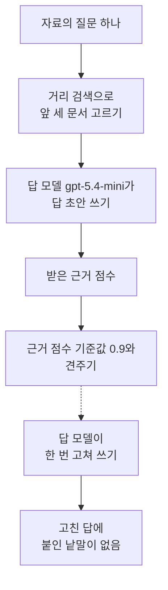
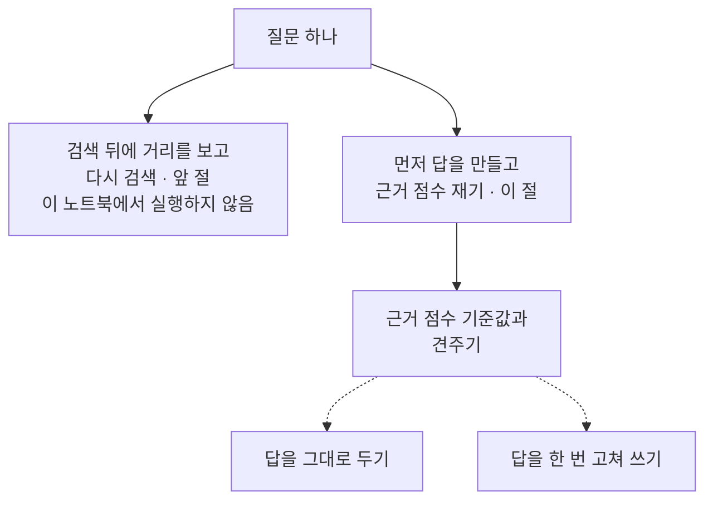
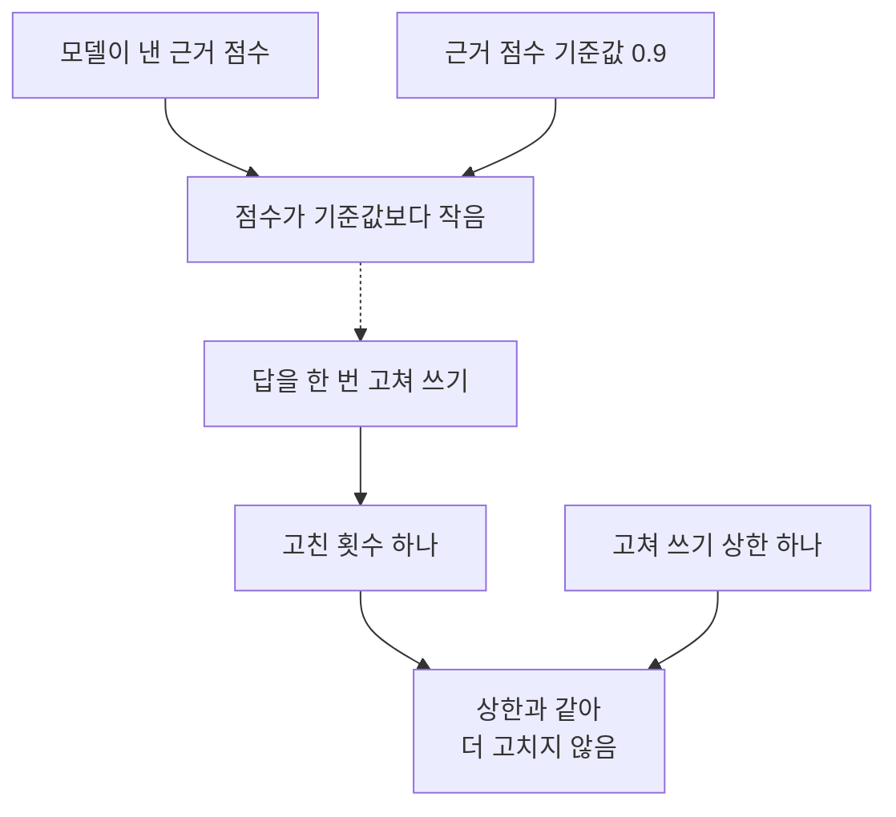
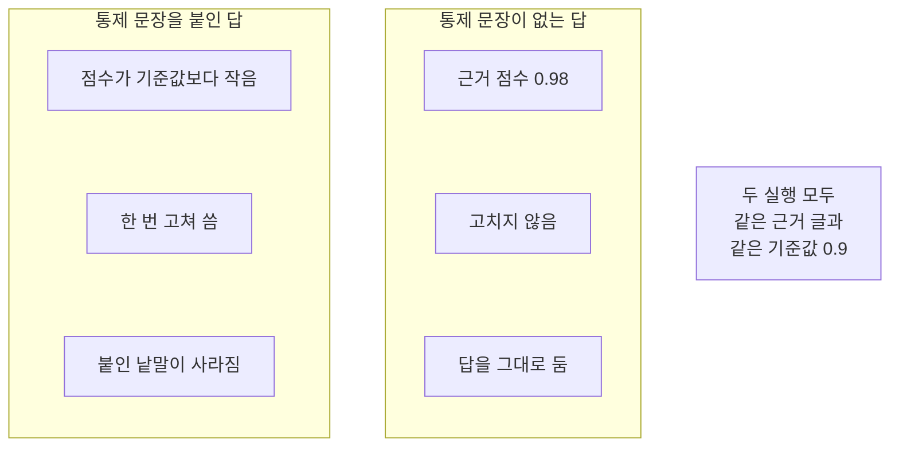

# 07-Self-RAG

## _src 본문 (HTML 원본)

```html
<!--meta: 강의 1h | 실습 2h | 코드 notebooks/07-Self-RAG.ipynb | 새 용어 1 -->
<style>html,body{overflow-x:hidden}.notebook,.nb-cell,.nb-main,.nb-input,.nb-result{min-width:0;max-width:100%}.nb-input pre,.nb-output{box-sizing:border-box;max-width:100%;overflow-x:auto}code.nb-source{display:block!important;width:100%!important;min-width:0!important;overflow-x:auto!important;padding:0!important}</style>
<h2 id="b1"><span class="no">1</span>학습 목표</h2><div class="goal"><ul>
<li>답을 만든 뒤 그 답이 근거와 얼마나 맞는지 점수로 받아 볼 수 있습니다.</li>
<li>근거 점수가 기준값보다 작을 때만 답을 한 번 고치도록 코드에 적을 수 있습니다.</li>
<li>모델이 낸 점수가 정답률이 아니라는 것을 출력과 함께 설명할 수 있습니다.</li>
</ul></div>
<h2 id="b2"><span class="no">2</span>이 내용을 배우는 이유</h2><p>검색이 맞는 문서를 찾아도 답에는 자료에 없는 내용이 섞일 수 있습니다. 답을 그대로 내보내면 그 내용이 사실처럼 읽힙니다. 답을 만든 뒤에 근거와 한 번 더 견주면 어디까지 자료로 확인되는지 볼 수 있습니다. 볼 수 있어야 고칠지 말지를 코드가 정할 수 있습니다.</p><p>01절부터 05절까지는 검색 앞에서 넣을 글을 바꿨습니다. 06절은 검색 뒤에 다시 검색할지 정했습니다. 이 절은 답을 만든 뒤에 고칠지 정합니다. Self-RAG 논문은 학습한 모델이 스스로 표시를 다는 방법이고 이 절은 그 방법을 재현하지 않습니다.</p>
<h2 id="b3"><span class="no">3</span>앞에서 배운 내용</h2><p>06절은 첫 검색의 첫 자리 거리를 기준값과 견주어 다시 검색할지 정했습니다. 이 절은 같은 모양의 규칙을 답에 겁니다. 다만 견주는 값이 거리가 아니라 근거 점수입니다. 문서 열두 건과 질문 여덟 개는 Ch 12 core 벌 사본 그대로입니다.</p><p>거리 순위 함수와 순위 표 출력 함수는 Ch 12 01절과 05절에서 배웠습니다. 문서 ID를 모으는 함수와 자리를 세는 함수는 Ch 11 01절에서 배웠습니다. 모델이 보낸 글을 줄로 나누는 함수는 02절에서 만들었습니다. 01~06절처럼 이 함수들을 도구 파일 <code>notebooks/rag_tools.py</code>에서 가져옵니다.</p><p>답을 만드는 절은 01절과 이 절 둘뿐입니다. 답 만들기 머리글은 01절과 같게 적고 함수 `build_answer_prompt`는 01절 판을 도구 파일에서 가져옵니다. 답 안에 찾는 낱말이 있는지 보는 함수도 01절에서 만든 것을 가져옵니다. 06절 검색 묶음 함수는 이 절이 검색을 한 번만 해서 가져오지 않았습니다.</p>
<h2 id="b4"><span class="no">4</span>핵심 개념</h2><h3>비유로 시작하기</h3><p>나무판 구멍에 마개를 하나 끼웠다고 생각해 봅니다. 잘 들어갔는데 한쪽이 판 위로 튀어나와 있습니다. 튀어나온 만큼을 보고 넘치면 판과 나란해지도록 한 번 손봅니다. 손보는 일은 한 번까지만 하기로 미리 정해 둡니다.</p>
{{img:07-5-튀어나온-마개와-판과-나란한-마개|흰 바탕에 나무판 두 장이 옆에서 본 모양으로 나란히 놓여 있고 왼쪽 판에는 둥근 나무 마개가 판 윗면보다 위로 뚜렷하게 솟아 있으며 오른쪽 판에는 그 자리에 둥근 테두리만 보이고 높이가 판 윗면과 같은 그림|튀어나온 만큼이 넘치면 한 번 손보고 판과 나란하면 그대로 둡니다.}}
<p class="look"><b>그림 읽기</b> — 나무판 두 장이 옆에서 본 모양으로 놓여 있습니다. 왼쪽 판에는 둥근 마개가 판 윗면보다 위로 솟아 있습니다. 오른쪽 판에는 그 자리에 둥근 테두리만 보입니다. 오른쪽은 마개 높이가 판 윗면과 같습니다. 솟아 있는 만큼이 근거에 없는 내용이고 나란한 자리가 근거로 확인되는 답입니다.</p>
<table><thead><tr><th>말</th><th>뜻</th></tr></thead><tbody><tr><td>근거 검사</td><td>답을 만든 뒤 그 답의 내용이 근거 문서로 확인되는 정도를 0과 1 사이 점수로 재는 일입니다.</td></tr></tbody></table>
<p>아래 네 말은 Ch 11·Ch 12·Ch 13과 06절에서 쓰던 뜻 그대로 이어 씁니다.</p>
<table><thead><tr><th>말</th><th>뜻</th></tr></thead><tbody><tr><td>기준값</td><td>어느 갈래로 갈지 가르려고 코드에 미리 적어 두는 값입니다(Ch 13).</td></tr><tr><td>코사인 거리</td><td>두 벡터가 얼마나 먼지를 나타내는 값이고 작을수록 가깝습니다(Ch 12 01절).</td></tr><tr><td>보정 검색</td><td>첫 자리 거리가 기준값보다 클 때 질문을 한 번 고쳐 다시 검색하는 일입니다(06절).</td></tr><tr><td>정답 문서 ID</td><td>그 물음에 답할 내용이 적힌 문서의 ID입니다(Ch 11 01절).</td></tr></tbody></table>
{{mermaid:07-1-답을-만든-뒤-근거-점수를-보고-한-번-고치기|위에서 아래로 놓인 상자 일곱으로 맨 위에 초록 상자 자료의 질문 하나가 있고 그 아래 파란 상자 거리 검색으로 앞 세 문서 고르기와 보라 상자 답 모델 gpt-5.4-mini가 답 초안 쓰기를 지나 노란 상자 받은 근거 점수로 이어지며 그 아래 파란 상자 근거 점수 기준값 0.9와 견주기에서 점선으로 갈라져 보라 상자 답 모델이 한 번 고쳐 쓰기와 맨 아래 노란 상자 고친 답에 붙인 낱말이 없음으로 이어지는 그림|근거 점수가 기준값보다 작으면 답을 한 번 고쳐 씁니다.}}
<p class="look"><b>도식 읽기</b> — 위에서 아래로 읽습니다. 맨 위 초록 상자가 자료에 있는 질문입니다. 파란 상자 둘은 우리가 적은 처리와 판정 규칙이고 보라 상자 둘이 이번에 부른 모델입니다. 노란 상자 둘은 출력으로 확인한 값입니다. 점선은 점수가 기준값보다 작을 때만 가는 자리입니다.</p>
<h3>검색 뒤에 다시 하기와 답을 만든 뒤에 고치기</h3><p>06절은 검색이 끝난 자리에서 첫 자리 거리를 보았습니다. 그때는 아직 답을 만들지 않았습니다. 이 절은 답까지 만든 뒤에 그 답을 근거와 견줍니다. 그래서 고치는 대상도 질문이 아니라 답입니다. 두 절 모두 정하는 것은 모델이 아니라 우리가 코드에 적은 규칙입니다.</p>
{{mermaid:07-2-검색-뒤에-다시-하기와-답을-만든-뒤에-고치기|위에서 아래로 놓인 상자 여섯으로 맨 위 초록 상자 질문 하나에서 아래로 갈라져 왼쪽에 회색 상자 검색 뒤에 거리를 보고 다시 검색 앞 절 이 노트북에서 실행하지 않음이 있고 오른쪽에 파란 상자 먼저 답을 만들고 근거 점수 재기 이 절과 그 아래 파란 상자 근거 점수 기준값과 견주기가 이어지며 거기에서 점선 둘로 갈라져 파란 상자 답을 그대로 두기와 파란 상자 답을 한 번 고쳐 쓰기로 나뉘는 그림|06절은 검색 뒤에 다시 할지 정했고 이 절은 답을 만든 뒤에 고칠지 정합니다.}}
<p class="look"><b>도식 읽기</b> — 위에서 아래로 읽습니다. 맨 위 초록 상자가 자료에 있는 질문입니다. 왼쪽 회색 상자는 06절에서 본 갈래이고 이 노트북에서 실행하지 않았습니다. 오른쪽 파란 상자 넷만 이번에 실행한 자리입니다. 맨 아래 점선 둘이 근거 점수에 따라 갈라지는 두 갈래입니다.</p>
<h3>근거 점수 기준값으로 정하기</h3><p>기준값은 어느 갈래로 갈지 가르려고 미리 정해 두는 값입니다. 시험 점수가 60점 아래면 다시 본다는 규칙이 같은 모양입니다. 이 절 코드에서는 변수 <code>score_limit</code>가 그 값이고 근거 점수와 견줍니다. 점수는 클수록 근거와 잘 맞으므로 기준값보다 작을 때 고쳐 씁니다.</p><p>06절과 부등호 방향이 다른 까닭은 재는 값이 다르기 때문입니다. 06절이 본 코사인 거리는 작을수록 가까운 값이었습니다. 이 절이 보는 근거 점수는 클수록 좋은 값입니다. 같은 모양의 규칙이라도 값의 방향을 먼저 확인해야 합니다.</p><p>이 절은 기준값으로 문서를 목록에서 빼지 않습니다. 근거 세 건은 그대로 두고 답을 고칠지만 정합니다.</p>
<h3>고쳐 쓰기 상한을 값으로 적어 둡니다</h3><p>고쳐 쓸 때마다 모델 요청이 늘어납니다. 상한이 없으면 점수가 기준값을 넘을 때까지 요청이 계속 늘 수 있습니다. 그래서 <code>fix_limit</code>를 값으로 적고 실제로 고친 횟수와 나란히 출력합니다. 이 절의 상한은 한 번입니다.</p>
<h3>Self-RAG 논문과 이 절의 범위</h3><p>Self-RAG 논문은 검색이 필요한지와 근거가 맞는지를 표시로 다는 모델을 학습해 씁니다. 이 절은 그 학습한 모델을 재현하지 않습니다. 일반 모델에게 근거 점수를 물어 기준값과 견주고 한 번만 고치는 자리까지만 코드로 봅니다. 기준값 <code>0.9</code>도 보편 기준이 아니라 이 자료에서 고른 값입니다.</p>
<h3>다른 상황에 적용</h3><p>보고서 요약에도 같은 자리가 있습니다. 요약에 적힌 숫자와 날짜가 원문에 있는지 점수로 받아 볼 수 있습니다. 점수가 낮으면 한 번 고쳐 쓰고 몇 번까지 고칠지는 값으로 적어 둡니다.</p>
<h2 id="b5"><span class="no">5</span>실행 예제</h2><p>노트북은 문서 열두 건을 벡터로 바꾸고 자료의 질문 하나로 답을 만듭니다. 서비스 요청은 아홉 번이고 임베딩 두 번과 답 모델 일곱 번입니다. 점수가 기준값보다 작은 갈래에서는 답 모델을 세 번 부르고 크거나 같은 갈래에서는 한 번 부릅니다. 예상 비용은 미화 0.01달러 아래이고 새로 쓰는 파일은 없습니다.</p><p>먼저 근거 하나를 두고 두 글의 근거 점수를 재어 눈금을 봅니다. 그 눈금 사이에서 근거 점수 기준값과 고쳐 쓰기 상한을 정합니다. 그다음 질문 하나를 검색해 앞 세 문서를 근거로 답 초안을 만듭니다. 그 답에 원문에 없는 문장을 일부러 붙여 근거 점수를 받습니다. 마지막으로 통제 문장이 없는 답을 같은 규칙에 넣어 봅니다.</p>
{{mermaid:07-3-근거-점수-판정과-고쳐-쓰기-상한|위에서 아래로 놓인 상자 일곱으로 맨 위 왼쪽에 노란 상자 모델이 낸 근거 점수와 오른쪽에 파란 상자 근거 점수 기준값 0.9가 있고 둘이 노란 상자 점수가 기준값보다 작음으로 모이며 거기에서 점선으로 파란 상자 답을 한 번 고쳐 쓰기가 이어지고 그 아래 노란 상자 고친 횟수 하나와 파란 상자 고쳐 쓰기 상한 하나가 맨 아래 노란 상자 상한과 같아 더 고치지 않음으로 모이는 그림|근거 점수가 기준값보다 작아 한 번 고쳐 썼고 상한과 같아 거기서 멈춥니다.}}
<p class="look"><b>도식 읽기</b> — 위에서 아래로 읽습니다. 맨 위 노란 상자는 출력으로 확인한 점수이고 그 옆 파란 상자는 우리가 정한 값입니다. 가운데 점선은 판정에 따라 갈라지는 자리입니다. 맨 아래 노란 상자는 상한과 실제 횟수를 견준 결과입니다.</p>
{{notebook:07-Self-RAG}}
<p class="look"><b>확인할 점</b> — 눈금 줄은 <code>근거에 있는 내용만 적은 글의 점수: 1.0</code>과 <code>근거에 없는 문장을 섞은 글의 점수: 0.5</code>였습니다. 정한 값은 <code>근거 점수 기준값: 0.9</code>와 <code>고쳐 쓸 수 있는 횟수 상한: 1</code>입니다. 통제 문장을 붙인 답에서는 <code>고쳐 쓰기로 했는가: True</code>와 <code>고친 답에 일부러 붙인 낱말이 남았는가: False</code>가 나왔습니다. 통제 문장이 없는 답에서는 <code>통제 문장이 없는 답의 근거 점수: 0.98</code>과 <code>그 갈래에서 고친 횟수: 0</code>이었습니다.</p>
<h2 id="b6"><span class="no">6</span>실험 결과 해석</h2><p>먼저 졸업생 안내문 하나를 근거로 두고 두 글의 점수를 쟀습니다. 근거에 있는 내용만 적은 글은 <code>1.0</code>을 받았습니다. 거기에 근거에 없는 문장 하나를 섞은 글은 <code>0.5</code>를 받았습니다. 이 낮은 쪽 값은 새 커널 두 번 실행 가운데 한 번은 0.7로 나왔습니다. 두 값 사이에서 기준값을 <code>0.9</code>로 정했습니다.</p><p>자료의 질문으로 검색하니 정답 문서 <code>LIB-003</code>이 첫 자리였습니다. 앞 세 문서를 근거로 넣어 답 초안을 받았습니다. 초안에는 근거에 있는 내용만 적혀 있었습니다. 그대로는 고쳐 쓰는 갈래를 볼 수 없습니다.</p><p>그래서 원문에 없는 문장 하나를 답 끝에 일부러 붙였습니다. 붙인 문장은 신청한 책이 언제 들어오는지를 말합니다. 근거 세 건 어디에도 그런 내용이 없습니다. 이 통제는 우리가 손으로 넣은 조건입니다.</p><p>통제 문장을 붙인 답의 근거 점수는 기준값보다 작았습니다. 그래서 답을 한 번 고쳐 썼고 고친 횟수는 한 번이었습니다. 고친 답에서 붙인 낱말이 사라졌고 다시 잰 점수는 <code>0.98</code>이었습니다. 한 번 고친 뒤에는 상한에 닿아 더 고치지 않습니다.</p>
{{mermaid:07-4-답-둘을-나란히-보기|왼쪽부터 오른쪽으로 놓인 칸 두 개와 회색 상자 하나로 왼쪽 칸 제목은 통제 문장을 붙인 답이고 그 안에 노란 상자 점수가 기준값보다 작음과 노란 상자 한 번 고쳐 씀과 노란 상자 붙인 낱말이 사라짐이 있으며 가운데 칸 제목은 통제 문장이 없는 답이고 그 안에 노란 상자 근거 점수 0.98과 노란 상자 고치지 않음과 노란 상자 답을 그대로 둠이 있고 오른쪽에 회색 상자 두 실행 모두 같은 근거 글과 같은 기준값 0.9가 놓인 그림|같은 근거와 같은 기준값에서도 검사할 답에 따라 고치기도 하고 그대로 두기도 합니다.}}
<p class="look"><b>도식 읽기</b> — 왼쪽 칸이 통제 문장을 붙인 답입니다. 가운데 칸이 통제 문장이 없는 답입니다. 칸마다 노란 상자 셋이 그 답에서 확인한 값입니다. 오른쪽 회색 상자는 두 칸에 모두 해당하는 사실입니다.</p>
<p>검사할 답 하나만 바꾸자 같은 규칙이 다른 갈래로 갔습니다. 통제 문장이 없는 답은 <code>0.98</code>을 받아 그대로 두었습니다. 문장 하나를 더 붙였는지가 그 차이의 전부입니다. 근거 글과 기준값은 두 실행에서 같았습니다.</p><p>통제 문장을 붙인 답이 받은 점수 값은 답 문장에 따라 달라집니다. 탐색 실행에서 그 값이 둘로 갈렸고 둘 다 기준값보다 작았습니다. 그래서 그 숫자는 그림 라벨과 정리에 넣지 않았습니다. 갈래를 가른 판정은 두 값에서 모두 같았습니다.</p><p>모델이 낸 점수는 출력으로 확인한 값이지 정답률이 아닙니다. 같은 모델이 답도 쓰고 점수도 매기면 치우침이 겹칠 수 있습니다. 사람이 만든 평가셋과 따로 만든 판정자가 있어야 확인이 됩니다. 답이 맞는지 재는 일은 Ch 15 몫입니다.</p><p>여기서 본 것은 답 둘과 근거 글 하나입니다. 여덟 질문 전체에서 같은 차이가 나는지는 이번에 확인하지 않았습니다.</p>
<h2 id="b7"><span class="no">7</span>주의할 점과 실무 메모</h2><ul><li>근거 점수 기준값 <code>0.9</code>는 눈금을 먼저 재고 정한 값입니다. 어떤 답을 고칠지 먼저 정하고 그런 글이 몇 점을 받는지 잰 뒤에 그 위에서 골랐습니다.</li><li>눈금에는 검사 대상과 다른 문서를 썼습니다. 검사할 값을 먼저 보고 기준을 맞추지 않으려는 것입니다.</li><li>그 값은 정답 확률이 아닙니다. 모델이나 자료가 바뀌면 다시 재고 다시 정해야 합니다.</li><li>근거 점수는 클수록 근거와 잘 맞는 값이라 기준값보다 작을 때 고쳐 씁니다. 코사인 거리를 본 06절과 부등호 방향이 반대입니다.</li><li>Self-RAG 논문의 학습한 모델과 표시는 이 절에서 재현하지 않았습니다. 일반 모델에게 점수를 물어 한 번 고치는 자리까지만 봤습니다.</li><li>원문에 없는 문장은 우리가 일부러 붙인 통제 조건입니다. 그 한 번의 결과를 다른 답으로 넓혀 읽지 않습니다.</li><li>통제 문장도 탐색 실행 뒤 고른 예입니다. 후보 셋을 재어 보고 근거 세 건 어디에도 없는 문장 하나를 골랐습니다.</li><li>고쳐 쓸 수 있는 횟수를 <code>fix_limit</code>로 적고 실제 횟수와 나란히 출력했습니다. 결과에 건 검사 <code>assert</code>는 그 세 값을 견주는 두 줄뿐입니다.</li><li>모델이 낸 점수와 모델이 쓴 답 문장에는 <code>assert</code>를 걸지 않았습니다. 두 값 모두 실행마다 달라질 수 있습니다.</li><li>새 커널로 두 번 실행하니 답 초안과 고친 답은 쉼표 하나만 달랐고 근거 점수 셋은 같았습니다. 눈금의 낮은 쪽 값은 0.7과 0.5로 갈렸습니다. 탐색 실행에서 갈린 점수 값과 이 눈금 값은 그림 라벨과 정리에 넣지 않았습니다.</li><li>모델이 보낸 글을 소수로 바꾸는 자리에서 0과 1 밖의 값은 끝값으로 맞춥니다. 소수로 바꾸지 못하는 글이 오면 그 자리에서 멈춥니다. 이번에는 그런 답을 받아 보지 않았습니다.</li><li>점수가 기준값 위인 갈래에서는 고쳐 쓰기 모델을 부르지 않습니다. 그래서 그 갈래에서는 요청이 늘지 않았습니다.</li><li>이 절은 기준값으로 문서를 목록에서 빼지 않습니다. 근거 세 건은 그대로 두고 답을 고칠지만 정합니다.</li><li>걸린 시간은 이번에 재지 않았습니다. 그래서 빨라졌는지 느려졌는지 적지 않습니다.</li><li>이 절은 파일을 쓰지 않습니다. 문서 파일과 질문 파일은 읽기만 합니다.</li><li>준비물에 LangChain 1.4.0과 langchain-openai 1.6.1과 numpy 2.5.3을 적었습니다. 다른 판과 Windows·macOS에서는 이번에 실행하지 않았습니다.</li></ul>
<h2 id="b8"><span class="no">8</span>정리와 다음 절</h2><ul><li>근거 그대로인 글과 한 문장이 섞인 글로 점수 눈금을 먼저 보았습니다.</li><li>그 두 값 사이에서 근거 점수 기준값을 정하고 고쳐 쓰기 상한도 적었습니다.</li><li>원문에 없는 문장을 붙인 답은 점수가 기준값보다 작아 한 번 고쳐 썼습니다.</li><li>통제 문장이 없는 답은 점수가 기준값 위여서 그대로 두었습니다.</li></ul><p><strong>다음 학습과 이어지는 지점</strong> — 08절에서는 문서를 갈래로 묶어 한 단계 요약을 만들고 그 요약으로 찾습니다. 이 절은 답을 만든 뒤 고칠지 정했고 08절은 찾기 전에 요약을 만들어 둡니다.</p>
<h2 id="b9"><span class="no">9</span>복습 문제</h2><details class="quiz" open><summary>문제 4개 · 해설 포함</summary><p class="quiz-q">1. 근거 검사의 입력과 출력은 무엇입니까?</p><p class="quiz-a">근거 글과 답 하나를 넣으면 0과 1 사이 근거 점수 하나가 나옵니다. 틀렸다면 「핵심 개념」의 용어 표를 다시 읽습니다.</p><p class="quiz-q">2. 근거 점수가 기준값보다 작을 때와 클 때 코드는 무엇을 다르게 합니까?</p><p class="quiz-a">작을 때만 모델에게 답을 다시 쓰게 하고 클 때는 답을 그대로 둡니다. 점수는 클수록 근거와 잘 맞기 때문입니다. 틀렸다면 「핵심 개념」의 소제목 「근거 점수 기준값으로 정하기」를 다시 읽습니다.</p><p class="quiz-q">3. 이 절의 부등호 방향이 06절과 반대인 까닭은 무엇입니까?</p><p class="quiz-a">06절이 본 코사인 거리는 작을수록 가깝고 이 절이 보는 근거 점수는 클수록 잘 맞기 때문입니다. 틀렸다면 「핵심 개념」의 소제목 「근거 점수 기준값으로 정하기」 둘째 단락을 다시 읽습니다.</p><p class="quiz-q">4. 이 절이 Self-RAG 논문 전체를 재현하지 않는다고 적은 까닭은 무엇입니까?</p><p class="quiz-a">논문은 표시를 다는 모델을 학습해 쓰지만 이 절은 일반 모델에게 점수를 물어 한 번만 고칩니다. 틀렸다면 「핵심 개념」의 소제목 「Self-RAG 논문과 이 절의 범위」를 다시 읽습니다.</p></details>
<h2 id="b10"><span class="no">10</span>참고 자료</h2><ul><li><div><a href="https://arxiv.org/abs/2310.11511">Self-RAG 논문</a></div>확인 2026-09-19 · 학습한 모델이 스스로 표시를 다는 원래 방법의 출처.</li><li><div><a href="https://docs.langchain.com/oss/python/concepts/providers-and-models">LangChain 모델과 provider</a></div>확인 2026-09-19 · LangChain 1.4 기준 · 답과 점수를 받을 모델을 준비하는 방법.</li><li><div><a href="https://developers.openai.com/api/docs/models/text-embedding-3-small">OpenAI text-embedding-3-small 모델 안내</a></div>확인 2026-09-19 · 문서와 질문을 벡터로 바꿀 때 쓴 모델과 차원 수 설정.</li><li>Ch 14 06절 CRAG — 같은 모양의 규칙을 거리에 걸어 본 자리와 견주어 볼 곳.</li><li>Ch 14 01절 대화 히스토리와 질문 재작성 — 이 절이 이어 쓴 답 만들기 머리글과 함수가 있는 자리.</li></ul>
```

## 노트북 셀 (순서대로)

### [0] markdown {'html': 'skip'}

# Self-RAG

**이 노트북에서 할 일**

1. Ch 12에서 쓰던 문서 열두 건과 질문 여덟 개를 그대로 읽습니다.
2. 근거 하나를 두고 두 글의 근거 점수를 재어 눈금을 봅니다.
3. 그 눈금을 보고 근거 점수 기준값과 고쳐 쓰기 상한을 정합니다.
4. 자료의 질문 하나를 검색해 앞 세 문서를 근거로 답 초안을 만듭니다.
5. 원문에 없는 문장을 일부러 붙인 답의 근거 점수를 받습니다.
6. 점수가 기준값보다 작으면 그 답을 한 번만 고쳐 씁니다.

**준비물** — 이 절은 프로젝트 맨 위 폴더의 `.env`에 적어 둔 `OPENAI_API_KEY`를 씁니다.
서비스 요청은 아홉 번이고 임베딩 두 번과 답 모델 일곱 번입니다.
점수가 기준값보다 작은 갈래에서는 답 모델을 세 번 부르고 크거나 같은 갈래에서는 한 번 부릅니다.
예상 비용은 미화 0.01달러 아래이고 읽어 오는 파일은 문서 파일과 질문 파일 둘입니다.
새로 쓰는 파일은 없고 실행 시간은 2분 안팎입니다.

**기준 버전** — 첫 셀에서 LangChain 1.4.0과 langchain-openai 1.6.1을 설치합니다.
키를 읽는 python-dotenv 1.2.3과 도구 파일이 쓰는 numpy 2.5.3도 함께 설치합니다.
교재 출력은 Linux의 Python 3.12.13으로 만들었습니다.
다른 판과 Windows·macOS에서는 이번에 실행하지 않았습니다.

**강의와 실습 범위** — 강의 시간에는 3절부터 10절까지 읽습니다.
Ch 12 검색 부품을 준비하고 점수 눈금을 보고 기준값을 정하는 자리입니다.
11절부터 14절까지는 답을 만들고 검사하고 한 번 고쳐 쓰는 자리입니다.
15절부터 17절까지는 검사할 답을 바꿔 보고 세 실행을 표로 보는 자리입니다.

실습 폴더 `labs/part4/ch14-rag-patterns`에서 `uv sync --locked`를 실행합니다.
그다음 이 폴더의 `.venv` 커널을 고르고 첫 셀부터 순서대로 실행합니다.

### [1] markdown {'html': 'skip'}

## 오늘 볼 그림


위에서 아래로 읽습니다.
맨 위 초록 상자가 자료에 있는 질문입니다.
파란 상자 둘이 우리가 적은 처리와 판정 규칙이고 보라 상자 둘이 모델입니다.
노란 상자 둘이 출력으로 확인한 값입니다.
점선은 점수가 기준값보다 작을 때만 가는 자리입니다.

### [2] markdown {}

## 1. 준비

첫 셀은 패키지 네 개를 설치하고 설치된 판 번호를 출력합니다.
설치에는 몇십 초가 걸릴 수 있습니다.

### [3] code {'execution': {'iopub.execute_input': '2026-09-21T09:39:46.750972Z', 'iopub.status.busy': '2026-09-21T09:39:46.750767Z', 'iopub.status.idle': '2026-09-21T09:39:47.192806Z', 'shell.execute_reply': '2026-09-21T09:39:47.192223Z'}, 'lesson_role': 'setup'}

```python
# 이 절에서 쓰는 패키지를 설치하고 버전을 확인합니다
%pip install -q "langchain==1.4.0" "langchain-openai==1.6.1" "python-dotenv==1.2.3" "numpy==2.5.3"
from importlib.metadata import version

print("langchain:", version("langchain"))
print("langchain-openai:", version("langchain-openai"))
print("python-dotenv:", version("python-dotenv"))
print("numpy:", version("numpy"))
```

출력:
```
Note: you may need to restart the kernel to use updated packages.
langchain: 1.4.0
langchain-openai: 1.6.1
python-dotenv: 1.2.3
numpy: 2.5.3

```

### [4] markdown {}

**결과 읽기** — 설치가 끝나면 판 번호 네 줄이 보입니다.
마지막 줄 `numpy: 2.5.3`은 도구 파일이 벡터 계산에 쓰는 패키지입니다.
이 노트북의 출력은 2026-09-21에 이 판으로 실행한 결과입니다.

다음 셀은 이름 네 개를 불러오고 도구 파일에서 함수 일곱 개를 가져옵니다.
앞의 둘은 자료 읽기와 폴더 확인에 씁니다.
뒤의 둘은 Ch 9~13에서 쓴 임베딩과 답 모델 이름입니다.

앞에서 배운 함수는 `rag_tools.py`에 모아 두었습니다. 파일을 열면 코드를 볼 수 있습니다. 노트북과 같은 폴더(`notebooks/`)에 있는 파일입니다.

이 노트북은 Ch 12 01절 `rank_by_distance()`와 05절 `print_ranked()`를 가져옵니다.
Ch 11 01절 `unique_doc_ids()`·`find_gold_rank()`와 02절 `split_lines()`도 가져옵니다.
01절에서 만든 `keeps_word()`와 `build_answer_prompt()`도 함께 가져옵니다.
인자 모양은 쓰는 자리에서 설명합니다.

### [5] code {'execution': {'iopub.execute_input': '2026-09-21T09:39:47.193952Z', 'iopub.status.busy': '2026-09-21T09:39:47.193861Z', 'iopub.status.idle': '2026-09-21T09:39:48.006519Z', 'shell.execute_reply': '2026-09-21T09:39:48.006316Z'}, 'lesson_role': 'setup'}

```python
# 자료 읽기·폴더 확인과 임베딩·답 모델 이름을 불러옵니다
import json
import os

from langchain_openai import OpenAIEmbeddings
from langchain.chat_models import init_chat_model
# Ch 12 01·05절·Ch 11 01절 함수와 01·02절 함수를 도구 파일에서 가져옵니다
from rag_tools import build_answer_prompt, find_gold_rank, keeps_word, print_ranked
from rag_tools import rank_by_distance, split_lines, unique_doc_ids

print("불러온 이름:", "json", "os", "OpenAIEmbeddings", "init_chat_model")
```

출력:
```
불러온 이름: json os OpenAIEmbeddings init_chat_model

```

### [6] markdown {}

**결과 읽기** — 출력 줄에 불러온 이름 네 개가 보입니다.
이름 `OpenAIEmbeddings`와 `init_chat_model`은 06절에서 쓴 것과 같습니다.
도구 파일에서 가져온 함수 일곱 개는 출력하지 않습니다.

## 2. 키와 모델 준비

### [7] markdown {}

API 키가 있는지 확인합니다. `True` 값이 나오면 다음으로 넘어갑니다.

### [8] code {'execution': {'iopub.execute_input': '2026-09-21T09:39:48.009132Z', 'iopub.status.busy': '2026-09-21T09:39:48.009036Z', 'iopub.status.idle': '2026-09-21T09:39:48.014050Z', 'shell.execute_reply': '2026-09-21T09:39:48.012433Z'}, 'lesson_role': 'setup'}

```python
# .env 파일에서 OpenAI API 키를 읽습니다(키 값은 출력하지 않습니다)
import os
from dotenv import find_dotenv, load_dotenv

env_path = find_dotenv(usecwd=True)
load_dotenv(env_path)
has_key = os.getenv("OPENAI_API_KEY") is not None
print("OPENAI_API_KEY 설정 여부:", has_key)
assert has_key, "프로젝트 폴더의 .env 파일에 OPENAI_API_KEY를 적어 주세요."
```

출력:
```
OPENAI_API_KEY 설정 여부: True

```

### [9] markdown {}

실습에 쓸 모델을 준비합니다.
temperature 값을 0으로 두어 매번 비슷한 답을 고르게 합니다.

### [10] code {'execution': {'iopub.execute_input': '2026-09-21T09:39:48.014553Z', 'iopub.status.busy': '2026-09-21T09:39:48.014470Z', 'iopub.status.idle': '2026-09-21T09:39:48.059059Z', 'shell.execute_reply': '2026-09-21T09:39:48.058799Z'}}

```python
# 실습에 쓸 모델을 준비합니다
model = init_chat_model(
    "openai:gpt-5.4-mini",
    temperature=0,
    reasoning_effort="none",
)
print("모델 이름:", model.model_name)
print("temperature:", model.temperature)
```

출력:
```
모델 이름: gpt-5.4-mini
temperature: 0.0

```

### [11] markdown {}

**결과 읽기** — 모델 이름 `gpt-5.4-mini`, temperature `0.0`이 보이면 준비가 끝났습니다.
이 노트북의 출력은 2026-09-21에 이 모델로 실행한 결과입니다.

### [12] markdown {}

## 3. 문서와 질문 읽기

이 절은 01~06절과 같은 문서 파일과 질문 파일을 읽습니다.
두 파일은 Ch 12 core 벌 파일과 바이트가 같은 사본입니다.
먼저 노트북을 연 자리에서 프로젝트 맨 위를 찾습니다.

### [13] code {'execution': {'iopub.execute_input': '2026-09-21T09:39:48.059638Z', 'iopub.status.busy': '2026-09-21T09:39:48.059584Z', 'iopub.status.idle': '2026-09-21T09:39:48.061796Z', 'shell.execute_reply': '2026-09-21T09:39:48.061452Z'}}

```python
# 노트북을 어느 폴더에서 열어도 프로젝트 맨 위를 찾게 후보 세 개를 차례로 봅니다
candidates = [".", "../../..", "../../../.."]
root_path = None
for candidate in candidates:
    if os.path.exists(candidate + "/labs/part4/ch14-rag-patterns/data"):
        root_path = candidate
        break
print("고른 자리:", root_path)
assert root_path is not None, "notebooks 폴더나 실습 폴더 맨 위에서 노트북을 열어 주세요."
```

출력:
```
고른 자리: .

```

### [14] markdown {}

**결과 읽기** — 출력 줄 `고른 자리` 뒤에 점 하나나 위로 올라가는 표시가 보입니다.
Ch 10~13과 01~06절에서 쓴 방법과 같습니다.
후보 셋 가운데 이 챕터 자료 폴더가 있는 자리를 고릅니다.

다음 셀은 문서 파일과 질문 파일을 읽습니다.

### [15] code {'execution': {'iopub.execute_input': '2026-09-21T09:39:48.062378Z', 'iopub.status.busy': '2026-09-21T09:39:48.062325Z', 'iopub.status.idle': '2026-09-21T09:39:48.065272Z', 'shell.execute_reply': '2026-09-21T09:39:48.064789Z'}}

```python
# 이 챕터 폴더의 문서 파일과 질문 파일을 읽습니다(읽기만 하고 고치지 않습니다)
data_path = root_path + "/labs/part4/ch14-rag-patterns/data"
with open(data_path + "/documents.json", encoding="utf-8") as file:
    docs = json.loads(file.read())
with open(data_path + "/queries.json", encoding="utf-8") as file:
    queries = json.loads(file.read())
print("문서 수:", len(docs))
print("질문 수:", len(queries))
```

출력:
```
문서 수: 12
질문 수: 8

```

### [16] markdown {}

**결과 읽기** — 출력 줄 `문서 수: 12`와 `질문 수: 8`이 Ch 12 core 벌 그대로입니다.
문서는 도서관 안내 열두 건입니다.

질문 번호는 C01부터 C08까지이고 질문 파일에 적혀 있습니다.
이 절은 그 가운데 하나를 골라 답까지 만듭니다.

## 4. 앞 절 부품 준비

다음 두 셀은 01~06절에서 이미 본 준비입니다.
읽지 말고 실행만 하고 넘어가도 됩니다.
첫 셀은 Ch 12에서 정한 값 둘을 그대로 적고 문서 글을 이어 붙입니다.
둘째 셀은 문서 ID로 원문을 찾을 짝을 만듭니다.
함수는 준비 셀에서 도구 파일로 가져왔습니다.

### [17] code {'execution': {'iopub.execute_input': '2026-09-21T09:39:48.065982Z', 'iopub.status.busy': '2026-09-21T09:39:48.065930Z', 'iopub.status.idle': '2026-09-21T09:39:48.068259Z', 'shell.execute_reply': '2026-09-21T09:39:48.067765Z'}, 'lesson_role': 'setup'}

```python
# Ch 12에서 쓴 값 둘을 그대로 적고 문서 12개의 제목과 본문을 이어 붙입니다
top_three = 3
top_all = 12
doc_texts = []
doc_ids = []
for doc in docs:
    doc_texts.append(doc["title"] + " " + doc["text"])
    doc_ids.append(doc["doc_id"])
print("나란히 볼 상위 문서 수:", top_three)
print("자리를 셀 때 재는 문서 수:", top_all)
print("이어 붙인 글 수:", len(doc_texts))
print("첫 문서 글:", doc_texts[0])
```

출력:
```
나란히 볼 상위 문서 수: 3
자리를 셀 때 재는 문서 수: 12
이어 붙인 글 수: 12
첫 문서 글: 도서 대출 기간 일반 도서는 14일 동안 대출할 수 있습니다. 예약자가 없으면 한 번 연장할 수 있습니다.

```

### [18] code {'execution': {'iopub.execute_input': '2026-09-21T09:39:48.069051Z', 'iopub.status.busy': '2026-09-21T09:39:48.068989Z', 'iopub.status.idle': '2026-09-21T09:39:48.070916Z', 'shell.execute_reply': '2026-09-21T09:39:48.070558Z'}, 'lesson_role': 'setup'}

```python
# 문서 ID로 원문을 찾을 짝을 만듭니다(답 만들기와 근거 글에 원문을 넣으려고 씁니다)
text_by_doc = {}
for i in range(len(doc_ids)):
    text_by_doc[doc_ids[i]] = doc_texts[i]
print("짝의 수:", len(text_by_doc))
```

출력:
```
짝의 수: 12

```

### [19] markdown {}

준비 셀 두 개를 지났습니다.
02·03절이 쓴 순위 합치기 함수는 04~06절에 이어 이 절에서도 가져오지 않았습니다.
이 절도 목록 여러 개를 하나로 합치지 않기 때문입니다.
06절 검색 묶음 함수 `search_hits`도 가져오지 않았습니다.
이 절은 검색을 한 번만 해서 01절처럼 세 줄로 펴 두었습니다.

## 5. 문서를 벡터로 바꾸기

다음 셀은 문서 열두 건을 벡터로 바꿉니다.
이 절에서 서비스에 보내는 첫 요청입니다.

### [20] code {'execution': {'iopub.execute_input': '2026-09-21T09:39:48.071671Z', 'iopub.status.busy': '2026-09-21T09:39:48.071604Z', 'iopub.status.idle': '2026-09-21T09:39:48.307086Z', 'shell.execute_reply': '2026-09-21T09:39:48.306286Z'}}

```python
# Ch 12와 같은 모델로 문서 12개를 벡터로 바꿉니다(임베딩 요청 1번)
embedding_model_name = "text-embedding-3-small"
vector_dimensions = 256
embedding_model = OpenAIEmbeddings(model=embedding_model_name, dimensions=vector_dimensions)
doc_vectors = embedding_model.embed_documents(doc_texts)
print("임베딩 모델 이름:", embedding_model.model)
print("벡터의 숫자 개수 설정:", embedding_model.dimensions)
print("문서 벡터 수:", len(doc_vectors))
```

출력:
```
임베딩 모델 이름: text-embedding-3-small
벡터의 숫자 개수 설정: 256
문서 벡터 수: 12

```

### [21] markdown {}

**결과 읽기** — 출력 줄 `임베딩 모델 이름: text-embedding-3-small`은 06절과 같은 모델입니다.
출력 줄 `벡터의 숫자 개수 설정: 256`도 Ch 10~13과 같은 값입니다.
출력 줄 `문서 벡터 수: 12`로 문서마다 벡터 하나를 받았습니다.
벡터 안의 숫자는 호출마다 아주 조금씩 달라져 소수 자리까지 같다고 보지 않습니다.

## 6. 답 만들기 머리글과 함수

이 챕터에서 답을 만드는 절은 01절과 이 절 둘뿐입니다.
머리글 두 줄을 01절과 같게 적고 함수는 01절 판을 도구 파일에서 가져왔습니다.
머리글은 자료만 보고 한 문장으로 답하고 출처를 적으라고 말합니다.

### [22] code {'execution': {'iopub.execute_input': '2026-09-21T09:39:48.308499Z', 'iopub.status.busy': '2026-09-21T09:39:48.308382Z', 'iopub.status.idle': '2026-09-21T09:39:48.311237Z', 'shell.execute_reply': '2026-09-21T09:39:48.310757Z'}}

```python
# 답 만들기 머리글 두 줄을 01절과 같게 적습니다
answer_head = "아래 자료만 보고 질문에 한국어로 한 문장으로 답하세요.\n"
answer_head = answer_head + "답 끝에 [문서ID] 모양으로 출처를 적으세요.\n\n"
print("답 만들기 머리글:")
print(answer_head)
```

출력:
```
답 만들기 머리글:
아래 자료만 보고 질문에 한국어로 한 문장으로 답하세요.
답 끝에 [문서ID] 모양으로 출처를 적으세요.


```

### [23] markdown {}

**결과 읽기** — 라벨 줄 `답 만들기 머리글:` 아래에 두 문장이 있습니다.
함수 `build_answer_prompt()`는 문서 ID를 대괄호로 묶고 그 아래 원문을 붙입니다.
도구 파일 판은 이 머리글을 첫 인자로, 문서 ID와 원문의 짝을 넷째 인자로 받습니다.
출처로 쓰는 것은 자료에 있는 문서 ID와 그 원문입니다.

## 7. 모델이 보낸 글을 점수로 바꾸기

모델이 보내는 것은 숫자가 아니라 글입니다.
글 `0.5`와 숫자 0.5는 다르게 다뤄집니다.
글을 소수로 바꾸는 `float`을 이 절에서 처음 씁니다.
범위를 벗어난 값이 올 수도 있어 0과 1 밖이면 끝값으로 맞춥니다.

### [24] code {'execution': {'iopub.execute_input': '2026-09-21T09:39:48.312667Z', 'iopub.status.busy': '2026-09-21T09:39:48.312521Z', 'iopub.status.idle': '2026-09-21T09:39:48.315368Z', 'shell.execute_reply': '2026-09-21T09:39:48.314835Z'}}

```python
# 받은 점수가 벗어날 때 맞출 낮은 끝과 높은 끝을 먼저 정합니다
score_low = 0.0
score_high = 1.0


def to_score(reply_text):
    lines = split_lines(reply_text)
    number = float(lines[0])
    if number < score_low:
        number = score_low
    if number > score_high:
        number = score_high
    return number
```

출력:
```

```

### [25] markdown {}

**결과 읽기** — 정의 셀이라 출력이 없습니다.
함수 `to_score`는 받은 글을 줄로 나눈 뒤 맨 앞 줄만 소수로 바꿉니다.
바꾼 값이 0보다 작으면 0으로, 1보다 크면 1로 맞춥니다.
소수로 바꾸지 못하는 글이 오면 그 자리에서 멈추는데 이번에는 그런 답을 받아 보지 않았습니다.
그래서 머리글에 숫자 하나만 적으라고 적어 둡니다.

## 8. 근거 점수를 받는 함수

근거 검사는 근거 글과 답을 함께 넣고 점수를 받는 일입니다.
이 절에서 이 함수를 다섯 번 부릅니다.
머리글은 자료만 보고 확인되는 정도를 소수 하나로 적으라고 말합니다.

### [26] code {'execution': {'iopub.execute_input': '2026-09-21T09:39:48.316379Z', 'iopub.status.busy': '2026-09-21T09:39:48.316285Z', 'iopub.status.idle': '2026-09-21T09:39:48.318985Z', 'shell.execute_reply': '2026-09-21T09:39:48.318400Z'}}

```python
# 근거와 답을 한 글로 이어 붙여 모델에게 근거 점수를 받습니다
def score_of(answer_text, ground_text):
    check_head = "아래 자료만 보고 답의 내용이 자료로 확인되는 정도를 재세요.\n"
    check_head = check_head + "0과 1 사이 소수 하나만 적고 다른 말은 적지 마세요.\n\n"
    check_prompt = check_head + "자료:\n" + ground_text + "\n답: " + answer_text
    check_reply = model.invoke(check_prompt)
    return to_score(check_reply.text)
```

출력:
```

```

### [27] markdown {}

**결과 읽기** — 정의 셀이라 출력이 없습니다.
함수 `score_of`는 근거 글과 답 하나를 받아 점수 하나를 만듭니다.
안에서 모델을 한 번 부르고 받은 글을 `to_score`로 넘깁니다.
모델이 낸 점수는 출력으로 확인한 값이지 정답률이 아닙니다.

## 9. 근거 점수 눈금을 보고 기준값 정하기

기준값을 먼저 정해 놓고 검사하면 값을 마음대로 맞출 수 있습니다.
그래서 어떤 답을 고칠지 먼저 정합니다.
이 절은 근거에 없는 문장이 섞인 답을 고치기로 합니다.
그런 글과 근거 그대로인 글이 각각 몇 점을 받는지 먼저 봅니다.
눈금에는 이 절이 검사할 문서가 아닌 다른 문서를 씁니다.

### [28] code {'execution': {'iopub.execute_input': '2026-09-21T09:39:48.320174Z', 'iopub.status.busy': '2026-09-21T09:39:48.320077Z', 'iopub.status.idle': '2026-09-21T09:39:49.464827Z', 'shell.execute_reply': '2026-09-21T09:39:49.463693Z'}}

```python
# 근거 하나를 두고 두 글의 근거 점수를 먼저 재어 눈금을 봅니다(모델 요청 2번)
scale_ground = "[ACC-004] " + text_by_doc["ACC-004"] + "\n"
same_text = "졸업생은 동문 회원으로 전환한 뒤 자료실을 이용할 수 있습니다. [ACC-004]"
mixed_text = "졸업생은 동문 회원으로 전환한 뒤 자료실을 이용할 수 있습니다. 전환 비용은 없습니다. [ACC-004]"
same_score = score_of(same_text, scale_ground)
mixed_score = score_of(mixed_text, scale_ground)
print("근거에 있는 내용만 적은 글의 점수:", same_score)
print("근거에 없는 문장을 섞은 글의 점수:", mixed_score)
```

출력:
```
근거에 있는 내용만 적은 글의 점수: 1.0
근거에 없는 문장을 섞은 글의 점수: 0.5

```

### [29] markdown {}

**결과 읽기** — 출력 줄 `근거에 있는 내용만 적은 글의 점수: 1.0`이 눈금의 높은 쪽입니다.
출력 줄 `근거에 없는 문장을 섞은 글의 점수: 0.5`가 눈금의 낮은 쪽입니다.
두 글은 한 문장이 더 있는지만 다릅니다.

이 두 값은 졸업생 안내문 하나로 잰 것입니다.
다른 자료에서 같은 값이 나온다는 뜻은 아닙니다.
새 커널로 두 번 실행했을 때 낮은 쪽 값은 한 번은 0.7이고 한 번은 0.5였습니다.
두 번 모두 높은 쪽 값과 멀리 떨어져 있었습니다.

다음 셀은 두 눈금 사이에서 기준값을 고릅니다.

### [30] code {'execution': {'iopub.execute_input': '2026-09-21T09:39:49.467211Z', 'iopub.status.busy': '2026-09-21T09:39:49.467026Z', 'iopub.status.idle': '2026-09-21T09:39:49.470678Z', 'shell.execute_reply': '2026-09-21T09:39:49.469835Z'}}

```python
# 두 눈금 사이에서 근거 점수 기준값을 고르고 고쳐 쓰기 상한도 적습니다
score_limit = 0.9
fix_limit = 1
print("근거 점수 기준값:", score_limit)
print("고쳐 쓸 수 있는 횟수 상한:", fix_limit)
```

출력:
```
근거 점수 기준값: 0.9
고쳐 쓸 수 있는 횟수 상한: 1

```

### [31] markdown {}

**결과 읽기** — 출력 줄 `근거 점수 기준값: 0.9`가 이 절의 갈래를 가르는 값입니다.
출력 줄 `고쳐 쓸 수 있는 횟수 상한: 1`은 고쳐 쓰기를 한 번까지만 한다는 뜻입니다.
두 값 모두 이름 있는 변수로 적어 두어 식 안에 숫자를 바로 쓰지 않습니다.

기준값 `0.9`는 눈금의 두 값 사이에서 높은 쪽에 가깝게 고른 값입니다.
근거에 없는 내용이 조금이라도 섞이면 걸리게 하려는 것입니다.
이 값은 정답 확률이 아니고 자료가 바뀌면 다시 재고 다시 정해야 합니다.

## 10. 고쳐 쓸지 정하는 규칙

06절은 코사인 거리를 보았고 거리는 작을수록 가깝습니다.
그래서 06절은 기준값보다 크면 다시 검색했습니다.
근거 점수는 반대로 클수록 근거와 잘 맞는 값입니다.
그래서 이 절은 기준값보다 작으면 고쳐 씁니다.

### [32] code {'execution': {'iopub.execute_input': '2026-09-21T09:39:49.472204Z', 'iopub.status.busy': '2026-09-21T09:39:49.472082Z', 'iopub.status.idle': '2026-09-21T09:39:49.474438Z', 'shell.execute_reply': '2026-09-21T09:39:49.473867Z'}}

```python
# 근거 점수는 클수록 좋으므로 기준값보다 작으면 고쳐 쓰기로 정합니다
def needs_fix(ground_score, limit):
    if ground_score < limit:
        return True
    return False
```

출력:
```

```

### [33] markdown {}

**결과 읽기** — 정의 셀이라 출력이 없습니다.
함수 `needs_fix`는 근거 점수와 기준값 둘을 받습니다.
점수가 기준값보다 작으면 참이고 아니면 거짓입니다.
부등호 방향을 뒤집으면 잘 맞는 답을 고치게 되니 조심합니다.

## 11. 질문을 골라 검색하기

답을 만들려면 먼저 넣을 자료를 찾아야 합니다.
자료의 여덟 질문 가운데 하나를 골라 한 번 검색합니다.

### [34] code {'execution': {'iopub.execute_input': '2026-09-21T09:39:49.475741Z', 'iopub.status.busy': '2026-09-21T09:39:49.475610Z', 'iopub.status.idle': '2026-09-21T09:39:49.613835Z', 'shell.execute_reply': '2026-09-21T09:39:49.612991Z'}}

```python
# 자료의 질문 하나를 골라 문서 열두 건의 거리 순위를 만듭니다(임베딩 요청 1번)
question = queries[2]["question"]
gold_doc_id = queries[2]["gold_doc_id"]
question_vector = embedding_model.embed_query(question)
base_hits = rank_by_distance(question_vector, doc_vectors, doc_ids, top_all)
base_ids = unique_doc_ids(base_hits)
base_place = find_gold_rank(base_ids, [gold_doc_id])
print("고른 질문:", question)
print("이 질문의 정답 문서 ID:", gold_doc_id)
print_ranked(base_hits[:top_three], "거리")
```

출력:
```
고른 질문: ISBN으로 없는 책을 신청하려면?
이 질문의 정답 문서 ID: LIB-003
순위 | 문서 ID | 거리
1 | LIB-003 | 0.35
2 | ACC-002 | 0.56
3 | LIB-004 | 0.66

```

### [35] markdown {}

**결과 읽기** — 출력 줄 `이 질문의 정답 문서 ID: LIB-003`이 이 물음의 정답 문서입니다.
순위 표 첫 줄은 `1 | LIB-003 | 0.35`로 정답 문서가 맨 앞에 섰습니다.
둘째 줄은 `2 | ACC-002 | 0.56`이고 셋째 줄은 `3 | LIB-004 | 0.66`입니다.

앞 세 문서 가운데 둘은 이 물음과 관계가 적은 안내문입니다.
답을 만들 때 자료를 세 건 넣으면 그런 문서도 함께 들어갑니다.

## 12. 근거 글 만들기

검색이 고른 앞 세 문서의 원문을 한 글로 이어 붙입니다.
이 글이 답을 만들 자료이면서 나중에 답을 견줄 근거입니다.

### [36] code {'execution': {'iopub.execute_input': '2026-09-21T09:39:49.616726Z', 'iopub.status.busy': '2026-09-21T09:39:49.616483Z', 'iopub.status.idle': '2026-09-21T09:39:49.620571Z', 'shell.execute_reply': '2026-09-21T09:39:49.619839Z'}}

```python
# 앞 세 문서의 원문을 이어 붙여 근거 글 하나로 만듭니다
ground_text = ""
for hit in base_hits[:top_three]:
    doc_id = hit["doc_id"]
    ground_text = ground_text + "[" + doc_id + "] " + text_by_doc[doc_id] + "\n"
print("근거에 넣은 문서:", base_ids[:top_three])
print("정답 문서의 자리:", base_place)
print("근거 글자 수:", len(ground_text))
```

출력:
```
근거에 넣은 문서: ['LIB-003', 'ACC-002', 'LIB-004']
정답 문서의 자리: 1
근거 글자 수: 206

```

### [37] markdown {}

**결과 읽기** — 출력 줄 `근거에 넣은 문서: ['LIB-003', 'ACC-002', 'LIB-004']`가 근거 세 건입니다.
출력 줄 `정답 문서의 자리: 1`로 정답 문서가 근거 맨 앞에 있습니다.
출력 줄 `근거 글자 수: 206`은 이어 붙인 글의 길이입니다.

근거 글은 다음 셀부터 세 자리에서 쓰입니다.
답을 만들 때와 점수를 받을 때와 고쳐 쓸 때입니다.

## 13. 답 초안 만들기

찾은 원문 세 건만 모델에 넣어 답을 받습니다.
이 답을 초안이라고 부르고 뒤에서 근거와 견줍니다.

### [38] code {'execution': {'iopub.execute_input': '2026-09-21T09:39:49.621931Z', 'iopub.status.busy': '2026-09-21T09:39:49.621825Z', 'iopub.status.idle': '2026-09-21T09:39:50.551556Z', 'shell.execute_reply': '2026-09-21T09:39:50.550703Z'}}

```python
# 근거 세 건을 넣어 답 초안을 받습니다(모델 요청 1번)
answer_prompt = build_answer_prompt(answer_head, question, base_hits[:top_three], text_by_doc)
answer_reply = model.invoke(answer_prompt)
draft_answer = answer_reply.text.strip()
print("답 초안:")
print(draft_answer)
print("답에 정답 문서 ID 표시가 있는가:", keeps_word(draft_answer, gold_doc_id))
```

출력:
```
답 초안:
소장하지 않은 책은 희망 도서로 신청할 수 있으며, ISBN과 책 제목을 입력하면 됩니다. [LIB-003]
답에 정답 문서 ID 표시가 있는가: True

```

### [39] markdown {}

**결과 읽기** — 라벨 줄 `답 초안:` 아래 한 문장에 희망 도서 신청 방법이 적혀 있습니다.
출력 줄 `답에 정답 문서 ID 표시가 있는가: True`로 답 끝에 출처 표시가 붙었습니다.

답 문장은 실행마다 조금씩 달라질 수 있어 문장 속 낱말에 `assert`를 걸지 않았습니다.
쉼표 하나가 붙고 빠지는 정도의 차이는 이 절 결론을 바꾸지 않습니다.

## 14. 원문에 없는 문장을 붙여 검사하기

초안은 근거에 있는 내용만 적었습니다.
그러면 고쳐 쓰는 갈래를 볼 수 없습니다.
그래서 원문에 없는 문장 하나를 일부러 붙입니다.
붙였다는 사실을 적어 두는 것이 이 실험의 조건입니다.

### [40] code {'execution': {'iopub.execute_input': '2026-09-21T09:39:50.553944Z', 'iopub.status.busy': '2026-09-21T09:39:50.553789Z', 'iopub.status.idle': '2026-09-21T09:39:51.122211Z', 'shell.execute_reply': '2026-09-21T09:39:51.121428Z'}}

```python
# 원문에 없는 문장을 일부러 붙인 답의 근거 점수를 받습니다(모델 요청 1번)
control_sentence = "신청한 책은 일주일 안에 들어옵니다."
control_word = "일주일"
check_answer = draft_answer + " " + control_sentence
check_score = score_of(check_answer, ground_text)
print("일부러 붙인 문장:", control_sentence)
print("검사할 답:")
print(check_answer)
print("근거 점수:", check_score)
print("고쳐 쓰기로 했는가:", needs_fix(check_score, score_limit))
```

출력:
```
일부러 붙인 문장: 신청한 책은 일주일 안에 들어옵니다.
검사할 답:
소장하지 않은 책은 희망 도서로 신청할 수 있으며, ISBN과 책 제목을 입력하면 됩니다. [LIB-003] 신청한 책은 일주일 안에 들어옵니다.
근거 점수: 0.86
고쳐 쓰기로 했는가: True

```

### [41] markdown {}

**결과 읽기** — 출력 줄 `일부러 붙인 문장` 뒤에 우리가 손으로 적은 한 문장이 있습니다.
그 문장은 근거 세 건 어디에도 없습니다.
출력 줄 `고쳐 쓰기로 했는가: True`로 점수가 기준값보다 작았습니다.

출력 줄 `근거 점수` 뒤의 값은 답 문장이 조금만 달라져도 바뀝니다.
탐색 실행에서 그 값이 둘로 갈렸으므로 그림 라벨과 정리에는 넣지 않았습니다.
이번 실행에서 그 값은 기준값보다 작았습니다.

## 15. 한 번만 고쳐 쓰기

고쳐 쓰려면 모델에게 무엇을 빼라고 말해야 합니다.
머리글 네 줄로 자료에 없는 내용만 빼라고 적습니다.

### [42] code {'execution': {'iopub.execute_input': '2026-09-21T09:39:51.123687Z', 'iopub.status.busy': '2026-09-21T09:39:51.123556Z', 'iopub.status.idle': '2026-09-21T09:39:51.126711Z', 'shell.execute_reply': '2026-09-21T09:39:51.126049Z'}}

```python
# 고쳐 쓰기 머리글 네 줄과 근거와 답을 한 글로 이어 붙입니다
def build_fix_prompt(answer_text, ground_text):
    fix_head = "아래 자료로 확인되지 않는 내용을 빼고 답을 다시 쓰세요.\n"
    fix_head = fix_head + "자료에 있는 내용은 그대로 두고 새 내용을 보태지 마세요.\n"
    fix_head = fix_head + "답 끝에 [문서ID] 모양으로 출처를 적으세요.\n"
    fix_head = fix_head + "답 한 문장만 적고 다른 말은 적지 마세요.\n\n"
    prompt_text = fix_head + "자료:\n" + ground_text + "\n답: " + answer_text
    return prompt_text
```

출력:
```

```

### [43] markdown {}

**결과 읽기** — 정의 셀이라 출력이 없습니다.
함수 `build_fix_prompt`는 머리글 네 줄 뒤에 근거와 답을 붙입니다.
새 내용을 보태지 말라는 줄을 둔 까닭은 답이 길어지면 안 되기 때문입니다.
출처 표시를 다시 적으라는 줄도 함께 둡니다.

다음 셀은 판정과 모델 호출을 한 함수로 묶습니다.

### [44] code {'execution': {'iopub.execute_input': '2026-09-21T09:39:51.127932Z', 'iopub.status.busy': '2026-09-21T09:39:51.127816Z', 'iopub.status.idle': '2026-09-21T09:39:51.131015Z', 'shell.execute_reply': '2026-09-21T09:39:51.130518Z'}}

```python
# 기준값에 못 미친 답만 한 번 고치고 고친 횟수를 함께 담습니다
def fix_once(answer_text, ground_text, ground_score, limit):
    row = {"고친 답": answer_text, "고친 횟수": 0}
    if needs_fix(ground_score, limit):
        fix_prompt = build_fix_prompt(answer_text, ground_text)
        fix_reply = model.invoke(fix_prompt)
        row["고친 답"] = fix_reply.text.strip()
        row["고친 횟수"] = 1
    return row
```

출력:
```

```

### [45] markdown {}

**결과 읽기** — 정의 셀이라 출력이 없습니다.
함수 `fix_once`는 기록 한 줄을 만들어 고친 답과 고친 횟수를 담습니다.
고치지 않기로 하면 받은 답과 횟수 영을 그대로 담습니다.
고치기로 할 때만 모델을 부르므로 요청은 그 갈래에서만 늘어납니다.

다음 셀은 검사할 답을 그 함수에 넣습니다.

### [46] code {'execution': {'iopub.execute_input': '2026-09-21T09:39:51.131755Z', 'iopub.status.busy': '2026-09-21T09:39:51.131694Z', 'iopub.status.idle': '2026-09-21T09:39:52.285934Z', 'shell.execute_reply': '2026-09-21T09:39:52.284950Z'}}

```python
# 기준값에 못 미친 답을 한 번만 고치고 고친 답도 다시 재 봅니다(모델 요청 2번)
fix_row = fix_once(check_answer, ground_text, check_score, score_limit)
fixed_answer = fix_row["고친 답"]
check_fix_count = fix_row["고친 횟수"]
fixed_score = score_of(fixed_answer, ground_text)
print("고친 횟수:", check_fix_count)
print("고친 답:")
print(fixed_answer)
print("고친 답의 근거 점수:", fixed_score)
print("고친 답에 일부러 붙인 낱말이 남았는가:", keeps_word(fixed_answer, control_word))
```

출력:
```
고친 횟수: 1
고친 답:
소장하지 않은 책은 희망 도서로 신청할 수 있으며, ISBN과 책 제목을 입력하면 됩니다. [LIB-003]
고친 답의 근거 점수: 0.98
고친 답에 일부러 붙인 낱말이 남았는가: False

```

### [47] markdown {}

**결과 읽기** — 출력 줄 `고친 횟수: 1`로 이번에는 모델을 불러 답을 고쳤습니다.
출력 줄 `고친 답의 근거 점수: 0.98`로 눈금의 높은 쪽에 가까운 값이 나왔습니다.
출력 줄 `고친 답에 일부러 붙인 낱말이 남았는가: False`로 붙인 문장이 사라졌습니다.

라벨 줄 `고친 답:` 아래 문장은 실행마다 달라질 수 있습니다.
고친 답을 다시 재는 일은 이 셀에서 한 번만 합니다.
점수가 또 낮게 나와도 상한이 한 번이라 다시 고치지 않습니다.

## 16. 값 바꿔 보기 · 통제 문장이 없는 답

바꿀 것은 검사할 답 하나입니다.
근거 글도 기준값도 그대로 두고 통제 문장이 없는 초안을 넣습니다.
실행 전에 예상해 봅니다.
초안은 근거에 있는 내용만 적었으니 고치지 않을 것입니다.

### [48] code {'execution': {'iopub.execute_input': '2026-09-21T09:39:52.288375Z', 'iopub.status.busy': '2026-09-21T09:39:52.288181Z', 'iopub.status.idle': '2026-09-21T09:39:52.837543Z', 'shell.execute_reply': '2026-09-21T09:39:52.836659Z'}}

```python
# 바꿀 것은 검사할 답 하나이고 근거 글과 기준값은 그대로 둡니다(모델 요청 1번)
clean_score = score_of(draft_answer, ground_text)
clean_row = fix_once(draft_answer, ground_text, clean_score, score_limit)
clean_fix_count = clean_row["고친 횟수"]
print("통제 문장이 없는 답의 근거 점수:", clean_score)
print("근거 점수 기준값:", score_limit)
print("고쳐 쓰기로 했는가:", needs_fix(clean_score, score_limit))
print("그 갈래에서 고친 횟수:", clean_fix_count)
```

출력:
```
통제 문장이 없는 답의 근거 점수: 0.98
근거 점수 기준값: 0.9
고쳐 쓰기로 했는가: False
그 갈래에서 고친 횟수: 0

```

### [49] markdown {}

**결과 읽기** — 출력 줄 `통제 문장이 없는 답의 근거 점수: 0.98`이 이번에 받은 점수입니다.
출력 줄 `고쳐 쓰기로 했는가: False`로 점수가 기준값보다 작지 않았습니다.
출력 줄 `그 갈래에서 고친 횟수: 0`으로 모델을 한 번만 불렀습니다.

같은 근거와 같은 기준값에서 답 하나가 갈래를 갈랐습니다.
문장 하나를 더 붙였는지가 그 차이의 전부입니다.

## 17. 고쳐 쓰기 상한 확인

고쳐 쓸 때마다 요청이 늘어납니다.
상한을 값으로 적어 두고 실제 횟수와 나란히 봅니다.

### [50] code {'execution': {'iopub.execute_input': '2026-09-21T09:39:52.839730Z', 'iopub.status.busy': '2026-09-21T09:39:52.839552Z', 'iopub.status.idle': '2026-09-21T09:39:52.843626Z', 'shell.execute_reply': '2026-09-21T09:39:52.842836Z'}}

```python
# 갈래마다 고친 횟수가 상한을 넘지 않았는지 확인합니다
print("고쳐 쓸 수 있는 횟수 상한:", fix_limit)
print("통제 문장을 붙인 갈래에서 고친 횟수:", check_fix_count)
print("통제 문장이 없는 갈래에서 고친 횟수:", clean_fix_count)
assert check_fix_count <= fix_limit, "통제 문장을 붙인 갈래에서 상한을 넘었습니다."
assert clean_fix_count <= fix_limit, "통제 문장이 없는 갈래에서 상한을 넘었습니다."
```

출력:
```
고쳐 쓸 수 있는 횟수 상한: 1
통제 문장을 붙인 갈래에서 고친 횟수: 1
통제 문장이 없는 갈래에서 고친 횟수: 0

```

### [51] markdown {}

**결과 읽기** — 출력 줄 `고쳐 쓸 수 있는 횟수 상한: 1`이 코드에 적어 둔 값입니다.
출력 줄 `통제 문장을 붙인 갈래에서 고친 횟수: 1`은 상한과 같습니다.
출력 줄 `통제 문장이 없는 갈래에서 고친 횟수: 0`은 상한보다 작습니다.

`assert` 두 줄은 이 세 값만 봅니다.
모델이 낸 점수와 모델이 쓴 문장에는 `assert`를 걸지 않았습니다.

## 18. 세 실행을 기록 한 줄씩으로

실행 하나를 기록 한 줄로 만들어 담아 둡니다.
Ch 9~13과 01~06절에서 쓴 기록 한 줄과 같은 모양입니다.
칸은 이 절이 견주는 값으로 다시 짰습니다.
검사한 답과 근거 점수와 고친 횟수 셋입니다.

### [52] code {'execution': {'iopub.execute_input': '2026-09-21T09:39:52.845231Z', 'iopub.status.busy': '2026-09-21T09:39:52.845106Z', 'iopub.status.idle': '2026-09-21T09:39:52.848181Z', 'shell.execute_reply': '2026-09-21T09:39:52.847499Z'}}

```python
# 실행 한 번을 기록 한 줄로 만듭니다
def run_row(run_name, answer_text, ground_score, fix_count):
    row = {"실행": run_name}
    row["검사한 답"] = answer_text
    row["근거 점수"] = ground_score
    row["고친 횟수"] = fix_count
    return row
```

출력:
```

```

### [53] markdown {}

**결과 읽기** — 정의 셀이라 출력이 없습니다.
담는 칸은 실행 이름과 검사한 답과 근거 점수와 고친 횟수 넷입니다.
06절 기록 한 줄의 거리 칸과 검색 칸은 이 절에 없습니다.
이 절이 견주는 것이 검색 결과가 아니라 답이기 때문입니다.

다음 셀은 세 실행의 기록을 표로 출력합니다.

### [54] code {'execution': {'iopub.execute_input': '2026-09-21T09:39:52.849624Z', 'iopub.status.busy': '2026-09-21T09:39:52.849507Z', 'iopub.status.idle': '2026-09-21T09:39:52.852836Z', 'shell.execute_reply': '2026-09-21T09:39:52.852186Z'}}

```python
# 세 실행의 기록을 담아 라벨 줄 아래에 한 줄씩 출력합니다
run_rows = []
run_rows.append(run_row("통제 문장을 붙인 답", check_answer, check_score, 0))
run_rows.append(run_row("한 번 고친 답", fixed_answer, fixed_score, check_fix_count))
run_rows.append(run_row("통제 문장이 없는 답", draft_answer, clean_score, clean_fix_count))
print("실행 | 근거 점수 | 고친 횟수")
for row in run_rows:
    print(row["실행"], "|", row["근거 점수"], "|", row["고친 횟수"])
    print("  검사한 답:", row["검사한 답"])
```

출력:
```
실행 | 근거 점수 | 고친 횟수
통제 문장을 붙인 답 | 0.86 | 0
  검사한 답: 소장하지 않은 책은 희망 도서로 신청할 수 있으며, ISBN과 책 제목을 입력하면 됩니다. [LIB-003] 신청한 책은 일주일 안에 들어옵니다.
한 번 고친 답 | 0.98 | 1
  검사한 답: 소장하지 않은 책은 희망 도서로 신청할 수 있으며, ISBN과 책 제목을 입력하면 됩니다. [LIB-003]
통제 문장이 없는 답 | 0.98 | 0
  검사한 답: 소장하지 않은 책은 희망 도서로 신청할 수 있으며, ISBN과 책 제목을 입력하면 됩니다. [LIB-003]

```

### [55] markdown {}

**결과 읽기** — 라벨 줄 아래 둘째 줄은 `한 번 고친 답 | 0.98 | 1`입니다.
셋째 줄은 `통제 문장이 없는 답 | 0.98 | 0`으로 점수가 둘째 줄과 같습니다.
고친 답이 통제 문장이 없는 답과 같은 점수를 받았다는 뜻입니다.

첫 줄의 근거 점수는 답 문장에 따라 달라지는 값입니다.
세 줄 모두 근거 글 하나와 기준값 하나에서 나온 결과입니다.

## 정리

1. 근거 그대로인 글과 한 문장이 섞인 글로 점수 눈금을 먼저 보았습니다.
2. 그 두 값 사이에서 근거 점수 기준값을 정하고 고쳐 쓰기 상한도 적었습니다.
3. 원문에 없는 문장을 붙인 답은 점수가 기준값보다 작아 한 번 고쳐 썼습니다.
4. 통제 문장이 없는 답은 점수가 기준값 위여서 그대로 두었습니다.

08절에서는 문서를 갈래로 묶어 한 단계 요약을 만들고 그 요약으로 찾습니다.
이 절은 답을 만든 뒤 고칠지 정했고 08절은 찾기 전에 요약을 만들어 둡니다.

## 그림

### 07-1-답을-만든-뒤-근거-점수를-보고-한-번-고치기.mmd



근거 점수가 기준값보다 작으면 답을 한 번 고쳐 씁니다.

### 07-2-검색-뒤에-다시-하기와-답을-만든-뒤에-고치기.mmd



06절은 검색 뒤에 다시 할지 정했고 이 절은 답을 만든 뒤에 고칠지 정합니다.

### 07-3-근거-점수-판정과-고쳐-쓰기-상한.mmd



근거 점수가 기준값보다 작아 한 번 고쳐 썼고 상한과 같아 거기서 멈춥니다.

### 07-4-답-둘을-나란히-보기.mmd



같은 근거와 같은 기준값에서도 검사할 답에 따라 고치기도 하고 그대로 두기도 합니다.

### 07-5-튀어나온-마개와-판과-나란한-마개.prompt.md

# 07-5 튀어나온 마개와 판과 나란한 마개 (Higgsfield 삽화)

- 상태: **채택** · 2026-09-19 · 모델 `nano_banana_pro`(잡 기록 모델 이름은 `nano_banana_2`) · 16:9 · 2k · `use_unlim: false`
- job id `8ccddc1a-d4fa-44d2-b5f1-673db6b7e34c` · **1차 채택**(재생성 0회) · 2크레딧 · 잔액 2673 → 2671
- 원본 2752×1536 · 채택본 원본 sha256 `dd8a4efb988b24cd77189a51f0ee5cda64e3359a38ed37c5e11a320351442f6d`
- 저장본 폭 1100px(614 높이) · sha256 `f3b9484d5d32bd5b47a7794a20f3a6d2e8e85bf04173b11dbb508a68e94b9387`
- 채택 job 결과를 같은 폭으로 줄여 픽셀 대조한 결과 **다른 픽셀 0개**(규격 §5-4).
- 저장 방법: 기기 셸 `curl` → `uv run --no-project --with pillow`로 폭 1100px. 클라우드 `/mnt/user-data/outputs`는 쓰지 않았습니다.

## 설명 대상 문장 (본문 b4 비유 단락)

나무판 구멍에 마개를 하나 끼웠다고 생각해 봅니다. 잘 들어갔는데 한쪽이 판 위로 튀어나와 있습니다.
튀어나온 만큼을 보고 넘치면 판과 나란해지도록 한 번 손봅니다. 손보는 일은 한 번까지만 하기로
미리 정해 둡니다. 「답을 만든 뒤 근거 점수를 기준값과 견주고 한 번만 고쳐 쓰기」의 비유입니다.

## 구성 요소와 배치 · 시선 순서

- 같은 모양의 나무판 두 장을 옆에서 본 모양으로 나란히 둡니다.
- 왼쪽 판: 둥근 나무 마개가 판 윗면보다 위로 뚜렷하게 솟아 있습니다.
- 오른쪽 판: 같은 자리에 둥근 테두리만 보이고 높이가 판 윗면과 같습니다.
- 왼쪽 → 오른쪽으로 읽으면 「솟은 만큼」과 「나란한 면」이 세어집니다.
- 글자·숫자·화면·연장·손·자는 넣지 않았습니다.

## 프롬프트 (영어, 규격 §5-4 공통 스타일 줄 포함)

```text
Simple flat educational illustration, white background, limited soft palette,
clean outlines, plain everyday objects, no text, no letters, no numbers, no logos.
Side view at eye level of two identical flat wooden boards lying side by side.
Each board has one round wooden plug set into a hole in it. On the left board the
plug clearly sticks up above the top surface of the board. On the right board the
plug sits perfectly level with the top surface, so board and plug make one flat
line. Nothing else in the scene, no monitors, no screens, no tools, no hands.
```

## 검수 메모 (저장한 PNG를 직접 열어 보고 씀)

- 나무판 두 장이 같은 모양·같은 높이로 나란히 놓여 개수가 세어집니다.
- 왼쪽 판의 마개는 판 윗면 위로 솟아 옆에서 본 높이 차이가 바로 보입니다.
- 오른쪽 판은 같은 자리에 둥근 테두리만 보이고 윗면이 한 줄로 이어집니다.
- 오른쪽을 빈 구멍으로도 읽을 수 있어 「그림 읽기」에 「둥근 테두리만 보이고 높이가 판 윗면과 같습니다」로 적었습니다.
- 01~06절 삽화(구멍 하나에 마개 하나 · 한 장에서 네 장으로 · 구멍 둘에 마개 둘 · 넓은 구멍을 덮는 큰 판 · 본뜬 판과 진짜 판 · 틈이 넓은 마개와 꼭 맞는 마개)와 견주면 이 장은 높이가 넘치는지를 견주는 장입니다.
- 「자르기」·「조각」·「깎기」라는 말은 본문과 캡션에 쓰지 않았습니다.

