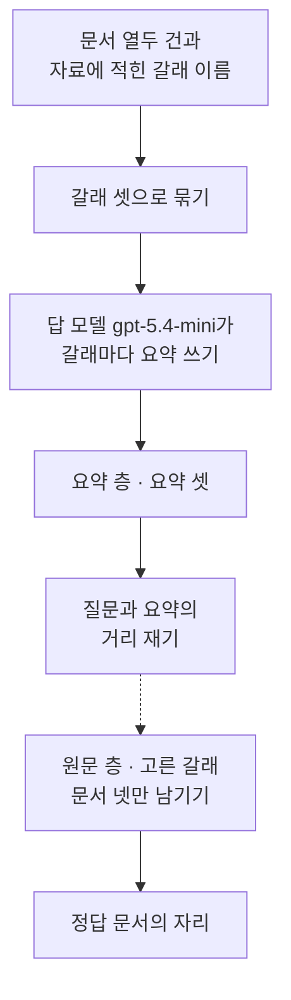
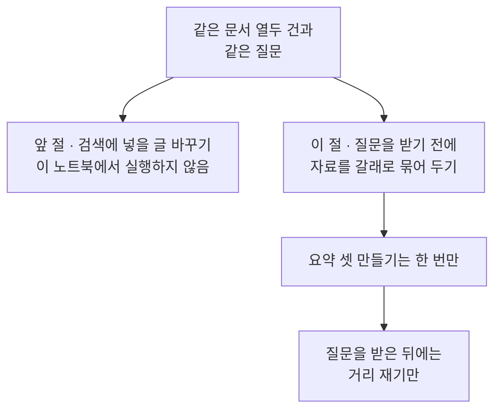
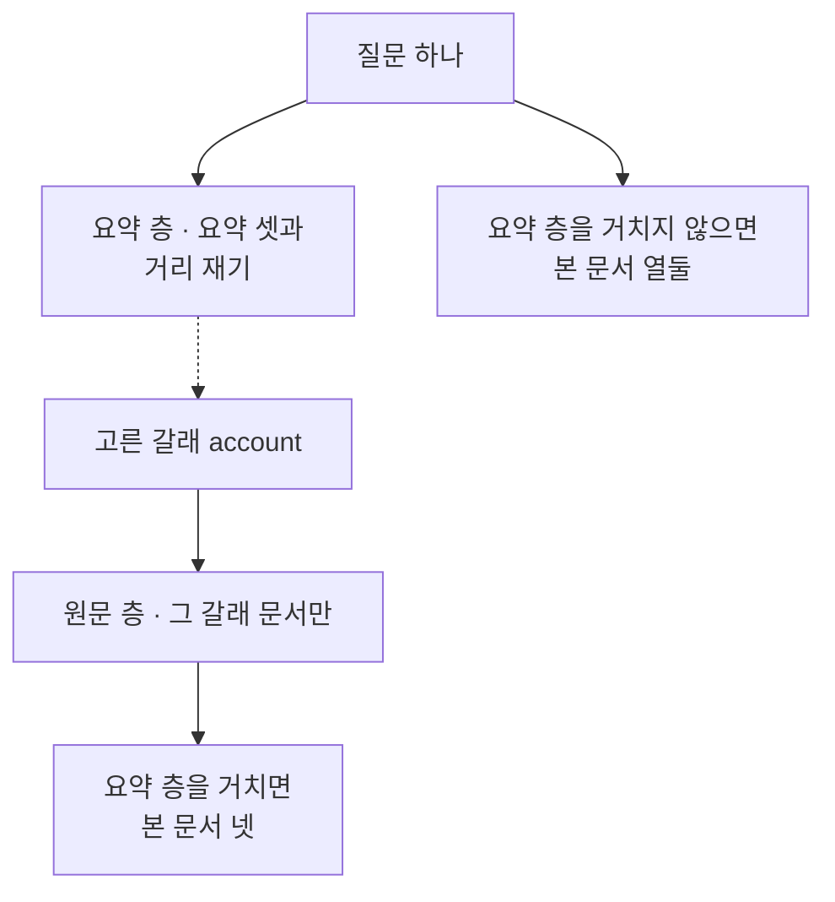
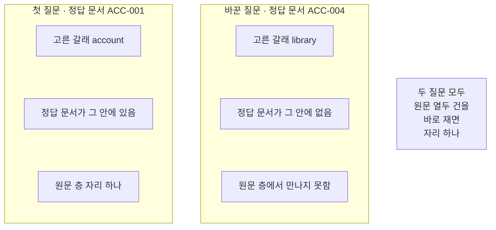

# 08-RAPTOR-계층-요약

## _src 본문 (HTML 원본)

```html
<!--meta: 강의 1h | 실습 1h | 코드 notebooks/08-RAPTOR-계층-요약.ipynb | 새 용어 1 -->
<style>html,body{overflow-x:hidden}.notebook,.nb-cell,.nb-main,.nb-input,.nb-result{min-width:0;max-width:100%}.nb-input pre,.nb-output{box-sizing:border-box;max-width:100%;overflow-x:auto}code.nb-source{display:block!important;width:100%!important;min-width:0!important;overflow-x:auto!important;padding:0!important}</style>
<h2 id="b1"><span class="no">1</span>학습 목표</h2><div class="goal"><ul>
<li>갈래마다 원문을 모아 요약을 하나씩 만들어 두는 차례를 코드로 적을 수 있습니다.</li>
<li>질문과 요약의 거리로 갈래 하나를 고르고 그 갈래 원문만 남길 수 있습니다.</li>
<li>요약 층이 다른 갈래를 고르면 정답 문서를 만나지 못한다는 것을 출력으로 보일 수 있습니다.</li>
</ul></div>
<h2 id="b2"><span class="no">2</span>이 내용을 배우는 이유</h2><p>문서가 많아지면 질문 하나마다 모든 원문과 거리를 재야 합니다. 갈래마다 요약을 미리 만들어 두면 요약 셋만 먼저 재고 그 갈래로 내려갈 수 있습니다. 요약을 만드는 일은 질문을 받기 전에 한 번만 합니다. 질문을 받은 뒤에 보는 문서 수가 줄어듭니다.</p><p>RAPTOR 논문은 문서를 되풀이해 묶고 요약해 여러 층을 쌓습니다. 이 절은 그 방법을 재현하지 않습니다. 자료에 갈래 이름이 이미 적혀 있어 그 갈래마다 요약을 한 단계만 만듭니다. 층은 요약과 원문 둘뿐입니다.</p><p>01절부터 05절까지는 검색 앞에서 넣을 글을 바꿨습니다. 06절은 검색 뒤에, 07절은 답을 만든 뒤에 할 일을 정했습니다. 이 절은 질문을 받기 전에 자료 쪽을 미리 묶어 둡니다.</p>
<h2 id="b3"><span class="no">3</span>앞에서 배운 내용</h2><p>07절은 답을 만든 뒤 근거 점수를 기준값과 견주어 한 번 고칠지 정했습니다. 이 절은 점수도 기준값도 쓰지 않습니다. 대신 질문과 요약의 코사인 거리만 봅니다. 문서 열두 건과 질문 여덟 개는 Ch 12 core 벌 사본 그대로입니다.</p><p>거리 순위 함수와 순위 표 출력 함수는 Ch 12 01절과 05절에서 배웠습니다. 문서 ID를 모으는 함수와 자리를 세는 함수는 Ch 11 01절에서 배웠습니다. 01~07절처럼 이 넷을 도구 파일 <code>notebooks/rag_tools.py</code>에서 가져옵니다. 요약 셋의 거리 순서도 같은 거리 순위 함수로 매깁니다.</p><p>자료의 문서에는 제목과 본문 말고 갈래 이름 칸이 하나 더 있습니다. Ch 12와 01~07절은 그 칸을 쓰지 않았습니다. 이 절이 그 칸을 처음 씁니다.</p>
<h2 id="b4"><span class="no">4</span>핵심 개념</h2><h3>비유로 시작하기</h3><p>같은 나무판을 갈래별로 세 더미로 쌓아 두었다고 생각해 봅니다. 더미마다 맨 위에 얇은 표시판 한 장을 얹어 둡니다. 찾을 때는 표시판 셋만 먼저 보고 어느 더미를 열지 고릅니다. 고른 더미 안만 뒤지므로 손이 닿는 판이 줄어듭니다.</p>
{{img:08-5-갈래별-판-더미와-맨-위-표시판|흰 바탕에 나무판 더미 셋이 옆에서 본 모양으로 나란히 서 있고 더미마다 두꺼운 판 넷이 쌓여 있으며 더미 맨 위마다 그보다 훨씬 얇은 판 한 장이 놓여 있는 그림|얇은 표시판 셋을 먼저 보고 어느 더미를 열지 고릅니다.}}
<p class="look"><b>그림 읽기</b> — 나무판 더미 셋이 옆에서 본 모양으로 나란히 서 있습니다. 더미마다 두꺼운 판이 넷씩 쌓여 있습니다. 더미 맨 위에는 그보다 얇은 판 한 장이 놓여 있습니다. 얇은 판이 갈래마다 만든 요약이고 아래 쌓인 판이 원문입니다.</p>
<table><thead><tr><th>말</th><th>뜻</th></tr></thead><tbody><tr><td>한 단계 요약</td><td>갈래마다 원문을 모아 요약 하나를 미리 만들어 두고 찾을 때 그 요약을 먼저 보는 일입니다. 요약을 모아 둔 자리를 「요약 층」, 원문을 모아 둔 자리를 「원문 층」이라고 이 절에서 부릅니다.</td></tr></tbody></table>
<p>아래 네 말은 Ch 11·Ch 12·Ch 13에서 쓰던 뜻 그대로 이어 씁니다.</p>
<table><thead><tr><th>말</th><th>뜻</th></tr></thead><tbody><tr><td>갈래</td><td>자료의 칸 하나에 적혀 있는 묶음 이름입니다(Ch 13).</td></tr><tr><td>코사인 거리</td><td>두 벡터가 얼마나 먼지를 나타내는 값이고 작을수록 가깝습니다(Ch 12 01절).</td></tr><tr><td>정답 문서 ID</td><td>그 물음에 답할 내용이 적힌 문서의 ID입니다(Ch 11 01절).</td></tr><tr><td>정답 자리</td><td>순위 목록에서 정답 문서가 선 번째 자리입니다(Ch 11 01절).</td></tr></tbody></table>
{{mermaid:08-1-갈래마다-요약을-만들어-두고-요약으로-먼저-고르기|위에서 아래로 놓인 상자 일곱으로 맨 위 초록 상자 문서 열두 건과 자료에 적힌 갈래 이름에서 파란 상자 갈래 셋으로 묶기로 이어지고 그 아래 보라 상자 답 모델 gpt-5.4-mini가 갈래마다 요약 쓰기와 노란 상자 요약 층 요약 셋을 지나 파란 상자 질문과 요약의 거리 재기에 닿으며 거기에서 점선으로 파란 상자 원문 층 고른 갈래 문서 넷만 남기기와 맨 아래 노란 상자 정답 문서의 자리로 이어지는 그림|갈래마다 요약을 미리 만들어 두고 그 요약으로 갈래를 먼저 고릅니다.}}
<p class="look"><b>도식 읽기</b> — 위에서 아래로 읽습니다. 맨 위 초록 상자가 자료에 있는 문서와 갈래 이름입니다. 파란 상자 셋은 우리가 코드로 적은 처리이고 보라 상자 하나가 요약을 쓴 모델입니다. 노란 상자 둘은 출력으로 확인한 값입니다. 점선은 가장 가까운 갈래 하나만 고르는 자리입니다.</p>
<h3>요약 층과 원문 층</h3><p>요약 층은 갈래마다 만든 요약을 모아 둔 자리입니다. 원문 층은 문서 열두 건을 그대로 모아 둔 자리입니다. 책장 앞에 붙인 칸 이름표와 그 안에 꽂힌 책이 같은 모양입니다. 이 절 코드에서는 목록 <code>summary_vectors</code>가 요약 층이고 목록 <code>doc_vectors</code>가 원문 층입니다.</p><p>찾을 때는 요약 층에서 갈래 하나를 고르고 원문 층으로 내려갑니다. 두 층을 잇는 것은 문서 ID로 갈래를 찾는 짝 하나입니다. 층은 이 둘뿐이고 더 쌓지 않습니다.</p>
<h3>넣을 글을 바꾸기와 자료를 미리 묶어 두기</h3><p>01절부터 05절까지는 검색에 넣을 글을 바꿨습니다. 06절과 07절은 검색한 뒤와 답을 만든 뒤에 할 일을 정했습니다. 이 절은 질문을 받기 전에 자료 쪽을 미리 묶어 둡니다. 묶어 두는 일은 한 번만 하고 질문마다 다시 하지 않습니다.</p>
{{mermaid:08-2-넣을-글을-바꾸기와-자료를-미리-묶어-두기|위에서 아래로 놓인 상자 다섯으로 맨 위 초록 상자 같은 문서 열두 건과 같은 질문에서 아래로 갈라져 왼쪽에 회색 상자 앞 절 검색에 넣을 글 바꾸기 이 노트북에서 실행하지 않음이 있고 오른쪽에 파란 상자 이 절 질문을 받기 전에 자료를 갈래로 묶어 두기가 있으며 그 아래로 파란 상자 요약 셋 만들기는 한 번만과 파란 상자 질문을 받은 뒤에는 거리 재기만이 차례로 이어지는 그림|앞 절은 넣을 글을 바꿨고 이 절은 질문을 받기 전에 자료를 묶어 둡니다.}}
<p class="look"><b>도식 읽기</b> — 위에서 아래로 읽습니다. 맨 위 초록 상자가 두 갈래에 함께 쓰는 문서와 질문입니다. 왼쪽 회색 상자는 앞 절에서 본 자리이고 이 노트북에서 실행하지 않았습니다. 오른쪽 파란 상자 셋만 이번에 실행한 자리입니다.</p>
<p>그래서 요약 요청 세 번은 질문 수와 상관없이 한 번만 듭니다. 질문이 늘면 드는 것은 질문 하나마다 임베딩 한 번입니다. 문서가 열두 건뿐인 이 자료에서는 미리 묶어 얻는 것이 크지 않습니다.</p>
<h3>RAPTOR 논문과 이 절의 범위</h3><p>RAPTOR 논문은 문서를 벡터로 바꾸고 되풀이해 묶어 여러 층을 쌓습니다. 이 절은 그 되풀이 묶기와 여러 층 쌓기를 재현하지 않습니다. 자료에 갈래 이름이 이미 적혀 있어 그 갈래를 그대로 씁니다. 요약은 갈래마다 한 단계만 만들고 층은 요약과 원문 둘뿐입니다.</p><p>이 절은 기준값도 쓰지 않습니다. 가장 가까운 요약 하나를 고를 뿐이라 견줄 값이 없습니다. 고른 갈래 밖 문서는 기준값이 아니라 갈래 이름으로 덜어 냅니다.</p>
<h3>다른 상황에 적용</h3><p>부서별 규정 문서에도 같은 자리가 있습니다. 부서마다 요약을 하나씩 만들어 두고 넓은 물음은 요약에서 먼저 봅니다. 세부 규정은 고른 부서 문서에서 찾습니다. 부서를 잘못 고르면 그 규정에 닿지 못한다는 점도 같습니다.</p>
<h2 id="b5"><span class="no">5</span>실행 예제</h2><p>노트북은 문서 열두 건을 벡터로 바꾸고 갈래 셋으로 묶습니다. 서비스 요청은 일곱 번이고 임베딩 네 번과 답 모델 세 번입니다. 갈래가 셋이라 요약을 만드는 답 모델 요청이 세 번입니다. 예상 비용은 미화 0.01달러 아래이고 새로 쓰는 파일은 없습니다.</p><p>먼저 갈래마다 원문을 모아 요약 하나씩을 만들어 둡니다. 그다음 질문 하나와 요약 셋의 거리를 재어 갈래를 고릅니다. 고른 갈래의 원문만 남겨 정답 문서의 자리를 셉니다. 마지막으로 질문 하나만 바꿔 같은 차례를 다시 지납니다.</p>
{{mermaid:08-3-요약-층과-원문-층에서-보는-문서-수|위에서 아래로 놓인 상자 여섯으로 맨 위 초록 상자 질문 하나에서 두 갈래로 나뉘어 왼쪽 파란 상자 요약 층 요약 셋과 거리 재기를 지나 점선으로 노란 상자 고른 갈래 account에 닿고 그 아래 파란 상자 원문 층 그 갈래 문서만과 노란 상자 요약 층을 거치면 본 문서 넷으로 이어지며 오른쪽에는 노란 상자 요약 층을 거치지 않으면 본 문서 열둘이 놓인 그림|요약 층을 거치면 자리를 셀 때 보는 문서가 열둘에서 넷으로 줄어듭니다.}}
<p class="look"><b>도식 읽기</b> — 위에서 아래로 읽습니다. 맨 위 초록 상자가 이번에 넣은 질문입니다. 왼쪽 갈래가 요약 층을 거치는 쪽이고 오른쪽 상자가 거치지 않는 쪽입니다. 노란 상자 셋은 출력으로 확인한 값입니다. 점선은 가장 가까운 갈래 하나만 고르는 자리입니다.</p>
{{notebook:08-RAPTOR-계층-요약}}
<p class="look"><b>확인할 점</b> — 갈래 묶음은 <code>갈래 이름: ['library', 'facility', 'account']</code>였습니다. 첫 질문에서는 <code>고른 갈래: account</code>와 <code>정답 문서가 고른 갈래 안에 있는가: True</code>가 나왔습니다. 원문 열두 건 검색과 고른 갈래 검색 모두 <code>정답 문서의 자리: 1</code>이고 <code>본 문서 수</code>는 열둘과 넷이었습니다. 바꾼 질문에서는 <code>고른 갈래: library</code>와 <code>고른 갈래 원문만 남겨 센 자리: 0</code>이었습니다.</p>
<h2 id="b6"><span class="no">6</span>실험 결과 해석</h2><p>먼저 자료에 적힌 갈래로 문서를 세 묶음으로 나눴습니다. 갈래는 <code>library</code>와 <code>facility</code>와 <code>account</code> 셋이고 갈래마다 문서가 네 건입니다. 갈래마다 원문을 모아 요약 하나씩 세 개를 만들었습니다. 이 일은 질문을 받기 전에 한 번만 했습니다.</p><p>첫 질문은 비밀번호 재설정 링크를 얼마 동안 쓸 수 있는지 묻습니다. 요약 층은 계정 갈래를 골랐고 정답 문서가 그 안에 있었습니다. 원문 열두 건을 바로 검색해도 정답 문서는 첫 자리였습니다. 고른 갈래 원문 넷만 남겨도 자리는 그대로 첫 자리였습니다.</p><p>달라진 것은 자리를 셀 때 본 문서 수입니다. 열둘에서 넷으로 줄었고 정답 문서의 자리는 바뀌지 않았습니다. 이 자료에서 요약 층을 거쳐 얻은 것은 자리가 아니라 본 문서 수입니다.</p><p>질문 하나만 바꾸자 결과가 달라졌습니다. 바꾼 질문은 졸업한 뒤 빌릴 수 있는 책 수를 묻습니다. 요약 층은 도서 갈래를 골랐고 정답 문서는 계정 갈래에 있습니다. 그래서 원문 층 후보 넷에 정답 문서가 들어오지 않았습니다.</p><p>원문 열두 건을 바로 검색하면 그 문서는 첫 자리였습니다. 요약 층에서 갈래를 잘못 고르면 그 아래에서 되돌릴 수 없습니다. 자리 값 <code>0</code>은 본 목록 안에 정답 문서가 없었다는 뜻입니다.</p>
{{mermaid:08-4-질문-둘을-나란히-보기|왼쪽부터 오른쪽으로 놓인 칸 두 개와 회색 상자 하나로 왼쪽 칸 제목은 첫 질문 정답 문서 ACC-001이고 그 안에 노란 상자 고른 갈래 account와 노란 상자 정답 문서가 그 안에 있음과 노란 상자 원문 층 자리 하나가 있으며 가운데 칸 제목은 바꾼 질문 정답 문서 ACC-004이고 그 안에 노란 상자 고른 갈래 library와 노란 상자 정답 문서가 그 안에 없음과 노란 상자 원문 층에서 만나지 못함이 있고 오른쪽에 회색 상자 두 질문 모두 원문 열두 건을 바로 재면 자리 하나가 놓인 그림|같은 요약 셋에서도 질문에 따라 정답 문서를 만나기도 하고 만나지 못하기도 합니다.}}
<p class="look"><b>도식 읽기</b> — 왼쪽 칸이 첫 질문입니다. 가운데 칸이 질문만 바꾼 실행입니다. 칸마다 노란 상자 셋이 그 질문에서 확인한 값입니다. 오른쪽 회색 상자는 두 칸에 모두 해당하는 사실입니다.</p>
<p>모델이 쓴 요약 글과 요약과의 거리는 실행마다 달라졌습니다. 그래서 그 값들은 그림 라벨과 정리에 넣지 않았습니다. 고른 갈래와 정답 문서의 자리는 탐색 실행 세 번에서 모두 같았습니다.</p><p>여기서 본 것은 질문 둘과 문서 열두 건의 결과입니다. 문서가 열두 건뿐이라 모두 재는 데 드는 값이 크지 않습니다. 그래서 요약을 거치면 좋아진다고 넓혀 읽지 않습니다. 여덟 질문 전체 비교는 이번에 하지 않았습니다.</p>
<h2 id="b7"><span class="no">7</span>주의할 점과 실무 메모</h2><ul><li>요약을 만드는 일은 질문을 받기 전에 한 번만 합니다. 질문이 늘어도 요약 요청은 늘지 않습니다.</li><li>갈래는 자료의 칸에 이미 적혀 있던 것입니다. 이 절은 갈래를 모델이나 자동 묶기로 만들지 않았습니다.</li><li>RAPTOR 논문의 되풀이 묶기와 여러 층 쌓기는 이 절에서 재현하지 않았습니다. 층은 요약과 원문 둘뿐입니다.</li><li>요약 층이 다른 갈래를 고르면 원문 층에서 정답 문서를 만나지 못합니다. 이 절의 바꾼 질문이 그런 자리였습니다.</li><li>자리 값 <code>0</code>은 본 목록 안에 정답 문서가 없었다는 뜻입니다. 자리가 뒤로 밀린 것과 다릅니다.</li><li>질문 둘은 자료의 여덟 질문에서 고르지 않고 손으로 적었습니다. 흐름을 보여 주려고 탐색 실행 뒤 고른 예입니다. 자료의 여덟 질문 가운데 하나는 요약 셋과의 거리가 거의 같아 쓰지 않았습니다.</li><li>모델이 쓴 요약 글과 글자 수는 실행마다 달라졌습니다. 그래서 요약 글에는 <code>assert</code>를 걸지 않았습니다.</li><li>요약과의 거리도 소수 둘째 자리에서 흔들렸습니다. 그 값은 그림 라벨과 정리에 넣지 않았습니다.</li><li>만들 요약 수를 <code>summary_count</code>로 적고 실제 수와 요청 수를 나란히 출력했습니다. 결과에 건 검사 <code>assert</code>는 그 셋을 견주는 두 줄뿐입니다.</li><li>이 절은 기준값을 쓰지 않습니다. 가장 가까운 요약 하나를 고를 뿐이라 견줄 값이 없습니다.</li><li>기준값으로 문서를 목록에서 빼는 일도 하지 않습니다. 고른 갈래 밖 문서는 갈래 이름으로 덜어 냈습니다.</li><li>문서가 열두 건뿐이라 모두 재는 데 드는 값이 크지 않습니다. 이 자료에서 미리 묶어 얻는 것은 작습니다.</li><li>걸린 시간은 이번에 재지 않았습니다. 그래서 빨라졌는지 느려졌는지 적지 않습니다.</li><li>이 절은 파일을 쓰지 않습니다. 문서 파일과 질문 파일은 읽기만 합니다.</li><li>준비물에 LangChain 1.4.0과 langchain-openai 1.6.1과 numpy 2.5.3을 적었습니다. 다른 판과 Windows·macOS에서는 이번에 실행하지 않았습니다.</li></ul>
<h2 id="b8"><span class="no">8</span>정리와 다음 절</h2><ul><li>자료에 적힌 갈래로 문서를 세 묶음으로 나누고 갈래마다 요약 하나를 미리 만들었습니다.</li><li>질문과 요약 셋의 거리를 재어 갈래 하나를 고르고 그 갈래 원문만 보았습니다.</li><li>첫 질문에서는 본 문서가 열둘에서 넷으로 줄었고 정답 문서의 자리는 그대로였습니다.</li><li>바꾼 질문에서는 요약 층이 다른 갈래를 골라 정답 문서를 만나지 못했습니다.</li></ul><p><strong>다음 학습과 이어지는 지점</strong> — 09절에서는 이 챕터에서 본 패턴들을 같은 질문과 같은 정답으로 나란히 견줍니다. 이 절은 찾기 전에 자료 쪽을 묶어 두었고 09절은 패턴을 고르는 자리입니다.</p>
<h2 id="b9"><span class="no">9</span>복습 문제</h2><details class="quiz" open><summary>문제 4개 · 해설 포함</summary><p class="quiz-q">1. 한 단계 요약의 입력과 출력은 무엇입니까?</p><p class="quiz-a">갈래 하나의 원문 묶음을 넣으면 그 갈래를 가리키는 요약 글 하나가 나옵니다. 틀렸다면 「핵심 개념」의 용어 표를 다시 읽습니다.</p><p class="quiz-q">2. 요약 층과 원문 층은 각각 무엇을 모아 둔 자리입니까?</p><p class="quiz-a">요약 층은 갈래마다 만든 요약을 모아 둔 자리입니다. 원문 층은 문서 열두 건을 그대로 모아 둔 자리입니다. 틀렸다면 「핵심 개념」의 소제목 「요약 층과 원문 층」을 다시 읽습니다.</p><p class="quiz-q">3. 요약 층이 다른 갈래를 고르면 원문 층에서 무엇이 달라집니까?</p><p class="quiz-a">고른 갈래 안에 정답 문서가 없으면 그 문서를 후보로 만나지 못합니다. 틀렸다면 「실험 결과 해석」의 넷째 단락을 다시 읽습니다.</p><p class="quiz-q">4. 이 절이 RAPTOR 논문 전체를 재현하지 않는다고 적은 까닭은 무엇입니까?</p><p class="quiz-a">논문은 되풀이 묶기로 여러 층을 쌓지만 이 절은 자료의 갈래로 한 단계만 만듭니다. 틀렸다면 「핵심 개념」의 소제목 「RAPTOR 논문과 이 절의 범위」를 다시 읽습니다.</p></details>
<h2 id="b10"><span class="no">10</span>참고 자료</h2><ul><li><div><a href="https://arxiv.org/abs/2401.18059">RAPTOR 논문</a></div>확인 2026-09-19 · 되풀이 묶기로 여러 층을 쌓는 원래 방법의 출처.</li><li><div><a href="https://docs.langchain.com/oss/python/concepts/providers-and-models">LangChain 모델과 provider</a></div>확인 2026-09-19 · LangChain 1.4 기준 · 요약을 받을 모델을 준비하는 방법.</li><li><div><a href="https://developers.openai.com/api/docs/models/text-embedding-3-small">OpenAI text-embedding-3-small 모델 안내</a></div>확인 2026-09-19 · 문서와 요약과 질문을 벡터로 바꿀 때 쓴 모델과 차원 수 설정.</li><li>Ch 14 07절 Self-RAG — 답을 만든 뒤 고칠지 정한 자리와 견주어 볼 곳.</li><li>Ch 12 01절 코사인 거리 — 이 절이 도구 파일에서 가져온 거리 순위 함수를 배운 자리.</li></ul>
```

## 노트북 셀 (순서대로)

### [0] markdown {'html': 'skip'}

# RAPTOR 계층 요약

**이 노트북에서 할 일**

1. Ch 12에서 쓰던 문서 열두 건과 질문 여덟 개를 그대로 읽습니다.
2. 자료에 적힌 갈래 이름으로 문서를 세 묶음으로 나눕니다.
3. 갈래마다 원문을 모아 요약 하나씩 세 개를 만들어 둡니다.
4. 질문과 요약 셋의 거리를 재어 갈래 하나를 고릅니다.
5. 고른 갈래의 원문만 남겨 정답 문서의 자리를 셉니다.
6. 질문 하나만 바꿔 같은 차례를 다시 지납니다.

**준비물** — 이 절은 프로젝트 맨 위 폴더의 `.env`에 적어 둔 `OPENAI_API_KEY`를 씁니다.
서비스 요청은 일곱 번이고 임베딩 네 번과 답 모델 세 번입니다.
갈래가 셋이라 요약을 만드는 답 모델 요청이 세 번입니다.
임베딩은 문서 한 번과 요약 한 번과 질문 두 번입니다.

예상 비용은 미화 0.01달러 아래이고 읽어 오는 파일은 문서 파일과 질문 파일 둘입니다.
새로 쓰는 파일은 없고 실행 시간은 2분 안팎입니다.

**기준 버전** — 첫 셀에서 LangChain 1.4.0과 langchain-openai 1.6.1을 설치합니다.
키를 읽는 python-dotenv 1.2.3과 도구 파일이 쓰는 numpy 2.5.3도 함께 설치합니다.
교재 출력은 Linux의 Python 3.12.13으로 만들었습니다.
다른 판과 Windows·macOS에서는 이번에 실행하지 않았습니다.

**강의와 실습 범위** — 강의 시간에는 3절부터 9절까지 읽습니다.
Ch 12 검색 부품을 준비하고 갈래로 묶어 요약을 만들어 두는 자리입니다.
10절과 11절은 요약 층에서 갈래를 고르고 원문 층으로 내려가는 자리입니다.
12절부터 14절까지는 질문을 바꿔 보고 네 실행을 표로 보는 자리입니다.

실습 폴더 `labs/part4/ch14-rag-patterns`에서 `uv sync --locked`를 실행합니다.
그다음 이 폴더의 `.venv` 커널을 고르고 첫 셀부터 순서대로 실행합니다.

### [1] markdown {'html': 'skip'}

## 오늘 볼 그림


위에서 아래로 읽습니다.
맨 위 초록 상자가 자료에 있는 문서와 갈래 이름입니다.
파란 상자 셋은 우리가 코드로 적은 처리이고 보라 상자 하나가 요약을 쓴 모델입니다.
노란 상자 둘은 출력으로 확인한 값입니다.
점선은 가장 가까운 갈래 하나만 고르는 자리입니다.

### [2] markdown {}

## 1. 준비

첫 셀은 패키지 네 개를 설치하고 설치된 판 번호를 출력합니다.
설치에는 몇십 초가 걸릴 수 있습니다.

### [3] code {'execution': {'iopub.execute_input': '2026-09-21T09:39:53.596180Z', 'iopub.status.busy': '2026-09-21T09:39:53.596011Z', 'iopub.status.idle': '2026-09-21T09:39:54.049278Z', 'shell.execute_reply': '2026-09-21T09:39:54.048749Z'}, 'lesson_role': 'setup'}

```python
# 이 절에서 쓰는 패키지를 설치하고 버전을 확인합니다
%pip install -q "langchain==1.4.0" "langchain-openai==1.6.1" "python-dotenv==1.2.3" "numpy==2.5.3"
from importlib.metadata import version

print("langchain:", version("langchain"))
print("langchain-openai:", version("langchain-openai"))
print("python-dotenv:", version("python-dotenv"))
print("numpy:", version("numpy"))
```

출력:
```
Note: you may need to restart the kernel to use updated packages.
langchain: 1.4.0
langchain-openai: 1.6.1
python-dotenv: 1.2.3
numpy: 2.5.3

```

### [4] markdown {}

**결과 읽기** — 설치가 끝나면 판 번호 네 줄이 보입니다.
마지막 줄 `numpy: 2.5.3`은 도구 파일이 벡터 계산에 쓰는 패키지입니다.
이 노트북의 출력은 2026-09-21에 이 판으로 실행한 결과입니다.

다음 셀은 이름 네 개를 불러오고 도구 파일에서 함수 네 개를 가져옵니다.
앞의 둘은 자료 읽기와 폴더 확인에 씁니다.
뒤의 둘은 Ch 9~13에서 쓴 임베딩과 답 모델 이름입니다.

앞에서 배운 함수는 `rag_tools.py`에 모아 두었습니다. 파일을 열면 코드를 볼 수 있습니다. 노트북과 같은 폴더(`notebooks/`)에 있는 파일입니다.

이 노트북은 Ch 12 01절 `rank_by_distance()`와 05절 `print_ranked()`를 가져옵니다.
Ch 11 01절 `unique_doc_ids()`와 `find_gold_rank()`도 함께 가져옵니다.
거리 순위 함수는 질문 벡터와 벡터 목록과 ID 목록과 개수를 받습니다.
10절에서는 같은 함수로 요약 셋의 거리 순서도 매깁니다.

### [5] code {'execution': {'iopub.execute_input': '2026-09-21T09:39:54.050302Z', 'iopub.status.busy': '2026-09-21T09:39:54.050207Z', 'iopub.status.idle': '2026-09-21T09:39:54.883986Z', 'shell.execute_reply': '2026-09-21T09:39:54.883797Z'}, 'lesson_role': 'setup'}

```python
# 자료 읽기·폴더 확인과 임베딩·답 모델 이름을 불러옵니다
import json
import os

from langchain_openai import OpenAIEmbeddings
from langchain.chat_models import init_chat_model
# Ch 12 01·05절과 Ch 11 01절 함수를 도구 파일에서 가져옵니다
from rag_tools import find_gold_rank, print_ranked, rank_by_distance, unique_doc_ids

print("불러온 이름:", "json", "os", "OpenAIEmbeddings", "init_chat_model")
```

출력:
```
불러온 이름: json os OpenAIEmbeddings init_chat_model

```

### [6] markdown {}

**결과 읽기** — 출력 줄에 불러온 이름 네 개가 보입니다.
이름 `OpenAIEmbeddings`와 `init_chat_model`은 07절에서 쓴 것과 같습니다.
도구 파일에서 가져온 함수 네 개는 출력하지 않습니다.

## 2. 키와 모델 준비

### [7] markdown {}

API 키가 있는지 확인합니다. `True` 값이 나오면 다음으로 넘어갑니다.

### [8] code {'execution': {'iopub.execute_input': '2026-09-21T09:39:54.887105Z', 'iopub.status.busy': '2026-09-21T09:39:54.887013Z', 'iopub.status.idle': '2026-09-21T09:39:54.890716Z', 'shell.execute_reply': '2026-09-21T09:39:54.890550Z'}, 'lesson_role': 'setup'}

```python
# .env 파일에서 OpenAI API 키를 읽습니다(키 값은 출력하지 않습니다)
import os
from dotenv import find_dotenv, load_dotenv

env_path = find_dotenv(usecwd=True)
load_dotenv(env_path)
has_key = os.getenv("OPENAI_API_KEY") is not None
print("OPENAI_API_KEY 설정 여부:", has_key)
assert has_key, "프로젝트 폴더의 .env 파일에 OPENAI_API_KEY를 적어 주세요."
```

출력:
```
OPENAI_API_KEY 설정 여부: True

```

### [9] markdown {}

실습에 쓸 모델을 준비합니다.
temperature 값을 0으로 두어 매번 비슷한 답을 고르게 합니다.

### [10] code {'execution': {'iopub.execute_input': '2026-09-21T09:39:54.891272Z', 'iopub.status.busy': '2026-09-21T09:39:54.891131Z', 'iopub.status.idle': '2026-09-21T09:39:54.939129Z', 'shell.execute_reply': '2026-09-21T09:39:54.938968Z'}}

```python
# 실습에 쓸 모델을 준비합니다
model = init_chat_model(
    "openai:gpt-5.4-mini",
    temperature=0,
    reasoning_effort="none",
)
print("모델 이름:", model.model_name)
print("temperature:", model.temperature)
```

출력:
```
모델 이름: gpt-5.4-mini
temperature: 0.0

```

### [11] markdown {}

**결과 읽기** — 모델 이름 `gpt-5.4-mini`, temperature `0.0`이 보이면 준비가 끝났습니다.
이 노트북의 출력은 2026-09-21에 이 모델로 실행한 결과입니다.

### [12] markdown {}

## 3. 문서와 질문 읽기

이 절은 01~07절과 같은 문서 파일과 질문 파일을 읽습니다.
두 파일은 Ch 12 core 벌 파일과 바이트가 같은 사본입니다.
먼저 노트북을 연 자리에서 프로젝트 맨 위를 찾습니다.

### [13] code {'execution': {'iopub.execute_input': '2026-09-21T09:39:54.939741Z', 'iopub.status.busy': '2026-09-21T09:39:54.939686Z', 'iopub.status.idle': '2026-09-21T09:39:54.941952Z', 'shell.execute_reply': '2026-09-21T09:39:54.941576Z'}}

```python
# 노트북을 어느 폴더에서 열어도 프로젝트 맨 위를 찾게 후보 세 개를 차례로 봅니다
candidates = [".", "../../..", "../../../.."]
root_path = None
for candidate in candidates:
    if os.path.exists(candidate + "/labs/part4/ch14-rag-patterns/data"):
        root_path = candidate
        break
print("고른 자리:", root_path)
assert root_path is not None, "notebooks 폴더나 실습 폴더 맨 위에서 노트북을 열어 주세요."
```

출력:
```
고른 자리: .

```

### [14] markdown {}

**결과 읽기** — 출력 줄 `고른 자리` 뒤에 점 하나나 위로 올라가는 표시가 보입니다.
Ch 10~13과 01~07절에서 쓴 방법과 같습니다.
후보 셋 가운데 이 챕터 자료 폴더가 있는 자리를 고릅니다.

다음 셀은 문서 파일과 질문 파일을 읽습니다.

### [15] code {'execution': {'iopub.execute_input': '2026-09-21T09:39:54.942502Z', 'iopub.status.busy': '2026-09-21T09:39:54.942456Z', 'iopub.status.idle': '2026-09-21T09:39:54.945106Z', 'shell.execute_reply': '2026-09-21T09:39:54.944856Z'}}

```python
# 이 챕터 폴더의 문서 파일과 질문 파일을 읽습니다(읽기만 하고 고치지 않습니다)
data_path = root_path + "/labs/part4/ch14-rag-patterns/data"
with open(data_path + "/documents.json", encoding="utf-8") as file:
    docs = json.loads(file.read())
with open(data_path + "/queries.json", encoding="utf-8") as file:
    queries = json.loads(file.read())
print("문서 수:", len(docs))
print("질문 수:", len(queries))
```

출력:
```
문서 수: 12
질문 수: 8

```

### [16] markdown {}

**결과 읽기** — 출력 줄 `문서 수: 12`와 `질문 수: 8`이 Ch 12 core 벌 그대로입니다.
문서는 도서관 안내 열두 건입니다.

문서마다 제목과 본문 말고 갈래 이름이 적힌 칸이 하나 더 있습니다.
이 절은 그 칸을 써서 문서를 묶습니다.

## 4. 앞 절 부품 준비

다음 두 셀은 01~07절에서 이미 본 준비입니다.
읽지 말고 실행만 하고 넘어가도 됩니다.
첫 셀은 Ch 12에서 정한 값 둘을 적고 문서 글과 갈래 이름을 따로 모읍니다.
둘째 셀은 문서 ID로 원문과 갈래를 찾을 짝 둘을 만듭니다.
함수는 준비 셀에서 도구 파일로 가져왔습니다.

### [17] code {'execution': {'iopub.execute_input': '2026-09-21T09:39:54.945662Z', 'iopub.status.busy': '2026-09-21T09:39:54.945612Z', 'iopub.status.idle': '2026-09-21T09:39:54.947323Z', 'shell.execute_reply': '2026-09-21T09:39:54.947143Z'}, 'lesson_role': 'setup'}

```python
# Ch 12에서 쓴 값 둘을 그대로 적고 문서 12개의 제목·본문·갈래를 따로 모읍니다
top_three = 3
top_all = 12
doc_texts = []
doc_ids = []
doc_categories = []
for doc in docs:
    doc_texts.append(doc["title"] + " " + doc["text"])
    doc_ids.append(doc["doc_id"])
    doc_categories.append(doc["category"])
print("나란히 볼 상위 문서 수:", top_three)
print("자리를 셀 때 재는 문서 수:", top_all)
print("이어 붙인 글 수:", len(doc_texts))
```

출력:
```
나란히 볼 상위 문서 수: 3
자리를 셀 때 재는 문서 수: 12
이어 붙인 글 수: 12

```

### [18] code {'execution': {'iopub.execute_input': '2026-09-21T09:39:54.947904Z', 'iopub.status.busy': '2026-09-21T09:39:54.947859Z', 'iopub.status.idle': '2026-09-21T09:39:54.949624Z', 'shell.execute_reply': '2026-09-21T09:39:54.949353Z'}, 'lesson_role': 'setup'}

```python
# 문서 ID로 원문과 갈래 이름을 찾을 짝 둘을 만듭니다
text_by_doc = {}
category_by_doc = {}
for i in range(len(doc_ids)):
    text_by_doc[doc_ids[i]] = doc_texts[i]
    category_by_doc[doc_ids[i]] = doc_categories[i]
print("짝의 수:", len(text_by_doc))
print("문서 LIB-001의 갈래:", category_by_doc["LIB-001"])
```

출력:
```
짝의 수: 12
문서 LIB-001의 갈래: library

```

### [19] markdown {}

준비 셀 두 개를 지났습니다.
02·03절이 쓴 순위 합치기 함수는 04~07절에 이어 이 절에서도 가져오지 않았습니다.
이 절도 목록 여러 개를 하나로 합치지 않기 때문입니다.
07절 점수 함수 다섯도 가져오지 않았습니다.
이 절은 점수를 매기지 않고 거리만 봅니다.

## 5. 문서를 벡터로 바꾸기

다음 셀은 문서 열두 건을 벡터로 바꿉니다.
이 절에서 서비스에 보내는 첫 요청입니다.

### [20] code {'execution': {'iopub.execute_input': '2026-09-21T09:39:54.950114Z', 'iopub.status.busy': '2026-09-21T09:39:54.950073Z', 'iopub.status.idle': '2026-09-21T09:39:55.216119Z', 'shell.execute_reply': '2026-09-21T09:39:55.215385Z'}}

```python
# Ch 12와 같은 모델로 문서 12개를 벡터로 바꿉니다(임베딩 요청 1번)
embedding_model_name = "text-embedding-3-small"
vector_dimensions = 256
embedding_model = OpenAIEmbeddings(model=embedding_model_name, dimensions=vector_dimensions)
doc_vectors = embedding_model.embed_documents(doc_texts)
print("임베딩 모델 이름:", embedding_model.model)
print("벡터의 숫자 개수 설정:", embedding_model.dimensions)
print("문서 벡터 수:", len(doc_vectors))
```

출력:
```
임베딩 모델 이름: text-embedding-3-small
벡터의 숫자 개수 설정: 256
문서 벡터 수: 12

```

### [21] markdown {}

**결과 읽기** — 출력 줄 `임베딩 모델 이름: text-embedding-3-small`은 07절과 같은 모델입니다.
출력 줄 `벡터의 숫자 개수 설정: 256`도 Ch 10~13과 같은 값입니다.
출력 줄 `문서 벡터 수: 12`로 문서마다 벡터 하나를 받았습니다.
벡터 안의 숫자는 호출마다 아주 조금씩 달라져 소수 자리까지 같다고 보지 않습니다.

## 6. 갈래로 묶기

자료의 문서마다 갈래 이름이 칸 하나에 적혀 있습니다.
그 이름을 차례로 모아 갈래 목록을 만듭니다.
갈래마다 빈 목록을 하나 두고 문서 ID를 담습니다.
갈래를 모델이나 자동 묶기로 새로 만들지 않습니다.

### [22] code {'execution': {'iopub.execute_input': '2026-09-21T09:39:55.217842Z', 'iopub.status.busy': '2026-09-21T09:39:55.217713Z', 'iopub.status.idle': '2026-09-21T09:39:55.221206Z', 'shell.execute_reply': '2026-09-21T09:39:55.220523Z'}}

```python
# 자료에 적힌 갈래 이름을 차례로 모으고 갈래마다 문서 ID 목록을 만듭니다
category_names = []
doc_ids_by_category = {}
for i in range(len(doc_ids)):
    name = doc_categories[i]
    if name not in category_names:
        category_names.append(name)
        doc_ids_by_category[name] = []
    doc_ids_by_category[name].append(doc_ids[i])
print("갈래 이름:", category_names)
```

출력:
```
갈래 이름: ['library', 'facility', 'account']

```

### [23] markdown {}

**결과 읽기** — 출력 줄 `갈래 이름: ['library', 'facility', 'account']`가 자료에 적힌 갈래 셋입니다.
갈래를 우리가 정한 것이 아니라 자료에 이미 있던 것입니다.

빈 목록을 먼저 만들고 이름이 목록에 없을 때만 새로 담습니다.
갈래 이름은 자료에 나온 차례 그대로입니다.

다음 셀은 갈래마다 담긴 문서 ID를 봅니다.

### [24] code {'execution': {'iopub.execute_input': '2026-09-21T09:39:55.222563Z', 'iopub.status.busy': '2026-09-21T09:39:55.222443Z', 'iopub.status.idle': '2026-09-21T09:39:55.225181Z', 'shell.execute_reply': '2026-09-21T09:39:55.224616Z'}}

```python
# 갈래마다 담긴 문서 ID를 한 줄씩 봅니다
print("갈래 | 문서 ID")
for name in category_names:
    print(name, "|", doc_ids_by_category[name])
```

출력:
```
갈래 | 문서 ID
library | ['LIB-001', 'LIB-002', 'LIB-003', 'LIB-004']
facility | ['FAC-001', 'FAC-002', 'FAC-003', 'FAC-004']
account | ['ACC-001', 'ACC-002', 'ACC-003', 'ACC-004']

```

### [25] markdown {}

**결과 읽기** — 라벨 줄 `갈래 | 문서 ID` 아래 세 줄에 갈래마다 문서 네 건이 담겼습니다.
첫 줄은 `library | ['LIB-001', 'LIB-002', 'LIB-003', 'LIB-004']`입니다.

문서 ID의 앞 세 글자가 갈래와 짝지어 있습니다.

다음 셀은 만들 요약 수를 값으로 적어 둡니다.

### [26] code {'execution': {'iopub.execute_input': '2026-09-21T09:39:55.226442Z', 'iopub.status.busy': '2026-09-21T09:39:55.226335Z', 'iopub.status.idle': '2026-09-21T09:39:55.229318Z', 'shell.execute_reply': '2026-09-21T09:39:55.228776Z'}}

```python
# 갈래가 셋이라 만들 요약도 셋이라고 값으로 적어 둡니다
summary_count = 3
print("만들 요약 수:", summary_count)
print("자료에서 센 갈래 수:", len(category_names))
assert len(category_names) == summary_count, "갈래 수와 만들 요약 수가 다릅니다."
```

출력:
```
만들 요약 수: 3
자료에서 센 갈래 수: 3

```

### [27] markdown {}

**결과 읽기** — 출력 줄 `만들 요약 수: 3`이 이 절에서 만들 요약 수입니다.
출력 줄 `자료에서 센 갈래 수: 3`이 앞 셀에서 센 갈래 수입니다.
`assert` 한 줄이 두 값을 견줍니다.

요약 하나에 모델 요청이 한 번 듭니다.
그래서 요약 수를 값으로 적어 두면 요청 수를 미리 셀 수 있습니다.

## 7. 요약 머리글과 함수

요약을 만들려면 갈래 하나의 원문을 한 글로 모아야 합니다.
머리글 두 줄로 두 문장만 쓰고 새 내용을 보태지 말라고 적습니다.

### [28] code {'execution': {'iopub.execute_input': '2026-09-21T09:39:55.230564Z', 'iopub.status.busy': '2026-09-21T09:39:55.230465Z', 'iopub.status.idle': '2026-09-21T09:39:55.233343Z', 'shell.execute_reply': '2026-09-21T09:39:55.232733Z'}}

```python
# 요약 머리글 두 줄을 적고 갈래 하나의 원문을 그 뒤에 이어 붙입니다
summary_head = "아래 안내문의 공통 주제를 두 문장으로 요약하세요.\n"
summary_head = summary_head + "안내문에 있는 내용만 쓰고 새 내용을 보태지 마세요.\n\n"


def build_summary_prompt(category_name):
    material = ""
    for doc_id in doc_ids_by_category[category_name]:
        material = material + "[" + doc_id + "] " + text_by_doc[doc_id] + "\n"
    prompt_text = summary_head + "갈래: " + category_name + "\n안내문:\n" + material
    return prompt_text
```

출력:
```

```

### [29] markdown {}

**결과 읽기** — 정의 셀이라 출력이 없습니다.
함수 `build_summary_prompt`는 갈래 이름 하나를 받습니다.
그 갈래의 문서 ID를 차례로 보며 대괄호와 원문을 이어 붙입니다.
머리글 뒤에 갈래 이름과 그 글 덩어리를 붙여 한 글로 만듭니다.

## 8. 갈래마다 요약 만들기

다음 셀은 갈래 셋을 차례로 돌며 요약을 하나씩 받습니다.
질문을 받기 전에 미리 해 두는 일입니다.
모델을 몇 번 불렀는지 같은 셀에서 세어 둡니다.

### [30] code {'execution': {'iopub.execute_input': '2026-09-21T09:39:55.234444Z', 'iopub.status.busy': '2026-09-21T09:39:55.234348Z', 'iopub.status.idle': '2026-09-21T09:39:57.574876Z', 'shell.execute_reply': '2026-09-21T09:39:57.573906Z'}}

```python
# 갈래마다 요약 하나를 만들고 모델을 몇 번 불렀는지 함께 셉니다(모델 요청 3번)
summary_texts = []
summary_calls = 0
for name in category_names:
    summary_prompt = build_summary_prompt(name)
    summary_reply = model.invoke(summary_prompt)
    summary_texts.append(summary_reply.text.strip())
    summary_calls = summary_calls + 1
print("만든 요약 수:", len(summary_texts))
print("부른 모델 요청 수:", summary_calls)
```

출력:
```
만든 요약 수: 3
부른 모델 요청 수: 3

```

### [31] markdown {}

**결과 읽기** — 출력 줄 `만든 요약 수: 3`으로 갈래마다 요약 하나를 받았습니다.
출력 줄 `부른 모델 요청 수: 3`이 이 셀에서 보낸 요청 수입니다.

요약은 갈래 목록과 같은 차례로 담깁니다.
요약 글은 모델이 쓴 글이라 실행마다 문장이 달라질 수 있습니다.
그래서 요약 글 자체에는 `assert`를 걸지 않았습니다.

다음 셀은 만든 요약을 눈으로 봅니다.

### [32] code {'execution': {'iopub.execute_input': '2026-09-21T09:39:57.577266Z', 'iopub.status.busy': '2026-09-21T09:39:57.577091Z', 'iopub.status.idle': '2026-09-21T09:39:57.580681Z', 'shell.execute_reply': '2026-09-21T09:39:57.580072Z'}}

```python
# 만든 요약 셋을 갈래 이름·글자 수와 함께 한 줄씩 봅니다
print("갈래 | 요약 글자 수")
for i in range(len(summary_texts)):
    print(category_names[i], "|", len(summary_texts[i]))
print("갈래별 요약 글:")
for i in range(len(summary_texts)):
    print(category_names[i], "|", summary_texts[i])
```

출력:
```
갈래 | 요약 글자 수
library | 82
facility | 102
account | 73
갈래별 요약 글:
library | 도서관에서는 일반 도서와 전자책의 대출 기간과 연장, 대출 제한 규정을 안내합니다.  
또한 희망 도서 신청 방법과 전자책 이용 방법도 안내합니다.
facility | 안내문은 스터디룸 예약, 프린터 이용, 운영 시간, 분실물 보관 등 시설 이용에 관한 내용을 안내합니다. 각 시설의 이용 방법과 시간, 비용, 보관 기간 같은 이용 규정을 설명합니다.
account | 안내문은 계정과 이용 권한에 관한 내용을 다룹니다. 비밀번호 재설정, 학생증 분실, 휴학생과 졸업생의 이용 가능 범위를 안내합니다.

```

### [33] markdown {}

**결과 읽기** — 라벨 줄 `갈래 | 요약 글자 수` 아래 세 줄에 갈래별 글자 수가 있습니다.
라벨 줄 `갈래별 요약 글:` 아래 세 줄이 모델이 쓴 요약입니다.

글자 수와 문장은 실행마다 달라집니다.
탐색 실행에서 `library` 갈래 요약이 여든두 자에서 백예순 자까지 오갔습니다.
그래서 이 값들은 이 절의 결론과 그림 라벨에 넣지 않았습니다.

## 9. 요약을 벡터로 바꾸기

요약으로 찾으려면 요약도 벡터로 바꿔야 합니다.
문서와 같은 모델과 같은 숫자 개수를 씁니다.

### [34] code {'execution': {'iopub.execute_input': '2026-09-21T09:39:57.582037Z', 'iopub.status.busy': '2026-09-21T09:39:57.581917Z', 'iopub.status.idle': '2026-09-21T09:39:57.738020Z', 'shell.execute_reply': '2026-09-21T09:39:57.737173Z'}}

```python
# 요약 셋을 문서와 같은 모델로 벡터로 바꿉니다(임베딩 요청 1번)
summary_vectors = embedding_model.embed_documents(summary_texts)
print("요약 벡터 수:", len(summary_vectors))
print("벡터의 숫자 개수 설정:", embedding_model.dimensions)
```

출력:
```
요약 벡터 수: 3
벡터의 숫자 개수 설정: 256

```

### [35] markdown {}

**결과 읽기** — 출력 줄 `요약 벡터 수: 3`으로 요약마다 벡터 하나를 받았습니다.
출력 줄 `벡터의 숫자 개수 설정: 256`이 문서를 바꿀 때와 같습니다.

같은 모델과 같은 숫자 개수를 써야 거리를 견줄 수 있습니다.
요약 벡터는 질문을 받기 전에 한 번만 만들어 둡니다.

## 10. 요약 층에서 갈래 고르기

이제 질문을 받습니다.
먼저 질문과 요약 셋의 거리를 재는 함수를 만듭니다.

### [36] code {'execution': {'iopub.execute_input': '2026-09-21T09:39:57.740071Z', 'iopub.status.busy': '2026-09-21T09:39:57.739888Z', 'iopub.status.idle': '2026-09-21T09:39:57.743282Z', 'shell.execute_reply': '2026-09-21T09:39:57.742828Z'}}

```python
# 질문과 요약 셋의 거리를 재어 가까운 갈래부터 늘어놓습니다
def rank_summaries(question_vector):
    row_list = []
    for hit in rank_by_distance(question_vector, summary_vectors, category_names, summary_count):
        # 칸 doc_id에 든 값이 갈래 이름이라 그 값을 칸 갈래로 옮깁니다
        row_list.append({"갈래": hit["doc_id"], "거리": hit["거리"]})
    return row_list
```

출력:
```

```

### [37] markdown {}

**결과 읽기** — 정의 셀이라 출력이 없습니다.
함수 `rank_summaries`는 질문 벡터 하나를 받습니다.
안에서 도구 파일의 `rank_by_distance()`로 요약 셋과의 코사인 거리를 재어 가까운 갈래부터 늘어놓습니다.
그 함수는 ID 목록에 넣은 갈래 이름을 칸 `doc_id`에 담으므로 칸 이름만 `갈래`로 옮깁니다.
문서가 아니라 갈래 이름을 담는다는 점이 문서 순위 목록과 다릅니다.

다음 셀은 첫 질문을 정하고 그 함수를 부릅니다.

### [38] code {'execution': {'iopub.execute_input': '2026-09-21T09:39:57.744245Z', 'iopub.status.busy': '2026-09-21T09:39:57.744177Z', 'iopub.status.idle': '2026-09-21T09:39:57.885551Z', 'shell.execute_reply': '2026-09-21T09:39:57.884726Z'}}

```python
# 첫 질문을 정하고 요약 층에서 갈래마다 거리를 잽니다(임베딩 요청 1번)
question = "비밀번호를 잊었을 때 받는 재설정 링크는 얼마 동안 쓸 수 있나요?"
gold_doc_id = "ACC-001"
question_vector = embedding_model.embed_query(question)
summary_rows = rank_summaries(question_vector)
print("고른 질문:", question)
print("이 질문의 정답 문서 ID:", gold_doc_id)
print("순위 | 갈래 | 거리")
for rank_number in range(len(summary_rows)):
    print(rank_number + 1, "|", summary_rows[rank_number]["갈래"], "|", summary_rows[rank_number]["거리"])
```

출력:
```
고른 질문: 비밀번호를 잊었을 때 받는 재설정 링크는 얼마 동안 쓸 수 있나요?
이 질문의 정답 문서 ID: ACC-001
순위 | 갈래 | 거리
1 | account | 0.62
2 | facility | 0.76
3 | library | 0.86

```

### [39] markdown {}

**결과 읽기** — 출력 줄 `이 질문의 정답 문서 ID: ACC-001`이 이 물음의 정답 문서입니다.
라벨 줄 `순위 | 갈래 | 거리` 아래 세 줄이 요약 층의 거리 순위입니다.
첫 줄의 갈래가 질문과 가장 가까운 요약의 갈래입니다.

거리 값은 요약 글에 따라 달라집니다.
요약 글이 실행마다 바뀌므로 이 세 값은 결론에 넣지 않습니다.

다음 셀은 첫 줄의 갈래 하나를 고릅니다.

### [40] code {'execution': {'iopub.execute_input': '2026-09-21T09:39:57.887905Z', 'iopub.status.busy': '2026-09-21T09:39:57.887662Z', 'iopub.status.idle': '2026-09-21T09:39:57.892081Z', 'shell.execute_reply': '2026-09-21T09:39:57.891124Z'}}

```python
# 거리가 가장 가까운 갈래 하나를 골라 그 갈래의 문서를 봅니다
chosen_category = summary_rows[0]["갈래"]
chosen_doc_ids = doc_ids_by_category[chosen_category]
print("고른 갈래:", chosen_category)
print("그 갈래의 문서:", chosen_doc_ids)
print("그 갈래의 문서 수:", len(chosen_doc_ids))
print("정답 문서가 고른 갈래 안에 있는가:", gold_doc_id in chosen_doc_ids)
```

출력:
```
고른 갈래: account
그 갈래의 문서: ['ACC-001', 'ACC-002', 'ACC-003', 'ACC-004']
그 갈래의 문서 수: 4
정답 문서가 고른 갈래 안에 있는가: True

```

### [41] markdown {}

**결과 읽기** — 출력 줄 `고른 갈래: account`가 요약 층이 고른 갈래입니다.
출력 줄 `그 갈래의 문서 수: 4`로 원문 층에서 볼 문서가 넷으로 줄었습니다.
출력 줄 `정답 문서가 고른 갈래 안에 있는가: True`로 정답 문서가 그 안에 있습니다.

기준값과 견주지 않고 가장 가까운 갈래 하나를 그대로 고릅니다.
06절과 07절은 기준값을 두었지만 이 절에는 견줄 기준값이 없습니다.

## 11. 원문 층으로 내려가기

고른 갈래의 원문만 남기려면 순위 목록을 거르는 함수가 필요합니다.
문서 ID로 갈래를 찾는 짝을 앞에서 만들어 두었습니다.

### [42] code {'execution': {'iopub.execute_input': '2026-09-21T09:39:57.893620Z', 'iopub.status.busy': '2026-09-21T09:39:57.893467Z', 'iopub.status.idle': '2026-09-21T09:39:57.896566Z', 'shell.execute_reply': '2026-09-21T09:39:57.895841Z'}}

```python
# 순위 목록에서 고른 갈래의 문서만 남깁니다
def keep_category(hit_list, category_name):
    kept = []
    for hit in hit_list:
        if category_by_doc[hit["doc_id"]] == category_name:
            kept.append(hit)
    return kept
```

출력:
```

```

### [43] markdown {}

**결과 읽기** — 정의 셀이라 출력이 없습니다.
함수 `keep_category`는 순위 목록과 갈래 이름 하나를 받습니다.
목록을 차례로 보며 갈래가 같은 문서만 새 목록에 담습니다.
거리 순서는 그대로 두고 덜어 내기만 합니다.

다음 셀은 먼저 원문 열두 건을 바로 검색해 견줄 값을 만듭니다.

### [44] code {'execution': {'iopub.execute_input': '2026-09-21T09:39:57.897960Z', 'iopub.status.busy': '2026-09-21T09:39:57.897852Z', 'iopub.status.idle': '2026-09-21T09:39:57.901778Z', 'shell.execute_reply': '2026-09-21T09:39:57.901147Z'}}

```python
# 요약 층을 거치지 않고 원문 열두 건을 바로 검색해 봅니다(임베딩 요청 0번)
base_hits = rank_by_distance(question_vector, doc_vectors, doc_ids, top_all)
base_ids = unique_doc_ids(base_hits)
base_place = find_gold_rank(base_ids, [gold_doc_id])
print("본 문서 수:", len(base_ids))
print("정답 문서의 자리:", base_place)
print_ranked(base_hits[:top_three], "거리")
```

출력:
```
본 문서 수: 12
정답 문서의 자리: 1
순위 | 문서 ID | 거리
1 | ACC-001 | 0.16
2 | ACC-003 | 0.61
3 | FAC-004 | 0.68

```

### [45] markdown {}

**결과 읽기** — 출력 줄 `본 문서 수: 12`로 문서 열두 건을 모두 재었습니다.
출력 줄 `정답 문서의 자리: 1`로 정답 문서가 맨 앞에 섰습니다.
순위 표 첫 줄은 `1 | ACC-001 | 0.16`입니다.

이 값이 요약 층을 거치지 않았을 때의 결과입니다.
Ch 12에서 하던 검색 한 번과 같습니다.

다음 셀은 같은 순위 목록에서 고른 갈래만 남깁니다.

### [46] code {'execution': {'iopub.execute_input': '2026-09-21T09:39:57.903019Z', 'iopub.status.busy': '2026-09-21T09:39:57.902913Z', 'iopub.status.idle': '2026-09-21T09:39:57.905779Z', 'shell.execute_reply': '2026-09-21T09:39:57.905185Z'}}

```python
# 같은 순위 목록에서 고른 갈래의 원문만 남겨 자리를 다시 셉니다
leaf_hits = keep_category(base_hits, chosen_category)
leaf_ids = unique_doc_ids(leaf_hits)
leaf_place = find_gold_rank(leaf_ids, [gold_doc_id])
print("본 문서 수:", len(leaf_ids))
print("정답 문서의 자리:", leaf_place)
print_ranked(leaf_hits[:top_three], "거리")
```

출력:
```
본 문서 수: 4
정답 문서의 자리: 1
순위 | 문서 ID | 거리
1 | ACC-001 | 0.16
2 | ACC-003 | 0.61
3 | ACC-004 | 0.76

```

### [47] markdown {}

**결과 읽기** — 출력 줄 `본 문서 수: 4`로 볼 문서가 열둘에서 넷으로 줄었습니다.
출력 줄 `정답 문서의 자리: 1`은 앞 셀과 같습니다.
순위 표 첫 줄도 `1 | ACC-001 | 0.16`으로 같습니다.

이 질문에서는 자리가 달라지지 않았습니다.
달라진 것은 자리를 셀 때 본 문서 수입니다.

## 12. 값 바꿔 보기 · 질문 하나만 바꾸기

바꿀 것은 질문 하나입니다.
요약 셋과 갈래 묶음과 문서 벡터는 그대로 둡니다.
실행 전에 예상해 봅니다.
바꾼 질문은 책을 빌리는 일을 묻지만 정답은 졸업생 안내문입니다.

### [48] code {'execution': {'iopub.execute_input': '2026-09-21T09:39:57.906954Z', 'iopub.status.busy': '2026-09-21T09:39:57.906863Z', 'iopub.status.idle': '2026-09-21T09:39:58.063722Z', 'shell.execute_reply': '2026-09-21T09:39:58.062652Z'}}

```python
# 바꿀 것은 질문 하나이고 요약 셋과 갈래 묶음은 그대로 둡니다(임베딩 요청 1번)
other_question = "졸업한 뒤에는 책을 몇 권까지 빌릴 수 있나요?"
other_gold_doc_id = "ACC-004"
other_vector = embedding_model.embed_query(other_question)
other_rows = rank_summaries(other_vector)
other_category = other_rows[0]["갈래"]
other_doc_ids = doc_ids_by_category[other_category]
print("바꾼 질문:", other_question)
print("이 질문의 정답 문서 ID:", other_gold_doc_id)
print("고른 갈래:", other_category)
print("정답 문서가 고른 갈래 안에 있는가:", other_gold_doc_id in other_doc_ids)
```

출력:
```
바꾼 질문: 졸업한 뒤에는 책을 몇 권까지 빌릴 수 있나요?
이 질문의 정답 문서 ID: ACC-004
고른 갈래: library
정답 문서가 고른 갈래 안에 있는가: False

```

### [49] markdown {}

**결과 읽기** — 출력 줄 `이 질문의 정답 문서 ID: ACC-004`가 이 물음의 정답 문서입니다.
출력 줄 `고른 갈래: library`로 요약 층이 도서 갈래를 골랐습니다.
출력 줄 `정답 문서가 고른 갈래 안에 있는가: False`가 이 절에서 볼 자리입니다.

질문에 「책」과 「빌리다」가 있어 도서 갈래 요약과 더 가까웠습니다.
정답 문서는 계정 갈래에 있는 졸업생 안내문입니다.

다음 셀은 두 층의 결과를 나란히 봅니다.

### [50] code {'execution': {'iopub.execute_input': '2026-09-21T09:39:58.065708Z', 'iopub.status.busy': '2026-09-21T09:39:58.065528Z', 'iopub.status.idle': '2026-09-21T09:39:58.070588Z', 'shell.execute_reply': '2026-09-21T09:39:58.069827Z'}}

```python
# 바꾼 질문으로 원문 열두 건과 고른 갈래 원문을 나란히 검색합니다
other_hits = rank_by_distance(other_vector, doc_vectors, doc_ids, top_all)
other_base_ids = unique_doc_ids(other_hits)
other_base_place = find_gold_rank(other_base_ids, [other_gold_doc_id])
other_leaf_hits = keep_category(other_hits, other_category)
other_leaf_ids = unique_doc_ids(other_leaf_hits)
other_leaf_place = find_gold_rank(other_leaf_ids, [other_gold_doc_id])
print("원문 열두 건을 바로 검색한 자리:", other_base_place)
print("고른 갈래 원문만 남겨 센 자리:", other_leaf_place)
print("고른 갈래에서 본 문서:", other_leaf_ids)
```

출력:
```
원문 열두 건을 바로 검색한 자리: 1
고른 갈래 원문만 남겨 센 자리: 0
고른 갈래에서 본 문서: ['LIB-004', 'LIB-001', 'LIB-003', 'LIB-002']

```

### [51] markdown {}

**결과 읽기** — 출력 줄 `원문 열두 건을 바로 검색한 자리: 1`로 정답 문서가 맨 앞이었습니다.
출력 줄 `고른 갈래 원문만 남겨 센 자리: 0`에서 영은 목록 안에 없다는 뜻입니다.
출력 줄 `고른 갈래에서 본 문서` 뒤 목록에 정답 문서가 없습니다.

요약 층이 다른 갈래를 고르면 원문 층에서 정답 문서를 만나지 못합니다.
원문을 모두 재면 맨 앞에 설 문서였는데도 후보에 들어오지 않았습니다.

## 13. 요약 수 확인

요약을 만들 때마다 모델 요청이 늘어납니다.
값으로 적어 둔 수와 실제 수를 나란히 봅니다.

### [52] code {'execution': {'iopub.execute_input': '2026-09-21T09:39:58.072231Z', 'iopub.status.busy': '2026-09-21T09:39:58.072107Z', 'iopub.status.idle': '2026-09-21T09:39:58.075154Z', 'shell.execute_reply': '2026-09-21T09:39:58.074582Z'}}

```python
# 값으로 적어 둔 요약 수와 실제로 만든 수·부른 요청 수를 나란히 봅니다
print("값으로 적어 둔 요약 수:", summary_count)
print("실제로 만든 요약 수:", len(summary_texts))
print("요약에 부른 모델 요청 수:", summary_calls)
assert len(summary_texts) == summary_count, "만든 요약 수가 적어 둔 값과 다릅니다."
assert summary_calls == summary_count, "부른 요청 수가 적어 둔 값과 다릅니다."
```

출력:
```
값으로 적어 둔 요약 수: 3
실제로 만든 요약 수: 3
요약에 부른 모델 요청 수: 3

```

### [53] markdown {}

**결과 읽기** — 출력 줄 `값으로 적어 둔 요약 수: 3`이 코드에 적어 둔 값입니다.
출력 줄 `실제로 만든 요약 수: 3`과 `요약에 부른 모델 요청 수: 3`이 그 값과 같습니다.

`assert` 두 줄은 이 세 값만 봅니다.
모델이 쓴 요약 글에는 `assert`를 걸지 않았습니다.

## 14. 네 실행을 기록 한 줄씩으로

실행 하나를 기록 한 줄로 만들어 담아 둡니다.
Ch 9~13과 01~07절에서 쓴 기록 한 줄과 같은 모양입니다.
칸은 이 절이 견주는 값으로 다시 짰습니다.
고른 갈래와 본 문서 수와 정답 문서의 자리 셋입니다.

### [54] code {'execution': {'iopub.execute_input': '2026-09-21T09:39:58.076475Z', 'iopub.status.busy': '2026-09-21T09:39:58.076371Z', 'iopub.status.idle': '2026-09-21T09:39:58.079251Z', 'shell.execute_reply': '2026-09-21T09:39:58.078595Z'}}

```python
# 실행 한 번을 기록 한 줄로 만듭니다
def run_row(run_name, chosen_name, seen_ids, place):
    row = {"실행": run_name}
    row["고른 갈래"] = chosen_name
    row["본 문서 수"] = len(seen_ids)
    row["정답 문서의 자리"] = place
    return row
```

출력:
```

```

### [55] markdown {}

**결과 읽기** — 정의 셀이라 출력이 없습니다.
담는 칸은 실행 이름과 고른 갈래와 본 문서 수와 정답 문서의 자리 넷입니다.
본 문서 수는 문서 ID 목록을 받아 함수 안에서 셉니다.
07절 기록 한 줄의 점수 칸과 고친 횟수 칸은 이 절에 없습니다.
이 절이 견주는 것이 답이 아니라 검색 결과이기 때문입니다.

다음 셀은 네 실행의 기록을 표로 출력합니다.

### [56] code {'execution': {'iopub.execute_input': '2026-09-21T09:39:58.080701Z', 'iopub.status.busy': '2026-09-21T09:39:58.080578Z', 'iopub.status.idle': '2026-09-21T09:39:58.084211Z', 'shell.execute_reply': '2026-09-21T09:39:58.083532Z'}}

```python
# 네 실행의 기록을 담아 라벨 줄 아래에 한 줄씩 출력합니다
run_rows = []
run_rows.append(run_row("첫 질문 · 원문 열두 건", "고르지 않음", base_ids, base_place))
run_rows.append(run_row("첫 질문 · 요약으로 고른 갈래", chosen_category, leaf_ids, leaf_place))
run_rows.append(run_row("바꾼 질문 · 원문 열두 건", "고르지 않음", other_base_ids, other_base_place))
run_rows.append(run_row("바꾼 질문 · 요약으로 고른 갈래", other_category, other_leaf_ids, other_leaf_place))
print("실행 | 고른 갈래 | 본 문서 수 | 정답 문서의 자리")
for row in run_rows:
    print(row["실행"], "|", row["고른 갈래"], "|", row["본 문서 수"], "|", row["정답 문서의 자리"])
```

출력:
```
실행 | 고른 갈래 | 본 문서 수 | 정답 문서의 자리
첫 질문 · 원문 열두 건 | 고르지 않음 | 12 | 1
첫 질문 · 요약으로 고른 갈래 | account | 4 | 1
바꾼 질문 · 원문 열두 건 | 고르지 않음 | 12 | 1
바꾼 질문 · 요약으로 고른 갈래 | library | 4 | 0

```

### [57] markdown {}

**결과 읽기** — 라벨 줄 아래 첫 줄과 둘째 줄이 첫 질문의 두 실행입니다.
둘째 줄은 `첫 질문 · 요약으로 고른 갈래 | account | 4 | 1`입니다.
넷째 줄은 `바꾼 질문 · 요약으로 고른 갈래 | library | 4 | 0`입니다.

넷째 줄의 영은 고른 갈래 안에 정답 문서가 없었다는 뜻입니다.
셋째 줄을 보면 같은 질문도 원문을 모두 재면 자리가 하나였습니다.

## 정리

1. 자료에 적힌 갈래로 문서를 세 묶음으로 나누고 갈래마다 요약 하나를 미리 만들었습니다.
2. 질문과 요약 셋의 거리를 재어 갈래 하나를 고르고 그 갈래 원문만 보았습니다.
3. 첫 질문에서는 본 문서가 열둘에서 넷으로 줄었고 정답 문서의 자리는 그대로였습니다.
4. 바꾼 질문에서는 요약 층이 다른 갈래를 골라 정답 문서를 만나지 못했습니다.

09절에서는 이 챕터에서 본 패턴들을 같은 질문과 같은 정답으로 나란히 견줍니다.
이 절은 찾기 전에 자료 쪽을 묶어 두었고 09절은 패턴을 고르는 자리입니다.

## 그림

### 08-1-갈래마다-요약을-만들어-두고-요약으로-먼저-고르기.mmd



갈래마다 요약을 미리 만들어 두고 그 요약으로 갈래를 먼저 고릅니다.

### 08-2-넣을-글을-바꾸기와-자료를-미리-묶어-두기.mmd



앞 절은 넣을 글을 바꿨고 이 절은 질문을 받기 전에 자료를 묶어 둡니다.

### 08-3-요약-층과-원문-층에서-보는-문서-수.mmd



요약 층을 거치면 자리를 셀 때 보는 문서가 열둘에서 넷으로 줄어듭니다.

### 08-4-질문-둘을-나란히-보기.mmd



같은 요약 셋에서도 질문에 따라 정답 문서를 만나기도 하고 만나지 못하기도 합니다.

### 08-5-갈래별-판-더미와-맨-위-표시판.prompt.md

# 08-5 갈래별 판 더미와 맨 위 표시판 (Higgsfield 삽화)

- 상태: **채택** · 2026-09-19 · 모델 `nano_banana_pro`(잡 기록 모델 이름은 `nano_banana_2`) · 16:9 · 2k · `use_unlim: false`
- job id `ccf91ecb-8b43-4fc4-938e-aac027ef136d` · **1차 채택**(재생성 0회) · 2크레딧 · 잔액 2671 → 2669
- 원본 2752×1536 · 채택본 원본 sha256 `ddfa94f2aa3ffeeda093b63df74bcd7e2911607767e9bd556cb411ae7a5b5bae`
- 저장본 폭 1100px(614 높이) · sha256 `9bfa28168b41e77c51ac7b7a1deff80b608f1b1bcc823f7934510e285e468171`
- 채택 job 결과를 같은 폭으로 줄여 픽셀 대조한 결과 **다른 픽셀 0개**(규격 §5-4).
- 저장 방법: 기기 셸 `curl` → `uv run --no-project --with pillow`로 폭 1100px. 클라우드 `/mnt/user-data/outputs`는 쓰지 않았습니다.

## 설명 대상 문장 (본문 b4 비유 단락)

같은 나무판을 갈래별로 세 더미로 쌓아 두었다고 생각해 봅니다. 더미마다 맨 위에 얇은 표시판 한 장을
얹어 둡니다. 찾을 때는 표시판 셋만 먼저 보고 어느 더미를 열지 고릅니다. 고른 더미 안만 뒤지므로
손이 닿는 판이 줄어듭니다. 「갈래마다 요약을 만들어 두고 그 요약으로 갈래를 먼저 고르기」의 비유입니다.

## 구성 요소와 배치 · 시선 순서

- 같은 모양의 나무판 더미 셋을 옆에서 본 모양으로 나란히 둡니다.
- 더미마다 두꺼운 판 넷이 가지런히 쌓여 있습니다.
- 더미 맨 위에는 그 넷보다 훨씬 얇은 판 한 장이 놓여 있습니다.
- 위에서 아래로 읽으면 「얇은 표시판 한 장」과 「그 아래 두꺼운 판 넷」이 세어집니다.
- 왼쪽에서 오른쪽으로 읽으면 더미가 셋이라는 것이 세어집니다.
- 글자·숫자·화면·연장·손·자는 넣지 않았습니다.

## 프롬프트 (영어, 규격 §5-4 공통 스타일 줄 포함)

```text
Simple flat educational illustration, white background, limited soft palette,
clean outlines, plain everyday objects, no text, no letters, no numbers, no logos.
Side view at eye level of three separate stacks of flat wooden boards standing
side by side on a plain surface. Each stack is four equally thick boards piled
neatly on top of each other. On top of every stack lies one extra board that is
much thinner than the four below it. Nothing else in the scene, no tools, no
hands, no screens.
```

## 검수 메모 (저장한 PNG를 직접 열어 보고 씀)

- 더미 셋이 같은 높이로 나란히 서 있어 더미 수가 바로 세어집니다.
- 더미마다 두꺼운 판이 넷이고 그 위 한 장만 뚜렷하게 얇아 두께 차이가 옆에서 보입니다.
- 얇은 판은 아래 판들보다 색이 옅어 「먼저 보는 판」으로 읽힙니다.
- 바닥에 얇은 회색 선반이 하나 그려졌지만 판 더미와 두께가 달라 더미로 세어지지 않습니다.
- 01~07절 삽화(구멍 하나에 마개 하나 · 한 장에서 네 장으로 · 구멍 둘에 마개 둘 · 넓은 구멍을 덮는 큰 판 · 본뜬 판과 진짜 판 · 틈이 넓은 마개와 꼭 맞는 마개 · 튀어나온 마개와 판과 나란한 마개)와 견주면 이 장은 판을 갈래별로 쌓아 두고 맨 위 한 장만 먼저 보는 장입니다.
- 「자르기」·「조각」·「깎기」라는 말은 본문과 캡션에 쓰지 않았습니다.

