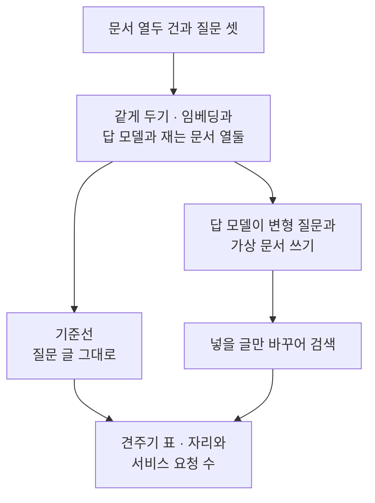
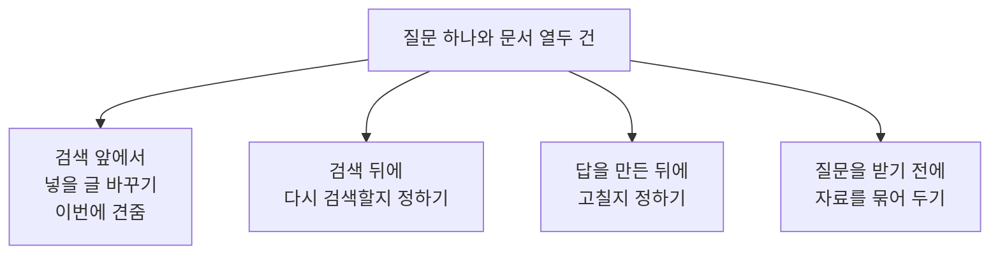
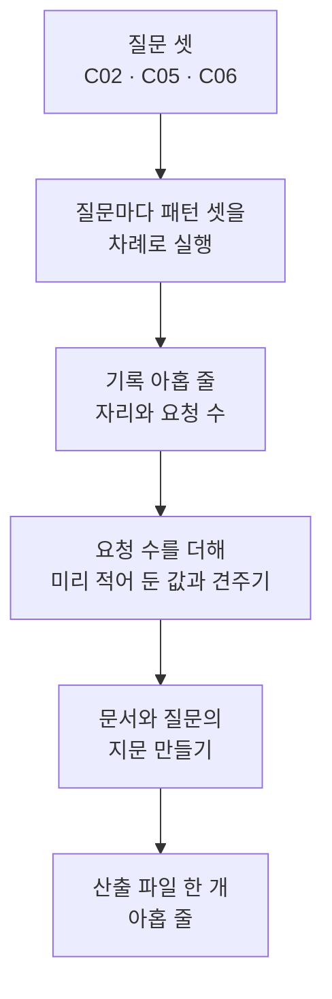
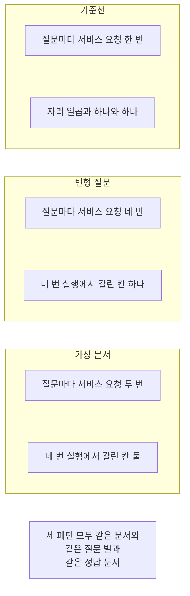

# 09-패턴-비교와-선택

## _src 본문 (HTML 원본)

```html
<!--meta: 강의 0h | 실습 1h | 코드 notebooks/09-패턴-비교와-선택.ipynb | 새 용어 1 -->
<style>html,body{overflow-x:hidden}.notebook,.nb-cell,.nb-main,.nb-input,.nb-result{min-width:0;max-width:100%}.nb-input pre,.nb-output{box-sizing:border-box;max-width:100%;overflow-x:auto}code.nb-source{display:block!important;width:100%!important;min-width:0!important;overflow-x:auto!important;padding:0!important}</style>
<h2 id="b1"><span class="no">1</span>학습 목표</h2><div class="goal"><ul>
<li>패턴을 견주기 전에 무엇을 같게 두어야 하는지 목록으로 적을 수 있습니다.</li>
<li>같은 질문 벌로 패턴 셋을 돌려 정답 문서의 자리와 서비스 요청 수를 한 표에 모을 수 있습니다.</li>
<li>질문 수가 적을 때 표에서 읽어도 되는 것과 읽으면 안 되는 것을 가를 수 있습니다.</li>
</ul></div>
<h2 id="b2"><span class="no">2</span>이 내용을 배우는 이유</h2><p>패턴 이름만 보고 고르면 무엇이 좋아졌는지 알 수 없습니다. 같은 문서와 같은 질문과 같은 정답으로 한 번에 하나만 바꿔야 차이를 읽을 수 있습니다. 이 절은 그 자리를 만들고 실제로 아홉 번 실행합니다.</p><p>01절부터 08절까지는 절마다 다른 질문과 다른 정답 문서를 썼습니다. 그 숫자를 한 표로 옮겨 적으면 조건이 달라 견줄 수 없습니다. 그래서 이 절은 질문 벌을 새로 정하고 패턴마다 다시 잽니다.</p><p>재는 값은 둘입니다. 정답 문서의 자리와 서비스 요청 수입니다. 걸린 시간과 비용은 Ch 12부터 이 과정이 재지 않으므로 이 절도 재지 않습니다.</p>
<h2 id="b3"><span class="no">3</span>앞에서 배운 내용</h2><p>01절부터 05절까지는 검색에 넣을 글을 바꿨습니다. 06절은 검색한 뒤에 다시 검색할지 정했고 07절은 답을 만든 뒤에 고칠지 정했습니다. 08절은 질문을 받기 전에 자료를 갈래로 묶어 두었습니다. 이 절은 그 자리 넷을 한자리에 모아 놓고 고릅니다.</p><p>거리 순위 함수는 Ch 12 01절에서, 문서 ID를 모으는 함수와 자리를 세는 함수는 Ch 11 01절에서 배웠습니다. 순위 합치기 함수는 Ch 12 06절에서 배웠고 순위 상수 60도 같습니다. 01~08절처럼 이 함수들을 도구 파일 <code>notebooks/rag_tools.py</code>에서 가져옵니다.</p><p>변형 질문 머리글은 02절 것이고 가상 문서 머리글은 05절 것입니다. 두 머리글을 만드는 함수도 같은 도구 파일에서 가져와야 앞 절과 같은 조건이 됩니다. 문서 열두 건과 질문 여덟 개도 Ch 12 core 벌 사본 그대로입니다.</p>
<h2 id="b4"><span class="no">4</span>핵심 개념</h2><h3>비유로 시작하기</h3><p>나무판 하나에 구멍이 뚫려 있다고 생각해 봅니다. 마개 여러 개를 같은 구멍에 차례로 대 보고 잘 맞는 하나를 고릅니다. 대 볼 때마다 손이 한 번씩 더 갑니다. 그래서 잘 맞았는지와 손이 몇 번 갔는지를 함께 적어 둡니다.</p>
{{img:09-5-같은-구멍에-마개-셋을-차례로-대-보기|흰 바탕에 구멍이 하나 뚫린 나무판이 비스듬히 위에서 본 모양으로 왼쪽에 놓여 있고 오른쪽에 굵기가 다른 둥근 마개 셋이 한 줄로 서 있는 그림|같은 구멍 하나에 마개 셋을 차례로 대 보고 하나를 고릅니다.}}
<p class="look"><b>그림 읽기</b> — 왼쪽에 구멍이 하나 뚫린 나무판이 놓여 있습니다. 구멍 안으로 흰 바탕이 비쳐 보입니다. 오른쪽에 둥근 마개 셋이 한 줄로 서 있습니다. 마개는 굵기가 서로 달라 셋으로 세어집니다. 구멍이 하나뿐이라 셋을 같은 자리에 대 보게 됩니다.</p>
<table><thead><tr><th>말</th><th>뜻</th></tr></thead><tbody><tr><td>견주기 표</td><td>같은 질문 벌과 같은 설정으로 패턴마다 실행 한 줄씩을 담아 나란히 놓은 표입니다. 줄마다 패턴 이름과 질문 번호와 정답 문서의 자리와 서비스 요청 수를 적습니다.</td></tr></tbody></table>
<p>아래 네 말은 앞 절에서 쓰던 뜻 그대로 이어 씁니다.</p>
<table><thead><tr><th>말</th><th>뜻</th></tr></thead><tbody><tr><td>변형 질문</td><td>같은 것을 묻되 표현을 달리한 검색 질문입니다(02절).</td></tr><tr><td>가상 문서</td><td>질문에 답할 법한 글을 모델에게 지어 받아 검색에만 넣는 글입니다(05절).</td></tr><tr><td>순위 합치기</td><td>순위 목록 여러 개를 자리 몫으로 바꿔 한 목록에 모으는 일입니다(Ch 12 06절).</td></tr><tr><td>정답 자리</td><td>순위 목록에서 정답 문서가 선 번째 자리입니다(Ch 11 01절).</td></tr></tbody></table>
{{mermaid:09-1-같은-조건에서-넣을-글만-바꾸어-견주기|위에서 아래로 놓인 상자 여섯으로 맨 위 초록 상자 문서 열두 건과 질문 셋에서 파란 상자 같게 두기 임베딩과 답 모델과 재는 문서 열둘로 이어지고 거기에서 둘로 갈라져 왼쪽 파란 상자 기준선 질문 글 그대로와 오른쪽 보라 상자 답 모델이 변형 질문과 가상 문서 쓰기가 있으며 보라 상자 아래 파란 상자 넣을 글만 바꾸어 검색을 지나 맨 아래 노란 상자 견주기 표 자리와 서비스 요청 수로 두 갈래가 모이는 그림|같은 조건을 고정하고 검색에 넣을 글만 바꿔 자리와 요청 수를 견줍니다.}}
<p class="look"><b>도식 읽기</b> — 위에서 아래로 읽습니다. 맨 위 초록 상자가 세 패턴에 똑같이 넣는 자료입니다. 그 아래 파란 상자가 패턴 사이에 같게 두는 설정입니다. 보라 상자 하나만 답 모델을 부르는 자리이고 나머지 파란 상자는 코드가 하는 일입니다. 맨 아래 노란 상자가 출력으로 확인한 값 둘입니다.</p>
<h3>어느 자리를 손보는 패턴인가</h3><p>이 챕터의 패턴은 손보는 자리가 서로 다릅니다. 검색 앞과 검색 뒤와 답을 만든 뒤와 질문을 받기 전 넷입니다. 자리가 다르면 견주는 값도 달라집니다. 그래서 이 절은 같은 자리를 손보는 패턴만 한 표에 올렸습니다.</p>
{{mermaid:09-2-어느-자리를-손보는-패턴인가|위에서 아래로 놓인 상자 다섯으로 맨 위 초록 상자 질문 하나와 문서 열두 건에서 아래로 넷으로 갈라져 파란 상자 검색 앞에서 넣을 글 바꾸기 이번에 견줌과 회색 상자 검색 뒤에 다시 검색할지 정하기와 회색 상자 답을 만든 뒤에 고칠지 정하기와 회색 상자 질문을 받기 전에 자료를 묶어 두기가 한 줄로 놓인 그림|이 절은 검색 앞에서 넣을 글을 바꾸는 자리만 한 표에 올립니다.}}
<p class="look"><b>도식 읽기</b> — 위에서 아래로 읽습니다. 맨 위 초록 상자가 네 자리에 똑같이 들어가는 자료입니다. 아래 상자 넷이 이 챕터가 손본 자리 넷입니다. 파란 상자 하나만 이 노트북에서 실행한 자리입니다. 회색 상자 셋은 이번에 견주지 않은 자리입니다.</p>
<h3>같게 두기와 다르게 두기</h3><p>이 절이 같게 둔 것은 여섯입니다. 문서 열두 건과 질문 벌과 정답 문서 ID와 임베딩 설정입니다. 거기에 답 모델과 자리를 셀 때 재는 문서 수를 더합니다.</p><p>다르게 둔 것은 검색에 넣을 글 하나뿐입니다. 기준선은 질문 글을 그대로 넣고 변형 질문은 질문 셋을 넣어 합칩니다. 가상 문서는 모델이 지은 안내문을 넣습니다. 세 패턴 모두 검색 뒤에 더 하는 일이 없습니다.</p><p>재는 값은 정답 문서의 자리와 서비스 요청 수 둘입니다. 자리는 문서 열두 건을 모두 재고 세므로 1부터 12까지 나옵니다. 요청 수는 코드가 세는 값이라 추정이 아닙니다.</p>
<h3>다른 상황에 적용</h3><p>상담 기록으로 찾는 서비스에도 같은 자리가 있습니다. 먼저 기준선을 재고 기준선이 놓친 질문을 모읍니다. 그 질문에만 패턴을 얹어 자리가 앞으로 오는지 봅니다. 요청이 늘어난 만큼 자리가 좋아지지 않으면 얹지 않습니다.</p>
<h2 id="b5"><span class="no">5</span>실행 예제</h2><p>노트북은 문서 열두 건을 벡터로 바꾸고 질문 셋을 자료에서 고릅니다. 서비스 요청은 스물두 번이고 임베딩 열여섯 번과 답 모델 여섯 번입니다. 실행 하나에 드는 요청은 기준선 한 번과 변형 질문 네 번과 가상 문서 두 번입니다. 예상 비용은 미화 0.01달러 아래입니다.</p><p>먼저 패턴 셋을 함수 셋으로 만듭니다. 그다음 질문 셋을 세 패턴에 차례로 넣어 실행 아홉 번을 기록합니다. 그 기록을 견주기 표로 보고 재는 문서 수를 바꿔 다시 셉니다. 마지막으로 기록 아홉 줄을 산출 파일 하나로 씁니다.</p>
{{mermaid:09-3-질문-셋과-패턴-셋으로-기록-아홉-줄-만들기|위에서 아래로 놓인 상자 여섯으로 맨 위 초록 상자 질문 셋 C02 C05 C06에서 파란 상자 질문마다 패턴 셋을 차례로 실행으로 이어지고 그 아래 노란 상자 기록 아홉 줄 자리와 요청 수와 파란 상자 요청 수를 더해 미리 적어 둔 값과 견주기를 지나 파란 상자 문서와 질문의 지문 만들기와 맨 아래 노란 상자 산출 파일 한 개 아홉 줄로 이어지는 그림|질문 셋과 패턴 셋으로 기록 아홉 줄을 만들어 산출 파일 하나로 씁니다.}}
<p class="look"><b>도식 읽기</b> — 위에서 아래로 읽습니다. 맨 위 초록 상자가 자료에서 고른 질문 셋입니다. 파란 상자 셋은 코드가 하는 일이고 노란 상자 둘은 출력으로 확인한 값입니다. 맨 아래 노란 상자가 새로 쓴 산출 파일입니다.</p>
{{notebook:09-패턴-비교와-선택}}
<p class="look"><b>확인할 점</b> — 질문 벌은 <code>C02 | LIB-002</code>와 <code>C05 | FAC-003</code>과 <code>C06 | ACC-001</code>이었습니다. 견주기 표의 기준선 세 줄은 <code>기준선 | C02 | 7 | 1</code>과 <code>기준선 | C05 | 1 | 1</code>과 <code>기준선 | C06 | 1 | 1</code>이었습니다. 패턴을 얹은 여섯 줄 가운데 자리가 실행마다 달라진 칸이 있었습니다. 요청 수는 <code>실제로 센 서비스 요청 수: 21</code>이고 산출 파일은 <code>담은 줄 수: 9</code>였습니다. 그 스물한 번은 문서 임베딩 한 번을 뺀 아홉 실행의 합입니다.</p>
<h2 id="b6"><span class="no">6</span>실험 결과 해석</h2><p>질문 셋은 갈래가 겹치지 않게 골랐습니다. 도서 갈래에서 <code>C02</code>, 시설 갈래에서 <code>C05</code>, 계정 갈래에서 <code>C06</code>입니다. 정답 문서 ID는 자료에 적혀 있는 것을 그대로 썼습니다.</p><p>기준선은 질문 셋 가운데 둘에서 정답 문서를 첫 자리에 두었습니다. <code>C02</code>에서만 자리가 일곱이었습니다. 늦게 반납하면 돈을 내는지 묻는 질문인데 정답 문서에는 연체료를 매기지 않는다고 적혀 있습니다. 묻는 낱말과 적힌 낱말이 어긋나 뒤로 밀렸습니다.</p><p>변형 질문은 요청을 하나에서 넷으로 늘렸습니다. 시설 질문과 계정 질문에서는 자리가 그대로 하나였습니다. 이미 첫 자리인 질문은 패턴을 얹어도 앞으로 갈 자리가 없습니다. 도서 질문의 자리는 새 커널 네 번 실행에서 서로 달랐습니다.</p><p>가상 문서는 요청을 하나에서 둘로 늘렸습니다. 계정 질문에서는 자리가 그대로 하나였습니다. 도서 질문과 시설 질문의 자리는 새 커널 네 번 실행에서 서로 달랐습니다. 모델이 지은 안내문이 실행마다 달라졌기 때문입니다.</p><p>그래서 이 질문 벌에서는 어느 패턴이 낫다고 적지 않습니다. 네 번 실행에서 갈리지 않은 값은 기준선 자리 셋과 패턴마다 든 요청 수입니다. 갈린 칸은 패턴을 얹은 여섯 줄 가운데 셋입니다. 아홉 칸 가운데 셋이 갈리면 고르는 판단이 바뀝니다.</p>
{{mermaid:09-4-패턴-셋을-나란히-보기|위에서 아래로 놓인 칸 세 개와 회색 상자 하나로 첫째 칸 제목은 기준선이고 그 안에 노란 상자 질문마다 서비스 요청 한 번과 노란 상자 자리 일곱과 하나와 하나가 있으며 둘째 칸 제목은 변형 질문이고 그 안에 노란 상자 질문마다 서비스 요청 네 번과 노란 상자 네 번 실행에서 갈린 칸 하나가 있고 셋째 칸 제목은 가상 문서이며 그 안에 노란 상자 질문마다 서비스 요청 두 번과 노란 상자 네 번 실행에서 갈린 칸 둘이 있으며 맨 아래 회색 상자 세 패턴 모두 같은 문서와 같은 질문 벌과 같은 정답 문서가 놓인 그림|요청 수는 패턴마다 분명히 달랐고 자리는 갈린 칸이 있어 가를 수 없었습니다.}}
<p class="look"><b>도식 읽기</b> — 위에서 아래로 읽습니다. 칸 셋이 이번에 견준 패턴 셋입니다. 칸마다 노란 상자 둘이 그 패턴에서 확인한 값입니다. 맨 아래 회색 상자는 세 칸에 모두 해당하는 사실입니다.</p>
<p>자리를 셀 때 재는 문서 수를 셋으로 바꾸면 자리가 셋보다 뒤였던 줄이 모두 영이 됩니다. 서로 달랐던 값이 같아 보여 패턴을 가르기 어려워집니다. 그래서 이 절은 문서 열두 건을 모두 재어 자리를 셌습니다.</p><p>여기서 본 것은 질문 셋과 문서 열두 건의 결과입니다. 문서가 열두 건뿐이라 기준선만으로도 첫 자리인 질문이 많습니다. 그래서 어느 패턴이 낫다고 넓혀 읽지 않습니다. 여덟 질문 전체 비교와 답 품질 판정은 이번에 하지 않았습니다.</p>
<h2 id="b7"><span class="no">7</span>주의할 점과 실무 메모</h2><ul><li>견줄 패턴을 기준선과 변형 질문과 가상 문서 셋으로 골랐습니다. 셋 다 검색에 넣을 글 하나만 다르고 검색 뒤에 더 하는 일이 없습니다.</li><li>하위 질문으로 나누기와 한 단계 넓히기는 이번에 견주지 않았습니다. 질문의 성질이 달라 같은 질문 벌로는 그 패턴에 불리합니다.</li><li>보정 검색과 근거 검사와 한 단계 요약도 이번에 견주지 않았습니다. 손보는 자리가 달라 견주는 값이 자리가 아니게 됩니다.</li><li>질문 셋은 자료의 여덟 질문에서 갈래마다 하나씩 골랐습니다. 흐름을 보여 주려고 탐색 실행 뒤 고른 예입니다.</li><li>탐색 실행에서 자료의 여덟 질문 가운데 여섯은 기준선만으로도 정답 문서가 첫 자리였습니다. 문서가 열두 건뿐이라 기준선이 이미 높은 자리에 있습니다.</li><li>결론은 이 질문 벌과 문서 열두 건으로 한정합니다. 다른 자료와 다른 질문에서는 다시 재야 합니다.</li><li>패턴을 얹은 여섯 칸 가운데 셋이 앞선 새 커널 네 번 실행에서 갈렸습니다. 이번 새 커널 두 번 실행에서는 가상 문서의 <code>C02</code> 칸이 여섯과 셋으로 갈렸고 나머지 여덟 칸은 같았습니다. 그림과 본문의 「네 번 실행」은 앞선 네 번입니다. 갈린 칸은 결론과 그림 라벨에 넣지 않았습니다.</li><li>모델이 쓴 변형 질문과 가상 문서 문장도 실행마다 달라집니다. 그래서 모델이 쓴 글에는 <code>assert</code>를 걸지 않았습니다.</li><li>질문이 셋뿐이라 표의 눈금이 성깁니다. 한 질문이 뒤집히면 고르는 판단이 바뀝니다.</li><li>자리를 앞 세 자리로 세면 넷보다 뒤였던 줄이 모두 영이 됩니다. 분모가 셋인 비율도 네 값만 나오므로 쓰지 않았습니다.</li><li>서비스 요청 수는 코드가 센 값입니다. 걸린 시간과 토큰 수와 비용은 이번에 재지 않았습니다.</li><li>그래서 패턴을 얹어 빨라졌는지 느려졌는지 적지 않습니다.</li><li>패턴을 고를 때는 먼저 기준선을 재는 편이 좋습니다. 기준선이 놓친 질문에만 패턴을 얹고 다시 재면 됩니다.</li><li>변형 질문 수를 02절 셋에서 둘로 줄였습니다. 질문 셋을 돌리면 요청이 곱으로 늘기 때문입니다.</li><li>이 절은 산출 파일 하나를 새로 씁니다. 쓴 뒤 다시 읽어 줄 수와 칸 이름만 <code>assert</code>로 확인했습니다.</li><li>산출 파일에는 걸린 시간과 토큰과 비용 칸을 담지 않았습니다. 이 과정이 재지 않는 값이기 때문입니다.</li><li>지문을 만드는 이름 <code>hashlib</code>은 Ch 7 08절에서 쓴 것입니다. 지문 값은 길어서 출력하지 않고 글자 수만 출력했습니다.</li><li>준비물에 LangChain 1.4.0과 langchain-openai 1.6.1과 numpy 2.5.3을 적었습니다. 다른 판과 Windows·macOS에서는 이번에 실행하지 않았습니다.</li></ul>
<h2 id="b8"><span class="no">8</span>정리와 다음 절</h2><ul><li>문서와 질문 벌과 정답 문서와 모델과 재는 문서 수를 고정하고 패턴 셋만 바꿔 아홉 번 실행했습니다.</li><li>기준선은 질문 셋 가운데 둘에서 정답 문서를 첫 자리에 두었습니다.</li><li>이미 첫 자리인 질문에서는 패턴을 얹어도 자리가 앞으로 갈 수 없고 요청만 늘었습니다.</li><li>모델이 글을 쓰는 두 패턴은 같은 코드에서도 자리가 실행마다 달라졌습니다.</li><li>그래서 이 질문 벌과 문서 열두 건에서는 어느 패턴이 낫다고 적지 않았습니다.</li><li>기록 아홉 줄을 산출 파일 하나로 쓰고 다시 읽어 줄 수와 칸 이름을 확인했습니다.</li></ul><p><strong>다음 학습과 이어지는 지점</strong> — 이 챕터의 마지막에는 실습 절이 붙습니다. 그 절은 이 챕터에서 쓴 이름과 함수만으로 작은 상황 하나를 함께 따라 실행합니다. 새 문법과 새 서비스는 쓰지 않습니다.</p>
<h2 id="b9"><span class="no">9</span>복습 문제</h2><details class="quiz" open><summary>문제 4개 · 해설 포함</summary><p class="quiz-q">1. 견주기 표를 만들 때 같게 두어야 하는 것은 무엇입니까?</p><p class="quiz-a">문서와 질문 벌과 정답 문서 ID와 임베딩 설정과 답 모델과 자리를 셀 때 재는 문서 수입니다. 틀렸다면 「핵심 개념」의 소제목 「같게 두기와 다르게 두기」를 다시 읽습니다.</p><p class="quiz-q">2. 앞 절 숫자를 이 절 표로 옮겨 적으면 안 되는 까닭은 무엇입니까?</p><p class="quiz-a">절마다 질문과 정답 문서가 달라 조건이 맞지 않기 때문입니다. 틀렸다면 「이 내용을 배우는 이유」의 둘째 단락을 다시 읽습니다.</p><p class="quiz-q">3. 이 절의 표에서 어느 패턴이 낫다고 적지 않은 까닭은 무엇입니까?</p><p class="quiz-a">아홉 칸 가운데 셋이 새 커널 네 번 실행에서 갈렸고 질문이 셋뿐이기 때문입니다. 틀렸다면 「실험 결과 해석」의 다섯째 단락을 다시 읽습니다.</p><p class="quiz-q">4. 자리를 셀 때 재는 문서 수를 셋으로 줄이면 표가 어떻게 달라집니까?</p><p class="quiz-a">자리가 셋보다 뒤였던 줄이 모두 영이 되어 서로 달랐던 값이 같아 보입니다. 틀렸다면 「실험 결과 해석」의 도식 아래 단락을 다시 읽습니다.</p></details>
<h2 id="b10"><span class="no">10</span>참고 자료</h2><ul><li><div><a href="https://docs.langchain.com/oss/python/concepts/providers-and-models">LangChain 모델과 provider</a></div>확인 2026-09-19 · LangChain 1.4 기준 · 변형 질문과 가상 문서를 받을 모델을 준비하는 방법.</li><li><div><a href="https://developers.openai.com/api/docs/models/text-embedding-3-small">OpenAI text-embedding-3-small 모델 안내</a></div>확인 2026-09-19 · 문서와 질문과 가상 문서를 벡터로 바꿀 때 쓴 모델과 차원 수 설정.</li><li>Ch 14 02절 Multi-Query — 이 절이 이어 쓴 변형 질문 머리글이 있는 자리.</li><li>Ch 14 05절 HyDE — 이 절이 이어 쓴 가상 문서 머리글이 있는 자리.</li><li>Ch 12 06절 순위 합치기 — 이 절이 이어 쓴 자리 몫 계산이 있는 자리.</li></ul>
```

## 노트북 셀 (순서대로)

### [0] markdown {'html': 'skip'}

# 패턴 비교와 선택

**이 노트북에서 할 일**

1. Ch 12에서 쓰던 문서 열두 건과 질문 여덟 개를 그대로 읽습니다.
2. 견줄 조건을 고정하고 패턴마다 다르게 둘 값 둘만 따로 적습니다.
3. 자료에서 질문 셋을 고르고 정답 문서 ID를 함께 봅니다.
4. 패턴 셋을 함수 셋으로 만들어 같은 질문 벌에 차례로 씁니다.
5. 정답 문서의 자리와 서비스 요청 수를 기록 아홉 줄로 모읍니다.
6. 자리를 셀 때 재는 문서 수를 바꿔 보고 기록을 파일 하나로 씁니다.

**준비물** — 이 절은 프로젝트 맨 위 폴더의 `.env`에 적어 둔 `OPENAI_API_KEY`를 씁니다.
서비스 요청은 스물두 번이고 임베딩 열여섯 번과 답 모델 여섯 번입니다.
패턴 셋에 질문 셋이라 실행이 아홉 번이고 실행 하나에 요청이 한 번에서 네 번까지 듭니다.
임베딩은 문서 한 번과 실행 아홉 번에서 열다섯 번입니다.

예상 비용은 미화 0.01달러 아래이고 읽어 오는 파일은 문서 파일과 질문 파일 둘입니다.
새로 쓰는 파일은 `runs/pattern-comparison.json` 하나이고 실행 시간은 3분 안팎입니다.

**기준 버전** — 첫 셀에서 LangChain 1.4.0과 langchain-openai 1.6.1을 설치합니다.
키를 읽는 python-dotenv 1.2.3과 도구 파일이 쓰는 numpy 2.5.3도 함께 설치합니다.
교재 출력은 Linux의 Python 3.12.13으로 만들었습니다.
다른 판과 Windows·macOS에서는 이번에 실행하지 않았습니다.

**강의와 실습 범위** — 강의 시간에는 4절부터 7절까지 읽습니다.
견줄 조건을 고정하고 질문 셋을 고르는 자리입니다.
8절부터 11절까지는 패턴 셋을 함수로 만들어 아홉 번 실행하고 표로 모으는 자리입니다.
12절과 13절은 재는 문서 수를 바꿔 보고 산출 파일을 쓰는 자리입니다.

실습 폴더 `labs/part4/ch14-rag-patterns`에서 `uv sync --locked`를 실행합니다.
그다음 이 폴더의 `.venv` 커널을 고르고 첫 셀부터 순서대로 실행합니다.

### [1] markdown {'html': 'skip'}

## 오늘 볼 그림


위에서 아래로 읽습니다.
맨 위 초록 상자가 세 패턴에 똑같이 넣는 자료입니다.
그 아래 파란 상자가 패턴 사이에 같게 두는 설정입니다.
보라 상자 하나만 답 모델을 부르는 자리이고 나머지 파란 상자는 코드가 하는 일입니다.
맨 아래 노란 상자가 출력으로 확인한 값 둘입니다.

### [2] markdown {}

## 1. 준비

첫 셀은 패키지 네 개를 설치하고 설치된 판 번호를 출력합니다.
설치에는 몇십 초가 걸릴 수 있습니다.

### [3] code {'execution': {'iopub.execute_input': '2026-09-21T09:39:58.812450Z', 'iopub.status.busy': '2026-09-21T09:39:58.812216Z', 'iopub.status.idle': '2026-09-21T09:39:59.257846Z', 'shell.execute_reply': '2026-09-21T09:39:59.257230Z'}, 'lesson_role': 'setup'}

```python
# 이 절에서 쓰는 패키지를 설치하고 버전을 확인합니다
%pip install -q "langchain==1.4.0" "langchain-openai==1.6.1" "python-dotenv==1.2.3" "numpy==2.5.3"
from importlib.metadata import version

print("langchain:", version("langchain"))
print("langchain-openai:", version("langchain-openai"))
print("python-dotenv:", version("python-dotenv"))
print("numpy:", version("numpy"))
```

출력:
```
Note: you may need to restart the kernel to use updated packages.
langchain: 1.4.0
langchain-openai: 1.6.1
python-dotenv: 1.2.3
numpy: 2.5.3

```

### [4] markdown {}

**결과 읽기** — 설치가 끝나면 판 번호 네 줄이 보입니다.
마지막 줄 `numpy: 2.5.3`은 도구 파일이 벡터 계산에 쓰는 패키지입니다.
이 노트북의 출력은 2026-09-21에 이 판으로 실행한 결과입니다.

다음 셀은 이름 다섯 개를 불러오고 도구 파일에서 함수 일곱 개를 가져옵니다.
앞의 셋은 자료 읽기와 폴더 확인과 지문 만들기에 씁니다.
뒤의 둘은 Ch 9~13에서 쓴 임베딩과 답 모델 이름입니다.
이름 `hashlib`은 Ch 7 08절에서 쓴 것이고 파일 내용이 같은지 견줄 지문을 만듭니다.

앞에서 배운 함수는 `rag_tools.py`에 모아 두었습니다. 파일을 열면 코드를 볼 수 있습니다. 노트북과 같은 폴더(`notebooks/`)에 있는 파일입니다.

이 노트북은 Ch 11 01절 `find_gold_rank()`와 Ch 12 06절 `fuse_rank()`를 가져옵니다.
02절 `split_lines()`·`search_ids()`·`build_variant_prompt()`도 가져옵니다.
05절 `join_lines()`·`build_hyde_prompt()`도 함께 가져옵니다.
인자 모양은 5절에서 설명합니다.

### [5] code {'execution': {'iopub.execute_input': '2026-09-21T09:39:59.259002Z', 'iopub.status.busy': '2026-09-21T09:39:59.258913Z', 'iopub.status.idle': '2026-09-21T09:40:00.067036Z', 'shell.execute_reply': '2026-09-21T09:40:00.066831Z'}, 'lesson_role': 'setup'}

```python
# 자료 읽기·폴더 확인·지문 만들기와 임베딩·답 모델 이름을 불러옵니다
import hashlib
import json
import os

from langchain_openai import OpenAIEmbeddings
from langchain.chat_models import init_chat_model
# Ch 11·Ch 12 함수와 02·05절 함수를 도구 파일에서 가져옵니다
from rag_tools import build_hyde_prompt, build_variant_prompt, find_gold_rank, fuse_rank
from rag_tools import join_lines, search_ids, split_lines

print("불러온 이름:", "hashlib", "json", "os", "OpenAIEmbeddings", "init_chat_model")
```

출력:
```
불러온 이름: hashlib json os OpenAIEmbeddings init_chat_model

```

### [6] markdown {}

**결과 읽기** — 출력 줄에 불러온 이름 다섯 개가 보입니다.
이름 `OpenAIEmbeddings`와 `init_chat_model`은 08절에서 쓴 것과 같습니다.
도구 파일에서 가져온 함수 일곱 개는 출력하지 않습니다.

## 2. 키와 모델 준비

### [7] markdown {}

API 키가 있는지 확인합니다. `True` 값이 나오면 다음으로 넘어갑니다.

### [8] code {'execution': {'iopub.execute_input': '2026-09-21T09:40:00.071309Z', 'iopub.status.busy': '2026-09-21T09:40:00.071219Z', 'iopub.status.idle': '2026-09-21T09:40:00.074581Z', 'shell.execute_reply': '2026-09-21T09:40:00.074411Z'}, 'lesson_role': 'setup'}

```python
# .env 파일에서 OpenAI API 키를 읽습니다(키 값은 출력하지 않습니다)
import os
from dotenv import find_dotenv, load_dotenv

env_path = find_dotenv(usecwd=True)
load_dotenv(env_path)
has_key = os.getenv("OPENAI_API_KEY") is not None
print("OPENAI_API_KEY 설정 여부:", has_key)
assert has_key, "프로젝트 폴더의 .env 파일에 OPENAI_API_KEY를 적어 주세요."
```

출력:
```
OPENAI_API_KEY 설정 여부: True

```

### [9] markdown {}

실습에 쓸 모델을 준비합니다.
temperature 값을 0으로 두어 매번 비슷한 답을 고르게 합니다.

### [10] code {'execution': {'iopub.execute_input': '2026-09-21T09:40:00.075000Z', 'iopub.status.busy': '2026-09-21T09:40:00.074916Z', 'iopub.status.idle': '2026-09-21T09:40:00.120104Z', 'shell.execute_reply': '2026-09-21T09:40:00.119773Z'}}

```python
# 실습에 쓸 모델을 준비합니다
model = init_chat_model(
    "openai:gpt-5.4-mini",
    temperature=0,
    reasoning_effort="none",
)
print("모델 이름:", model.model_name)
print("temperature:", model.temperature)
```

출력:
```
모델 이름: gpt-5.4-mini
temperature: 0.0

```

### [11] markdown {}

**결과 읽기** — 모델 이름 `gpt-5.4-mini`, temperature `0.0`이 보이면 준비가 끝났습니다.
이 노트북의 출력은 2026-09-21에 이 모델로 실행한 결과입니다.

### [12] markdown {}

## 3. 문서와 질문 읽기

이 절은 01~08절과 같은 문서 파일과 질문 파일을 읽습니다.
두 파일은 Ch 12 core 벌 파일과 바이트가 같은 사본입니다.
먼저 노트북을 연 자리에서 프로젝트 맨 위를 찾습니다.

### [13] code {'execution': {'iopub.execute_input': '2026-09-21T09:40:00.120743Z', 'iopub.status.busy': '2026-09-21T09:40:00.120684Z', 'iopub.status.idle': '2026-09-21T09:40:00.122882Z', 'shell.execute_reply': '2026-09-21T09:40:00.122618Z'}}

```python
# 노트북을 어느 폴더에서 열어도 프로젝트 맨 위를 찾게 후보 세 개를 차례로 봅니다
candidates = [".", "../../..", "../../../.."]
root_path = None
for candidate in candidates:
    if os.path.exists(candidate + "/labs/part4/ch14-rag-patterns/data"):
        root_path = candidate
        break
print("고른 자리:", root_path)
assert root_path is not None, "notebooks 폴더나 실습 폴더 맨 위에서 노트북을 열어 주세요."
```

출력:
```
고른 자리: .

```

### [14] markdown {}

**결과 읽기** — 출력 줄 `고른 자리` 뒤에 점 하나나 위로 올라가는 표시가 보입니다.
Ch 10~13과 01~08절에서 쓴 방법과 같습니다.
후보 셋 가운데 이 챕터 자료 폴더가 있는 자리를 고릅니다.

다음 셀은 문서 파일과 질문 파일을 읽습니다.

### [15] code {'execution': {'iopub.execute_input': '2026-09-21T09:40:00.123510Z', 'iopub.status.busy': '2026-09-21T09:40:00.123454Z', 'iopub.status.idle': '2026-09-21T09:40:00.126098Z', 'shell.execute_reply': '2026-09-21T09:40:00.125822Z'}}

```python
# 이 챕터 폴더의 문서 파일과 질문 파일을 읽습니다(읽기만 하고 고치지 않습니다)
data_path = root_path + "/labs/part4/ch14-rag-patterns/data"
with open(data_path + "/documents.json", encoding="utf-8") as file:
    docs = json.loads(file.read())
with open(data_path + "/queries.json", encoding="utf-8") as file:
    queries = json.loads(file.read())
print("문서 수:", len(docs))
print("질문 수:", len(queries))
```

출력:
```
문서 수: 12
질문 수: 8

```

### [16] markdown {}

**결과 읽기** — 출력 줄 `문서 수: 12`와 `질문 수: 8`이 Ch 12 core 벌 그대로입니다.
01절부터 08절까지 이 파일 둘만 읽었습니다.

절마다 고른 질문과 정답 문서는 달랐습니다.
그래서 앞 절 숫자를 이 절 표로 옮겨 적으면 조건이 맞지 않습니다.
이 절은 질문 셋을 새로 정하고 패턴마다 같은 벌로 다시 잽니다.

## 4. 값 정하기

다음 셀은 01~08절에서 쓰던 값 넷을 그대로 적는 준비 셀입니다.
읽지 말고 실행만 하고 넘어가도 됩니다.

### [17] code {'execution': {'iopub.execute_input': '2026-09-21T09:40:00.126630Z', 'iopub.status.busy': '2026-09-21T09:40:00.126582Z', 'iopub.status.idle': '2026-09-21T09:40:00.128173Z', 'shell.execute_reply': '2026-09-21T09:40:00.127944Z'}, 'lesson_role': 'setup'}

```python
# 01~08절에서 쓰던 값 둘과 Ch 12 06절 순위 합치기 값 둘을 그대로 적습니다
top_three = 3
top_all = 12
rank_constant = 60
base_weight = 1.0
print("나란히 볼 상위 문서 수:", top_three)
print("자리를 셀 때 재는 문서 수:", top_all)
print("순위 상수:", rank_constant)
print("목록 하나에 줄 가중치:", base_weight)
```

출력:
```
나란히 볼 상위 문서 수: 3
자리를 셀 때 재는 문서 수: 12
순위 상수: 60
목록 하나에 줄 가중치: 1.0

```

### [18] markdown {}

다음 셀은 이 절이 패턴마다 다르게 두는 값 둘을 적습니다.
변형 질문 수는 02절에서 셋이었고 이 절은 둘로 줄였습니다.
줄인 까닭은 질문 셋을 돌리면 요청이 곱으로 늘기 때문입니다.

### [19] code {'execution': {'iopub.execute_input': '2026-09-21T09:40:00.128671Z', 'iopub.status.busy': '2026-09-21T09:40:00.128620Z', 'iopub.status.idle': '2026-09-21T09:40:00.130065Z', 'shell.execute_reply': '2026-09-21T09:40:00.129828Z'}}

```python
# 패턴마다 다르게 두는 값 둘을 적어 둡니다
variant_count = 2
doc_sentences = 2
print("만들 변형 질문 수:", variant_count)
print("가상 문서의 문장 수:", doc_sentences)
```

출력:
```
만들 변형 질문 수: 2
가상 문서의 문장 수: 2

```

### [20] markdown {}

**결과 읽기** — 출력 줄 `만들 변형 질문 수: 2`가 변형 질문 패턴에 쓸 값입니다.
출력 줄 `가상 문서의 문장 수: 2`가 가상 문서 패턴에 쓸 값입니다.

이 값 둘만 패턴 사이에서 다릅니다.
나머지 설정은 세 패턴에 모두 같게 둡니다.

## 5. 앞 절 부품 준비

다음 셀은 01~08절과 같은 방법으로 문서 열두 건의 제목과 본문을 이어 붙이는 준비 셀입니다.
읽지 말고 실행만 하고 넘어가도 됩니다.
검색과 순위 합치기와 줄 다루기와 머리글 함수는 준비 셀에서 도구 파일로 가져왔습니다.

### [21] code {'execution': {'iopub.execute_input': '2026-09-21T09:40:00.130591Z', 'iopub.status.busy': '2026-09-21T09:40:00.130524Z', 'iopub.status.idle': '2026-09-21T09:40:00.132171Z', 'shell.execute_reply': '2026-09-21T09:40:00.131958Z'}, 'lesson_role': 'setup'}

```python
# 문서 12개의 제목과 본문을 이어 붙이고 문서 ID 목록도 만듭니다(Ch 12와 같은 제목 + 본문 모양)
doc_texts = []
doc_ids = []
for doc in docs:
    doc_texts.append(doc["title"] + " " + doc["text"])
    doc_ids.append(doc["doc_id"])
print("이어 붙인 글 수:", len(doc_texts))
print("문서 ID 목록:")
print(doc_ids)
```

출력:
```
이어 붙인 글 수: 12
문서 ID 목록:
['LIB-001', 'LIB-002', 'LIB-003', 'LIB-004', 'FAC-001', 'FAC-002', 'FAC-003', 'FAC-004', 'ACC-001', 'ACC-002', 'ACC-003', 'ACC-004']

```

### [22] markdown {}

준비 셀 하나를 지났습니다.
머리글 둘은 02절과 05절 함수를 도구 파일에서 가져와 만듭니다.
같은 머리글을 써야 두 패턴을 앞 절과 같은 조건으로 견줄 수 있습니다.

도구 파일 판은 변형 질문 수와 가상 문서의 문장 수를 둘째 인자로 받습니다.
검색 한 번 묶기는 임베딩 모델과 질문과 문서 벡터 목록과 문서 ID 목록과 개수를 받습니다.
06절 보정 검색 함수와 07절 점수 함수와 08절 갈래 함수는 가져오지 않았습니다.

## 6. 문서를 벡터로 바꾸기

다음 셀은 문서 열두 건을 벡터로 바꿉니다.
이 절에서 서비스에 보내는 첫 요청입니다.

### [23] code {'execution': {'iopub.execute_input': '2026-09-21T09:40:00.132754Z', 'iopub.status.busy': '2026-09-21T09:40:00.132708Z', 'iopub.status.idle': '2026-09-21T09:40:00.361841Z', 'shell.execute_reply': '2026-09-21T09:40:00.361121Z'}}

```python
# Ch 12와 같은 모델로 문서 12개를 벡터로 바꿉니다(임베딩 요청 1번)
embedding_model_name = "text-embedding-3-small"
vector_dimensions = 256
embedding_model = OpenAIEmbeddings(model=embedding_model_name, dimensions=vector_dimensions)
doc_vectors = embedding_model.embed_documents(doc_texts)
print("임베딩 모델 이름:", embedding_model.model)
print("벡터의 숫자 개수 설정:", embedding_model.dimensions)
print("문서 벡터 수:", len(doc_vectors))
```

출력:
```
임베딩 모델 이름: text-embedding-3-small
벡터의 숫자 개수 설정: 256
문서 벡터 수: 12

```

### [24] markdown {}

**결과 읽기** — 출력 줄 `임베딩 모델 이름: text-embedding-3-small`은 08절과 같은 모델입니다.
출력 줄 `벡터의 숫자 개수 설정: 256`도 Ch 10~13과 같은 값입니다.
출력 줄 `문서 벡터 수: 12`로 문서마다 벡터 하나를 받았습니다.

문서 벡터는 한 번만 만들어 세 패턴이 함께 씁니다.
같은 문서 벡터를 써야 자리를 견줄 수 있습니다.

## 7. 견줄 질문 셋 고르기

자료의 질문 여덟 개 가운데 셋을 고릅니다.
갈래가 겹치지 않게 도서와 시설과 계정에서 하나씩 골랐습니다.
정답 문서 ID는 자료에 적혀 있는 것을 그대로 씁니다.

### [25] code {'execution': {'iopub.execute_input': '2026-09-21T09:40:00.363223Z', 'iopub.status.busy': '2026-09-21T09:40:00.363098Z', 'iopub.status.idle': '2026-09-21T09:40:00.366387Z', 'shell.execute_reply': '2026-09-21T09:40:00.365751Z'}}

```python
# 견줄 질문 셋을 자료에서 고르고 번호·정답 문서 ID와 함께 봅니다
chosen_qids = ["C02", "C05", "C06"]
question_set = []
for query in queries:
    if query["qid"] in chosen_qids:
        question_set.append(query)
print("견줄 질문 수:", len(question_set))
print("질문 번호 | 정답 문서 ID | 질문")
for item in question_set:
    print(item["qid"], "|", item["gold_doc_id"], "|", item["question"])
```

출력:
```
견줄 질문 수: 3
질문 번호 | 정답 문서 ID | 질문
C02 | LIB-002 | 책을 늦게 반납하면 돈을 내나요?
C05 | FAC-003 | 토요일 자료실 폐관 시각은?
C06 | ACC-001 | 재설정 URL은 언제까지 쓸 수 있나요?

```

### [26] markdown {}

**결과 읽기** — 출력 줄 `견줄 질문 수: 3`으로 질문 셋을 골랐습니다.
라벨 줄 `질문 번호 | 정답 문서 ID | 질문` 아래 세 줄이 이번에 쓸 질문 벌입니다.
첫 줄은 `C02 | LIB-002`이고 둘째 줄은 `C05 | FAC-003`이며 셋째 줄은 `C06 | ACC-001`입니다.

이 질문 벌과 정답 문서는 세 패턴에 모두 같습니다.
질문 수가 셋뿐이라 한 질문이 뒤집히면 표가 크게 움직입니다.

## 8. 패턴 하나를 함수 하나로

패턴 셋을 함수 셋으로 만듭니다.
세 함수는 모두 질문 글 하나를 받아 같은 모양을 냅니다.
문서 ID 목록 하나와 그 실행에 든 서비스 요청 수 하나입니다.
첫 함수는 기준선이고 질문 글을 그대로 검색합니다.

### [27] code {'execution': {'iopub.execute_input': '2026-09-21T09:40:00.367721Z', 'iopub.status.busy': '2026-09-21T09:40:00.367610Z', 'iopub.status.idle': '2026-09-21T09:40:00.370358Z', 'shell.execute_reply': '2026-09-21T09:40:00.369782Z'}}

```python
# 기준선은 질문 글을 그대로 검색합니다(부를 때마다 임베딩 요청 1번)
def run_baseline(question_text):
    found_ids = search_ids(embedding_model, question_text, doc_vectors, doc_ids, top_all)
    call_count = 1
    return {"문서 ID 목록": found_ids, "서비스 요청 수": call_count}
```

출력:
```

```

### [28] markdown {}

**결과 읽기** — 정의 셀이라 출력이 없습니다.
함수 `run_baseline`은 질문 글 하나를 그대로 `search_ids`에 넘깁니다.
드는 서비스 요청은 질문을 벡터로 바꾸는 임베딩 한 번뿐입니다.
답 모델은 부르지 않습니다.

다음 셀은 변형 질문 패턴의 앞부분입니다.

### [29] code {'execution': {'iopub.execute_input': '2026-09-21T09:40:00.371401Z', 'iopub.status.busy': '2026-09-21T09:40:00.371310Z', 'iopub.status.idle': '2026-09-21T09:40:00.374072Z', 'shell.execute_reply': '2026-09-21T09:40:00.373517Z'}}

```python
# 원 질문과 변형 질문 둘을 검색할 글 목록 하나로 모읍니다(부를 때마다 모델 요청 1번)
def build_search_texts(question_text):
    variant_prompt = build_variant_prompt(question_text, variant_count)
    reply = model.invoke(variant_prompt)
    variant_lines = split_lines(reply.text)
    search_texts = [question_text]
    for line in variant_lines[:variant_count]:
        search_texts.append(line)
    return search_texts
```

출력:
```

```

### [30] markdown {}

**결과 읽기** — 정의 셀이라 출력이 없습니다.
함수 `build_search_texts`는 02절 머리글로 변형 질문을 받습니다.
받은 줄에서 앞의 둘만 골라 원 질문 뒤에 붙입니다.
그래서 검색할 글이 원 질문 하나와 변형 질문 둘로 셋이 됩니다.

다음 셀은 그 글 셋으로 검색해 목록을 합칩니다.

### [31] code {'execution': {'iopub.execute_input': '2026-09-21T09:40:00.375210Z', 'iopub.status.busy': '2026-09-21T09:40:00.375117Z', 'iopub.status.idle': '2026-09-21T09:40:00.378050Z', 'shell.execute_reply': '2026-09-21T09:40:00.377501Z'}}

```python
# 검색할 글마다 순위 목록을 만들고 순위 합치기로 한 목록에 모읍니다(임베딩 요청 3번)
def run_multi(question_text):
    search_texts = build_search_texts(question_text)
    id_lists = []
    weight_list = []
    for text in search_texts:
        id_lists.append(search_ids(embedding_model, text, doc_vectors, doc_ids, top_all))
        weight_list.append(base_weight)
    found_ids = fuse_rank(id_lists, weight_list, rank_constant)
    return {"문서 ID 목록": found_ids, "서비스 요청 수": len(id_lists) + 1}
```

출력:
```

```

### [32] markdown {}

**결과 읽기** — 정의 셀이라 출력이 없습니다.
함수 `run_multi`는 검색할 글마다 문서 ID 목록을 하나씩 만듭니다.
목록 셋을 Ch 12 06절 순위 합치기로 한 목록에 모읍니다.
드는 서비스 요청은 답 모델 한 번과 임베딩 셋을 더해 넷입니다.

다음 셀은 가상 문서 패턴입니다.

### [33] code {'execution': {'iopub.execute_input': '2026-09-21T09:40:00.379196Z', 'iopub.status.busy': '2026-09-21T09:40:00.379107Z', 'iopub.status.idle': '2026-09-21T09:40:00.381743Z', 'shell.execute_reply': '2026-09-21T09:40:00.381184Z'}}

```python
# 가상 문서를 지어 받아 그 글로 검색합니다(모델 요청 1번·임베딩 요청 1번)
def run_hyde(question_text):
    hyde_prompt = build_hyde_prompt(question_text, doc_sentences)
    reply = model.invoke(hyde_prompt)
    hyde_lines = split_lines(reply.text)
    hyde_text = join_lines(hyde_lines)
    found_ids = search_ids(embedding_model, hyde_text, doc_vectors, doc_ids, top_all)
    call_count = 2
    return {"문서 ID 목록": found_ids, "서비스 요청 수": call_count}
```

출력:
```

```

### [34] markdown {}

**결과 읽기** — 정의 셀이라 출력이 없습니다.
함수 `run_hyde`는 05절 머리글로 안내문 두 문장을 받습니다.
받은 줄을 한 글로 이어 붙여 그 글로 검색합니다.
드는 서비스 요청은 답 모델 한 번과 임베딩 한 번을 더해 둘입니다.

## 9. 기록 한 줄 만들기

실행 하나를 기록 한 줄로 만듭니다.
이 절의 기록 한 줄은 산출 파일에 그대로 담깁니다.
그래서 칸 이름을 Ch 12 실행 기록 파일처럼 영어로 적었습니다.

### [35] code {'execution': {'iopub.execute_input': '2026-09-21T09:40:00.382774Z', 'iopub.status.busy': '2026-09-21T09:40:00.382689Z', 'iopub.status.idle': '2026-09-21T09:40:00.385276Z', 'shell.execute_reply': '2026-09-21T09:40:00.384854Z'}}

```python
# 실행 한 번을 기록 한 줄로 만듭니다(산출 파일에 그대로 담을 칸 일곱입니다)
def run_row(pattern_name, item, result):
    found_ids = result["문서 ID 목록"]
    row = {"pattern": pattern_name, "qid": item["qid"]}
    row["question"] = item["question"]
    row["gold_doc_id"] = item["gold_doc_id"]
    row["found_ids"] = found_ids
    row["rank"] = find_gold_rank(found_ids, [item["gold_doc_id"]])
    row["service_calls"] = result["서비스 요청 수"]
    return row
```

출력:
```

```

### [36] markdown {}

**결과 읽기** — 정의 셀이라 출력이 없습니다.
담는 칸은 패턴 이름과 질문 번호와 질문 글과 정답 문서 ID입니다.
거기에 찾은 문서 ID 목록과 정답 문서의 자리와 서비스 요청 수를 더해 일곱입니다.
자리는 문서 열두 건을 모두 재고 센 값이라 1부터 12까지 나옵니다.

## 10. 아홉 실행 돌리기

질문 셋을 세 패턴에 차례로 넣습니다.
실행이 아홉 번이고 이 셀에서 서비스 요청이 스물한 번 갑니다.
질문 하나를 세 패턴으로 이어서 실행해 표에서 나란히 읽히게 했습니다.

### [37] code {'execution': {'iopub.execute_input': '2026-09-21T09:40:00.386269Z', 'iopub.status.busy': '2026-09-21T09:40:00.386185Z', 'iopub.status.idle': '2026-09-21T09:40:06.528278Z', 'shell.execute_reply': '2026-09-21T09:40:06.527302Z'}}

```python
# 질문 셋을 세 패턴으로 차례로 돌려 기록 아홉 줄을 만듭니다(서비스 요청 21번)
run_rows = []
for item in question_set:
    base_result = run_baseline(item["question"])
    run_rows.append(run_row("기준선", item, base_result))
    multi_result = run_multi(item["question"])
    run_rows.append(run_row("변형 질문", item, multi_result))
    hyde_result = run_hyde(item["question"])
    run_rows.append(run_row("가상 문서", item, hyde_result))
print("기록 줄 수:", len(run_rows))
```

출력:
```
기록 줄 수: 9

```

### [38] markdown {}

**결과 읽기** — 출력 줄 `기록 줄 수: 9`로 실행 아홉 번을 모두 담았습니다.

이 셀은 답 모델을 여섯 번 부르므로 몇십 초가 걸립니다.
모델이 쓴 변형 질문과 가상 문서는 실행마다 문장이 달라질 수 있습니다.

## 11. 견주기 표 보기

기록 아홉 줄을 한 표로 봅니다.
서비스 요청 수도 함께 더해 미리 적어 둔 값과 견줍니다.

### [39] code {'execution': {'iopub.execute_input': '2026-09-21T09:40:06.530425Z', 'iopub.status.busy': '2026-09-21T09:40:06.530226Z', 'iopub.status.idle': '2026-09-21T09:40:06.535817Z', 'shell.execute_reply': '2026-09-21T09:40:06.534856Z'}}

```python
# 기록 아홉 줄을 출력하고 서비스 요청 수를 모두 더해 미리 적어 둔 값과 견줍니다
planned_calls = 21
counted_calls = 0
print("패턴 | 질문 번호 | 정답 문서의 자리 | 서비스 요청 수")
for row in run_rows:
    print(row["pattern"], "|", row["qid"], "|", row["rank"], "|", row["service_calls"])
    counted_calls = counted_calls + row["service_calls"]
print("미리 적어 둔 서비스 요청 수:", planned_calls)
print("실제로 센 서비스 요청 수:", counted_calls)
assert counted_calls == planned_calls, "센 요청 수가 미리 적어 둔 값과 다릅니다."
```

출력:
```
패턴 | 질문 번호 | 정답 문서의 자리 | 서비스 요청 수
기준선 | C02 | 7 | 1
변형 질문 | C02 | 5 | 4
가상 문서 | C02 | 3 | 2
기준선 | C05 | 1 | 1
변형 질문 | C05 | 1 | 4
가상 문서 | C05 | 1 | 2
기준선 | C06 | 1 | 1
변형 질문 | C06 | 1 | 4
가상 문서 | C06 | 1 | 2
미리 적어 둔 서비스 요청 수: 21
실제로 센 서비스 요청 수: 21

```

### [40] markdown {}

**결과 읽기** — 라벨 줄 아래 첫 줄이 `기준선 | C02 | 7 | 1`입니다.
넷째 줄은 `기준선 | C05 | 1 | 1`이고 일곱째 줄은 `기준선 | C06 | 1 | 1`입니다.
출력 줄 `실제로 센 서비스 요청 수: 21`이 미리 적어 둔 값과 같습니다.
요청 수 칸은 기준선 하나와 변형 질문 넷과 가상 문서 둘입니다.

패턴을 얹은 여섯 줄의 자리는 앞선 새 커널 네 번 실행에서 셋이 서로 달라졌습니다.
이번 새 커널 두 번 실행에서도 가상 문서의 `C02` 칸이 여섯과 셋으로 갈렸습니다.
모델이 쓴 변형 질문과 가상 문서가 실행마다 달라지기 때문입니다.
그래서 갈린 칸은 이 절의 결론과 그림 라벨에 넣지 않았습니다.
`assert` 한 줄은 요청 수만 보고 모델이 쓴 글에는 걸지 않았습니다.

## 12. 값 바꿔 보기 · 재는 문서 수를 셋으로

바꿀 것은 자리를 셀 때 재는 문서 수 하나입니다.
같은 기록 아홉 줄을 그대로 두고 앞 세 자리만 봅니다.
서비스 요청은 늘지 않습니다.
실행 전에 예상해 봅니다. 자리가 셋보다 뒤였던 줄은 영이 됩니다.

### [41] code {'execution': {'iopub.execute_input': '2026-09-21T09:40:06.537381Z', 'iopub.status.busy': '2026-09-21T09:40:06.537258Z', 'iopub.status.idle': '2026-09-21T09:40:06.540664Z', 'shell.execute_reply': '2026-09-21T09:40:06.540055Z'}}

```python
# 자리를 셀 때 재는 문서 수를 열둘에서 셋으로 바꿔 같은 기록을 다시 셉니다
print("패턴 | 질문 번호 | 열둘에서 센 자리 | 앞 세 자리에서 센 자리")
for row in run_rows:
    short_ids = row["found_ids"][:top_three]
    short_place = find_gold_rank(short_ids, [row["gold_doc_id"]])
    print(row["pattern"], "|", row["qid"], "|", row["rank"], "|", short_place)
```

출력:
```
패턴 | 질문 번호 | 열둘에서 센 자리 | 앞 세 자리에서 센 자리
기준선 | C02 | 7 | 0
변형 질문 | C02 | 5 | 0
가상 문서 | C02 | 3 | 3
기준선 | C05 | 1 | 1
변형 질문 | C05 | 1 | 1
가상 문서 | C05 | 1 | 1
기준선 | C06 | 1 | 1
변형 질문 | C06 | 1 | 1
가상 문서 | C06 | 1 | 1

```

### [42] markdown {}

**결과 읽기** — 라벨 줄 `패턴 | 질문 번호 | 열둘에서 센 자리 | 앞 세 자리에서 센 자리`가 보입니다.
첫 줄은 `기준선 | C02 | 7 | 0`이고 영은 앞 세 자리 안에 없었다는 뜻입니다.
넷째 줄은 `기준선 | C05 | 1 | 1`로 두 칸이 같습니다.

자리가 셋보다 뒤였던 줄은 모두 영이 됩니다.
서로 달랐던 값이 같아 보여 패턴을 가르기 어려워집니다.
그래서 이 절은 문서 열두 건을 모두 재어 자리를 셌습니다.

## 13. 산출 파일 쓰기

이 챕터에서 파일을 쓰는 절은 이 절 하나입니다.
먼저 문서 파일과 질문 파일의 지문을 만듭니다.
지문은 파일 내용이 같은지 나중에 견주려고 담는 값입니다.

### [43] code {'execution': {'iopub.execute_input': '2026-09-21T09:40:06.541983Z', 'iopub.status.busy': '2026-09-21T09:40:06.541875Z', 'iopub.status.idle': '2026-09-21T09:40:06.547953Z', 'shell.execute_reply': '2026-09-21T09:40:06.547362Z'}}

```python
# 문서 파일과 질문 파일의 지문을 만들고 산출 파일에 담을 칸 이름을 적어 둡니다
with open(data_path + "/documents.json", "rb") as file:
    document_hash = hashlib.sha256(file.read()).hexdigest()
with open(data_path + "/queries.json", "rb") as file:
    query_hash = hashlib.sha256(file.read()).hexdigest()
expected_columns = ["pattern", "qid", "question", "gold_doc_id", "found_ids", "rank", "service_calls"]
print("문서 지문 글자 수:", len(document_hash))
print("질문 지문 글자 수:", len(query_hash))
print("담을 칸 이름 수:", len(expected_columns))
```

출력:
```
문서 지문 글자 수: 64
질문 지문 글자 수: 64
담을 칸 이름 수: 7

```

### [44] markdown {}

**결과 읽기** — 출력 줄 `문서 지문 글자 수: 64`로 지문 하나가 예순네 글자입니다.
출력 줄 `담을 칸 이름 수: 7`이 기록 한 줄의 칸 수와 같습니다.

지문 값 자체는 길어서 출력하지 않습니다.
담는 것은 지문 둘과 모델 이름과 벡터의 숫자 개수 설정입니다.

다음 셀은 설정 칸과 기록 아홉 줄을 파일 하나로 씁니다.

### [45] code {'execution': {'iopub.execute_input': '2026-09-21T09:40:06.549127Z', 'iopub.status.busy': '2026-09-21T09:40:06.549022Z', 'iopub.status.idle': '2026-09-21T09:40:06.554314Z', 'shell.execute_reply': '2026-09-21T09:40:06.553772Z'}}

```python
# 설정 칸 다섯과 기록 아홉 줄을 담아 산출 파일 하나를 새로 씁니다
runs_path = root_path + "/labs/part4/ch14-rag-patterns/runs"
log = {"chat_model": model.model_name, "embedding_model": embedding_model_name}
log["embedding_dimensions"] = vector_dimensions
log["document_hash"] = document_hash
log["query_hash"] = query_hash
log["rows"] = run_rows
with open(runs_path + "/pattern-comparison.json", "w", encoding="utf-8") as file:
    file.write(json.dumps(log, ensure_ascii=False, indent=2))
print("쓴 파일 이름:", "pattern-comparison.json")
print("담은 줄 수:", len(log["rows"]))
```

출력:
```
쓴 파일 이름: pattern-comparison.json
담은 줄 수: 9

```

### [46] markdown {}

**결과 읽기** — 출력 줄 `쓴 파일 이름: pattern-comparison.json`이 새로 쓴 파일입니다.
출력 줄 `담은 줄 수: 9`로 기록 아홉 줄을 모두 담았습니다.

파일은 실습 폴더의 `runs` 폴더에 들어갑니다.
이 파일은 학생 묶음에 함께 들어가는 파일입니다.

다음 셀은 쓴 파일을 다시 읽어 확인합니다.

### [47] code {'execution': {'iopub.execute_input': '2026-09-21T09:40:06.555328Z', 'iopub.status.busy': '2026-09-21T09:40:06.555223Z', 'iopub.status.idle': '2026-09-21T09:40:06.559030Z', 'shell.execute_reply': '2026-09-21T09:40:06.558515Z'}}

```python
# 쓴 파일을 다시 읽어 줄 수와 줄의 칸 이름을 확인합니다
with open(runs_path + "/pattern-comparison.json", encoding="utf-8") as file:
    saved = json.loads(file.read())
saved_rows = saved["rows"]
column_names = []
for name in saved_rows[0]:
    column_names.append(name)
print("다시 읽은 줄 수:", len(saved_rows))
print("줄의 칸 이름:", column_names)
assert len(saved_rows) == len(run_rows), "다시 읽은 줄 수가 쓴 줄 수와 다릅니다."
assert column_names == expected_columns, "다시 읽은 칸 이름이 적어 둔 이름과 다릅니다."
```

출력:
```
다시 읽은 줄 수: 9
줄의 칸 이름: ['pattern', 'qid', 'question', 'gold_doc_id', 'found_ids', 'rank', 'service_calls']

```

### [48] markdown {}

**결과 읽기** — 출력 줄 `다시 읽은 줄 수: 9`가 쓴 줄 수와 같습니다.
라벨 줄 `줄의 칸 이름` 뒤에 칸 이름 일곱이 차례로 보입니다.

`assert` 두 줄은 줄 수와 칸 이름만 봅니다.
파일 안의 자리 값과 모델이 쓴 글에는 `assert`를 걸지 않았습니다.

## 정리

1. 문서와 질문과 정답과 모델과 재는 문서 수를 고정하고 패턴 셋만 바꿔 아홉 번 실행했습니다.
2. 기준선은 질문 셋 가운데 둘에서 정답 문서를 첫 자리에 두었습니다.
3. 이미 첫 자리인 질문에서는 패턴을 얹어도 자리가 앞으로 갈 수 없고 요청만 늘었습니다.
4. 모델이 글을 쓰는 두 패턴은 같은 코드에서도 자리가 실행마다 달라졌습니다.
5. 그래서 이 질문 벌에서는 어느 패턴이 낫다고 적지 않고 기록 아홉 줄을 파일 하나로 썼습니다.

이 챕터의 마지막에는 실습 절이 붙습니다.
그 절은 이 챕터에서 쓴 이름과 함수만으로 작은 상황 하나를 함께 따라 실행합니다.

## 그림

### 09-1-같은-조건에서-넣을-글만-바꾸어-견주기.mmd



같은 조건을 고정하고 검색에 넣을 글만 바꿔 자리와 요청 수를 견줍니다.

### 09-2-어느-자리를-손보는-패턴인가.mmd



이 절은 검색 앞에서 넣을 글을 바꾸는 자리만 한 표에 올립니다.

### 09-3-질문-셋과-패턴-셋으로-기록-아홉-줄-만들기.mmd



질문 셋과 패턴 셋으로 기록 아홉 줄을 만들어 산출 파일 하나로 씁니다.

### 09-4-패턴-셋을-나란히-보기.mmd



요청 수는 패턴마다 분명히 달랐고 자리는 갈린 칸이 있어 가를 수 없었습니다.

### 09-5-같은-구멍에-마개-셋을-차례로-대-보기.prompt.md

# 09-5 같은 구멍에 마개 셋을 차례로 대 보기 (Higgsfield 삽화)

- 상태: **채택** · 2026-09-19 · 모델 `nano_banana_pro`(잡 기록 모델 이름은 `nano_banana_2`) · 16:9 · 2k · `use_unlim: false`
- job id `a97f306c-4340-422a-9159-29736627b49b` · **1차 채택**(재생성 0회) · 2크레딧 · 잔액 2669 → 2667
- 원본 2752×1536 · 채택본 원본 sha256 `67187b2700813a96ac9efbb8d87fc5443cb1cbd70ae125e0fd26cfc24a13b640`
- 저장본 폭 1100px(614 높이) · sha256 `aca7f87b120730a2346ccb7823662613b8a6e7a2379236246eff265016d00176`
- 채택 job 결과를 같은 폭으로 줄여 픽셀 대조한 결과 **다른 픽셀 0개**(규격 §5-4).
- 저장 방법: 기기 셸 `curl` → `uv run --no-project --with pillow`로 폭 1100px. 클라우드 `/mnt/user-data/outputs`는 쓰지 않았습니다.

## 설명 대상 문장 (본문 b4 비유 단락)

나무판 하나에 구멍이 뚫려 있다고 생각해 봅니다. 마개 여러 개를 같은 구멍에 차례로 대 보고 잘 맞는
하나를 고릅니다. 대 볼 때마다 손이 한 번씩 더 갑니다. 그래서 잘 맞았는지와 손이 몇 번 갔는지를 함께
적어 둡니다. 「같은 질문 벌로 패턴을 견주고 하나를 고르기」의 비유입니다.

## 구성 요소와 배치 · 시선 순서

- 왼쪽에 구멍이 하나 뚫린 나무판을 둡니다. 구멍 안으로 흰 바탕이 비쳐 보입니다.
- 오른쪽에 둥근 마개 셋을 한 줄로 세웁니다. 굵기가 서로 달라 셋으로 세어집니다.
- 왼쪽에서 오른쪽으로 읽으면 「대 볼 자리 하나」와 「대 볼 것 셋」이 세어집니다.
- 구멍이 하나뿐이라 셋을 같은 자리에 차례로 대 보게 됩니다.
- 글자·숫자·화면·연장·손·자는 넣지 않았습니다.

## 프롬프트 (영어, 규격 §5-4 공통 스타일 줄 포함)

```text
Simple flat educational illustration, white background, limited soft palette,
clean outlines, plain everyday objects, no text, no letters, no numbers, no logos.
Side view at eye level of one flat wooden board lying on a plain surface with a
single round hole cut right through it so the white background shows through.
Three round plugs of clearly different thickness stand in a row beside the board,
all the same width as the hole. Nothing else in the scene, no tools, no hands,
no screens.
```

## 검수 메모 (저장한 PNG를 직접 열어 보고 씀)

- 나무판이 비스듬히 위에서 본 모양으로 그려졌습니다. `Side view at eye level`을 적었지만 판의 윗면이
  보이는 각도가 되었고, 그 덕에 구멍이 뚫린 것과 흰 바탕이 비치는 것이 더 잘 보입니다. 그래서 채택했고
  본문 alt와 「그림 읽기」를 그린 대로 「비스듬히 위에서 본 모양」으로 고쳤습니다.
- 마개 셋이 굵기와 높이가 모두 달라 셋으로 또렷하게 세어집니다.
- 가장 굵은 마개가 구멍과 지름이 가까워 「어느 것이 맞는지 대 봐야 안다」가 읽힙니다.
- 구멍은 하나뿐이고 판도 하나여서 「같은 자리에 차례로 대 보기」가 읽힙니다.
- 01~08절 삽화(구멍 하나에 마개 하나 · 한 장에서 네 장으로 · 구멍 둘에 마개 둘 · 넓은 구멍을 덮는 큰 판 · 본뜬 판과 진짜 판 · 틈이 넓은 마개와 꼭 맞는 마개 · 튀어나온 마개와 판과 나란한 마개 · 갈래별 판 더미와 표시판)와 견주면 이 장은 같은 구멍 하나를 두고 여럿을 차례로 대 보는 장입니다.
- 「자르기」·「조각」·「깎기」라는 말은 본문과 캡션에 쓰지 않았습니다.

